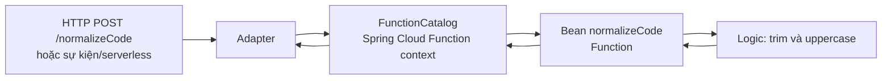
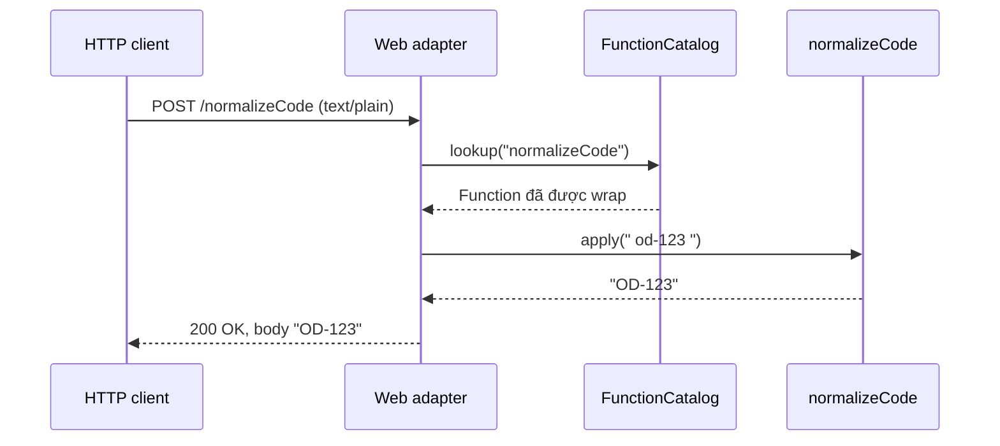

# Tạo Function<String, String> đầu tiên bằng @Bean

> **Chương:** Khởi tạo  
> **Module:** SPRING_CLOUD_FUNCTION  
> **Mục tiêu thực hành:** Khởi tạo một ứng dụng Spring Boot, đăng ký hàm `Function<String, String>` qua `@Bean`, gọi hàm bằng `FunctionCatalog` và HTTP, sau đó kiểm thử hành vi bằng JUnit.  
> **Bộ phiên bản ví dụ:** Java 21, Spring Boot 4.2.0, Spring Cloud BOM 2026.0.0 (Spring Cloud Function 5.1.0); các phiên bản cần được kiểm tra lại theo thời điểm sử dụng.

## 1. Bài toán và kết quả mong đợi

Giả sử dịch vụ nhận mã đơn hàng từ nhiều kênh: một HTTP request, bản tin sự kiện hoặc lời gọi từ môi trường serverless. Nghiệp vụ đầu tiên rất đơn giản: **xóa khoảng trắng ở đầu/cuối rồi chuyển mã sang chữ hoa**.

| Đầu vào (`String`) | Đầu ra (`String`) |
| --- | --- |
| `"  od-123  "` | `"OD-123"` |
| `"  inv-2026 "` | `"INV-2026"` |
| `" ab-01"` | `"AB-01"` |

Đây là dạng chuyển đổi **một giá trị thành một giá trị**; hợp đồng Java phù hợp là `java.util.function.Function<String, String>`. Ta không cần khai báo controller hay viết code Kafka/AWS ở trong hàm. Việc kết nối hàm với HTTP, sự kiện và serverless sẽ do Spring Cloud Function cùng adapter phù hợp đảm nhiệm.

Sau khi làm xong bài, bạn cần thực hiện được những việc sau:

1. Giải thích được ý nghĩa hai generic type của `Function<String, String>` và phương thức `apply(String)`.
2. Đăng ký hàm như bean Spring bằng `@Bean`, hiểu tên bean được lấy ở đâu.
3. Khởi động ứng dụng có dependency Spring Cloud Function Web starter.
4. Gọi `POST /normalizeCode` và nhận kết quả `OD-123`.
5. Tra cứu bean đã được framework đăng ký qua `FunctionCatalog.lookup("normalizeCode")`.
6. Viết kiểm thử cho nghiệp vụ và catalog, đồng thời nhận diện lỗi phổ biến khi khởi tạo.

### 1.1. Bốn lớp trách nhiệm



- **Java:** `Function<String, String>` quy định đầu vào/đầu ra của logic.
- **Spring Boot:** `@Bean` tạo và quản lý đối tượng hàm trong `ApplicationContext`.
- **Spring Cloud Function:** `FunctionCatalog` phát hiện/tra cứu và bổ sung cách gọi thống nhất, composition, chuyển đổi kiểu khi được hỗ trợ.
- **Adapter:** lấy dữ liệu từ HTTP, broker hoặc serverless, truyền vào hàm và chuyển kết quả về giao thức tương ứng.

Nhờ phân lớp như vậy, logic chuẩn hóa mã không phải viết lại khi thay cách gọi. Tuy nhiên, mỗi môi trường vẫn cần dependency, cấu hình serialization và kiểm thử riêng.

## 2. Đọc đúng chữ ký `Function<String, String>`

Java cung cấp interface `Function<T, R>` trong `java.util.function`:

```java
@FunctionalInterface
public interface Function<T, R> {
    R apply(T value);
    // Ngoài ra còn có các phương thức default/static như andThen, compose, identity.
}
```

Đoạn trên là **bản rút gọn để giải thích**; không cần tự tạo lại interface này trong project. Với `Function<String, String>`:

- `T = String`: hàm **nhận một chuỗi**.
- `R = String`: hàm **trả một chuỗi**.
- `apply(T)`: phương thức được gọi để chạy phép biến đổi.
- Hai generic type có thể khác nhau, ví dụ `Function<String, Integer>` trả độ dài chuỗi.

Trong Java thuần, có thể viết:

```java
import java.util.Locale;
import java.util.function.Function;

Function<String, String> normalizeCode =
        raw -> raw.trim().toUpperCase(Locale.ROOT);

String output = normalizeCode.apply("  od-123  ");
System.out.println(output); // OD-123
```

`raw -> ...` là biểu thức **lambda** triển khai phương thức `apply`. Vì `Function` là *functional interface* chỉ có một phương thức trừu tượng, Java biết lambda phải dùng cho `apply`.

### 2.1. Vì sao dùng `Locale.ROOT`?

Phương thức `String.toUpperCase()` không truyền locale dùng locale mặc định của máy chạy. Nếu mục tiêu là mã định danh kỹ thuật không phụ thuộc ngôn ngữ người dùng, dùng `toUpperCase(Locale.ROOT)` giúp tránh những trường hợp chuyển đổi khác nhau giữa các locale, chẳng hạn chữ `i` trong tiếng Thổ Nhĩ Kỳ.

`String.trim()` loại bỏ các ký tự khoảng trắng cơ bản ở đầu/cuối. Với yêu cầu Unicode whitespace đầy đủ hơn, có thể xem xét `strip()` (Java 11+) và quy tắc kiểm thử tương ứng. Bài này chủ ý dùng `trim()` để kết quả có thể dự đoán dễ dàng.

### 2.2. Vì sao không dùng `Supplier` hoặc `Consumer`?

| Interface | Chữ ký chính | Dùng cho |
| --- | --- | --- |
| `Supplier<String>` | `String get()` | Tự tạo/cung cấp một mã, **không có input** từ người gọi. |
| **`Function<String, String>`** | **`String apply(String)`** | Nhận mã, chuẩn hóa và **trả kết quả**. |
| `Consumer<String>` | `void accept(String)` | Nhận mã để ghi log/gửi đi, **không trả kết quả**. |

Đối với yêu cầu nhận `"  od-123  "` rồi trả `"OD-123"`, `Function<String, String>` là hợp đồng đúng nhất. Hai interface còn lại cũng được Spring Cloud Function hỗ trợ, nhưng có ngữ nghĩa và cách adapter kích hoạt khác nhau.

## 3. Chuẩn bị project và dependency

### 3.1. Chọn bộ phiên bản tương thích

Ví dụ được xây dựng trên bộ phát hành:

| Thành phần | Version |
| --- | --- |
| JDK | **Java 21** |
| Spring Boot | **4.2.0** |
| Spring Cloud BOM | **2026.0.0** |
| Spring Cloud Function trong release train trên | **5.1.0** |

Spring Cloud 2026.0.0 phát hành ngày 20/11/2026 và công bố tương thích Spring Boot 4.2.0; Spring Cloud Function trong train đó là 5.1.0. Java 21 là lựa chọn cho bài thực hành. Khi chọn bộ khác, phải dựa vào ma trận Boot–Cloud chính thức; không ghép các version rời rạc chỉ vì chúng có số lớn.

Để ứng dụng tự mở endpoint HTTP cho `@Bean`, dùng artifact:

```text
org.springframework.cloud:spring-cloud-starter-function-web
```

Starter này kéo các module cần thiết cho Spring Cloud Function Web. **BOM Spring Cloud chỉ quản lý version, không tự thêm starter**. Với ứng dụng chỉ gọi catalog mà không cần HTTP, có thể dùng `spring-cloud-function-context` cùng nền Spring Boot phù hợp.

### 3.2. Cấu trúc thư mục Maven

```text
function-first/
├── pom.xml
└── src/
    ├── main/
    │   ├── java/
    │   │   └── vn/example/functionfirst/
    │   │       └── FunctionFirstApplication.java
    │   └── resources/
    │       └── application.properties
    └── test/
        └── java/
            └── vn/example/functionfirst/
                └── FunctionFirstApplicationTest.java
```

Package của lớp main là `vn.example.functionfirst`; lớp test đặt cùng package giúp `@SpringBootTest` tìm thấy application. Không cần tự tạo controller để dùng Web adapter của Spring Cloud Function.

### 3.3. Maven `pom.xml` hoàn chỉnh

```xml
<?xml version="1.0" encoding="UTF-8"?>
<project xmlns="http://maven.apache.org/POM/4.0.0"
         xmlns:xsi="http://www.w3.org/2001/XMLSchema-instance"
         xsi:schemaLocation="
           http://maven.apache.org/POM/4.0.0
           https://maven.apache.org/xsd/maven-4.0.0.xsd">
    <modelVersion>4.0.0</modelVersion>

    <parent>
        <groupId>org.springframework.boot</groupId>
        <artifactId>spring-boot-starter-parent</artifactId>
        <version>4.2.0</version>
        <relativePath/>
    </parent>

    <groupId>vn.example</groupId>
    <artifactId>function-first</artifactId>
    <version>0.0.1-SNAPSHOT</version>

    <properties>
        <java.version>21</java.version>
        <spring-cloud.version>2026.0.0</spring-cloud.version>
    </properties>

    <dependencyManagement>
        <dependencies>
            <dependency>
                <groupId>org.springframework.cloud</groupId>
                <artifactId>spring-cloud-dependencies</artifactId>
                <version>${spring-cloud.version}</version>
                <type>pom</type>
                <scope>import</scope>
            </dependency>
        </dependencies>
    </dependencyManagement>

    <dependencies>
        <dependency>
            <groupId>org.springframework.cloud</groupId>
            <artifactId>spring-cloud-starter-function-web</artifactId>
        </dependency>

        <dependency>
            <groupId>org.springframework.boot</groupId>
            <artifactId>spring-boot-starter-test</artifactId>
            <scope>test</scope>
        </dependency>
    </dependencies>

    <build>
        <plugins>
            <plugin>
                <groupId>org.springframework.boot</groupId>
                <artifactId>spring-boot-maven-plugin</artifactId>
            </plugin>
        </plugins>
    </build>
</project>
```

**Giải thích vị trí quan trọng:**

1. `spring-boot-starter-parent:4.2.0` cung cấp cấu hình build và các dependency/plugin của Spring Boot.
2. `<java.version>21</java.version>` chỉ định Java 21 theo cấu hình Boot parent.
3. `spring-cloud-dependencies:2026.0.0` được **import** trong `dependencyManagement` để quản lý version các module Spring Cloud.
4. `spring-cloud-starter-function-web` nằm trong `dependencies` vì đây là thư viện ứng dụng thực sự sử dụng.
5. `spring-boot-starter-test` ở scope `test` phục vụ JUnit/Spring integration test.
6. `spring-boot-maven-plugin` hỗ trợ chạy và đóng gói ứng dụng Spring Boot.

Không thêm thẻ `<version>5.1.0</version>` vào starter. Version module Function do BOM đã import quyết định, giúp tránh trộn hai dòng Spring Cloud.

### 3.4. Nếu dùng Gradle Groovy DSL

Tạo `build.gradle` tương đương:

```groovy
plugins {
    id 'java'
    id 'org.springframework.boot' version '4.2.0'
    id 'io.spring.dependency-management' version '1.1.7'
}

group = 'vn.example'
version = '0.0.1-SNAPSHOT'

repositories {
    mavenCentral()
}

java {
    toolchain {
        languageVersion = JavaLanguageVersion.of(21)
    }
}

ext {
    set('springCloudVersion', '2026.0.0')
}

dependencyManagement {
    imports {
        mavenBom "org.springframework.cloud:spring-cloud-dependencies:${springCloudVersion}"
    }
}

dependencies {
    implementation 'org.springframework.cloud:spring-cloud-starter-function-web'
    testImplementation 'org.springframework.boot:spring-boot-starter-test'
}

tasks.named('test') {
    useJUnitPlatform()
}
```

Gradle dùng Boot plugin và dependency-management plugin thay cho Maven parent. Cả hai cách đều phải thỏa quan hệ phiên bản Java/Boot/Cloud tương thích và thêm đúng starter. Với Gradle cần wrapper phù hợp với phiên bản Spring Boot đã chọn.

Bạn chỉ cần **chọn một build tool** cho project. Những phần Java, `@Bean` và `FunctionCatalog` ở dưới không phụ thuộc việc dùng Maven hay Gradle.

## 4. Tạo hàm đầu tiên bằng `@Bean`

Tạo đúng file `src/main/java/vn/example/functionfirst/FunctionFirstApplication.java`:

```java
package vn.example.functionfirst;

import java.util.Locale;
import java.util.function.Function;

import org.springframework.boot.SpringApplication;
import org.springframework.boot.autoconfigure.SpringBootApplication;
import org.springframework.context.annotation.Bean;

@SpringBootApplication
public class FunctionFirstApplication {

    public static void main(String[] args) {
        SpringApplication.run(FunctionFirstApplication.class, args);
    }

    @Bean
    public Function<String, String> normalizeCode() {
        return raw -> raw.trim().toUpperCase(Locale.ROOT);
    }
}
```

Đây là ứng dụng hoàn chỉnh, tự chứa một bean `Function<String, String>` và entrypoint Spring Boot. Chú ý:

- `@SpringBootApplication` đánh dấu lớp khởi động; nó cũng hỗ trợ cấu hình và quét component theo package.
- `@Bean` yêu cầu Spring gọi phương thức `normalizeCode()` để lấy một đối tượng làm bean trong `ApplicationContext`.
- Phương thức `normalizeCode()` **trả về một `Function`**, cụ thể là lambda. Spring không gọi `apply` ngay khi tạo bean.
- Tên bean mặc định là **`normalizeCode`**, theo tên phương thức `@Bean`.
- `raw -> raw.trim().toUpperCase(Locale.ROOT)` là logic nghiệp vụ, không phụ thuộc HTTP.

### 4.1. Phân biệt phương thức tạo bean và phương thức xử lý dữ liệu

Có hai thời điểm khác nhau:

```text
Lúc Spring khởi động:
  gọi normalizeCode()
      -> nhận một Function<String,String>
      -> đăng ký bean tên "normalizeCode"

Lúc có yêu cầu xử lý:
  tìm bean Function qua catalog/adapter
      -> gọi function.apply("  od-123  ")
      -> trả về "OD-123"
```

Người mới học thường nhầm rằng cứ khai báo `@Bean` thì nội dung trong lambda chạy ngay lúc khởi động. Thực tế, việc **tạo đối tượng Function** và việc **gọi Function** là hai hành động riêng.

### 4.2. Đổi tên bean có tác dụng gì?

Nếu muốn tên public trong catalog là `canonicalizeCode`, có thể khai báo:

```java
@Bean("canonicalizeCode")
public Function<String, String> normalizeCode() {
    return raw -> raw.trim().toUpperCase(Locale.ROOT);
}
```

Khi đó tên bean là `canonicalizeCode` mặc dù tên phương thức Java vẫn là `normalizeCode`. Lúc tra cứu qua `FunctionCatalog` và dùng Web route theo tên, phải dùng tên đã đăng ký.

**Không khai báo đồng thời hai phương thức `@Bean` trùng tên** trong cùng cấu hình chỉ để thử hai cách này. Đoạn trên là **phương án thay thế** cho phương thức ở mục 4.

### 4.3. Một phiên bản có kiểm tra input

Nếu ứng dụng cần từ chối chuỗi rỗng, có thể thay logic bằng:

```java
@Bean
public Function<String, String> normalizeCode() {
    return raw -> {
        if (raw == null || raw.isBlank()) {
            throw new IllegalArgumentException("Mã đơn hàng không được rỗng");
        }
        return raw.trim().toUpperCase(Locale.ROOT);
    };
}
```

Hàm này báo lỗi rõ ràng với input không hợp lệ. Trong một HTTP app, chuyển lỗi nghiệp vụ thành mã trạng thái HTTP thích hợp là việc của adapter hoặc lớp xử lý lỗi bổ sung. Không nên mặc định rằng mọi `IllegalArgumentException` sẽ tự được chuyển thành `400 Bad Request`.

Đối với bài thực hành cơ bản, **giữ bản đơn giản ở mục 4** để tập trung vào cách đăng ký và gọi `@Bean`. Bản validation được dùng để thảo luận thiết kế ở phần cuối.

## 5. Cấu hình ứng dụng Spring Boot

Tạo `src/main/resources/application.properties`:

```properties
spring.application.name=function-first
server.port=8080
```

Hai property này chỉ đặt tên ứng dụng và cổng HTTP. Khi trong catalog **chỉ có một** bean hàm, `spring.cloud.function.definition` thường chưa bắt buộc. Ở bài này cố ý dùng một function để thao tác đơn giản.

Nếu sau này có nhiều bean hàm, bạn có thể chỉ định hàm mặc định bằng:

```properties
spring.cloud.function.definition=normalizeCode
```

Khi định nghĩa một hàm được chọn làm mặc định, Web adapter có thể dùng nó trên root path. Bài này dùng route theo tên `/normalizeCode` để học rõ nguồn gốc đường dẫn, độc lập với việc root path có được kích hoạt hay không.

**Không cần `@RestController`, `@PostMapping` hoặc `@RequestBody`** cho ví dụ HTTP cơ bản: Web adapter của Spring Cloud Function thực hiện ánh xạ tới bean Function.

## 6. Build và gọi thử hàm qua HTTP

### 6.1. Xác nhận Java và build tool

Với Maven đã cài sẵn:

```bash
java -version
mvn -v
mvn clean test
mvn spring-boot:run
```

Nếu dự án có **Maven Wrapper** (file `mvnw`, `mvnw.cmd` và thư mục `.mvn`), dùng `./mvnw` trên Linux/macOS hoặc `./mvnw.cmd` trên Windows. Không chạy `./mvnw` nếu chưa tạo wrapper.

Với Gradle Wrapper:

```bash
java -version
./gradlew --version
./gradlew clean test
./gradlew bootRun
```

Trên Windows dùng `./gradlew.bat`. Nếu chưa tạo wrapper, có thể dùng Gradle đã cài phù hợp. Nên thống nhất JDK 21 ở máy cá nhân, IDE và CI.

Đợi log thông báo ứng dụng Spring Boot đã khởi động trên cổng 8080, sau đó mở **terminal khác** để gọi HTTP.

### 6.2. Gửi request đầu tiên

```bash
curl -i -X POST http://localhost:8080/normalizeCode \
  -H "Content-Type: text/plain" \
  -H "Accept: text/plain" \
  --data-raw "  od-123  "
```

Kết quả phần body kỳ vọng:

```text
OD-123
```

Web adapter nhận body dạng chuỗi, tra function có tên `normalizeCode` và gọi `apply(...)`. Response của `Function` là giá trị trả về. Với trường hợp request hợp lệ này, HTTP mapping tiêu chuẩn trả thành công.

Trên Windows PowerShell, `curl` có thể là alias của công cụ khác; nếu muốn đúng cú pháp cURL ở trên, dùng `curl.exe` và viết lệnh trên một dòng:

```powershell
curl.exe -i -X POST "http://localhost:8080/normalizeCode" -H "Content-Type: text/plain" -H "Accept: text/plain" --data-raw "  od-123  "
```

### 6.3. Có thể gọi bằng HTTP GET không?

Web adapter hỗ trợ một số mapping theo loại hàm. Với `Function<String, String>`, một ví dụ là:

```bash
curl -i http://localhost:8080/normalizeCode/od-123
```

Kết quả body là `OD-123`. Đường dẫn này truyền path item `od-123` làm input cho hàm. Với dữ liệu tùy ý hoặc chuỗi có khoảng trắng/ ký tự đặc biệt, cần URL-encode chính xác; dùng POST body `text/plain` thường đơn giản hơn.

Nếu catalog chỉ có một function, Web adapter cũng có thể cho phép gọi hàm qua đường dẫn gốc `/`. Tuy nhiên, route theo tên giúp dễ đọc và tránh phụ thuộc hành vi fallback khi bạn thêm hàm thứ hai.

### 6.4. Từ request đến kết quả



Đây là sơ đồ **luồng logic**, không khẳng định framework luôn gọi `lookup` lại cho từng HTTP request (catalog và mapping có thể được cache). Nó giúp phân biệt nơi nhận giao thức với nơi chứa nghiệp vụ.

## 7. Gọi hàm trực tiếp trong Java và qua `FunctionCatalog`

### 7.1. Gọi function như một đối tượng Java

Vì `normalizeCode()` là phương thức factory bình thường, ta có thể lấy lambda và tự gọi:

```java
FunctionFirstApplication app = new FunctionFirstApplication();
Function<String, String> fn = app.normalizeCode();

String result = fn.apply("  od-123  "); // OD-123
```

Đoạn này hữu ích để hiểu hợp đồng Java, nhưng nó **không tạo Spring ApplicationContext** và **không kiểm tra FunctionCatalog**. Trong code production, không nên tự `new` lớp cấu hình Spring chỉ để lấy bean.

### 7.2. Tra cứu catalog trong Spring

Ví dụ một service cần gọi function bằng tên:

```java
package vn.example.functionfirst;

import java.util.function.Function;

import org.springframework.cloud.function.context.FunctionCatalog;
import org.springframework.stereotype.Service;

@Service
public class CodeProcessingService {

    private final Function<String, String> normalizeCode;

    public CodeProcessingService(FunctionCatalog catalog) {
        this.normalizeCode = catalog.lookup("normalizeCode");
    }

    public String process(String raw) {
        return normalizeCode.apply(raw);
    }
}
```

Đặt lớp này cùng package `vn.example.functionfirst` để Spring Boot quét được. Khi Spring tạo service, dependency `FunctionCatalog` được inject vào constructor.

Sự khác biệt giữa hai cách lấy function:

| Cách lấy | Giá trị trả về | Ý nghĩa |
| --- | --- | --- |
| `applicationContext.getBean("normalizeCode")` | Bean Java nguyên gốc do `@Bean` tạo. | Gọi hàm trực tiếp, chỉ có hành vi bạn viết. |
| `catalog.lookup("normalizeCode")` | Function được Spring Cloud Function chuẩn hóa/wrap. | Hỗ trợ các khả năng của framework như composition và type/message conversion tùy chữ ký. |

Với ví dụ String → String đơn giản, hai cách có thể cho kết quả giống nhau. Khác biệt sẽ rõ hơn khi muốn kết hợp nhiều function hoặc xử lý payload/message từ adapter.

### 7.3. Đặt tên nhất quán

Nếu bạn đổi `@Bean("canonicalizeCode")`, hàm sau đây sẽ khác:

```java
Function<String, String> fn = catalog.lookup("canonicalizeCode");
```

Đừng dùng tên phương thức cũ `"normalizeCode"` khi bean đã được đổi tên. Spring Cloud Function chủ yếu tra cứu theo **bean name** hoặc definition/composition đã cấu hình.

## 8. Viết kiểm thử cho `@Bean` và `FunctionCatalog`

### 8.1. Kiểm thử Java thuần

Không cần khởi động Spring để kiểm tra quy tắc đổi chuỗi:

```java
package vn.example.functionfirst;

import static org.junit.jupiter.api.Assertions.assertEquals;
import java.util.function.Function;
import org.junit.jupiter.api.Test;

class PureFunctionTest {

    @Test
    void normalizeCodeReturnsUppercaseTrimmedText() {
        Function<String, String> fn =
                new FunctionFirstApplication().normalizeCode();

        assertEquals("OD-123", fn.apply("  od-123  "));
        assertEquals("INV-2026", fn.apply("  inv-2026 "));
    }
}
```

Test này xác minh lambda, nhưng **không** chứng minh Spring đã đăng ký bean hoặc Web adapter đang hoạt động.

### 8.2. Integration test cho FunctionCatalog

Tạo `src/test/java/vn/example/functionfirst/FunctionFirstApplicationTest.java`:

```java
package vn.example.functionfirst;

import static org.junit.jupiter.api.Assertions.assertEquals;
import static org.junit.jupiter.api.Assertions.assertNotNull;

import java.util.function.Function;

import org.junit.jupiter.api.Test;
import org.springframework.beans.factory.annotation.Autowired;
import org.springframework.boot.test.context.SpringBootTest;
import org.springframework.cloud.function.context.FunctionCatalog;

@SpringBootTest
class FunctionFirstApplicationTest {

    @Autowired
    FunctionCatalog catalog;

    @Test
    void beanCanBeFoundAndInvoked() {
        Function<String, String> fn = catalog.lookup("normalizeCode");
        assertNotNull(fn);
        assertEquals("OD-123", fn.apply("  od-123  "));
    }
}
```

`@SpringBootTest` khởi động Spring Boot context, còn test gọi catalog để chắc chắn framework nhận diện bean `normalizeCode`. Nếu thiếu dependency Function hoặc tạo bean sai package/cấu hình, test sẽ giúp phát hiện sớm.

**Phạm vi của test:** nó không khẳng định server HTTP đã được khởi động trên cổng 8080. Bước cURL ở mục 6 là một *smoke test* cho adapter. Để kiểm tra HTTP tự động trong CI, có thể bổ sung integration test với HTTP test client tương ứng phiên bản Spring Boot và port ngẫu nhiên.

### 8.3. Kiểm tra các tình huống đầu vào

| Input | Kỳ vọng với phiên bản ở mục 4 | Lý do |
| --- | --- | --- |
| `"  od-123  "` | `"OD-123"` | Xóa khoảng trắng rồi viết hoa. |
| `"OD-123"` | `"OD-123"` | Hàm không cần thay đổi gì. |
| `"   "` | `""` | `trim()` xóa khoảng trắng; chưa có validation. |
| `""` | `""` | Chuỗi rỗng vẫn là chuỗi hợp lệ với lambda hiện tại. |
| `null` khi gọi Java trực tiếp | `NullPointerException` | `trim()` không thể gọi trên null. |

Bản có validation tại mục 4.3 sẽ xử lý chuỗi rỗng khác với bản đơn giản. Đừng viết test kỳ vọng lỗi với bản đơn giản rồi cho rằng `@Bean` hoạt động sai: đó là **khác biệt trong quy tắc nghiệp vụ**.

## 9. Mở rộng: ghép hai `Function` mà không đổi adapter

Sau khi tạo một `@Bean` đầu tiên, bạn có thể thêm hàm xác thực mã để thấy điểm mạnh của composition. Bổ sung **phương thức thứ hai vào bên trong** `FunctionFirstApplication`:

```java
@Bean
public Function<String, String> validateCode() {
    return code -> {
        if (!code.matches("[A-Z]{2}-[0-9]{3}")) {
            throw new IllegalArgumentException("Mã không hợp lệ: " + code);
        }
        return code;
    };
}
```

Khi có hai bean hàm, hãy tra cứu pipeline:

```java
Function<String, String> pipeline =
        catalog.lookup("normalizeCode|validateCode");

String normalized = pipeline.apply("  od-123  "); // OD-123
```

Dấu `|` biểu diễn **thứ tự thực thi** từ trái qua phải: chuẩn hóa trước, xác thực sau. Nếu đảo thứ tự, input `" od-123 "` có thể bị từ chối trước khi được chuẩn hóa.

Bạn cũng có thể khai báo function definition cho adapter qua property:

```properties
spring.cloud.function.definition=normalizeCode|validateCode
```

Với Web adapter, definition chỉ định composition mặc định; theo mapping được tài liệu mô tả, composition mặc định có thể được gọi ở root path `/`. Nếu chưa dùng definition và muốn gọi composition theo URL, có thể dùng dấu phẩy ngăn cách tên function:

```bash
curl -i -X POST http://localhost:8080/normalizeCode,validateCode \
  -H "Content-Type: text/plain" \
  --data-raw "  od-123  "
```

Vẫn dùng **hai bean Java**, không cần viết controller. Khi kết nối tới Spring Cloud Stream hoặc một serverless adapter, tên definition có thể được dùng để chọn chuỗi hàm phục vụ nguồn sự kiện.

### 9.1. Composition của Java khác composition qua catalog thế nào?

Java `Function` có sẵn `andThen` và `compose`:

```java
Function<String, String> pipeline = normalizeCode.andThen(validateCode);
```

Composition bằng Java cần có sẵn tham chiếu tới hai function. `FunctionCatalog.lookup("normalizeCode|validateCode")` dùng **tên các bean** để lắp pipeline ở runtime, phù hợp với cách adapter lựa chọn definition từ cấu hình. Catalog còn cung cấp các khả năng của framework như type/message conversion ở lớp tích hợp.

Với hàm đơn giản có cùng kiểu `String`, cả hai có thể tạo cùng kết quả nghiệp vụ. Không nên dùng conversion để che giấu hợp đồng kiểu không rõ ràng: cần thiết kế input/output tương thích và kiểm thử.

## 10. Từ `String` đến message, HTTP và sự kiện

Ví dụ đầu tiên chủ ý dùng `Function<String, String>` vì input/output rõ ràng. Trong hệ thống thật, adapter có thể nhận payload và metadata kèm theo.

### 10.1. Khi nào cần `Message<String>`?

Một sự kiện thường có `correlationId`, `contentType` và các header khác. Khi logic thực sự cần metadata, bạn có thể dùng `Message<T>` của Spring Messaging:

```java
import java.util.Locale;
import java.util.function.Function;

import org.springframework.context.annotation.Bean;
import org.springframework.messaging.Message;
import org.springframework.messaging.support.MessageBuilder;

// Đặt phương thức trong một lớp @Configuration hoặc @SpringBootApplication.
@Bean
public Function<Message<String>, Message<String>> normalizeMessage() {
    return input -> {
        String code = input.getPayload()
                .trim()
                .toUpperCase(Locale.ROOT);

        return MessageBuilder.withPayload(code)
                .copyHeaders(input.getHeaders())
                .build();
    };
}
```

Đây là **một bean bổ sung để minh họa**, không cần thêm vào ứng dụng đầu tiên. Signature `Message<String>` cho phép truy cập cả payload lẫn headers, nhưng việc ánh xạ header từ HTTP/broker và giữ chúng trên đường ra vẫn tùy adapter.

### 10.2. Chuyển đổi thông điệp diễn ra ở đâu?

Spring Cloud Function có khả năng chuyển đổi đầu vào/đầu ra dựa trên kiểu khai báo của function và metadata như `contentType` khi có adapter/message phù hợp. Chẳng hạn, với một DTO và JSON, tầng tích hợp có thể giải mã body thành object trước khi gọi `apply`.

Trong bài đầu tiên, input luôn là `text/plain` và chữ ký là `String`; ta chưa cần xử lý JSON. Sau này khi chuyển sang `Function<OrderRequest, OrderResult>`, cần kiểm tra serializer, content type và cách adapter chuyển schema. **Hàm nghiệp vụ không nên tự đọc request HTTP hoặc broker message nếu chỉ cần dữ liệu đã được chuyển đổi.**

### 10.3. Cùng một Function dùng với nhiều giao thức

| Môi trường | Thành phần kết nối cần thêm | Điều vẫn giữ nguyên |
| --- | --- | --- |
| HTTP | `spring-cloud-starter-function-web`. | `@Bean normalizeCode` và phép biến đổi chuỗi. |
| Sự kiện Kafka/RabbitMQ | Spring Cloud Stream cùng binder và cấu hình binding. | Hàm nghiệp vụ nếu payload tương thích. |
| AWS Lambda | Spring Cloud Function AWS adapter, handler, package và runtime thích hợp. | Hàm nghiệp vụ nếu payload sự kiện đã chuyển thành String đúng contract. |
| Azure/Google Cloud Functions | Adapter provider và cấu hình trigger/entrypoint tương ứng. | Quy tắc chuẩn hóa chuỗi. |

Điều cốt lõi của **SPRING_CLOUD_FUNCTION** là tái sử dụng logic `Supplier`, `Function`, `Consumer` và tra cứu qua `FunctionCatalog`. Không thể suy ra một hàm đã triển khai lên Kafka hoặc serverless chỉ vì HTTP adapter chạy thành công; mỗi đường kết nối có lifecycle, serialization, retry và lỗi riêng.

## 11. Những lỗi khởi tạo thường gặp

| Hiện tượng | Nguyên nhân có thể | Cách xử lý |
| --- | --- | --- |
| Java báo `Cannot resolve symbol Function` | Chưa import `java.util.function.Function` hoặc nhầm package. | Thêm import chuẩn của JDK, kiểm tra JDK/IDE. |
| `@Bean` không có hiệu lực | Đặt phương thức ngoài lớp cấu hình hoặc lớp không thuộc Spring context. | Đặt trong lớp `@SpringBootApplication` hoặc `@Configuration` được Spring nạp. |
| `FunctionCatalog` không inject được | Chưa có Spring Cloud Function context/starter, hoặc lệch Boot/Cloud BOM. | Thêm starter đúng, kiểm tra dependency tree và cặp phiên bản. |
| `catalog.lookup("normalizeCode")` không trả bean mong muốn | Tên bean đã đổi, cấu hình scan sai hoặc catalog chưa đăng ký bean. | Kiểm tra tên `@Bean` và package/cấu hình ứng dụng. |
| `POST /normalizeCode` trả 404 | Thiếu Web starter, nhầm cổng/base path, route sai. | Kiểm tra startup log, starter và `spring.cloud.function.web.path` nếu đã đặt. |
| Body HTTP không được xử lý đúng | Sai `Content-Type` hoặc payload không phù hợp với kiểu input. | Với ví dụ này dùng `Content-Type: text/plain` và body String. |
| Kết quả vẫn chứa khoảng trắng | Dùng nhầm bean hoặc logic không gọi `trim()`. | Unit test trực tiếp và kiểm tra tên route/definition. |
| `NullPointerException` | Gọi `apply(null)` vào bản lambda đơn giản. | Xác định chính sách null: từ chối, trả lỗi rõ ràng hoặc dùng hợp đồng tùy chọn. |
| Input không hợp lệ gây HTTP error ngoài dự đoán | Ném `IllegalArgumentException` nhưng chưa thiết kế mapping lỗi. | Thiết kế response/error handling tại adapter/API; không gắn mặc định 400 cho mọi exception. |
| Build Maven/Gradle báo xung đột class | Ghép Spring Boot và Spring Cloud khác release train hoặc override phiên bản module. | Chọn BOM tương thích, bỏ version override không cần thiết và kiểm tra resolved dependencies. |
| Ứng dụng chạy local nhưng lỗi trên server | Runtime JDK, classpath, environment hoặc adapter khác local. | Đồng bộ toolchain, kiểm tra artifact đã đóng gói và smoke test trên đích. |

### 11.1. Một chức năng đầu tiên nên đơn giản tới mức nào?

Hãy ưu tiên một biến đổi **deterministic**: cùng input, cùng output và không có side effect. Không cần kết nối database, tạo Kafka producer hoặc gọi API ngoài trong hàm đầu tiên. Khi đã xác minh bean/catalog/HTTP, bạn mới bổ sung validation, logging, security, persistence hoặc xử lý bất đồng bộ.

### 11.2. Tránh giữ mutable state trong lambda bean

Bean Spring mặc định có scope singleton, nên cùng một function có thể được gọi bởi nhiều request đồng thời. Nếu lambda cập nhật một `ArrayList` hoặc biến đếm không đồng bộ, có nguy cơ race condition. Hàm chuẩn hóa chuỗi hiện tại không giữ state và phù hợp để dùng lại. Với thao tác có side effect, cần thiết kế thread safety và idempotency.

## 12. Bài thực hành và tiêu chí hoàn thành

### Bài 1 — Hoàn thành bước đầu tiên

Tạo Maven hoặc Gradle project theo mục 3 và chép nguyên mã Java ở mục 4. Chạy:

```bash
mvn clean test
mvn spring-boot:run
```

Hoặc tác vụ Gradle tương ứng. Gửi các request:

```bash
curl -s -X POST http://localhost:8080/normalizeCode \
  -H "Content-Type: text/plain" \
  --data-raw " od-123 "

curl -s -X POST http://localhost:8080/normalizeCode \
  -H "Content-Type: text/plain" \
  --data-raw "  inv-2026 "
```

Kỳ vọng lần lượt `OD-123` và `INV-2026`.

### Bài 2 — Chứng minh `FunctionCatalog` nhận bean

Thêm `FunctionFirstApplicationTest` ở mục 8, chạy test và kiểm tra tên bean `normalizeCode`. Hãy giải thích tại sao phép gọi `new FunctionFirstApplication().normalizeCode()` vẫn chạy dù không khởi động Spring, nhưng không thể chứng minh catalog hoặc HTTP adapter từ phép gọi đó.

### Bài 3 — Thử thay tên bean

Thay `@Bean` bằng `@Bean("canonicalizeCode")` rồi:

1. Kiểm tra hành vi khi gọi URL cũ `/normalizeCode`.
2. Sửa test catalog dùng `lookup("canonicalizeCode")`.
3. Gọi URL `/canonicalizeCode`.
4. Kết luận tên method Java và tên bean Spring có thể khác nhau.

Nhớ sửa các cấu hình definition nếu chúng tham chiếu tên cũ. Nếu app chỉ có một function, fallback theo quy tắc catalog/adapter có thể khiến một số tên tùy ý vẫn resolve được; để kiểm chứng chính xác theo tên, có thể tắt single-function fallback với `spring.cloud.function.single-function-fallback-enabled=false` và kiểm tra lại.

### Bài 4 — Composition theo hai cách

Thêm bean `validateCode`, sau đó kiểm tra:

- Java: `normalizeCode.andThen(validateCode)` với tham chiếu hai bean.
- Spring Cloud Function: `catalog.lookup("normalizeCode|validateCode")`.
- Web adapter: gọi `POST /normalizeCode,validateCode` hoặc cấu hình definition và route tương ứng.

Cho đầu vào `"  od-123  "` và `" ??? "` để kiểm tra cả đường thành công và lỗi.

### Tiêu chí đạt

| Năng lực | Bằng chứng |
| --- | --- |
| Biết dùng `Function<String, String>` | Giải thích `T`, `R`, `apply` và viết lambda đúng. |
| Biết đăng ký `@Bean` | Ứng dụng khởi động, catalog tìm được `normalizeCode`. |
| Biết chạy qua HTTP | `POST /normalizeCode` trả `OD-123`. |
| Biết kiểm thử | Unit test và test `@SpringBootTest` đều đạt. |
| Phân biệt các lớp trách nhiệm | Giải thích được Java/Spring Boot/FunctionCatalog/adapter. |
| Hiểu khả năng tái sử dụng | Có thể nêu cách giữ nguyên bean khi chuyển HTTP sang event/serverless. |

## 13. Tổng kết và tài liệu tham khảo

Bạn đã tạo một bean `Function<String, String>` bằng `@Bean`, truyền dữ liệu qua `apply` và đưa nó vào runtime Spring Cloud Function thông qua catalog và Web adapter. Mấu chốt là giữ **logic nghiệp vụ Java** tách khỏi **giao thức kích hoạt**: hàm `normalizeCode` chỉ biết input/output dạng `String`, còn HTTP, sự kiện và serverless do lớp tích hợp chịu trách nhiệm.

Các bước học tiếp theo phù hợp là thêm nhiều function để composition, chuyển `String` sang DTO, xử lý `Message<?>`/headers, và triển khai cùng function qua Stream binder hoặc cloud provider adapter.

**Tài liệu chính thức:**

1. Java `Function<T,R>` API: https://docs.oracle.com/en/java/javase/21/docs/api/java.base/java/util/function/Function.html
2. Spring Cloud Function – Programming Model, `@Bean` và `FunctionCatalog`: https://docs.spring.io/spring-cloud-function/reference/spring-cloud-function/programming-model.html
3. Spring Cloud Function – Standalone Web Applications: https://docs.spring.io/spring-cloud-function/reference/spring-cloud-function/standalone-web-applications.html
4. Spring Cloud Function – Function composition: https://docs.spring.io/spring-cloud-function/reference/spring-cloud-function/function-composition.html
5. Spring Cloud Function – Reference: https://docs.spring.io/spring-cloud-function/reference/
6. Spring Cloud Stream – Reference: https://docs.spring.io/spring-cloud-stream/reference/
7. Spring Cloud 2026.0.0 release train, ngày 20/11/2026: https://spring.io/blog/2026/11/20/spring-cloud-2026-0-0-has-been-released/
8. Spring Cloud – Ma trận Spring Boot/Spring Cloud: https://spring.io/projects/spring-cloud/
9. Spring Boot – Documentation: https://docs.spring.io/spring-boot/reference/
