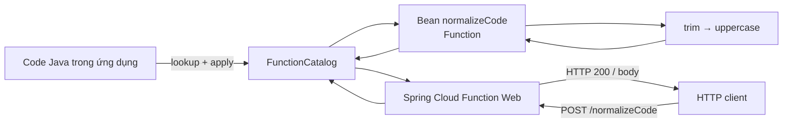

# Gọi hàm từ FunctionCatalog và từ HTTP

> **Chương:** Khởi tạo  
> **Module:** SPRING_CLOUD_FUNCTION  
> **Mục tiêu:** Gọi cùng một hàm Java qua `FunctionCatalog` và qua Web adapter HTTP; hiểu đường đi dữ liệu, cách đặt tên hàm, composition, chuyển đổi payload và những khác biệt khi xử lý lỗi.  
> **Môi trường minh họa:** Java 21, Spring Boot 4.2.0, Spring Cloud BOM 2026.0.0 (Spring Cloud Function 5.1.0). Bộ phiên bản này được công bố tháng 11/2026; cần đối chiếu lại tài liệu phát hành khi sử dụng vào thời điểm khác.

## 1. Bài toán: một chức năng, hai cách gọi

Dịch vụ nhận mã đơn hàng từ các nguồn khác nhau. Yêu cầu nghiệp vụ trước mắt là **xóa khoảng trắng ở hai đầu và chuẩn hóa mã thành chữ hoa**. Chẳng hạn:

| Dữ liệu đầu vào | Kết quả mong đợi |
| --- | --- |
| `"  od-123  "` | `"OD-123"` |
| `" in-2026 "` | `"IN-2026"` |
| `"x-9"` | `"X-9"` |

Ta sẽ viết duy nhất một bean `Function<String, String> normalizeCode`, sau đó gọi theo hai đường:

1. **Trong Java/Spring:** lấy function từ `FunctionCatalog.lookup("normalizeCode")` rồi gọi `apply(...)`.
2. **Từ bên ngoài qua HTTP:** gửi `POST /normalizeCode`; Spring Cloud Function Web adapter nhận request, tìm function và trả response.

Bản thân lambda không cần biết ai đã gọi mình. Khi cùng logic được dùng qua Spring Cloud Stream hoặc môi trường serverless, adapter tương ứng sẽ xử lý giao thức ở bên ngoài hàm.



**Cần hiểu sau bài:** Java `Function` là hợp đồng xử lý, Spring Boot `@Bean` đăng ký nó, `FunctionCatalog` cung cấp cách tra cứu/thích nghi thống nhất, còn Web adapter chuyển HTTP thành lời gọi tới catalog. Những phần này liên kết với nhau nhưng giải quyết các trách nhiệm khác nhau.

## 2. Các kiểu dữ liệu và API tham gia lời gọi

### 2.1. `Function<T, R>` trong Java

`Function<T, R>` thuộc `java.util.function`. Phương thức chính là `R apply(T input)`. Với `Function<String, String>`:

- Đầu vào là một `String`.
- Đầu ra là một `String`.
- `apply(...)` thực hiện chuyển đổi trên một giá trị.
- Kiểu `T` và `R` có thể khác nhau, ví dụ `Function<String, Integer>`.

```java
import java.util.Locale;
import java.util.function.Function;

Function<String, String> normalize =
        code -> code.trim().toUpperCase(Locale.ROOT);

String result = normalize.apply("  od-123  ");
System.out.println(result); // OD-123
```

Đây là Java thuần. Chưa có Spring container, catalog hay HTTP server.

### 2.2. `@Bean` và `ApplicationContext`

Trong Spring Boot, phương thức `@Bean` tạo một đối tượng và đăng ký đối tượng đó vào `ApplicationContext`. Với phương thức:

```java
@Bean
public Function<String, String> normalizeCode() {
    return code -> code.trim().toUpperCase(Locale.ROOT);
}
```

Bean sẽ có tên mặc định là `normalizeCode`. Spring gọi **phương thức factory** `normalizeCode()` khi tạo bean, nhưng không tự chạy `Function.apply(...)` với dữ liệu nghiệp vụ. Việc xử lý xảy ra khi có bên gọi hàm.

Có thể truy cập bean gốc bằng `applicationContext.getBean("normalizeCode")`; tuy nhiên, khi muốn tích hợp với Spring Cloud Function, cách chuẩn là tra qua `FunctionCatalog`.

### 2.3. `FunctionCatalog` cung cấp điều gì thêm?

Spring Cloud Function khám phá các bean kiểu `Supplier`, `Function`, `Consumer` trong Spring context và có thể đăng ký chúng một cách lười (*lazy registration*) vào catalog. API:

```java
Function<String, String> function = catalog.lookup("normalizeCode");
String result = function.apply(" od-123 "); // OD-123
```

Kết quả lookup là hàm đã được Spring Cloud Function **bọc/thích nghi** để hỗ trợ các khả năng như composition và chuyển đổi kiểu/thông điệp. Nó không nhất thiết chính là instance `Function` nguyên bản mà `ApplicationContext.getBean(...)` trả ra.

Ví dụ, khi ghép `normalizeCode` với `validateCode`, catalog có thể tạo một lời gọi theo tên `"normalizeCode|validateCode"` mà không cần bạn giữ hai tham chiếu hàm rồi tự viết `andThen(...)`.

### 2.4. HTTP Web adapter có vai trò gì?

Module `spring-cloud-function-web` cung cấp auto-configuration để xuất các hàm thành endpoint HTTP trong ứng dụng Spring Boot có Web/MVC phù hợp. Starter `spring-cloud-starter-function-web` tập hợp dependency để khởi tạo nhanh.

Adapter có nhiệm vụ nhận request, giải quyết hàm từ catalog, chuyển body/headers sang đối số và đưa kết quả trở lại HTTP response. **Không cần viết `@RestController`** trong ví dụ này. Tuy nhiên, Web adapter không thay thế toàn bộ khả năng xây dựng REST API chuyên sâu bằng Spring MVC/WebFlux.

## 3. Khởi tạo ứng dụng minh họa

### 3.1. Bộ dependency có thể chạy qua HTTP

Ví dụ dùng bộ tương thích:

| Thành phần | Phiên bản |
| --- | --- |
| JDK | 21 |
| Spring Boot parent | 4.2.0 |
| Spring Cloud BOM | 2026.0.0 |
| Spring Cloud Function theo BOM trên | 5.1.0 |
| HTTP adapter | `spring-cloud-starter-function-web` |

Maven `pom.xml` hoàn chỉnh:

```xml
<?xml version="1.0" encoding="UTF-8"?>
<project xmlns="http://maven.apache.org/POM/4.0.0"
         xmlns:xsi="http://www.w3.org/2001/XMLSchema-instance"
         xsi:schemaLocation="
           http://maven.apache.org/POM/4.0.0
           https://maven.apache.org/xsd/maven-4.0.0.xsd">
    <modelVersion>4.0.0</modelVersion>

    <parent>
        <groupId>org.springframework.boot</groupId>
        <artifactId>spring-boot-starter-parent</artifactId>
        <version>4.2.0</version>
        <relativePath/>
    </parent>

    <groupId>vn.example</groupId>
    <artifactId>function-invocation-demo</artifactId>
    <version>0.0.1-SNAPSHOT</version>

    <properties>
        <java.version>21</java.version>
        <spring-cloud.version>2026.0.0</spring-cloud.version>
    </properties>

    <dependencyManagement>
        <dependencies>
            <dependency>
                <groupId>org.springframework.cloud</groupId>
                <artifactId>spring-cloud-dependencies</artifactId>
                <version>${spring-cloud.version}</version>
                <type>pom</type>
                <scope>import</scope>
            </dependency>
        </dependencies>
    </dependencyManagement>

    <dependencies>
        <dependency>
            <groupId>org.springframework.cloud</groupId>
            <artifactId>spring-cloud-starter-function-web</artifactId>
        </dependency>
        <dependency>
            <groupId>org.springframework.boot</groupId>
            <artifactId>spring-boot-starter-test</artifactId>
            <scope>test</scope>
        </dependency>
    </dependencies>

    <build>
        <plugins>
            <plugin>
                <groupId>org.springframework.boot</groupId>
                <artifactId>spring-boot-maven-plugin</artifactId>
            </plugin>
        </plugins>
    </build>
</project>
```

**Vì sao phải import BOM?** `spring-cloud-dependencies` quản lý version đồng bộ các module Spring Cloud; bản `2026.0.0` tương ứng Boot `4.2.0`. `dependencyManagement` **không tự thêm** thư viện. Chính `spring-cloud-starter-function-web` trong `dependencies` mới đưa Web adapter và các module cần thiết vào classpath. Không khai báo version riêng cho starter khi BOM đã quản lý nó.

Nếu đã dùng bộ Spring Boot/Spring Cloud khác, thay **cả cặp** theo ma trận tại https://spring.io/projects/spring-cloud/. Không trộn phiên bản Function riêng từ release train khác.

### 3.2. Tùy chọn Gradle Groovy DSL

Nếu dự án dùng Gradle, có thể khai báo `build.gradle` như sau:

```groovy
plugins {
    id 'java'
    id 'org.springframework.boot' version '4.2.0'
    id 'io.spring.dependency-management' version '1.1.7'
}

group = 'vn.example'
version = '0.0.1-SNAPSHOT'

repositories {
    mavenCentral()
}

java {
    toolchain {
        languageVersion = JavaLanguageVersion.of(21)
    }
}

ext {
    set('springCloudVersion', '2026.0.0')
}

dependencyManagement {
    imports {
        mavenBom "org.springframework.cloud:spring-cloud-dependencies:${springCloudVersion}"
    }
}

dependencies {
    implementation 'org.springframework.cloud:spring-cloud-starter-function-web'
    testImplementation 'org.springframework.boot:spring-boot-starter-test'
}

tasks.named('test') {
    useJUnitPlatform()
}
```

Dùng Maven **hoặc** Gradle làm công cụ build chính. File Java ở bước sau có thể dùng nguyên vẹn với cả hai.

### 3.3. Cấu trúc source

```text
function-invocation-demo/
├── pom.xml
└── src/
    ├── main/
    │   ├── java/
    │   │   └── vn/example/functiondemo/
    │   │       ├── FunctionDemoApplication.java
    │   │       └── CodeProcessor.java
    │   └── resources/
    │       └── application.properties
    └── test/
        └── java/
            └── vn/example/functiondemo/
                └── FunctionDemoApplicationTest.java
```

Nếu dùng Gradle, file build là `build.gradle` và cấu trúc `src/...` giữ nguyên.

## 4. Đăng ký `Function<String, String>` bằng `@Bean`

Tạo `src/main/java/vn/example/functiondemo/FunctionDemoApplication.java`:

```java
package vn.example.functiondemo;

import java.util.Locale;
import java.util.function.Function;

import org.springframework.boot.SpringApplication;
import org.springframework.boot.autoconfigure.SpringBootApplication;
import org.springframework.context.annotation.Bean;

@SpringBootApplication
public class FunctionDemoApplication {

    public static void main(String[] args) {
        SpringApplication.run(FunctionDemoApplication.class, args);
    }

    @Bean
    public Function<String, String> normalizeCode() {
        return raw -> raw.trim().toUpperCase(Locale.ROOT);
    }
}
```

Dòng `return raw -> ...` trả một lambda triển khai `Function.apply(...)`. Spring đăng ký đối tượng đó thành bean tên `normalizeCode`. Các điểm cần lưu ý:

- `String::trim` chỉ xóa khoảng trắng; `toUpperCase(Locale.ROOT)` chuyển chữ hoa ổn định cho mã kỹ thuật không phụ thuộc locale máy chạy.
- Hàm này **không kiểm tra `null`**; gọi `apply(null)` sẽ gây `NullPointerException`. Với các endpoint bên ngoài, cần quy tắc validation và lỗi rõ ràng.
- Bean Spring mặc định có scope singleton. Lambda này không giữ trạng thái mutable nên nhiều lời gọi có thể cùng sử dụng.
- Không cần `@RestController` để Web starter xuất bean này qua HTTP.

Tạo `src/main/resources/application.properties`:

```properties
spring.application.name=function-invocation-demo
server.port=8080
```

Ở giai đoạn này **chỉ có một function**, nên chưa cần `spring.cloud.function.definition`. Cấu hình chọn definition sẽ được giới thiệu khi có hai function.

## 5. Cách thứ nhất: gọi từ `FunctionCatalog` trong Java

### 5.1. Inject catalog vào một service

Tạo `src/main/java/vn/example/functiondemo/CodeProcessor.java`:

```java
package vn.example.functiondemo;

import java.util.function.Function;

import org.springframework.cloud.function.context.FunctionCatalog;
import org.springframework.stereotype.Service;

@Service
public class CodeProcessor {

    private final Function<String, String> normalize;

    public CodeProcessor(FunctionCatalog catalog) {
        this.normalize = catalog.lookup("normalizeCode");
        if (this.normalize == null) {
            throw new IllegalStateException(
                    "Không tìm thấy function: normalizeCode");
        }
    }

    public String process(String rawCode) {
        return normalize.apply(rawCode);
    }
}
```

Khi Spring khởi động:

1. Tạo `FunctionDemoApplication` và bean `normalizeCode`.
2. Tạo `CodeProcessor`; thông qua constructor, Spring inject `FunctionCatalog`.
3. `catalog.lookup("normalizeCode")` trả function theo tên.
4. `process(...)` dùng `apply(...)` để xử lý input sau này, ví dụ khi service được gọi.

Việc **lookup ở constructor** là quyết định đơn giản cho bài học vì chỉ cần tìm một lần và sử dụng lại. Trong ứng dụng phức tạp, có thể tra cứu động theo cấu hình hoặc theo môi trường, nhưng vẫn cần kiểm soát function nào được phép gọi.

### 5.2. Trực tiếp dùng `ApplicationContext` thì khác gì?

Có thể lấy bean gốc:

```java
Function<String, String> rawFunction =
        applicationContext.getBean("normalizeCode", Function.class);
String value = rawFunction.apply(" od-123 ");
```

Code trên cần biến `applicationContext` của Spring có sẵn trong phạm vi đang sử dụng; đây là **đoạn minh họa**, không phải file Java độc lập. `rawFunction` là bean Java do `@Bean` tạo, còn `FunctionCatalog.lookup(...)` thường trả wrapper do Spring Cloud Function quản lý.

| Cách lấy | Mục đích phù hợp | Điểm khác biệt |
| --- | --- | --- |
| `new FunctionDemoApplication().normalizeCode()` | Unit test logic Java, không khởi động Spring. | Không kiểm tra bean registration hay catalog. |
| `ApplicationContext.getBean(...)` | Truy cập bean Spring gốc. | Không mặc định dùng lớp thích nghi/compose của Spring Cloud Function. |
| **`FunctionCatalog.lookup(...)`** | Gọi theo tên, composition, tích hợp adapter. | Trả function đã được framework chuẩn hóa. |
| HTTP `POST /normalizeCode` | Cho client ngoài JVM gọi chức năng. | Cần Web adapter và HTTP request/response. |

### 5.3. Tên bean và tên function

Tên mặc định là tên phương thức `@Bean`. Nếu viết:

```java
@Bean("canonicalCode")
public Function<String, String> normalizeCode() {
    return raw -> raw.trim().toUpperCase(Locale.ROOT);
}
```

thì phải lookup bằng `catalog.lookup("canonicalCode")`. Đoạn này là **phương án thay thế**, không thêm song song với bean ở mục 4.

Spring Cloud Function có cơ chế **single-function fallback**: khi catalog chỉ có một functional bean, tên không tồn tại vẫn có thể resolve về function duy nhất. Vì vậy thử `catalog.lookup("sai-ten")` và thấy có kết quả chưa chứng minh tên đúng. Để tập học lookup chính xác theo tên, có thể tắt fallback:

```properties
spring.cloud.function.single-function-fallback-enabled=false
```

Sau khi tắt, tên sai sẽ không được tự chuyển thành function duy nhất. Khi app có nhiều function, cần khai báo rõ tên hoặc definition để tránh nhập nhằng.

### 5.4. Khi nào cần `spring.cloud.function.definition`?

Definition định danh function hoặc composition mặc định cho adapter và framework tích hợp, ví dụ:

```properties
spring.cloud.function.definition=normalizeCode
```

Với một function, thường có thể bỏ qua. Với nhiều function, đặc biệt là Spring Cloud Stream và môi trường serverless, nên cấu hình rõ. **Definition không phải lệnh gọi `apply`** và không tự mở HTTP endpoint; chỉ adapter phù hợp mới biến nó thành lời gọi giao thức.

## 6. Kiểm thử cách gọi catalog

### 6.1. Unit test cho hàm Java thuần

Tạo `src/test/java/vn/example/functiondemo/PureFunctionTest.java`:

```java
package vn.example.functiondemo;

import static org.junit.jupiter.api.Assertions.assertEquals;

import java.util.function.Function;

import org.junit.jupiter.api.Test;

class PureFunctionTest {

    @Test
    void normalizesCode() {
        Function<String, String> function =
                new FunctionDemoApplication().normalizeCode();

        assertEquals("OD-123", function.apply("  od-123  "));
        assertEquals("IN-2026", function.apply(" in-2026 "));
    }
}
```

Đây là phép kiểm thử hành vi của lambda. Nó **không khởi động Spring** và không chứng minh catalog hoặc Web adapter có mặt trên classpath.

### 6.2. Integration test với `@SpringBootTest`

Tạo `src/test/java/vn/example/functiondemo/FunctionDemoApplicationTest.java`:

```java
package vn.example.functiondemo;

import static org.junit.jupiter.api.Assertions.assertEquals;
import static org.junit.jupiter.api.Assertions.assertNotNull;

import java.util.function.Function;

import org.junit.jupiter.api.Test;
import org.springframework.beans.factory.annotation.Autowired;
import org.springframework.boot.test.context.SpringBootTest;
import org.springframework.cloud.function.context.FunctionCatalog;

@SpringBootTest
class FunctionDemoApplicationTest {

    @Autowired
    private FunctionCatalog catalog;

    @Autowired
    private CodeProcessor codeProcessor;

    @Test
    void findsFunctionAndInvokesIt() {
        Function<String, String> function = catalog.lookup("normalizeCode");

        assertNotNull(function);
        assertEquals("OD-123", function.apply("  od-123  "));
    }

    @Test
    void serviceCanUseCatalogFunction() {
        assertEquals("AB-01", codeProcessor.process(" ab-01 "));
    }
}
```

Kiểm thử này chứng minh `FunctionCatalog` được Spring đăng ký, bean được tìm đúng tên và service có thể sử dụng catalog để gọi hàm. Nó **không khởi động HTTP server trên cổng 8080**; vẫn cần một smoke test HTTP riêng hoặc kiểm thử Web với server/test client.

Chạy Maven:

```bash
mvn clean test
```

Nếu project có Maven Wrapper, dùng `./mvnw clean test`. Với Gradle, dùng `./gradlew test` (Windows: `./gradlew.bat test`).

### 6.3. Kết luận rút ra từ hai bài test

- Nếu **unit test thất bại**, cần sửa logic `trim`/`uppercase` hoặc kỳ vọng đầu ra.
- Nếu **unit test đạt nhưng catalog test thất bại**, cần kiểm tra starter/dependency, khai báo `@Bean`, tên bean và Spring context.
- Nếu **catalog test đạt nhưng HTTP không gọi được**, tập trung vào Web starter, port, route, HTTP method, content type và môi trường chạy.

Cách chia thành từng lớp giúp tìm đúng nơi lỗi mà không phải thay cả ứng dụng.

## 7. Cách thứ hai: gọi cùng function bằng HTTP

### 7.1. Khởi động ứng dụng Web adapter

Với Maven, trong thư mục dự án có `pom.xml`:

```bash
java -version
mvn -v
mvn spring-boot:run
```

Nếu dùng Maven Wrapper, thay `mvn` bằng `./mvnw`. Với Gradle, dùng `./gradlew bootRun` hoặc `./gradlew.bat bootRun` trên Windows. Hãy xác nhận startup log báo HTTP server chạy trên port 8080.

Spring Cloud Function Web adapter sẽ ánh xạ tên `normalizeCode` vào URL path. Cùng một lambda ở mục 4 nay có thể được gọi từ chương trình/cURL bên ngoài JVM.

### 7.2. Gửi `POST` với `text/plain`

Mở terminal khác:

```bash
curl -i -X POST http://localhost:8080/normalizeCode \
  -H "Content-Type: text/plain" \
  -H "Accept: text/plain" \
  --data-raw "  od-123  "
```

Phần response thông thường:

```http
HTTP/1.1 200 OK
Content-Type: text/plain

OD-123
```

Ví dụ trên chỉ minh họa **status, content type và body**; các HTTP header thực tế sẽ khác tùy server và cấu hình. Với function đơn trị `String -> String` và request `text/plain`, kết quả là một chuỗi.

Thử lại:

```bash
curl -s -X POST http://localhost:8080/normalizeCode \
  -H "Content-Type: text/plain" \
  --data-raw " in-2026 "
```

Kết quả kỳ vọng: `IN-2026`.

Trên Windows PowerShell, dùng `curl.exe` để tránh nhầm alias `curl`:

```powershell
curl.exe -i -X POST "http://localhost:8080/normalizeCode" -H "Content-Type: text/plain" -H "Accept: text/plain" --data-raw "  od-123  "
```

**Vì sao có hai header?** `Content-Type` mô tả định dạng request body; `Accept` thể hiện định dạng response client mong muốn. Dùng cả hai khi kiểm thử giúp giảm nhầm lẫn do content negotiation.

### 7.3. `GET /{function}/{item}`

Theo quy tắc Web adapter, `Function` đơn trị cũng có thể nhận một giá trị từ path:

```bash
curl -i http://localhost:8080/normalizeCode/od-123
```

Body trả về `OD-123`. Đường dẫn `/{function}/{item}` truyền một path segment làm input; với input có ký tự đặc biệt hoặc dấu cách, cần URL-encode đúng, và không nên mặc định path segment có thể biểu diễn mọi JSON/body phức tạp.

### 7.4. `POST`, `PUT`, `GET` có khác nhau?

Bảng sau mô tả các mapping cơ bản được Spring Cloud Function Web công bố:

| Loại bean | Phương thức và URL | Input | Kết quả thường gặp |
| --- | --- | --- | --- |
| `Function<T,R>` | `POST /{function}` | Request body | HTTP 200, output từ `apply`. |
| `Function<T,R>` | `PUT /{function}` | Request body | HTTP 200, output từ `apply`. |
| `Function<T,R>` | `GET /{function}/{item}` | Path segment | HTTP 200, output từ `apply`. |
| `Supplier<T>` | `GET /{supplier}` | Không có body | HTTP 200, dữ liệu từ `get`. |
| `Consumer<T>` | `POST /{consumer}` | Request body | HTTP 202 Accepted, hành vi theo `accept`. |

Đối với `Supplier`, runtime/adapter quyết định thời điểm gọi `get`. Với `Consumer`, response HTTP không đại diện cho giá trị nghiệp vụ trả về vì `accept` là `void`. Trong event processing, còn phải quan tâm retry và side effect.

### 7.5. HTTP path mặc định và base path tùy chỉnh

Khi catalog chỉ có **một** function, Web adapter thường cho phép gọi nó bằng tên hoặc qua root path `/`:

```bash
curl -i -X POST http://localhost:8080/ \
  -H "Content-Type: text/plain" \
  --data-raw "  od-123  "
```

Nhưng với nhiều functional bean, hãy gọi rõ tên. Có thể cấu hình base path:

```properties
spring.cloud.function.web.path=/functions
```

Khi đó route theo tên có dạng `/functions/normalizeCode`. `spring.cloud.function.web.path` quyết định **tiền tố mapping Web adapter**, khác với `spring.cloud.function.definition` (chọn function/chuỗi function).

### 7.6. Tại sao chỉ nhìn body chưa đủ?

Khi kiểm thử HTTP, cần ghi nhận:

- HTTP method và URL.
- Request `Content-Type` và `Accept`.
- HTTP status.
- Response body và `Content-Type`.
- Trường hợp input rỗng/sai, server trả lỗi thế nào.

Hai cách gọi có thể cho cùng output `OD-123` nhưng khác nhau về transport. `catalog.lookup(...).apply(...)` có thể ném exception Java trực tiếp; HTTP sẽ biểu diễn lỗi bằng status và body theo lớp Web/error handling. Không nên mặc định tất cả lỗi validation sẽ tự trở thành HTTP 400.

## 8. Một lời gọi qua HTTP đi qua những lớp nào?

```mermaid
sequenceDiagram
    participant Client as HTTP client
    participant Web as Web adapter
    participant Catalog as FunctionCatalog
    participant Function as normalizeCode

    Client->>Web: POST /normalizeCode; Content-Type: text/plain
    Web->>Catalog: Xác định function normalizeCode
    Catalog-->>Web: Function đã được thích nghi
    Web->>Function: apply("  od-123  ")
    Function-->>Web: "OD-123"
    Web-->>Client: HTTP 200, body OD-123
```

Sơ đồ mô tả **luồng logic**, không khẳng định Web adapter thực hiện lookup mới cho từng request. Framework có thể khởi tạo/cache mapping và wrapper. Điều quan trọng là:

1. **Giao thức** do Web adapter xử lý.
2. **Lựa chọn và thích nghi function** do catalog thực hiện.
3. **Nghiệp vụ** do lambda thực hiện.
4. **Chuyển thành HTTP response** do adapter đảm nhiệm.

Khi thay Web bằng Spring Cloud Stream/binder, phần HTTP chuyển thành nhận và gửi message. Khi thay bằng adapter serverless, phần giao thức chuyển thành handler/trigger của provider. `normalizeCode` vẫn có thể giữ nguyên nếu input được chuyển về kiểu String.

## 9. Composition: gọi hai Function qua catalog và HTTP

### 9.1. Thêm bean thứ hai vào ứng dụng

Đặt thêm phương thức trong lớp `FunctionDemoApplication` (bên cạnh `normalizeCode`):

```java
@Bean
public Function<String, String> validateCode() {
    return code -> {
        if (!code.matches("[A-Z]{2}-[0-9]{3}")) {
            throw new IllegalArgumentException("Mã không hợp lệ: " + code);
        }
        return code;
    };
}
```

Sau khi thêm, có **hai** bean: `normalizeCode` và `validateCode`. Chữ ký input/output của cả hai đều là String, phù hợp cho composition.

### 9.2. Gọi composition qua catalog

```java
Function<String, String> pipeline =
        catalog.lookup("normalizeCode|validateCode");

String result = pipeline.apply(" od-123 ");  // OD-123
```

Dấu `|` có nghĩa chạy `normalizeCode` trước rồi mới `validateCode`. Nếu đảo ngược chuỗi, input `" od-123 "` có thể bị từ chối trước khi kịp chuẩn hóa.

Trong Java thuần, ta có thể viết:

```java
Function<String, String> pipeline =
        normalizeCode.andThen(validateCode);
```

Nhưng dòng trên cần hai biến `normalizeCode` và `validateCode` đã được khai báo làm đối tượng `Function` trong phạm vi hiện tại. Tra cứu `FunctionCatalog` thuận tiện khi thành phần gọi chỉ biết **tên function trong cấu hình**, và catalog còn cung cấp các tính năng chuyển đổi/điều phối khác của Spring Cloud Function.

### 9.3. Gọi composition qua HTTP

Web adapter có thể nhận tên function ghép bằng **dấu phẩy** trên URL:

```bash
curl -i -X POST http://localhost:8080/normalizeCode,validateCode \
  -H "Content-Type: text/plain" \
  -H "Accept: text/plain" \
  --data-raw "  od-123  "
```

Response body kỳ vọng: `OD-123`.

Đối với lệnh shell, dấu `|` có ý nghĩa pipe nên sử dụng dấu phẩy trong URL dễ hơn. Spring Cloud Function cũng hỗ trợ cú pháp composition bằng pipe hoặc comma trong function definition; URL cần tuân theo cách escape của HTTP client.

### 9.4. Map composition thành root path

Khi muốn adapter dùng chuỗi hàm làm definition mặc định:

```properties
spring.cloud.function.definition=normalizeCode|validateCode
```

Theo tài liệu Web adapter, definition này có thể được ánh xạ đến root `/`. Khi đặt definition, hành vi chọn function qua URL có thể khác trường hợp không cấu hình; kiểm tra mapping thực tế nếu có nhiều function hoặc nhiều definition.

Với một danh sách function được xuất chọn lọc, Web adapter còn hỗ trợ các definition phân tách bằng dấu `;`, ví dụ:

```properties
spring.cloud.function.definition=normalizeCode;validateCode
```

Khác với pipe, dấu chấm phẩy trong trường hợp này biểu diễn **danh sách các function được xuất**, không phải chuỗi xử lý. Nếu muốn cho client gọi cả composition, cần khai báo definition tương ứng theo quy tắc filtering của Web adapter. Phân biệt hai cú pháp:

| Ký hiệu | Ngữ cảnh | Ý nghĩa |
| --- | --- | --- |
| `normalizeCode|validateCode` | `FunctionCatalog.lookup` hoặc property definition | Composition: hàm trái → hàm phải. |
| `/normalizeCode,validateCode` | URL Web adapter | Gọi composition bằng route. |
| `normalizeCode;validateCode` | Property definition của Web adapter | Chọn nhiều function riêng để xuất, không composition. |

### 9.5. Bổ sung một catalog test cho composition

Trong test class `FunctionDemoApplicationTest`, thêm:

```java
@Test
void canComposeFunctions() {
    Function<String, String> pipeline =
            catalog.lookup("normalizeCode|validateCode");

    assertNotNull(pipeline);
    assertEquals("OD-123", pipeline.apply("  od-123  "));
}
```

Test này chỉ áp dụng **sau khi đã thêm** bean `validateCode`. Không thêm test composition trước khi bean thứ hai tồn tại.

## 10. Chuyển đổi payload và metadata giữa HTTP với function

### 10.1. `String` đơn giản và `Message<T>` có gì khác?

Ví dụ `Function<String,String>` chỉ xử lý payload. Nhưng request HTTP còn chứa method, URL, content type, correlation ID và các header. Spring Messaging biểu diễn cặp payload/headers bằng `Message<T>`. Khi cần metadata, có thể viết function có input/output dạng `Message<String>`.

Ví dụ bean **bổ sung**, cần đặt trong lớp cấu hình Spring:

```java
import java.util.Locale;
import java.util.function.Function;

import org.springframework.context.annotation.Bean;
import org.springframework.messaging.Message;
import org.springframework.messaging.support.MessageBuilder;

@Bean
public Function<Message<String>, Message<String>> normalizeMessage() {
    return incoming -> {
        String normalized = incoming.getPayload()
                .trim()
                .toUpperCase(Locale.ROOT);

        return MessageBuilder.withPayload(normalized)
                .copyHeaders(incoming.getHeaders())
                .setHeader("processedBy", "normalizeMessage")
                .build();
    };
}
```

Khi được Web adapter gọi, function có thể đọc headers của request thông qua `MessageHeaders` và trả headers được adapter ánh xạ ra response theo các quy tắc áp dụng. Không giả định mọi header được giữ nguyên vô điều kiện: các header chuẩn, quy tắc ignored headers, content type và adapter cụ thể đều có thể ảnh hưởng.

### 10.2. Chuyển JSON thành DTO

Nếu nghiệp vụ nhận `Function<OrderRequest, OrderResult>`, HTTP request có thể mang JSON và `Content-Type: application/json`. Spring Cloud Function dùng **kiểu tham số của function** kết hợp metadata như `contentType` để chọn bộ chuyển đổi.

Giả sử ta thay input/output bằng DTO (Java 21):

```java
public record OrderRequest(String code) {}

public record OrderResult(String normalizedCode) {}
```

Bean `Function` có thể viết:

```java
@Bean
public Function<OrderRequest, OrderResult> normalizeOrder() {
    return request -> new OrderResult(
            request.code().trim().toUpperCase(Locale.ROOT)
    );
}
```

Khi các record này được khai báo ở file Java thích hợp và thư viện JSON converter được cấu hình phù hợp, request HTTP minh họa là:

```bash
curl -i -X POST http://localhost:8080/normalizeOrder \
  -H "Content-Type: application/json" \
  -H "Accept: application/json" \
  --data-raw '{"code":" od-123 "}'
```

Response body kỳ vọng theo mô hình DTO:

```json
{"normalizedCode":"OD-123"}
```

**Lưu ý về mã nguồn:** mỗi `public record` top-level cần file `OrderRequest.java` / `OrderResult.java` riêng trong cùng package, hoặc có thể khai báo record lồng trong một class thích hợp rồi dùng type tương ứng. Đoạn ở trên minh họa chức năng chuyển DTO, không phải phần bắt buộc của project String đầu tiên.

Với JSON, phải xử lý cả trường hợp thiếu `code`, giá trị `null`, JSON sai định dạng và nội dung không hợp lệ. Content type **không** tự bảo đảm dữ liệu được chuyển đổi thành công; còn phụ thuộc vào kiểu đích và converter thực tế.

### 10.3. Phân biệt lỗi chuyển đổi và lỗi nghiệp vụ

| Tình huống | Lớp xử lý chính | Ví dụ |
| --- | --- | --- |
| JSON sai cú pháp | HTTP/message conversion | Body không parse thành DTO. |
| Chữ ký Function không phù hợp payload | Catalog/conversion | Hàm đòi `OrderRequest` nhưng payload không chuyển đổi được. |
| Dữ liệu chuyển thành DTO được nhưng sai quy tắc | Logic nghiệp vụ | `code="??"` không khớp regex đơn hàng. |
| Không tìm thấy tên Function | FunctionCatalog/Web mapping | Gọi URL `/unknownFunction` khi không có fallback. |
| Không kết nối được server | Mạng/runtime | Port sai, app chưa khởi động. |

Việc phân lớp lỗi rất quan trọng khi sau này đưa cùng logic lên HTTP, broker hoặc serverless. Mỗi adapter có cách báo lỗi/ retry khác nhau; không đưa toàn bộ xử lý transport vào lambda.

## 11. Xử lý lỗi và giới hạn khi gọi từ HTTP

### 11.1. Exception Java không đồng nghĩa HTTP 400

Khi thêm `validateCode`, một input không hợp lệ có thể ném `IllegalArgumentException`:

```java
Function<String, String> pipeline =
        catalog.lookup("normalizeCode|validateCode");

pipeline.apply("???"); // IllegalArgumentException
```

Trong Java, caller có thể bắt ngoại lệ bằng `try/catch` hoặc để ngoại lệ lan ra. Trong HTTP, adapter/framework sẽ chuyển lỗi thành HTTP response theo cơ chế xử lý lỗi của ứng dụng. **Không được mặc định rằng `IllegalArgumentException` tự động thành 400 Bad Request** hoặc body lỗi luôn có cấu trúc JSON cố định.

Để có HTTP API ổn định, hãy định nghĩa contract lỗi riêng: status, error code, message, correlation ID; kiểm thử chúng với Web adapter hoặc lớp HTTP xử lý lỗi bạn sử dụng.

### 11.2. Giá trị rỗng và `null`

Với bản `normalizeCode` đơn giản ở mục 4:

| Input Java | Kết quả |
| --- | --- |
| `" OD-123 "` | `"OD-123"` |
| `"   "` | `""` |
| `""` | `""` |
| `null` | `NullPointerException` |

Tầng HTTP có thể ánh xạ empty request body hoặc missing body khác với một `String` rỗng. Vì vậy kiểm thử **request HTTP thực tế** thay vì chỉ suy luận từ bảng input Java.

Một chính sách rõ ràng hơn là từ chối mã rỗng trong logic:

```java
@Bean
public Function<String, String> normalizeCode() {
    return raw -> {
        if (raw == null || raw.isBlank()) {
            throw new IllegalArgumentException("Mã không được rỗng");
        }
        return raw.trim().toUpperCase(Locale.ROOT);
    };
}
```

Đoạn này **thay thế** implementation của `normalizeCode`, không tạo thêm bean cùng tên.

### 11.3. API security và HTTP Web adapter

Spring Cloud Function Web rất tiện để học, thử hàm hoặc cung cấp endpoint đơn giản. Nhưng một endpoint HTTP thật còn cần:

- Authentication/authorization phù hợp.
- Giới hạn kích thước request, timeout và rate limit khi cần.
- Kiểm soát header và dữ liệu người dùng được phép chuyển vào function.
- Logging, correlation ID và bảo vệ dữ liệu nhạy cảm.
- Hợp đồng lỗi ổn định và quan sát bằng metrics/tracing.

Đặc biệt, nếu ứng dụng cho phép điều hướng function động bằng header/biểu thức, cần giới hạn quyền lựa chọn và tránh mở các khả năng không dành cho client. Các ứng dụng nghiệp vụ thông thường nên chỉ xuất các function dự kiến phục vụ.

## 12. Những lỗi thường gặp và cách chẩn đoán

| Hiện tượng | Nguyên nhân có thể | Hành động kiểm tra |
| --- | --- | --- |
| `catalog.lookup("normalizeCode")` trả `null` | Sai tên bean, bean không đăng ký hoặc context không nạp; có thể đã tắt fallback. | Xem `@Bean`, package scan, tên thực tế và classpath Function. |
| Lookup tên sai nhưng vẫn trả function | Chỉ có một function và **single-function fallback** còn bật. | Tắt `spring.cloud.function.single-function-fallback-enabled` để kiểm tra tên chính xác. |
| Inject `FunctionCatalog` thất bại | Thiếu `spring-cloud-function-context`/starter hoặc dependency Boot–Cloud không tương thích. | Kiểm tra Maven/Gradle dependency tree và Spring Cloud BOM. |
| Gọi Java được, HTTP 404 | Web starter chưa có, app không chạy Web/MVC hoặc URL/base path sai. | Kiểm tra startup log, starter, port và `spring.cloud.function.web.path`. |
| HTTP 405 Method Not Allowed | Dùng phương thức HTTP không phù hợp với mapping đang kích hoạt. | Xem mapping của Web adapter; dùng POST cho Function ở ví dụ. |
| HTTP 415/ lỗi conversion | Sai `Content-Type`, thiếu converter hoặc payload/kiểu Function không khớp. | Với String dùng `text/plain`; với DTO dùng JSON converter và `application/json`. |
| Java trả `OD-123` nhưng HTTP trả khác | Đang gọi route/definition khác, hoặc conversion/encoding khác. | Kiểm tra URL, function definition, header và input thực gửi. |
| Composition lỗi/không tìm thấy bean | Sai cú pháp, thiếu `validateCode` hoặc kiểu giữa hai hàm không tương thích. | Gọi từng function riêng, rồi thử `catalog.lookup("normalizeCode|validateCode")`. |
| HTTP response lỗi khi input sai | Exception nghiệp vụ chưa được ánh xạ theo contract API. | Bổ sung error handling và smoke test status/body. |
| Build chạy local, lỗi khi deploy | Khác JDK, port, dependency, runtime hoặc packaging. | So sánh môi trường, kiểm tra artifact và log runtime. |
| Gọi Consumer bị side effect trùng | Retry/giao lại message hoặc client gửi request hai lần. | Thiết kế idempotency; không coi HTTP 202 là đảm bảo exactly-once. |

### 12.1. Quy trình chẩn đoán ngắn

1. **Kiểm tra logic:** chạy unit test cho `normalizeCode`.
2. **Kiểm tra Spring:** chạy `@SpringBootTest` và `FunctionCatalog.lookup`.
3. **Kiểm tra HTTP adapter:** xác nhận starter, startup log và port.
4. **Kiểm tra request:** thử `curl -i` với `Content-Type: text/plain` và URL chuẩn.
5. **Kiểm tra mở rộng:** khi thêm composition/DTO, kiểm thử lại function definition và conversion.

Quy trình này khoanh vùng lỗi theo lớp trách nhiệm. Nếu Java và catalog đều đúng nhưng cURL bị lỗi, không cần sửa lambda khi chưa kiểm tra Web mapping.

## 13. Bài thực hành tổng hợp

### Bài 1 — Gọi một function bằng hai cách

**Đề bài:** Tạo project theo `pom.xml` ở mục 3 và bean `normalizeCode` ở mục 4. Với input `"  od-123  "`:

1. Viết unit test dùng `apply(...)` trực tiếp.
2. Viết catalog test `lookup("normalizeCode")`.
3. Chạy HTTP server và gửi `POST /normalizeCode`.
4. So sánh output của cả ba lời gọi.

**Tiêu chí đạt:** cùng trả `OD-123`, nhưng chỉ bước 2 và 3 kiểm tra tích hợp Spring Cloud Function; bước 3 còn kiểm tra Web adapter.

### Bài 2 — Phân biệt lỗi tên bean và lỗi route

Thay bean `@Bean` thành `@Bean("canonicalCode")`, sau đó bật:

```properties
spring.cloud.function.single-function-fallback-enabled=false
```

Hãy thử:

- `catalog.lookup("normalizeCode")` và `catalog.lookup("canonicalCode")`.
- `POST /normalizeCode` và `POST /canonicalCode`.
- Giải thích sự khác nhau giữa tên phương thức Java và tên bean được đăng ký.

**Gợi ý:** sau khi đổi tên bean, tên mới `canonicalCode` là tên lookup và route phù hợp. Fallback bị tắt để việc kiểm tra tên không bị che khuất.

### Bài 3 — Composition và HTTP

Thêm bean `validateCode` ở mục 9. Thử:

```java
Function<String, String> pipeline =
        catalog.lookup("normalizeCode|validateCode");
```

Và:

```bash
curl -i -X POST http://localhost:8080/normalizeCode,validateCode \
  -H "Content-Type: text/plain" \
  --data-raw "  od-123  "
```

Thay input thành `"  invalid??  "`, quan sát sự khác nhau giữa exception Java và HTTP error response.

### Bài 4 — Đổi base path và kiểm tra HTTP

Thêm:

```properties
spring.cloud.function.web.path=/functions
```

Gọi `POST /functions/normalizeCode`. Giải thích vì sao sửa base path chỉ ảnh hưởng lớp Web, còn `catalog.lookup("normalizeCode")` vẫn không đổi.

### Bài 5 — Tư duy chuyển giao thức

Giả sử ngày mai cần xử lý các mã đơn hàng từ Kafka. Hãy mô tả những phần cần thêm:

- Spring Cloud Stream và Kafka binder tương thích.
- Function definition, input/output bindings và Kafka destinations.
- Chuyển đổi event payload/headers, retry và idempotency.

Giữ bean `normalizeCode` nếu payload được chuyển về `String` phù hợp. Giải thích vì sao `FunctionCatalog` và bản chất logic Java vẫn sử dụng được, dù không còn HTTP request.

### Checklist tự đánh giá

| Câu hỏi | Kết quả mong đợi |
| --- | --- |
| `@Bean Function<String,String>` đã có thì HTTP dùng được ngay chưa? | **Chưa**; cần Spring Cloud Function Web starter và ứng dụng Web chạy phù hợp. |
| `FunctionCatalog.lookup` có trả bean Java gốc không? | Trả function đã được framework bọc/thích nghi, có thêm khả năng liên quan catalog. |
| Composition `normalizeCode|validateCode` khác `normalizeCode;validateCode` ở đâu? | Pipe dùng để ghép hàm, dấu chấm phẩy dùng để chọn danh sách hàm trong ngữ cảnh filtering của Web adapter. |
| Gửi `text/plain` qua POST vào String Function để làm gì? | Web adapter đưa body qua lời gọi function và trả output tương ứng. |
| Có thể dùng lại logic này qua event/serverless không? | Có, với adapter, kiểu payload và cấu hình môi trường phù hợp. |

## 14. Tổng kết

- `FunctionCatalog.lookup("normalizeCode")` cho phép tìm function theo tên và gọi `apply(...)` trong ứng dụng Spring. Catalog còn hỗ trợ composition và chuyển đổi dữ liệu/thông điệp theo contract thích hợp.
- Spring Cloud Function Web adapter xuất function thành endpoint HTTP. `POST /normalizeCode` và `GET /normalizeCode/{item}` là ví dụ đơn giản cho `Function<String, String>`.
- Với nhiều hàm, có thể ghép bằng `catalog.lookup("normalizeCode|validateCode")` hoặc gửi HTTP tới `/normalizeCode,validateCode`; property `spring.cloud.function.definition` giúp chỉ định definition cho adapter.
- Java exception và HTTP error response thuộc hai tầng khác nhau. Cần kiểm thử input, status và payload conversion trên từng môi trường.
- Cùng logic nghiệp vụ có thể được dùng qua HTTP, sự kiện hoặc serverless; tầng adapter chịu trách nhiệm chuyển lời gọi/giao thức vào contract của `Supplier`, `Function` hoặc `Consumer`.

### Tài liệu chính thức

1. Spring Cloud Function – **Programming Model**, FunctionCatalog, function definition, composition, type conversion: https://docs.spring.io/spring-cloud-function/reference/spring-cloud-function/programming-model.html
2. Spring Cloud Function – **Standalone Web Applications**, HTTP mapping, root path, composition URL, headers: https://docs.spring.io/spring-cloud-function/reference/spring-cloud-function/standalone-web-applications.html
3. Spring Cloud Function – Reference: https://docs.spring.io/spring-cloud-function/reference/
4. Spring Cloud Stream – Reference (kết nối function với broker): https://docs.spring.io/spring-cloud-stream/reference/
5. Spring Cloud 2026.0.0 GA, phát hành 20/11/2026: https://spring.io/blog/2026/11/20/spring-cloud-2026-0-0-has-been-released/
6. Spring Cloud release train và bảng tương thích Spring Boot: https://spring.io/projects/spring-cloud/
7. Spring Boot Reference: https://docs.spring.io/spring-boot/reference/
8. Java `java.util.function.Function` API: https://docs.oracle.com/en/java/javase/21/docs/api/java.base/java/util/function/Function.html
