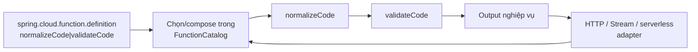

# Chọn hàm bằng spring.cloud.function.definition

> **Chương:** Khởi tạo  
> **Module:** SPRING_CLOUD_FUNCTION  
> **Mục tiêu:** Sử dụng `spring.cloud.function.definition` để chọn một hàm, ghép nhiều hàm hoặc khai báo nhiều hàm cần xuất ra môi trường thực thi; phân biệt lựa chọn function với việc gọi function qua `FunctionCatalog`, HTTP, sự kiện và serverless.  
> **Bộ phiên bản minh họa:** Java 21, Spring Boot 4.2.0, Spring Cloud BOM 2026.0.0, Spring Cloud Function 5.1.0 (mốc 24/11/2026). Khi triển khai thực tế, kiểm tra bản phát hành và khả năng tương thích của adapter.

## 1. Tại sao cần `spring.cloud.function.definition`?

Spring Cloud Function cho phép đóng gói logic nghiệp vụ bằng ba functional interface chuẩn của Java: `Supplier<T>` cung cấp dữ liệu, `Function<T, R>` biến đổi dữ liệu, `Consumer<T>` nhận và tiêu thụ dữ liệu. Logic có thể tái sử dụng độc lập với giao thức gọi. `FunctionCatalog` khám phá các bean và hỗ trợ tra cứu, composition, chuyển đổi dữ liệu/thông điệp; HTTP, Spring Cloud Stream hoặc adapter serverless quyết định khi nào và bằng cách nào hàm được gọi.

Một ứng dụng có thể có nhiều bean:

```text
normalizeCode : Function<String, String>  // bỏ khoảng trắng, viết hoa
validateCode  : Function<String, String>  // kiểm tra mẫu mã
addPrefix     : Function<String, String>  // thêm tiền tố ORDER:
```

Khi chỉ có **một** function trong catalog, framework thường có thể tự chọn function đó. Khi có **nhiều** function, adapter cần biết function nào cần được sử dụng làm điểm xử lý chính, hoặc những function nào được phép xuất ra ngoài. Property sau diễn đạt lựa chọn đó:

```properties
spring.cloud.function.definition=normalizeCode
```

Đây là **definition** (định nghĩa hàm): có thể chỉ một bean hoặc mô tả chuỗi ghép nhiều bean. Property không tạo bean và không tự thực hiện `apply(...)`; các bean phải tồn tại trong Spring context hoặc catalog, còn việc thực thi diễn ra khi adapter hoặc code Java gọi chúng.

Sau bài này, người học có thể:

1. Chọn một function bằng tên bean với `spring.cloud.function.definition`.
2. Ghép nhiều function bằng `|` hoặc `,` và giải thích thứ tự xử lý.
3. Phân biệt `;` để chọn **danh sách function/chuỗi function riêng** với `|` dùng để **compose**.
4. Viết cấu hình trong `application.properties`, `application.yml`, biến môi trường và tham số dòng lệnh.
5. Kiểm tra hành vi khác nhau của definition khi dùng Web adapter, Spring Cloud Stream và serverless.
6. Chẩn đoán lỗi tên bean, function không tồn tại, type mismatch, path và lỗi message conversion.

### 1.1. Đường đi tổng quát



Cấu hình điều khiển **hàm hoặc pipeline được chọn**. Nguồn request/sự kiện, message serialization, response, retry, timeout và bảo mật vẫn thuộc về adapter hay môi trường triển khai.

## 2. Đọc đúng cú pháp của property

### 2.1. Một tên function: chọn một bean

```properties
spring.cloud.function.definition=normalizeCode
```

Tên `normalizeCode` là **bean name**, thường lấy từ tên phương thức `@Bean`. Nếu bạn khai báo:

```java
@Bean("canonicalCode")
public Function<String, String> normalizeCode() {
    return text -> text.trim().toUpperCase(Locale.ROOT);
}
```

tên để chọn sẽ là `canonicalCode`, dù phương thức Java vẫn tên `normalizeCode`. Đoạn mã này minh họa một **cách đặt tên thay thế**, không nên đặt trùng một bean với ví dụ ứng dụng ở mục 4.

### 2.2. Composition: dùng `|` hoặc `,`

```properties
spring.cloud.function.definition=normalizeCode|validateCode
```

Lệnh này mô tả **một function tổng hợp**:

```text
input -> normalizeCode -> validateCode -> output
```

Spring Cloud Function cũng cho phép viết định nghĩa composition bằng dấu phẩy:

```properties
spring.cloud.function.definition=normalizeCode,validateCode
```

Hai cú pháp trên cùng thể hiện thứ tự chạy **trái sang phải** trong ngữ cảnh composition. Với input `"  od-123 "`, `normalizeCode` trả `"OD-123"` và `validateCode` kiểm tra kết quả đó. Đảo thành `validateCode|normalizeCode` có thể khiến input bị từ chối trước khi chuẩn hóa.

Java thuần có phép tương đương về ý tưởng:

```java
Function<String, String> pipeline = normalizeCode.andThen(validateCode);
```

Nhưng `FunctionCatalog` cho phép tạo pipeline bằng **tên bean từ cấu hình**, hữu ích khi cùng logic được triển khai trong nhiều adapter khác nhau.

### 2.3. Danh sách: dùng dấu chấm phẩy `;`

Ví dụ:

```properties
spring.cloud.function.definition=normalizeCode;addPrefix
```

Đây là **hai function được chọn riêng**. Dấu `;` không có nghĩa chạy `normalizeCode` rồi chuyển output cho `addPrefix`. Từng function được adapter liên quan dùng như một definition riêng theo quy tắc xuất hàm hoặc binding của nó.

Bạn cũng có thể chọn một composition và một function riêng:

```properties
spring.cloud.function.definition=normalizeCode|validateCode;addPrefix
```

Khi dùng **Web adapter**, cách này chỉ xuất composition `normalizeCode|validateCode` và bean `addPrefix` ra HTTP; các function không có trong danh sách sẽ không được Web adapter xuất trực tiếp. Trong **Spring Cloud Stream**, dấu chấm phẩy có thể dùng để chỉ định nhiều function cần kết nối với các binding riêng.

### 2.4. Bảng nhớ nhanh

| Giá trị definition | Ý nghĩa khái niệm | Có bao nhiêu definition được chọn? |
| --- | --- | --- |
| `normalizeCode` | Chọn một bean Function. | 1 |
| `normalizeCode\|validateCode` | Compose hai Function theo thứ tự. | 1 pipeline |
| `normalizeCode,validateCode` | Cách viết khác của composition. | 1 pipeline |
| `normalizeCode;addPrefix` | Chọn hai function riêng. | 2 |
| `normalizeCode\|validateCode;addPrefix` | Chọn một pipeline và một function riêng. | 2 |
| `validateCode\|normalizeCode` | Cũng là composition nhưng **thứ tự khác**. | 1 pipeline, có thể sai nghiệp vụ |

**Không hoán đổi `|` và `;`**: chúng có ý nghĩa khác nhau. Cũng đừng dùng dấu `;` trong URL rồi suy ra rằng request sẽ chạy hai hàm tuần tự.

## 3. Definition có liên quan gì đến `FunctionCatalog`?

### 3.1. FunctionCatalog được tạo ra để tìm hàm

Khi có bean `Function<String, String>` tên `normalizeCode`, code Java có thể gọi:

```java
Function<String, String> function =
        catalog.lookup("normalizeCode");

String output = function.apply("  od-123  "); // "OD-123"
```

Nếu có thêm bean `validateCode`, có thể lookup composition:

```java
Function<String, String> pipeline =
        catalog.lookup("normalizeCode|validateCode");
```

`FunctionCatalog.lookup(...)` là lời gọi **tường minh theo tên**. Property `spring.cloud.function.definition` chủ yếu giúp các hệ thống tích hợp chọn function mặc định hoặc nhiều function cần sử dụng. Ví dụ, bạn không cần truyền tên function trong mỗi sự kiện Kafka nếu Stream đã đọc definition từ cấu hình.

Từng adapter có quy tắc riêng về việc áp dụng property này. **Đặt definition không đồng nghĩa khóa mọi cách lookup programmatic** trong Spring context. Đặc biệt, đừng dùng property để thay thế kiểm soát quyền truy cập vào function.

### 3.2. Vì sao Spring Cloud Function không luôn yêu cầu definition?

Nếu chỉ có **một functional bean** trong `ApplicationContext`, Spring Cloud Function có cơ chế *single-function fallback*. Trong trường hợp thông thường, lookup bằng tên rỗng, tên tùy ý hoặc không có tên có thể trả về function duy nhất.

Chẳng hạn, khi chỉ có `normalizeCode`:

```java
catalog.lookup("normalizeCode"); // tên chính xác
catalog.lookup(null);            // có thể resolve function duy nhất
catalog.lookup("wrongName");     // cũng có thể fallback về function duy nhất
```

Đây là ví dụ **hành vi mặc định được tài liệu mô tả**, không nên dùng tên sai như một thói quen. Khi muốn yêu cầu lookup phải đúng tên:

```properties
spring.cloud.function.single-function-fallback-enabled=false
```

Với Spring Cloud Stream, tài liệu khuyến nghị **luôn khai báo definition rõ ràng**, kể cả khi chỉ có một function, để tránh nhập nhằng khi ứng dụng tăng số bean.

### 3.3. Hàm không phù hợp để xuất hoặc bị lọc khỏi catalog

Không phải mọi bean Java implements `Function` đều có ý nghĩa như một entrypoint nghiệp vụ. Một số bean nội bộ có thể bị framework loại khỏi danh sách hàm ứng viên. Nếu có bean chức năng không muốn đăng ký trong catalog, Spring Cloud Function hỗ trợ:

```properties
spring.cloud.function.ineligible-definitions=internalFormatter,debugFunction
```

Property này dùng cho **lọc ứng viên catalog**, khác với `spring.cloud.function.definition` dùng để chỉ định definition sẽ chạy hoặc xuất qua adapter. Nếu function không được catalog đăng ký, chọn tên của nó trong definition sẽ không khiến nó tự xuất hiện.

## 4. Tạo ứng dụng có ba function để thực hành

### 4.1. Phụ thuộc Maven

Một lựa chọn tương thích tại mốc 24/11/2026 là Java 21, Spring Boot 4.2.0, Spring Cloud BOM 2026.0.0. Release train Spring Cloud này chứa Spring Cloud Function 5.1.0. Sử dụng Web starter để dễ kiểm chứng definition bằng HTTP.

Tạo `pom.xml`:

```xml
<?xml version="1.0" encoding="UTF-8"?>
<project xmlns="http://maven.apache.org/POM/4.0.0"
         xmlns:xsi="http://www.w3.org/2001/XMLSchema-instance"
         xsi:schemaLocation="
           http://maven.apache.org/POM/4.0.0
           https://maven.apache.org/xsd/maven-4.0.0.xsd">
    <modelVersion>4.0.0</modelVersion>

    <parent>
        <groupId>org.springframework.boot</groupId>
        <artifactId>spring-boot-starter-parent</artifactId>
        <version>4.2.0</version>
        <relativePath/>
    </parent>

    <groupId>vn.example</groupId>
    <artifactId>function-definition-demo</artifactId>
    <version>0.0.1-SNAPSHOT</version>

    <properties>
        <java.version>21</java.version>
        <spring-cloud.version>2026.0.0</spring-cloud.version>
    </properties>

    <dependencyManagement>
        <dependencies>
            <dependency>
                <groupId>org.springframework.cloud</groupId>
                <artifactId>spring-cloud-dependencies</artifactId>
                <version>${spring-cloud.version}</version>
                <type>pom</type>
                <scope>import</scope>
            </dependency>
        </dependencies>
    </dependencyManagement>

    <dependencies>
        <dependency>
            <groupId>org.springframework.cloud</groupId>
            <artifactId>spring-cloud-starter-function-web</artifactId>
        </dependency>

        <dependency>
            <groupId>org.springframework.boot</groupId>
            <artifactId>spring-boot-starter-test</artifactId>
            <scope>test</scope>
        </dependency>
    </dependencies>

    <build>
        <plugins>
            <plugin>
                <groupId>org.springframework.boot</groupId>
                <artifactId>spring-boot-maven-plugin</artifactId>
            </plugin>
        </plugins>
    </build>
</project>
```

`spring-cloud-dependencies` là **BOM quản lý phiên bản**. `spring-cloud-starter-function-web` mới là dependency để chạy Web adapter. Với BOM đúng, không cần ghi version Function riêng trong thẻ dependency. Nếu dùng release train khác, chọn lại cặp Boot/Cloud theo ma trận tương thích chính thức.

### 4.2. Cấu trúc thư mục

```text
function-definition-demo/
├── pom.xml
└── src/
    ├── main/
    │   ├── java/
    │   │   └── vn/example/definition/
    │   │       └── FunctionDefinitionApplication.java
    │   └── resources/
    │       └── application.properties
    └── test/
        └── java/
            └── vn/example/definition/
                └── FunctionDefinitionApplicationTest.java
```

Nếu dùng Gradle thay Maven, Java source và file cấu hình vẫn như trên; chỉ thay phần build tool, dependency management và lệnh chạy.

### 4.3. Định nghĩa bean trong Java

Tạo `src/main/java/vn/example/definition/FunctionDefinitionApplication.java`:

```java
package vn.example.definition;

import java.util.Locale;
import java.util.function.Function;

import org.springframework.boot.SpringApplication;
import org.springframework.boot.autoconfigure.SpringBootApplication;
import org.springframework.context.annotation.Bean;

@SpringBootApplication
public class FunctionDefinitionApplication {

    public static void main(String[] args) {
        SpringApplication.run(FunctionDefinitionApplication.class, args);
    }

    @Bean
    public Function<String, String> normalizeCode() {
        return raw -> raw.trim().toUpperCase(Locale.ROOT);
    }

    @Bean
    public Function<String, String> validateCode() {
        return code -> {
            if (!code.matches("[A-Z]{2}-[0-9]{3}")) {
                throw new IllegalArgumentException("Mã không hợp lệ: " + code);
            }
            return code;
        };
    }

    @Bean
    public Function<String, String> addPrefix() {
        return code -> "ORDER:" + code;
    }
}
```

Ba bean có tên mặc định `normalizeCode`, `validateCode` và `addPrefix`, tương ứng với tên phương thức `@Bean`. Thứ tự xử lý tạo ra những kết quả khác nhau:

| Composition | Input | Kết quả |
| --- | --- | --- |
| `normalizeCode` | `"  od-123  "` | `"OD-123"` |
| `normalizeCode\|validateCode` | `"  od-123  "` | `"OD-123"` |
| `normalizeCode\|addPrefix` | `"  od-123  "` | `"ORDER:OD-123"` |
| `addPrefix\|validateCode` | `"OD-123"` | Ném `IllegalArgumentException` vì `ORDER:` không khớp mẫu. |

Ví dụ này cố ý cho thấy **composition là quy tắc nghiệp vụ có thứ tự**, không chỉ là ghép tên tùy ý.

### 4.4. Viết file cấu hình đầu tiên

Đặt `src/main/resources/application.properties`:

```properties
spring.application.name=function-definition-demo
server.port=8080
spring.cloud.function.definition=normalizeCode|validateCode
```

Khi Spring Boot chạy cùng Web starter, function definition chọn pipeline `normalizeCode|validateCode` làm function mặc định cho HTTP. Trước khi kiểm tra URL, hãy phân biệt việc bean đã được tạo với việc adapter đã gắn definition vào route.

## 5. Chọn hàm qua HTTP khi dùng definition

### 5.1. Đặt một definition: ánh xạ tới root path

Tài liệu Web adapter mô tả rằng khi có nhiều function, property:

```properties
spring.cloud.function.definition=normalizeCode|validateCode
```

sẽ tạo **composition mặc định** và ánh xạ nó tới đường dẫn gốc `/` (hoặc đường dẫn cơ sở đã được cấu hình cho Web adapter). Chạy app:

```bash
mvn clean package
mvn spring-boot:run
```

Nếu dự án có Maven Wrapper, dùng `./mvnw` (Linux/macOS) hoặc `./mvnw.cmd` (Windows).

Gửi HTTP POST từ terminal khác:

```bash
curl -i -X POST http://localhost:8080/ \
  -H "Content-Type: text/plain" \
  -H "Accept: text/plain" \
  --data-raw "  od-123  "
```

Body kỳ vọng:

```text
OD-123
```

Đầu vào đến root URL nhưng được xử lý qua **hai bean** theo definition. Không cần viết `@RestController`: Web starter tạo mapping tới Spring Cloud Function.

### 5.2. Nếu không khai báo definition thì sao?

Trong ứng dụng có ba bean, xóa **dòng** `spring.cloud.function.definition=...` rồi khởi động lại. Theo quy tắc Web adapter, từng function có thể được gọi theo tên:

```bash
curl -i -X POST http://localhost:8080/normalizeCode \
  -H "Content-Type: text/plain" \
  --data-raw "  od-123  "
```

Ngoài ra có thể gọi composition qua URL chứa các tên phân tách bằng dấu phẩy:

```bash
curl -i -X POST http://localhost:8080/normalizeCode,validateCode \
  -H "Content-Type: text/plain" \
  --data-raw "  od-123  "
```

Web adapter còn hỗ trợ dấu `|` trong URL nhưng phải chú ý escape ký tự trong shell và URL. Dấu phẩy giúp ví dụ cURL dễ đọc. Trong `FunctionCatalog.lookup(...)` hoặc file properties, dùng pipe thường thể hiện thứ tự rõ ràng hơn.

### 5.3. Khi có một definition, điều đó có tự động ẩn mọi hàm còn lại?

**Không nên coi definition đơn là cơ chế phân quyền hoặc bộ lọc API.** Với Web adapter, một definition đơn được dùng để chọn composition mặc định, ánh xạ tới root và có thể làm fallback cho URL không ánh xạ được theo tên. Các quy tắc fallback/mapping còn phụ thuộc cấu hình và phiên bản adapter.

Nếu muốn **chỉ xuất một tập function/composition đã định**, hãy dùng **danh sách definition phân tách bằng dấu chấm phẩy**, theo quy tắc function filtering của Web adapter:

```properties
spring.cloud.function.definition=normalizeCode|validateCode;addPrefix
```

Bây giờ các HTTP endpoint theo danh sách được chọn bao gồm:

- `POST /normalizeCode,validateCode`: pipeline normalize rồi validate.
- `POST /addPrefix`: function thêm tiền tố.

Với cách khai báo danh sách có dấu `;`, **không có mapping root `/` theo quy tắc lọc** và Web adapter không xuất các function khác ngoài danh sách (kể cả các composition không liệt kê). Ví dụ `/validateCode` sẽ không được xuất độc lập. Dù vậy, bảo mật endpoint thực tế vẫn cần Spring Security/gateway và kiểm thử.

### 5.4. Tùy chỉnh base path

```properties
spring.cloud.function.web.path=/functions
spring.cloud.function.definition=normalizeCode|validateCode
```

Đường dẫn cơ sở không còn là `/` mà là `/functions` theo quy tắc Web adapter. Nếu cấu hình danh sách lọc `normalizeCode|validateCode;addPrefix`, các đường dẫn theo tên có tiền tố `/functions/`, chẳng hạn `/functions/addPrefix`.

`spring.cloud.function.web.path` **điều chỉnh URL**; `spring.cloud.function.definition` **chọn function/composition**. Chúng phục vụ hai trách nhiệm khác nhau.

### 5.5. So sánh ba chế độ Web

| Cấu hình | URL nên thử | Kết quả kỳ vọng |
| --- | --- | --- |
| Không đặt definition, ba bean được đăng ký | `POST /normalizeCode` | `OD-123` |
| Không đặt definition, dùng URL composition | `POST /normalizeCode,validateCode` | `OD-123` |
| `definition=normalizeCode\|validateCode` | `POST /` | `OD-123` |
| `definition=normalizeCode\|addPrefix` | `POST /` | `ORDER:OD-123` |
| `definition=normalizeCode\|validateCode;addPrefix` | `POST /normalizeCode,validateCode` hoặc `POST /addPrefix` | Hai endpoint riêng; không map root. |

Các kết quả trên giả định app có đúng ba bean mẫu, Web starter hoạt động và request dùng `Content-Type: text/plain`. Nếu dùng thêm controller, security hoặc proxy, cần xác minh mapping thực tế.

## 6. Khai báo ở properties, YAML, CLI và biến môi trường

### 6.1. `application.properties`

```properties
spring.cloud.function.definition=normalizeCode|validateCode
```

Đây là cách trực tiếp nhất. Dấu `|` được giữ nguyên trong giá trị properties.

### 6.2. `application.yml`

```yaml
spring:
  application:
    name: function-definition-demo
  cloud:
    function:
      definition: "normalizeCode|validateCode"
```

Nếu muốn chọn nhiều function:

```yaml
spring:
  cloud:
    function:
      definition: "normalizeCode|validateCode;addPrefix"
```

Đặt giá trị trong dấu ngoặc kép giúp dễ đọc và tránh nhầm ký tự đặc biệt; một giá trị **chuỗi** vẫn được truyền xuống Spring Environment. Không cần thêm field riêng như `functionNames` để mô tả composition.

### 6.3. Tham số dòng lệnh

Sau khi chạy `mvn package`:

```bash
java -jar target/function-definition-demo-0.0.1-SNAPSHOT.jar \
  '--spring.cloud.function.definition=normalizeCode|addPrefix'
```

Dấu nháy đơn giúp Bash không diễn giải `|` thành toán tử pipe. Trên Windows PowerShell:

```powershell
java -jar target/function-definition-demo-0.0.1-SNAPSHOT.jar '--spring.cloud.function.definition=normalizeCode|addPrefix'
```

Nếu dùng Windows CMD, cần dùng cú pháp quote phù hợp với CMD, ví dụ:

```bat
java -jar target\function-definition-demo-0.0.1-SNAPSHOT.jar "--spring.cloud.function.definition=normalizeCode|addPrefix"
```

Ví dụ này cho phép đổi pipeline khi chạy mà không sửa mã Java; app cần được **khởi động lại** để đọc cấu hình mới trong cách triển khai thông thường.

### 6.4. Biến môi trường

Spring Boot hỗ trợ ánh xạ biến môi trường theo quy tắc tên cấu hình. Với thuộc tính này, có thể dùng:

**Linux/macOS:**

```bash
export SPRING_CLOUD_FUNCTION_DEFINITION='normalizeCode|validateCode'
java -jar target/function-definition-demo-0.0.1-SNAPSHOT.jar
```

**PowerShell:**

```powershell
$env:SPRING_CLOUD_FUNCTION_DEFINITION = 'normalizeCode|validateCode'
java -jar target/function-definition-demo-0.0.1-SNAPSHOT.jar
```

Trong Docker/Kubernetes/serverless, biến môi trường thường phù hợp với việc điều khiển function được chọn cho từng deployment. Hãy chắc chắn runtime thực sự truyền giá trị vào tiến trình Java.

### 6.5. Profiles và độ ưu tiên cấu hình

Có thể dùng profile để phục vụ các môi trường:

```properties
# application-dev.properties
spring.cloud.function.definition=normalizeCode|addPrefix
```

```properties
# application-prod.properties
spring.cloud.function.definition=normalizeCode|validateCode
```

Chọn profile qua `spring.profiles.active` và xác minh Spring Environment đã nạp đúng file. Property xuất hiện trong file cấu hình, biến môi trường và tham số dòng lệnh có thể có độ ưu tiên khác nhau theo Spring Boot *externalized configuration*. Khi kết quả không như mong đợi, kiểm tra nguồn cấu hình đang **thực sự được áp dụng**, không chỉ file bạn vừa sửa.

## 7. Chọn hàm trong Spring Cloud Stream

### 7.1. Vì sao Spring Cloud Stream thường cần definition rõ ràng?

Spring Cloud Stream dùng model hàm để kết nối logic với broker qua binder. Một ứng dụng có nhiều bean `Function` không cho biết bean nào nên nhận message nào nếu bạn chưa chỉ định. `spring.cloud.function.definition` giúp Stream chọn handler hoặc pipeline cần bind với các input/output destination.

Ví dụ, nếu muốn nhận mã thô từ Kafka và xuất mã đã kiểm tra:

```properties
spring.cloud.function.definition=normalizeCode|validateCode
```

Giá trị này cho Stream biết **chọn pipeline**; nó không tự khai báo Kafka broker hoặc topic. Cần thêm dependency Stream binder và cấu hình binding.

### 7.2. Một function với Kafka binder

Với bean `normalizeCode` đơn lẻ và Spring Cloud Stream Kafka binder tương thích:

```xml
<dependency>
    <groupId>org.springframework.cloud</groupId>
    <artifactId>spring-cloud-starter-stream-kafka</artifactId>
</dependency>
```

Sau khi thêm binder, cấu hình ví dụ:

```properties
spring.cloud.function.definition=normalizeCode
spring.cloud.stream.bindings.normalizeCode-in-0.destination=raw-codes
spring.cloud.stream.bindings.normalizeCode-out-0.destination=normalized-codes
spring.cloud.stream.kafka.binder.brokers=localhost:9092
```

Theo quy ước binding chức năng của Stream:

- `normalizeCode-in-0`: đầu vào của bean `normalizeCode`.
- `normalizeCode-out-0`: đầu ra của bean `normalizeCode`.
- `destination`: topic/đích broker bên ngoài.
- `brokers`: địa chỉ Kafka broker. Broker phải chạy và ứng dụng phải có quyền truy cập.

Lúc này một message vào topic `raw-codes` có thể được xử lý và phát ra `normalized-codes` nếu payload chuyển được thành `String` phù hợp.

### 7.3. Composition và nhiều function trong Stream

Khi `definition=normalizeCode|validateCode`, Stream làm việc với **một pipeline** nhận dữ liệu vào rồi trả dữ liệu ra. Tên binding khi composition có thể được tạo từ tên của các thành phần; để tránh đoán sai tên binding, xem log khởi động và tài liệu **Functional Binding Names** của đúng phiên bản Stream, hoặc sử dụng cấu hình alias binding được hỗ trợ.

Nếu muốn chạy **hai pipeline độc lập**, có thể viết:

```properties
spring.cloud.function.definition=normalizeCode;addPrefix
```

Stream sẽ chọn hai function và tạo các binding tương ứng; bạn phải cấu hình destination cho từng cặp binding. Dấu `;` không chuyển message từ `normalizeCode` sang `addPrefix`. Muốn tạo một chuỗi biến đổi, dùng `|` hoặc `,`.

**Lưu ý quan trọng:** không đồng nhất semantics ở Web và Stream. Cùng một string definition có thể được đọc bởi hai adapter, nhưng Web quyết định HTTP mapping/filtering còn Stream quyết định binding với broker. Nếu triển khai cùng ứng dụng với nhiều adapter, cần kiểm tra cấu hình toàn cục có phục vụ cả hai mục đích hay không.

## 8. Definition khi chạy serverless

Với AWS Lambda, Azure Functions hoặc Google Cloud Functions, adapter sẽ nhận invocation từ runtime của nhà cung cấp và tìm function cần gọi. Khi gói triển khai chứa nhiều bean, nên xác định rõ definition:

```properties
spring.cloud.function.definition=normalizeCode|validateCode
```

Trong một số nền tảng, property này được cung cấp dưới dạng biến môi trường:

```text
SPRING_CLOUD_FUNCTION_DEFINITION=normalizeCode|validateCode
```

Khi provider kích hoạt function, adapter nạp Spring context, chọn function hoặc pipeline theo contract của adapter rồi chuyển payload vào. **Chỉ thêm property không tạo handler hay deploy cloud function**: vẫn cần adapter AWS/Azure/GCP, Java runtime được hỗ trợ, cấu hình trigger/handler, đóng gói, permissions và kiểm thử artifact.

Ví dụ, `Function<String,String>` xử lý được mã chuỗi sau khi adapter chuyển đổi input thành String. Nếu runtime gửi một JSON event envelope phức tạp (chẳng hạn sự kiện S3 hoặc SQS), cần thiết kế DTO/`Message<?>` hoặc lớp chuyển đổi để trích xuất đúng dữ liệu. Definition không tự hiểu nội dung JSON đó.

### 8.1. Definition không thay thế dynamic routing

Một **definition tĩnh** như `normalizeCode|validateCode` áp dụng cho pipeline được chọn theo cấu hình. Nếu mỗi message phải chọn function khác nhau dựa trên header hoặc payload, Spring Cloud Function có cơ chế `functionRouter` và `spring.cloud.function.routing-expression`.

Ví dụ:

```text
Static deployment:
  definition = normalizeCode|validateCode

Routing theo từng message:
  functionRouter -> chọn function theo điều kiện được cấu hình
```

Routing là chủ đề nâng cao, có thể dùng SpEL và metadata message. Không lấy biểu thức routing trực tiếp từ input không tin cậy; cần kiểm soát danh sách function được phép gọi. Trong bài này chỉ cấu hình **definition tĩnh** để chọn hàm an toàn, dễ kiểm thử.

## 9. Composition với Supplier, Function và Consumer

### 9.1. Nguyên tắc tương thích kiểu

Không phải mọi cặp bean đều compose được. Với hai function:

```text
Function<A,B> | Function<B,C> -> Function<A,C>
```

Kiểu output của hàm trước phải phù hợp input của hàm sau, hoặc có cơ chế chuyển đổi được hỗ trợ và cấu hình đúng.

Ví dụ hợp lệ:

```java
@Bean
public Function<String, Integer> codeLength() {
    return String::length;
}

@Bean
public Function<Integer, String> lengthLabel() {
    return len -> "length=" + len;
}
```

Đây là hai bean **bổ sung** có thể đặt trong lớp ứng dụng. Definition:

```properties
spring.cloud.function.definition=codeLength|lengthLabel
```

Input `"OD-123"` cho output `"length=6"`.

Nếu đảo thành `lengthLabel|codeLength`, output của `lengthLabel` là String nhưng input của nó là Integer: pipeline không có chữ ký logic phù hợp với đầu vào String như trước. Không nên phụ thuộc vào conversion ngầm để che một thiết kế sai thứ tự.

### 9.2. Ghép với Supplier và Consumer

Spring Cloud Function hỗ trợ composition không chỉ giữa các `Function`. Theo tài liệu lập trình:

| Composition | Hợp đồng cuối cùng | Ý nghĩa |
| --- | --- | --- |
| `Supplier<T>` → `Function<T,R>` | `Supplier<R>` | Sinh dữ liệu rồi biến đổi dữ liệu. |
| `Function<T,R>` → `Consumer<R>` | `Consumer<T>` | Biến đổi dữ liệu rồi thực hiện side effect. |
| `Supplier<T>` → `Consumer<T>` | `Runnable` về mặt hành vi | Cung cấp rồi tiêu thụ, không có giá trị đầu vào/đầu ra nghiệp vụ. |
| `Consumer<T>` → `Function<...>` | Không compose theo chiều đó | Consumer không trả kết quả để truyền cho function phía sau. |

Bảng mô tả hợp đồng **khái niệm**. Cách adapter kích hoạt `Supplier`, `Consumer` hoặc `Runnable` phụ thuộc môi trường: HTTP, Stream polling/reactive source và serverless không có cùng semantics.

### 9.3. Reactive function cần chú ý gì?

Với Reactor, một bean có thể có chữ ký:

```java
@Bean
public Function<Flux<String>, Flux<String>> normalizeStream() {
    return input -> input
            .map(String::trim)
            .map(value -> value.toUpperCase(Locale.ROOT));
}
```

Phương thức này cần import `reactor.core.publisher.Flux` và đặt trong class cấu hình. Function nhận/trả **publisher**; adapter chịu trách nhiệm subscription và luồng dữ liệu ở ranh giới tương ứng. Composition có thể kết hợp function reactive khi kiểu giữa các thành phần tương thích, nhưng không thể tự giả định rằng ghép một function imperative với reactive luôn có đúng semantics mong muốn.

Property definition vẫn chọn **tên/pipeline**, không tự thay đổi luật backpressure, retry hoặc thread model của Reactor.

## 10. Viết kiểm thử cho definition và composition

### 10.1. Test FunctionCatalog với hai bean

Tạo `src/test/java/vn/example/definition/FunctionDefinitionApplicationTest.java`:

```java
package vn.example.definition;

import static org.junit.jupiter.api.Assertions.assertEquals;
import static org.junit.jupiter.api.Assertions.assertNotNull;
import static org.junit.jupiter.api.Assertions.assertThrows;

import java.util.function.Function;

import org.junit.jupiter.api.Test;
import org.springframework.beans.factory.annotation.Autowired;
import org.springframework.beans.factory.annotation.Value;
import org.springframework.boot.test.context.SpringBootTest;
import org.springframework.cloud.function.context.FunctionCatalog;

@SpringBootTest(properties = {
        "spring.cloud.function.definition=normalizeCode|validateCode"
})
class FunctionDefinitionApplicationTest {

    @Autowired
    private FunctionCatalog catalog;

    @Value("${spring.cloud.function.definition}")
    private String definition;

    @Test
    void picksExpectedDefinition() {
        assertEquals("normalizeCode|validateCode", definition);
    }

    @Test
    void composesInTheConfiguredOrder() {
        Function<String, String> pipeline =
                catalog.lookup(definition);

        assertNotNull(pipeline);
        assertEquals("OD-123", pipeline.apply("  od-123  "));
        assertThrows(IllegalArgumentException.class,
                () -> pipeline.apply("  ???  "));
    }
}
```

Bài test này xác nhận:

- Property thực sự được Spring Environment đọc.
- Hai bean Function tồn tại và catalog có thể compose bằng definition.
- Pipeline chạy đúng thứ tự cho input hợp lệ và báo lỗi với mã không hợp lệ.

**Giới hạn:** đây là test catalog và cấu hình, chưa xác minh Web adapter mapping root `/`. Muốn kiểm tra behavior HTTP, khởi động ứng dụng và gửi cURL như mục 5 hoặc thêm một integration test HTTP với server thực/test client thích hợp.

### 10.2. Kiểm tra bằng curl theo từng cấu hình

Thử ba lần khởi động với mỗi giá trị definition:

**A. Chọn một hàm:**

```properties
spring.cloud.function.definition=normalizeCode
```

```bash
curl -i -X POST http://localhost:8080/ \
  -H "Content-Type: text/plain" --data-raw "  od-123  "
```

Kỳ vọng body: `OD-123`.

**B. Chọn composition:**

```properties
spring.cloud.function.definition=normalizeCode|addPrefix
```

```bash
curl -i -X POST http://localhost:8080/ \
  -H "Content-Type: text/plain" --data-raw "  od-123  "
```

Kỳ vọng body: `ORDER:OD-123`.

**C. Chọn danh sách có filtering:**

```properties
spring.cloud.function.definition=normalizeCode|validateCode;addPrefix
```

```bash
curl -i -X POST http://localhost:8080/normalizeCode,validateCode \
  -H "Content-Type: text/plain" --data-raw "  od-123  "
```

Kỳ vọng body: `OD-123`. Lúc này root không map theo quy tắc filtering. Để thử bean còn lại, gửi `POST /addPrefix`; với input `OD-123`, kỳ vọng `ORDER:OD-123`.

Khởi động lại app giữa các kịch bản để tránh nhầm lẫn property cũ còn hiệu lực.

### 10.3. Lệnh xem dependency và xác nhận phiên bản

Maven:

```bash
mvn dependency:tree -Dincludes=org.springframework.cloud
mvn test
```

Nếu dùng wrapper, dùng `./mvnw` thay cho `mvn`. Kiểm tra starter thực sự được resolve và các module Function lấy version từ BOM. Chỉ có `spring.cloud.function.definition` trong properties nhưng không có Function context/starter vẫn không tạo ra catalog.

## 11. Những lỗi thường gặp

| Triệu chứng | Nguyên nhân có thể | Cách xử lý |
| --- | --- | --- |
| App có nhiều bean, không biết hàm nào sẽ nhận message | Thiếu definition trong Spring Cloud Stream hoặc adapter cần selection. | Đặt `spring.cloud.function.definition` bằng tên/chuỗi mong muốn. |
| Definition dùng tên không tồn tại | Tên bean bị đổi hoặc `@Bean` không được scan. | Xác minh tên bean, package scan và `FunctionCatalog.lookup(...)`. |
| Viết `normalizeCode;validateCode` nhưng mong cả hai chạy tuần tự | Nhầm dấu `;` với `\|`. | Dùng `normalizeCode\|validateCode` để compose. |
| Viết `validateCode\|normalizeCode` và input bị từ chối | Thứ tự xử lý sai nghiệp vụ. | Chuẩn hóa trước, kiểm tra sau. |
| HTTP `POST /` trả 404 khi dùng danh sách có `;` | Function filtering không map root. | Gọi `/normalizeCode,validateCode` hoặc `/addPrefix` theo danh sách đã xuất. |
| HTTP gọi một bean nhưng nhận kết quả pipeline khác | Single definition được dùng làm root/fallback, hoặc cấu hình/environment đang ghi đè. | Kiểm tra active properties, definition và Web mappings. |
| `catalog.lookup("wrongName")` vẫn có kết quả | Single-function fallback khi catalog chỉ có một bean. | Tắt `spring.cloud.function.single-function-fallback-enabled` để kiểm tra tên chính xác. |
| Không gọi được HTTP nhưng lookup catalog thành công | Chưa có Web starter, app chưa khởi động Web hoặc route sai. | Kiểm tra `spring-cloud-starter-function-web`, port và base path. |
| Composition báo lỗi kiểu dữ liệu | Kiểu output/input của các function không tương thích. | Vẽ chuỗi `T -> R -> U`, kiểm tra converter và generic. |
| Function nhận JSON nhưng lỗi chuyển đổi | DTO, `contentType` hoặc converter không phù hợp. | Kiểm tra payload, header và kiểu hàm. |
| Pipe trong terminal gây lỗi | `\|` bị shell hiểu là toán tử pipeline. | Bọc tham số trong dấu nháy theo Bash/PowerShell/CMD. |
| Bean trong catalog có thể bị gọi ngoài dự kiến | Xuất quá nhiều function hoặc để adapter chọn route động không kiểm soát. | Chỉ định danh sách function, giới hạn đường vào và bổ sung authentication/authorization. |
| Đổi definition nhưng ứng dụng vẫn xử lý như cũ | Process chưa khởi động lại hoặc cấu hình ưu tiên cao hơn đang ghi đè. | Kiểm tra Spring Environment, biến môi trường, profile và startup command. |

### 11.1. Property chọn hàm không phải cơ chế bảo mật

`spring.cloud.function.definition` hỗ trợ chọn và lọc function theo semantics của adapter. Tuy nhiên, không dùng nó như biện pháp duy nhất để bảo vệ endpoint nhạy cảm. Với HTTP, kết hợp chính sách Spring Security, gateway và chỉ công bố function có chủ đích; với broker, giới hạn quyền đọc/ghi topic; với serverless, áp dụng IAM và cấu hình trigger.

### 11.2. Definition không tự xử lý lỗi

Nếu `validateCode` ném `IllegalArgumentException` khi gặp mã sai, trong Java lỗi xuất hiện như exception; HTTP adapter sẽ chuyển lỗi thành response theo cơ chế xử lý lỗi ứng dụng, còn Stream có thể retry hoặc xử lý theo cấu hình binder. Definition chỉ quyết định pipeline, không quy định mã HTTP 400, retry count hay idempotency.

Với `Consumer` có side effect, đặc biệt phải kiểm soát xử lý trùng khi nguồn sự kiện giao lại message.

## 12. Bài thực hành cuối bài

### Bài 1 — Chọn một function

Với ba bean mẫu ở mục 4:

1. Đặt `spring.cloud.function.definition=normalizeCode`.
2. Khởi động app và gọi `POST /` với `"  od-123  "`.
3. Đổi thành `spring.cloud.function.definition=addPrefix`, khởi động lại và gọi cùng URL.
4. Ghi lại hai output và giải thích vì sao Java source không đổi.

**Đáp án định hướng:** lần đầu trả `OD-123`, lần sau trả `ORDER:  od-123  ` (vì `addPrefix` chỉ nối chuỗi, không gọi `trim`). Đây là bằng chứng rằng definition chọn **bean nào chạy**, không tự ghép logic.

### Bài 2 — Chọn composition

1. Đặt `spring.cloud.function.definition=normalizeCode|addPrefix`.
2. Gọi `POST /` với body `"  od-123  "`.
3. Quan sát kết quả `ORDER:OD-123`.
4. Đổi thứ tự thành `addPrefix|normalizeCode`. Kết quả là gì, và nó có giống trường hợp trước không?

**Đáp án định hướng:** `addPrefix|normalizeCode` trả `ORDER:  OD-123` với input `"  od-123  "`: `addPrefix` thêm `ORDER:` trước cả dấu cách đầu chuỗi, nên `trim()` ở bước sau chỉ bỏ dấu cách cuối, còn hai dấu cách giữa `ORDER:` và `OD-123` vẫn tồn tại. Trong khi đó `normalizeCode|addPrefix` trả `ORDER:OD-123`. Bài học là thứ tự composition làm đổi kết quả ngay cả khi từng hàm đều đúng.

### Bài 3 — Dùng dấu `;` để giới hạn Web export

1. Cấu hình `spring.cloud.function.definition=normalizeCode|validateCode;addPrefix`.
2. Gửi `POST /normalizeCode,validateCode` và `POST /addPrefix`.
3. Thử `POST /` và `POST /validateCode`.
4. Giải thích tại sao root không map và tại sao `validateCode` không được xuất như một function độc lập.

**Đáp án định hướng:** `;` chọn **danh sách endpoint** cho Web adapter. Mỗi mục trong danh sách có thể là một bean hoặc composition; root không được map khi filtering bằng danh sách.

### Bài 4 — Phân biệt Web và Stream

Giả sử cần xử lý Kafka message thay cho HTTP:

1. Bổ sung Stream Kafka binder và cấu hình `spring.cloud.function.definition=normalizeCode`.
2. Thiết lập `normalizeCode-in-0` và `normalizeCode-out-0` đến hai topic thích hợp.
3. Nêu những gì vẫn dùng lại được (`normalizeCode`, `FunctionCatalog`) và những gì phải cấu hình thêm (binder, broker, destination, serialization).
4. Giải thích tại sao `spring.cloud.function.definition=normalizeCode;addPrefix` không có nghĩa các message đi qua cả hai function tuần tự.

### Bài 5 — Chuyển cấu hình sang biến môi trường

Đưa pipeline `normalizeCode|validateCode` từ file `application.properties` sang biến môi trường `SPRING_CLOUD_FUNCTION_DEFINITION`, chạy lại ứng dụng và xác minh bằng test HTTP. Kiểm tra chuỗi value đã được quote khi dùng shell có ký tự `|`.

### Tiêu chí hoàn thành

| Năng lực | Bằng chứng |
| --- | --- |
| Chọn function theo tên | `definition=normalizeCode` và root HTTP cho đúng kết quả. |
| Biết composition | `normalizeCode\|validateCode` thực thi đúng thứ tự. |
| Phân biệt `;` và `\|` | Hai function riêng không bị nhầm thành pipeline. |
| Biết các nguồn cấu hình | Viết được properties, YAML, CLI, env. |
| Hiểu quan hệ catalog–adapter | Giải thích được vì sao lookup Java và HTTP/Stream selection khác nhau. |
| Kiểm chứng thay vì đoán | Test catalog và smoke test HTTP theo từng definition. |

## 13. Tổng kết và nguồn tham khảo

- **`spring.cloud.function.definition`** xác định function hoặc pipeline sẽ được tích hợp; giá trị có thể là tên bean hoặc composition.
- **`|`** và **`,`** cho phép compose nhiều function theo thứ tự; **`;`** chọn nhiều definition riêng, với ý nghĩa filtering/export hoặc multiple bindings tùy adapter.
- **`FunctionCatalog.lookup(...)`** gọi tường minh theo tên; **definition** thường được adapter đọc để quyết định function mặc định, route hoặc binding. Cấu hình không thay cho việc khai báo bean và dependency.
- Với Web adapter, definition đơn có thể map composition vào root `/`; danh sách phân tách bằng `;` chỉ xuất function/composition được liệt kê và không map root theo quy tắc filtering.
- Với Spring Cloud Stream, định nghĩa chọn function cho binding; với serverless, adapter dùng definition trong ngữ cảnh runtime, nhưng vẫn cần handler/trigger và packaging phù hợp.
- Chọn hàm thành công cần **kiểm tra kết quả xử lý, tên bean, kiểu dữ liệu, HTTP/broker contract và cấu hình thực tế**.

**Tài liệu chính thức:**

1. Spring Cloud Function – Programming Model, function definition, composition và fallback: https://docs.spring.io/spring-cloud-function/reference/spring-cloud-function/programming-model.html
2. Spring Cloud Function – Standalone Web Applications, mapping và filtering: https://docs.spring.io/spring-cloud-function/reference/spring-cloud-function/standalone-web-applications.html
3. Spring Cloud Stream – Functional Binding Names: https://docs.spring.io/spring-cloud-stream/reference/spring-cloud-stream/functional-binding-names.html
4. Spring Cloud Stream – Producing and Consuming Messages: https://docs.spring.io/spring-cloud-stream/reference/spring-cloud-stream/producing-and-consuming-messages.html
5. Spring Cloud Function – Reference: https://docs.spring.io/spring-cloud-function/reference/
6. Spring Cloud 2026.0.0 GA và bộ phiên bản theo release train: https://spring.io/blog/2026/11/20/spring-cloud-2026-0-0-has-been-released/
7. Spring Boot – Externalized Configuration: https://docs.spring.io/spring-boot/reference/features/external-config.html
8. Spring Cloud – Bảng tương thích release train: https://spring.io/projects/spring-cloud/
