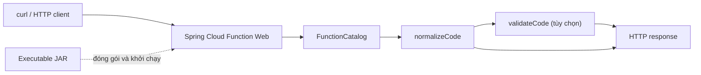
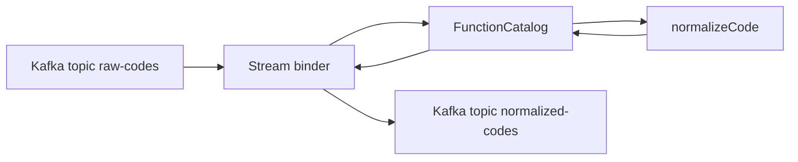

# Chạy cục bộ, đóng gói và kiểm tra đầu vào đầu ra

> **Chương:** Khởi tạo  
> **Module:** SPRING_CLOUD_FUNCTION  
> **Bài thực hành:** Chạy một ứng dụng Spring Cloud Function trên máy lập trình, đóng gói thành executable JAR, gọi qua HTTP và kiểm chứng kết quả cũng như các trường hợp lỗi.  
> **Bộ phiên bản minh họa (24/11/2026):** Java 21, Spring Boot 4.2.0, Spring Cloud BOM 2026.0.0, Spring Cloud Function 5.1.0.

## 1. Sau bài này bạn sẽ làm được gì?

Spring Cloud Function cho phép viết logic nghiệp vụ qua `Supplier<T>`, `Function<T, R>` và `Consumer<T>`, tìm và ghép chúng bằng `FunctionCatalog`, rồi kết nối với HTTP, sự kiện hoặc môi trường serverless thông qua adapter phù hợp. Khi khởi tạo một dự án, chỉ nhìn thấy hàm Java biên dịch thành công vẫn chưa đủ: cần chứng minh toàn bộ đường đi **input → adapter → FunctionCatalog → nghiệp vụ → output** hoạt động đúng.

Bài này sử dụng chức năng chuẩn hóa mã đơn hàng:

```text
Input:  "  od-123  "
Output: "OD-123"
```

Sau đó bổ sung bước kiểm tra định dạng mã `AA-999` để quan sát composition và xử lý đầu vào không hợp lệ. Bạn sẽ thực hiện những việc sau:

1. Tạo một Spring Boot project có hai bean `Function<String, String>`.
2. Chạy project trực tiếp từ Maven hoặc Gradle trên máy cá nhân.
3. Gọi hàm qua Web adapter bằng `curl` và đối chiếu **status, headers, body**.
4. Tra cứu hai hàm qua `FunctionCatalog` và kiểm tra composition.
5. Đóng gói ứng dụng thành executable JAR, chạy độc lập khỏi build tool và kiểm chứng lại.
6. Phân biệt lỗi nghiệp vụ, lỗi chuyển đổi đầu vào và lỗi hạ tầng.
7. Hiểu giới hạn của smoke test HTTP khi muốn sử dụng lại cùng hàm qua sự kiện hoặc serverless.

### 1.1. Vì sao phải kiểm tra cả khi chạy từ JAR?

Khi chạy `mvn spring-boot:run` hoặc `gradlew bootRun`, build tool dựng classpath và khởi động ứng dụng. Khi chạy `java -jar ...`, **artifact đã đóng gói** phải tự chứa những gì cần cho runtime Spring Boot. Hai chế độ này kiểm tra các vấn đề khác nhau:

| Lớp kiểm tra | Cần chứng minh | Ví dụ lỗi phát hiện được |
| --- | --- | --- |
| Kiểm tra Java unit | Logic chuỗi hoạt động đúng. | Quên `trim()` hoặc đổi chữ hoa theo locale ngoài ý muốn. |
| Kiểm tra `FunctionCatalog` | Bean được Spring đăng ký, catalog tra được theo tên và compose được. | Bean bị sai tên hoặc chưa được phát hiện. |
| Chạy cục bộ qua HTTP | Web adapter ánh xạ request đến đúng function. | Thiếu starter Web, sai URL hoặc sai content type. |
| Chạy từ executable JAR | Artifact đóng gói có đủ dependency và điểm khởi động. | JAR không executable, sai Java runtime hoặc thiếu thư viện. |
| Kiểm tra input không hợp lệ | Quy tắc validation và cơ chế lỗi được nhận diện. | Server trả thành công dù dữ liệu nghiệp vụ sai. |
| Kiểm tra trên môi trường khác | Cấu hình port, biến môi trường, runtime và adapter phù hợp. | JAR chạy local nhưng thiếu quyền/handler ở serverless. |



Web adapter và executable JAR là hai khía cạnh khác nhau: **adapter** kết nối giao thức, còn **packaging** quyết định chương trình được phân phối và khởi động thế nào.

## 2. Chuẩn bị môi trường và phiên bản

### 2.1. Chọn phiên bản tương thích

Ví dụ dùng bộ sau đã được Spring công bố:

| Thành phần | Phiên bản ví dụ | Vai trò |
| --- | --- | --- |
| Java JDK | **21** | Biên dịch và chạy ứng dụng. |
| Spring Boot | **4.2.0** | Nền ứng dụng, auto-configuration và build plugin. |
| Spring Cloud BOM | **2026.0.0** | Quản lý phiên bản các module Spring Cloud tương thích Boot 4.2.0. |
| Spring Cloud Function | **5.1.0** | Các module Function do release train 2026.0.0 quản lý. |
| Spring Cloud Function Web starter | Theo BOM | Cung cấp Web adapter HTTP và dependency liên quan. |

Đây là bộ ví dụ **cố định để thực hành**. Khi tạo dự án mới hoặc nâng cấp, đối chiếu bảng https://spring.io/projects/spring-cloud/ và các release notes; không tự ghép một Spring Cloud release train thuộc thế hệ Boot khác.

Cấu trúc Spring Cloud Function dùng ở đây:

- `java.util.function.Function`: hợp đồng nhận một `String` và trả một `String`.
- `@Bean`: đăng ký lambda vào `ApplicationContext` của Spring Boot.
- `FunctionCatalog`: tra cứu bean và tạo composition theo tên.
- `spring-cloud-starter-function-web`: đưa các bean hàm thành HTTP endpoint theo quy tắc Web adapter.

### 2.2. Kiểm tra JDK và build tool

Trên Linux/macOS:

```bash
java -version
javac -version
mvn -v
```

Nếu dùng Gradle:

```bash
gradle --version
```

Trên Windows PowerShell, có thể chạy các lệnh tương tự; cần chú ý đường dẫn `JAVA_HOME` và thứ tự `PATH`. Kết quả `mvn -v` cho biết **JDK thực sự chạy Maven**, có thể khác JDK IDE đang chọn. Với Gradle, xem cả phiên bản JVM của daemon và Java toolchain.

**Yêu cầu:** công cụ biên dịch phải tìm được JDK 21 (hoặc đúng phiên bản Java được cấu hình). Nếu máy chỉ có runtime Java 17 nhưng build sinh bytecode Java 21, chạy JAR sẽ báo `UnsupportedClassVersionError`.

### 2.3. Có cần cài Maven và Gradle cùng lúc?

Không. Chọn **một** build tool phù hợp với dự án. Khi repository có Maven Wrapper (`mvnw`, `mvnw.cmd`) hoặc Gradle Wrapper (`gradlew`, `gradlew.bat`), ưu tiên wrapper đã được cung cấp để tránh khác phiên bản build tool trên các máy. Ví dụ phần chính dùng Maven; có quy trình Gradle tương đương ở mục 8.

## 3. Tạo ứng dụng Spring Cloud Function tối thiểu

### 3.1. Cấu trúc thư mục

```text
scf-local-demo/
├── pom.xml
└── src/
    ├── main/
    │   ├── java/
    │   │   └── vn/example/scf/local/
    │   │       └── LocalFunctionApplication.java
    │   └── resources/
    │       └── application.properties
    └── test/
        └── java/
            └── vn/example/scf/local/
                └── LocalFunctionApplicationTest.java
```

Đây là cấu trúc chuẩn Maven. Các file Java cần đúng package `vn.example.scf.local` để Spring Boot tìm bean và JUnit test tải được application context.

### 3.2. `pom.xml` đầy đủ

```xml
<?xml version="1.0" encoding="UTF-8"?>
<project xmlns="http://maven.apache.org/POM/4.0.0"
         xmlns:xsi="http://www.w3.org/2001/XMLSchema-instance"
         xsi:schemaLocation="
             http://maven.apache.org/POM/4.0.0
             https://maven.apache.org/xsd/maven-4.0.0.xsd">
    <modelVersion>4.0.0</modelVersion>

    <parent>
        <groupId>org.springframework.boot</groupId>
        <artifactId>spring-boot-starter-parent</artifactId>
        <version>4.2.0</version>
        <relativePath/>
    </parent>

    <groupId>vn.example</groupId>
    <artifactId>scf-local-demo</artifactId>
    <version>0.0.1-SNAPSHOT</version>
    <name>scf-local-demo</name>

    <properties>
        <java.version>21</java.version>
        <spring-cloud.version>2026.0.0</spring-cloud.version>
    </properties>

    <dependencyManagement>
        <dependencies>
            <dependency>
                <groupId>org.springframework.cloud</groupId>
                <artifactId>spring-cloud-dependencies</artifactId>
                <version>${spring-cloud.version}</version>
                <type>pom</type>
                <scope>import</scope>
            </dependency>
        </dependencies>
    </dependencyManagement>

    <dependencies>
        <dependency>
            <groupId>org.springframework.cloud</groupId>
            <artifactId>spring-cloud-starter-function-web</artifactId>
        </dependency>

        <dependency>
            <groupId>org.springframework.boot</groupId>
            <artifactId>spring-boot-starter-test</artifactId>
            <scope>test</scope>
        </dependency>
    </dependencies>

    <build>
        <plugins>
            <plugin>
                <groupId>org.springframework.boot</groupId>
                <artifactId>spring-boot-maven-plugin</artifactId>
            </plugin>
        </plugins>
    </build>
</project>
```

Giải thích:

1. `spring-boot-starter-parent` cung cấp quản lý dependency/plugin và cấu hình build của Spring Boot.
2. `spring-cloud-dependencies` là **BOM** (*Bill of Materials*) quản lý phiên bản Spring Cloud; nó được import trong `dependencyManagement`, không phải thư viện JAR chạy trực tiếp.
3. `spring-cloud-starter-function-web` là dependency **thực sự** đưa HTTP adapter và context vào ứng dụng. Không cần gắn version của starter vì BOM quản lý.
4. `spring-boot-starter-test` dùng cho unit/integration test; khai báo `scope=test` để không đưa các công cụ kiểm thử vào runtime bình thường.
5. `spring-boot-maven-plugin` tạo executable JAR và cung cấp `spring-boot:run`.

Nếu chỉ dùng function nội bộ mà không cần HTTP, có thể chọn `spring-cloud-function-context` cùng nền Spring Boot tương ứng. Bài này cần Web starter để kiểm chứng request/response bằng cURL.

### 3.3. Viết bean nghiệp vụ

Tạo `src/main/java/vn/example/scf/local/LocalFunctionApplication.java`:

```java
package vn.example.scf.local;

import java.util.Locale;
import java.util.function.Function;

import org.springframework.boot.SpringApplication;
import org.springframework.boot.autoconfigure.SpringBootApplication;
import org.springframework.context.annotation.Bean;

@SpringBootApplication
public class LocalFunctionApplication {

    public static void main(String[] args) {
        SpringApplication.run(LocalFunctionApplication.class, args);
    }

    @Bean
    public Function<String, String> normalizeCode() {
        return raw -> raw.trim().toUpperCase(Locale.ROOT);
    }

    @Bean
    public Function<String, String> validateCode() {
        return code -> {
            if (!code.matches("[A-Z]{2}-[0-9]{3}")) {
                throw new IllegalArgumentException(
                        "Mã phải có dạng AA-999: " + code);
            }
            return code;
        };
    }
}
```

Hai bean có tên mặc định `normalizeCode` và `validateCode`. Cả hai là `Function<String, String>`, vì vậy có thể gọi riêng hoặc ghép bằng `FunctionCatalog.lookup("normalizeCode|validateCode")`. Cú pháp pipe nghĩa là chuẩn hóa trước, kiểm tra sau.

Chữ ký function chỉ nói lên **dữ liệu nghiệp vụ** nhận và trả. Nó không chứa `HttpServletRequest`, tên topic Kafka hay handler của AWS Lambda. Đây là điểm quan trọng của Spring Cloud Function: cùng logic có thể được kết nối qua nhiều adapter.

Với function ở trên:

| Cách gọi | Input | Kết quả |
| --- | --- | --- |
| Chỉ `normalizeCode` | `"  od-123  "` | `"OD-123"` |
| Chỉ `normalizeCode` | `"  ab-12  "` | `"AB-12"` (chưa kiểm tra mẫu). |
| `normalizeCode` rồi `validateCode` | `"  od-123  "` | `"OD-123"` |
| `normalizeCode` rồi `validateCode` | `"  ab-12  "` | `IllegalArgumentException` do sai mẫu. |

**Ghi nhớ:** chuẩn hóa và validation là hai hành vi khác nhau. Nếu gọi riêng `normalizeCode`, đừng kỳ vọng nó từ chối mã sai định dạng.

### 3.4. Cấu hình `application.properties`

Tạo `src/main/resources/application.properties`:

```properties
spring.application.name=scf-local-demo
server.port=8080
```

Chưa thêm `spring.cloud.function.definition` để hai bean đều có thể được gọi theo tên trên HTTP. Khi muốn chọn composition mặc định, bạn có thể thêm:

```properties
spring.cloud.function.definition=normalizeCode|validateCode
```

Với Web adapter, một definition như vậy có thể được ánh xạ ra đường dẫn root `/` theo tài liệu. Trong bài thực hành cơ bản, **giữ cấu hình chưa có definition** và gọi các function bằng URL rõ tên để tránh nhầm mapping.

## 4. Chạy cục bộ từ build tool

### 4.1. Build và chạy ứng dụng với Maven

Trong thư mục chứa `pom.xml`, chạy:

```bash
mvn clean test
mvn spring-boot:run
```

Nếu project có Maven Wrapper:

```bash
./mvnw clean test
./mvnw spring-boot:run
```

Trên Windows PowerShell, dùng `./mvnw.cmd` khi wrapper tồn tại. Nếu chưa có wrapper, chỉ dùng `mvn` đã cài đặt.

Ý nghĩa các lệnh:

- `clean`: dọn sản phẩm build cũ trong `target`.
- `test`: biên dịch source, biên dịch và chạy unit/integration tests.
- `spring-boot:run`: dùng plugin Boot để chạy application bằng classpath của project.

Đối chiếu log khởi động để biết ứng dụng đã mở HTTP server trên cổng **8080**. Khi server đang chạy, terminal của lệnh `spring-boot:run` vẫn giữ tiến trình; mở terminal thứ hai để thử cURL. Dừng ứng dụng bằng `Ctrl+C` trong terminal đang chạy.

### 4.2. Dấu hiệu ứng dụng sẵn sàng

Khi chạy thành công, log Spring Boot thông thường cho biết:

- Lớp ứng dụng `LocalFunctionApplication` được khởi động.
- Embedded web server đã lắng nghe trên port 8080.
- Application context đã tạo các bean cần thiết.

**Đừng chỉ dựa vào một dòng log** để kết luận function chạy đúng. Bước kiểm chứng tiếp theo là gọi request thật và quan sát status/body. Một ứng dụng có thể khởi động thành công nhưng cấu hình route hoặc converter vẫn sai.

Nếu port 8080 đang được process khác chiếm, có thể chạy trên 8081:

```bash
mvn spring-boot:run -Dspring-boot.run.arguments=--server.port=8081
```

Trong nhiều shell, tham số Maven có dấu bằng có thể cần thêm dấu nháy phù hợp. Một cách đơn giản hơn là chỉnh `server.port=8081` trong `application.properties` khi học local, khởi động lại và thay URL cURL thành `http://localhost:8081`.

### 4.3. Sơ đồ đường đi request

```mermaid
sequenceDiagram
    participant User as cURL
    participant Web as Web adapter
    participant Catalog as FunctionCatalog
    participant Fn as normalizeCode

    User->>Web: POST /normalizeCode; text/plain
    Web->>Catalog: Xác định bean normalizeCode
    Catalog-->>Web: Function tương ứng
    Web->>Fn: apply("  od-123  ")
    Fn-->>Web: "OD-123"
    Web-->>User: 200 OK; body OD-123
```

Đây là sơ đồ logic, không khẳng định framework tra catalog lại cho từng request; việc cache mapping/wrapper phụ thuộc implementation. Điều quan trọng là không có xử lý HTTP trong lambda Java.

## 5. Kiểm tra đầu vào đầu ra bằng HTTP

### 5.1. Lời gọi `POST` đầu tiên

Trong terminal thứ hai, chạy:

```bash
curl -i -X POST http://localhost:8080/normalizeCode \
  -H "Content-Type: text/plain" \
  -H "Accept: text/plain" \
  --data-raw "  od-123  "
```

Phần phản hồi tiêu biểu:

```http
HTTP/1.1 200 OK
Content-Type: text/plain

OD-123
```

Đây là **ví dụ phần status, content type và body**; header thực tế có thể khác theo server, phiên bản và cấu hình. Với `Function<String, String>` được gọi bằng body đơn trị `text/plain`, kết quả mong đợi là mã đã chuẩn hóa.

**Vì sao dùng `curl -i`?** Cờ `-i` đưa response headers ra cùng body, giúp kiểm tra cả mã trạng thái HTTP, content type và kết quả. Chỉ dùng `curl -s` có thể che mất thông tin quan trọng khi API trả lỗi.

### 5.2. Kiểm tra thêm hai input

```bash
curl -i -X POST http://localhost:8080/normalizeCode \
  -H "Content-Type: text/plain" \
  -H "Accept: text/plain" \
  --data-raw "  in-2026  "
```

Kết quả body mong đợi: `IN-2026`.

```bash
curl -i -X POST http://localhost:8080/normalizeCode \
  -H "Content-Type: text/plain" \
  -H "Accept: text/plain" \
  --data-raw "AB-12"
```

Kết quả body: `AB-12`. Đây **không phải lỗi** của `normalizeCode`, vì hàm này chỉ chuẩn hóa chứ chưa kiểm tra regex. Để yêu cầu mã `AA-999`, phải gọi composition với `validateCode`.

### 5.3. Gọi composition bằng HTTP

Tài liệu Spring Cloud Function Web cho phép gọi composition bằng tên các hàm ngăn cách bởi dấu phẩy trên URL:

```bash
curl -i -X POST http://localhost:8080/normalizeCode,validateCode \
  -H "Content-Type: text/plain" \
  -H "Accept: text/plain" \
  --data-raw "  od-123  "
```

Response body thành công kỳ vọng: `OD-123`.

Thử đầu vào sai:

```bash
curl -i -X POST http://localhost:8080/normalizeCode,validateCode \
  -H "Content-Type: text/plain" \
  --data-raw "  ab-12  "
```

`normalizeCode` trả `AB-12`, sau đó `validateCode` ném `IllegalArgumentException` vì không khớp `[A-Z]{2}-[0-9]{3}`. **Điều cần quan sát:** HTTP status lỗi, response body do framework sinh ra và thông tin exception trong log. Không nên mặc định lỗi này sẽ luôn là `400 Bad Request`; mapping lỗi HTTP phụ thuộc cấu hình xử lý ngoại lệ.

Nếu muốn pipeline chạy ở đường dẫn gốc, có thể bật:

```properties
spring.cloud.function.definition=normalizeCode|validateCode
```

Khởi động lại rồi gọi `POST /`. Property định nghĩa pipeline được chọn; nó không phải một lời gọi xử lý dữ liệu và không tự tạo endpoint nếu thiếu Web starter.

### 5.4. Kiểm tra bằng `GET` với path item

Web adapter còn hỗ trợ:

```bash
curl -i "http://localhost:8080/normalizeCode/od-123"
```

Body mong đợi: `OD-123`. Kiểu mapping này phù hợp với input đơn giản; nếu input có dấu cách, ký tự `/`, dấu hỏi hoặc JSON phức tạp, cần URL encoding chính xác. Với dữ liệu nghiệp vụ thực, `POST` body thường cho phép thể hiện input rõ ràng hơn.

### 5.5. Kiểm tra trên Windows PowerShell

Trên Windows, `curl` có thể là alias tùy phiên bản PowerShell. Dùng `curl.exe` để chắc chắn chạy chương trình cURL thực:

```powershell
curl.exe -i -X POST "http://localhost:8080/normalizeCode" -H "Content-Type: text/plain" -H "Accept: text/plain" --data-raw "  od-123  "
```

Lệnh một dòng này tránh vấn đề tiếp dòng bằng dấu `\` trong Bash (PowerShell có quy tắc tiếp dòng khác). Đối với JSON, quy tắc escape nháy kép trong shell phức tạp hơn; khi kiểm tra JSON có thể dùng file payload hoặc công cụ HTTP client hỗ trợ JSON body trực tiếp.

## 6. Đọc đúng kết quả: status, content type, body và thời gian

Một phép thử HTTP tốt cần trả lời ít nhất bốn câu hỏi:

1. **Đúng endpoint và method chưa?** Ví dụ `POST /normalizeCode`.
2. **Request mang payload và content type gì?** Ví dụ String `"  od-123  "` với `text/plain`.
3. **HTTP status và response content type là gì?** Ví dụ `200 OK` với `text/plain`.
4. **Body có đúng quy tắc nghiệp vụ không?** Ví dụ `OD-123`.

Bảng testcase tối thiểu:

| Đường vào | Request body | Kỳ vọng nghiệp vụ | Điều cần ghi nhận |
| --- | --- | --- | --- |
| `POST /normalizeCode` | `"  od-123  "` | `OD-123` | Status 200, text body. |
| `POST /normalizeCode` | `"AB-12"` | `AB-12` | Chuẩn hóa vẫn thành công. |
| `POST /normalizeCode,validateCode` | `"  od-123  "` | `OD-123` | Hai bước cùng chạy. |
| `POST /normalizeCode,validateCode` | `"  ab-12  "` | Validation ném lỗi. | Status/body/log lỗi, không đoán status. |
| `GET /normalizeCode/od-123` | Không có body | `OD-123` | Mapping path item. |
| `POST /notExisting` | `"od-123"` | Không có function cùng tên. | Quan sát mapping/fallback và cấu hình. |

Cẩn thận với **single-function fallback**: khi catalog chỉ có một functional bean, Spring Cloud Function có thể trả bean duy nhất cho một tên lookup không hợp lệ. Ứng dụng ví dụ có hai bean nên cần kiểm tra mapping, không suy từ behavior khi chỉ có một bean. Nếu muốn kiểm tra nghiêm ngặt tên function trên catalog, có thể cấu hình:

```properties
spring.cloud.function.single-function-fallback-enabled=false
```

### 6.1. Xem status độc lập với body

Có thể hiển thị riêng HTTP status bằng `curl -w`:

```bash
curl -sS -o /dev/null -w "%{http_code}\n" \
  -X POST http://localhost:8080/normalizeCode \
  -H "Content-Type: text/plain" \
  --data-raw "  od-123  "
```

Kết quả kỳ vọng là `200` khi request hợp lệ và Web adapter hoạt động. `/dev/null` là sink trên Linux/macOS; trên Windows có thể dùng một lệnh cURL hiển thị headers bằng `-i` hoặc chọn sink đúng cho shell.

Muốn xem thời gian xử lý để phát hiện độ trễ bất thường, cURL có `time_total`:

```bash
curl -sS -o /dev/null \
  -w "status=%{http_code} total=%{time_total}s\n" \
  -X POST http://localhost:8080/normalizeCode \
  -H "Content-Type: text/plain" \
  --data-raw "  od-123  "
```

Con số `time_total` chỉ là quan sát của một request; không được coi là benchmark hiệu năng nếu chưa có warm-up, đủ mẫu, điều kiện tải và thống kê.

### 6.2. Những trường hợp input dễ bị hiểu sai

- **Chuỗi rỗng**: bản `normalizeCode` hiện tại trả `""` nếu được gọi trực tiếp với `""`. Nhưng body HTTP rỗng có thể được adapter xử lý khác với một String rỗng, nên cần test qua HTTP.
- **`null`**: bản lambda gọi `trim()`, nên `apply(null)` gây `NullPointerException`. Request HTTP không thể gửi một Java `null` trực tiếp bằng `text/plain`; `"null"` là bốn ký tự n-u-l-l.
- **Khoảng trắng và newline**: `trim()` loại bỏ khoảng trắng đầu/cuối trong phạm vi mà Java `trim` hỗ trợ. Khi gửi multiline input, Web adapter có thể diễn giải thành nhiều item tùy content type và chữ ký; không suy từ một test đơn trị.
- **JSON không có nghĩa giống text/plain**: body `"od-123"` gửi với `application/json` là JSON string có dấu nháy trong cú pháp JSON; khi gửi bằng `text/plain`, nội dung dấu nháy (nếu có) là ký tự của payload.
- **Header và URL encoding**: `Content-Type` giúp conversion chọn đường xử lý; `Accept` biểu thị định dạng client muốn nhận. Với path, phải mã hóa ký tự đặc biệt đúng cách.

### 6.3. Kiểm tra message/headers khi cần

Nếu nghiệp vụ muốn theo dõi correlation ID đi qua hệ thống sự kiện, có thể chọn chữ ký `Function<Message<String>, Message<String>>` thay vì `Function<String,String>`. Ví dụ **bean mở rộng**, không thêm vào ứng dụng lõi nếu đang dùng hai bean mẫu:

```java
@Bean
public Function<Message<String>, Message<String>> normalizeMessage() {
    return input -> MessageBuilder
            .withPayload(input.getPayload().trim()
                    .toUpperCase(Locale.ROOT))
            .copyHeaders(input.getHeaders())
            .setHeader("processedBy", "normalizeMessage")
            .build();
}
```

Đoạn này cần import `java.util.function.Function`, `org.springframework.messaging.Message`, `org.springframework.messaging.support.MessageBuilder` và `java.util.Locale`; đặt phương thức trong lớp cấu hình Spring. Web adapter có thể đưa HTTP headers vào `MessageHeaders` và ánh xạ output message headers ra response. Việc header nào được giữ/lọc phụ thuộc adapter; cần viết integration test theo contract.

## 7. Kiểm tra logic và `FunctionCatalog` bằng JUnit

### 7.1. Tại sao cần test khi đã thử cURL?

cURL kiểm tra toàn bộ request/response nhưng khi lỗi xảy ra, khó phân biệt nguyên nhân từ logic, bean registration hay Web adapter. Một test Java thuần và một test catalog giúp **khoanh vùng lỗi**.

- Unit test Java: gọi lambda, không khởi động Spring.
- Integration test catalog: chạy Spring context và tìm function theo tên/composition.
- Smoke test HTTP: xác nhận adapter nhận request và trả response.

### 7.2. File test đầy đủ

Tạo `src/test/java/vn/example/scf/local/LocalFunctionApplicationTest.java`:

```java
package vn.example.scf.local;

import static org.junit.jupiter.api.Assertions.assertEquals;
import static org.junit.jupiter.api.Assertions.assertNotNull;
import static org.junit.jupiter.api.Assertions.assertThrows;

import java.util.function.Function;

import org.junit.jupiter.api.Test;
import org.springframework.beans.factory.annotation.Autowired;
import org.springframework.boot.test.context.SpringBootTest;
import org.springframework.cloud.function.context.FunctionCatalog;

@SpringBootTest
class LocalFunctionApplicationTest {

    @Autowired
    FunctionCatalog catalog;

    @Test
    void functionIsRegisteredAndTransformsInput() {
        Function<String, String> fn = catalog.lookup("normalizeCode");

        assertNotNull(fn);
        assertEquals("OD-123", fn.apply("  od-123  "));
        assertEquals("AB-12", fn.apply(" ab-12 "));
    }

    @Test
    void pipelineNormalizesBeforeValidating() {
        Function<String, String> pipeline =
                catalog.lookup("normalizeCode|validateCode");

        assertNotNull(pipeline);
        assertEquals("OD-123", pipeline.apply("  od-123  "));
    }

    @Test
    void validationRejectsUnexpectedFormat() {
        Function<String, String> validator =
                new LocalFunctionApplication().validateCode();

        assertThrows(IllegalArgumentException.class,
                () -> validator.apply("AB-12"));
    }
}
```

Phần `@SpringBootTest` chứng minh Spring context và `FunctionCatalog` hoạt động. Test cuối gọi **bean factory method trực tiếp** để xác minh quy tắc exception của logic; nó không khẳng định cách HTTP adapter chuyển `IllegalArgumentException` thành status. Test này phù hợp cho mục tiêu đầu tiên, còn hệ thống thực cần thêm integration test HTTP cho lỗi.

### 7.3. Chạy test rồi mới đóng gói

```bash
mvn clean test
```

Nếu test thành công, Maven báo kết quả thành công và số test đã chạy. Không dùng `-DskipTests` làm thói quen để “đóng gói nhanh” vì nó khiến một lỗi nghiệp vụ hoặc catalog bị che mất. Khi dự án có CI, chạy kiểm thử cùng dependency BOM/version và Java toolchain được dùng cho artifact release.

**Không coi việc viết test là đã chạy test.** Kết quả thực chỉ có sau khi lệnh build hoàn tất trên máy/CI với đúng project và dependency.

## 8. Đóng gói executable JAR và chạy độc lập

### 8.1. Maven package hoạt động thế nào?

Trong project dùng `spring-boot-maven-plugin` và Boot parent ở mục 3, chạy:

```bash
mvn clean package
```

Lệnh này thực hiện build và test trước khi tạo package (theo lifecycle Maven). Spring Boot Maven plugin được cấu hình phù hợp sẽ **repackage** artifact thành executable JAR có thể chạy bằng `java -jar`.

Tên file ví dụ:

```text
target/scf-local-demo-0.0.1-SNAPSHOT.jar
```

Tùy cấu hình plugin và dự án, có thể có các file khác như artifact `.original`; kiểm tra file JAR executable trước khi sử dụng. Không chọn bừa JAR không chứa Boot loader và dependencies.

### 8.2. Kiểm tra file JAR đã tạo

Linux/macOS:

```bash
ls -lh target/*.jar
jar tf target/scf-local-demo-0.0.1-SNAPSHOT.jar
```

Windows PowerShell:

```powershell
Get-ChildItem -Path .\target -Filter *.jar
jar tf .\target\scf-local-demo-0.0.1-SNAPSHOT.jar
```

Đối với executable JAR của Spring Boot, thường có:

- `META-INF/MANIFEST.MF` với thông tin khởi động của Boot.
- Thư mục `BOOT-INF/classes/` chứa bytecode và resources ứng dụng.
- Thư mục `BOOT-INF/lib/` chứa dependency runtime.
- Các class của Boot loader cần để nạp nested JAR.

Có thể kiểm tra manifest và cấu trúc qua công cụ `jar` của JDK. Không nên dựa vào một đường dẫn JAR nằm trong IDE hoặc cache Maven: đó không phải artifact bạn sẽ phân phối.

### 8.3. Chạy JAR độc lập với Maven

Dừng tiến trình `mvn spring-boot:run` để giải phóng port 8080. Sau đó:

```bash
java -jar target/scf-local-demo-0.0.1-SNAPSHOT.jar
```

Nếu cần chạy trên 8081:

```bash
java -jar target/scf-local-demo-0.0.1-SNAPSHOT.jar --server.port=8081
```

Trên Windows PowerShell:

```powershell
java -jar .\target\scf-local-demo-0.0.1-SNAPSHOT.jar
```

Hãy dùng `java -version` để xác nhận runtime phù hợp với target Java 21. Nếu JAR đã được build nhưng Java runtime quá cũ, JVM sẽ từ chối tải class khi có bytecode mới hơn.

### 8.4. Chạy lại cùng bộ HTTP testcase

Sau khi JAR chạy trên port 8080, gửi lại:

```bash
curl -i -X POST http://localhost:8080/normalizeCode \
  -H "Content-Type: text/plain" \
  --data-raw "  od-123  "
```

Rồi thử composition:

```bash
curl -i -X POST http://localhost:8080/normalizeCode,validateCode \
  -H "Content-Type: text/plain" \
  --data-raw "  od-123  "
```

Nếu hai response vẫn đúng như khi chạy từ Maven, bạn đã có bằng chứng rằng **JAR chứa logic và Web adapter cần thiết để thực thi**. Với input không hợp lệ, cũng cần quan sát log và HTTP error status; không chỉ so kết quả thành công.

### 8.5. Đóng gói JAR có phải là deploy serverless không?

Không. Executable Boot JAR chạy bằng `java -jar` và artifact triển khai trên AWS Lambda/Azure/GCP có thể yêu cầu **handler, entrypoint, layout, plugin hoặc runtime riêng**. Một số adapter serverless dùng packaging chuyên dụng. Do đó:

- Test `java -jar` chứng minh đóng gói cho JVM server/VM/container thông thường.
- Test HTTP cục bộ chứng minh Web adapter nhận và trả request.
- Test serverless cần dùng **artifact đã đóng gói cho provider**, trigger/handler, runtime và quyền truy cập tương ứng.

Logic `normalizeCode` và `validateCode` có thể giữ nguyên khi đổi adapter, nhưng trách nhiệm đóng gói/chuyển đổi sự kiện phải được thiết kế lại theo môi trường.

## 9. Nếu chọn Gradle: build và chạy bằng `bootRun`/`bootJar`

### 9.1. `build.gradle` tương đương

Ví dụ Gradle Groovy DSL:

```groovy
plugins {
    id 'java'
    id 'org.springframework.boot' version '4.2.0'
    id 'io.spring.dependency-management' version '1.1.7'
}

group = 'vn.example'
version = '0.0.1-SNAPSHOT'

repositories {
    mavenCentral()
}

java {
    toolchain {
        languageVersion = JavaLanguageVersion.of(21)
    }
}

ext {
    set('springCloudVersion', '2026.0.0')
}

dependencyManagement {
    imports {
        mavenBom "org.springframework.cloud:spring-cloud-dependencies:${springCloudVersion}"
    }
}

dependencies {
    implementation 'org.springframework.cloud:spring-cloud-starter-function-web'
    testImplementation 'org.springframework.boot:spring-boot-starter-test'
}

tasks.named('test') {
    useJUnitPlatform()
}
```

Project Gradle dùng cùng `src/main/java`, `src/main/resources` và `src/test/java` đã tạo. Khi dùng Gradle, không cần `pom.xml`; sử dụng một build tool làm nguồn cấu hình chính trong CI.

### 9.2. Chạy từ source

Nếu có Gradle Wrapper:

```bash
./gradlew clean test
./gradlew bootRun
```

Trên Windows dùng `./gradlew.bat`. Nếu không có wrapper, dùng Gradle được cài tương thích với Spring Boot đã chọn. `bootRun` chạy ứng dụng với classpath build, tương tự mục đích của `spring-boot:run` bên Maven.

### 9.3. Tạo JAR và chạy

```bash
./gradlew clean test bootJar
java -jar build/libs/scf-local-demo-0.0.1-SNAPSHOT.jar
```

`bootJar` tạo executable JAR. Tên file phụ thuộc tên project, version và archive configuration; kiểm tra thư mục `build/libs` trước khi chạy. Nếu Gradle sinh cả plain JAR và Boot JAR, chọn **Boot JAR executable**.

### 9.4. So sánh Maven/Gradle

| Nhu cầu | Maven | Gradle |
| --- | --- | --- |
| Chạy ứng dụng từ build tool | `mvn spring-boot:run` | `./gradlew bootRun` |
| Chạy test | `mvn test` | `./gradlew test` |
| Đóng gói executable JAR | `mvn package` với Boot repackage | `./gradlew bootJar` |
| Vị trí artifact mặc định | `target/` | `build/libs/` |
| Chạy artifact | `java -jar target/...jar` | `java -jar build/libs/...jar` |
| Xem dependency | `mvn dependency:tree` | `./gradlew dependencies` và `dependencyInsight` |

Mục tiêu của cả hai đường giống nhau: build thành công, JAR chứa đúng dependency, chạy được qua `java -jar` và xử lý đúng input/output.

## 10. Đo và so sánh kết quả trong ba chế độ

Bạn có thể lập một bảng đối chiếu kết quả trên cùng dữ liệu:

| Kiểm tra | Test `FunctionCatalog` | Chạy từ build tool | Chạy từ executable JAR |
| --- | --- | --- | --- |
| Input `"  od-123  "` | `OD-123` | `OD-123` qua HTTP | `OD-123` qua HTTP |
| Input `"  ab-12  "` vào normalize riêng | `AB-12` | `AB-12` | `AB-12` |
| Input `"  ab-12  "` vào pipeline | Validation lỗi | HTTP lỗi, xem status/log | HTTP lỗi, xem status/log |
| Kiểm tra bean registration | Có | Có thông qua adapter | Có thông qua adapter |
| Kiểm tra HTTP mapping | Không | Có | Có |
| Kiểm tra packaging executable | Không | Không | Có |

Từ bảng có thể suy ra nguyên nhân khi có sự khác biệt:

- Catalog test đúng, HTTP chạy từ build tool sai: khả năng ở Web adapter, URL, header hoặc conversion.
- HTTP chạy từ build tool đúng nhưng JAR lỗi khởi động: kiểm tra Boot plugin, packaging, manifest, runtime Java, dependency và property được đóng vào artifact.
- Cả hai kiểu chạy đều cho cùng output sai: kiểm tra logic nghiệp vụ và input thực sự được gửi.
- Lỗi chỉ xuất hiện với input sai: kiểm tra validation và cách adapter ánh xạ exception ra response.

**Lưu ý:** test catalogue không kiểm tra HTTP hay artifact; smoke test local cũng không kiểm tra behavior Kafka/serverless. Mỗi chế độ cho một phạm vi bằng chứng riêng.

## 11. Những lỗi thường gặp khi chạy và đóng gói

| Triệu chứng | Nguyên nhân thường gặp | Cách xử lý |
| --- | --- | --- |
| `mvn` hoặc `gradle` không được nhận diện | Chưa cài build tool, sai `PATH` hoặc dự án có wrapper nhưng chưa dùng. | Dùng wrapper đã tồn tại hoặc cài tool tương thích. |
| `invalid target release: 21` | Compiler Maven/Gradle đang dùng JDK quá cũ. | Kiểm tra `java -version`, `mvn -v`, toolchain và `JAVA_HOME`. |
| `UnsupportedClassVersionError` | Runtime chạy JAR thấp hơn phiên bản bytecode. | Dùng Java 21 hoặc build target phù hợp. |
| Port 8080 đã được dùng | Ứng dụng khác đang nghe trên cùng port. | Dừng process cũ hoặc đổi `server.port`. |
| `POST /normalizeCode` trả 404 | Chưa có Web adapter, sai URL/base path hoặc bean không được đăng ký. | Kiểm tra starter, tên `@Bean`, log startup, cấu hình `spring.cloud.function.web.path`. |
| `POST /normalizeCode` trả 405 | Sai HTTP method so với mapping. | Dùng `POST` hoặc mapping được adapter hỗ trợ. |
| HTTP lỗi 415 hoặc conversion | Sai `Content-Type`/`Accept` hoặc payload không phù hợp chữ ký hàm. | Với String, thử `text/plain` trước; với DTO, kiểm tra JSON converter. |
| Catalog không tìm được function | Sai tên, bean nằm ngoài phạm vi quét hoặc thiếu Spring Cloud Function context. | Kiểm tra package, `@Bean`, dependency và fallback. |
| `java -jar` báo thiếu Main-Class/không có main manifest | Đang chạy plain JAR, Boot repackage/`bootJar` chưa được thực hiện. | Chạy đúng executable Boot JAR. |
| JAR báo `ClassNotFoundException` hoặc `NoSuchMethodError` | Thiếu hoặc trộn sai phiên bản dependency trong artifact. | Kiểm tra BOM, `dependency:tree`/`dependencyInsight`, cấu trúc JAR. |
| HTTP chạy trong IDE nhưng JAR có cấu hình khác | File `application.properties` không được đóng gói hoặc runtime override. | Kiểm tra `BOOT-INF/classes`, profiles, env vars và CLI args. |
| HTTP 200 nhưng nội dung không đúng | Gọi nhầm bean hoặc chưa bật pipeline validation. | Xem URL, `spring.cloud.function.definition` và input thực sự. |
| Gọi input lỗi nhưng không thấy HTTP 400 | Chưa định nghĩa error mapping cho `IllegalArgumentException`. | Kiểm tra actual status/log; thiết kế contract lỗi ở API layer. |
| Build xong nhưng file JAR có tên khác tài liệu | Thay `artifactId`, `version` hoặc Gradle archive settings. | Liệt kê thư mục output và dùng tên thực tế. |

### 11.1. Lỗi do cấu hình definition

Nếu bạn đặt:

```properties
spring.cloud.function.definition=normalizeCode|validateCode
```

Web adapter có thể map pipeline vào root `/`. Nếu sau đó gọi `POST /normalizeCode` và thấy kết quả không như mong đợi, kiểm tra routing/fallback thay vì giả định đây là cùng một lời gọi như khi không có definition.

Nếu muốn **lọc** các function Web được công bố, tài liệu cho phép dùng danh sách definition ngăn bởi `;`; trong chế độ filtering đó, root không còn mapping mặc định. Ví dụ:

```properties
spring.cloud.function.definition=normalizeCode|validateCode;normalizeCode
```

Chỉ những function/chuỗi trong danh sách được xuất qua Web adapter theo mapping hỗ trợ. Cách chọn function này không thay thế xác thực/phân quyền của HTTP API.

### 11.2. Lỗi đầu vào không hợp lệ

Trong Java, `validateCode` ném `IllegalArgumentException` với mã sai regex; qua HTTP, lỗi sẽ được Spring xử lý thành một phản hồi thất bại theo cấu hình Web/application. Nên thống nhất **hợp đồng lỗi** gồm mã HTTP, mã lỗi nghiệp vụ, thông báo an toàn và correlation ID khi phát triển ứng dụng thật.

Không đặt toàn bộ mã xử lý lỗi HTTP trong lambda nếu nghiệp vụ cần được tái sử dụng cho Kafka hoặc serverless. Hãy để logic báo lỗi có ý nghĩa và tầng adapter thiết kế ánh xạ phù hợp.

## 12. Mở rộng: test `Supplier`, `Consumer` và message conversion

Phần lõi trên dùng `Function<String,String>`. Khi đã hiểu chạy và đóng gói, cùng phương pháp kiểm tra có thể áp dụng cho hai dạng còn lại.

### 12.1. `Supplier<String>`

Một bean cung cấp dữ liệu:

```java
@Bean
public Supplier<String> sampleCode() {
    return () -> "OD-123";
}
```

Cần import `java.util.function.Supplier`. Với Web adapter, thường có thể gọi bằng `GET /sampleCode` và kỳ vọng body `OD-123`. Với Spring Cloud Stream, cách kích hoạt Supplier phụ thuộc cấu hình polling/reactive; với serverless, runtime quyết định invocation. Không suy nghĩa lịch chạy từ việc bean có chữ ký Supplier.

### 12.2. `Consumer<String>`

Một bean ghi nhận mã:

```java
@Bean
public Consumer<String> auditCode() {
    return code -> System.out.println("Đã nhận: " + code);
}
```

Cần import `java.util.function.Consumer`. Với Web adapter, `POST /auditCode` thường trả `202 Accepted` khi request được chấp nhận; Consumer không có giá trị trả về vì `accept(...)` là `void`. Khi tiêu thụ sự kiện trong môi trường production, side effect này có thể chạy lại do retry; thiết kế xử lý idempotent nếu cần.

**Các đoạn ở mục 12 là mở rộng.** Đừng thêm chúng vào ứng dụng lõi giữa chừng nếu đang dựa vào hành vi fallback của số lượng function trong catalog; thêm bean mới có thể đổi quy tắc chọn function mặc định.

### 12.3. `Message<T>` và DTO JSON

Với dữ liệu có header `correlationId` hoặc content type đặc thù, bean có thể nhận `Message<String>` thay vì String trần. Với payload JSON, có thể dùng `Function<OrderRequest, OrderResult>` và converter thích hợp.

Khi chuyển input/output, test cần xác minh:

- Payload từ HTTP/event có được chuyển đúng kiểu generic của function không?
- Header cần thiết có được giữ hoặc chuyển tiếp theo quy tắc adapter không?
- JSON null/missing field/sai schema tạo lỗi gì?
- Output String, DTO hoặc `Message<?>` được serialize ra response phù hợp không?

Những bài kiểm tra này là cơ sở để tái sử dụng cùng chức năng ở HTTP, sự kiện và serverless; mỗi adapter có thể có thêm quy tắc conversion riêng.

## 13. Bài thực hành cuối bài

### Bài 1. Chạy cục bộ và ghi lại response

Dùng ứng dụng ở mục 3, khởi động bằng Maven/Gradle. Thử `POST /normalizeCode` với ba input:

- `"  od-123  "` → `OD-123`.
- `"  zz-999  "` → `ZZ-999`.
- `"  ab-12  "` → `AB-12` (chỉ chuẩn hóa).

Ghi lại **HTTP method, URL, Content-Type, Accept, status và body** của từng request. Giải thích vì sao request thứ ba vẫn thành công khi gọi riêng `normalizeCode`.

### Bài 2. Kiểm tra composition và input lỗi

Gọi `POST /normalizeCode,validateCode` với:

- `"  od-123  "`: kỳ vọng `OD-123`.
- `"  ab-12  "`: kỳ vọng validation thất bại; ghi lại status, body, log thực tế.
- `"  12-123  "`: kỳ vọng validation thất bại vì tiền tố không phải chữ hoa.

Nêu rõ phần nào của request thuộc **transport**, phần nào thuộc **nghiệp vụ**. Không dùng HTTP status được đoán trước làm đáp án nếu chưa kiểm chứng adapter và error handling.

### Bài 3. Đóng gói và chạy `java -jar`

1. Dừng ứng dụng đang chạy từ build tool.
2. Chạy `mvn clean package` hoặc `./gradlew clean test bootJar`.
3. Liệt kê JAR executable, xem metadata/cấu trúc và chọn artifact đúng.
4. Chạy `java -jar` với JAR đã tạo.
5. Gửi lại cùng bộ cURL và ghi nhận kết quả.

**Tiêu chí đạt:** artifact chạy độc lập khỏi build tool, mở server đúng port và phản hồi cùng logic nghiệp vụ. Giải thích vì sao không thể kết luận serverless đã hoạt động chỉ nhờ bài test JAR.

### Bài 4. Đổi port mà không sửa Java

Chạy JAR với `--server.port=8081` rồi gọi `http://localhost:8081/normalizeCode`. Chứng minh logic function không đổi; chỉ cấu hình runtime và URL client cần thay đổi.

### Bài 5. Mô tả đường chuyển sang sự kiện

Giữ bean `normalizeCode`. Vẽ sơ đồ tương ứng khi thay Web adapter bằng Spring Cloud Stream + Kafka binder:



Chỉ ra dependency/cấu hình cần thêm: binder, broker, `spring.cloud.function.definition`, input/output destination, content type và retry. Với serverless, còn cần adapter provider, handler, package và runtime Java tương ứng.

### Tiêu chí đạt của toàn bài

| Năng lực | Bằng chứng cần có |
| --- | --- |
| Build được Spring Cloud Function app | `mvn clean test` hoặc `gradlew test` thành công. |
| Chạy trực tiếp từ source | Ứng dụng mở port và cURL gọi được function. |
| Hiểu input/output | So được status, content type, body với nhiều payload. |
| Hiểu composition | Gọi được pipeline và nhận ra input invalid. |
| Đóng gói đúng | Executable JAR chứa Boot loader, classes và runtime dependencies. |
| Chạy lại từ artifact | `java -jar` cho kết quả nghiệp vụ giống chạy từ build tool. |
| Phân biệt môi trường | Nêu được việc HTTP/JAR test chưa thay thế test broker/serverless. |

## 14. Tóm tắt và tài liệu tham khảo

- Chạy **từ build tool** bằng `spring-boot:run` hoặc `bootRun` để thử nghiệm nhanh; chạy **từ executable JAR** để kiểm tra sản phẩm đóng gói.
- Kiểm thử logic và `FunctionCatalog` riêng giúp xác định lỗi thuộc lambda hay Spring context; cURL kiểm tra thêm HTTP adapter và conversion.
- Với `Function<String,String>`, hãy đối chiếu **request body, Content-Type, Accept, HTTP status và response body**. Sử dụng composition qua catalog hoặc đường dẫn `/normalizeCode,validateCode` để kiểm thử nhiều bước.
- Spring Boot plugin có trách nhiệm tạo JAR chạy được; BOM quản lý phiên bản dependency; starter Web kết nối HTTP; chúng không thay thế vai trò của nhau.
- Cùng logic nghiệp vụ có thể chuyển từ HTTP sang sự kiện hoặc môi trường serverless, nhưng cần adapter, packaging, runtime, cấu hình và bộ kiểm thử tương ứng.

**Tài liệu chính thức:**

1. Spring Cloud Function – Standalone Web Applications, HTTP mapping và response behavior: https://docs.spring.io/spring-cloud-function/reference/spring-cloud-function/standalone-web-applications.html
2. Spring Cloud Function – Programming Model và FunctionCatalog: https://docs.spring.io/spring-cloud-function/reference/spring-cloud-function/programming-model.html
3. Spring Cloud Function – Reference: https://docs.spring.io/spring-cloud-function/reference/
4. Spring Boot Maven Plugin – executable JAR, repackage và run: https://docs.spring.io/spring-boot/maven-plugin/
5. Spring Boot Gradle Plugin – packaging executable archives: https://docs.spring.io/spring-boot/gradle-plugin/packaging.html
6. Spring Boot – Executable Jar Format: https://docs.spring.io/spring-boot/specification/executable-jar/index.html
7. Spring Cloud 2026.0.0 GA (20/11/2026), tương thích Boot 4.2.0: https://spring.io/blog/2026/11/20/spring-cloud-2026-0-0-has-been-released/
8. Spring Cloud release train và bảng phiên bản: https://spring.io/projects/spring-cloud/
9. Spring Cloud Stream – Reference: https://docs.spring.io/spring-cloud-stream/reference/
