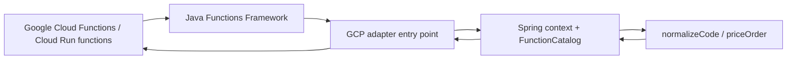
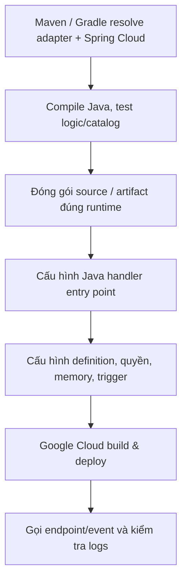

# Phụ thuộc `spring-cloud-function-adapter-gcp` trong Google Cloud

## Mục tiêu bài học

**Spring Cloud Function** cho phép viết logic nghiệp vụ một lần bằng `Supplier`, `Function` hoặc `Consumer`, rồi gọi lại logic đó bằng Java, HTTP, sự kiện hoặc môi trường serverless. Trong chương **Google Cloud**, thư viện `spring-cloud-function-adapter-gcp` đóng vai trò **cầu nối giữa mô hình hàm của Spring Cloud Function và cơ chế gọi hàm Java trên nền tảng Google Cloud**.

Bài này tập trung vào **dependency và những thành phần đi kèm**, không coi việc thêm một dòng Maven/Gradle là đã hoàn tất triển khai cloud.

Sau khi học, bạn có thể:

- Xác định đúng tọa độ Maven của `spring-cloud-function-adapter-gcp` và quản lý phiên bản tương thích Spring Boot/Spring Cloud Function.
- Phân biệt **bean nghiệp vụ** trong `FunctionCatalog`, **entry point của Google Cloud Functions** và **điểm khởi động Spring Boot**.
- Tạo ví dụ `Function<PriceRequest, PriceResponse>` độc lập HTTP và kiểm tra nó qua Spring context.
- Hiểu yêu cầu của **Google Cloud Functions/Cloud Run functions**, Java Functions Framework và đóng gói artifact.
- Tránh nhầm adapter GCP với Spring Cloud Function Web adapter hoặc Pub/Sub binder.
- Thiết lập các bước thử nghiệm, quan sát lỗi, bảo mật và cân nhắc cold start.

## 1. Adapter GCP giải quyết vấn đề gì?

Giả sử bạn có một bean Java:

```java
@Bean
Function<String, String> normalizeCode() {
    return text -> text.trim().toUpperCase(Locale.ROOT);
}
```

Spring Cloud Function có thể nhận diện bean `normalizeCode` và công bố qua `FunctionCatalog`. Tuy nhiên, **Google Cloud không gọi trực tiếp `catalog.lookup(...)`**: nền tảng serverless cần một *entry point* đáp ứng hợp đồng của Java Functions Framework để nhận request/event.

Adapter GCP nằm giữa hai thế giới:



Trong sơ đồ:

1. Google Cloud kích hoạt một function theo HTTP hoặc một loại sự kiện được cấu hình.
2. Java Functions Framework chuyển lời gọi tới **handler/entry point Java** đã chỉ định.
3. Spring Cloud Function GCP adapter sử dụng Spring context và `FunctionCatalog` để tìm hàm nghiệp vụ.
4. Dữ liệu được chuyển đổi theo hợp đồng adapter, hàm được gọi, kết quả được ánh xạ về response khi phù hợp.

**Cần phân biệt** khả năng của framework với khả năng của từng adapter và từng thế hệ Google Cloud Functions. Một thư viện GCP adapter không đồng nghĩa mọi kiểu `HttpFunction`, `CloudEventsFunction`, `BackgroundFunction`, streaming và trigger đều được hỗ trợ cùng cách ở mọi phiên bản.

## 2. Tọa độ dependency Maven

Artifact dành cho phần tích hợp Google Cloud của Spring Cloud Function là:

```xml
<dependency>
    <groupId>org.springframework.cloud</groupId>
    <artifactId>spring-cloud-function-adapter-gcp</artifactId>
</dependency>
```

**Group ID:** `org.springframework.cloud`. **Artifact ID:** `spring-cloud-function-adapter-gcp`.

Không nên tự chọn phiên bản ngẫu nhiên chỉ vì artifact tải được từ repository. Nó cần phù hợp với:

- Spring Boot và Spring Framework của ứng dụng.
- Spring Cloud Function Context và các module Spring Cloud Function khác.
- Runtime Java được Google Cloud hỗ trợ ở môi trường đích.
- Công cụ build/deploy, Google Functions Framework và các dependency đi kèm.

### Sử dụng BOM để thống nhất phiên bản

Với Maven, nếu dự án sử dụng Spring Boot parent hoặc một cơ chế quản lý phiên bản Boot tương đương, có thể nhập BOM Spring Cloud **tương thích với phiên bản Boot đó**:

```xml
<dependencyManagement>
    <dependencies>
        <dependency>
            <groupId>org.springframework.cloud</groupId>
            <artifactId>spring-cloud-dependencies</artifactId>
            <version>SPRING_CLOUD_RELEASE_VERSION</version>
            <type>pom</type>
            <scope>import</scope>
        </dependency>
    </dependencies>
</dependencyManagement>

<dependencies>
    <dependency>
        <groupId>org.springframework.cloud</groupId>
        <artifactId>spring-cloud-function-adapter-gcp</artifactId>
    </dependency>
</dependencies>
```

`SPRING_CLOUD_RELEASE_VERSION` là **ký hiệu cần thay bằng release train thực tế**, không phải chuỗi version có thể chạy nguyên trạng. Hãy đối chiếu ma trận tương thích Spring Cloud/Spring Boot và BOM đang dùng. Trong trường hợp dự án quản lý Spring Cloud Function bằng BOM chuyên biệt, cần áp dụng đúng BOM của dòng Spring Cloud Function đang triển khai và tránh để các BOM kéo các module Function về phiên bản mâu thuẫn.

**Không sao chép nguyên vẹn đoạn XML này làm `pom.xml` hoàn chỉnh**: ví dụ chỉ hiển thị dependency management và dependency, chưa có group/artifact/version của ứng dụng, plugin build hoặc Java toolchain.

### Có cần khai báo thêm `spring-cloud-function-context`?

`spring-cloud-function-adapter-gcp` dùng hạ tầng Spring Cloud Function, trong đó `FunctionCatalog` là thành phần trung tâm. Adapter có thể kéo một số module liên quan **transitively** tùy phiên bản; nếu code dự án trực tiếp import API catalog thì khai báo dependency Context tường minh cũng giúp mô tả rõ ràng quan hệ:

```xml
<dependency>
    <groupId>org.springframework.cloud</groupId>
    <artifactId>spring-cloud-function-context</artifactId>
</dependency>
```

Điều này **không có nghĩa** thêm hai dependency sẽ tự khởi chạy HTTP handler. Bạn vẫn cần cấu hình ứng dụng, lớp handler phù hợp, packaging và Google Cloud runtime.

## 3. Khai báo bằng Gradle

Với Gradle Groovy DSL trong một dự án đã cấu hình plugin Spring Boot và quản lý version Java thích hợp:

```groovy
dependencies {
    implementation platform(
        "org.springframework.cloud:spring-cloud-dependencies:SPRING_CLOUD_RELEASE_VERSION"
    )

    implementation "org.springframework.cloud:spring-cloud-function-adapter-gcp"
    implementation "org.springframework.cloud:spring-cloud-function-context"

    testImplementation "org.springframework.boot:spring-boot-starter-test"
}
```

Hãy thay `SPRING_CLOUD_RELEASE_VERSION` bằng release train khớp với Spring Boot của dự án. Nếu đã dùng plugin `io.spring.dependency-management` và BOM ở nơi khác, không cần sao chép một cách quản lý phiên bản thứ hai thiếu nhất quán.

Trong Gradle Kotlin DSL, ý tưởng tương tự:

```kotlin
dependencies {
    implementation(platform(
        "org.springframework.cloud:spring-cloud-dependencies:SPRING_CLOUD_RELEASE_VERSION"
    ))
    implementation("org.springframework.cloud:spring-cloud-function-adapter-gcp")
    implementation("org.springframework.cloud:spring-cloud-function-context")
    testImplementation("org.springframework.boot:spring-boot-starter-test")
}
```

Đoạn cấu hình này chỉ trình bày **phần dependency**. Build trên Google Cloud còn phụ thuộc plugin, loại artifact, builder và chế độ deploy nguồn hay deploy image của nền tảng.

### Kiểm tra dependency đã được resolve

Một số lệnh hữu ích khi dự án đã có build chạy được:

```bash
./mvnw dependency:tree
```

```bash
./gradlew dependencies --configuration runtimeClasspath
```

Kiểm tra xem `spring-cloud-function-adapter-gcp`, `spring-cloud-function-context`, Spring Boot/Spring Framework và các thư viện Google Functions Framework có được resolve như dự kiến không. Đặc biệt chú ý **hai phiên bản khác nhau của cùng một thư viện** bị kéo vào bởi dependency transitive.

## 4. Phân biệt bốn lớp trách nhiệm

Khi xử lý một lời gọi Google Cloud, có ít nhất bốn khái niệm tên khác nhau:

| Khái niệm | Ví dụ | Ai dùng? |
| --- | --- | --- |
| **Bean name / FunctionCatalog name** | `priceOrder` | Spring Cloud Function tra cứu hàm nghiệp vụ |
| **Function definition** | `spring.cloud.function.definition=priceOrder` | Adapter/catalog chọn hàm hoặc composition |
| **Google Cloud Java entry point** | Lớp handler do adapter cung cấp, ví dụ `GcfJarLauncher` ở các bản hỗ trợ | Java Functions Framework gọi theo cấu hình deploy |
| **Spring Boot application class** | `PriceFunctionApplication` | Spring bootstrap dùng để tạo application context và đăng ký bean |

Ví dụ một số phiên bản Spring Cloud Function GCP dùng lớp launcher có tên:

```text
org.springframework.cloud.function.adapter.gcp.GcfJarLauncher
```

**Phải kiểm tra class và hợp đồng handler trong chính artifact/phiên bản đang sử dụng** trước khi điền `--entry-point`. Không giả định cùng một launcher có thể xử lý mọi kiểu trigger hoặc mọi bản Java runtime. Tên `priceOrder` là tên hàm Spring, **không phải tên entry point Java do Google Cloud bắt buộc phải tải**.

Tương tự, `PriceFunctionApplication.main(...)` có thể giúp khởi chạy ứng dụng ở JVM cục bộ, nhưng Google Cloud Functions Java runtime **gọi entry point được cấu hình**, không nhất thiết gọi `main` trước mỗi request.

## 5. Ví dụ nghiệp vụ: tính tiền đơn hàng

Ví dụ dùng Java 17+ (vì có `record`) và Spring Boot/Spring Cloud Function các phiên bản tương thích. Logic chỉ biết dữ liệu Java, không phụ thuộc `HttpRequest`, `HttpResponse` hay Pub/Sub.

Các class ở package `example.gcp`.

### 5.1. DTO đầu vào và đầu ra

File `PriceRequest.java`:

```java
package example.gcp;

public record PriceRequest(String orderId, int quantity) {
}
```

File `PriceResponse.java`:

```java
package example.gcp;

public record PriceResponse(String orderId, long totalCents) {
}
```

Mỗi record được đặt trong một file Java cùng tên. Trong hệ thống thực tế nên xác thực chặt `orderId`, xử lý quyền truy cập và bổ sung giới hạn số lượng phù hợp với nghiệp vụ.

### 5.2. Đăng ký hàm bằng `@Bean`

File `PriceFunctionApplication.java`:

```java
package example.gcp;

import java.util.function.Function;

import org.springframework.boot.SpringApplication;
import org.springframework.boot.autoconfigure.SpringBootApplication;
import org.springframework.context.annotation.Bean;

@SpringBootApplication(proxyBeanMethods = false)
public class PriceFunctionApplication {

    public static void main(String[] args) {
        SpringApplication.run(PriceFunctionApplication.class, args);
    }

    @Bean
    public Function<PriceRequest, PriceResponse> priceOrder() {
        return request -> {
            if (request == null
                    || request.orderId() == null
                    || request.orderId().isBlank()
                    || request.quantity() <= 0) {
                throw new IllegalArgumentException(
                        "Dữ liệu đơn hàng không hợp lệ");
            }

            long total = Math.multiplyExact(
                    (long) request.quantity(), 15_000L);

            return new PriceResponse(request.orderId(), total);
        };
    }
}
```

Chữ ký `Function<PriceRequest, PriceResponse>` giữ rõ thông tin generic, hữu ích cho `FunctionCatalog` và lớp chuyển đổi JSON của adapter. Với đầu vào:

```json
{"orderId":"ORD-55","quantity":2}
```

kết quả nghiệp vụ dự kiến:

```json
{"orderId":"ORD-55","totalCents":30000}
```

**Giới hạn của ví dụ:** chỉ riêng mã trên **không tạo Google Cloud Java entry point**. Cần adapter GCP tương thích, cách bootstrap để handler tìm thấy Spring application và cấu hình deploy phù hợp. Hơn nữa, nếu một Google Cloud runtime không hỗ trợ Java version bạn dùng, phải chọn lại Java toolchain hoặc môi trường triển khai.

### 5.3. Chọn hàm qua `spring.cloud.function.definition`

Với ứng dụng có thể đăng ký nhiều `Function`, hãy chọn rõ hàm mà adapter cần gọi:

```properties
spring.cloud.function.definition=priceOrder
```

Trong `application.yml`:

```yaml
spring:
  cloud:
    function:
      definition: priceOrder
```

Thuộc tính này **không tạo một function bean**. Nó chỉ chọn `priceOrder` đã có trong context/catalog. Khi đăng ký bằng tên khác, phải chỉnh property cho khớp.

Ở môi trường hỗ trợ ánh xạ property Spring Boot từ biến môi trường, có thể đặt:

```text
SPRING_CLOUD_FUNCTION_DEFINITION=priceOrder
```

Không nên hard-code nhánh xử lý theo request HTTP bên trong `priceOrder`. Nhờ mô hình `Function`, cùng logic có thể được gọi trong test Java hoặc từ adapter khác mà không thay đổi mã.

## 6. Dependency GCP adapter khác gì `spring-cloud-function-web`?

Hai adapter hướng đến **môi trường chạy khác nhau**.

| Thành phần | Mục đích | Trường hợp tiêu biểu |
| --- | --- | --- |
| `spring-cloud-function-context` | `FunctionCatalog` và mô hình function | Tra cứu/gọi hàm trong Spring context |
| `spring-cloud-function-adapter-gcp` | Tích hợp lời gọi Google Cloud Functions Java với Spring Cloud Function | Deploy hàm trên Google Cloud Functions / Cloud Run functions khi runtime hỗ trợ |
| `spring-cloud-function-web` | Ánh xạ hàm với web adapter của Spring Cloud Function | Ứng dụng Spring Boot tự chạy HTTP server |
| `spring-boot-starter-web` | Hạ tầng web MVC/servlet thông thường của Spring Boot | Spring Boot app/server; không tự biến nó thành Google Cloud function |
| Spring Cloud Stream + Pub/Sub binder | Binding và vận chuyển message Pub/Sub | Ứng dụng xử lý messaging qua binder |
| Google Java Functions Framework API/invoker | Hợp đồng HTTP/event handler và công cụ gọi handler | Google Functions Java runtime hoặc local invoker |

Không nên thêm `spring-cloud-function-web` và `spring-boot-starter-web` chỉ để “cho adapter GCP hoạt động”, khi runtime GCP adapter đã xử lý HTTP qua hợp đồng Java Functions Framework. Thêm web stack không cần thiết có thể khiến khởi động nặng hơn hoặc kéo thêm auto-configuration không dùng đến.

Ngược lại, nếu bạn muốn chạy **một dịch vụ Spring Boot độc lập** có server HTTP để tự test endpoint `/priceOrder`, khi đó web adapter có thể hữu ích. Hãy chọn **một đường HTTP phù hợp mục tiêu deploy** và kiểm tra lớp adapter thực sự nhận request.

**Pub/Sub là chủ đề riêng:** thêm `spring-cloud-function-adapter-gcp` không tự tạo subscription, không cấp IAM permission và không thay thế binder của Spring Cloud Stream. Một Pub/Sub trigger cũng có hợp đồng payload/event cụ thể, có thể khác hợp đồng JSON HTTP thông thường.

## 7. Google Cloud Java runtime và entry point

Java Functions Framework sử dụng các hợp đồng handler phổ biến:

- `com.google.cloud.functions.HttpFunction` cho HTTP request/response.
- `com.google.cloud.functions.CloudEventsFunction` cho CloudEvent ở những môi trường/hệ sự kiện tương ứng.
- `com.google.cloud.functions.BackgroundFunction<T>` cho một số hợp đồng sự kiện nền của thế hệ cũ, tùy runtime.

**Không suy ra tất cả interface trên đều được adapter GCP của mọi phiên bản triển khai.** Nếu cần HTTP, chọn launcher/entry point HTTP mà phiên bản adapter hỗ trợ. Nếu nhận Pub/Sub/Eventarc, xác minh adapter có hỗ trợ đúng signature và envelope của thế hệ functions đang dùng.

Google Cloud hiện có mô hình **Cloud Run functions** cho các function thế hệ mới, trong khi nhiều tài liệu/mẫu lịch sử dùng tên **Cloud Functions** hoặc **Cloud Functions 1st gen / 2nd gen**. Giữa các thế hệ có khác biệt về runtime, ingress, identity, trigger và triển khai; không nên áp dụng nguyên một lệnh deploy của tài liệu cũ mà không kiểm tra.

### Ba việc cần xác minh trước khi deploy

1. **Handler:** xác định tên lớp entry point Java thực sự có trong artifact GCP adapter và signature mà runtime yêu cầu.
2. **Spring bootstrap:** bảo đảm launcher nhìn thấy ứng dụng Spring Boot và bean `priceOrder` ở thời điểm khởi động.
3. **Function definition:** xác nhận `spring.cloud.function.definition=priceOrder` chọn đúng hàm trong `FunctionCatalog`.

Nếu bạn truyền `--entry-point=priceOrder` trong khi nền tảng đòi hỏi tên **Java handler class**, deploy có thể báo không tìm thấy target. Nếu nhập `--entry-point=PriceFunctionApplication`, class ứng dụng Spring Boot cũng chưa chắc triển khai giao diện Google Functions Framework. Đây là lỗi khác với lỗi `FunctionCatalog.lookup("priceOrder")` trả `null`.

## 8. Đóng gói và triển khai: hiểu những thành phần bắt buộc

Tùy nền tảng và phiên bản, có các kiểu triển khai khác nhau: triển khai **từ source**, triển khai qua buildpacks hoặc triển khai một **container image**. Không phải tất cả cùng sử dụng một lệnh Maven, một loại JAR hay cùng handler.

Quy trình tổng quát:



### Mẫu lệnh deploy có tham số cần thay thế

Đây là **khung lệnh** dành cho một môi trường hỗ trợ giao diện `gcloud functions deploy` tương ứng. Nó cố tình dùng placeholder, vì runtime và handler cụ thể phụ thuộc phiên bản adapter/Google Cloud bạn đã chọn:

```bash
gcloud functions deploy order-pricing \
  --gen2 \
  --region=REGION_ID \
  --runtime=SUPPORTED_JAVA_RUNTIME \
  --source=. \
  --entry-point=ADAPTER_HTTP_HANDLER_CLASS \
  --trigger-http
```

Bạn phải thay `REGION_ID`, `SUPPORTED_JAVA_RUNTIME` và `ADAPTER_HTTP_HANDLER_CLASS` bằng giá trị hợp lệ; chúng **không phải giá trị triển khai trực tiếp**. Trước đó cần chọn project, cấp quyền cho tài khoản triển khai, kích hoạt các API cần thiết và cấu hình authentication/ingress. Với môi trường dùng giao diện Cloud Run mới, lệnh/flag triển khai có thể khác.

Tránh tự động thêm `--allow-unauthenticated` trong môi trường production chỉ để thử nhanh. HTTP endpoint thực tế nên được bảo vệ bằng IAM/identity token, cơ chế xác thực phù hợp và nguyên tắc cấp quyền tối thiểu.

### Cấu hình lúc deploy

Trong môi trường đích, cần xét ít nhất:

| Nhóm | Câu hỏi |
| --- | --- |
| Version | Java runtime được hỗ trợ có tương thích bytecode mà bạn build không? |
| Entry point | Nền tảng đang gọi **class handler GCP**, hay nhầm với bean name? |
| Application discovery | Spring context có nạp `PriceFunctionApplication` và bean `priceOrder` không? |
| Definition | Có nhiều bean `Supplier`/`Function`/`Consumer` khiến adapter phải chọn tên cụ thể không? |
| Runtime resources | Memory, CPU, timeout và concurrency có phù hợp cold start của Spring không? |
| Security | Function có public không? Ai được phép gọi, truy cập secrets và resource bên ngoài? |
| Trigger | Đây là HTTP hay CloudEvent/Pub/Sub? Adapter hỗ trợ envelope đó không? |
| Logs | Có thể phân biệt lỗi khởi tạo Spring context với lỗi `apply(...)` hoặc lỗi serialization không? |

Không nên giả định fat JAR do Spring Boot tạo ra có thể sử dụng nguyên trạng như **source package của Google Cloud Java Functions**. Cách tìm entry point và bố trí dependency phải theo **cơ chế buildpack/functions framework của runtime** và hướng dẫn phiên bản Spring Cloud Function GCP adapter.

## 9. Gọi HTTP và chuyển đổi JSON

Giả sử function đã triển khai bằng **HTTP entry point tương thích**, có URL được cung cấp bởi Google Cloud và Spring context chứa `priceOrder`.

Một request nghiệp vụ minh họa:

```bash
curl -X POST "$FUNCTION_URL" \
  -H "Content-Type: application/json" \
  -H "Authorization: Bearer $ID_TOKEN" \
  --data '{"orderId":"ORD-55","quantity":2}'
```

Trong đó `FUNCTION_URL` là URL thực tế của function, `ID_TOKEN` là identity token hợp lệ theo chính sách xác thực của dịch vụ. Cách lấy token cần phù hợp với tài khoản và audience của đích; **không đưa token vào source code hoặc log công khai**.

Nếu adapter/codec ánh xạ JSON body vào `PriceRequest` như cấu hình mong muốn, hàm có thể trả một payload tương đương:

```json
{"orderId":"ORD-55","totalCents":30000}
```

**Đây là kết quả nghiệp vụ kỳ vọng, không phải bảo đảm về wire format.** Tùy phiên bản adapter, có thể có yêu cầu khác đối với payload, headers, cấu trúc response hoặc loại trigger. Hãy kiểm tra thực tế đường JSON → `PriceRequest` → `Function.apply` → `PriceResponse` → HTTP response.

### Vì sao generic rất quan trọng?

Chữ ký:

```java
Function<PriceRequest, PriceResponse>
```

giúp Spring Cloud Function biết kiểu đích cho payload và kiểu trả về. Nếu thay bằng raw `Function`, thông tin generic có thể bị mất:

```java
// Tránh kiểu trả về thô khi cần chuyển đổi DTO:
@Bean
@SuppressWarnings({"rawtypes", "unchecked"})
Function rawPriceOrder() {
    return (Function<PriceRequest, PriceResponse>)
            request -> new PriceResponse(
                    request.orderId(),
                    (long) request.quantity() * 15_000L);
}
```

Lambda ở ví dụ trên có thể gọi được với kiểu Java đúng nhưng bean definition không công bố `PriceRequest`/`PriceResponse` rõ ràng. Với các trường hợp đăng ký động, một `FunctionRegistration` và metadata kiểu tường minh có thể cần thiết; phải áp dụng API theo phiên bản Spring Cloud Function hiện dùng.

Ngoài generic, JSON mapper, content type, charset, cách deserialize Java record và giới hạn kích thước body cũng có thể ảnh hưởng kết quả. **Dependency GCP adapter không tự chữa mọi lỗi chuyển đổi**.

## 10. Kiểm thử trước khi sử dụng Google Cloud

### 10.1. Unit test logic thuần Java

Có thể gọi `Function` trực tiếp mà không cần Google Cloud:

```java
package example.gcp;

import static org.junit.jupiter.api.Assertions.assertEquals;
import org.junit.jupiter.api.Test;

class PriceLogicTest {

    @Test
    void calculatesOrderTotal() {
        PriceFunctionApplication configuration =
                new PriceFunctionApplication();

        PriceResponse result = configuration.priceOrder()
                .apply(new PriceRequest("ORD-55", 2));

        assertEquals(new PriceResponse("ORD-55", 30_000L), result);
    }
}
```

Test này kiểm tra toán nghiệp vụ nhưng **chưa chứng minh Spring context, GCP launcher hoặc JSON adapter hoạt động**. Nếu muốn tách business layer hơn nữa, hãy chuyển hàm vào lớp `PriceOrderFunction implements Function<...>` riêng rồi test trực tiếp lớp đó.

### 10.2. Integration test `FunctionCatalog`

Với JUnit 5 và Spring Boot Test:

```java
package example.gcp;

import static org.junit.jupiter.api.Assertions.assertEquals;
import static org.junit.jupiter.api.Assertions.assertNotNull;

import java.util.function.Function;
import org.junit.jupiter.api.Test;
import org.springframework.beans.factory.annotation.Autowired;
import org.springframework.boot.test.context.SpringBootTest;
import org.springframework.cloud.function.context.FunctionCatalog;

@SpringBootTest(
        classes = PriceFunctionApplication.class,
        webEnvironment = SpringBootTest.WebEnvironment.NONE)
class PriceCatalogTest {

    @Autowired
    FunctionCatalog catalog;

    @Test
    void canFindNamedFunction() {
        Function<PriceRequest, PriceResponse> fn =
                catalog.lookup("priceOrder");

        assertNotNull(fn);
        assertEquals(
                new PriceResponse("ORD-55", 30_000L),
                fn.apply(new PriceRequest("ORD-55", 2)));
    }
}
```

Test này xác minh Spring Boot/Spring Cloud Function đã nạp `priceOrder` và `FunctionCatalog` tra cứu được hàm. Nó **không khởi chạy Google Functions Framework**, vì vậy cần thêm test qua handler thực tế.

### 10.3. Local invoker hoặc môi trường thử nghiệm

Với Java Functions Framework và adapter GCP đúng phiên bản, bạn có thể chạy local invoker/plugin được Google Cloud hỗ trợ rồi gửi HTTP request vào Java entry point đã chọn. Các lệnh kiểu `mvn function:run` chỉ hoạt động khi **plugin Functions Framework tương ứng đã được cấu hình**; đừng cho rằng chỉ thêm `spring-cloud-function-adapter-gcp` là Maven tự có goal này.

Cần kiểm tra theo ba lớp:

1. **Handler được tải:** Java Functions Framework tìm thấy class handler/entry point GCP.
2. **Spring được khởi tạo:** handler có thể tạo Spring context và tra cứu `priceOrder`.
3. **Payload được chuyển đổi:** cùng JSON như ở production tạo ra `PriceRequest` và response đúng.

Nếu local test đi qua một controller Spring MVC khác mà không qua GCP handler, test đó không đủ để kết luận adapter GCP hoạt động.

### 10.4. Kiểm thử trên môi trường cloud

Sau khi deploy, thực hiện một smoke test có xác thực và quan sát logs. Đối với function xử lý event, dùng **event mẫu đúng định dạng của trigger**, không biến CloudEvent thành HTTP JSON tùy ý. Kiểm tra latency lần gọi đầu (cold start) lẫn các lần gọi tiếp theo, timeout và memory.

## 11. Nhiều function bean, composition và trigger

Spring Cloud Function có thể kết hợp các hàm khi kiểu tương thích. Ví dụ bổ sung:

```java
@Bean
public Function<PriceResponse, String> formatReceipt() {
    return result ->
            result.orderId() + ":" + result.totalCents();
}
```

Với hai bean `priceOrder` và `formatReceipt` được đăng ký, `FunctionCatalog` có thể tra cứu:

```java
Function<PriceRequest, String> chain =
        catalog.lookup("priceOrder|formatReceipt");
```

Adapter có thể chọn cùng biểu thức theo cấu hình:

```properties
spring.cloud.function.definition=priceOrder|formatReceipt
```

Tuy nhiên, **khả năng handler GCP trả về dữ liệu phù hợp còn phụ thuộc kiểu request/response và codec của adapter**. Composition không có nghĩa Google Cloud tự kích hoạt hai cloud functions riêng biệt, cũng không tạo Pub/Sub trigger mới.

Đối với `Supplier` hoặc `Consumer`:

- `Supplier` không nhận đầu vào nghiệp vụ; cơ chế adapter quyết định khi nào `get()` được gọi. Thêm adapter GCP không tự tạo lịch polling.
- `Consumer` không trả kết quả nghiệp vụ; hãy thiết kế side effect an toàn, có idempotency nếu có retry.
- Các biến thể reactive `Flux`/`Mono` hay CloudEvent cần xác minh hỗ trợ thực tế của adapter và nền tảng; không suy ra chỉ vì `FunctionCatalog` hỗ trợ các kiểu đó.

## 12. Bảo mật, cold start và vận hành

### 12.1. Xác thực và phân quyền

Một function HTTP có thể được cấu hình public hoặc yêu cầu identity token tùy chính sách. Trong production, ưu tiên **xác thực người gọi**, IAM tối thiểu và hạn chế ingress phù hợp. Không đặt API key, mật khẩu hoặc service account key trong source hay `application.properties` được commit.

Nếu hàm gọi Google Cloud Storage, Pub/Sub, Secret Manager hoặc API khác, nên cấp quyền cho **runtime service account** đúng resource và dùng cơ chế Application Default Credentials được hỗ trợ. Đây là quyền của ứng dụng tại runtime, độc lập với dependency `spring-cloud-function-adapter-gcp`.

### 12.2. Cold start và vòng đời Spring context

Spring Boot context cần khởi tạo khi một instance mới của function được tạo. Cold start có thể phụ thuộc kích thước classpath, số lượng bean, auto-configuration, JSON mapper, kết nối ngoài và memory/CPU được cấp.

Để giảm độ trễ có thể:

- Giữ dependency tối thiểu, tránh thêm cả web stack/binder khi không sử dụng.
- Không tạo kết nối chậm hoặc đọc dữ liệu mạng không cần thiết ở static initializer.
- Dùng đúng vùng triển khai và cấu hình resource cho workload.
- Đo cả cold invocation và warm invocation trên runtime thực tế.

Không dựa vào việc một instance luôn tồn tại: Google Cloud có thể tạo hoặc hủy instance tùy tải. Vì thế, **trạng thái trong memory không phải kho dữ liệu bền vững**.

### 12.3. Retry, concurrency và side effect

Khi event được gửi lại, `Consumer` có thể thực hiện hành động hai lần nếu không thiết kế idempotency. Nếu nhiều request dùng cùng Spring bean singleton, cần đảm bảo trạng thái mutable được quản lý thread-safe.

Ghi log theo correlation ID/event ID khi phù hợp, nhưng tránh log payload chứa thông tin nhạy cảm. Theo dõi nguyên nhân thất bại ở handler, startup Spring, `FunctionCatalog`, conversion và nghiệp vụ riêng biệt.

## 13. Những lỗi thường gặp

| Triệu chứng | Nguyên nhân có thể | Cách kiểm tra và xử lý |
| --- | --- | --- |
| Build báo không resolve được `spring-cloud-function-adapter-gcp` | Thiếu repository, sai version hoặc BOM không phù hợp | Kiểm tra tọa độ artifact, dependency management và repository |
| Lỗi `NoSuchMethodError` / class incompatible khi khởi động | Spring Boot, Spring Framework, Spring Cloud Function hoặc Functions Framework lệch phiên bản | Đồng bộ BOM, xem dependency tree, đối chiếu ma trận tương thích |
| Google Cloud báo không tìm thấy entry point | Truyền tên bean `priceOrder` thay vì Java handler, hoặc class handler không có trong artifact | Đối chiếu `--entry-point` với launcher và kiểu trigger của bản adapter |
| Handler được gọi nhưng `FunctionCatalog` không có | Spring application chưa được nạp hoặc thiếu Function Context | Kiểm tra bootstrap, application class, dependency và logs |
| `lookup("priceOrder")` trả `null` | Bean name không khớp hoặc bean không được đăng ký | Kiểm tra `@Bean`, `definition` và package/configuration |
| Có nhiều hàm nhưng chạy sai hàm | Chưa cấu hình `spring.cloud.function.definition` rõ ràng | Chọn tên hoặc composition theo đúng contract của adapter |
| HTTP 401 hoặc 403 | Thiếu token, sai audience hoặc IAM chưa cho phép | Xác nhận chính sách truy cập và runtime caller/service account |
| HTTP 404 | Route/URL sai, function chưa deploy hoặc đang gọi web adapter khác | Xác nhận URL/entry point, thế hệ function và loại trigger |
| JSON không ánh xạ được `PriceRequest` | Generic mất, content type sai hoặc body format không tương thích | Giữ `Function<PriceRequest, PriceResponse>` và test converter qua GCP handler |
| CloudEvent/Pub/Sub không đến được hàm | Trigger/event signature không khớp adapter hoặc thiếu quyền subscription/trigger | Kiểm tra event source, envelope, Eventarc/Pub/Sub và IAM |
| Maven `function:run` không tồn tại | Chưa cấu hình plugin Functions Framework tương ứng | Cài/cấu hình plugin đúng phiên bản hoặc chọn local invoker khác |
| Local JVM test pass nhưng deploy lỗi | Test không đi qua launcher, đóng gói thiếu class/dependency hoặc Java runtime khác | Test handler và artifact triển khai thực tế |
| Cold start/timeout cao | Spring context lớn, I/O khởi tạo chậm hoặc resource quá thấp | Đo startup, tối giản dependency và điều chỉnh memory/timeout phù hợp |

### Quy trình chẩn đoán theo lớp

1. **Dependency:** artifact và các version đã resolve đúng chưa?
2. **Entry point:** Google Cloud Java Functions Framework có tải đúng handler class không?
3. **Spring bootstrap:** context được tạo và có bean `priceOrder` không?
4. **Catalog:** `FunctionCatalog.lookup("priceOrder")` có tìm được hàm đúng không?
5. **Payload:** HTTP body/event envelope có chuyển thành kiểu Java mong đợi không?
6. **Vận hành:** IAM, timeout, memory, retry và các API bên ngoài có đáp ứng không?

Đi theo thứ tự này tránh tình huống sửa `application.properties` trong khi lỗi thực sự là Google Cloud không tìm thấy Java entry point, hoặc thay handler trong khi lỗi thực sự là JSON converter.

## 14. Bài tập thực hành

**Bài tập 1 — Thêm dependency đúng:** tạo một Spring Boot project sử dụng Spring Cloud BOM tương thích, khai báo `spring-cloud-function-adapter-gcp` và `spring-cloud-function-context`. Kiểm tra dependency tree xem những phiên bản Spring liên quan có bị xung đột không.

**Bài tập 2 — Xác minh catalog:** triển khai bean `priceOrder` như phần 5, viết `@SpringBootTest` để tra cứu bằng tên và kiểm tra `PriceResponse("ORD-55", 30000)`.

**Bài tập 3 — Phân biệt hai tên:** ghi lại giá trị của `spring.cloud.function.definition` và class mà Google Functions Framework sử dụng làm entry point. Giải thích vì sao không thể tráo hai giá trị này.

**Bài tập 4 — Chọn môi trường:** so sánh nhu cầu chạy Spring Boot web service với nhu cầu triển khai Google Cloud Function. Nêu dependency/adapter tối thiểu cho mỗi kiểu; giải thích vì sao `spring-cloud-function-web` không phải lựa chọn bắt buộc khi đã dùng GCP handler.

**Bài tập 5 — Bảo mật HTTP:** triển khai thử một function có yêu cầu xác thực; gửi request với identity token hợp lệ và kiểm chứng response. Không gửi token trong tài liệu chia sẻ hoặc log.

**Bài tập 6 — Sự kiện:** nếu muốn dùng Pub/Sub/Eventarc thay HTTP, tìm hợp đồng Java event handler của runtime và phiên bản adapter. Thiết kế kiểm thử với envelope thật, nêu cách bảo đảm idempotency khi event bị gửi lại.

### Câu hỏi tự kiểm tra

1. **Artifact ID cho adapter Google Cloud là gì?** `spring-cloud-function-adapter-gcp`.
2. **Chỉ thêm adapter đã có function nghiệp vụ chưa?** Chưa. Cần tạo/đăng ký `Supplier`, `Function` hoặc `Consumer`.
3. **`FunctionCatalog` làm gì?** Tra cứu và gọi các hàm đã đăng ký, có thể hỗ trợ composition và chuyển đổi thông điệp qua framework.
4. **Tên `priceOrder` có luôn là `--entry-point` của Google Cloud không?** Không; đó là tên bean/hàm Spring. Google Cloud cần Java handler class phù hợp.
5. **Có cần thêm `spring-cloud-function-web` để một GCP adapter HTTP chạy không?** Không mặc định; hai adapter có môi trường đích khác nhau.
6. **Thêm GCP adapter có tự tạo Pub/Sub subscription không?** Không.
7. **Test `FunctionCatalog` pass có chứng minh Google Cloud deployment pass không?** Không; phải thử Java handler, cách đóng gói và môi trường đích.

## 15. Tổng kết và tài liệu đối chiếu

Dependency **`org.springframework.cloud:spring-cloud-function-adapter-gcp`** là cầu nối giúp sử dụng mô hình Spring Cloud Function trong môi trường Google Cloud Functions/Cloud Run functions tương thích. Nó không thay thế các thành phần còn lại: **Spring application + bean nghiệp vụ**, **`FunctionCatalog`**, **Google Cloud Java entry point**, **Functions Framework**, **đóng gói đúng runtime** và **cấu hình trigger/IAM**.

Khi thiết kế, nên bắt đầu bằng một `Function<I,O>` có generic rõ ràng, xác minh trong catalog, sau đó thử chính handler GCP và cuối cùng deploy với đúng runtime/entry point. Đối với Pub/Sub, CloudEvent và các nền tảng serverless khác, hãy xác minh hợp đồng adapter theo phiên bản, không coi mọi nguồn sự kiện là một HTTP POST JSON giống nhau.

Tài liệu tham khảo để đối chiếu phiên bản:

- [Spring Cloud Function Reference](https://docs.spring.io/spring-cloud-function/reference/) — programming model, adapter và hướng dẫn triển khai theo từng môi trường.
- [Spring Cloud Function — mã nguồn và ví dụ](https://github.com/spring-cloud/spring-cloud-function) — có thể tìm mẫu tích hợp Google Cloud phù hợp nhánh release đang dùng.
- [Google Cloud — Cloud Run functions](https://cloud.google.com/run/docs/functions) — môi trường chạy, trigger, quyền truy cập và cách deploy function.
- [Google Cloud — Java Functions Framework](https://github.com/GoogleCloudPlatform/functions-framework-java) — hợp đồng Java handler và công cụ chạy cục bộ.

**Lưu ý phiên bản:** class entry point, hỗ trợ HTTP/CloudEvent, Java runtime, phương thức build và câu lệnh deploy có thể khác nhau theo Spring Cloud Function và Google Cloud. Trước khi triển khai production, cần đối chiếu các thành phần đó với artifact và runtime thực tế.
