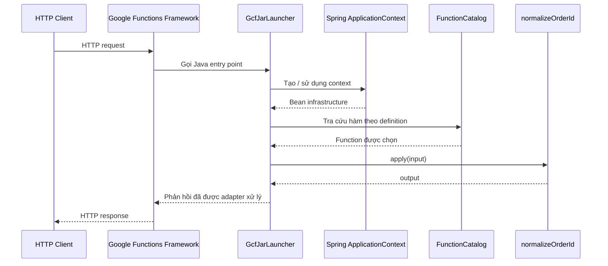
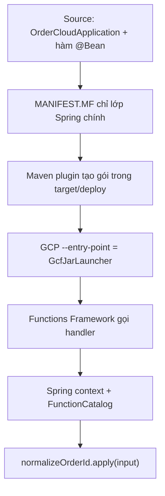

# Vai trò của `GcfJarLauncher` và lớp ứng dụng chính

## Mục tiêu bài học

Trong **Spring Cloud Function**, lập trình viên định nghĩa `Supplier`, `Function` hoặc `Consumer` như các thành phần xử lý nghiệp vụ độc lập giao thức. `FunctionCatalog` cho phép tìm và gọi chúng, đồng thời hỗ trợ composition và chuyển đổi thông điệp khi có adapter thích hợp. Trên **Google Cloud Functions / Cloud Run functions**, Google không trực tiếp biết cách tạo một Spring `ApplicationContext` hoặc gọi `FunctionCatalog.lookup(...)`; nền tảng cần một **Java function entry point** theo hợp đồng của runtime.

Với cách tích hợp được tài liệu Spring Cloud Function GCP adapter mô tả, lớp **`org.springframework.cloud.function.adapter.gcp.GcfJarLauncher`** đảm nhiệm vai trò entry point đó. Ngược lại, lớp ứng dụng chính, ví dụ **`com.example.gcp.OrderCloudApplication`**, là nơi cung cấp cấu hình Spring Boot và các bean hàm. Hai lớp có vai trò hoàn toàn khác nhau nhưng cùng cần thiết cho một gói triển khai đúng cách.

Sau bài học, bạn sẽ:

- Phân biệt **Google Cloud entry point**, **Spring Boot application class**, **bean name** và **`spring.cloud.function.definition`**.
- Hiểu cách `GcfJarLauncher` kết nối lời gọi của Google Functions Framework với Spring `ApplicationContext` và `FunctionCatalog`.
- Khai báo `Main-Class` trong manifest để gói triển khai chỉ ra lớp cấu hình ứng dụng chính theo mẫu GCP adapter.
- Tạo ví dụ Java cho `Function<String, String>`, cấu hình Maven, chạy local bằng Functions Framework và thử deploy có kiểm soát.
- Nhận biết khác biệt giữa manifest GCP và manifest của executable JAR Spring Boot thông thường.
- Chẩn đoán lỗi sai entry point, sai manifest, thiếu bean, sai function definition, đóng gói không đúng và lỗi HTTP/event.

**Phạm vi phiên bản:** ví dụ dựa trên mô hình `spring-cloud-function-adapter-gcp` và `GcfJarLauncher` được mô tả trong tài liệu Spring Cloud Function. API, khả năng tương thích với từng thế hệ Google Cloud Functions, Java runtime và cách build/deploy phải được đối chiếu với chính phiên bản dự án; không mặc định một cấu hình lịch sử phù hợp mọi môi trường hiện tại.

## 1. Bốn tên rất dễ nhầm trong một ứng dụng

Giả sử ứng dụng công bố hàm `normalizeOrderId`. Ta có thể gặp những tên sau:

| Tên | Ví dụ | Chịu trách nhiệm |
| --- | --- | --- |
| Google Cloud **Java entry point** | `org.springframework.cloud.function.adapter.gcp.GcfJarLauncher` | Được Google Functions Framework tìm và gọi khi có request/event theo hợp đồng của adapter |
| **Lớp ứng dụng chính** của Spring | `com.example.gcp.OrderCloudApplication` | Cung cấp cấu hình Spring Boot, `@Bean` và thông tin để tạo `ApplicationContext` |
| **Tên bean hàm** | `normalizeOrderId` | Được Spring Cloud Function nhận diện và tra cứu qua `FunctionCatalog` |
| **Function definition** | `spring.cloud.function.definition=normalizeOrderId` | Chọn hàm hoặc biểu thức composition đã tồn tại để adapter gọi |

Điểm cốt lõi:

- Khi Google Cloud yêu cầu **entry point**, trong cách triển khai này dùng tên lớp **`GcfJarLauncher`** theo đầy đủ package, **không dùng** `normalizeOrderId`.
- Khi adapter cần biết **ứng dụng Spring nào phải khởi tạo**, gói triển khai phải cung cấp thông tin về **lớp ứng dụng chính** theo quy ước của adapter, chẳng hạn manifest.
- Khi `FunctionCatalog` nhận yêu cầu **tra cứu hàm**, nó dùng tên bean **`normalizeOrderId`**, **không dùng** tên `GcfJarLauncher`.
- Khi ứng dụng có nhiều hàm, cấu hình **`spring.cloud.function.definition`** chỉ định hàm cần gọi; nó **không tạo bean mới**.

Một lệnh deploy sai như `--entry-point=normalizeOrderId` có thể khiến **Google Functions Framework không tìm được Java handler**, ngay cả khi Spring context và hàm Java hoàn toàn đúng. Ngược lại, `--entry-point=GcfJarLauncher` đúng nhưng catalog không có `normalizeOrderId` vẫn khiến quá trình thực thi thất bại ở một lớp khác.

## 2. `GcfJarLauncher` làm gì?

`GcfJarLauncher` là **lớp adapter/launcher** do thư viện `spring-cloud-function-adapter-gcp` cung cấp. Tài liệu Spring Cloud Function dùng chính class này làm `functionTarget` khi chạy Google Functions Framework cục bộ và làm `--entry-point` khi deploy theo cách đóng gói JAR mà adapter hướng dẫn.

```text
org.springframework.cloud.function.adapter.gcp.GcfJarLauncher
```

Một luồng gọi **HTTP Function** có thể hiểu theo các tầng sau:



Đây là **mô hình khái niệm**, không khẳng định Spring context được khởi tạo mới ở **mỗi request**. Runtime có thể tái sử dụng instance và context khi phục vụ các lời gọi tiếp theo; cách tái sử dụng phụ thuộc môi trường, phiên bản và vòng đời container.

Lớp launcher giúp:

1. Tiếp nhận điểm gọi mà Java Functions Framework hiểu.
2. Kết nối tới cách khởi tạo Spring application của gói triển khai.
3. Sử dụng mô hình hàm của Spring Cloud Function, thay vì yêu cầu ứng dụng tự viết controller hoặc Google Java handler cho từng hàm.
4. Chuyển lời gọi theo hợp đồng adapter, bao gồm xử lý payload/response ở mức phù hợp với loại trigger.

**Không nên tự suy ra** `GcfJarLauncher` hỗ trợ mọi biến thể `HttpFunction`, `BackgroundFunction<T>` và `CloudEventsFunction` giống hệt nhau. Tài liệu adapter có ví dụ cả HTTP và background function, nhưng cần kiểm tra loại trigger và Java Functions Framework API đúng thế hệ triển khai.

## 3. Lớp ứng dụng chính có vai trò gì?

Lớp ứng dụng chính thường là một lớp Spring Boot với `@SpringBootApplication`, chẳng hạn:

```java
package com.example.gcp;

import java.util.Locale;
import java.util.function.Function;

import org.springframework.boot.SpringApplication;
import org.springframework.boot.autoconfigure.SpringBootApplication;
import org.springframework.context.annotation.Bean;

@SpringBootApplication(proxyBeanMethods = false)
public class OrderCloudApplication {

    public static void main(String[] args) {
        SpringApplication.run(OrderCloudApplication.class, args);
    }

    @Bean
    public Function<String, String> normalizeOrderId() {
        return value -> {
            if (value == null || value.isBlank()) {
                throw new IllegalArgumentException(
                        "Mã đơn hàng không được rỗng");
            }
            return value.trim().toUpperCase(Locale.ROOT);
        };
    }
}
```

File tương ứng: `src/main/java/com/example/gcp/OrderCloudApplication.java`.

Phân tích:

- `OrderCloudApplication` là **Spring application class**, dùng để tổ chức cấu hình và các bean hàm.
- `main(String[] args)` cho phép chạy ứng dụng bằng cơ chế Spring Boot khi thích hợp; **nó không phải Google Java entry point** mà `--entry-point` của adapter yêu cầu.
- `@Bean` công bố hàm tên **`normalizeOrderId`**; generic `Function<String, String>` giúp catalog biết kiểu đầu vào/đầu ra.
- Hàm chỉ xử lý `String`, không phụ thuộc `HttpRequest`, `HttpResponse`, Pub/Sub hoặc Google Cloud SDK.
- `proxyBeanMethods = false` thích hợp khi không gọi các phương thức `@Bean` lẫn nhau theo cơ chế proxy; đó **không** phải một cấu hình Google Cloud bắt buộc.

Nhờ tách lớp nghiệp vụ với handler, cùng hàm có thể được test như Java thông thường, gọi qua `FunctionCatalog`, hoặc kết nối với HTTP/event adapter khác mà không phải viết lại logic.

### Tại sao vẫn cần `main(...)`?

Trong các ví dụ Spring Cloud Function GCP, lớp ứng dụng chứa `main(...)` để biểu diễn điểm khởi tạo Spring Boot thông thường. Đồng thời, thông tin **lớp cấu hình chính** được đưa vào gói triển khai để launcher biết ứng dụng Spring nào cần sử dụng.

**Phân biệt rõ:** việc class có phương thức `main` không có nghĩa Google Cloud runtime gọi phương thức đó **mỗi lần có event**. Java Functions Framework gọi **entry point đã cấu hình**. Quy trình bootstrap Spring bên trong adapter là trách nhiệm của launcher; chi tiết phản chiếu hoặc cách đọc manifest là vấn đề implementation phụ thuộc phiên bản.

## 4. Manifest: nối launcher với lớp ứng dụng chính

Theo mẫu được tài liệu Spring Cloud Function GCP nêu, cần chỉ rõ lớp ứng dụng chính trong **`META-INF/MANIFEST.MF`** của nguồn tài nguyên dự án.

Ví dụ đường dẫn nguồn:

```text
src/
└── main/
    ├── java/
    │   └── com/example/gcp/OrderCloudApplication.java
    └── resources/
        └── META-INF/
            └── MANIFEST.MF
```

Nội dung mẫu của `src/main/resources/META-INF/MANIFEST.MF`:

```text
Manifest-Version: 1.0
Main-Class: com.example.gcp.OrderCloudApplication
```

Theo hướng dẫn GCP adapter, giá trị **`Main-Class` ở đây là lớp ứng dụng chính**, **không phải** tên bean `normalizeOrderId` và **không phải** `GcfJarLauncher`. Đây là cơ chế giúp gói triển khai chứa thông tin bootstrap Spring mà adapter yêu cầu.

### Phân biệt với manifest của Spring Boot executable JAR

Đây là một khác biệt dễ gây lỗi:

| Gói / ngữ cảnh | `Main-Class` thường thể hiện điều gì? | Cần chú ý |
| --- | --- | --- |
| Mẫu GCP adapter theo tài liệu Spring Cloud Function | Lớp cấu hình ứng dụng, ví dụ `com.example.gcp.OrderCloudApplication` | Gói và launcher GCP phải đọc được metadata theo quy ước của adapter |
| Spring Boot **executable fat JAR** tiêu chuẩn | Một lớp **Spring Boot loader**, ví dụ `org.springframework.boot.loader.launch.JarLauncher` ở dòng Boot thích hợp | Lớp ứng dụng thường nằm ở thuộc tính **`Start-Class`** |
| Google Functions Framework khi chạy/deploy | **Java function target**, ví dụ `GcfJarLauncher` | Đây là tên được cung cấp qua `functionTarget` hoặc `--entry-point`, không phải tự động là `Main-Class` của Boot fat JAR |

Vì vậy, **không lấy một Spring Boot fat JAR bất kỳ rồi giả định nó là gói GCP adapter hợp lệ**. Spring Boot Maven plugin có thể tái đóng gói JAR và thay đổi metadata; kiểu classloader, dependency layout và manifest sau build cần được kiểm tra.

Tài liệu GCP adapter giới thiệu một cấu hình `spring-boot-maven-plugin` **có thêm dependency adapter bên trong plugin** nhằm tạo gói JAR phù hợp cho Google Cloud. Cấu hình `Main-Class` trong nguồn và metadata của **artifact cuối** phải được đối chiếu cùng nhau, vì plugin và hệ thống build có thể ghi lại manifest.

### Kiểm tra nội dung thực của gói

Với JDK có công cụ `jar`, có thể xem danh sách file:

```bash
jar tf target/deploy/YOUR_APPLICATION.jar
```

Để xem manifest của một JAR theo cách thuần JDK, có thể giải nén ra một thư mục kiểm tra:

```bash
jar xf YOUR_APPLICATION.jar META-INF/MANIFEST.MF
```

Rồi đọc `META-INF/MANIFEST.MF` và kiểm tra thông tin class chính. **Không dùng đoạn lệnh giải nén trong thư mục source đang có manifest quan trọng mà không có bản sao**, vì `jar xf` có thể ghi file vào thư mục hiện tại. Ngoài manifest, cần kiểm tra class ứng dụng và các dependency adapter/Function có thực sự được đóng gói đúng.

Tên `YOUR_APPLICATION.jar` là placeholder; đường dẫn và định dạng gói phụ thuộc plugin/bản build.

## 5. `pom.xml`: dependency và plugin phục vụ hai vai trò

Ví dụ dưới đây thể hiện phần cấu hình **cốt lõi** của một dự án Maven vốn đã có Spring Boot parent/BOM và Spring Cloud BOM tương thích. Đây **không phải POM hoàn chỉnh**; không được sao chép cả ví dụ thành một file duy nhất và cho rằng build ngay được.

### 5.1. Dependency chạy ứng dụng

```xml
<dependencies>
    <dependency>
        <groupId>org.springframework.cloud</groupId>
        <artifactId>spring-cloud-function-adapter-gcp</artifactId>
    </dependency>
    <dependency>
        <groupId>org.springframework.cloud</groupId>
        <artifactId>spring-cloud-function-context</artifactId>
    </dependency>
</dependencies>
```

`spring-cloud-function-context` cung cấp hạ tầng như `FunctionCatalog`; adapter GCP là phần tích hợp Google Functions Framework. Một số bản adapter có thể kéo Context theo dependency transitive, nhưng nếu code ứng dụng dùng trực tiếp `FunctionCatalog`, việc khai báo rõ dependency còn giúp diễn đạt đúng phụ thuộc của dự án.

Để quản lý phiên bản, nên dùng BOM Spring Cloud phù hợp với Spring Boot và **không tự ghép các version tùy tiện**:

```xml
<dependencyManagement>
    <dependencies>
        <dependency>
            <groupId>org.springframework.cloud</groupId>
            <artifactId>spring-cloud-dependencies</artifactId>
            <version>COMPATIBLE_SPRING_CLOUD_RELEASE</version>
            <type>pom</type>
            <scope>import</scope>
        </dependency>
    </dependencies>
</dependencyManagement>
```

`COMPATIBLE_SPRING_CLOUD_RELEASE` là placeholder; phải thay bằng release train tương thích với Spring Boot đang sử dụng.

### 5.2. Spring Boot Maven plugin: đóng gói GCP

Trong phần `<build><plugins>...</plugins></build>`, tài liệu Spring Cloud Function GCP mô tả cấu hình dạng:

```xml
<plugin>
    <groupId>org.springframework.boot</groupId>
    <artifactId>spring-boot-maven-plugin</artifactId>
    <configuration>
        <outputDirectory>target/deploy</outputDirectory>
    </configuration>
    <dependencies>
        <dependency>
            <groupId>org.springframework.cloud</groupId>
            <artifactId>spring-cloud-function-adapter-gcp</artifactId>
        </dependency>
    </dependencies>
</plugin>
```

**Cần chú ý phần `<plugin><dependencies>` riêng này.** Trong cơ chế đóng gói được tài liệu GCP adapter mô tả, nó cho phép plugin có phần mở rộng phù hợp để sinh ra **định dạng gói triển khai** mà Google Cloud adapter mong đợi. Dependency ở tầng plugin và dependency ở tầng ứng dụng **không phải cùng một việc**.

Với mẫu cấu hình đó, sau `mvn package`, tài liệu chỉ ra kết quả nằm trong **`target/deploy`**. Tuy nhiên, vị trí và cấu trúc cuối cùng cần kiểm tra theo phiên bản plugin và cách build thực tế; những thay đổi lớn giữa các thế hệ Spring Boot có thể làm ví dụ lịch sử cần điều chỉnh.

### 5.3. Google Functions Framework Maven plugin: chạy local

Tài liệu adapter dùng **`com.google.cloud.functions:function-maven-plugin`** để tạo local invoker:

```xml
<plugin>
    <groupId>com.google.cloud.functions</groupId>
    <artifactId>function-maven-plugin</artifactId>
    <version>COMPATIBLE_FUNCTION_PLUGIN_VERSION</version>
    <configuration>
        <functionTarget>org.springframework.cloud.function.adapter.gcp.GcfJarLauncher</functionTarget>
        <port>8080</port>
    </configuration>
</plugin>
```

`COMPATIBLE_FUNCTION_PLUGIN_VERSION` phải thay bằng phiên bản plugin tương thích. Một số tài liệu/nhánh Spring Cloud Function trình bày `0.9.1` làm ví dụ; **không tự suy ra đó là phiên bản khuyến nghị mới nhất cho mọi runtime**.

Thuộc tính **`functionTarget` chính là lớp `GcfJarLauncher`**, không phải `OrderCloudApplication` và không phải `normalizeOrderId`.

| Thành phần trong POM | Nhiệm vụ |
| --- | --- |
| `spring-cloud-function-adapter-gcp` ở `dependencies` ứng dụng | Cung cấp mã adapter khi chạy |
| `spring-cloud-function-adapter-gcp` ở `spring-boot-maven-plugin.dependencies` | Tham gia cách đóng gói GCP theo cơ chế được tài liệu adapter mô tả |
| `function-maven-plugin` | Cung cấp lệnh `mvn function:run` cho Java Functions Framework cục bộ |
| `functionTarget=...GcfJarLauncher` | Chọn Java handler để local invoker gọi |
| Manifest `Main-Class: ...OrderCloudApplication` | Chỉ ra lớp ứng dụng Spring theo quy ước của gói |
| `spring.cloud.function.definition=normalizeOrderId` | Chọn bean hàm nghiệp vụ qua catalog |

## 6. Cấu hình `FunctionCatalog` và nhiều hàm

Trong ví dụ `OrderCloudApplication`, tên hàm là **`normalizeOrderId`**. Khi có một hoặc nhiều hàm cần chọn rõ, khai báo ở `src/main/resources/application.properties`:

```properties
spring.cloud.function.definition=normalizeOrderId
```

Hoặc:

```yaml
spring:
  cloud:
    function:
      definition: normalizeOrderId
```

Với cách đăng ký `@Bean`, `FunctionCatalog` có thể tra cứu:

```java
Function<String, String> fn =
        catalog.lookup("normalizeOrderId");

if (fn == null) {
    throw new IllegalStateException(
            "Không tìm thấy normalizeOrderId trong FunctionCatalog");
}

String output = fn.apply("  ord-88  ");
// output: "ORD-88"
```

Đoạn trên giả định biến `catalog` đã được Spring inject hoặc lấy từ application context. Nó **không gọi `GcfJarLauncher`**. Đây là cách kiểm tra tầng catalog, hữu ích trước khi kiểm tra Google Functions Framework.

### Nếu muốn composition?

Ví dụ thêm một hàm `appendSuffix` nhận `String`, trả `String`:

```java
@Bean
public Function<String, String> appendSuffix() {
    return value -> value + "-PROCESSED";
}
```

Trong Spring Cloud Function, khi các hàm đã được đăng ký và kiểu tương thích, có thể tra cứu:

```java
Function<String, String> pipeline =
        catalog.lookup("normalizeOrderId|appendSuffix");
```

Và cấu hình adapter trong trường hợp hỗ trợ biểu thức composition:

```properties
spring.cloud.function.definition=normalizeOrderId|appendSuffix
```

**Không nhầm:** `|` tạo composition **bên trong Spring Cloud Function catalog**, không tạo hai Google Cloud Functions và không bắt Google Cloud gọi hai Java entry points. Google vẫn gọi launcher, rồi launcher chọn một biểu thức hàm thích hợp.

### Nếu có `Supplier` và `Consumer`?

`Supplier` không nhận payload, `Consumer` không trả giá trị nghiệp vụ. Spring Cloud Function có thể công bố cả hai, nhưng **cách Google adapter kích hoạt, chuyển input hoặc diễn giải output** tùy loại trigger/handler. Không nên mặc định `Supplier.get()` chạy theo lịch hoặc một `Consumer` sẽ tự nhận Pub/Sub khi chưa cấu hình trigger tương ứng.

## 7. Chạy thử HTTP local theo đúng đường `GcfJarLauncher`

Khi đã có lớp ứng dụng, manifest và Maven plugin phù hợp:

```bash
./mvnw clean package
./mvnw function:run
```

Lệnh `function:run` thuộc **Google Functions Framework Maven plugin** đã cấu hình ở phần trước. Nếu chỉ thêm dependency GCP adapter mà không có plugin này, Maven có thể báo **không tìm thấy plugin prefix/goal `function`**.

Ở bản mẫu HTTP được Spring Cloud Function GCP mô tả, invoker thường dùng port `8080` và gửi request tới **đường dẫn gốc `/`**:

```bash
curl -X POST http://localhost:8080/ \
  -H "Content-Type: text/plain" \
  --data-binary "  ord-88  "
```

Kết quả nghiệp vụ mong đợi từ `normalizeOrderId`:

```text
ORD-88
```

Lưu ý quan trọng:

- Đây là **endpoint của Java Functions Framework local invoker** chạy GCP handler. Không nên tự thêm `/normalizeOrderId` vào URL theo thói quen dùng `spring-cloud-function-web`.
- Google Cloud Functions có URL phục vụ HTTP riêng. Khi deploy, đường dẫn request/route do runtime cung cấp; **không tự coi nó là Spring MVC controller route**.
- Nếu có yêu cầu JSON hoặc body là DTO, cần kiểm tra cách adapter chuyển đổi payload theo content type, không chỉ kiểm tra giá trị `String`.
- Nếu runtime cần xác thực, lời gọi cURL phải có token hợp lệ; **không tắt bảo mật production chỉ để làm demo**.

### Vì sao test bằng `spring-cloud-function-web` chưa đủ?

Chạy Spring Boot với web adapter và gửi `POST /normalizeOrderId` có thể chứng minh một **adapter khác** hoạt động, nhưng nó không kiểm chứng `GcfJarLauncher`, manifest hay Functions Framework. Để xác nhận deploy GCP, **phải có ít nhất một kiểm thử qua Java function target thật**.

## 8. Đóng gói và deploy Google Cloud

Sau khi build:

```bash
./mvnw clean package
```

Theo mẫu cấu hình Maven GCP adapter trong tài liệu, artifact triển khai có trong **`target/deploy`**. Đây là đường dẫn do ví dụ plugin quyết định, không phải một quy ước vĩnh viễn cho mọi phiên bản Spring Boot.

Với **môi trường tương thích cách deploy bằng `gcloud functions deploy` và GCP adapter đã chọn**, khung lệnh tham khảo:

```bash
gcloud functions deploy order-normalizer \
  --region=YOUR_REGION \
  --runtime=SUPPORTED_JAVA_RUNTIME \
  --entry-point=org.springframework.cloud.function.adapter.gcp.GcfJarLauncher \
  --trigger-http \
  --source=target/deploy
```

**Bắt buộc thay** `YOUR_REGION` và `SUPPORTED_JAVA_RUNTIME` bằng giá trị thật. Runtime, flags, generation, IAM/ingress và khả năng GCF adapter hoạt động trên môi trường Cloud Run functions/Cloud Functions thế hệ tương ứng phải được đối chiếu trước; đừng lấy một lệnh lịch sử dùng Java 11 rồi áp dụng nguyên trạng cho dự án Java mới hơn.

Với nền tảng yêu cầu chọn **`--gen2`** hoặc dùng workflow Cloud Run mới, hãy kiểm tra **độ tương thích adapter với hợp đồng Java Functions Framework của thế hệ đó** rồi điều chỉnh lệnh. Không có đảm bảo mọi version `GcfJarLauncher` hoặc cơ chế đóng gói JAR được hỗ trợ giống nhau trên mọi thế hệ.

### Luồng deploy đúng



Một deployment thành công phải có **cả** metadata để Google tải handler **và** metadata để handler tìm thấy ứng dụng Spring. Thiếu một trong hai có thể khiến code nghiệp vụ không bao giờ được gọi.

### Quyền truy cập và biến môi trường

Nếu cần chỉ rõ function được chọn trong môi trường deploy, Spring Boot thường có thể nhận:

```text
SPRING_CLOUD_FUNCTION_DEFINITION=normalizeOrderId
```

Việc đưa biến này vào môi trường runtime phải tuân theo cơ chế cấu hình của Google Cloud. Nếu handler yêu cầu quyền gọi dịch vụ khác, hãy cấp cho **runtime service account** quyền tối thiểu cần thiết. Đối với HTTP endpoint, ưu tiên xác thực bằng IAM/identity token hoặc cơ chế xác thực tương đương thay vì mặc định mở public.

## 9. Background event và Pub/Sub có thay đổi vai trò launcher không?

Theo tài liệu Spring Cloud Function GCP, cùng họ adapter còn có mẫu **background function**, ví dụ một `Consumer` nhận nội dung sự kiện Pub/Sub. Đây là một hợp đồng khác HTTP plain text:

```java
@Bean
public Consumer<PubSubMessage> auditPubSub() {
    return message -> {
        System.out.println("Received event message ID: "
                + message.getMessageId());
    };
}
```

`PubSubMessage` trong ví dụ này là một DTO ứng dụng cần tự định nghĩa theo payload của trigger, **không phải class Java tự động có sẵn trong mọi dự án**. Một hình thức đơn giản theo các ví dụ background lịch sử:

```java
package com.example.gcp;

import java.util.Map;

public class PubSubMessage {

    private String data;
    private Map<String, String> attributes;
    private String messageId;
    private String publishTime;

    public String getData() { return data; }
    public void setData(String data) { this.data = data; }

    public Map<String, String> getAttributes() { return attributes; }
    public void setAttributes(Map<String, String> attributes) {
        this.attributes = attributes;
    }

    public String getMessageId() { return messageId; }
    public void setMessageId(String messageId) {
        this.messageId = messageId;
    }

    public String getPublishTime() { return publishTime; }
    public void setPublishTime(String publishTime) {
        this.publishTime = publishTime;
    }
}
```

Nhiều payload Pub/Sub truyền `data` dưới dạng **Base64**, cần giải mã nếu muốn đọc nội dung gốc. DTO và cách giải mã phải căn cứ vào **envelope thực tế**, đặc biệt khi so sánh sự kiện background thế hệ cũ với CloudEvents/Eventarc thế hệ mới.

Những điểm giữ nguyên:

- Google vẫn cần **entry point hợp lệ** cho đúng loại trigger.
- Ứng dụng vẫn cần lớp Spring chính và bean nghiệp vụ, ví dụ `auditPubSub`.
- Adapter vẫn phải kết nối vào Spring context/catalog.
- Cấu hình `spring.cloud.function.definition=auditPubSub` chỉ chọn bean có sẵn.

**Không mặc định** mọi `GcfJarLauncher` trên mọi dòng version đều hoạt động với tất cả CloudEvent/Pub/Sub trigger hoặc tất cả thế hệ runtime. Việc một mẫu background lịch sử dùng `--trigger-topic` không bảo đảm cùng mã chạy nguyên vẹn qua Eventarc ngày nay. Ngoài ra, message có thể được gửi lại, nên `Consumer` có side effect phải xử lý **idempotency**, retry và khả năng xử lý trùng lặp.

## 10. Kiểm thử theo từng tầng

Khi có lỗi, không nên sửa `--entry-point` hoặc manifest ngay lập tức. Hãy xác minh từng tầng, từ logic Java tới cloud.

### 10.1. Unit test chỉ kiểm tra logic

```java
package com.example.gcp;

import static org.junit.jupiter.api.Assertions.assertEquals;

import org.junit.jupiter.api.Test;

class NormalizeOrderIdTest {

    @Test
    void normalizesOrderId() {
        OrderCloudApplication config =
                new OrderCloudApplication();
        assertEquals(
                "ORD-88",
                config.normalizeOrderId().apply("  ord-88  "));
    }
}
```

Test này chứng minh biểu thức `Function` đúng. Nó **không chạy Spring**, không đọc manifest và không khởi động `GcfJarLauncher`. Trong ứng dụng thật nên tách logic lớn vào một lớp service/function riêng thay vì dùng phương thức `@Bean` như phép thử duy nhất.

### 10.2. Spring context test kiểm tra bean và catalog

```java
package com.example.gcp;

import static org.junit.jupiter.api.Assertions.assertEquals;
import static org.junit.jupiter.api.Assertions.assertNotNull;

import java.util.function.Function;
import org.junit.jupiter.api.Test;
import org.springframework.beans.factory.annotation.Autowired;
import org.springframework.boot.test.context.SpringBootTest;
import org.springframework.cloud.function.context.FunctionCatalog;

@SpringBootTest(
        classes = OrderCloudApplication.class,
        webEnvironment = SpringBootTest.WebEnvironment.NONE)
class FunctionCatalogTest {

    @Autowired
    FunctionCatalog catalog;

    @Test
    void findsFunctionByBeanName() {
        Function<String, String> fn =
                catalog.lookup("normalizeOrderId");

        assertNotNull(fn);
        assertEquals("ORD-88", fn.apply("  ord-88  "));
    }
}
```

Test này chứng minh Spring Boot/Cloud Function Context có bean và tra cứu được hàm **trên JVM**, nhưng chưa chứng minh `GcfJarLauncher` khởi động đúng.

### 10.3. Local Functions Framework test kiểm tra launcher

Với plugin và manifest đã cấu hình:

```bash
./mvnw clean package
./mvnw function:run
```

Sau đó gọi:

```bash
curl -X POST http://localhost:8080/ \
  -H "Content-Type: text/plain" \
  --data-binary "  ord-88  "
```

Nếu `function:run` khởi tạo được handler và trả `ORD-88`, bạn đã kiểm tra thêm một phần đường **Functions Framework → GcfJarLauncher → Spring → FunctionCatalog**. Đây vẫn chưa phải smoke test trên runtime Google Cloud thực tế.

### 10.4. Smoke test trên cloud

Sau khi deploy, thử function theo URL thực tế hoặc gửi event đúng format, có xác thực nếu service yêu cầu. Theo dõi ít nhất:

- Startup/cold start: handler được nạp và Spring context được khởi tạo hay chưa.
- Routing: `spring.cloud.function.definition` có chọn đúng bean không.
- Payload: body/event envelope được chuyển đổi đúng kiểu chưa.
- Authorization: người gọi và runtime service account có quyền cần thiết không.
- Ứng xử lỗi: function trả lỗi HTTP hay exception, có retry dẫn tới gọi trùng không.

Không ghi token hoặc payload nhạy cảm vào log; khi cần hãy dùng correlation ID/event ID.

## 11. Những lỗi điển hình và cách xác định đúng tầng

| Triệu chứng | Tầng có thể lỗi | Nguyên nhân / cách xử lý |
| --- | --- | --- |
| `ClassNotFoundException: GcfJarLauncher` | Google handler/packaging | Artifact không chứa adapter hoặc packaging không theo mẫu GCP; kiểm tra dependency và `target/deploy` |
| Google báo entry point không hợp lệ | Google function target | Truyền `normalizeOrderId` hay `OrderCloudApplication` thay vì class GCP adapter đúng hợp đồng |
| Local Functions Framework không tải handler | Local invoker | `functionTarget` sai hoặc Functions Framework/plugin và classpath không tương thích |
| Launcher có nhưng không thấy Spring application class | Spring bootstrap/manifest | `Main-Class` thiếu/sai FQCN hoặc manifest cuối build không phải metadata adapter mong đợi |
| `Main-Class` thành Spring Boot `JarLauncher` | Artifact layout | Đang đọc manifest của fat JAR tiêu chuẩn thay vì artifact GCP hoặc build plugin ghi đè |
| `NoSuchBeanDefinitionException: FunctionCatalog` | Spring Cloud Function context | Thiếu dependency, auto-configuration hoặc bootstrap bị lỗi |
| `catalog.lookup("normalizeOrderId")` trả `null` | Bean registration/catalog | Không có `@Bean`, tên sai hoặc `definition` không khớp |
| Chạy đúng handler nhưng sai hàm | Function selection | Nhiều bean, không đặt hoặc đặt sai `spring.cloud.function.definition` |
| `mvn function:run` báo không có goal | Maven plugin | Chưa khai báo đúng `function-maven-plugin` hoặc goal/plugin prefix chưa resolve |
| HTTP `404` tại `/normalizeOrderId` local | Route | Dùng URL của Spring Cloud Function Web thay vì root `/` của GCP invoker trong mẫu |
| HTTP `401`/`403` trên Google Cloud | IAM/ingress | Thiếu identity token, sai audience, chưa được quyền invoke hoặc bị giới hạn ingress |
| Java test pass nhưng JSON convert lỗi | Adapter/message conversion | Content type, kiểu generic, JSON mapper hoặc envelope sai |
| Pub/Sub có trigger nhưng không ghi nhận dữ liệu | Background event contract | DTO/CloudEvent envelope hoặc loại handler không khớp thế hệ runtime |
| Cold start quá lâu hoặc timeout | Runtime resources | Context lớn, kết nối ngoài chậm, memory/timeout không phù hợp |
| Local tốt nhưng Google Cloud báo Java runtime không được hỗ trợ | Deployment platform | Chọn runtime/bytecode không tương thích hoặc entrypoint/packaging sai thế hệ |

### Cách chẩn đoán theo thứ tự

1. **Xác nhận dependency** `spring-cloud-function-adapter-gcp`, Context và versions tương thích.
2. **Xác nhận Java function target** là `GcfJarLauncher` trong cách deploy đang sử dụng.
3. **Xác nhận artifact/manifest** chỉ đúng lớp `OrderCloudApplication` và đúng gói ứng dụng.
4. **Xác nhận Spring context** khởi động được, có bean `normalizeOrderId`.
5. **Xác nhận `FunctionCatalog.lookup(...)`** tìm được đúng hàm.
6. **Xác nhận payload/adapter** (plain text, JSON, Pub/Sub hoặc CloudEvent).
7. **Xác nhận môi trường cloud**: runtime, trigger, IAM, memory, timeout.

Kiểm tra theo tầng giúp tránh lỗi sửa tên hàm Spring trong khi Google không tải được Java handler, hoặc sửa manifest khi vấn đề thực ra nằm ở IAM.

## 12. Checklist trước khi deploy

| Kiểm tra | Tiêu chí đạt |
| --- | --- |
| Lớp Spring chính | Có `OrderCloudApplication` ở package đúng và `@Bean` cần thiết |
| Metadata gói | Manifest có thông tin lớp Spring theo quy ước GCP adapter đang dùng |
| Dependency | `spring-cloud-function-adapter-gcp` và `spring-cloud-function-context` tương thích |
| Maven plugin build | Sinh artifact theo mẫu GCP, xác nhận nội dung `target/deploy` |
| Java function target | Local `functionTarget` và cloud `--entry-point` trỏ tới handler được adapter hỗ trợ |
| Catalog | `catalog.lookup("normalizeOrderId")` trả hàm |
| Function definition | Cấu hình chọn đúng bean, đặc biệt nếu có nhiều hàm |
| HTTP/event | Kiểu trigger, envelope và route được adapter hỗ trợ |
| Tests | Unit → catalog → Functions Framework → cloud smoke test đều qua |
| Security | Caller identity, ingress và runtime service account được giới hạn thích hợp |
| Observability | Logs giúp tách startup, handler, catalog, conversion và nghiệp vụ |

## 13. Bài tập thực hành và câu hỏi tự kiểm tra

### Bài tập 1 — Bốn tên, bốn mục đích

Cho một ứng dụng:

- Spring main class: `com.example.gcp.OrderCloudApplication`.
- Bean: `normalizeOrderId`.
- Cloud entry point: `org.springframework.cloud.function.adapter.gcp.GcfJarLauncher`.
- Property: `spring.cloud.function.definition=normalizeOrderId`.

Hãy chỉ rõ giá trị nào đặt vào **manifest `Main-Class`**, giá trị nào đặt vào Maven `functionTarget` và Google `--entry-point`, và giá trị nào dùng trong `FunctionCatalog.lookup(...)`.

### Bài tập 2 — Đổi tên hàm

Đổi bean `normalizeOrderId` thành `normalizeCustomerId` trong `@Bean(name="normalizeCustomerId")`. Hãy cập nhật `definition` và integration test. **Có cần đổi `GcfJarLauncher` thành tên mới không?** Không, vì handler là entry point của adapter, không phải bean nghiệp vụ.

### Bài tập 3 — Kiểm tra manifest sau đóng gói

Tạo artifact bằng cách build dự án theo mẫu GCP adapter. Kiểm tra metadata trong gói và xác nhận launcher có thể tìm lớp Spring. So sánh với JAR Spring Boot thường có `Main-Class` là Boot `JarLauncher` và `Start-Class` là ứng dụng.

### Bài tập 4 — Sự kiện thay cho HTTP

Giả sử chuyển từ `Function<String,String>` HTTP sang `Consumer<PubSubMessage>`. Nêu các phần cần xác minh: **event trigger**, hợp đồng payload, định dạng Base64, tên bean, function definition, khả năng hỗ trợ của handler cho thế hệ runtime và idempotency. Giải thích vì sao chỉ đổi `--trigger-http` thành `--trigger-topic` có thể chưa đủ.

### Câu hỏi tự kiểm tra

1. **`GcfJarLauncher` có phải bean `Function` của ứng dụng không?** Không; đó là Java entry point/adapter.
2. **`OrderCloudApplication.main(...)` có phải Google Java function target không?** Không theo mẫu GCP adapter này; Google gọi handler đã cấu hình.
3. **`Main-Class` theo mẫu GCP adapter dùng để chỉ gì?** Lớp cấu hình ứng dụng Spring.
4. **`spring.cloud.function.definition` có thể tự tạo `normalizeOrderId` không?** Không, nó chỉ chọn hàm đã đăng ký.
5. **Vì sao cURL local thường gọi `/` chứ không phải `/normalizeOrderId`?** Đó là đường HTTP của Functions Framework invoker trong mẫu GCP, không phải route Spring Cloud Function Web.
6. **Tại sao phải kiểm tra artifact cuối thay vì chỉ xem `src/main/resources/META-INF/MANIFEST.MF`?** Plugin có thể tái đóng gói hoặc ghi lại manifest và đổi bố cục class/dependency.
7. **Test catalog thành công đã đủ kết luận deploy Google Cloud thành công chưa?** Chưa; còn handler, gói triển khai, runtime, trigger và quyền truy cập.

## 14. Tổng kết và tài liệu tham khảo

Trong mô hình Spring Cloud Function cho Google Cloud, **`GcfJarLauncher` là cầu nối do Java Functions Framework gọi**, trong khi **lớp Spring Boot chính tạo cấu hình/bean hàm**, và **`FunctionCatalog` chọn logic nghiệp vụ theo tên**. Manifest và Maven packaging là phần nối những lớp trách nhiệm này. Đặt đúng `--entry-point` nhưng đóng gói sai, hoặc có manifest đúng nhưng không có bean/function definition hợp lệ, đều có thể khiến hệ thống không thực thi được nghiệp vụ.

Khi làm việc thực tế, hãy kiểm chứng lần lượt **Java function target → manifest/application class → Spring context → FunctionCatalog → payload/adapter → cloud runtime**. Giữ hàm `Supplier`, `Function`, `Consumer` độc lập giao thức, để launcher và adapter đảm nhiệm việc nhận HTTP/event. Với môi trường serverless hiện đại, luôn đối chiếu generation, Java version và kiểu trigger với phiên bản GCP adapter được dùng.

Tài liệu tham khảo chính thức:

- [Spring Cloud Function — Google Cloud Functions (bản 5.0)](https://docs.spring.io/spring-cloud-function/reference/5.0/adapters/gcp-intro.html): entry point `GcfJarLauncher`, file `MANIFEST.MF`, Maven plugin, local invoker và ví dụ HTTP/background.
- [Spring Cloud Function — Reference](https://docs.spring.io/spring-cloud-function/reference/): `FunctionCatalog`, bean registration, definition và composition.
- [Spring Boot — Launching Executable Jars](https://docs.spring.io/spring-boot/specification/executable-jar/launching.html): giải thích `Main-Class`, `Start-Class` và Boot `JarLauncher`.
- [Google Cloud — Cloud Run functions](https://cloud.google.com/run/docs/functions): runtime, Java handler, trigger, bảo mật và cơ chế triển khai mới.
- [Google Functions Framework for Java](https://github.com/GoogleCloudPlatform/functions-framework-java): hợp đồng Java entry point và local invoker.

**Lưu ý phiên bản:** các ví dụ đóng gói và lệnh `gcloud functions deploy` trong tài liệu Spring Cloud Function có nguồn gốc từ cơ chế GCP adapter cụ thể. Không suy ra mọi phiên bản Spring Boot, Java Functions Framework hay mọi thế hệ Cloud Functions/Cloud Run functions đều dùng cùng manifest, classpath và flags mà không cần kiểm chứng.
