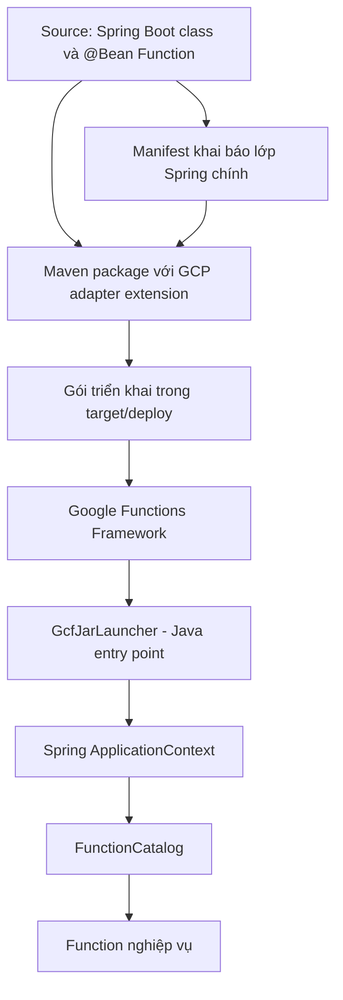
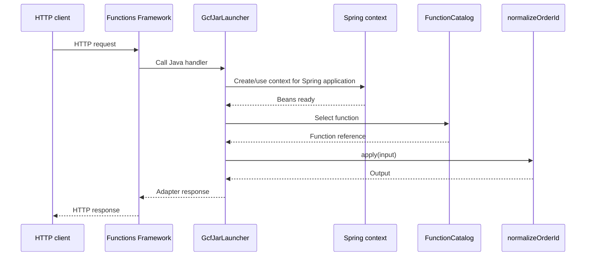

# Đóng gói artifact và khai báo manifest phù hợp khi triển khai Google Cloud

## Mục tiêu bài học

Trong **Spring Cloud Function**, một hàm nghiệp vụ viết bằng `Supplier<O>`, `Function<I, O>` hoặc `Consumer<I>` có thể được tái sử dụng qua `FunctionCatalog`, composition, HTTP, hệ thống sự kiện và nền tảng serverless. Tuy nhiên, khi triển khai trên **Google Cloud Functions / Cloud Run functions**, viết đúng bean hàm chỉ là một phần công việc: **artifact phải có định dạng mà Java Functions Framework và GCP adapter có thể nạp**, đồng thời metadata phải chỉ đúng lớp cấu hình Spring.

Chủ đề này tập trung vào **đóng gói artifact và khai báo `META-INF/MANIFEST.MF`** theo cách tích hợp được tài liệu `spring-cloud-function-adapter-gcp` mô tả. Sau bài học, bạn có thể:

- Phân biệt **lớp ứng dụng Spring Boot**, **Java function target**, **tên hàm trong `FunctionCatalog`** và **manifest `Main-Class`**.
- Tạo source manifest trỏ tới đúng lớp ứng dụng và hiểu vì sao `Main-Class` trong Spring Boot executable JAR thông thường có thể khác.
- Cấu hình đúng dependency ứng dụng và dependency mở rộng của `spring-boot-maven-plugin` để tạo gói triển khai GCP theo mẫu của Spring Cloud Function.
- Hiểu quan hệ giữa `target/deploy`, `functionTarget` khi chạy local và `--entry-point` khi triển khai.
- Kiểm tra artifact cuối sau `mvn package`, không chỉ kiểm tra các file nguồn.
- Chẩn đoán lỗi thiếu handler, sai manifest, classpath không phù hợp, `FunctionCatalog` không tìm thấy bean, sai Java runtime hoặc sai loại trigger.

**Giới hạn phiên bản:** tài liệu Spring Cloud Function hiện có mô tả quy trình GCP adapter với `GcfJarLauncher`, manifest và Maven plugin riêng; một số lệnh minh họa gốc dùng Java runtime của thế hệ Google Cloud Functions cũ. Khi sử dụng thật, phải kiểm tra release Spring Cloud Function, Spring Boot, Java Functions Framework và nền tảng Google Cloud đích trước khi áp dụng lệnh deploy.

## 1. Vì sao một `@Bean Function` chưa đủ để triển khai?

Ví dụ:

```java
@Bean
Function<String, String> uppercase() {
    return text -> text.toUpperCase(Locale.ROOT);
}
```

Spring Cloud Function có thể đăng ký hàm `uppercase` và cho phép gọi bằng `FunctionCatalog.lookup("uppercase")`. Nhưng nền tảng Google Cloud chạy Java function theo một **Java entry point** cụ thể, thay vì tự tìm những `@Bean Function` trong source code.

GCP adapter giải quyết sự khác biệt bằng một chuỗi trách nhiệm:



Có **hai việc tách biệt** trong gói triển khai:

1. **Google phải biết Java handler nào để gọi:** `org.springframework.cloud.function.adapter.gcp.GcfJarLauncher` theo mẫu adapter.
2. **Handler phải biết Spring application nào để nạp:** lớp như `com.example.gcp.OrderCloudApplication`, được nêu qua manifest theo quy ước của gói.

Ngay cả khi cả hai đều đúng, Spring context vẫn cần bean nghiệp vụ và `FunctionCatalog`. Vì vậy, không nên gộp các lỗi này thành một khái niệm chung là "deploy Java lỗi".

## 2. Bốn định danh trong quy trình đóng gói

| Định danh | Ví dụ | Nơi sử dụng |
| --- | --- | --- |
| **Spring application class** | `com.example.gcp.OrderCloudApplication` | `Main-Class` trong manifest **theo mẫu GCP adapter**; được Spring bootstrap dùng để lấy cấu hình |
| **Google Java entry point** | `org.springframework.cloud.function.adapter.gcp.GcfJarLauncher` | `functionTarget` của Functions Framework và `--entry-point` lúc deploy |
| **Spring function bean name** | `normalizeOrderId` | `FunctionCatalog.lookup("normalizeOrderId")` |
| **Spring function definition** | `spring.cloud.function.definition=normalizeOrderId` | Chọn một hàm/chuỗi hàm đã được đăng ký để adapter gọi |

Lưu ý:

- Không điền `--entry-point=normalizeOrderId` khi cách deploy đòi hỏi tên **class triển khai Google Java handler**.
- Không điền `Main-Class: org.springframework.cloud.function.adapter.gcp.GcfJarLauncher` vào source manifest theo mẫu này nếu mục tiêu của thuộc tính đó là chỉ **Spring application class**.
- Không điền `spring.cloud.function.definition=OrderCloudApplication`: đó là tên class cấu hình, không phải tên hàm nghiệp vụ.
- Một lớp Spring có phương thức `main(String[] args)` **không tự trở thành Google Java function handler**.

Luồng lời gọi có thể hình dung:



Sơ đồ mang tính kiến trúc; không hàm ý `ApplicationContext` được tạo mới cho từng HTTP request. Việc tái sử dụng context, concurrency và cold start phụ thuộc runtime, adapter và cấu hình.

## 3. Cấu trúc project mẫu

Ta tạo một hàm chuẩn hóa mã đơn hàng, không phụ thuộc HTTP. Với Java 17+ và Spring Boot/Spring Cloud Function tương thích, cấu trúc nguồn minh họa:

```text
order-normalizer/
├── pom.xml
└── src/
    ├── main/
    │   ├── java/
    │   │   └── com/example/gcp/
    │   │       └── OrderCloudApplication.java
    │   └── resources/
    │       ├── application.properties
    │       └── META-INF/
    │           └── MANIFEST.MF
    └── test/
        └── java/
            └── com/example/gcp/
                └── OrderFunctionCatalogTest.java
```

**Ba loại tệp có ba nhiệm vụ khác nhau:** `OrderCloudApplication.java` định nghĩa ứng dụng và bean; `MANIFEST.MF` cung cấp metadata cho quá trình bootstrap theo mẫu GCP; `application.properties` chọn hàm trong Spring Cloud Function. `pom.xml` xác định cách đóng gói.

### 3.1. Lớp Spring ứng dụng chính

File `src/main/java/com/example/gcp/OrderCloudApplication.java`:

```java
package com.example.gcp;

import java.util.Locale;
import java.util.function.Function;

import org.springframework.boot.SpringApplication;
import org.springframework.boot.autoconfigure.SpringBootApplication;
import org.springframework.context.annotation.Bean;

@SpringBootApplication(proxyBeanMethods = false)
public class OrderCloudApplication {

    public static void main(String[] args) {
        SpringApplication.run(OrderCloudApplication.class, args);
    }

    @Bean
    public Function<String, String> normalizeOrderId() {
        return input -> {
            if (input == null || input.isBlank()) {
                throw new IllegalArgumentException(
                        "orderId không được rỗng");
            }
            return input.trim().toUpperCase(Locale.ROOT);
        };
    }
}
```

Lớp có `@SpringBootApplication`, cung cấp bean tên `normalizeOrderId` qua phương thức `@Bean`. `Function<String, String>` giữ rõ generic input/output giúp catalog và adapter xử lý payload. Nghiệp vụ hoàn toàn độc lập giao thức gọi; `normalizeOrderId` không biết đến `HttpRequest`, `CloudEvent` hay Pub/Sub.

**Tách hai điểm vào:** `OrderCloudApplication.main(...)` khởi động Spring Boot theo đường JVM thông thường; trong quy trình GCP adapter, Google Functions Framework gọi `GcfJarLauncher` được khai báo làm entry point. Không nên giả định Google Cloud gọi `main` trước mỗi request.

### 3.2. `application.properties`

File `src/main/resources/application.properties`:

```properties
spring.cloud.function.definition=normalizeOrderId
```

Nếu chỉ có một hàm, một số adapter có thể chọn nó theo mặc định; khai báo tên tường minh giúp ví dụ dễ kiểm tra và giảm lỗi khi sau này thêm nhiều bean.

`spring.cloud.function.definition` chỉ **lựa chọn** hàm đã đăng ký, không làm phát sinh bean `normalizeOrderId` và không thay thế metadata manifest.

## 4. Viết `META-INF/MANIFEST.MF` đúng vai trò

Theo tài liệu Spring Cloud Function GCP adapter, lớp cấu hình chính được ghi trong:

```text
src/main/resources/META-INF/MANIFEST.MF
```

Nội dung cho project mẫu:

```text
Manifest-Version: 1.0
Main-Class: com.example.gcp.OrderCloudApplication
```

Tại sao là `OrderCloudApplication`?

- Đây là tên **fully qualified class name (FQCN)** của lớp Spring ứng dụng chính.
- Tên khớp với `package com.example.gcp;` và class `OrderCloudApplication` trong nguồn Java.
- Theo quy ước GCP adapter được hướng dẫn, manifest cho phép launcher biết **lớp cấu hình Spring** cần dùng khi chuẩn bị context.

Không điền đường dẫn nguồn `com/example/gcp/OrderCloudApplication.java`; Java manifest dùng tên class phân tách bằng dấu chấm. Cũng không ghi tên bean `normalizeOrderId` vào `Main-Class`.

### 4.1. Những lỗi định dạng manifest có thể gặp

`MANIFEST.MF` không phải file properties tùy ý. Một số quy tắc cần lưu ý:

1. Viết đúng **`Main-Class`**, có dấu gạch ngang và chữ hoa đúng định dạng.
2. Có **dấu cách sau dấu hai chấm**: `Main-Class: com.example.gcp.OrderCloudApplication`.
3. Ghi nội dung thành các dòng manifest hợp lệ; kết thúc bằng dấu xuống dòng. Khi tự tạo file, một dòng trống cuối manifest giúp tránh lỗi đọc do thiếu dấu kết thúc section.
4. Với giá trị dài, tuân theo quy tắc *line folding* của JAR manifest; không tự tách FQCN thành hai dòng tùy tiện.
5. Không thêm hai thuộc tính `Main-Class` mâu thuẫn hoặc lấy manifest từ một JAR khác rồi sử dụng nguyên trạng.

Ví dụ sai:

```text
Main-Class: normalizeOrderId
```

Sai vì `normalizeOrderId` là **tên bean** chứ không phải Java class.

Một lỗi khác:

```text
Main-Class: org.springframework.cloud.function.adapter.gcp.GcfJarLauncher
```

Theo **mẫu source manifest GCP adapter đang học**, giá trị trên chỉ handler Google, không phải lớp ứng dụng Spring chính mà thuộc tính này cần mô tả.

### 4.2. Manifest trong nguồn không phải lúc nào cũng là manifest cuối

Điểm rất quan trọng: nội dung `src/main/resources/META-INF/MANIFEST.MF` là **đầu vào cho quy trình build/adapter**. Maven JAR plugin, Spring Boot Maven plugin hoặc một công cụ đóng gói khác có thể tạo hoặc ghi lại `META-INF/MANIFEST.MF` trong artifact.

Vì vậy, sau build phải xác minh **manifest thực tế ở gói triển khai**. Đừng chỉ kiểm tra file nguồn rồi kết luận `GcfJarLauncher` sẽ khởi động đúng.

## 5. Phân biệt GCP adapter JAR với Spring Boot executable JAR

Đây là nguyên nhân phổ biến gây nhầm lẫn khi deploy. Với **Spring Boot executable fat JAR** thông thường, manifest hiện đại có thể chứa:

```text
Main-Class: org.springframework.boot.loader.launch.JarLauncher
Start-Class: com.example.gcp.OrderCloudApplication
```

Spring Boot `JarLauncher` dựng classloader để đọc `BOOT-INF/classes/` và các dependency nested trong `BOOT-INF/lib/`, rồi chuyển sang lớp `Start-Class`. Đường dẫn class `org.springframework.boot.loader.JarLauncher` trong những phiên bản cũ khác với `org.springframework.boot.loader.launch.JarLauncher` ở các dòng mới. Các giá trị chính xác phải được kiểm tra với Boot version thực tế.

**Không nhầm `JarLauncher` của Spring Boot với `GcfJarLauncher` của Spring Cloud Function.**

| Tình huống | Điểm vào | Vai trò metadata |
| --- | --- | --- |
| Chạy `java -jar` với Spring Boot executable JAR thông thường | Spring Boot loader `JarLauncher` | `Main-Class` là loader, `Start-Class` là lớp application |
| Chạy GCP adapter theo mẫu Spring Cloud Function | Google Functions Framework gọi `GcfJarLauncher` | Source manifest `Main-Class` chỉ lớp Spring chính theo quy ước đóng gói GCP |
| Truy cập hàm trong ứng dụng đã chạy | `FunctionCatalog.lookup("normalizeOrderId")` | Tên bean và `spring.cloud.function.definition`, không phải entry point Java |

Không phải cứ ứng dụng có `@SpringBootApplication` là lấy **bất kỳ fat JAR** nào rồi đổi `--entry-point` thành `GcfJarLauncher` sẽ chạy. Gói đó phải có **bố cục classpath mà Functions Framework/adapter đọc được**, và metadata chính xác theo contract.

Một số JAR có `Main-Class` là Boot loader vẫn hợp lệ để chạy `java -jar`; điều đó **không chứng minh** chúng phù hợp với **Google Functions Framework source deployment**. Tương tự, nếu artifact GCP đã đóng gói đúng nhưng không chạy được bằng `java -jar` như fat JAR tiêu chuẩn, chưa thể kết luận artifact GCP sai — hai kiểu launcher có mục đích khác nhau.

## 6. Cấu hình `pom.xml`: hai tầng dependency

Trong Maven, dependency của ứng dụng và dependency của **plugin build** là hai danh sách khác nhau. Theo hướng dẫn Spring Cloud Function GCP, adapter phải được nhắc tới ở cả hai vị trí trong cấu hình được cung cấp.

### 6.1. Dependency chạy ứng dụng

Trong `<dependencies>` của dự án:

```xml
<dependencies>
    <dependency>
        <groupId>org.springframework.cloud</groupId>
        <artifactId>spring-cloud-function-adapter-gcp</artifactId>
    </dependency>
    <dependency>
        <groupId>org.springframework.cloud</groupId>
        <artifactId>spring-cloud-function-context</artifactId>
    </dependency>
</dependencies>
```

Artifact `spring-cloud-function-adapter-gcp` cung cấp mã adapter. `spring-cloud-function-context` cung cấp hạ tầng Spring Cloud Function như `FunctionCatalog`. Tùy phiên bản, adapter có thể đã kéo Context transitively; khai báo tường minh có ý nghĩa khi ứng dụng trực tiếp sử dụng API Context.

### 6.2. Quản lý phiên bản tương thích

Không nên tự chọn độc lập version của Spring Boot, Spring Cloud Function và adapter. Với một project Spring Boot có parent/BOM thích hợp, có thể dùng Spring Cloud release train BOM:

```xml
<dependencyManagement>
    <dependencies>
        <dependency>
            <groupId>org.springframework.cloud</groupId>
            <artifactId>spring-cloud-dependencies</artifactId>
            <version>SPRING_CLOUD_RELEASE_VERSION</version>
            <type>pom</type>
            <scope>import</scope>
        </dependency>
    </dependencies>
</dependencyManagement>
```

`SPRING_CLOUD_RELEASE_VERSION` là **placeholder phải thay**, không phải giá trị có thể dùng trực tiếp. BOM phải tương thích Spring Boot mà dự án đang sử dụng. Nếu dự án dùng BOM chuyên biệt của Spring Cloud Function, hãy để các phiên bản module Function thống nhất và kiểm tra dependency tree.

### 6.3. Dependency của `spring-boot-maven-plugin`

Theo tài liệu GCP adapter, plugin Maven của Spring Boot được cấu hình như sau:

```xml
<build>
    <plugins>
        <plugin>
            <groupId>org.springframework.boot</groupId>
            <artifactId>spring-boot-maven-plugin</artifactId>
            <configuration>
                <outputDirectory>target/deploy</outputDirectory>
            </configuration>
            <dependencies>
                <dependency>
                    <groupId>org.springframework.cloud</groupId>
                    <artifactId>spring-cloud-function-adapter-gcp</artifactId>
                </dependency>
            </dependencies>
        </plugin>
    </plugins>
</build>
```

**Đây là điểm đặc thù quan trọng của bài.** Tài liệu Spring Cloud Function lưu ý dependency adapter đặt **bên trong `spring-boot-maven-plugin`** vì nó tùy chỉnh cách plugin đóng gói function thành JAR phù hợp cho Google Cloud Functions.

Không thể thay đoạn trên chỉ bằng dependency ứng dụng ở phần 6.1 rồi mặc định plugin tự biết cách tạo đúng gói GCP. Ngược lại, khai báo adapter ở plugin mà **bỏ phụ thuộc runtime ứng dụng** cũng không phải cách bảo đảm code adapter có mặt khi thực thi.

**Lưu ý Maven:** snippet là một phần của `pom.xml`, chưa bao gồm parent, version/plugin management và lifecycle bindings. Trong một số cấu hình Maven, dependency của plugin cần khai báo **`<version>` tường minh**; release train BOM của ứng dụng không nên được coi là bảo đảm mọi plugin dependency tự nhận version. Nếu Maven báo thiếu version hoặc không resolve dependency, khai báo version adapter phù hợp với phiên bản Function của project và kiểm tra `help:effective-pom`.

### 6.4. Google Functions Framework Maven plugin

Để chạy local qua **đúng Java GCP entry point**, bổ sung plugin Functions Framework:

```xml
<plugin>
    <groupId>com.google.cloud.functions</groupId>
    <artifactId>function-maven-plugin</artifactId>
    <version>FUNCTIONS_FRAMEWORK_PLUGIN_VERSION</version>
    <configuration>
        <functionTarget>org.springframework.cloud.function.adapter.gcp.GcfJarLauncher</functionTarget>
        <port>8080</port>
    </configuration>
</plugin>
```

`FUNCTIONS_FRAMEWORK_PLUGIN_VERSION` là placeholder. Tài liệu Spring Cloud Function GCP có ví dụ dùng plugin `0.9.1`; trước khi triển khai, hãy đối chiếu plugin/version hiện hành có hỗ trợ toolchain đang sử dụng hay không.

`functionTarget` trỏ tới **`GcfJarLauncher`**, không phải `OrderCloudApplication`. Đây là một plugin phục vụ **gọi thử local**, khác với `spring-boot-maven-plugin` phục vụ đóng gói.

| Thành phần | Mục đích |
| --- | --- |
| Project `dependencies` | Classpath ứng dụng: Spring Cloud Function, GCP adapter, logic |
| Project `dependencyManagement` | Quản lý version tương thích |
| `spring-boot-maven-plugin` | Build/repackage artifact với cách đóng gói tương ứng |
| `spring-boot-maven-plugin.dependencies` | Cho plugin nhận mở rộng GCP adapter theo hướng dẫn |
| `function-maven-plugin` | Chạy Java Functions Framework cục bộ |
| `functionTarget` / Google `--entry-point` | Chọn Java handler GCP |
| `MANIFEST.MF Main-Class` theo mẫu | Chỉ Spring application class |

## 7. Build và xác minh artifact cuối

Từ project đã có Maven wrapper hoặc cài Maven tương thích:

```bash
./mvnw clean package
```

Theo cấu hình chính thức có `spring-boot-maven-plugin` mở rộng bằng adapter GCP và `<outputDirectory>target/deploy</outputDirectory>`, quá trình package tạo **JAR dành cho deploy** trong thư mục `target/deploy`. Cấu trúc cụ thể của artifact tùy phiên bản build plugin; nên kiểm tra kết quả thật trước khi deploy.

### 7.1. Kiểm tra file có được tạo đúng nơi

Ví dụ trên Linux/macOS:

```bash
ls -lah target/deploy/
```

Trên Windows PowerShell:

```powershell
Get-ChildItem -LiteralPath target/deploy -File
```

Đừng nhầm thư mục `target/` chứa JAR build thường với `target/deploy/` đã được cấu hình riêng. Nếu `target/deploy` rỗng, cần kiểm tra lifecycle, plugin extension, output directory và lỗi Maven trong log.

### 7.2. Kiểm tra cấu trúc JAR

Giả sử JAR thực tế là `target/deploy/order-normalizer.jar` (đây là **ví dụ tên file**, cần thay theo tên artifact thật):

```bash
jar tf target/deploy/order-normalizer.jar
```

Tìm các dấu hiệu:

- Gói có manifest ở `META-INF/MANIFEST.MF`.
- Class `OrderCloudApplication` có trong bố cục artifact đúng theo packager.
- Những thư viện cần chạy (Spring Cloud Function Context, GCP adapter, dependencies) được cung cấp theo cách **runtime classloader thực sự hỗ trợ**, không nhất thiết phải có tất cả class rải ngay ở root JAR.
- Gói không bị thiếu class hay resource trong quá trình shade, repackage hoặc tạo ZIP.

Đặc biệt, việc không thấy trực tiếp `GcfJarLauncher.class` ở root của **một** JAR chưa đủ kết luận thiếu handler: class có thể nằm trong một dependency được gói theo layout mà adapter/runtime hỗ trợ. Phải kiểm tra classpath thực tế và thử load handler bằng Functions Framework.

### 7.3. Đọc manifest của artifact, không chỉ đọc nguồn

Trên hệ có `unzip`:

```bash
unzip -p target/deploy/order-normalizer.jar META-INF/MANIFEST.MF
```

Hoặc dùng JDK `jar` trong một thư mục kiểm tra độc lập:

```bash
mkdir -p manifest-check
cd manifest-check
jar xf ../target/deploy/order-normalizer.jar META-INF/MANIFEST.MF
cat META-INF/MANIFEST.MF
```

Đoạn sau chỉ minh họa từ **thư mục đang nằm ngay ở gốc project**: nếu bạn chạy `cd manifest-check`, đường dẫn `../target/deploy/...jar` mới đúng. Không giải nén vào thư mục nguồn đang có file manifest quan trọng, vì `jar xf` có thể ghi đè tệp trùng tên.

Kiểm tra FQCN lớp chính và loại launcher được ghi trong manifest; so sánh với **hợp đồng của đúng artifact GCP adapter/version đã chọn**. Nếu kết quả ghi `Main-Class` là Spring Boot `JarLauncher` và `Start-Class` là ứng dụng, đừng tự kết luận đó là manifest GCP đúng chỉ vì nó có thể chạy với `java -jar`.

### 7.4. Xác minh bằng local invoker

Sau package, chạy:

```bash
./mvnw function:run
```

Với `function-maven-plugin` đã cấu hình `functionTarget=org.springframework.cloud.function.adapter.gcp.GcfJarLauncher`, Java Functions Framework sẽ cố tải handler và gọi vào Spring.

Với HTTP function đơn giản, thử:

```bash
curl -X POST http://localhost:8080/ \
  -H 'Content-Type: text/plain' \
  --data-binary '  ord-103  '
```

Kết quả nghiệp vụ dự kiến:

```text
ORD-103
```

**Dấu `/` là đường request của Functions Framework trong ví dụ GCP**, không phải route `/normalizeOrderId` thường gặp ở `spring-cloud-function-web`. Nếu test của bạn chỉ chạy một Spring MVC endpoint khác, test đó chưa chứng minh GCP packaging/launcher đúng.

## 8. Kiểm thử bean độc lập trước khi kiểm thử JAR

Nếu Functions Framework không khởi động, trước tiên nên tách **lỗi đăng ký hàm** khỏi **lỗi đóng gói**.

Với JUnit 5 và Spring Boot Test:

```java
package com.example.gcp;

import static org.junit.jupiter.api.Assertions.assertEquals;
import static org.junit.jupiter.api.Assertions.assertNotNull;

import java.util.function.Function;
import org.junit.jupiter.api.Test;
import org.springframework.beans.factory.annotation.Autowired;
import org.springframework.boot.test.context.SpringBootTest;
import org.springframework.cloud.function.context.FunctionCatalog;

@SpringBootTest(
        classes = OrderCloudApplication.class,
        webEnvironment = SpringBootTest.WebEnvironment.NONE)
class OrderFunctionCatalogTest {

    @Autowired
    FunctionCatalog catalog;

    @Test
    void findsNormalizedOrderId() {
        Function<String, String> fn =
                catalog.lookup("normalizeOrderId");
        assertNotNull(fn);
        assertEquals("ORD-103", fn.apply("  ord-103  "));
    }
}
```

Test này xác nhận Spring Boot có thể tạo context, hạ tầng Spring Cloud Function có catalog và bean `normalizeOrderId` xử lý đúng. Nó **không kiểm thử** manifest, `GcfJarLauncher` hay Google Cloud Functions Framework.

Nên giữ ít nhất hai tầng test:

1. **Catalog test**: lỗi ở Spring context / bean name / logic.
2. **Local Functions Framework test**: lỗi ở Java handler / manifest / classloader / adapter / HTTP conversion.

Thêm smoke test trên Google Cloud mới xác minh yếu tố deployment, runtime và IAM.

## 9. Deploy thư mục artifact đúng với handler

Khi gói `target/deploy` đã được xác minh, có thể tham khảo khung lệnh cho **môi trường hỗ trợ `gcloud functions deploy` với loại adapter/handler này**:

```bash
gcloud functions deploy order-normalizer \
  --region=REGION_ID \
  --runtime=SUPPORTED_JAVA_RUNTIME \
  --entry-point=org.springframework.cloud.function.adapter.gcp.GcfJarLauncher \
  --trigger-http \
  --source=target/deploy
```

**Đây là mẫu cần thay tham số**, chưa phải lệnh sẵn sàng thực thi. Phải thay `REGION_ID` và `SUPPORTED_JAVA_RUNTIME` bằng vùng và runtime được hỗ trợ. Với thế hệ Google Cloud Functions/Cloud Run functions khác nhau, flags hoặc quy trình deploy có thể thay đổi; kiểm tra đặc biệt việc sử dụng `--gen2`, buildpacks và Java Functions Framework.

Trong ví dụ, `--entry-point` là FQCN handler do GCP adapter cung cấp. `--source` trỏ tới **thư mục artifact** đúng như hướng dẫn đóng gói, không phải tên bean `normalizeOrderId`. Không tự thay `--source=target/deploy` bằng JAR thường trong `target/` mà không kiểm tra bố cục mà runtime mong đợi.

### 9.1. Chọn trigger trước khi kiểm tra wire format

Với HTTP trigger, nền tảng cung cấp một URL HTTP, nhưng route và cách ánh xạ body do Functions Framework/adapter điều khiển. Với Pub/Sub hoặc CloudEvent, payload có thể được bọc trong một envelope với kiểu và metadata khác; không thể mặc định thử bằng JSON body tùy ý.

Nếu bạn muốn dùng `Consumer<PubSubMessage>` thay cho `Function<String,String>` trong ví dụ, phải đổi **bean**, **`spring.cloud.function.definition`**, payload DTO, kiểm thử và **trigger phù hợp**. Thư viện GCP adapter có tài liệu về background functions theo mô hình lịch sử; cần kiểm tra lại với thế hệ Eventarc/Cloud Run functions hiện tại.

### 9.2. Bảo mật khi deploy

Không tự thêm `--allow-unauthenticated` trong production. Xác định chính sách IAM, ingress, runtime service account và cách lấy identity token phù hợp. Nếu ứng dụng gọi Cloud Storage, Pub/Sub hoặc Secret Manager, cấp quyền tối thiểu; thông tin IAM/secret không được tạo tự động chỉ vì có adapter trong dependency.

Một lời gọi HTTP có bảo vệ có thể dùng:

```bash
curl -X POST "$FUNCTION_URL" \
  -H "Authorization: Bearer $ID_TOKEN" \
  -H "Content-Type: text/plain" \
  --data-binary '  ord-103  '
```

`FUNCTION_URL` và `ID_TOKEN` ở đây là **biến môi trường đã được thiết lập**. Không đưa token thật vào bài học, log chia sẻ hoặc source control.

## 10. Không nhầm deploy Google Cloud với chạy một Spring Boot web server

Một cách khác để công bố hàm là dùng `spring-cloud-function-web` cùng web server Spring Boot. Hai kiểu đóng gói phục vụ hai mục tiêu:

| Tiêu chí | Spring Cloud Function Web | Spring Cloud Function GCP adapter |
| --- | --- | --- |
| Runtime | Spring Boot web app/server tự chạy | Google Functions Framework gọi Java handler |
| Điểm vào HTTP | Web adapter mapping theo cấu hình | Java function target/launcher theo hợp đồng cloud |
| Route mẫu | Có thể là `/normalizeOrderId` | Local invoker mẫu thường gọi `/` |
| Artifact điển hình | Spring Boot executable JAR/container | Gói GCP adapter theo hướng dẫn plugin/manifest |
| Manifest | Boot loader làm `Main-Class` ở fat JAR | Source manifest chỉ Spring application class theo mẫu GCP |
| Khi nào dùng? | Chạy service HTTP độc lập hoặc container web | Triển khai function lên nền tảng serverless Java phù hợp |

Có thể dùng **cùng code `Function<String,String>`** cho cả hai, nhưng **cách bootstrap/packaging khác nhau**. Không nên thêm web starter hoặc tự nhúng Tomcat chỉ vì muốn xử lý một HTTP function trên Google Cloud. Điều đó có thể gây tăng thời gian khởi động và xung đột không cần thiết, trừ khi kiến trúc cụ thể yêu cầu web stack.

Tương tự, `spring-cloud-function-adapter-gcp` không phải **Pub/Sub binder của Spring Cloud Stream**. Để tạo subscription/binding trong một Spring Stream app, phải cấu hình các thành phần messaging tương ứng; với GCP event trigger, phải kiểm tra contract handler/envelope riêng.

## 11. Những lỗi đóng gói thường gặp

| Triệu chứng | Nguyên nhân có thể | Cách khắc phục |
| --- | --- | --- |
| Không tạo thư mục `target/deploy` | Plugin GCP extension không được nạp, lifecycle không chạy hoặc output directory khác | Xem Maven build log, effective POM, outputDirectory và dependency plugin |
| Maven không resolve được adapter trong plugin | Plugin dependency chưa có version phù hợp hoặc repository/BOM không áp dụng ở phạm vi plugin | Kiểm tra plugin dependency version và repository |
| `ClassNotFoundException: GcfJarLauncher` | Handler không được đóng gói/cung cấp cho classloader Java Functions Framework | Kiểm tra plugin/runtime dependencies, layout và `functionTarget` |
| `Main-Class` không phải ứng dụng Spring theo mẫu | File manifest chưa được packager đưa vào, hoặc plugin khác ghi đè | Kiểm tra source manifest **và** artifact cuối |
| `Main-Class` là Boot `JarLauncher` | Đang dùng/kiểm tra executable fat JAR tiêu chuẩn thay vì gói GCP | Phân biệt `target/` và `target/deploy/`; xác minh plugin extension |
| `Main-Class` ghi `normalizeOrderId` | Nhầm bean name với tên Java class | Dùng FQCN `OrderCloudApplication` |
| `--entry-point=OrderCloudApplication` bị từ chối | Lớp Spring không triển khai hợp đồng Java handler theo cách deploy này | Dùng FQCN `GcfJarLauncher` theo bản adapter hỗ trợ |
| `--entry-point=normalizeOrderId` báo không có target | Tên Spring function bị dùng làm Java entry point | Đổi sang Java handler; giữ bean name trong `definition` |
| Java Functions Framework chạy nhưng không thấy bean `normalizeOrderId` | Spring application không nạp được hoặc bean name/definition sai | Test catalog, kiểm tra application class và cấu hình |
| `NoSuchBeanDefinitionException: FunctionCatalog` | Thiếu Context/auto-configuration hoặc version không tương thích | Kiểm tra `spring-cloud-function-context`, dependency tree và bootstrap |
| Local `curl /normalizeOrderId` trả 404 | Đang dùng route của Web adapter thay cho route Functions Framework mẫu | Thử `POST /` trên local invoker |
| Local JVM chạy tốt nhưng cloud báo Java runtime không hỗ trợ | Java bytecode/build toolchain mới hơn hoặc generation khác runtime đích | Chọn runtime hợp lệ và kiểm tra target Java/toolchain |
| `NoSuchMethodError` khi handler khởi tạo | Spring Boot/Framework/Cloud Function/Functions Framework bị lệch version | Đồng bộ BOM và kiểm tra resolved dependencies |
| JSON không chuyển thành DTO | Generic thiếu, content type sai hoặc codec/envelope không hỗ trợ | Giữ `Function<I,O>` có kiểu rõ, test qua adapter thực |
| Pub/Sub function chạy hai lần với cùng event | Retry/redelivery bình thường, xử lý side effect chưa idempotent | Thiết kế idempotency theo event ID và trạng thái bền vững |
| Cold start lâu, function timeout | Classpath lớn, quá nhiều auto-configuration hoặc I/O khởi tạo | Tối giản dependency, đo khởi động và cấu hình resources |

Thứ tự điều tra hiệu quả:

1. **Dependency resolution:** artifact và plugin có version tương thích không?
2. **Packaging:** gói trong `target/deploy` có đúng định dạng/manifest/classpath không?
3. **Java handler:** Functions Framework có nạp được `GcfJarLauncher` không?
4. **Spring application:** manifest dẫn tới đúng lớp cấu hình, context có refresh được không?
5. **FunctionCatalog:** hàm đã đăng ký và tên trong `definition` khớp không?
6. **Transport:** payload/HTTP/event trigger/JSON mapper có đúng không?
7. **Cloud platform:** runtime, IAM, ingress, memory, timeout có hợp lệ không?

Đừng cố sửa JSON serialization bằng cách đổi `Main-Class` nếu catalog đã có hàm và handler đã gọi được. Ngược lại, thêm `spring.cloud.function.definition` cũng không sửa được lỗi **Java handler class không tồn tại**.

## 12. Quy trình kiểm tra trước khi publish

Một checklist thực tế cho người chịu trách nhiệm đóng gói:

| Mục kiểm tra | Tiêu chí đạt |
| --- | --- |
| Spring Boot application class | FQCN đúng, có cấu hình/bean `normalizeOrderId` |
| Function bean | Generic input/output phù hợp, logic được unit test |
| `application.properties` | `spring.cloud.function.definition` trỏ đúng bean |
| Source `META-INF/MANIFEST.MF` | `Main-Class` chỉ lớp ứng dụng Spring theo mẫu GCP |
| Spring Cloud versions | Boot, Function Context và GCP adapter được quản lý tương thích |
| Plugin dependencies | `spring-boot-maven-plugin` có GCP adapter extension đúng version |
| Maven package | Sinh artifact ở `target/deploy` theo hướng dẫn phiên bản |
| Artifact sau build | Manifest, classpath và layout được kiểm chứng thực tế |
| Java handler | `functionTarget` và `--entry-point` chỉ handler hỗ trợ |
| Local smoke test | `mvn function:run`, request `/` nhận output mong đợi |
| Cloud deploy | Runtime, trigger, source path và IAM đúng môi trường |
| Observability | Có logs cho startup, handler, catalog và lỗi conversion |

**Không nên publish/deploy chỉ vì `mvn package` trả exit code 0.** Build thành công chưa kiểm chứng handler, manifest thực tế hoặc network/event behavior.

## 13. Bài tập ứng dụng

### Bài tập 1 — Nhận diện bốn tên

Cho:

```text
Spring class: com.example.gcp.OrderCloudApplication
Bean: normalizeOrderId
Java handler: org.springframework.cloud.function.adapter.gcp.GcfJarLauncher
Definition: spring.cloud.function.definition=normalizeOrderId
```

Hãy điền bốn giá trị vào đúng nơi: **source manifest `Main-Class`**, **Maven `functionTarget`**, **Google Cloud `--entry-point`**, và **`FunctionCatalog.lookup(...)`**. Giải thích tại sao không thể tráo các giá trị.

### Bài tập 2 — Kiểm tra artifact hai lần

Sau `mvn package`, so sánh manifest của một Spring Boot executable JAR thông thường với manifest/bố cục của artifact trong `target/deploy`. Tìm `Main-Class`, `Start-Class`, lớp ứng dụng và cách dependencies được bố trí. Giải thích vì sao **`java -jar` chạy được** chưa chứng minh **Functions Framework tải handler được**.

### Bài tập 3 — Chủ động gây lỗi manifest

Trong một project thử nghiệm, đổi `Main-Class` thành tên bean `normalizeOrderId`, build và chạy local invoker. Ghi lại lỗi từ bước bootstrap. Khôi phục FQCN lớp Spring, build lại và đối chiếu. Không làm bài tập này trong nhánh production.

### Bài tập 4 — Tách lỗi catalog và lỗi packaging

Viết `@SpringBootTest` tra cứu `normalizeOrderId` thành công nhưng cố tình đặt `functionTarget` sai ở local invoker. Trình bày vì sao **catalog test pass** trong khi **Functions Framework test fail**, và bước cần sửa thuộc tầng nào.

### Bài tập 5 — Chuyển từ HTTP sang event

Giả sử thay `Function<String,String>` bằng `Consumer<PubSubMessage>`. Phân tích thay đổi cần thiết ở kiểu bean, `spring.cloud.function.definition`, payload DTO, Java event contract, trigger, test và idempotency. Không mặc định chỉ cần đổi cờ deploy `--trigger-http` là đủ.

### Câu hỏi tự kiểm tra

1. **`Main-Class` của source manifest theo mẫu GCP adapter trỏ tới đâu?** Lớp cấu hình Spring application, như `OrderCloudApplication`.
2. **`GcfJarLauncher` trỏ vào đâu?** Đây là Java handler/entry point mà Google Functions Framework gọi.
3. **`JarLauncher` và `GcfJarLauncher` có phải một lớp không?** Không. Một bên là loader của Spring Boot executable JAR; bên kia là adapter Java function cho Google.
4. **Vì sao thêm GCP adapter vào `<dependencies>` chưa đủ cho packaging theo mẫu?** Vì Maven plugin cũng cần GCP adapter extension ở phần `<plugin><dependencies>`.
5. **Tại sao cần kiểm tra artifact sau build?** Plugin có thể thay đổi manifest và layout; file nguồn không bảo đảm phản ánh đúng JAR cuối.
6. **`spring.cloud.function.definition` có tạo Java handler không?** Không. Nó chọn bean hàm đã có, không quyết định entry point của Google.
7. **`mvn function:run` kiểm tra điều gì mà unit test không kiểm tra?** Việc Functions Framework tải Java handler và gọi qua GCP adapter vào Spring context/catalog.
8. **Mọi bản Cloud Run functions đều dùng nguyên cách đóng gói tài liệu GCF lịch sử không?** Không nên giả định; phải đối chiếu thế hệ, Java runtime, buildpack và adapter version.

## 14. Tổng kết và tài liệu tham khảo

Trong Spring Cloud Function trên Google Cloud, **đóng gói đúng là sự phối hợp giữa ba thứ**: **metadata lớp Spring chính trong manifest**, **GCP adapter extension tạo artifact phù hợp**, và **`GcfJarLauncher` làm Java function target**. Sau khi handler khởi tạo context, `FunctionCatalog` mới tìm bean nghiệp vụ theo `spring.cloud.function.definition`. Sai một mắt xích có thể khiến function thất bại trước khi mã `apply(...)` được gọi.

Vì vậy, quy trình tin cậy là: **viết hàm độc lập giao thức → khai báo bean/definition → tạo manifest → cấu hình Maven packaging → kiểm tra `target/deploy` → test local Functions Framework → xác minh cloud runtime/IAM → deploy và smoke test**. Đặc biệt phải phân biệt manifest của gói GCP với manifest của Spring Boot fat JAR thông thường.

Tài liệu chính thức:

- [Spring Cloud Function — Google Cloud Functions adapter](https://docs.spring.io/spring-cloud-function/reference/adapters/gcp-intro.html): tọa độ adapter, plugin extension, `MANIFEST.MF`, `functionTarget`, `target/deploy`, cách chạy local và deploy.
- [Spring Boot — Launching Executable Jars](https://docs.spring.io/spring-boot/specification/executable-jar/launching.html): `Main-Class`, `Start-Class`, `JarLauncher` và nested dependency layout.
- [Google Functions Framework for Java](https://github.com/GoogleCloudPlatform/functions-framework-java): Java handler interface, Maven local invoker và quy trình thử nghiệm.
- [Google Cloud — Cloud Run functions](https://cloud.google.com/run/docs/functions): các lựa chọn runtime/trigger/deployment, IAM và thế hệ nền tảng.

**Lưu ý phiên bản:** minh họa packaging và manifest trong bài dựa trên quy trình được Spring Cloud Function GCP adapter tài liệu hóa. Trước khi áp dụng cho production, xác minh khả năng tương thích giữa Spring Boot, Spring Cloud Function, Java Functions Framework, Maven plugin và runtime Google Cloud thực tế.
