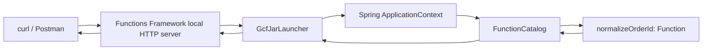

# Chạy thử bằng Google Functions Framework

## Mục tiêu học tập

**Spring Cloud Function** cho phép viết logic nghiệp vụ dưới dạng `Supplier`, `Function` và `Consumer`, sử dụng lại qua `FunctionCatalog`, composition và chuyển đổi thông điệp, bất kể nguồn gọi là HTTP, sự kiện hay môi trường serverless. Khi triển khai ở **Google Cloud**, `spring-cloud-function-adapter-gcp` làm cầu nối giữa Spring và **Google Functions Framework for Java**.

Trước khi đưa một function lên Google Cloud, bạn nên **chạy thử đúng Java handler của GCP adapter ngay trên máy phát triển**. Cách này phát hiện những lỗi mà việc gọi trực tiếp `Function.apply(...)` hoặc chỉ chạy Spring Boot không thể phát hiện: sai entry point, không tìm được Spring application, sai `FunctionCatalog` name, chuyển đổi payload không đúng và lỗi phụ thuộc runtime.

Sau bài này, bạn có thể:

- Cấu hình `com.google.cloud.functions:function-maven-plugin` để chạy `GcfJarLauncher` qua `mvn function:run`.
- Phân biệt `functionTarget` (Java handler), `Main-Class` (lớp Spring chính theo mẫu adapter), `spring.cloud.function.definition` (hàm cần chọn) và tên bean trong `FunctionCatalog`.
- Tạo một `Function<String, String>`, khởi chạy Functions Framework trên cổng `8080`, gọi thử HTTP bằng `curl` và xác minh kết quả.
- Chạy thử một `Consumer<PubSubMessage>` theo **mẫu background function** lịch sử, đồng thời hiểu giới hạn khi chuyển sang CloudEvents/Eventarc.
- Phân tầng kiểm thử: Java unit test, Spring context/catalog test, local Functions Framework test và cloud smoke test.
- Xử lý lỗi `function:run` không tồn tại, `ClassNotFoundException`, cổng bận, trả `404`, `FunctionCatalog.lookup(...)` không thấy hàm và lỗi JSON.

> **Lưu ý phiên bản:** ví dụ dựa trên hướng dẫn Spring Cloud Function GCP adapter có lớp `org.springframework.cloud.function.adapter.gcp.GcfJarLauncher`. Cách đóng gói, API và hỗ trợ trigger có thể khác giữa các phiên bản Spring Cloud Function, Spring Boot, Google Functions Framework và các thế hệ Cloud Functions/Cloud Run functions. Cần xác nhận bộ phiên bản tương thích của dự án.

## 1. Google Functions Framework là gì?

**Google Functions Framework for Java** là công cụ mã nguồn mở thực hiện hợp đồng gọi **Java function handler** ở môi trường local. Thay vì phải triển khai một bản build mới lên Google Cloud cho mỗi thay đổi, bạn có thể chạy một HTTP server cục bộ rồi gửi request mô phỏng lời gọi của nền tảng.

Khi sử dụng Spring Cloud Function GCP adapter, đường gọi có dạng:



Các thành phần có trách nhiệm khác nhau:

| Thành phần | Vai trò |
| --- | --- |
| Google Functions Framework | Cung cấp server local và gọi Java handler theo hợp đồng HTTP hoặc event |
| `GcfJarLauncher` | Entry point của Spring Cloud Function GCP adapter, nơi nối handler với Spring context/catalog |
| Lớp `@SpringBootApplication` | Cấu hình Spring, tạo các bean `Supplier`/`Function`/`Consumer` |
| `FunctionCatalog` | Tra cứu, composition và gọi hàm nghiệp vụ đã đăng ký |
| `spring.cloud.function.definition` | Chọn tên hàm hoặc chuỗi hàm cho adapter |

**Chạy Functions Framework local không có nghĩa bạn đang chạy toàn bộ Google Cloud.** Nó kiểm tra đường Java handler và việc gọi payload trên máy phát triển; nó không tự mô phỏng đầy đủ IAM, Eventarc routing, Pub/Sub delivery/retry, service accounts, cold start hoặc khả năng mở rộng của Google Cloud.

## 2. Cần chuẩn bị gì trước khi chạy?

Đối với ví dụ ở đây:

1. Java/JDK tương thích với dòng Spring Boot và Spring Cloud Function bạn đã chọn; ví dụ dùng cú pháp Java 17+.
2. Maven hoặc Maven Wrapper (`mvnw`), có thể resolve dependency từ repository thích hợp.
3. Một dự án Spring Boot có **`spring-cloud-function-adapter-gcp`** và hạ tầng Spring Cloud Function phù hợp.
4. Google Functions Framework Maven plugin trong `pom.xml`.
5. Một lớp cấu hình Spring chính và một `Function` bean.
6. Source manifest có `Main-Class` đúng theo hướng dẫn GCP adapter; xác minh artifact thực tế nếu plugin tái đóng gói.
7. Cổng `8080` chưa bị tiến trình khác chiếm, hoặc biết cách chọn cổng khác.

Bạn **không cần deploy function lên Google Cloud hoặc cấp quyền truy cập một project cloud** chỉ để thử ví dụ `String -> String` trên localhost. Nếu hàm của bạn thực sự gọi API Google, các quyền và credential của API đó là một vấn đề riêng.

### Nhìn vào các tên trước khi bắt đầu

| Tham số / metadata | Giá trị ví dụ | Đặt ở đâu? |
| --- | --- | --- |
| Java handler target | `org.springframework.cloud.function.adapter.gcp.GcfJarLauncher` | `function-maven-plugin.functionTarget` |
| Spring application class | `example.gcp.LocalGcpApplication` | `Main-Class` trong manifest theo mẫu |
| Tên bean nghiệp vụ | `normalizeOrderId` | Tên phương thức `@Bean` |
| Function definition | `normalizeOrderId` | `spring.cloud.function.definition` |
| Port local | `8080` | `function-maven-plugin.port` hoặc runtime override |
| URL thử HTTP | `http://localhost:8080/` | `curl`/Postman |

`GcfJarLauncher` **không phải** hàm `normalizeOrderId` và **không phải** lớp Spring chính `LocalGcpApplication`. Đây là ba tên khác nhau, thường xuyên bị dùng nhầm.

## 3. Ví dụ Spring Cloud Function HTTP nhỏ, độc lập giao thức

Tạo cấu trúc:

```text
local-gcp-demo/
├── pom.xml
└── src/
    ├── main/
    │   ├── java/example/gcp/
    │   │   └── LocalGcpApplication.java
    │   └── resources/
    │       ├── application.properties
    │       └── META-INF/MANIFEST.MF
    └── test/java/example/gcp/
        └── NormalizeCatalogTest.java
```

### 3.1. Lớp Spring chính và `Function` bean

File `src/main/java/example/gcp/LocalGcpApplication.java`:

```java
package example.gcp;

import java.util.Locale;
import java.util.function.Function;

import org.springframework.boot.SpringApplication;
import org.springframework.boot.autoconfigure.SpringBootApplication;
import org.springframework.context.annotation.Bean;

@SpringBootApplication(proxyBeanMethods = false)
public class LocalGcpApplication {

    public static void main(String[] args) {
        SpringApplication.run(LocalGcpApplication.class, args);
    }

    @Bean
    public Function<String, String> normalizeOrderId() {
        return input -> {
            if (input == null || input.isBlank()) {
                throw new IllegalArgumentException(
                        "Mã đơn hàng không được rỗng");
            }
            return input.trim().toUpperCase(Locale.ROOT);
        };
    }
}
```

Nếu đầu vào là `"  ord-204  "` thì kết quả nghiệp vụ mong đợi là `"ORD-204"`. Hàm này không dùng `HttpRequest`, `HttpResponse` hoặc Google Cloud SDK; nó có thể được gọi từ unit test, `FunctionCatalog`, HTTP adapter hay môi trường serverless.

`LocalGcpApplication.main(...)` dùng để chạy Spring Boot theo cách JVM thông thường. **Khi chạy Functions Framework, entry point được gọi là `GcfJarLauncher`, không phải phương thức `main` theo mỗi request.**

### 3.2. Chọn tên hàm trong `application.properties`

File `src/main/resources/application.properties`:

```properties
spring.cloud.function.definition=normalizeOrderId
```

Thuộc tính `definition` cho biết adapter nên chọn **bean `normalizeOrderId` đã có**, không tạo thêm bean mới. Nó càng quan trọng nếu ứng dụng có nhiều `Function`, `Consumer` hoặc `Supplier`.

### 3.3. Khai báo source manifest

File `src/main/resources/META-INF/MANIFEST.MF`:

```text
Manifest-Version: 1.0
Main-Class: example.gcp.LocalGcpApplication

```

Theo hướng dẫn Spring Cloud Function GCP adapter, `Main-Class` ở **source manifest này trỏ tới lớp ứng dụng Spring chính**, không phải Google handler `GcfJarLauncher`. Dòng trống cuối giúp kết thúc đúng phần manifest.

**Phân biệt với Spring Boot executable fat JAR:** bản JAR `java -jar` thông thường có thể dùng `Main-Class` là Spring Boot `JarLauncher` và `Start-Class` là ứng dụng. Các plugin có thể thay đổi manifest khi đóng gói; vì thế cần kiểm tra **artifact sau build**, không suy ra từ file nguồn.

## 4. Cấu hình Maven plugin để chạy Functions Framework

### 4.1. Dependency ứng dụng

Trong một `pom.xml` đã có Spring Boot parent và Spring Cloud BOM quản lý phiên bản **tương thích**, khai báo:

```xml
<dependencies>
    <dependency>
        <groupId>org.springframework.cloud</groupId>
        <artifactId>spring-cloud-function-adapter-gcp</artifactId>
    </dependency>
    <dependency>
        <groupId>org.springframework.cloud</groupId>
        <artifactId>spring-cloud-function-context</artifactId>
    </dependency>
    <dependency>
        <groupId>org.springframework.boot</groupId>
        <artifactId>spring-boot-starter-test</artifactId>
        <scope>test</scope>
    </dependency>
</dependencies>
```

`spring-cloud-function-context` là hạ tầng chứa `FunctionCatalog`. Adapter có thể kéo một số dependency theo quan hệ transitive tùy phiên bản, nhưng khai báo tường minh có ích khi source/test ứng dụng dùng trực tiếp API đó.

Ví dụ nhập BOM (khi dự án chưa có cách quản lý tương đương):

```xml
<dependencyManagement>
    <dependencies>
        <dependency>
            <groupId>org.springframework.cloud</groupId>
            <artifactId>spring-cloud-dependencies</artifactId>
            <version>COMPATIBLE_SPRING_CLOUD_VERSION</version>
            <type>pom</type>
            <scope>import</scope>
        </dependency>
    </dependencies>
</dependencyManagement>
```

`COMPATIBLE_SPRING_CLOUD_VERSION` là **placeholder**, không được dùng nguyên trạng. Bạn phải chọn release train Spring Cloud khớp với Spring Boot và module Spring Cloud Function của dự án. Các fragment XML ở đây **không phải POM hoàn chỉnh**; cần parent, project coordinates, build plugin và Java toolchain phù hợp.

### 4.2. `function-maven-plugin`: phần trọng tâm của chạy local

Trong `<build><plugins>`:

```xml
<plugin>
    <groupId>com.google.cloud.functions</groupId>
    <artifactId>function-maven-plugin</artifactId>
    <version>FUNCTIONS_FRAMEWORK_PLUGIN_VERSION</version>
    <configuration>
        <functionTarget>org.springframework.cloud.function.adapter.gcp.GcfJarLauncher</functionTarget>
        <port>8080</port>
    </configuration>
</plugin>
```

`FUNCTIONS_FRAMEWORK_PLUGIN_VERSION` cần được thay bằng phiên bản plugin tương thích. Tài liệu Spring Cloud Function 5.0 minh họa **`0.9.1`**, nhưng đó là phiên bản trong ví dụ tài liệu, **không phải lời khẳng định phiên bản mới nhất hoặc tốt nhất cho mọi JDK**.

`functionTarget` là **Java class name đầy đủ** của GCP adapter, không phải tên bean `normalizeOrderId`. Trong XML thực tế có thể để FQCN trên cùng một dòng để dễ kiểm tra:

```xml
<functionTarget>org.springframework.cloud.function.adapter.gcp.GcfJarLauncher</functionTarget>
```

Nếu plugin chưa được khai báo, `mvn function:run` có thể báo không tìm thấy `function` plugin prefix hoặc goal. Chỉ thêm `spring-cloud-function-adapter-gcp` trong `dependencies` **không tự bổ sung** Maven goal.

### 4.3. Spring Boot Maven plugin cho đóng gói GCP

Để tạo artifact deploy theo mẫu Spring Cloud Function, hướng dẫn GCP còn cấu hình:

```xml
<plugin>
    <groupId>org.springframework.boot</groupId>
    <artifactId>spring-boot-maven-plugin</artifactId>
    <configuration>
        <outputDirectory>target/deploy</outputDirectory>
    </configuration>
    <dependencies>
        <dependency>
            <groupId>org.springframework.cloud</groupId>
            <artifactId>spring-cloud-function-adapter-gcp</artifactId>
            <version>COMPATIBLE_SCF_VERSION</version>
        </dependency>
    </dependencies>
</plugin>
```

`COMPATIBLE_SCF_VERSION` cũng là placeholder; chọn đúng phiên bản adapter trong dependency tree của ứng dụng. Maven **plugin dependencies** có cơ chế quản lý phiên bản riêng, nên không mặc định BOM trong `dependencyManagement` của project tự giải quyết chúng. Nếu tài liệu phiên bản cụ thể dùng cách cấu hình khác, ưu tiên cách đó.

Phân biệt: `function-maven-plugin` dùng để **chạy handler local**; `spring-boot-maven-plugin` cùng GCP adapter extension dùng để **đóng gói theo cấu trúc được adapter hỗ trợ**. Một bài kiểm thử local nên kết hợp cả hai và xem kết quả build thực tế trước khi kết luận có thể deploy.

## 5. Chạy thử HTTP lần đầu theo đúng trình tự

### Bước 1 — Kiểm tra logic và build

Trong thư mục gốc project:

```bash
./mvnw clean test
./mvnw package
```

Nếu project không có Maven Wrapper, thay bằng `mvn`. Với cấu hình packaging ở trên, hãy kiểm tra thư mục `target/deploy` có artifact theo kỳ vọng; tuy nhiên local plugin có thể chạy từ classpath source/dependency do Maven tính toán, không nhất thiết tải đúng JAR deploy theo cùng cơ chế.

### Bước 2 — Chạy local server bằng Functions Framework

Ở terminal thứ nhất:

```bash
./mvnw function:run
```

Theo cấu hình, Maven plugin sẽ chạy **Java handler `GcfJarLauncher`** trên cổng `8080` và chờ request. Tiến trình này **chạy liên tục**; đừng đóng terminal nếu đang muốn gửi request từ terminal khác.

Khi muốn dừng, dùng **Ctrl+C** trong terminal đang chạy. Nếu server trả lỗi bind cổng, hãy xem phần thay đổi port bên dưới.

### Bước 3 — Gửi HTTP request qua root path `/`

Ở terminal thứ hai:

```bash
curl -i -X POST http://localhost:8080/ \
  -H "Content-Type: text/plain" \
  --data-binary "  ord-204  "
```

Kết quả nghiệp vụ mong đợi: body tương đương

```text
ORD-204
```

`-i` giúp in status line và response headers để quan sát. Đừng giả định mọi version adapter luôn trả cùng charset/content type/status code cho mọi tình huống; kiểm tra **cả mã phản hồi lẫn body thực tế**.

**Vì sao gọi `/` thay vì `/normalizeOrderId`?** Đây là server local của **Google Functions Framework** chạy một Java handler đã cấu hình. Đường dẫn `/normalizeOrderId` thường gặp trong mô hình `spring-cloud-function-web`, một adapter khác; không nên áp quy tắc route của Spring MVC lên GCP handler.

### Bước 4 — Quan sát log ở terminal chạy server

Sau khi gọi:

- Kiểm tra handler đã được Functions Framework load, không còn lỗi `ClassNotFoundException`.
- Kiểm tra Spring context khởi động không có lỗi bean/auto-configuration.
- Xác nhận `FunctionCatalog` chọn được `normalizeOrderId`.
- Khi gặp lỗi, tìm stack trace đầu tiên liên quan bootstrap hoặc conversion thay vì chỉ nhìn HTTP status.

Không log token, thông tin cá nhân hoặc toàn bộ payload nhạy cảm trong ứng dụng thật.

## 6. Đổi cổng và ghi đè function target khi chạy thử

Google Functions Framework Java hỗ trợ cấu hình runtime qua plugin `pom.xml`, dòng lệnh và biến môi trường. Với Maven, có thể ghi đè port:

```bash
./mvnw function:run -Drun.port=9090
```

Sau đó gọi:

```bash
curl -i -X POST http://localhost:9090/ \
  -H "Content-Type: text/plain" \
  --data-binary "  ord-204  "
```

Muốn kiểm tra Java handler target mà plugin sử dụng:

```bash
./mvnw function:run \
  -Drun.functionTarget=org.springframework.cloud.function.adapter.gcp.GcfJarLauncher \
  -Drun.port=9090
```

**Đừng đổi `run.functionTarget` thành `normalizeOrderId`.** Maven plugin cần tên Java class triển khai hợp đồng của Functions Framework, không nhận tên bean Spring.

Trong tài liệu Google Cloud, Java Functions Framework ưu tiên **tham số dòng lệnh** so với **cấu hình build file**, rồi tới **biến môi trường**. Cũng có thể đặt `FUNCTION_TARGET` hoặc `PORT` theo môi trường nếu plugin/runtime hỗ trợ cách truyền đó. Cần phân biệt các biến này với `SPRING_CLOUD_FUNCTION_DEFINITION`, vốn chọn bean nội bộ Spring.

Trên Windows PowerShell, `curl` có thể là alias trong Windows PowerShell cũ; dùng **`curl.exe`** để áp dụng đúng các cờ `-i`, `-H`, `--data-binary`. Ký tự gạch chéo ngược dùng để nối dòng trong các mẫu Bash **không áp dụng cho PowerShell**; hãy nhập lệnh trên một dòng hoặc dùng cách nối dòng của PowerShell.

## 7. Xác nhận function bean độc lập với handler

Nếu request tới local Functions Framework lỗi, cần tách **hàm Java/Spring** khỏi **launcher và HTTP**.

### 7.1. Unit test không khởi tạo Spring

```java
package example.gcp;

import static org.junit.jupiter.api.Assertions.assertEquals;
import org.junit.jupiter.api.Test;

class NormalizeLogicTest {

    @Test
    void normalizesOrderId() {
        LocalGcpApplication configuration =
                new LocalGcpApplication();

        assertEquals(
                "ORD-204",
                configuration.normalizeOrderId().apply("  ord-204  "));
    }
}
```

Test này kiểm tra logic `String -> String`; nó **không chứng minh** Maven plugin, manifest hoặc GCP handler đã hoạt động.

### 7.2. Kiểm thử `FunctionCatalog` trong Spring context

```java
package example.gcp;

import static org.junit.jupiter.api.Assertions.assertEquals;
import static org.junit.jupiter.api.Assertions.assertNotNull;

import java.util.function.Function;
import org.junit.jupiter.api.Test;
import org.springframework.beans.factory.annotation.Autowired;
import org.springframework.boot.test.context.SpringBootTest;
import org.springframework.cloud.function.context.FunctionCatalog;

@SpringBootTest(
        classes = LocalGcpApplication.class,
        webEnvironment = SpringBootTest.WebEnvironment.NONE)
class NormalizeCatalogTest {

    @Autowired
    FunctionCatalog catalog;

    @Test
    void findsNamedFunction() {
        Function<String, String> normalize =
                catalog.lookup("normalizeOrderId");

        assertNotNull(normalize);
        assertEquals("ORD-204",
                normalize.apply("  ord-204  "));
    }
}
```

Test này xác nhận **Spring Boot + FunctionCatalog + tên bean + logic**, nhưng chưa kiểm tra **Google Functions Framework → GcfJarLauncher → HTTP conversion**.

| Kiểu test | Điều xác minh | Điều chưa xác minh |
| --- | --- | --- |
| Unit test trực tiếp `apply(...)` | Thuật toán Java | Spring, catalog, adapter, HTTP |
| `@SpringBootTest` + catalog lookup | Bean registration, Spring context, catalog | GCP Java handler/packaging |
| `mvn function:run` + `curl` | Functions Framework, handler, Spring, catalog, payload/response local | IAM, Eventarc, Google runtime thực |
| Cloud smoke test | Gói và entry point triển khai, HTTP/event trigger, IAM và runtime thực tế | Không thay thế kiểm thử đầy đủ tải lớn/retry dài hạn |

**Quy trình tối ưu:** nếu unit test fail, sửa logic; nếu catalog test fail, sửa bean/definition/context; nếu chỉ local framework fail, kiểm tra handler/manifest/packaging/conversion; nếu chỉ cloud fail, kiểm tra runtime/trigger/IAM/configuration.

## 8. Chạy thử JSON khi hàm có kiểu DTO

Ví dụ `String -> String` tránh nhiều vấn đề JSON để tập trung kiểm tra launcher. Khi hàm nhận DTO, bạn còn phải kiểm tra khả năng deserialize thực tế của adapter.

Ví dụ về hợp đồng Java (mỗi `public record` trong file riêng):

```java
package example.gcp;

public record PriceRequest(String orderId, int quantity) {
}
```

```java
package example.gcp;

public record PriceResponse(String orderId, long totalCents) {
}
```

Bean minh họa:

```java
@Bean
public Function<PriceRequest, PriceResponse> priceOrder() {
    return request -> {
        if (request.quantity() <= 0) {
            throw new IllegalArgumentException(
                    "Số lượng phải lớn hơn 0");
        }
        return new PriceResponse(
                request.orderId(),
                Math.multiplyExact(
                        (long) request.quantity(), 15_000L));
    };
}
```

Nếu dùng bean này **thay cho** `normalizeOrderId` trong bài thực hành, hãy đổi `spring.cloud.function.definition=priceOrder` rồi thử:

```bash
curl -i -X POST http://localhost:8080/ \
  -H "Content-Type: application/json" \
  --data-binary '{"orderId":"ORD-204","quantity":2}'
```

**Kết quả nghiệp vụ kỳ vọng**: `PriceResponse("ORD-204", 30000)`. Hình thức JSON/HTTP response chính xác còn tùy bản GCP adapter, codec, generic metadata và content type. Vì vậy hãy dùng response thực tế để xác nhận; **không coi đoạn curl này là bảo đảm adapter trong mọi phiên bản tự map record đúng**.

Vấn đề cần kiểm tra: kiểu `Function<PriceRequest,PriceResponse>` có được công bố tường minh không, adapter có cơ chế chuyển đổi JSON không, `PriceRequest` có deserialize được không, và request có đúng JSON/content type hay không. Một raw `Function` thường làm thông tin generic khó suy ra hơn.

## 9. Chạy thử background event theo mẫu GCP lịch sử

Tài liệu Spring Cloud Function GCP adapter cũng mô tả **background function** được kích hoạt bởi sự kiện như Pub/Sub. Khi thử local qua Functions Framework, bạn vẫn gửi HTTP request tới local invoker nhưng **payload đại diện cho dữ liệu sự kiện**, và kết quả của `Consumer` thường được quan sát trong log, không phải response body nghiệp vụ.

**Không thay thế thẳng ví dụ HTTP mà giữ cùng bean name.** Nên tạo một project/entry point minh họa riêng hoặc chuyển đổi toàn bộ cấu hình giữa hai chế độ để tránh nhiều function cùng tồn tại, dẫn tới adapter chọn sai.

### 9.1. DTO sự kiện đơn giản

File `src/main/java/example/gcp/PubSubMessage.java`:

```java
package example.gcp;

public class PubSubMessage {
    private String data;
    private String messageId;

    public String getData() {
        return data;
    }

    public void setData(String data) {
        this.data = data;
    }

    public String getMessageId() {
        return messageId;
    }

    public void setMessageId(String messageId) {
        this.messageId = messageId;
    }
}
```

DTO này cố ý chỉ chứa hai thuộc tính để minh họa. Các thông tin `attributes`, `publishTime` và envelope thực tế có thể cần thêm theo hợp đồng trigger của bạn.

### 9.2. `Consumer` xử lý sự kiện

Trong cấu hình Spring tương ứng của **project background riêng**:

```java
@Bean
public Consumer<PubSubMessage> auditPubSub() {
    return message -> {
        String encoded = message.getData();
        String decoded = encoded == null
                ? ""
                : new String(
                        Base64.getDecoder().decode(encoded),
                        StandardCharsets.UTF_8);
        System.out.println(
                "Message ID = " + message.getMessageId()
                        + ", data = " + decoded);
    };
}
```

Đoạn trên cần import `java.util.function.Consumer`, `java.util.Base64` và `java.nio.charset.StandardCharsets`. Chỉ in thông tin demo; trong hệ thống thật không log message nhạy cảm và phải cân nhắc idempotency nếu có retry/redelivery.

Trong `application.properties` của project này:

```properties
spring.cloud.function.definition=auditPubSub
```

Manifest `Main-Class` phải trỏ tới **lớp ứng dụng Spring của project background**, `functionTarget` vẫn là handler GCP adapter tương thích với hợp đồng background function.

### 9.3. Gửi sự kiện mẫu qua local invoker

Sau khi chạy `./mvnw function:run` của project background:

```bash
curl -i -X POST http://localhost:8080/ \
  -H "Content-Type: application/json" \
  --data-binary '{"data":"aGVsbG8=","messageId":"msg-demo-01"}'
```

`aGVsbG8=` là Base64 của chuỗi `hello`. Theo mẫu background function của Spring Cloud Function, request này mô phỏng DTO sự kiện mà adapter chuyển cho consumer; quan sát **log của Java process** để xác minh dữ liệu được xử lý.

**Giới hạn quan trọng:** background events của Google Cloud Functions thế hệ cũ và **CloudEvents/Eventarc** trên các thế hệ mới có **signature và envelope khác nhau**. JSON ở đây là một *local adapter sample*, **không phải** cấu trúc dùng được cho mọi Pub/Sub push subscription, Eventarc trigger hoặc Cloud Run functions. Với CloudEvent, phải chọn handler hỗ trợ `CloudEventsFunction` theo phiên bản và gửi đúng headers/envelope của CloudEvent đó. Chỉ đổi `Content-Type` không làm một handler background cũ hiểu CloudEvent mới.

Ngoài ra, gửi request local **không tạo Pub/Sub topic, subscription hay IAM binding**. Muốn kiểm tra event delivery/retry thực tế cần kiểm thử bổ sung trên cloud hoặc một hạ tầng tích hợp phù hợp.

## 10. Các phép thử lỗi chủ động nên thực hiện

Một buổi thực hành chất lượng không chỉ thử happy path. Hãy tạo các trường hợp sau, nhưng chỉ trong project thử nghiệm:

| Phép thử | Kỳ vọng kiểm tra | Điều không nên khẳng định trước |
| --- | --- | --- |
| Gửi `"  ord-204  "` tới HTTP `normalizeOrderId` | Output đã chuẩn hóa | Header/charset cố định ở mọi adapter |
| Gửi chuỗi rỗng | Logic ném `IllegalArgumentException`; quan sát HTTP response/log | Luôn được map thành chính xác `400` thay vì status khác |
| Gửi JSON không hợp lệ tới hàm nhận DTO | Quan sát lỗi parse/conversion | Mã lỗi và body giống nhau qua mọi bản adapter |
| Đổi `definition` sang tên không tồn tại | Phát hiện lỗi function selection | Handler vẫn khởi động hoàn toàn bình thường |
| Đổi `functionTarget` sang tên bean | Functions Framework không tìm thấy Java handler hợp lệ | Spring `@Bean` tự trở thành handler |
| Chiếm trước cổng `8080` | Thấy lỗi bind/port in use | Maven tự chọn cổng khác |
| Gửi payload background tới HTTP function | Nhận kết quả khác hợp đồng mong đợi hoặc lỗi | Có thể tự kích hoạt `Consumer` đúng |

Các phép thử chủ động giúp bạn phân biệt **phản hồi lỗi của logic**, **lỗi adapter** và **lỗi trong lúc server khởi động**. Khi kiểm thử lỗi, ghi lại request, status, log và nguyên nhân chính; không chỉ ghi "curl thất bại".

## 11. Xử lý những lỗi thường gặp

| Triệu chứng | Nguyên nhân có thể | Cách xử lý |
| --- | --- | --- |
| `No plugin found for prefix 'function'` | Chưa khai báo `function-maven-plugin` hoặc chưa resolve plugin | Thêm plugin Google Functions Framework với version hợp lệ, kiểm tra repository |
| `ClassNotFoundException: GcfJarLauncher` | Class adapter chưa có trên classpath invoker hoặc dependency/plugin lệch version | Kiểm tra `spring-cloud-function-adapter-gcp`, classpath, packaging và plugin |
| Maven báo thiếu version dependency trong plugin | BOM dự án không quản lý plugin dependencies theo cách mong muốn | Đặt version adapter tương thích tường minh ở plugin dependency |
| Không tìm được `LocalGcpApplication` | `Main-Class` sai FQCN hoặc artifact không chứa class | Kiểm tra package Java, manifest nguồn **và artifact cuối** |
| `Main-Class` trở thành `JarLauncher` | Dùng Spring Boot fat JAR thường, khác gói GCP adapter | Kiểm tra loại artifact, `target/deploy` và cách đóng gói |
| `NoSuchBeanDefinitionException: FunctionCatalog` | Spring Cloud Function Context/auto-configuration không được nạp | Kiểm tra version, dependency và bootstrap |
| `catalog.lookup("normalizeOrderId")` trả `null` | Bean không tồn tại, sai tên hoặc `definition` không khớp | Kiểm tra tên `@Bean`, context test và cấu hình chọn hàm |
| `Address already in use` | Cổng `8080` đã có tiến trình khác sử dụng | Dừng tiến trình đó hoặc chạy `-Drun.port=9090` |
| HTTP `404` khi gửi vào `/normalizeOrderId` | Nhầm route Web adapter với Functions Framework root path | Thử `POST /` với local invoker đã cấu hình |
| HTTP `404` ngay ở `/` | Server khác đang chạy trên cổng hoặc function target/route không phù hợp | Xác nhận process, port, log và handler |
| HTTP `500` hoặc lỗi adapter khi input rỗng | Logic có exception hoặc chuyển đổi dữ liệu thất bại | Xem stack trace và kiểm tra từng tầng |
| DTO không deserialize được | Generic `Function<I,O>` thiếu, JSON invalid hoặc codec chưa phù hợp | Dùng generic cụ thể, kiểm tra `Content-Type`, request và adapter |
| Background `Consumer` không ghi log | Sai bean definition, sai event DTO hoặc sai handler/event signature | Kiểm tra `definition`, manifest và envelope được adapter mong đợi |
| Base64 decode lỗi | `data` không phải Base64 hợp lệ | Dùng payload đúng định dạng, xử lý lỗi dữ liệu theo nghiệp vụ |
| Lỗi `NoSuchMethodError` khi khởi tạo | Spring Boot/Cloud Function/Google Functions Framework không tương thích | Kiểm tra dependency tree và BOM; thống nhất version |
| Local ổn nhưng deploy cloud lỗi | Khác Java runtime, packaging, trigger, IAM, network hoặc startup limits | Kiểm thử artifact và runtime/trigger/IAM trên Google Cloud riêng |

### Quy trình điều tra theo thứ tự

1. **Plugin:** Maven có thực thi được goal `function:run` không?
2. **Handler:** Functions Framework load được `GcfJarLauncher` chưa?
3. **Bootstrap:** Spring application class từ manifest có được tìm thấy không?
4. **Bean:** Spring context có `FunctionCatalog` và `normalizeOrderId` không?
5. **Invocation:** Adapter có chọn đúng hàm, route và content type không?
6. **Logic:** `apply(...)` xử lý payload theo hợp đồng chưa?
7. **Cloud:** nếu chỉ lỗi khi deploy, kiểm tra trigger, IAM, generation, Java runtime, timeout và ingress.

Đây là cách khoanh vùng nhanh hơn nhiều so với việc thay đổi đồng thời `functionTarget`, `Main-Class`, `definition` và `pom.xml` rồi không biết sửa đổi nào tạo hiệu quả.

## 12. Giới hạn của local Functions Framework

Local invoker **rất hữu ích** nhưng không thể thay thế mọi phép thử production:

| Khía cạnh | Local Functions Framework | Còn phải xác minh trên Google Cloud |
| --- | --- | --- |
| Gọi Java handler | Có, khi cấu hình target đúng | Runtime thực tế có tìm entry point đúng |
| Spring context + `FunctionCatalog` | Có thể kiểm tra thông qua adapter | Version, profile và biến môi trường của bản deploy |
| HTTP request/response | Có thể gửi `curl` và kiểm tra body/status | IAM, domain, ingress, network, proxy và timeout |
| Pub/Sub/CloudEvent | Có thể gửi event mẫu theo hợp đồng hỗ trợ | Delivery, Eventarc envelope, retries và permission |
| Cloud service account | Không được tự mô phỏng hoàn toàn | Runtime identity và quyền truy cập tài nguyên |
| Cold start, concurrency | Có thể đo sơ bộ hoặc test đa luồng ở local | Startup, scaling và concurrency thực tế của nền tảng |
| Đóng gói deploy | Local classpath có thể hoạt động | Artifact source/JAR có layout đúng với cloud buildpack |
| Secret/config | Có thể giả lập bằng environment/profile | Secret Manager, secure injection và chính sách quyền |

Đặc biệt, **local Functions Framework có thể dùng classpath Maven tính từ source**, còn triển khai thực tế dùng gói được đóng từ build. Vì vậy việc `mvn function:run` thành công **không chứng minh** rằng `target/deploy` đã có đầy đủ class/resource hay rằng `gcloud functions deploy` sẽ thành công.

Ngoài ra, local invoker mặc định phục vụ HTTP trên `localhost` hoặc một cổng được cấu hình. Không nên mở nó công khai trên mạng không tin cậy trong khi test bằng request chứa thông tin thật.

## 13. Checklist cho một lượt kiểm thử local có thể lặp lại

Trước khi đánh dấu đã kiểm thử thành công, nên có bằng chứng cho từng bước:

| Bước | Tiêu chí PASS |
| --- | --- |
| Dependency | Spring Boot, Spring Cloud Function Context, GCP adapter và Google Functions Framework plugin resolve nhất quán |
| Source | Lớp Spring chính có bean `normalizeOrderId` |
| Manifest | `Main-Class` dùng đúng FQCN lớp Spring trong mẫu GCP adapter |
| Function selection | `spring.cloud.function.definition=normalizeOrderId` |
| Maven test | Unit test và catalog test cùng PASS |
| Maven build | Package hoàn tất, artifact ở đường dẫn mong đợi được kiểm tra |
| Local server | `mvn function:run` tải `GcfJarLauncher` không lỗi |
| Happy path | `POST /` với `"  ord-204  "` trả body `ORD-204` |
| Error path | Input rỗng/JSON lỗi cho kết quả có thể giải thích qua log |
| Port override | Có thể chuyển `8080` sang `9090` khi cần |
| Background (nếu dùng) | Event mẫu đúng contract đến được `Consumer`, kiểm tra log và Base64 |
| Sẵn sàng deploy | Đã ghi rõ phiên bản, Java runtime, trigger, IAM và giới hạn local test |

Một bản ghi test ngắn có thể bao gồm: commit/build identifier, JDK version, Maven plugin version, function target, function definition, cổng sử dụng, request mẫu, HTTP status, body kỳ vọng/thực tế và log lỗi khi fail. Không ghi credentials hoặc token thật.

## 14. Bài tập thực hành và câu hỏi tự kiểm tra

### Bài tập 1 — Chạy `Function<String,String>` từ HTTP

Sử dụng `LocalGcpApplication` của bài; cấu hình `functionTarget` là `GcfJarLauncher`, chạy `mvn function:run` và gửi `"  ord-204  "` tới `POST /`. Kiểm tra body `ORD-204` và ghi lại port, status, content type.

### Bài tập 2 — Phân biệt ba loại tên

Thử cố ý đặt `functionTarget=normalizeOrderId` và quan sát lỗi. Khôi phục `functionTarget=org.springframework.cloud.function.adapter.gcp.GcfJarLauncher`, sau đó đổi sai `spring.cloud.function.definition=unknownFunction`. So sánh lỗi **không tải được handler** với lỗi **catalog chọn sai hàm**.

### Bài tập 3 — Chạy trên cổng khác

Chạy local bằng `-Drun.port=9090`, gửi request đến cổng `9090` và xác nhận cổng `8080` không còn là điểm nhận của chính tiến trình đó. Giải thích vì sao thay `spring.cloud.function.definition` không đổi cổng.

### Bài tập 4 — Truyền DTO JSON

Chuyển sang `Function<PriceRequest, PriceResponse>` và gửi request JSON. Ghi nhận kết quả serialization. Phân biệt vấn đề generic/codec với vấn đề `GcfJarLauncher` không được load.

### Bài tập 5 — Mô phỏng Pub/Sub background

Tạo project `Consumer<PubSubMessage>` như ví dụ phần 9. Gửi JSON có `data` Base64 và `messageId`; xác nhận `Consumer` được gọi qua log. Nêu ít nhất ba điều **chưa được chứng minh**: Eventarc envelope, quyền IAM Pub/Sub và retry/redelivery.

### Tự kiểm tra

1. **Plugin nào cung cấp goal `mvn function:run`?** `com.google.cloud.functions:function-maven-plugin`.
2. **`functionTarget` nhận tên gì?** FQCN của Java handler, trong mẫu Spring Cloud Function là `org.springframework.cloud.function.adapter.gcp.GcfJarLauncher`.
3. **Tên bean `normalizeOrderId` nên nằm ở đâu?** Trong Spring context/catalog và `spring.cloud.function.definition`, không dùng làm Java handler target.
4. **HTTP local thường gọi đường nào?** `POST /` trên cổng Functions Framework, theo ví dụ adapter.
5. **Có cần project Google Cloud mới thử được ở localhost không?** Không, nếu hàm thuần Java không phụ thuộc dịch vụ cloud.
6. **Vì sao catalog test PASS chưa đủ?** Nó không đi qua GCP launcher/Functions Framework.
7. **Vì sao local handler PASS chưa đủ để deploy?** IAM, generation, trigger, package và runtime có thể khác.
8. **Gửi Pub/Sub JSON thử local có tạo subscription thật không?** Không.
9. **`-Drun.port=9090` và `spring.cloud.function.definition` khác nhau thế nào?** Một cái chọn cổng HTTP local, cái còn lại chọn bean hàm Spring.

## 15. Tổng kết và tài liệu tham khảo

**Chạy thử bằng Google Functions Framework** là bước nối giữa unit test/catalog test và triển khai Google Cloud. Với Spring Cloud Function, Maven plugin chạy **`GcfJarLauncher`**, launcher khởi tạo hoặc sử dụng Spring context, rồi adapter gọi hàm đã chọn qua **`FunctionCatalog`**. Để không nhầm lẫn, hãy kiểm tra riêng **Java handler target**, **manifest lớp ứng dụng chính**, **tên bean/definition**, **HTTP root path** và **kiểu payload**.

Quy trình cốt lõi: **viết bean `Function` → khai báo manifest → cấu hình dependency/plugin → unit & catalog test → `mvn function:run` → `curl POST /` → thử lỗi/JSON/event → đối chiếu artifact và môi trường cloud**. Mã nghiệp vụ vẫn độc lập HTTP/sự kiện/serverless; chỉ tầng adapter thay đổi theo cách gọi.

Tài liệu chính thức đối chiếu:

- [Spring Cloud Function — Google Cloud Functions adapter](https://docs.spring.io/spring-cloud-function/reference/5.0/adapters/gcp-intro.html): `GcfJarLauncher`, `function-maven-plugin`, chạy HTTP/background local và packaging.
- [Google Cloud — Local functions development](https://docs.cloud.google.com/run/docs/local-dev-functions): cách chạy Java Functions Framework, `run.functionTarget`, `run.port` và gửi request local.
- [Google Functions Framework for Java](https://github.com/GoogleCloudPlatform/functions-framework-java): Java handler contracts, Maven/Gradle invoker và các tùy chọn runtime.
- [Spring Cloud Function Reference](https://docs.spring.io/spring-cloud-function/reference/): `FunctionCatalog`, composition, function definition và message conversion.
- [Google Cloud — Cloud Run functions](https://cloud.google.com/run/docs/functions): runtime, trigger, bảo mật và khác biệt môi trường deploy.

**Lưu ý phiên bản:** tên plugin goal, định dạng background event, manifest packaging, hỗ trợ Java/runtime và khả năng xử lý CloudEvent có thể thay đổi. Chỉ coi ví dụ được xác nhận sau khi kiểm thử trên bộ phiên bản thực tế; STEP 4 tập trung hoàn thiện kiến thức, còn vòng QA chuyên môn tiếp theo mới kiểm tra sâu mức phù hợp của toàn bộ module.
