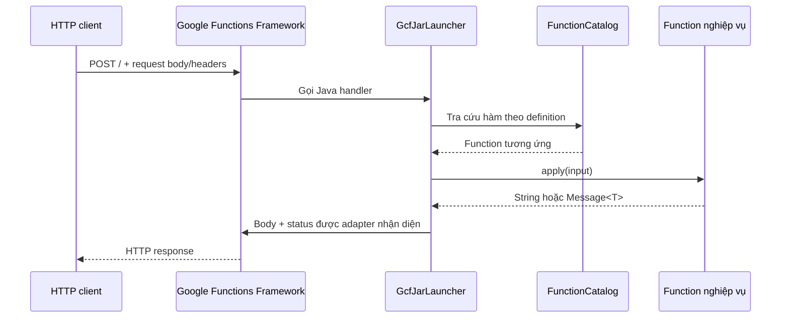
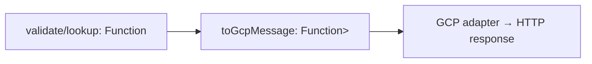
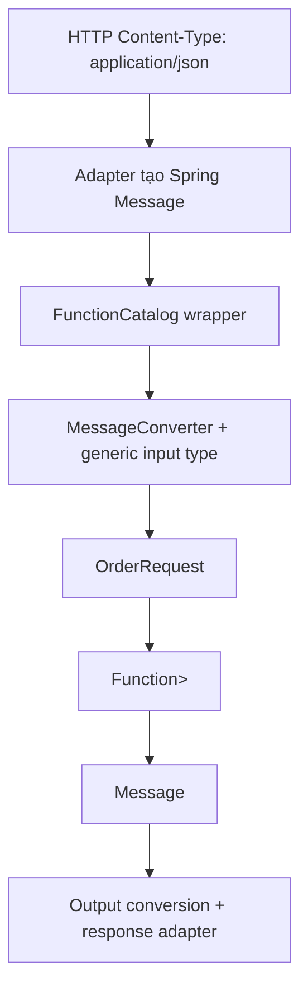

# Xử lý HTTP và tùy chỉnh phản hồi qua `Message` trên Google Cloud

## Mục tiêu bài học

Trong **Spring Cloud Function**, một hàm nghiệp vụ có thể được viết bằng `Supplier<O>`, `Function<I, O>` hoặc `Consumer<I>`, rồi được `FunctionCatalog` cung cấp cho HTTP adapter, message/event adapter hoặc môi trường serverless. Trên **Google Cloud Functions / Cloud Run functions**, `spring-cloud-function-adapter-gcp` cùng Java Functions Framework kết nối HTTP request bên ngoài với bean hàm Spring mà không buộc logic phải biết về servlet hoặc Google Cloud SDK.

Mặc định, một `Function<String, String>` chỉ thể hiện **body nghiệp vụ**. Khi muốn trả một mã HTTP có chủ đích, tài liệu Spring Cloud Function GCP giới thiệu cách trả **`org.springframework.messaging.Message<T>`** chứa payload và một header chuyên biệt: **`FunctionInvoker.HTTP_STATUS_CODE`**.

Sau bài này, bạn có thể:

- Giải thích luồng **HTTP request → `GcfJarLauncher` → `FunctionCatalog` → function → HTTP response**.
- Phân biệt `Function<I,O>`, `Function<I, Message<O>>` và `Function<Message<I>, Message<O>>`.
- Sử dụng `MessageBuilder` để tạo body và **HTTP status** như 200, 400, 404; hiểu rằng đây là hợp đồng riêng của adapter, không phải header HTTP chung.
- Chọn hàm bằng `spring.cloud.function.definition`, cấu hình GCP local invoker và quan sát phản hồi bằng `curl -i`.
- Hiểu vai trò của `contentType`, generic type, `MessageConverter`, request headers và giới hạn của việc truyền output message headers ra HTTP.
- Kiểm thử cả logic/catalog và **HTTP response thực tế** qua Google Functions Framework, đồng thời chẩn đoán sai lệch giữa adapter GCP và Spring Cloud Function Web.

**Lưu ý phiên bản:** nội dung về `FunctionInvoker.HTTP_STATUS_CODE` dựa trên mục *Setting custom HTTP statusCode* của tài liệu Spring Cloud Function GCP adapter. API, vị trí class, kiểu trigger và cách ánh xạ response có thể thay đổi giữa các bản Spring Cloud Function, Spring Boot và Google Cloud. Cần đối chiếu artifact/Java runtime đang dùng.

## 1. HTTP được xử lý qua những tầng nào?

Khi một HTTP function được cấu hình để dùng Spring Cloud Function GCP adapter, Google Functions Framework sẽ gọi Java handler do adapter cung cấp, thường là **`org.springframework.cloud.function.adapter.gcp.GcfJarLauncher`**. Handler chuẩn bị hoặc sử dụng Spring context, lấy hàm đã đăng ký từ catalog và chuyển dữ liệu vào/ra.



Sơ đồ mô tả trách nhiệm, không khẳng định Spring context bị tạo lại mỗi request. Một instance serverless có thể xử lý nhiều lượt gọi, và vòng đời do runtime quyết định.

| Lớp | Ví dụ | Việc nó thực hiện |
| --- | --- | --- |
| HTTP runtime | Google Functions Framework | Tiếp nhận method, URL, headers và body của request |
| Java entry point | `GcfJarLauncher` | Cầu nối tới Spring Cloud Function GCP adapter |
| Spring application | `OrderHttpApplication` | Cấu hình context, đăng ký `@Bean` |
| Function selection | `spring.cloud.function.definition=orderLookup` | Chọn function đã được đăng ký |
| `FunctionCatalog` | `lookup("orderLookup")` | Áp dụng wrapper/conversion/composition thích hợp |
| Business function | `Function<String, Message<String>>` | Tính body và metadata kết quả |

Quan trọng: **Google Java entry point khác Spring function name**. Không đặt `--entry-point=orderLookup` khi runtime đòi hỏi tên lớp handler. Ngược lại, `spring.cloud.function.definition=GcfJarLauncher` không có ý nghĩa vì đó không phải bean nghiệp vụ.

## 2. `Message<T>` là gì và khác `HttpResponse` thế nào?

Trong Spring Messaging, `Message<T>` có hai phần:

- **`getPayload()`**: dữ liệu nghiệp vụ, ví dụ `"FOUND:ORD-42"`.
- **`getHeaders()`**: metadata dạng khóa/giá trị, do hàm và các adapter tạo hoặc truyền tiếp.

Ví dụ Java:

```java
import org.springframework.messaging.Message;
import org.springframework.messaging.support.MessageBuilder;

Message<String> result = MessageBuilder
        .withPayload("FOUND:ORD-42")
        .setHeader("traceId", "demo-001")
        .build();

String body = result.getPayload();
Object traceId = result.getHeaders().get("traceId");
```

`Message<String>` ở đây **không phải** `com.google.cloud.functions.HttpResponse`, cũng **không phải** `org.springframework.http.ResponseEntity<String>`. Nó là cấu trúc **độc lập giao thức** của Spring Messaging, dùng được cả khi một function được kích hoạt bởi message broker hoặc được composition với hàm khác.

Nếu một HTTP adapter hiểu một số message headers như là chỉ thị HTTP, adapter **có thể** chuyển chúng thành mã trạng thái/header HTTP. Nhưng **không suy ra tất cả message headers đều được ánh xạ ra HTTP**: đó là quyết định của adapter và phiên bản.

### Ba cách khai báo chữ ký

| Chữ ký | Khi nào dùng? | Ý nghĩa |
| --- | --- | --- |
| `Function<String, String>` | Chỉ cần biến đổi body | Input và output không trực tiếp thể hiện metadata |
| `Function<String, Message<String>>` | Muốn **tùy chỉnh output message/status** | Nhận dữ liệu Java, trả payload kèm headers |
| `Function<Message<String>, Message<String>>` | Cần đọc **input message headers** và tạo output message | Hàm biết đến Spring Messaging nhưng không cần phụ thuộc HTTP servlet |

Bạn không cần đổi `GcfJarLauncher` chỉ vì đổi kiểu trả về từ `String` sang `Message<String>`. Điều cần kiểm tra là catalog nhận đúng kiểu và GCP adapter có hỗ trợ ánh xạ header mà bạn sử dụng.

## 3. Điều khiển HTTP status bằng `FunctionInvoker.HTTP_STATUS_CODE`

Tài liệu **Spring Cloud Function GCP** nêu rõ: một function có thể yêu cầu mã trạng thái HTTP tùy chỉnh bằng cách đặt **`FunctionInvoker.HTTP_STATUS_CODE`** vào headers của `Message` trả về. Ví dụ cơ bản:

```java
@Bean
public Function<String, Message<String>> notFoundExample() {
    return input -> MessageBuilder
            .withPayload("Không tìm thấy: " + input)
            .setHeader(FunctionInvoker.HTTP_STATUS_CODE, 404)
            .build();
}
```

Các kiểu cần import là `java.util.function.Function`, `org.springframework.messaging.Message` và `org.springframework.messaging.support.MessageBuilder`. **`FunctionInvoker` trong đoạn này phải là API của GCP adapter đúng phiên bản**, không phải class trùng tên thuộc AWS adapter. Kiểm tra class và hằng `HTTP_STATUS_CODE` trong dependency `spring-cloud-function-adapter-gcp` đang dùng trước khi biên dịch.

Điểm then chốt:

1. `MessageBuilder.withPayload(...)` tạo **body**.
2. `.setHeader(FunctionInvoker.HTTP_STATUS_CODE, 404)` thêm **metadata chỉ thị HTTP status**, không biến body thành đối tượng `HttpResponse`.
3. `.build()` tạo `Message<String>`.
4. GCP adapter đọc header chuyên biệt đó và có thể đặt mã HTTP trong phản hồi; ví dụ này là một cách được **tài liệu GCP adapter** minh họa.

**Không dùng** `.setHeader("status", 404)`, `.setHeader("httpStatus", 404)` hoặc `.setHeader("HTTP_STATUS_CODE", 404)` rồi giả định chúng tương đương hằng API. Header **key thực tế** là giá trị của `FunctionInvoker.HTTP_STATUS_CODE`, không phải tên biến Java dưới dạng chuỗi.

### Mã status nào nên trả?

| Tình huống | Status tham khảo | Ghi chú |
| --- | --- | --- |
| Tìm thấy dữ liệu và trả body | `200 OK` | Có thể dựa vào default nếu adapter trả 200 theo contract |
| Request sai định dạng hoặc thiếu mã đơn | `400 Bad Request` | Lỗi dữ liệu đầu vào do client gây ra |
| Mã đơn hợp lệ nhưng không tồn tại | `404 Not Found` | Lỗi nghiệp vụ có chủ đích, **khác** HTTP route 404 |
| Tạo mới thành công | `201 Created` | Cần kiểm tra khả năng đặt thêm `Location` nếu client cần |
| Không có payload | `204 No Content` | Không gắn payload giả rồi mặc định adapter sẽ tự bỏ body |
| Lỗi hệ thống bất ngờ | `500 Internal Server Error` | Thường do exception ở runtime/adapter; không nên lộ nội dung nội bộ |

Đừng sử dụng `404` cho mọi exception. Phân loại tình huống nghiệp vụ, tránh lẫn lỗi do client với lỗi máy chủ.

## 4. Ví dụ Java: trả 200, 400 và 404 theo dữ liệu

Tạo một HTTP function đơn giản nhận **mã đơn hàng từ text body**. Trong dữ liệu thử nghiệm, chỉ `ORD-42` được coi là tồn tại. Ví dụ này dùng Java 17+ và một phiên bản Spring Cloud Function có hằng `FunctionInvoker.HTTP_STATUS_CODE` như tài liệu GCP.

Để tập trung vào hành vi, chúng ta viết **một bean function**, không cần controller hay repository:

```java
package example.gcp;

import java.util.Locale;
import java.util.function.Function;

import org.springframework.boot.SpringApplication;
import org.springframework.boot.autoconfigure.SpringBootApplication;
import org.springframework.context.annotation.Bean;
import org.springframework.messaging.Message;
import org.springframework.messaging.support.MessageBuilder;

// Import FunctionInvoker từ GCP adapter đang dùng;
// kiểm tra package/API trong phiên bản của dự án.

@SpringBootApplication(proxyBeanMethods = false)
public class OrderHttpApplication {

    public static void main(String[] args) {
        SpringApplication.run(OrderHttpApplication.class, args);
    }

    @Bean
    public Function<String, Message<String>> orderLookup() {
        return raw -> {
            if (raw == null || raw.isBlank()) {
                return response("INVALID_ORDER_ID", 400);
            }

            String id = raw.trim().toUpperCase(Locale.ROOT);
            if (!"ORD-42".equals(id)) {
                return response("NOT_FOUND:" + id, 404);
            }

            return response("FOUND:" + id, 200);
        };
    }

    private static Message<String> response(String body, int status) {
        return MessageBuilder.withPayload(body)
                .setHeader(FunctionInvoker.HTTP_STATUS_CODE, status)
                .build();
    }
}
```

**Về tính biên dịch của ví dụ:** `FunctionInvoker` cần import từ API GCP adapter theo phiên bản. Tài liệu GCP minh họa hằng `FunctionInvoker.HTTP_STATUS_CODE` nhưng không liệt kê import trong đoạn mẫu. Trước khi dùng trong dự án thật, IDE/JAR dependency phải xác nhận class/hằng và import phù hợp; không nhập một `FunctionInvoker` từ adapter khác chỉ vì trùng tên. Toàn bộ logic Java còn lại là code ứng dụng; code này **không yêu cầu** HTTP controller.

Một số đầu vào/đầu ra dự kiến:

| Request body (`text/plain`) | Payload trả về | HTTP status mong đợi |
| --- | --- | --- |
| `ord-42` | `FOUND:ORD-42` | `200` |
| `  ORD-42  ` | `FOUND:ORD-42` | `200` |
| `ord-99` | `NOT_FOUND:ORD-99` | `404` |
| Chuỗi rỗng | `INVALID_ORDER_ID` | `400` |

Các giá trị trên là contract nghiệp vụ cộng với cách ánh xạ header **được GCP adapter hỗ trợ trong phiên bản tương thích**. Không có Google Cloud project thực hay database nào được truy vấn trong demo.

### Một hàm có đang “gắn chặt” với Google Cloud?

Logic `orderLookup` không xử lý `com.google.cloud.functions.HttpRequest` hay `HttpResponse`. Tuy nhiên, **hằng `FunctionInvoker.HTTP_STATUS_CODE` thuộc tầng adapter GCP**, nên nếu đưa nguyên cả hàm sang một môi trường khác, header ấy chưa chắc có cùng ý nghĩa.

Khi cần mức độc lập giao thức cao hơn, hãy tách:



`OrderOutcome` có thể là record Java biểu diễn kết quả nghiệp vụ gồm `status`, `description`, `payload`. Trong cách thiết kế này, chỉ hàm cuối phải biết header của adapter; các hàm nghiệp vụ còn lại có thể dùng lại qua HTTP, event hoặc serverless khác.

## 5. Cấu hình chọn hàm và Java entry point

Trong `src/main/resources/application.properties`:

```properties
spring.cloud.function.definition=orderLookup
```

Với cơ chế GCP adapter thông dụng:

- **Java Functions Framework entry point:** `org.springframework.cloud.function.adapter.gcp.GcfJarLauncher`.
- **Lớp cấu hình Spring:** `example.gcp.OrderHttpApplication`.
- **Bean function:** `orderLookup`.
- **Function definition:** `orderLookup`.

Source manifest theo mẫu adapter:

```text
Manifest-Version: 1.0
Main-Class: example.gcp.OrderHttpApplication

```

Tệp ví dụ: `src/main/resources/META-INF/MANIFEST.MF`. Lưu ý phải kiểm tra manifest **trong artifact sau build**, vì Spring Boot Maven plugin có thể tạo một manifest khác khi repackage executable JAR.

Không điền `Main-Class: orderLookup` hay `--entry-point=orderLookup`. Tên hàm nghiệp vụ dành cho `FunctionCatalog`, không thay thế Java handler hoặc cấu hình Spring class.

## 6. Maven dependencies và chạy thử bằng Functions Framework

Với dự án đã có Spring Boot parent/BOM và Spring Cloud release train tương thích, phần dependencies minh họa:

```xml
<dependencies>
    <dependency>
        <groupId>org.springframework.cloud</groupId>
        <artifactId>spring-cloud-function-adapter-gcp</artifactId>
    </dependency>
    <dependency>
        <groupId>org.springframework.cloud</groupId>
        <artifactId>spring-cloud-function-context</artifactId>
    </dependency>
    <dependency>
        <groupId>org.springframework.boot</groupId>
        <artifactId>spring-boot-starter-test</artifactId>
        <scope>test</scope>
    </dependency>
</dependencies>
```

Tùy dependency tree, GCP adapter có thể đã kéo Context transitively; việc liệt kê tường minh có ích nếu mã dự án import `FunctionCatalog`. **Đây chỉ là phần POM minh họa**, chưa có parent, quản lý phiên bản và build plugin đầy đủ. Luôn dùng các phiên bản Spring Boot/Cloud Function/GCP adapter tương thích, tránh ghép ngẫu nhiên.

Để chạy local, cấu hình Google Functions Framework Maven plugin:

```xml
<plugin>
    <groupId>com.google.cloud.functions</groupId>
    <artifactId>function-maven-plugin</artifactId>
    <version>COMPATIBLE_FUNCTION_PLUGIN_VERSION</version>
    <configuration>
        <functionTarget>org.springframework.cloud.function.adapter.gcp.GcfJarLauncher</functionTarget>
        <port>8080</port>
    </configuration>
</plugin>
```

`COMPATIBLE_FUNCTION_PLUGIN_VERSION` là placeholder cần thay bằng phiên bản thích hợp. Những tài liệu GCP adapter có dùng `0.9.1` làm ví dụ, nhưng không nên coi đây là phiên bản mới nhất cho mọi JDK.

Nếu chuẩn bị gói deploy theo cấu trúc Spring Cloud Function GCP, tài liệu cũng dùng **`spring-boot-maven-plugin` với GCP adapter là plugin dependency** và có thể xuất JAR vào `target/deploy`. Phần này khác nhiệm vụ của plugin chạy local; phải đối chiếu cơ chế đóng gói với phiên bản adapter và runtime đích.

### Chạy hai terminal

Terminal thứ nhất:

```bash
./mvnw test
./mvnw function:run
```

`function:run` khởi chạy Functions Framework local trên cổng 8080 theo cấu hình. Lệnh chỉ hoạt động khi Maven plugin đã được khai báo và dependencies đã resolve. Nếu không có Maven Wrapper, dùng `mvn` tương đương.

Terminal thứ hai:

```bash
curl -i -X POST http://localhost:8080/ \
  -H "Content-Type: text/plain" \
  --data-binary "ord-42"
```

Ví dụ mong đợi (header thực tế có thể khác):

```text
HTTP/1.1 200 OK
...

FOUND:ORD-42
```

Thử tình huống **không tìm thấy**:

```bash
curl -i -X POST http://localhost:8080/ \
  -H "Content-Type: text/plain" \
  --data-binary "ord-99"
```

Mã kỳ vọng là **404**, body nghiệp vụ `NOT_FOUND:ORD-99`. Cuối cùng, thử request rỗng:

```bash
curl -i -X POST http://localhost:8080/ \
  -H "Content-Type: text/plain" \
  --data-binary ""
```

Mã kỳ vọng là **400**, body `INVALID_ORDER_ID`. Cần quan sát log và các status **thực tế**; không suy từ việc hàm trả `Message` mà mặc định mọi phiên bản GCP adapter đều xử lý cùng một cách.

**Vì sao gọi `/` mà không phải `/orderLookup`?** Khi dùng local **Google Functions Framework** với một Java handler, ví dụ GCP adapter nhận request trên root path. `/orderLookup` là kiểu route có thể gặp ở **Spring Cloud Function Web adapter**, không nên áp dụng máy móc cho GCP handler.

## 7. Header status khác header thông thường như thế nào?

`MessageHeaders` là metadata chung của Spring Messaging; nó **không quy định một HTTP status code**. `FunctionInvoker.HTTP_STATUS_CODE` là hợp đồng **riêng của GCP adapter** được tài liệu hóa.

| Header/metadata | Ý nghĩa | Có chắc GCP sẽ biến thành HTTP response header/status? |
| --- | --- | --- |
| `FunctionInvoker.HTTP_STATUS_CODE` | Yêu cầu **HTTP status code** cụ thể | Được tài liệu GCP adapter mô tả |
| `MessageHeaders.CONTENT_TYPE` / `contentType` | Gợi ý kiểu dữ liệu payload khi chuyển đổi | **Không khẳng định** luôn đặt trực tiếp `Content-Type` HTTP |
| `traceId`, `correlationId` | Theo dõi một lời gọi qua nhiều tầng | Không tự động bảo đảm thành `X-Trace-Id` trên HTTP response |
| `X-Custom-Header` | Metadata do hàm tự tạo | Cần kiểm thử cụ thể; có thể bị bỏ qua bởi GCP adapter |
| `id`, `timestamp` | Metadata nội bộ Spring `Message` | Không phải mã HTTP hoặc HTTP request ID mặc định |

Bạn có thể tạo metadata tùy chỉnh như sau:

```java
Message<String> message = MessageBuilder.withPayload("FOUND:ORD-42")
        .setHeader("correlationId", "request-demo-7")
        .build();
```

Hàm Java khác có thể đọc `message.getHeaders().get("correlationId")`. Nhưng điều đó **không chứng minh** HTTP response của `GcfJarLauncher` sẽ tự có header `correlationId`.

### Header HTTP thực sự có thể cần giải pháp riêng

Nếu yêu cầu hệ thống là *bắt buộc* điều khiển `Cache-Control`, `Set-Cookie`, `Location`, CORS hoặc header bảo mật, cần:

1. Kiểm tra cụ thể adapter GCP hỗ trợ những output message headers nào và cách map ra HTTP.
2. Viết integration test qua **Functions Framework/GCP handler**, không chỉ kiểm tra `Message.getHeaders()`.
3. Nếu adapter không đáp ứng, cân nhắc **Java `HttpFunction` tùy chỉnh** sử dụng `HttpResponse` trực tiếp hoặc chuyển sang web adapter/controller phù hợp, rồi ủy quyền nghiệp vụ cho `FunctionCatalog`.

Không nên lấy đặc tính của **`spring-cloud-function-web`** — nơi các output message headers thường được ánh xạ sang HTTP headers — rồi cho rằng GCP adapter cũng có hành vi y hệt.

## 8. Đọc request headers qua `Function<Message<I>, Message<O>>`

Nếu logic cần tham khảo metadata input, Spring Cloud Function cho phép khai báo hàm nhận **`Message<I>`**:

```java
@Bean
public Function<Message<String>, Message<String>> echoWithTrace() {
    return input -> {
        String body = input.getPayload().trim();
        Object requestTrace = input.getHeaders().get("X-Trace-Id");

        return MessageBuilder.withPayload(body)
                .setHeader("traceId", requestTrace == null
                        ? "not-provided" : requestTrace.toString())
                .build();
    };
}
```

Đoạn mã minh họa **cách đọc và tạo Spring Message metadata**. HTTP request headers có thực sự đến với đúng tên `X-Trace-Id` trong `MessageHeaders` không còn phụ thuộc GCP adapter, việc chuẩn hóa chữ hoa/chữ thường và chính sách của runtime. Cần kiểm tra dưới Functions Framework trước khi dùng trong logic.

Khi chuyển sang bean `echoWithTrace`, cập nhật:

```properties
spring.cloud.function.definition=echoWithTrace
```

Không để `orderLookup` và `echoWithTrace` cùng là mục tiêu của một HTTP handler nếu chưa xác định rõ hàm nào được chọn. Có thể tạo các bài thử độc lập hoặc thiết lập definition phù hợp mỗi test.

**Bảo mật:** không tin rằng header tự khai báo bởi client là danh tính đã xác thực. Những header như `X-User-Id` có thể bị giả mạo nếu không được hệ thống trusted ingress xác minh. Authentication/authorization nên dựa trên chính sách IAM hoặc cơ chế đáng tin cậy của ứng dụng, không chỉ việc Spring Message chứa một chuỗi.

## 9. Content type và chuyển đổi thông điệp

Spring Cloud Function cần biết **kiểu input/output** và đôi khi cần **`contentType`** để chọn converter. Với `Function<String, Message<String>>`, payload là text; với `Function<OrderRequest, Message<OrderResult>>`, adapter thường cần chuyển JSON request thành DTO.



### Ví dụ JSON DTO

File `OrderRequest.java`:

```java
package example.gcp;

public record OrderRequest(String orderId, int quantity) {
}
```

File `OrderResult.java`:

```java
package example.gcp;

public record OrderResult(String orderId, long totalCents) {
}
```

Thêm một bean ví dụ (phải import `Function`, `Message`, `MessageBuilder` và GCP `FunctionInvoker` tương ứng):

```java
@Bean
public Function<OrderRequest, Message<OrderResult>> calculateOrder() {
    return request -> {
        if (request == null || request.quantity() <= 0) {
            // Không dùng null payload; dùng một kiểu phản hồi lỗi riêng
            // hoặc hợp đồng trả response DTO phù hợp.
            throw new IllegalArgumentException("Số lượng không hợp lệ");
        }

        OrderResult result = new OrderResult(
                request.orderId(),
                Math.multiplyExact(
                        (long) request.quantity(), 12_000L));

        return MessageBuilder.withPayload(result)
                .setHeader(FunctionInvoker.HTTP_STATUS_CODE, 200)
                .build();
    };
}
```

Để chọn hàm này thay `orderLookup`:

```properties
spring.cloud.function.definition=calculateOrder
```

Gửi thử JSON:

```bash
curl -i -X POST http://localhost:8080/ \
  -H "Content-Type: application/json" \
  --data-binary '{"orderId":"ORD-42","quantity":2}'
```

Kết quả nghiệp vụ kỳ vọng là `OrderResult("ORD-42", 24000)` và HTTP status 200. **Dạng response body JSON thực tế** phụ thuộc adapter, codec và kiểu mà catalog xuất ra. Đừng mặc định việc Java unit test đúng nghĩa là JSON wire format đã đúng; cần kiểm thử local HTTP.

Một `Function` khai báo raw `Function` thay vì `Function<OrderRequest, Message<OrderResult>>` có thể khiến converter không suy ra type `OrderRequest`. Cũng cần tránh dùng `Content-Type: text/plain` cho JSON và ngược lại nếu adapter yêu cầu định dạng cụ thể.

### Status và lỗi exception là hai đường khác nhau

Hàm **trả `Message`** có status header là một quyết định có chủ đích. Hàm **ném exception** không có nghĩa adapter sẽ tự biến một `IllegalArgumentException` thành 400 trong mọi phiên bản. Việc chuyển exception sang status/response thuộc tầng xử lý lỗi của runtime/adapter.

Đối với API có nhiều loại lỗi, nên định nghĩa một **outcome type** riêng hoặc một lớp adapter cuối nhận kết quả nghiệp vụ rồi chọn mã HTTP phù hợp. Không làm rò rỉ stack trace và secrets vào response khi có lỗi bất ngờ.

## 10. Composition để tách nghiệp vụ khỏi HTTP status

Một thiết kế có thể dùng lại qua HTTP và broker là để hàm nghiệp vụ trả về **kết quả domain thuần Java**, rồi chỉ hàm cuối mới tạo `Message`.

Ví dụ record:

```java
public record LookupOutcome(String orderId, boolean found) {
}
```

Hàm nghiệp vụ:

```java
@Bean
public Function<String, LookupOutcome> findOrder() {
    return id -> new LookupOutcome(
            id.trim().toUpperCase(Locale.ROOT),
            "ORD-42".equalsIgnoreCase(id.trim()));
}
```

Hàm chuyển domain outcome sang HTTP metadata:

```java
@Bean
public Function<LookupOutcome, Message<String>> toGcpResponse() {
    return outcome -> MessageBuilder
            .withPayload(outcome.found()
                    ? "FOUND:" + outcome.orderId()
                    : "NOT_FOUND:" + outcome.orderId())
            .setHeader(FunctionInvoker.HTTP_STATUS_CODE,
                    outcome.found() ? 200 : 404)
            .build();
}
```

Với hai bean đã đăng ký và generic khớp, Spring Cloud Function có thể composition:

```properties
spring.cloud.function.definition=findOrder|toGcpResponse
```

Đường ghép này **không tạo hai Google Cloud Functions**; Google vẫn gọi **một** Java handler GCP. `FunctionCatalog` chọn một chuỗi xử lý logic và response. Chữ ký `Function<String, LookupOutcome>` cùng `Function<LookupOutcome, Message<String>>` thể hiện rõ hợp đồng ghép.

Khi chuyển logic sang một message broker hoặc serverless adapter khác, có thể dùng lại `findOrder` mà không kéo theo mã status đặc thù Google. Tầng `toGcpResponse` được thay bằng adapter tương ứng môi trường mới.

**Chú ý giới hạn:** composition có thể thay đổi cách metadata được wrapper bảo toàn/chuyển đổi. Hãy kiểm tra header `FunctionInvoker.HTTP_STATUS_CODE` còn hiện diện sau composition qua **local HTTP integration test**, thay vì chỉ suy luận từ chữ ký hai hàm.

## 11. Kiểm thử ở hai tầng: Spring Message và HTTP thật

### 11.1. Unit test logic và message status

Trong JUnit 5, có thể gọi bean function trực tiếp qua phương thức factory:

```java
package example.gcp;

import static org.junit.jupiter.api.Assertions.assertEquals;
import org.junit.jupiter.api.Test;
import org.springframework.messaging.Message;

class OrderLookupTest {

    @Test
    void foundAndNotFoundHaveDifferentMessageStatus() {
        OrderHttpApplication config = new OrderHttpApplication();

        Message<String> found = config.orderLookup().apply("ord-42");
        assertEquals("FOUND:ORD-42", found.getPayload());
        assertEquals(200,
                found.getHeaders().get(FunctionInvoker.HTTP_STATUS_CODE));

        Message<String> missing = config.orderLookup().apply("ord-99");
        assertEquals("NOT_FOUND:ORD-99", missing.getPayload());
        assertEquals(404,
                missing.getHeaders().get(FunctionInvoker.HTTP_STATUS_CODE));
    }
}
```

Đoạn test cần tham chiếu cùng hằng `FunctionInvoker.HTTP_STATUS_CODE` của GCP adapter như lớp ứng dụng, theo API thực tế. Nó chứng minh function **tạo đúng metadata**, **chưa chứng minh** Java Functions Framework chuyển header đó thành HTTP status.

### 11.2. Kiểm thử Spring context và `FunctionCatalog`

```java
package example.gcp;

import static org.junit.jupiter.api.Assertions.assertNotNull;
import org.junit.jupiter.api.Test;
import org.springframework.beans.factory.annotation.Autowired;
import org.springframework.boot.test.context.SpringBootTest;
import org.springframework.cloud.function.context.FunctionCatalog;

@SpringBootTest(
        classes = OrderHttpApplication.class,
        webEnvironment = SpringBootTest.WebEnvironment.NONE)
class OrderCatalogTest {

    @Autowired
    FunctionCatalog catalog;

    @Test
    void findsFunctionByName() {
        assertNotNull(catalog.lookup("orderLookup"));
    }
}
```

Với catalog test, phải có `spring-cloud-function-context`/auto-configuration phù hợp. Nếu test này PASS, bạn biết bean/hạ tầng catalog tồn tại nhưng **chưa biết HTTP status có được GCP adapter đọc hay không**.

### 11.3. Integration test thủ công với Functions Framework

Chạy:

```bash
./mvnw function:run
```

Gửi ba request vào `/`, quan sát `curl -i`. Có thể thêm `--fail-with-body` trong môi trường curl đủ mới, nhưng **không dùng `-f` thông thường** nếu bạn muốn kiểm tra body của 400/404 vì nó có thể khiến client không in body.

| Test | Body gửi | Status dự kiến | Payload dự kiến |
| --- | --- | --- | --- |
| OK | `ord-42` | `200` | `FOUND:ORD-42` |
| Not Found | `ord-99` | `404` | `NOT_FOUND:ORD-99` |
| Invalid | rỗng | `400` | `INVALID_ORDER_ID` |

Nếu cả ba trường hợp đúng qua Functions Framework, bạn đã kiểm tra **GCP Java handler + Spring context + FunctionCatalog + output Message → HTTP status** ở môi trường local. Vẫn cần smoke test trên runtime Google Cloud thật để xác nhận cấu hình deployment/trigger/IAM.

### 11.4. Kiểm tra headers khác — tránh kết luận quá sớm

Thử đưa `"correlationId"` vào output `Message`, sau đó:

```bash
curl -i -X POST http://localhost:8080/ \
  -H "Content-Type: text/plain" \
  --data-binary "ord-42"
```

Quan sát response headers. Nếu `correlationId` không xuất hiện, đó **không nhất thiết là lỗi của `MessageBuilder`**: GCP adapter có thể chỉ xử lý một nhóm header xác định, không tự ánh xạ mọi metadata.

## 12. So sánh với Spring Cloud Function Web và `ResponseEntity`

| Đặc tính | GCP adapter + `GcfJarLauncher` | Spring Cloud Function Web adapter |
| --- | --- | --- |
| Runtime | Java Functions Framework/Google Cloud Functions | Ứng dụng Spring Boot có HTTP server |
| HTTP route mẫu | `POST /` trong local invoker | Có thể là `POST /{functionName}` |
| Chọn hàm | `spring.cloud.function.definition` | Catalog/routing/web configuration |
| Trả status tùy chỉnh | Tài liệu GCP nêu `FunctionInvoker.HTTP_STATUS_CODE` | Có cơ chế HTTP response/header riêng của Web adapter |
| Output `Message` headers | Chỉ những cách ánh xạ được adapter hỗ trợ | Tài liệu Web adapter mô tả ánh xạ output message headers sang HTTP headers |
| `ResponseEntity` | Không phải kiểu contract mặc định của GCP function | `ResponseEntity` thuộc Spring Web, phù hợp hơn với controller/HTTP stack |
| HTTP application setup | GCP adapter + Google handler; không bắt buộc Spring MVC server | Thường cần Spring Boot web stack phù hợp |

**Không nên đổi `Message<String>` thành `ResponseEntity<String>`** chỉ vì muốn trả 404 trong `GcfJarLauncher`. Một function có thể trả `ResponseEntity` như một Java object, nhưng điều đó **không bảo đảm GCP adapter diễn giải nó thành HTTP response**. Hãy sử dụng contract được adapter GCP tài liệu hóa hoặc viết custom Java HTTP handler nếu cần kiểm soát request/response cấp thấp.

## 13. Giới hạn bảo mật và tiêu chuẩn HTTP

Việc trả mã HTTP đúng **không thay thế kiểm tra bảo mật**:

- **401 Unauthorized** và **403 Forbidden** liên quan authentication/authorization; trong Google Cloud còn có IAM/identity token/ingress ở tầng runtime. Một hàm tạo status 403 không chứng minh quyền truy cập được bảo vệ đúng.
- **404 do nghiệp vụ** không giống **404 do route/function URL không tồn tại**. Cùng mã nhưng được tạo ở hai tầng khác nhau, cần log/correlation phù hợp để phân biệt.
- **CORS** không chỉ là thêm metadata `"Access-Control-Allow-Origin"` vào Spring Message: phải chứng minh adapter/runtime trả header đó và xử lý preflight `OPTIONS` khi có trình duyệt gọi.
- **`Set-Cookie`, `Location`, caching và security headers** phải được kiểm thử end-to-end. Không dựa vào lời hứa rằng mọi output message headers đều tự thành HTTP headers.
- Không đưa exception stack trace, secret hoặc payload chứa thông tin nhạy cảm vào body trả client.
- Với retry và concurrency, một bean singleton có thể phục vụ nhiều lời gọi; tránh giữ trạng thái request trong các trường mutable không được đồng bộ.

Nếu HTTP API phức tạp cần route nhiều mức, multipart upload, streaming, authentication middleware hoặc content negotiation nâng cao, một **HTTP controller** hoặc **custom Google HttpFunction** có thể phù hợp hơn. Vẫn có thể giữ `FunctionCatalog` cho phần nghiệp vụ tái sử dụng.

## 14. Lỗi thường gặp và cách khắc phục

| Triệu chứng | Nguyên nhân có thể | Hướng xử lý |
| --- | --- | --- |
| Status vẫn là 200 mặc dù `Message` có 404 | Sai constant, output message bị chuyển đổi, phiên bản adapter không đọc header như mong đợi | Xác minh `FunctionInvoker.HTTP_STATUS_CODE` của GCP, inspect output headers, thử `curl -i` |
| Java compile không tìm thấy `FunctionInvoker` | Import nhầm package, dependency/phiên bản GCP adapter không phù hợp | Kiểm tra class thực tế trong `spring-cloud-function-adapter-gcp`; **đừng** import AWS `FunctionInvoker` |
| Function trả string `"404"` nhưng HTTP vẫn 200 | Status nằm trong body chứ không phải header chuyên biệt | Trả `Message<String>` và setHeader đúng key |
| `catalog.lookup("orderLookup")` trả `null` | Bean không được đăng ký, tên/definition sai | Kiểm tra `@Bean`, cấu hình và Spring context |
| Response body bị serialize như một object headers/payload | Adapter/wrapper không xử lý `Message` như ví dụ phiên bản | Kiểm tra loại function output, converter và integration test GCP |
| JSON vào DTO thất bại | Thiếu generic type, content type sai hoặc converter chưa có | Dùng `Function<OrderRequest, Message<OrderResult>>`, gửi `application/json`, xác minh codec |
| Không thấy output header `traceId` trong HTTP | Adapter không ánh xạ header tùy chỉnh hoặc bị gateway lọc | Không giả định ánh xạ; kiểm tra contract và dùng handler phù hợp nếu bắt buộc |
| Đọc request header trả `null` | Adapter không truyền header với key đó hoặc bị chuẩn hóa | Quan sát headers thực trong `Message`, dùng mapping được hỗ trợ |
| HTTP 404 cả khi `orderLookup` chưa chạy | URL/route local sai; đang gọi `/orderLookup` thay vì `/` | Kiểm tra local Functions Framework, cổng và Java target |
| `No plugin found for prefix function` | Thiếu Google `function-maven-plugin` | Cấu hình plugin và version tương thích |
| `ClassNotFoundException: GcfJarLauncher` | GCP adapter không có trên classpath/runtime | Kiểm tra dependencies, plugin target, packaging |
| `Main-Class` sai | Source manifest hoặc artifact cuối không chỉ đúng Spring class | Kiểm tra tên lớp chính, Maven plugin và JAR manifest |
| HTTP 401/403 trên Google Cloud nhưng local chạy | IAM, authentication token, audience hoặc ingress | Kiểm tra bảo mật cloud; không sửa status header nghiệp vụ để giải quyết IAM |
| Mã 500 khi input xấu | Exception bị runtime xử lý thay vì function trả Message 400 | Phân loại validation trong hàm hoặc cấu hình error handling phù hợp |
| Composition làm mất status header | Wrapper/converter hoặc function sau ghi đè metadata | Kiểm tra message cuối pipeline và test HTTP thật |

Quy trình gỡ lỗi:

1. **Function bean** có được đăng ký và `FunctionCatalog` tìm thấy không?
2. **Java method test** có trả đúng `Message.getPayload()` và header `HTTP_STATUS_CODE` không?
3. **Local Functions Framework** có tải đúng `GcfJarLauncher` và nhận `POST /` không?
4. **GCP adapter** có đọc header và chuyển thành status HTTP thật không?
5. **Response conversion** có đúng text/JSON content type không?
6. Nếu local đúng mà cloud sai, kiểm tra **runtime, IAM, ingress, deployment và gateway**.

Tách từng tầng giúp tránh trường hợp sửa logic nghiệp vụ trong khi lỗi do Java handler chưa nạp, hoặc sửa Maven packaging trong khi chỉ đang đặt sai tên header.

## 15. Bài tập và câu hỏi tự kiểm tra

### Bài tập 1 — Thử 200, 400 và 404

Dùng bean `orderLookup`, thử các request `ord-42`, `ord-99` và body rỗng qua `curl -i`. Ghi lại HTTP status và response body thực tế. Giải thích sự khác nhau giữa một `Message` được gắn header 404 và một HTTP 404 do route không tồn tại.

### Bài tập 2 — Phân biệt body với header

Đổi `.setHeader(FunctionInvoker.HTTP_STATUS_CODE, 404)` thành **payload string** `"404"`. Kiểm thử và giải thích tại sao body mang giá trị 404 không tự làm response status thành 404.

### Bài tập 3 — Request metadata

Tạo `Function<Message<String>, Message<String>>` đọc `X-Trace-Id` nếu được adapter đưa vào message headers. Đưa `traceId` vào output message, sau đó kiểm tra hai chuyện **riêng biệt**: (a) header tồn tại trong Spring Message; (b) header có hiện ra trên HTTP response hay không.

### Bài tập 4 — Composition

Viết `findOrder: String -> LookupOutcome` và `toGcpResponse: LookupOutcome -> Message<String>`, cấu hình `spring.cloud.function.definition=findOrder|toGcpResponse`, chạy unit test và local HTTP test. Giải thích thành phần nào có thể tái sử dụng ngoài Google Cloud.

### Bài tập 5 — JSON và validation

Đổi sang `Function<OrderRequest, Message<OrderResult>>`. Gửi một request hợp lệ và một request có quantity không hợp lệ. Thiết kế contract lỗi không trả `null` payload, chọn status có chủ đích và kiểm tra converter/serialization thực tế.

### Câu hỏi tự kiểm tra

1. **`Message<T>` gồm hai phần nào?** Payload và headers.
2. **Muốn yêu cầu HTTP 404 theo tài liệu GCP adapter thì làm gì?** Trả một `Message` với header `FunctionInvoker.HTTP_STATUS_CODE` nhận giá trị 404.
3. **Có thể chỉ trả chuỗi `"404"` để thay HTTP status không?** Không; đó chỉ là response body.
4. **`FunctionInvoker.HTTP_STATUS_CODE` có phải tên header chuẩn của Spring Web hay Google HTTP API không?** Không; đó là key chuyên biệt mà GCP adapter được tài liệu hóa.
5. **Đưa `traceId` vào output message có bảo đảm HTTP có header đó không?** Không; phải kiểm tra adapter và thử HTTP thật.
6. **Có thể dùng `ResponseEntity<String>` để thay thế không?** Không mặc định với `GcfJarLauncher`; cần contract của adapter hoặc Java HTTP handler riêng.
7. **`POST /orderLookup` và `POST /` có giống nhau không?** Không; GCP local invoker theo mẫu nhận `/`, Web adapter có routing riêng.
8. **Vì sao unit test chỉ kiểm tra `Message` chưa đủ?** Vì nó không xác nhận GCP adapter chuyển header thành HTTP status.
9. **Có nên trả stack trace vào body 500 không?** Không, có thể lộ bí mật/chi tiết nội bộ.

## 16. Tổng kết và tài liệu tham khảo

Trong Spring Cloud Function GCP adapter, **`Message<T>` là cách mô tả payload và metadata mà không buộc hàm nghiệp vụ trực tiếp sử dụng `HttpResponse`**. Với HTTP function, tài liệu Spring Cloud Function hỗ trợ tùy chỉnh **HTTP status** qua header **`FunctionInvoker.HTTP_STATUS_CODE`**. Bean được chọn bằng `spring.cloud.function.definition`; `GcfJarLauncher` nhận lời gọi từ Google Functions Framework; `FunctionCatalog` phối hợp gọi hàm và chuyển đổi payload.

Muốn triển khai an toàn: **đăng ký function → chọn definition → tạo `Message` chứa status → kiểm thử headers trong Java → chạy Functions Framework và `curl -i` → kiểm tra response thật → thử trên Google Cloud với IAM/trigger thực tế**. Đừng nhầm khả năng tùy chỉnh status mà GCP adapter tài liệu hóa với việc tự động hỗ trợ mọi HTTP header hoặc toàn bộ Spring MVC.

Tài liệu chính thức:

- [Spring Cloud Function — Google Cloud Functions adapter](https://docs.spring.io/spring-cloud-function/reference/5.0/adapters/gcp-intro.html): phần *HTTP Functions* và *Setting custom HTTP statusCode*, `GcfJarLauncher`, local framework và packaging.
- [Spring Cloud Function — Programming Model](https://docs.spring.io/spring-cloud-function/reference/spring-cloud-function/programming-model.html): `FunctionCatalog`, `MessageConverter`, content type và message headers.
- [Spring Cloud Function — Standalone Web Applications](https://docs.spring.io/spring-cloud-function/reference/spring-cloud-function/standalone-web-applications.html): hành vi HTTP khác của Web adapter và ánh xạ output `Message` headers.
- [Google Functions Framework for Java](https://github.com/GoogleCloudPlatform/functions-framework-java): hợp đồng Java `HttpFunction`, local invoker và thử nghiệm.
- [Google Cloud — Cloud Run functions](https://cloud.google.com/run/docs/functions): môi trường runtime, HTTP trigger, ingress, IAM và khác biệt triển khai.

**Lưu ý phiên bản:** mã minh họa phụ thuộc hằng `FunctionInvoker.HTTP_STATUS_CODE` của GCP adapter. Bài học không có quyền build/QA project; cần xác nhận import/API trong JAR thực tế và chạy kiểm thử tích hợp theo bộ phiên bản Spring Cloud Function/Google Functions Framework trước khi dùng trong môi trường production.
