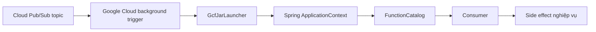
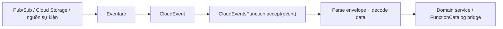
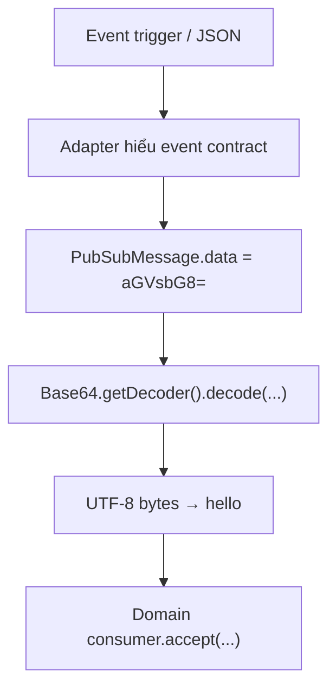
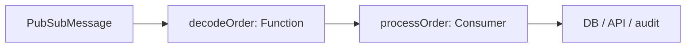
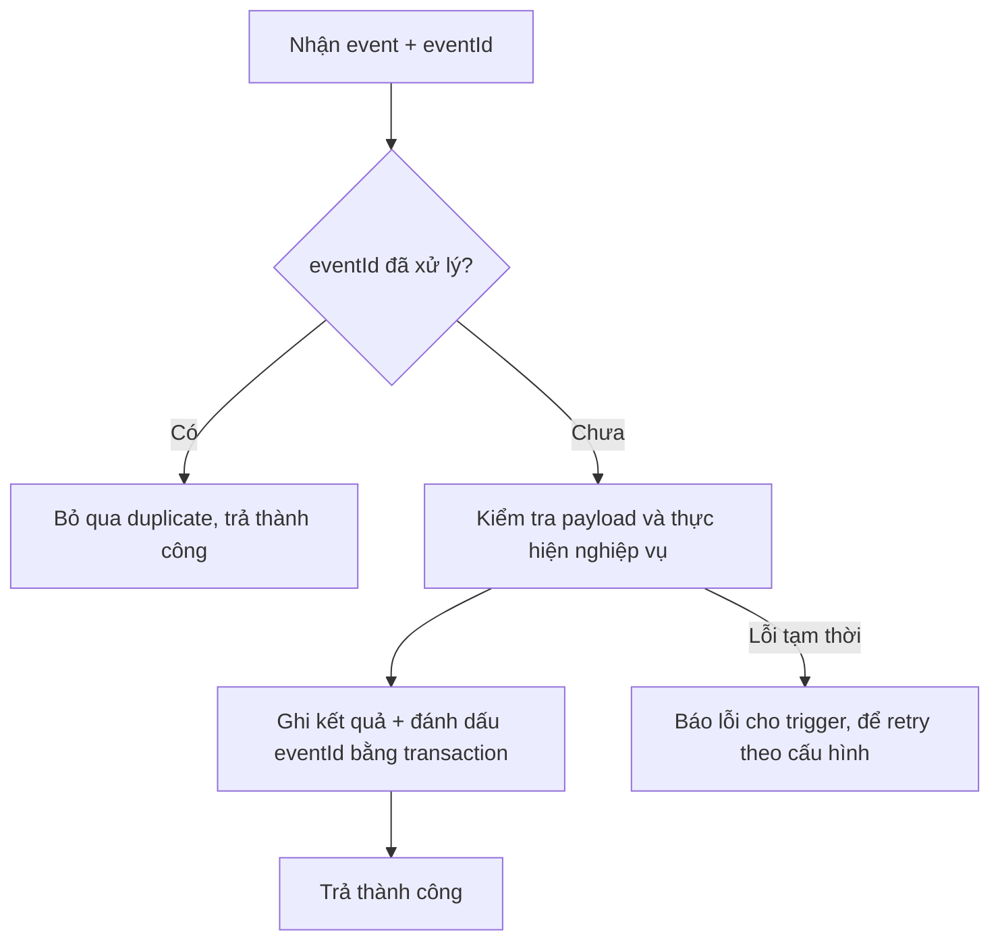

# Xử lý sự kiện nền và chuyển đổi dữ liệu theo adapter hỗ trợ

## Mục tiêu học tập

**Spring Cloud Function** tổ chức logic nghiệp vụ thành `Supplier<O>`, `Function<I, O>` và `Consumer<I>`, đăng ký trong Spring context rồi truy cập bằng `FunctionCatalog`. Cùng một logic có thể dùng cho HTTP, sự kiện hoặc serverless nếu **adapter nhận lời gọi và chuyển payload đúng hợp đồng**. Trong chương **Google Cloud**, điều này đặc biệt quan trọng khi xử lý **background event**, chẳng hạn thông điệp Cloud Pub/Sub, thay vì request HTTP thông thường.

Bài này trình bày hai đường tích hợp **khác nhau**, không nên trộn lẫn:

1. **Background function theo mẫu Spring Cloud Function GCP adapter:** `spring-cloud-function-adapter-gcp`, `GcfJarLauncher` và bean `Consumer<PubSubMessage>`, theo tài liệu về Google Cloud Functions background triggers.
2. **Event-driven function hiện đại với Eventarc/CloudEvents:** Java Functions Framework dùng `CloudEventsFunction` nhận một `CloudEvent` có envelope riêng. Muốn tái sử dụng `FunctionCatalog` trong đường này phải có **bridge/bootstrap tương thích**; không được mặc định handler background cũ tự hiểu mọi CloudEvent.

Sau khi học, bạn có thể giải thích dữ liệu đi từ trigger tới `Consumer`; viết DTO sự kiện và giải mã Pub/Sub Base64; cấu hình bean, manifest, Maven, `spring.cloud.function.definition`; phân biệt metadata sự kiện với message payload; kiểm thử qua Java, Spring context, local Functions Framework và môi trường cloud; đồng thời xử lý lỗi, retry và idempotency.

**Giới hạn phiên bản:** thuật ngữ *background function* và mẫu `GcfJarLauncher` trong Spring Cloud Function GCP reference có nguồn gốc từ hợp đồng Google Cloud Functions trước đây. Google Cloud Run functions hiện dùng **CloudEvents** cho các chức năng kích hoạt bởi Eventarc. Hãy xác nhận phiên bản Spring Cloud Function, Java runtime, loại trigger và handler được hỗ trợ trước khi áp dụng ví dụ vào production.

## 1. Sự kiện nền khác request HTTP ở đâu?

Một HTTP function thường nhận một request do người gọi gửi trực tiếp và trả response ngay cho người đó. Một event-driven function được kích hoạt **gián tiếp** khi một sự kiện xuất hiện: ví dụ Pub/Sub nhận message, Cloud Storage có object mới, hoặc một nguồn Eventarc phát sinh sự kiện.

| Khía cạnh | HTTP Function | Background/event-driven function |
| --- | --- | --- |
| Tác nhân kích hoạt | Client gửi HTTP request | Nguồn sự kiện + hạ tầng trigger |
| Dữ liệu vào | Body, headers, method, URL | Event data **và metadata** theo loại trigger |
| Logic Spring Cloud Function | Thường là `Function<I,O>` | Thường là `Consumer<I>`, hoặc composition kết thúc ở `Consumer` |
| Đầu ra | Response body/status cho client | Thường là side effect: ghi dữ liệu, gọi API, phát sự kiện khác |
| Retry | Tùy HTTP client/gateway | Tùy chính sách delivery/retry của trigger |
| Nguy cơ trùng lặp | Client có thể gửi lại | Event có thể được giao lại, cần idempotency |
| Hợp đồng adapter | HTTP handler/routing | Background handler hoặc CloudEvents handler tương thích |

**`Consumer<I>` không trả response nghiệp vụ** vì `accept(I)` trả `void`. Điều đó không có nghĩa nền tảng không cần biết kết quả: việc handler **trả về bình thường hay ném exception** có thể ảnh hưởng cách runtime ghi nhận thành công/thất bại và retry theo cấu hình.

Một function không tự có Pub/Sub subscription chỉ vì được khai báo:

```java
@Bean
Consumer<String> auditEvent() {
    return value -> System.out.println(value);
}
```

Để nhận sự kiện thực sự cần **trigger tương ứng**, quyền truy cập, adapter/handler và payload mapping đúng định dạng. `FunctionCatalog` chỉ chịu trách nhiệm nhận diện/chọn/gọi hàm bên trong Spring.

## 2. Hai mô hình Google Cloud phải được tách riêng

### 2.1. Background function theo GCP adapter của Spring Cloud Function

Tài liệu Spring Cloud Function mô tả mô hình:



Trong mẫu này:

- **Java entry point** là `org.springframework.cloud.function.adapter.gcp.GcfJarLauncher`.
- **Spring application class** đăng ký `Consumer<PubSubMessage>`.
- **`spring.cloud.function.definition`** chọn tên bean cần gọi.
- **DTO `PubSubMessage`** thể hiện các trường dữ liệu theo ví dụ background event.
- Google Functions Framework có thể chạy local và nhận JSON mô phỏng event.

Các chi tiết trên phản ánh **đường background adapter được tài liệu Spring Cloud Function mô tả**, không phải khẳng định mọi thế hệ Google Cloud đều dùng cùng chữ ký.

### 2.2. Cloud Run functions, Eventarc và CloudEvents

Với hướng dẫn Google Cloud Run functions hiện đại, hàm Java kích hoạt bởi event thường triển khai:

```java
import com.google.cloud.functions.CloudEventsFunction;
import io.cloudevents.CloudEvent;

public final class EventarcEntryPoint implements CloudEventsFunction {
    @Override
    public void accept(CloudEvent event) throws Exception {
        // Xử lý CloudEvent metadata và data tại đây.
    }
}
```

Entry point là **tên đầy đủ của lớp Java `EventarcEntryPoint`** và phải đúng hợp đồng `CloudEventsFunction`. Payload Pub/Sub trong CloudEvent thường nằm **bên trong một envelope JSON**, không phải một đối tượng `PubSubMessage` ở root.



**Không tự đặt `--entry-point=GcfJarLauncher` cho CloudEvent handler mới** nếu phiên bản adapter chưa xác nhận hỗ trợ đúng `CloudEventsFunction` và schema của trigger. Đừng nghĩ thay `--trigger-topic` hoặc `Content-Type` là đủ để chuyển một background handler lịch sử sang Eventarc.

### Bảng đối chiếu nhanh

| Câu hỏi | Mẫu GCP background adapter | Mẫu Eventarc hiện đại |
| --- | --- | --- |
| Handler ở biên | `GcfJarLauncher` theo SCF docs | Lớp `implements CloudEventsFunction` |
| Tham số Java ở tầng handler | Adapter xử lý request/event từ Functions Framework | `CloudEvent` có `id`, `type`, `source`, `data` |
| Bean Spring thường dùng | `Consumer<PubSubMessage>` | Có thể dùng `Consumer<DomainEvent>` **sau khi bridge** |
| Pub/Sub data | `PubSubMessage.data` | `CloudEvent.data` → JSON `message.data` |
| Metadata sự kiện | DTO/cơ chế adapter tùy phiên bản | `CloudEvent` metadata và nested message metadata |
| Chuyển đổi | Adapter → DTO → business | CloudEvent parser → nested payload → domain |
| Tính tương thích | Phải kiểm tra bản SCF/GCF tương ứng | Phải kiểm tra Java Functions Framework/Eventarc tương ứng |

## 3. Hợp đồng dữ liệu Pub/Sub: bao nhiêu lớp chuyển đổi?

Một message từ Pub/Sub có thể có:

- `data`: dữ liệu **được mã hóa Base64** trong JSON của sự kiện.
- `attributes`: cặp key/value metadata do publisher thêm.
- `messageId`: định danh message dùng để quan sát và hỗ trợ chống xử lý lặp.
- `publishTime`: thời điểm Pub/Sub ghi nhận đã publish.

Ví dụ message nền kiểu cũ mà bean có thể nhận sau khi adapter deserialize:

```json
{
  "data": "aGVsbG8=",
  "attributes": {
    "source": "orders"
  },
  "messageId": "msg-001",
  "publishTime": "2026-01-01T00:00:00Z"
}
```

`aGVsbG8=` là Base64 của `hello`. Để đưa vào xử lý nghiệp vụ theo kiểu text, có **ba tầng**:

1. **Transport/event decoding:** Google handler nhận body/envelope theo loại trigger.
2. **JSON-to-DTO binding:** adapter hoặc parser ánh xạ các trường sự kiện thành `PubSubMessage`/CloudEvent DTO.
3. **Base64 + domain conversion:** code ứng dụng giải mã `data`, sau đó mới parse thành `String`, `OrderEvent` hoặc dữ liệu nghiệp vụ.



**Không giả định Spring Cloud Function tự giải mã Base64** khi bạn chỉ khai báo `Consumer<String>`. Framework có thể thực hiện chuyển đổi message/JSON dựa trên generic, nhưng bước giải mã `PubSubMessage.data` và ánh xạ envelope là một quyết định của adapter hoặc code ứng dụng. Cần xác nhận contract thay vì thử ngẫu nhiên các kiểu input.

## 4. Ví dụ triển khai background function kiểu `Consumer<PubSubMessage>`

Ví dụ tập trung vào **đường GCP background adapter** được Spring Cloud Function tài liệu hóa. Sử dụng Java 17+ và các phiên bản Spring Boot/Cloud Function tương thích. Bài không yêu cầu tạo tài khoản Google Cloud để chạy các unit test và local Functions Framework.

### 4.1. DTO Java cho sự kiện Pub/Sub

File `src/main/java/example/gcp/PubSubMessage.java`:

```java
package example.gcp;

import java.util.Map;

public final class PubSubMessage {
    private String data;
    private Map<String, String> attributes;
    private String messageId;
    private String publishTime;

    public String getData() {
        return data;
    }

    public void setData(String data) {
        this.data = data;
    }

    public Map<String, String> getAttributes() {
        return attributes;
    }

    public void setAttributes(Map<String, String> attributes) {
        this.attributes = attributes;
    }

    public String getMessageId() {
        return messageId;
    }

    public void setMessageId(String messageId) {
        this.messageId = messageId;
    }

    public String getPublishTime() {
        return publishTime;
    }

    public void setPublishTime(String publishTime) {
        this.publishTime = publishTime;
    }
}
```

Đây là **DTO của ứng dụng** mô phỏng schema Pub/Sub background event theo tài liệu GCP adapter, không phải class được mọi dependency tự cung cấp. `getData()` trả về **chuỗi Base64**, không nhất thiết là thông điệp đã giải mã.

Các tên như `messageId`, `publishTime` có thể nằm ở vị trí khác hoặc được biểu diễn khác trong CloudEvent/adapter mới. Không sử dụng DTO này như thể nó là schema toàn cầu cho mọi trigger Google Cloud Storage, Firebase hay Eventarc.

### 4.2. Hàm chuyển Base64 → chuỗi UTF-8

File `src/main/java/example/gcp/PubSubPayloads.java`:

```java
package example.gcp;

import java.nio.charset.StandardCharsets;
import java.util.Base64;

public final class PubSubPayloads {
    private PubSubPayloads() {
    }

    public static String decodeUtf8(String encoded) {
        if (encoded == null) {
            throw new IllegalArgumentException("Pub/Sub data bị thiếu");
        }
        try {
            byte[] bytes = Base64.getDecoder().decode(encoded);
            return new String(bytes, StandardCharsets.UTF_8);
        } catch (IllegalArgumentException ex) {
            throw new IllegalArgumentException(
                    "Pub/Sub data không phải Base64 hợp lệ", ex);
        }
    }
}
```

Hàm này chỉ làm **một nhiệm vụ cụ thể**, dễ unit test và tái sử dụng với adapter CloudEvents. Khi nghiệp vụ xử lý dữ liệu nhị phân (ảnh, protobuf, ZIP), **không chuyển bytes sang `String`** một cách mặc định; dùng `byte[]` và decoder phù hợp. Với text thật, cần thống nhất charset giữa publisher và consumer.

Trong production, nên kiểm soát **kích thước message**, giới hạn dữ liệu sau giải mã, chính sách dữ liệu rỗng và logging để tránh dữ liệu bất thường gây tiêu thụ tài nguyên quá mức.

### 4.3. Spring Boot class và bean `Consumer`

File `src/main/java/example/gcp/BackgroundApplication.java`:

```java
package example.gcp;

import java.util.function.Consumer;
import java.util.logging.Logger;

import org.springframework.boot.SpringApplication;
import org.springframework.boot.autoconfigure.SpringBootApplication;
import org.springframework.context.annotation.Bean;

@SpringBootApplication(proxyBeanMethods = false)
public class BackgroundApplication {

    private static final Logger LOG =
            Logger.getLogger(BackgroundApplication.class.getName());

    public static void main(String[] args) {
        SpringApplication.run(BackgroundApplication.class, args);
    }

    @Bean
    public Consumer<PubSubMessage> consumePubSub() {
        return message -> {
            if (message == null) {
                throw new IllegalArgumentException("Thiếu message");
            }

            String text = PubSubPayloads.decodeUtf8(message.getData());
            if (text.isBlank()) {
                throw new IllegalArgumentException("Payload rỗng");
            }

            // Demo: chỉ log ID và độ dài, tránh ghi dữ liệu nhạy cảm.
            LOG.info(() -> "Consumed Pub/Sub messageId="
                    + message.getMessageId()
                    + ", utf8Length=" + text.length());

            // Thực tế: gọi service xử lý đơn hàng và ghi trạng thái bền vững.
        };
    }
}
```

**Vì sao chọn `Consumer`?** Một event có thể kích hoạt một hành động như lưu dữ liệu, phát thông báo hay cập nhật đơn hàng. `Consumer<PubSubMessage>.accept(...)` không tạo business response cho HTTP client; thành công/thất bại của lời gọi là một phần của hợp đồng handler/trigger.

**Thông tin kiểu generic** `Consumer<PubSubMessage>` giúp Spring Cloud Function biết loại input mà adapter cần đưa vào. Nếu thay bằng raw `Consumer`, việc deserialize JSON thành DTO có thể khó suy luận hơn.

### 4.4. Chọn hàm và khai báo manifest

Trong `src/main/resources/application.properties`:

```properties
spring.cloud.function.definition=consumePubSub
```

Trong `src/main/resources/META-INF/MANIFEST.MF`, theo mẫu GCP adapter:

```text
Manifest-Version: 1.0
Main-Class: example.gcp.BackgroundApplication

```

Hãy phân biệt ba giá trị:

| Giá trị | Ý nghĩa |
| --- | --- |
| `example.gcp.BackgroundApplication` | Lớp cấu hình Spring trong manifest theo mẫu |
| `org.springframework.cloud.function.adapter.gcp.GcfJarLauncher` | Java handler mà Google Functions Framework gọi |
| `consumePubSub` | Bean Spring được `FunctionCatalog` tìm theo `definition` |

**Không** dùng `--entry-point=consumePubSub` khi runtime yêu cầu tên lớp handler, cũng không điền `Main-Class: GcfJarLauncher` vào source manifest dùng để chỉ Spring application. Plugin có thể ghi lại manifest trong JAR cuối; phải kiểm tra **artifact sau build**.

## 5. Maven dependency, đóng gói và Functions Framework local

Với dự án Spring Boot Maven đã khai báo parent/BOM và **Spring Cloud BOM tương thích**, phần dependency cốt lõi:

```xml
<dependencies>
    <dependency>
        <groupId>org.springframework.cloud</groupId>
        <artifactId>spring-cloud-function-adapter-gcp</artifactId>
    </dependency>
    <dependency>
        <groupId>org.springframework.cloud</groupId>
        <artifactId>spring-cloud-function-context</artifactId>
    </dependency>
    <dependency>
        <groupId>org.springframework.boot</groupId>
        <artifactId>spring-boot-starter-test</artifactId>
        <scope>test</scope>
    </dependency>
</dependencies>
```

`spring-cloud-function-context` cung cấp `FunctionCatalog`; adapter GCP nối Spring Cloud Function với runtime Google Functions Framework. Một số dependency được kéo transitively theo phiên bản; khai báo rõ những API mà dự án trực tiếp import vẫn hữu ích.

Để chạy local, cấu hình Google Functions Framework Maven plugin trong `<build><plugins>`:

```xml
<plugin>
    <groupId>com.google.cloud.functions</groupId>
    <artifactId>function-maven-plugin</artifactId>
    <version>COMPATIBLE_FUNCTION_PLUGIN_VERSION</version>
    <configuration>
        <functionTarget>org.springframework.cloud.function.adapter.gcp.GcfJarLauncher</functionTarget>
        <port>8080</port>
    </configuration>
</plugin>
```

`COMPATIBLE_FUNCTION_PLUGIN_VERSION` **phải thay** bằng bản phù hợp với Java toolchain và SCF của dự án. Trong tài liệu Spring Cloud Function GCP, phiên bản `0.9.1` được dùng làm ví dụ, **không phải cam kết đó là phiên bản mới nhất cho mọi môi trường**.

Để đóng gói theo hướng dẫn GCP adapter, Spring Boot Maven plugin có thể cần **GCP adapter ở tầng plugin dependency**:

```xml
<plugin>
    <groupId>org.springframework.boot</groupId>
    <artifactId>spring-boot-maven-plugin</artifactId>
    <configuration>
        <outputDirectory>target/deploy</outputDirectory>
    </configuration>
    <dependencies>
        <dependency>
            <groupId>org.springframework.cloud</groupId>
            <artifactId>spring-cloud-function-adapter-gcp</artifactId>
            <version>COMPATIBLE_SCF_ADAPTER_VERSION</version>
        </dependency>
    </dependencies>
</plugin>
```

`COMPATIBLE_SCF_ADAPTER_VERSION` là placeholder. Maven **plugin dependencies** không nên được coi là luôn kế thừa mọi version từ `dependencyManagement` của project. Phải giữ phiên bản adapter trong ứng dụng và phần plugin nhất quán.

Các fragment XML này **không phải một `pom.xml` hoàn chỉnh**. Còn cần phần `project`, `parent`, plugin/lifecycle configuration và quản lý version theo dòng Spring Boot/Cloud tương thích.

## 6. Chạy thử background function bằng JSON event

Trong project mẫu đã cấu hình plugin và có Maven Wrapper, thực hiện:

```bash
./mvnw test
./mvnw package
./mvnw function:run
```

`function:run` là goal của **Google Functions Framework Maven plugin**. Tiến trình local invoker phục vụ request trên port `8080` theo cấu hình; để nguyên terminal này và mở terminal khác gửi event.

Với mẫu GCP background adapter, tài liệu Spring Cloud Function minh họa **HTTP POST tới local invoker** mang JSON event. Để phù hợp với data thực tế dạng Base64, dùng:

```bash
curl -i -X POST http://localhost:8080/ \
  -H "Content-Type: application/json" \
  --data-binary '{"data":"aGVsbG8=","messageId":"msg-local-01"}'
```

`aGVsbG8=` giải mã thành `hello`. Hãy kiểm tra **console logs** của local process; bean `consumePubSub` trong ví dụ ghi messageId và số ký tự sau giải mã.

### Tại sao không chờ một response body chứa `hello`?

Đây là `Consumer<PubSubMessage>` trả `void`. **Side effect/log** mới là điều ví dụ cần xác minh. HTTP response của Functions Framework là tín hiệu kỹ thuật về kết quả gọi handler, không phải kết quả nghiệp vụ kiểu `Function<I,O>`.

### Phân biệt mẫu JSON local và Pub/Sub event thật

Tài liệu Spring Cloud Function có ví dụ tối giản gửi `{"data":"hello"}` cho background handler local. Ví dụ đó minh họa luồng deserialize/gọi bean nhưng **không phải Base64 của một Pub/Sub message thật**. Trong bài này, code chủ động decode Base64 nên request local phải gửi `"aGVsbG8="`, không gửi `"hello"` trực tiếp.

**Không nhầm background local POST với HTTP Function**: local invoker nhận HTTP để mô phỏng một event, nhưng trên cloud trigger thật là Pub/Sub/Storage/etc. Không cần có người dùng trực tiếp gửi HTTP vào một endpoint business để background function được kích hoạt.

## 7. Đưa background function lên Google Cloud: trigger và giới hạn

Tài liệu Spring Cloud Function GCP background adapter mô tả một mẫu lịch sử dùng:

```bash
gcloud functions deploy orders-background \
  --entry-point=org.springframework.cloud.function.adapter.gcp.GcfJarLauncher \
  --runtime=SUPPORTED_JAVA_RUNTIME \
  --trigger-topic=YOUR_PUBSUB_TOPIC \
  --source=target/deploy \
  --region=YOUR_REGION
```

Các giá trị `SUPPORTED_JAVA_RUNTIME`, `YOUR_PUBSUB_TOPIC`, `YOUR_REGION` là **placeholder bắt buộc thay**. Câu lệnh trên chỉ biểu thị ý tưởng của **mẫu GCP adapter được tài liệu hóa**, không cam kết tương thích mọi thế hệ Cloud Functions/Cloud Run functions hay mọi Java version. Với nền tảng hiện đại, Eventarc có thể yêu cầu **CloudEvents handler** và cách deploy khác.

Trước khi triển khai, phải kiểm tra:

1. Loại trigger (`Pub/Sub`, Cloud Storage, Eventarc) và **event signature** mà runtime cung cấp.
2. Java entry point tương thích với đúng signature đó.
3. Cách đóng gói adapter và cấu trúc artifact `target/deploy`.
4. Runtime Java tương thích bytecode và các thư viện Spring của dự án.
5. Topic/trigger tồn tại và tài khoản triển khai có quyền tạo, gắn trigger.
6. **Runtime service account** được cấp quyền tối thiểu để thực hiện side effect.
7. Hành vi retry, dead-letter/quarantine và cơ chế idempotency đã được thiết kế.

Một message gửi tới Pub/Sub topic không đảm bảo được xử lý chính xác một lần; hạ tầng và client có thể thử lại. Vì vậy, không được dùng bộ nhớ singleton làm nơi duy nhất ghi nhận message đã xử lý.

## 8. Chuyển đổi dữ liệu: từ Base64 text sang DTO nghiệp vụ

Giả sử publisher gửi một JSON text:

```json
{
  "orderId": "ORD-42",
  "action": "CREATED"
}
```

Publisher **mã hóa toàn bộ JSON UTF-8 thành Base64**, sau đó đưa chuỗi Base64 vào trường `data` của `PubSubMessage`. Consumer cần:

1. Parse event envelope theo adapter.
2. Lấy trường `data`, giải mã Base64 thành bytes.
3. Giải mã bytes theo UTF-8 thành JSON text.
4. Dùng Jackson hoặc JSON mapper khác để ánh xạ thành DTO `OrderEvent`.
5. Xác thực `orderId`, `action` và thực hiện nghiệp vụ.

File `src/main/java/example/gcp/OrderEvent.java`:

```java
package example.gcp;

public record OrderEvent(String orderId, String action) {
}
```

Ví dụ hàm chuyển đổi:

```java
import com.fasterxml.jackson.databind.ObjectMapper;
import java.io.IOException;

static OrderEvent toOrderEvent(
        PubSubMessage message, ObjectMapper mapper) {
    String json = PubSubPayloads.decodeUtf8(message.getData());
    try {
        return mapper.readValue(json, OrderEvent.class);
    } catch (IOException ex) {
        throw new IllegalArgumentException(
                "Nội dung Pub/Sub không phải JSON OrderEvent hợp lệ", ex);
    }
}
```

Spring Boot có thể cung cấp Jackson `ObjectMapper` khi dependency và auto-configuration liên quan sẵn có; nếu project tối giản không có Jackson, phải khai báo dependency JSON mapper phù hợp. **Không coi `spring-cloud-function-adapter-gcp` là một lời bảo đảm rằng mọi codec/DTO đều tự được cấu hình.**

Khi tạo message thử nghiệm, có thể tính Base64 bằng Java thay vì tự gõ thủ công:

```java
String json = "{\"orderId\":\"ORD-42\",\"action\":\"CREATED\"}";
String encoded = Base64.getEncoder().encodeToString(
        json.getBytes(StandardCharsets.UTF_8));
```

Để dùng code này cần `java.util.Base64` và `java.nio.charset.StandardCharsets`. Chuỗi `encoded` được đặt vào trường `data` của JSON envelope local.

### Bước nào do adapter chịu trách nhiệm?

| Chuyển đổi | Đơn vị chịu trách nhiệm | Nên kiểm thử gì? |
| --- | --- | --- |
| HTTP/event bytes → event contract | Google Functions Framework/adapter | Handler nhận đúng signature và schema |
| JSON event → `PubSubMessage` | Adapter và JSON binding | `data`, `attributes`, `messageId` được map đúng |
| Base64 → raw bytes | Ứng dụng hoặc lớp chuyển đổi được cấu hình rõ | Dữ liệu hợp lệ, rỗng, bị hỏng |
| Bytes → UTF-8 text | Ứng dụng | Character encoding, dữ liệu nhị phân |
| JSON text → `OrderEvent` | Jackson/JSON mapper trong ứng dụng | DTO type, field names, validation |
| `OrderEvent` → side effect | Domain service/`Consumer` | Idempotency, transaction, retry |

Không nên khai báo `Consumer<OrderEvent>` rồi giả định GCP adapter sẽ tự **bỏ qua `PubSubMessage` và giải mã nested Base64 JSON**. Muốn dùng kiểu domain trực tiếp, hãy thêm một bước conversion tường minh.

## 9. Tách chuyển đổi khỏi xử lý nghiệp vụ bằng composition

Một mô hình rõ ràng hơn là:



Trong một cấu hình Spring, với `ObjectMapper` được cung cấp phù hợp:

```java
@Bean
public Function<PubSubMessage, OrderEvent> decodeOrder(
        ObjectMapper mapper) {
    return message -> toOrderEvent(message, mapper);
}

@Bean
public Consumer<OrderEvent> processOrder(OrderService service) {
    return event -> service.process(event);
}
```

`OrderService` là **service nghiệp vụ do ứng dụng định nghĩa** với phương thức `process(OrderEvent)`; nó phải được đăng ký vào Spring context. Đoạn mã thể hiện kiến trúc, không phải file Java hoàn chỉnh độc lập.

Nếu phiên bản Spring Cloud Function hỗ trợ composition **`Function` nối `Consumer`** theo các kiểu trên, adapter có thể chọn:

```properties
spring.cloud.function.definition=decodeOrder|processOrder
```

**Lưu ý quan trọng:** đây là một **phương án thay thế** cho `consumePubSub` ở phần 4. Nếu có cả ba bean trong ứng dụng, phải cấu hình definition rõ để tránh ambiguity. Hãy kiểm tra thực tế catalog tra cứu composition và adapter background có gọi đúng pipeline hay không.

Lợi ích: `decodeOrder` xử lý giao thức/định dạng, `processOrder` chỉ biết kiểu domain. Khi chuyển sang HTTP hoặc CloudEvents, có thể giữ `processOrder` và thay phần decode.

## 10. CloudEvents/Eventarc: envelope khác, logic vẫn tái sử dụng được

Với Pub/Sub event được chuyển qua Eventarc, dữ liệu đi vào `CloudEventsFunction.accept(CloudEvent)`. Một payload `event.getData()` điển hình có cấu trúc tương tự:

```json
{
  "message": {
    "data": "aGVsbG8=",
    "messageId": "msg-001",
    "attributes": {
      "source": "orders"
    },
    "publishTime": "2026-01-01T00:00:00Z"
  },
  "subscription": "projects/demo-project/subscriptions/demo-sub"
}
```

Đây là **data của CloudEvent Pub/Sub**. Nó không bao gồm toàn bộ CloudEvent metadata như `id`, `source`, `type`, `specversion`, vốn được biểu diễn ở phần **event envelope** riêng. Handler nên dùng `event.getId()`, `event.getType()`, `event.getSource()` để theo dõi sự kiện.

### Java entry point nhận CloudEvent

Ví dụ hiện đại dùng `CloudEventsFunction` để xử lý **schema Pub/Sub Eventarc** trực tiếp:

```java
package example.gcp.eventarc;

import com.fasterxml.jackson.databind.JsonNode;
import com.fasterxml.jackson.databind.ObjectMapper;
import com.google.cloud.functions.CloudEventsFunction;
import io.cloudevents.CloudEvent;
import java.nio.charset.StandardCharsets;
import java.util.Base64;
import java.util.logging.Logger;

public final class PubSubCloudEventHandler implements CloudEventsFunction {

    private static final Logger LOG =
            Logger.getLogger(PubSubCloudEventHandler.class.getName());
    private static final ObjectMapper MAPPER = new ObjectMapper();

    @Override
    public void accept(CloudEvent event) throws Exception {
        if (event.getData() == null) {
            throw new IllegalArgumentException("CloudEvent không có data");
        }

        JsonNode root = MAPPER.readTree(event.getData().toBytes());
        JsonNode encodedNode = root.path("message").path("data");
        if (!encodedNode.isTextual()) {
            throw new IllegalArgumentException(
                    "Pub/Sub CloudEvent thiếu message.data");
        }

        byte[] raw = Base64.getDecoder().decode(
                encodedNode.asText());
        String value = new String(raw, StandardCharsets.UTF_8);

        LOG.info(() -> "CloudEvent id=" + event.getId()
                + ", chars=" + value.length());

        // Chuyển value sang domain service; không log dữ liệu nhạy cảm.
    }
}
```

Mẫu này dùng `com.google.cloud.functions.CloudEventsFunction`, `io.cloudevents.CloudEvent` và Jackson. Các dependency **Functions Framework API**, **CloudEvents API** và **JSON mapper** phải tồn tại trong project hoặc được cung cấp transitively theo version phù hợp.

Đoạn mã là **một Java CloudEvent handler**, **chưa phải** ứng dụng Spring Cloud Function. Nó minh họa cách đọc đúng envelope Eventarc; không nên dán nguyên nó vào project background GCP rồi giả định `GcfJarLauncher` sẽ tự gọi. Nếu dùng CloudEventsFunction thì **entry point phải là `example.gcp.eventarc.PubSubCloudEventHandler`** và runtime phải được cấu hình signature type phù hợp.

### Làm sao tái sử dụng `FunctionCatalog` trong CloudEvents handler?

Có hai chiến lược:

1. **Tách domain processor thuần Java:** handler CloudEvent gọi cùng một service mà Spring `Consumer<OrderEvent>` sử dụng. Cách này ít phụ thuộc vào cơ chế khởi động Spring trong handler.
2. **Viết bridge tới Spring context:** khi handler được gọi, khởi tạo hoặc tái sử dụng một Spring `ApplicationContext` tương thích, lấy `FunctionCatalog`, rồi `lookup("processOrder")` và chuyển `OrderEvent` cho `Consumer<OrderEvent>`. Phải quản lý lifecycle, concurrency, exception và cold start phù hợp.

Một đoạn mã ý tưởng **sau khi `catalog` đã được cung cấp đúng cách**:

```java
Consumer<OrderEvent> handler = catalog.lookup("processOrder");
if (handler == null) {
    throw new IllegalStateException("Không tìm thấy processOrder");
}
handler.accept(orderEvent);
```

**Không giả định Spring tự inject `FunctionCatalog` vào một lớp `CloudEventsFunction` do Google Functions Framework trực tiếp khởi tạo.** Cần bootstrap/bridge rõ ràng hoặc một adapter đã chứng minh hỗ trợ CloudEvents trong phiên bản đang dùng.

## 11. `Message<T>` và metadata sự kiện: khi nào nên dùng?

Một Spring function có thể nhận `Message<PubSubMessage>` để đọc payload và message headers:

```java
@Bean
public Consumer<Message<PubSubMessage>> inspectMessage() {
    return springMessage -> {
        PubSubMessage payload = springMessage.getPayload();
        Object correlationId =
                springMessage.getHeaders().get("correlationId");
        // Xử lý payload và correlationId nếu thực sự được adapter cấp.
    };
}
```

Tuy nhiên, **`MessageHeaders` của Spring không đồng nhất với CloudEvent attributes hoặc Pub/Sub attributes**:

| Metadata | Nơi xuất hiện | Lưu ý |
| --- | --- | --- |
| `PubSubMessage.attributes` | Thuộc event data của Pub/Sub | Do publisher/transport cung cấp |
| `PubSubMessage.messageId` | Thuộc message/event data trong mẫu DTO | Hỗ trợ quan sát, chống xử lý lặp nếu có |
| `CloudEvent.id` | Thuộc CloudEvent envelope | ID sự kiện, có thể khác message ID bên trong |
| `CloudEvent.source`, `type` | Thuộc CloudEvent envelope | Xác định nguồn và loại sự kiện |
| Spring `Message.headers` | Metadata của Spring Messaging | Chỉ chứa các giá trị adapter thực sự đưa vào |

Nếu GCP adapter trong phiên bản của bạn không chuyển CloudEvent/PubSub metadata sang Spring `MessageHeaders`, `getHeaders().get("...")` có thể trả `null`. Không dựa vào các header suy đoán để kiểm tra quyền truy cập hoặc logic idempotency.

**Quan hệ với composition:** một hàm `Function<Message<I>, Message<O>>` có thể bảo toàn hoặc thay đổi metadata trong chuỗi xử lý; khi metadata quan trọng cho quyết định nghiệp vụ, phải kiểm thử qua adapter thực tế và tránh giả định mọi header tự động truyền qua từng bước.

## 12. Retry, idempotency và cách báo lỗi

Một event có thể được giao lại vì retry theo chính sách nền tảng, gián đoạn network hoặc lỗi trong lúc xử lý. Không được thiết kế side effect như thể mỗi event được chạy đúng một lần.

### 12.1. Mẫu xử lý idempotent

Giả sử một event có `eventId` đáng tin cậy. Luồng xử lý:



Trong production, bước kiểm tra và đánh dấu nên dựa trên **database hoặc kho bền vững với uniqueness/transaction phù hợp**, không phải `static Set` hoặc cache trong memory của một instance function. Nếu thực hiện side effect ra hệ thống bên ngoài, cần idempotency key hoặc kiến trúc outbox để tránh trạng thái đã gọi dịch vụ nhưng chưa đánh dấu thành công.

### 12.2. Không nuốt lỗi tạm thời

```java
try {
    processOrder(event);
} catch (TransientStorageException ex) {
    // Ghi log an toàn; báo lỗi cho handler để nền tảng có thể retry.
    throw ex;
}
```

`TransientStorageException` và `processOrder` ở đây là **ký hiệu minh họa của ứng dụng**. Khi xử lý lỗi thật, hãy phân biệt:

- **Payload không hợp lệ vĩnh viễn:** retry vô hạn không chữa được; cần quarantine/dead-letter/giám sát tùy policy.
- **Lỗi tạm thời (timeout, dependency chưa sẵn):** có thể retry với giới hạn/backoff và idempotency.
- **Duplicate event:** đã xử lý thành công thì bỏ qua an toàn, không thực hiện lại side effect.

**Việc ném exception không tự bảo đảm sẽ có retry.** Chính sách retry, thời gian lưu giữ, số lần giao và dead-letter phụ thuộc loại trigger và cấu hình nền tảng. Nếu retries bị tắt, một lời gọi lỗi có thể không được thử lại.

### 12.3. Tránh tạo công việc nền rồi return quá sớm

Trong serverless runtime, đừng tạo thread/future xử lý nghiệp vụ rồi trả khỏi `accept(...)` trong khi công việc vẫn còn. Nền tảng có thể coi lượt gọi đã kết thúc và không bảo đảm tác vụ chạy tiếp. Cần đợi side effect đạt trạng thái bền vững trước khi handler trả thành công, hoặc đưa công việc vào hàng đợi bền vững riêng.

## 13. Kiểm thử theo tầng, không chỉ kiểm thử `Consumer.accept`

### 13.1. Unit test lớp giải mã

Với JUnit 5:

```java
package example.gcp;

import static org.junit.jupiter.api.Assertions.assertEquals;
import static org.junit.jupiter.api.Assertions.assertThrows;

import org.junit.jupiter.api.Test;

class PubSubPayloadsTest {

    @Test
    void decodesBase64Utf8() {
        assertEquals("hello",
                PubSubPayloads.decodeUtf8("aGVsbG8="));
    }

    @Test
    void rejectsInvalidBase64() {
        assertThrows(IllegalArgumentException.class,
                () -> PubSubPayloads.decodeUtf8("not-base64!"));
    }
}
```

Test này xác minh code giải mã thuần Java, **không** kiểm tra Google event envelope, Spring bean registration hay handler.

### 13.2. Spring context + `FunctionCatalog`

```java
package example.gcp;

import static org.junit.jupiter.api.Assertions.assertNotNull;

import java.util.function.Consumer;
import org.junit.jupiter.api.Test;
import org.springframework.beans.factory.annotation.Autowired;
import org.springframework.boot.test.context.SpringBootTest;
import org.springframework.cloud.function.context.FunctionCatalog;

@SpringBootTest(
        classes = BackgroundApplication.class,
        webEnvironment = SpringBootTest.WebEnvironment.NONE)
class BackgroundCatalogTest {

    @Autowired
    FunctionCatalog catalog;

    @Test
    void findsNamedConsumer() {
        Consumer<PubSubMessage> consumer =
                catalog.lookup("consumePubSub");
        assertNotNull(consumer);

        PubSubMessage event = new PubSubMessage();
        event.setData("aGVsbG8=");
        event.setMessageId("msg-test-1");
        consumer.accept(event);
    }
}
```

Test xác nhận catalog tìm đúng `Consumer<PubSubMessage>` và gọi được bean. Nó **chưa đi qua `GcfJarLauncher`**. Với side effect thật (ghi database, phát message), hãy dùng fake hoặc test infrastructure có kiểm soát để khẳng định kết quả, không chỉ dựa trên log.

### 13.3. Local Functions Framework test

Chạy `./mvnw function:run` với `functionTarget=org.springframework.cloud.function.adapter.gcp.GcfJarLauncher`, rồi gửi JSON background:

```bash
curl -i -X POST http://localhost:8080/ \
  -H "Content-Type: application/json" \
  --data-binary '{"data":"aGVsbG8=","messageId":"msg-local-01"}'
```

Xác minh handler nạp được, Spring context chạy, catalog tìm được consumer, và log/side effect phù hợp. **Không khẳng định tất cả phiên bản local invoker có cùng HTTP status/body** cho background function; trọng tâm là consumer đã nhận event.

### 13.4. Cloud smoke test

Khi deploy, phát một Pub/Sub message thử đến đúng topic/trigger trong môi trường kiểm soát, theo dõi logs và trạng thái bền vững. Đối với Eventarc, dùng **CloudEvent format của trigger thật** thay vì gửi JSON root của background handler cũ.

Kiểm tra riêng retry/duplicate bằng cách mô phỏng sự kiện với cùng ID hoặc dùng môi trường thử phù hợp; tránh tạo giao dịch thật lặp lại khi thử idempotency.

## 14. Sự cố thường gặp và cách chẩn đoán

| Dấu hiệu | Nguyên nhân có thể | Hướng xử lý |
| --- | --- | --- |
| Local Functions Framework không tìm thấy handler | `functionTarget` sai hoặc adapter không trên classpath | Kiểm tra `GcfJarLauncher`, dependency và plugin |
| Spring chạy nhưng catalog không có consumer | Sai tên `@Bean`, `definition` hoặc thiếu Function Context | Test `FunctionCatalog.lookup("consumePubSub")` |
| `Consumer<PubSubMessage>` nhận `data=null` | Sai event envelope hoặc JSON field name | Kiểm tra payload thực tế, model DTO và adapter |
| Base64 decode báo lỗi | Gửi `"hello"` thay vì `"aGVsbG8="`, hoặc dữ liệu bị hỏng | Dùng Base64 hợp lệ, kiểm tra schema publisher |
| `Consumer<String>` không thấy text đã decode | Adapter không tự bỏ `PubSubMessage`/Base64 layer | Dùng DTO phù hợp và một hàm decode tường minh |
| Jackson không đọc được `OrderEvent` | Dữ liệu decode không phải JSON, field/type sai, thiếu mapper | Test lần lượt Base64 → JSON string → DTO |
| Background local demo chạy, CloudEvent deploy lỗi | Nhầm background handler lịch sử với `CloudEventsFunction` | Đổi entry point/adapter và parser theo Eventarc schema |
| `CloudEventsFunction` thấy `message.data` bị thiếu | Gửi sai envelope, trích trực tiếp root `data` | Kiểm tra `event.getData()` và JSON `message.data` |
| Message trùng bị xử lý hai lần | Retry/redelivery, chưa idempotent | Dedupe theo event ID/message ID trong kho bền vững |
| Function trả thành công nhưng chưa ghi dữ liệu | Tạo thread/future rồi return trước khi hoàn thành | Đợi side effect commit hoặc dùng queue bền vững |
| Exception xảy ra nhưng không có retry | Trigger chưa bật retry hoặc policy không hỗ trợ | Kiểm tra cấu hình Eventarc/PubSub và delivery behavior |
| Event bị retry mãi vì payload sai | Lỗi vĩnh viễn không được phân loại | Quarantine/dead-letter và alert theo policy |
| Cloud 401/403 hoặc không nhận event | IAM, service account, trigger permission/ingress | Kiểm tra quyền runtime, event source và cấu hình trigger |
| Java runtime hoặc packaging sai | Artifact không đúng version/format, Java bytecode không tương thích | Kiểm tra BOM, JAR, manifest, runtime và bản GCP adapter |
| Log thiếu metadata để truy dấu | Chỉ ghi payload, bỏ `messageId`/`CloudEvent.id` | Ghi ID an toàn cùng correlation và trạng thái xử lý |

Quy trình gỡ lỗi nên đi theo thứ tự:

1. **Trigger/Java handler:** sự kiện có tới đúng entry point, đúng signature không?
2. **Spring context/catalog:** có đúng bean `consumePubSub` hoặc composition đã khai báo không?
3. **Envelope:** JSON root background hay CloudEvent nested `message.data`?
4. **Conversion:** Base64, charset, JSON mapper và validation có đúng không?
5. **Side effect:** transaction, idempotency và hệ thống bên ngoài có hoạt động không?
6. **Runtime:** IAM, timeout, retry, concurrency, packaging và logs?

Không sửa `spring.cloud.function.definition` để chữa lỗi CloudEvent envelope; cũng không sửa Base64 decode nếu Google Functions Framework còn chưa tìm được Java handler.

## 15. Vận hành: bảo mật, quan sát và hiệu năng

- **IAM và service account:** cấp quyền tối thiểu cho nguồn trigger và hành động nghiệp vụ. Việc có GCP adapter dependency không tự cấp quyền Pub/Sub, Storage hay Secret Manager.
- **Secrets:** không nhúng credentials vào source/JAR hoặc ghi ra logs; dùng cơ chế cấu hình an toàn của Google Cloud.
- **Logging:** ưu tiên `messageId`, `CloudEvent.id`, loại event và trạng thái xử lý; hạn chế log payload chứa PII.
- **Concurrency:** Spring bean singleton có thể được gọi song song; tránh lưu message đang xử lý trong trường mutable không thread-safe.
- **Cold start:** Spring context, JSON mapper, network client và adapter ảnh hưởng startup. Đo trên runtime thật thay vì chỉ suy từ local.
- **Timeout và batch:** kiểm soát kích thước payload, số request tới service ngoài, giới hạn bộ nhớ và thời gian thực thi.
- **Observability:** phân biệt lỗi handler/bootstrap, conversion, domain và side effect; tránh gộp mọi exception thành một thông báo chung.

Sự kiện nền thường không có một người dùng trực tiếp chờ response, nhưng vẫn phải có **hợp đồng xử lý thành công/thất bại rõ ràng** và khả năng audit để quyết định có retry hoặc chuyển sang dead-letter/quarantine.

## 16. Bài tập và câu hỏi tự kiểm tra

### Bài tập 1 — Tạo Consumer background

Tạo `Consumer<PubSubMessage> consumePubSub`, cấu hình `spring.cloud.function.definition=consumePubSub`, manifest Spring main class và `GcfJarLauncher` làm Java target của Functions Framework. Gửi JSON có `data="aGVsbG8="` qua `POST /`, quan sát log. Giải thích vì sao không nên chờ business response body kiểu `Function<String,String>`.

### Bài tập 2 — Chuyển đổi Base64 và JSON

Tạo `OrderEvent("ORD-42","CREATED")`, serialize thành JSON UTF-8, mã hóa Base64 và đặt vào Pub/Sub `data`. Viết test theo thứ tự: JSON envelope → `PubSubMessage` → Base64 bytes → JSON text → `OrderEvent`.

### Bài tập 3 — Phân biệt background và CloudEvent

So sánh hai dữ liệu:

```json
{"data":"aGVsbG8=","messageId":"msg-001"}
```

```json
{"message":{"data":"aGVsbG8=","messageId":"msg-001"}}
```

Vì sao không dùng cùng đường JSON `root.data` để đọc cả hai? **Vì CloudEvent Pub/Sub chứa message lồng bên trong envelope data**, còn ví dụ background cũ ánh xạ DTO trực tiếp. Khi dùng CloudEvent, phải xét cả metadata `id`, `type`, `source`.

### Bài tập 4 — Composition

Tạo `decodeOrder: Function<PubSubMessage, OrderEvent>` và `processOrder: Consumer<OrderEvent>`, thử composition `decodeOrder|processOrder` bằng `FunctionCatalog` của phiên bản bạn dùng. Nếu không được catalog nhận diện, kiểm tra kiểu, tên, registration và hợp đồng adapter trước khi đổi sang cách gọi thủ công.

### Bài tập 5 — Retry và idempotency

Một Pub/Sub event `msg-001` được giao lại hai lần. Thiết kế xử lý chỉ ghi đơn hàng một lần bằng unique key và transaction trong cơ sở dữ liệu. Nêu rõ hành vi khi lỗi xảy ra **sau side effect nhưng trước khi đánh dấu đã xử lý**, và cách hạn chế duplicate.

### Câu hỏi tự kiểm tra

1. **Background function có nhất thiết trả business HTTP body không?** Không; `Consumer<I>` không có output nghiệp vụ.
2. **Mặc định `Consumer<String>` có tự decode Pub/Sub Base64 không?** Không nên giả định; cần xem adapter và conversion contract.
3. **`aGVsbG8=` đại diện cho gì?** Chuỗi `hello` ở dạng Base64.
4. **Spring `MessageHeaders` và Pub/Sub `attributes` có giống nhau không?** Không; chỉ tương ứng khi adapter mapping cụ thể đưa chúng vào.
5. **`GcfJarLauncher` và `CloudEventsFunction` có thể hoán đổi tùy ý không?** Không; phụ thuộc event signature và adapter/runtime.
6. **CloudEvent Pub/Sub `data` chứa message ở đâu?** Thường là nested `message.data` trong JSON data của CloudEvent.
7. **Ném exception có tự bảo đảm retry không?** Không; retry phụ thuộc loại trigger và chính sách đã bật.
8. **Vì sao không dùng `static Set` để chống xử lý trùng production?** State bộ nhớ không bền vững, không chia sẻ giữa instances.
9. **Unit test `Consumer.accept` pass có chứng minh Cloud Run functions triển khai đúng không?** Không; còn handler, packaging, trigger, schema, IAM và runtime thực.

## 17. Tổng kết và tài liệu tham khảo

**Xử lý sự kiện nền bằng Spring Cloud Function trên Google Cloud** đòi hỏi tách rõ **event transport/handler**, **JSON envelope**, **Base64 decoding**, **DTO/domain conversion** và **business consumer**. Mẫu `spring-cloud-function-adapter-gcp` sử dụng `GcfJarLauncher` để nối background event với bean `Consumer<PubSubMessage>`; với **Eventarc/CloudEvents** hiện đại, handler nhận `CloudEvent` và phải đọc đúng nested `message.data`. Chúng **không tự động tương đương**.

Giữ logic nghiệp vụ không phụ thuộc giao thức bằng cách tách bước decode ra khỏi `Consumer<OrderEvent>`, sử dụng `FunctionCatalog` và composition khi adapter hỗ trợ. Kiểm thử từ unit → catalog → local Functions Framework → cloud smoke test, và thiết kế retry/idempotency như một phần bắt buộc của xử lý sự kiện thực tế.

**Tài liệu chính thức để đối chiếu theo phiên bản:**

- [Spring Cloud Function — Google Cloud Functions adapter](https://docs.spring.io/spring-cloud-function/reference/adapters/gcp-intro.html): phần *Background Functions*, `Consumer<PubSubMessage>`, `GcfJarLauncher`, local invoker và packaging.
- [Google Cloud — Write Cloud Run functions](https://docs.cloud.google.com/run/docs/write-functions): Java `CloudEventsFunction`, event data và kết thúc xử lý.
- [Google Cloud — Trigger Pub/Sub functions through Eventarc](https://docs.cloud.google.com/run/docs/tutorials/pubsub-eventdriven): nested Pub/Sub CloudEvent envelope và Base64.
- [Google Cloud — Function triggers](https://docs.cloud.google.com/run/docs/function-triggers): HTTP so với event-driven Eventarc.
- [Google Cloud — First-generation Pub/Sub functions](https://docs.cloud.google.com/functions/1stgendocs/tutorials/pubsub-1st-gen): schema background legacy và sự khác biệt với CloudEvents.
- [Spring Cloud Function Reference](https://docs.spring.io/spring-cloud-function/reference/): `FunctionCatalog`, composition và message conversion.

**Lưu ý:** trong STEP 4, bài viết được hoàn thành về nội dung và xác minh tệp, không thay thế vòng kiểm thử build hoặc Content QA chuyên môn của những bước sau. Khi áp dụng, cần kiểm tra bytecode Java, Maven plugin, schema sự kiện, cấu hình trigger và hợp đồng adapter chính xác của dự án.
