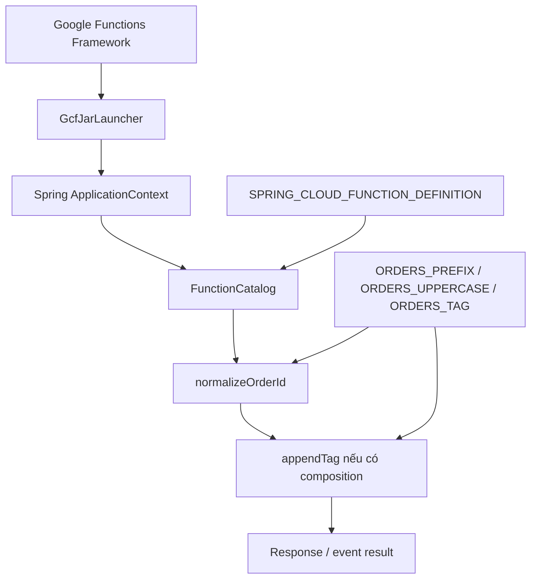

# Chọn hàm và truyền thuộc tính qua biến môi trường

## Mục tiêu học tập

Trong **Spring Cloud Function**, logic nghiệp vụ được đóng gói dưới dạng `Supplier<O>`, `Function<I, O>` và `Consumer<I>`. Những hàm này được đăng ký trong Spring context và tra cứu qua `FunctionCatalog`, có thể composition, chuyển đổi thông điệp và sử dụng lại qua HTTP, sự kiện hoặc nền tảng serverless. Khi triển khai lên **Google Cloud Functions / Cloud Run functions**, ta thường cần **chọn hàm sẽ được gọi** và **thay đổi cấu hình theo môi trường** mà không biên dịch lại mã Java.

Hai cơ chế quan trọng nhất là:

- **`spring.cloud.function.definition`**: chọn tên một hàm hoặc biểu thức composition đã đăng ký, ví dụ `normalizeOrderId` hoặc `normalizeOrderId|appendTag`.
- **Environment variables của runtime**: cung cấp thuộc tính cho Spring Boot, chẳng hạn `SPRING_CLOUD_FUNCTION_DEFINITION`, `ORDERS_PREFIX`, `ORDERS_UPPERCASE` và `ORDERS_TAG`.

Sau bài này, bạn có thể:

1. Phân biệt **Java entry point `GcfJarLauncher`**, lớp ứng dụng Spring, tên bean và function definition.
2. Ánh xạ environment variable sang Spring property theo quy tắc **relaxed binding** và biết khi nào dùng `@ConfigurationProperties`.
3. Viết một ứng dụng có hai `Function<String,String>`, đổi tên hàm được kích hoạt và cấu hình nghiệp vụ hoàn toàn bằng biến môi trường.
4. Thử local bằng Google Functions Framework và chạy `curl` với từng definition.
5. Triển khai theo mô hình `gcloud functions deploy` với `--set-env-vars`, `--update-env-vars` hoặc `--env-vars-file`, đồng thời phân biệt với cấu hình Cloud Run service.
6. Tránh ghi secrets vào biến môi trường thường, nhầm biến do nền tảng cấp, hoặc thay đổi biến mà tưởng function đang chạy sẽ tự reload tức thì.
7. Kiểm thử `FunctionCatalog`, property binding, composition và xử lý các lỗi thường gặp.

**Phạm vi:** ví dụ tập trung vào `spring-cloud-function-adapter-gcp` và cách GCP adapter được tài liệu Spring Cloud Function mô tả. Tên handler, quy trình đóng gói và lệnh deploy có thể cần điều chỉnh theo phiên bản Spring Boot/Spring Cloud Function, Java runtime và thế hệ Google Cloud Functions/Cloud Run functions thực tế.

## 1. Bốn khái niệm không được nhầm lẫn

Giả sử ứng dụng có hai bean: `normalizeOrderId` và `appendTag`. Có bốn tên với bốn trách nhiệm khác nhau:

| Thành phần | Ví dụ | Nơi sử dụng |
| --- | --- | --- |
| **Google Java function entry point** | `org.springframework.cloud.function.adapter.gcp.GcfJarLauncher` | Java Functions Framework/Google Cloud gọi handler |
| **Lớp Spring ứng dụng chính** | `example.gcp.OrderCloudApplication` | Khởi tạo Spring `ApplicationContext`, khai báo bean |
| **Tên bean `Function`** | `normalizeOrderId`, `appendTag` | `FunctionCatalog.lookup("normalizeOrderId")` |
| **Function definition** | `normalizeOrderId|appendTag` | Chọn hàm/chuỗi hàm đã đăng ký để adapter gọi |



Sơ đồ là luồng trách nhiệm ở mức khái niệm; một definition chỉ có `normalizeOrderId` sẽ **không gọi** `appendTag`.

**Không đưa tên bean vào `--entry-point`.** Trong cách deploy GCP adapter này, `--entry-point` chỉ định **class Java handler** do Functions Framework gọi. `SPRING_CLOUD_FUNCTION_DEFINITION` là biến cấu hình **bên trong Spring**, không sửa Java entry point.

Mặt khác, một biến môi trường chứa tên hàm **không sinh ra bean**: nếu ứng dụng không đăng ký `appendTag`, đặt definition bằng tên đó chỉ khiến quá trình tra cứu thất bại.

## 2. Chọn hàm bằng `spring.cloud.function.definition`

### 2.1. Chọn một hàm

Trong `application.properties`:

```properties
spring.cloud.function.definition=normalizeOrderId
```

Hoặc `application.yml`:

```yaml
spring:
  cloud:
    function:
      definition: normalizeOrderId
```

Khi runtime adapter cần biết hàm nào xử lý lời gọi, property trên chỉ định **tên hàm trong `FunctionCatalog`**. Nếu có đúng một `Function`, một số adapter có thể tự chọn, nhưng **khai báo tường minh** làm giảm sự mơ hồ khi ứng dụng phát triển thêm bean.

### 2.2. Chọn composition

Với hai hàm có kiểu đầu vào/đầu ra tương thích:

```properties
spring.cloud.function.definition=normalizeOrderId|appendTag
```

Giá trị `normalizeOrderId|appendTag` biểu thị một pipeline: đầu ra của `normalizeOrderId` truyền sang `appendTag`. Đây là **composition nội bộ Spring Cloud Function**, không phải hai function Google Cloud độc lập.

Trong Java:

```java
Function<String, String> pipeline =
        catalog.lookup("normalizeOrderId|appendTag");
String output = pipeline.apply(" a7 ");
```

Với biểu thức dùng dấu `|`, **phải quote khi đưa vào shell**; nếu nhập trần trong Bash/PowerShell, dấu `|` có thể được hiểu là toán tử pipe của shell thay vì là một ký tự trong giá trị cấu hình.

### 2.3. `definition` không phải `routing-expression`

`spring.cloud.function.definition` chọn tên hàm hoặc composition. Nó không tự thực hiện routing theo giá trị JSON/body hay header của từng request. Nếu muốn route động mỗi message, Spring Cloud Function có các cơ chế routing riêng theo phiên bản, nhưng đó là vấn đề khác với việc **chọn một function cố định cho deployment**.

Nếu dùng cùng artifact ở nhiều môi trường:

| Môi trường | Definition | Tác dụng |
| --- | --- | --- |
| Test tối giản | `normalizeOrderId` | Chỉ chuẩn hóa mã |
| Staging | `normalizeOrderId|appendTag` | Chuẩn hóa rồi thêm tag |
| Production | `normalizeOrderId|appendTag` | Cùng pipeline, cấu hình tag/prefix khác |

Điểm mạnh là **cùng logic Java** có thể được tái sử dụng; không cần tạo một controller hay một JAR khác chỉ để đổi tên hàm được chọn, miễn adapter, kiểu và dependency phù hợp.

## 3. Spring Boot đọc biến môi trường như thế nào?

Spring Boot tổng hợp dữ liệu cấu hình từ nhiều nguồn: `application.properties`/`application.yml`, environment variables, Java system properties, command-line arguments và những nguồn được cấu hình khác. **OS environment variables** thường có thể ghi đè các giá trị mặc định nằm trong `application.properties`.

Ánh xạ phổ biến:

```text
spring.cloud.function.definition
              ⇅
SPRING_CLOUD_FUNCTION_DEFINITION
```

Ví dụ:

```bash
export SPRING_CLOUD_FUNCTION_DEFINITION='normalizeOrderId|appendTag'
```

Lúc Spring Boot dựng `Environment`, một bean/adapter dùng property `spring.cloud.function.definition` có thể nhận giá trị `normalizeOrderId|appendTag`.

### Quy tắc tên biến môi trường

Với **`@ConfigurationProperties`** và relaxed binding, Spring Boot mô tả quy tắc canonical:

1. Thay **dấu chấm** `.` bằng gạch dưới `_`.
2. **Bỏ** dấu gạch ngang `-` trong tên property.
3. Viết chữ in **HOA**.

| Property dạng chuẩn | Environment variable khuyến nghị |
| --- | --- |
| `spring.cloud.function.definition` | `SPRING_CLOUD_FUNCTION_DEFINITION` |
| `orders.prefix` | `ORDERS_PREFIX` |
| `orders.uppercase` | `ORDERS_UPPERCASE` |
| `orders.tag` | `ORDERS_TAG` |
| `orders.max-length` | `ORDERS_MAXLENGTH` |
| `spring.main.log-startup-info` | `SPRING_MAIN_LOGSTARTUPINFO` |

Với property `orders.max-length`, **không mặc định** thêm gạch dưới thay thế cho dấu gạch ngang thành `ORDERS_MAX_LENGTH`: quy tắc canonical của Spring Boot là **bỏ dấu `-`**. Các dạng tên không chuẩn có thể có hành vi khác nhau giữa những cơ chế binding, nên tốt nhất dùng tên chuẩn và kiểm thử.

Trong `application.properties` nên ưu tiên dạng chữ thường/kebab-case; trong môi trường deploy nên dùng tên biến in hoa có dấu gạch dưới theo quy tắc trên.

### Thứ tự ưu tiên cấu hình

Với Spring Boot thường gặp:

```text
application.properties (mặc định)
    < environment variables
    < Java system properties / SPRING_APPLICATION_JSON / command-line args
```

Đây là **minh họa rút gọn**, không phải danh sách đầy đủ mọi `PropertySource`. Test properties, `@DynamicPropertySource` và cơ chế bootstrap riêng có thể có ưu tiên cao hơn. Khi một env var dường như không có tác dụng, hãy tìm xem property cùng tên có bị ghi đè bởi command-line argument, system property hoặc nguồn cấu hình khác không.

## 4. Ví dụ Java hoàn chỉnh: hai hàm và thuộc tính nghiệp vụ

Ta xây dựng một dịch vụ chuẩn hóa mã đơn. Input `" a7 "` đi vào hàm thứ nhất, có thể thành `"PO-A7"`; hàm thứ hai bổ sung tag thành `"PO-A7-READY"`. Tất cả các giá trị `PO`, `true`, `READY` được đọc từ Spring configuration, không hard-code vào hàm.

Ví dụ dùng Java 17+ và Spring Boot/Spring Cloud Function tương thích. Đặt các file trong package `example.gcp`.

### 4.1. `OrderSettings` sử dụng `@ConfigurationProperties`

File `src/main/java/example/gcp/OrderSettings.java`:

```java
package example.gcp;

import org.springframework.boot.context.properties.ConfigurationProperties;

@ConfigurationProperties(prefix = "orders")
public class OrderSettings {

    private String prefix = "ORD";
    private boolean uppercase = true;
    private String tag = "RECEIVED";

    public String getPrefix() {
        return prefix;
    }

    public void setPrefix(String prefix) {
        this.prefix = prefix;
    }

    public boolean isUppercase() {
        return uppercase;
    }

    public void setUppercase(boolean uppercase) {
        this.uppercase = uppercase;
    }

    public String getTag() {
        return tag;
    }

    public void setTag(String tag) {
        this.tag = tag;
    }
}
```

`@ConfigurationProperties(prefix = "orders")` gom ba giá trị về một object kiểu rõ ràng. Spring Boot binder có thể chuyển chuỗi `"true"` hoặc `"false"` sang `boolean`. Đối với các cấu hình có nhiều trường, kiểu này dễ mở rộng và kiểm thử hơn việc gọi `System.getenv(...)` rải rác.

Các default `ORD`, `true`, `RECEIVED` dùng khi nguồn cấu hình **không đặt** các giá trị tương ứng. Trong production, nên bổ sung validation cho prefix/tag, giới hạn độ dài và các giá trị được phép.

### 4.2. Spring application khai báo hai `Function`

File `src/main/java/example/gcp/OrderCloudApplication.java`:

```java
package example.gcp;

import java.util.Locale;
import java.util.function.Function;

import org.springframework.boot.SpringApplication;
import org.springframework.boot.autoconfigure.SpringBootApplication;
import org.springframework.boot.context.properties.EnableConfigurationProperties;
import org.springframework.context.annotation.Bean;

@SpringBootApplication(proxyBeanMethods = false)
@EnableConfigurationProperties(OrderSettings.class)
public class OrderCloudApplication {

    public static void main(String[] args) {
        SpringApplication.run(OrderCloudApplication.class, args);
    }

    @Bean
    public Function<String, String> normalizeOrderId(
            OrderSettings settings) {
        return input -> {
            if (input == null || input.isBlank()) {
                throw new IllegalArgumentException(
                        "Mã đơn hàng không được rỗng");
            }

            String normalized = input.trim();
            if (settings.isUppercase()) {
                normalized = normalized.toUpperCase(Locale.ROOT);
            }

            String prefix = settings.getPrefix();
            if (prefix == null || prefix.isBlank()) {
                throw new IllegalStateException(
                        "orders.prefix chưa hợp lệ");
            }
            return prefix + "-" + normalized;
        };
    }

    @Bean
    public Function<String, String> appendTag(
            OrderSettings settings) {
        return normalizedId -> {
            String tag = settings.getTag();
            if (tag == null || tag.isBlank()) {
                throw new IllegalStateException(
                        "orders.tag chưa hợp lệ");
            }
            return normalizedId + "-" + tag;
        };
    }
}
```

Giải thích:

- `@SpringBootApplication` tạo ứng dụng Spring theo cách thông thường.
- `@EnableConfigurationProperties(OrderSettings.class)` đăng ký bean cấu hình để Spring Boot bind các giá trị `orders.*`.
- Hai phương thức `@Bean` đăng ký **hai hàm khác tên**; chữ ký `Function<String,String>` giữ generic rõ ràng.
- `normalizeOrderId` và `appendTag` chỉ xử lý dữ liệu Java, không biết request được gửi qua HTTP, Pub/Sub hay môi trường serverless.
- `FunctionCatalog` có thể tìm mỗi hàm theo tên hoặc composition `normalizeOrderId|appendTag`.

**Không phải** mọi function trong catalog đều tự chạy. Hàm nào được kích hoạt bởi GCP adapter phụ thuộc **function definition** và hợp đồng trigger.

### 4.3. Defaults trong `application.properties`

File `src/main/resources/application.properties`:

```properties
spring.cloud.function.definition=normalizeOrderId
orders.prefix=ORD
orders.uppercase=true
orders.tag=RECEIVED
```

Ở cấu hình mặc định, nếu gửi body `" a7 "` cho function được chọn, kết quả nghiệp vụ là:

```text
ORD-A7
```

Nếu môi trường có:

```text
SPRING_CLOUD_FUNCTION_DEFINITION=normalizeOrderId|appendTag
ORDERS_PREFIX=PO
ORDERS_UPPERCASE=true
ORDERS_TAG=READY
```

thì kết quả trở thành:

```text
PO-A7-READY
```

Một **artifact Java giống hệt** có thể chạy hai cấu hình này. Đó là lợi ích chính của **externalized configuration**: thay đổi theo runtime mà không cần viết lại `Function`.

## 5. Khai báo entry point và packaging cho GCP adapter

Trong mô hình `spring-cloud-function-adapter-gcp` được tài liệu Spring Cloud Function mô tả:

- **Entry point của Google Functions Framework:** `org.springframework.cloud.function.adapter.gcp.GcfJarLauncher`.
- **Spring application class:** `example.gcp.OrderCloudApplication`.
- **Tên các bean:** `normalizeOrderId` và `appendTag`.
- **Giá trị definition:** `normalizeOrderId` hoặc `normalizeOrderId|appendTag`.

Source manifest `src/main/resources/META-INF/MANIFEST.MF` theo mẫu:

```text
Manifest-Version: 1.0
Main-Class: example.gcp.OrderCloudApplication

```

**Đừng nhầm với Spring Boot executable JAR**: JAR chạy bằng `java -jar` thông thường có thể có `Main-Class` là Spring Boot `JarLauncher` và `Start-Class` là lớp application. Gói Google Cloud adapter có quy ước đóng gói riêng; phải kiểm tra manifest và classpath **trong artifact cuối**, không chỉ nguồn.

### Maven dependencies và plugin cần thiết

Trong project đã quản lý phiên bản Boot/Cloud tương thích:

```xml
<dependencies>
    <dependency>
        <groupId>org.springframework.cloud</groupId>
        <artifactId>spring-cloud-function-adapter-gcp</artifactId>
    </dependency>
    <dependency>
        <groupId>org.springframework.cloud</groupId>
        <artifactId>spring-cloud-function-context</artifactId>
    </dependency>
    <dependency>
        <groupId>org.springframework.boot</groupId>
        <artifactId>spring-boot-starter-test</artifactId>
        <scope>test</scope>
    </dependency>
</dependencies>
```

Để chạy Functions Framework cục bộ, thêm `com.google.cloud.functions:function-maven-plugin` trong `<build><plugins>`:

```xml
<plugin>
    <groupId>com.google.cloud.functions</groupId>
    <artifactId>function-maven-plugin</artifactId>
    <version>COMPATIBLE_FUNCTION_PLUGIN_VERSION</version>
    <configuration>
        <functionTarget>org.springframework.cloud.function.adapter.gcp.GcfJarLauncher</functionTarget>
        <port>8080</port>
    </configuration>
</plugin>
```

Gói triển khai Google Cloud theo mẫu adapter còn có thể cần **GCP adapter extension ở tầng dependency của `spring-boot-maven-plugin`**, xuất gói vào `target/deploy`. Đó là cấu hình **đóng gói**, khác plugin `function:run` dùng để chạy local.

`COMPATIBLE_FUNCTION_PLUGIN_VERSION` là placeholder cần thay. Các đoạn XML minh họa **không phải POM hoàn chỉnh**; dự án còn cần Spring Boot parent/plugin management, BOM Spring Cloud, Java toolchain và release train tương thích.

## 6. Thử biến môi trường ở máy phát triển

### 6.1. Bash hoặc zsh (Linux/macOS)

Trong terminal sẽ chạy Functions Framework:

```bash
export SPRING_CLOUD_FUNCTION_DEFINITION='normalizeOrderId|appendTag'
export ORDERS_PREFIX='PO'
export ORDERS_UPPERCASE='true'
export ORDERS_TAG='READY'

./mvnw function:run
```

Giữ terminal này đang chạy. Ở terminal **khác**, gửi:

```bash
curl -i -X POST http://localhost:8080/ \
  -H 'Content-Type: text/plain' \
  --data-binary ' a7 '
```

Kết quả nghiệp vụ dự kiến là **`PO-A7-READY`**. Hãy xem HTTP status, body và log; request đi qua **Google Functions Framework → GcfJarLauncher → Spring context → FunctionCatalog** nếu adapter đã cấu hình đúng.

**Điểm dễ sai:** biến được export trong terminal của server phải xuất hiện trong **process Java được Maven plugin khởi chạy**. Export trong một terminal khác **sau** khi server đã start không tự thay `Environment` của process đang chạy.

Để chạy lại chỉ với một hàm:

```bash
export SPRING_CLOUD_FUNCTION_DEFINITION='normalizeOrderId'
./mvnw function:run
```

Cần **dừng tiến trình local cũ trước**, rồi khởi động tiến trình mới để nó đọc bộ biến hiện tại. Nếu cả hai cùng dùng cổng 8080, tiến trình thứ hai có thể bị lỗi bind port.

### 6.2. Windows PowerShell

```powershell
$env:SPRING_CLOUD_FUNCTION_DEFINITION = 'normalizeOrderId|appendTag'
$env:ORDERS_PREFIX = 'PO'
$env:ORDERS_UPPERCASE = 'true'
$env:ORDERS_TAG = 'READY'

.\mvnw.cmd function:run
```

Ở một cửa sổ PowerShell khác:

```powershell
curl.exe -i -X POST http://localhost:8080/ -H "Content-Type: text/plain" --data-binary " a7 "
```

Trong Windows PowerShell cũ, `curl` có thể là alias của `Invoke-WebRequest`; dùng **`curl.exe`** để chạy đúng các flag của công cụ curl. Ký tự `|` trong giá trị definition được đặt trong nháy đơn để không bị PowerShell diễn giải thành pipeline.

### 6.3. Dùng command-line arguments hoặc Java system properties

Spring Boot có thể nhận property từ command-line và Java system properties:

```bash
java -Dspring.cloud.function.definition=normalizeOrderId \
  -Dorders.prefix=WEB \
  -jar app.jar
```

Đây chỉ là ví dụ **cho artifact Spring Boot executable JAR đã hỗ trợ chạy `java -jar`**; không suy ra JAR của GCP adapter được đóng gói riêng có cùng cách bootstrap. Với local Functions Framework, dùng **environment variables** là đường kiểm thử thuận tiện hơn cho chức năng sẽ triển khai lên Google Cloud.

Nếu command-line hoặc system property đặt cùng tên và có ưu tiên cao hơn, env var có thể không được sử dụng. Khi gỡ lỗi, hãy xác minh **giá trị cuối cùng** từ Spring `Environment`.

## 7. Truyền biến môi trường khi deploy Google Cloud Functions

Google Cloud CLI hỗ trợ các tùy chọn `--set-env-vars`, `--update-env-vars`, `--env-vars-file` cho những kiểu deployment `gcloud functions deploy` tương ứng. Trước khi dùng, phải chọn đúng **project, region, Java runtime, generation, Java entry point, source artifact và trigger**.

### 7.1. Cấu hình khi triển khai lần đầu

Mẫu lệnh dành cho môi trường mà bản GCP adapter và runtime Java đã được **xác nhận hỗ trợ**:

```bash
gcloud functions deploy order-normalizer \
  --gen2 \
  --region=REGION_ID \
  --runtime=SUPPORTED_JAVA_RUNTIME \
  --source=target/deploy \
  --entry-point=org.springframework.cloud.function.adapter.gcp.GcfJarLauncher \
  --trigger-http \
  --set-env-vars='SPRING_CLOUD_FUNCTION_DEFINITION=normalizeOrderId|appendTag,ORDERS_PREFIX=PO,ORDERS_UPPERCASE=true,ORDERS_TAG=READY'
```

`REGION_ID` và `SUPPORTED_JAVA_RUNTIME` là **placeholder**, không phải giá trị deploy sẵn. GCP adapter/packaging theo tài liệu cũ có thể **không** tương thích nguyên trạng với Cloud Functions gen2 hoặc mọi Cloud Run functions runtime. Chỉ dùng mẫu này sau khi đã xác minh hợp đồng Java handler, manifest, buildpack, Java runtime và cơ chế deploy cụ thể.

**`--set-env-vars` có tính thay thế**: tài liệu `gcloud functions deploy` nêu rằng tập biến runtime đã đặt trước đó **bị xóa** trước khi thiết lập các cặp mới. Vì vậy, khi cập nhật một function đang hoạt động, đừng chỉ đưa `ORDERS_TAG=READY` qua `--set-env-vars` rồi vô tình làm mất các biến cấu hình khác.

### 7.2. Cập nhật một vài biến mà không xóa các biến khác

Đối với function **đã tồn tại** trong kiểu deployment hỗ trợ, có thể dùng:

```bash
gcloud functions deploy order-normalizer \
  --gen2 \
  --region=REGION_ID \
  --update-env-vars='ORDERS_TAG=SHIPPED,SPRING_CLOUD_FUNCTION_DEFINITION=normalizeOrderId|appendTag'
```

`--update-env-vars` cập nhật các cặp chỉ định mà không yêu cầu thay thế mọi biến còn lại. Những tham số khác khi update phụ thuộc thế hệ/platform và thiết lập hiện tại; trước khi chạy cần đối chiếu `gcloud functions deploy --help` trong CLI đang dùng.

Với Cloud Run **service** thông thường, lệnh quản lý biến thuộc bề mặt khác:

```bash
gcloud run services update SERVICE_NAME \
  --region=REGION_ID \
  --update-env-vars='ORDERS_TAG=SHIPPED'
```

**Không nhầm** `gcloud functions deploy` với `gcloud run services update`: chúng có đối tượng triển khai, option và quy trình quản lý phiên bản khác nhau. Chọn lệnh phù hợp runtime bạn thật sự sử dụng.

### 7.3. Dùng YAML env file khi có nhiều cấu hình

Ví dụ nội dung **file cấu hình dành cho Google Cloud CLI**, giả sử tên `runtime-env.yaml`:

```yaml
SPRING_CLOUD_FUNCTION_DEFINITION: "normalizeOrderId|appendTag"
ORDERS_PREFIX: "PO"
ORDERS_UPPERCASE: "true"
ORDERS_TAG: "READY"
```

Sau đó triển khai với:

```bash
gcloud functions deploy order-normalizer \
  --gen2 \
  --region=REGION_ID \
  --runtime=SUPPORTED_JAVA_RUNTIME \
  --source=target/deploy \
  --entry-point=org.springframework.cloud.function.adapter.gcp.GcfJarLauncher \
  --trigger-http \
  --env-vars-file=runtime-env.yaml
```

File YAML trên là **mẫu cấu hình do người triển khai tạo trong project phù hợp**; bài học này không yêu cầu tạo file thật. Theo Google Cloud CLI, `--env-vars-file` cũng **thay thế tập runtime environment variables đã có**. Không đặt passwords/API keys vào file và commit lên Git.

### 7.4. Tránh dấu phẩy và ký tự đặc biệt bị tách sai

`gcloud --set-env-vars` dùng **dấu phẩy** để phân tách các cặp `KEY=VALUE`. Nếu giá trị **của một biến** chứa dấu phẩy, không truyền trực tiếp như một danh sách bình thường; dùng `--env-vars-file` hoặc cú pháp đổi delimiter được Google Cloud CLI hỗ trợ.

Composition với `|` **không dùng dấu phẩy**, nhưng vẫn cần được **quote** ở shell:

```bash
--set-env-vars='SPRING_CLOUD_FUNCTION_DEFINITION=normalizeOrderId|appendTag'
```

Nếu một giá trị chứa `$`, khoảng trắng, dấu nháy hoặc ký tự đặc biệt khác, cần escape/quote theo shell đang dùng. Không để giá trị definition đi qua shell pipe ngoài ý muốn.

## 8. Phân biệt runtime env vars với biến hệ thống của Google

Trên Cloud Run functions, nền tảng có những biến môi trường dành cho runtime/Functions Framework. Đặc biệt:

| Biến | Ai quản lý? | Vai trò |
| --- | --- | --- |
| `FUNCTION_TARGET` | Google runtime/Functions Framework | Java function handler target được nền tảng gọi |
| `FUNCTION_SIGNATURE_TYPE` | Google runtime/Functions Framework | Kiểu hợp đồng handler, chẳng hạn `http` hoặc `event` |
| `PORT` | Cloud Run runtime | Cổng HTTP được runtime cung cấp |
| `SPRING_CLOUD_FUNCTION_DEFINITION` | Ứng dụng/người triển khai | Chọn bean hoặc composition trong Spring Cloud Function |
| `ORDERS_PREFIX`, `ORDERS_TAG` | Ứng dụng/người triển khai | Cấu hình nghiệp vụ |

**Không dùng `FUNCTION_TARGET=normalizeOrderId` để thay cho `SPRING_CLOUD_FUNCTION_DEFINITION=normalizeOrderId`.** `FUNCTION_TARGET` ở biên Google Functions Framework dùng tên Java handler; trong mô hình GCP adapter đó là lớp launcher, không phải bean Spring.

Các biến runtime do Google tự cấp như `PORT` và `FUNCTION_TARGET` có thể **được bảo vệ hoặc bị ghi đè bởi nền tảng**. Không tự sửa chúng như biến ứng dụng thông thường. Khi xây ứng dụng Cloud Run service (không phải function), `PORT` vẫn thuộc hợp đồng runtime; hãy để web server lắng nghe đúng port được nền tảng chỉ định nếu đang chạy server HTTP.

### Đừng nhầm biến tại build time với runtime

Một số công cụ Google Cloud cho phép cấu hình **build environment variables** riêng với **runtime environment variables**. `spring.cloud.function.definition` cho lựa chọn lời gọi runtime theo mẫu ở đây phải có trong **Spring `Environment` khi context chạy**, không phải chỉ trong môi trường của bước build container/JAR.

Nếu ứng dụng được build AOT/native image, một số quyết định bean graph/`@ConditionalOnProperty` đã được chốt ở giai đoạn AOT build. Việc đổi runtime env chỉ nên dùng cho những thuộc tính được phép thay đổi ở runtime; **không kỳ vọng biến runtime tạo ra một `@Bean` mà AOT đã loại ở build time**.

## 9. Quản lý secrets và kiểm soát quyền truy cập

Biến môi trường là công cụ tiện lợi cho **cấu hình thông thường**, nhưng **không phải kho secrets chuyên dụng**. Đừng truyền mật khẩu database, API key, private key hoặc token qua `--set-env-vars` chỉ vì dễ viết lệnh:

```bash
# Không dùng lệnh kiểu này trong production:
gcloud functions deploy order-normalizer \
  --set-env-vars='ORDERS_API_KEY=plaintext-secret'
```

Thay vào đó:

- Dùng **Google Secret Manager** và cấu hình secret injection/mount thích hợp theo loại runtime.
- Cấp quyền **Secret Manager Secret Accessor** chỉ cho runtime service account thực sự cần.
- Không ghi secret, toàn bộ danh sách env vars hoặc payload chứa dữ liệu nhạy cảm vào logs.
- Cẩn thận với lịch sử shell, CI/CD logs, output của công cụ cấu hình và các file env bị commit.
- Phân biệt **tài khoản deploy** và **runtime service account**; hai nhóm quyền không nhất thiết giống nhau.

Đối với Cloud Run service dùng service identity để gọi Google APIs, tài liệu Google khuyến cáo **không tự đặt `GOOGLE_APPLICATION_CREDENTIALS`**; hãy cấu hình service account phù hợp và dùng Application Default Credentials do môi trường cung cấp.

Nếu thay đổi một secret, hành vi áp dụng phiên bản mới phụ thuộc cách secret được mount/inject và đời sống instance. Không nên giả định mỗi lượt gọi tự đọc bản secret mới nhất khi bean đã cache giá trị.

## 10. Điều gì thay đổi khi cập nhật biến môi trường?

Một số hiểu lầm khi chạy serverless:

1. **Đổi giá trị env ở máy deploy không tự đổi cloud function.** Phải cập nhật cấu hình deployment theo công cụ Google Cloud.
2. **Đổi biến trên cloud không làm một Spring bean singleton đang chạy tự đọc lại mọi giá trị.** Bean `OrderSettings` được bind khi Spring context khởi tạo; lambda trong ví dụ giữ tham chiếu tới object này.
3. **Thay đổi cấu hình Cloud Run thường tạo revision mới.** Instance cũ có thể tiếp tục xử lý trong giai đoạn chuyển đổi traffic tùy chính sách, nên cần triển khai có kiểm soát.
4. **Gọi `System.getenv(...)` ở mỗi request** không tạo cơ chế hot reload của OS env cho process đang chạy.
5. **`spring.cloud.function.definition` không phải nút chuyển hàm theo từng request.** Đây là cấu hình lựa chọn hàm cho runtime/adapter, thường được áp dụng khi context/wrapper được dựng.

Nếu cần route động giữa nhiều hàm cho từng event, hãy nghiên cứu chức năng routing theo metadata của Spring Cloud Function và kiểm thử với adapter cụ thể. Đừng đổi definition trong global process environment theo từng request; điều đó tạo race condition và không phải hành vi được môi trường hỗ trợ.

### Đổi cấu hình nhưng không đổi code có lợi gì?

Một artifact được triển khai ở staging/prod có thể dùng:

| Thuộc tính | Staging | Production |
| --- | --- | --- |
| `SPRING_CLOUD_FUNCTION_DEFINITION` | `normalizeOrderId` | `normalizeOrderId|appendTag` |
| `ORDERS_PREFIX` | `STG` | `PO` |
| `ORDERS_UPPERCASE` | `false` | `true` |
| `ORDERS_TAG` | `TEST` | `READY` |

Với input `" a7 "`, staging chọn một hàm có kết quả `STG-a7`, production chọn composition có kết quả `PO-A7-READY`. Khi đó **version code và dependency vẫn giống nhau**; khác biệt nằm ở cấu hình deployment.

Trong môi trường có yêu cầu audit, nên ghi lại **tên hàm đã chọn và tên profile/config revision** (không ghi secret) để khi có sự cố biết workload nào xử lý lời gọi.

## 11. Chọn `Supplier`, `Function` hay `Consumer` qua environment variable

`FunctionCatalog` có thể công bố nhiều kiểu hàm; tuy nhiên cách adapter gọi chúng phụ thuộc hợp đồng đầu vào/đầu ra:

| Kiểu bean | Cách gọi Java | Tình huống |
| --- | --- | --- |
| `Supplier<T>` | `get()` | Sinh dữ liệu không nhận input |
| `Function<I,O>` | `apply(input)` | Nhận input và trả output, thuận tiện cho HTTP |
| `Consumer<I>` | `accept(input)` | Nhận sự kiện và thực hiện side effect |

Nếu project có thêm:

```java
@Bean
public Supplier<String> generateHeartbeat() {
    return () -> "ok";
}

@Bean
public Consumer<String> auditOrder() {
    return id -> System.out.println("Audited: " + id);
}
```

thì `spring.cloud.function.definition=generateHeartbeat` hay `auditOrder` về mặt **tên hàm** có thể tra cứu nếu bean được đăng ký. Nhưng **không suy ra mọi adapter HTTP/event đều có cùng cách kích hoạt Supplier hoặc Consumer**. Một `Supplier` không tự có lịch polling; một `Consumer` không tạo business HTTP response, còn Pub/Sub trigger vẫn cần cấu hình riêng.

Vì thế, cách chọn hàm qua environment variable cần đi cùng **loại trigger và hợp đồng adapter**. Việc chuyển từ HTTP `Function` sang Pub/Sub `Consumer` không chỉ là thay `SPRING_CLOUD_FUNCTION_DEFINITION`; cần chọn Java handler, event schema và IAM phù hợp.

## 12. Kiểm thử: property binding, catalog và local HTTP

### 12.1. Kiểm thử Spring `FunctionCatalog` với cấu hình có chủ đích

Với JUnit 5 và Spring Boot Test:

```java
package example.gcp;

import static org.junit.jupiter.api.Assertions.assertEquals;
import static org.junit.jupiter.api.Assertions.assertNotNull;

import java.util.function.Function;
import org.junit.jupiter.api.Test;
import org.springframework.beans.factory.annotation.Autowired;
import org.springframework.boot.test.context.SpringBootTest;
import org.springframework.cloud.function.context.FunctionCatalog;

@SpringBootTest(
        classes = OrderCloudApplication.class,
        webEnvironment = SpringBootTest.WebEnvironment.NONE,
        properties = {
            "spring.cloud.function.definition=normalizeOrderId|appendTag",
            "orders.prefix=PO",
            "orders.uppercase=true",
            "orders.tag=READY"
        })
class OrderFunctionCatalogTest {

    @Autowired
    FunctionCatalog catalog;

    @Autowired
    OrderSettings settings;

    @Test
    void composesFunctionWithConfiguredValues() {
        assertEquals("PO", settings.getPrefix());
        assertEquals("READY", settings.getTag());

        Function<String, String> fn =
                catalog.lookup("normalizeOrderId|appendTag");
        assertNotNull(fn);
        assertEquals("PO-A7-READY", fn.apply(" a7 "));
    }
}
```

Kiểm thử này xác nhận:

- Spring Boot đã bind `orders.*` vào `OrderSettings`.
- Spring Cloud Function Context cung cấp `FunctionCatalog`.
- Hai bean có thể được tra cứu theo biểu thức composition.
- Pipeline dùng đúng các giá trị cấu hình trong context.

**Nó chưa chứng minh OS env var thực sự được Google truyền vào**, vì `@SpringBootTest(properties = ...)` cấp giá trị qua test property source. Để kiểm tra đường environment variable từ hệ điều hành, hãy chạy local Functions Framework bằng `export`/`$env:` hoặc khởi tạo một process test độc lập với env thực.

### 12.2. Kiểm thử property nguồn environment riêng biệt

Trong một test tích hợp, có thể dùng `@Autowired Environment`:

```java
@Autowired
Environment environment;

@Test
void readsFinalPropertyValue() {
    assertEquals(
            "normalizeOrderId|appendTag",
            environment.getProperty(
                    "spring.cloud.function.definition"));
}
```

`Environment` thuộc `org.springframework.core.env.Environment`. Test này chỉ kiểm tra **giá trị cuối cùng của property theo các nguồn cấu hình của test**, không khẳng định nguồn của giá trị là OS environment. Trong production, việc đọc `Environment` có thể giúp chẩn đoán, nhưng **không log toàn bộ nội dung** vì có thể chứa secrets.

### 12.3. Thử theo đúng đường GCP handler

Trong terminal trước khi chạy local server:

```bash
export SPRING_CLOUD_FUNCTION_DEFINITION='normalizeOrderId|appendTag'
export ORDERS_PREFIX=PO
export ORDERS_UPPERCASE=true
export ORDERS_TAG=READY
./mvnw function:run
```

Sau đó:

```bash
curl -i -X POST http://localhost:8080/ \
  -H "Content-Type: text/plain" \
  --data-binary " a7 "
```

Phản hồi nghiệp vụ mong đợi: **`PO-A7-READY`**. Nếu `FunctionCatalog` test PASS nhưng `curl` fail, kiểm tra **`GcfJarLauncher`**, manifest, plugin, classpath, HTTP payload conversion và biến môi trường của **process thực sự chạy handler**.

Nếu chạy `spring-cloud-function-web` thay vì GCP adapter, URL có thể là `/normalizeOrderId` tùy routing. **Không dùng kết quả từ web adapter để kết luận GCP handler đã được kiểm chứng.**

## 13. Kiểm tra giá trị cấu hình khi triển khai

Một quy trình kiểm tra có kiểm soát:

1. Kiểm tra **runtime env var names** trong cấu hình function/service trên Google Cloud; không copy secret ra log.
2. Xác nhận **definition** là tên bean/chuỗi composition thực sự đã đăng ký.
3. Xác nhận **Spring main class** và handler `GcfJarLauncher` được đóng gói/khởi tạo phù hợp.
4. Thực hiện một HTTP request hoặc event test với input có kết quả dễ dự đoán.
5. Kiểm tra logs theo tên hàm (không lộ dữ liệu nhạy cảm), build/revision và cấu hình phiên bản.
6. Nếu thay đổi env, xác nhận **revision/instance mới** đã nhận config trước khi so sánh kết quả.

Với deployment `gcloud functions` đang hoạt động, có thể kiểm tra cấu hình mô tả:

```bash
gcloud functions describe order-normalizer \
  --gen2 \
  --region=REGION_ID
```

Tài liệu/CLI của các thế hệ Google Cloud có thể trình bày environment variables trong các trường metadata khác nhau; đừng viết script phụ thuộc một JSON field mà chưa đối chiếu output thực tế. Ngoài ra, quyền mô tả resource không đồng nghĩa bạn nên sao chép toàn bộ thông tin cấu hình vào nơi công khai.

Với Cloud Run service, dùng lệnh mô tả hoặc Google Cloud Console dành cho **Cloud Run**, không mặc định truy vấn qua `gcloud functions describe`.

## 14. Những lỗi thường gặp khi chọn hàm và truyền env

| Triệu chứng | Nguyên nhân có thể | Hướng khắc phục |
| --- | --- | --- |
| Function chạy mặc định dù đã đặt biến mới | Biến được đặt sai scope/build time, process cũ chưa khởi động lại hoặc có cấu hình ưu tiên cao hơn | Xác minh runtime env, Spring `Environment`, restart/revision |
| `SPRING_CLOUD_FUNCTION_DEFINITION` không chọn hàm | Sai chính tả, sai tên bean, giá trị chưa được truyền vào handler | Kiểm tra catalog lookup và biến trong process |
| `catalog.lookup("appendTag")` trả `null` | `@Bean` không được tạo hoặc name sai | Kiểm tra class config/package, bean name và type |
| Definition `normalizeOrderId|appendTag` bị shell lỗi | Dấu `|` không được quote | Đặt toàn bộ giá trị trong dấu nháy |
| Kết quả chỉ `PO-A7` thay vì `PO-A7-READY` | Definition vẫn chọn một hàm | Kiểm tra `SPRING_CLOUD_FUNCTION_DEFINITION` và cấu hình cuối |
| `ORDERS_PREFIX` không có tác dụng | `OrderSettings` chưa đăng ký hoặc env bị override | Kiểm tra `@EnableConfigurationProperties` và `Environment` |
| `ORDERS_UPPERCASE` không bind được | Giá trị không thể chuyển thành boolean hoặc tên bị sai | Dùng `true`/`false`, test binding |
| `ORDERS_MAX_LENGTH` không map như mong đợi | Nhầm cách đổi tên property có dấu gạch ngang | Kiểm tra quy tắc `orders.max-length → ORDERS_MAXLENGTH` |
| `--set-env-vars` làm biến khác biến mất | Flag thay thế toàn bộ tập runtime env | Dùng `--update-env-vars` cho cập nhật từng phần hoặc cấp đủ danh sách |
| Giá trị chứa dấu phẩy bị tách thành nhiều biến | CLI phân tách cặp env bằng dấu phẩy | Dùng `--env-vars-file` hoặc delimiter khác |
| Đặt `FUNCTION_TARGET=normalizeOrderId` nhưng handler không chạy | Nhầm Java handler target với tên Spring function | Để platform cấp `FUNCTION_TARGET`, cấu hình `SPRING_CLOUD_FUNCTION_DEFINITION` |
| Đổi env ở local shell nhưng GCP không đổi | Local shell không tác động cloud revision | Cập nhật deployment theo CLI/Console |
| `spring.cloud.function.definition` trỏ tới `Consumer` nhưng không có event | Không có Pub/Sub/Eventarc trigger tương ứng | Cấu hình nguồn sự kiện, handler, payload và IAM |
| Compilation/deploy thiếu `GcfJarLauncher` | Thiếu GCP adapter hoặc packaging sai | Kiểm tra dependency, entry point, manifest và artifact |
| HTTP 404 ở `/normalizeOrderId` local | Nhầm route Web adapter với root của Functions Framework | Với mẫu GCP local, dùng `POST /` |
| Status 401/403 trên cloud | IAM/identity token/ingress, không phải function definition | Kiểm tra quyền người gọi và chính sách cloud |
| API key lộ trong logs hoặc cấu hình | Đặt secret ở env thường hoặc in toàn bộ environment | Chuyển sang Secret Manager, hạn chế logs/quyền |
| Native image đổi env nhưng thiếu bean | Bean bị loại ở giai đoạn Spring AOT build | Điều chỉnh cấu hình build/native và build lại image khi cần |

### Chẩn đoán theo thứ tự

1. **Tên:** Java handler, Spring application, bean name và definition có bị nhầm nhau không?
2. **Dependency/bootstrap:** `FunctionCatalog` tồn tại, `lookup` tìm được hai hàm không?
3. **Binding:** `OrderSettings` nhận đúng `orders.*` không?
4. **Nguồn cấu hình:** runtime env đã được truyền cho đúng process/revision chưa, có nguồn ưu tiên cao hơn không?
5. **Transport:** GCP handler nhận HTTP/event theo đúng hợp đồng không?
6. **Vận hành:** IAM, secrets, runtime, cold start và việc cập nhật revision có phù hợp không?

Nếu một test Java trả `PO-A7-READY` nhưng HTTP cloud trả `ORD-A7`, vấn đề có thể là **deployment đang dùng definition/config khác**, không nhất thiết là bug trong hai hàm Java.

## 15. Bài tập thực hành

### Bài tập 1 — Chọn một hàm bằng biến môi trường

Giữ nguyên hai `@Bean` trong `OrderCloudApplication`, đặt `SPRING_CLOUD_FUNCTION_DEFINITION=normalizeOrderId`, `ORDERS_PREFIX=DEV` và `ORDERS_UPPERCASE=false`. Với input `" a7 "`, hãy kiểm tra output `DEV-a7` qua local Functions Framework.

### Bài tập 2 — Bật composition, không sửa mã Java

Đặt `SPRING_CLOUD_FUNCTION_DEFINITION='normalizeOrderId|appendTag'` và `ORDERS_TAG=READY`. Không thay đổi code, dự đoán output rồi thử `curl`. Giải thích vì sao một definition mới **không tạo Google function thứ hai**.

### Bài tập 3 — Kiểm tra relaxed binding

Thêm `private int maxLength` cùng getter/setter vào `OrderSettings` và cấu hình `orders.max-length`. Thử env `ORDERS_MAXLENGTH=40`, kiểm tra binding; so sánh với một tên biến viết không theo quy tắc canonical.

### Bài tập 4 — Thử ưu tiên property sources

Đặt giá trị mặc định `orders.prefix=ORD` trong `application.properties`, rồi đặt env `ORDERS_PREFIX=PO`. Tạo một test hoặc chạy local để xác nhận giá trị cuối. Tiếp đó thử chạy một Spring Boot executable JAR có system property `-Dorders.prefix=SYS` để thấy các nguồn có thể override nhau.

### Bài tập 5 — Không xóa nhầm env lúc cập nhật

Giả sử function đang có `ORDERS_PREFIX`, `ORDERS_UPPERCASE`, `ORDERS_TAG` và `SPRING_CLOUD_FUNCTION_DEFINITION`. Bạn chỉ muốn đổi `ORDERS_TAG`. So sánh hệ quả của `--set-env-vars` và `--update-env-vars` trong tài liệu Google Cloud CLI, rồi chọn cách không làm mất các biến khác.

### Bài tập 6 — Bảo vệ secrets

Giả sử hàm cần truy cập API ngoài với credential. Trình bày cách cấp quyền cho runtime service account và sử dụng Secret Manager thay vì ghi `API_KEY` trong file `runtime-env.yaml` commit lên repository. Nêu cách xác minh config mà không log secret.

### Bài tập 7 — Đổi từ HTTP sang event

Thêm `Consumer<String> auditOrder`, đặt definition chọn `auditOrder`. Phân tích vì sao cần **trigger, handler và kiểu payload** thích hợp để nó nhận Pub/Sub/Eventarc; chỉ đổi biến môi trường không biến một HTTP function thành một event-driven deployment hoàn chỉnh.

### Câu hỏi tự kiểm tra

1. **Biến môi trường ứng với `spring.cloud.function.definition` là gì?** `SPRING_CLOUD_FUNCTION_DEFINITION`.
2. **`--entry-point` có nhận `normalizeOrderId` không?** Không theo mô hình GCP adapter; nó nhận Java handler class.
3. **`SPRING_CLOUD_FUNCTION_DEFINITION` có tự tạo bean mới không?** Không, chỉ chọn bean đã đăng ký hoặc composition.
4. **Vì sao phải quote `normalizeOrderId|appendTag`?** Vì shell có thể diễn giải `|` thành pipe.
5. **Biến ứng với `orders.max-length` theo relaxed binding là gì?** `ORDERS_MAXLENGTH`.
6. **`--set-env-vars` và `--update-env-vars` khác nhau ra sao?** Một cách thay thế tập env hiện tại; cách kia cập nhật có chọn lọc.
7. **Đổi env ở terminal khác sau khi Java server chạy có tự thay function không?** Không; process đang chạy không tự lấy giá trị mới theo cách đó.
8. **Có nên lưu API key thật trong `--set-env-vars` hoặc YAML env file?** Không; dùng Secret Manager.
9. **`FUNCTION_TARGET` và `SPRING_CLOUD_FUNCTION_DEFINITION` có phải cùng một biến không?** Không; một biến thuộc Java handler của nền tảng, một biến chọn hàm Spring.
10. **Local `FunctionCatalog` test thành công đã chứng minh Google Cloud deploy đúng chưa?** Chưa; còn handler, packaging, runtime, IAM và env vars thực tế.

## 16. Tổng kết và tài liệu tham khảo

**Chọn hàm và truyền thuộc tính qua biến môi trường** cho phép sử dụng cùng mã Spring Cloud Function ở các môi trường Google Cloud mà không hard-code tên pipeline hay giá trị nghiệp vụ. **`SPRING_CLOUD_FUNCTION_DEFINITION`** chọn bean/composition trong `FunctionCatalog`; các biến như **`ORDERS_PREFIX`**, **`ORDERS_UPPERCASE`** và **`ORDERS_TAG`** được Spring Boot bind vào `@ConfigurationProperties`. **`GcfJarLauncher`** vẫn là Java entry point của adapter trong kiểu deploy tương ứng, hoàn toàn khác tên hàm nghiệp vụ.

Quy trình đáng tin cậy: **đăng ký bean → đặt default trong `application.properties` → bind environment variables → test catalog → chạy Functions Framework local → cấu hình runtime env khi deploy → xác minh revision/IAM/payload**. Khi đổi cấu hình, chú ý **`--set-env-vars` thay thế tập env**, còn `--update-env-vars` dùng để cập nhật có chọn lọc; tuyệt đối không đưa secrets vào cấu hình thường hoặc logs.

Tài liệu chính thức:

- [Spring Cloud Function Reference](https://docs.spring.io/spring-cloud-function/reference/): `FunctionCatalog`, function definition, composition, message conversion.
- [Spring Cloud Function — Google Cloud Functions adapter](https://docs.spring.io/spring-cloud-function/reference/adapters/gcp-intro.html): `GcfJarLauncher`, đóng gói, local Functions Framework và triển khai GCP.
- [Spring Boot — Externalized Configuration](https://docs.spring.io/spring-boot/reference/features/external-config.html): source precedence, relaxed binding, `@ConfigurationProperties`, quy tắc biến môi trường.
- [Google Cloud CLI — `gcloud functions deploy`](https://docs.cloud.google.com/sdk/gcloud/reference/functions/deploy): `--set-env-vars`, `--update-env-vars`, `--env-vars-file` và `--entry-point`.
- [Google Cloud Run — Environment variables](https://docs.cloud.google.com/run/docs/configuring/services/environment-variables): cấu hình revision, `FUNCTION_TARGET`/`FUNCTION_SIGNATURE_TYPE`, các biến reserved và hướng dẫn tránh secrets trong env.
- [Google Cloud — Secret Manager](https://cloud.google.com/secret-manager/docs/overview): lưu trữ và kiểm soát quyền truy cập dữ liệu bí mật.

**Lưu ý phiên bản:** các fragment Maven, lệnh deploy và cách chọn Java handler cần đối chiếu với phiên bản Spring Boot/Spring Cloud Function, Google Java Functions Framework và Cloud Functions/Cloud Run functions thực tế. Bài viết thuộc bước soạn Knowledge; vòng kiểm thử project và Content QA chuyên môn tiếp theo là các công đoạn độc lập.
