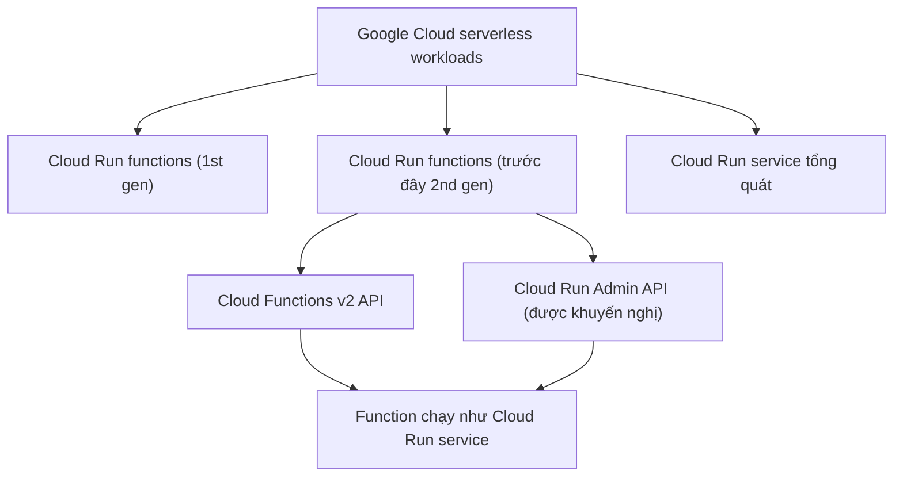
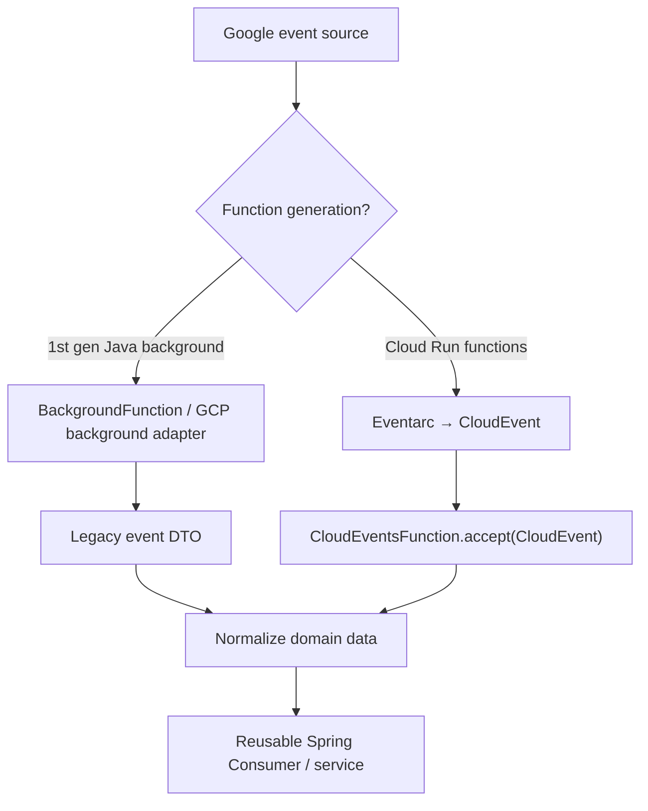
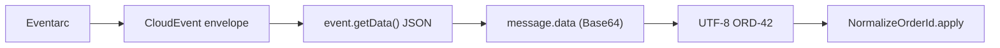
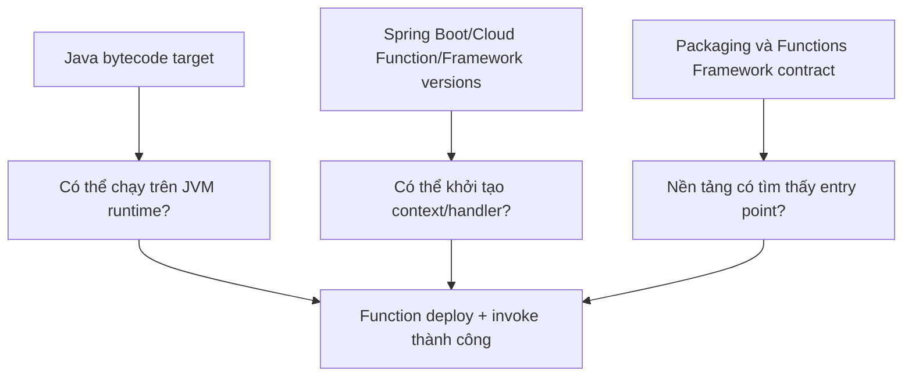
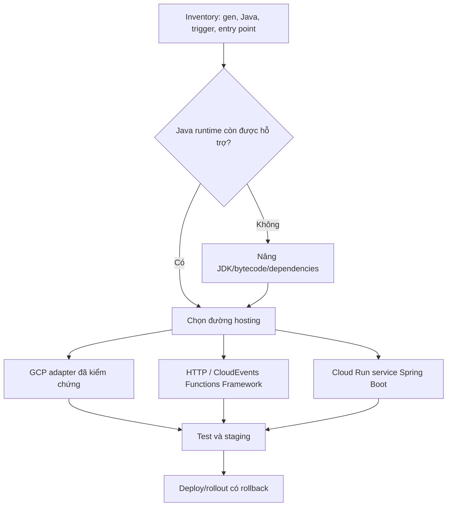

# Đối chiếu thế hệ Cloud Functions, Cloud Run functions và runtime Java

## Mục tiêu học tập

**Spring Cloud Function** cho phép triển khai logic nghiệp vụ dưới dạng `Supplier<O>`, `Function<I,O>` và `Consumer<I>`, đăng ký qua Spring rồi sử dụng lại bằng `FunctionCatalog`, composition, chuyển đổi thông điệp hoặc các adapter HTTP/sự kiện/serverless. Tuy nhiên, **Google Cloud Functions** đã thay đổi tên sản phẩm, kiến trúc thực thi, API triển khai và loại sự kiện được hỗ trợ. Một project Spring Cloud Function chạy đúng trong ví dụ cũ chưa chắc có thể chuyển nguyên gói JAR sang runtime mới.

Trong chương **Google Cloud**, bài này giúp đối chiếu chính xác:

- **Cloud Functions (1st gen)**, hiện gọi là **Cloud Run functions (1st gen)**.
- **Cloud Functions (2nd gen)**, hiện gọi là **Cloud Run functions**, gồm hai đường quản lý qua **Cloud Functions v2 API** và **Cloud Run Admin API**.
- Các runtime Java được hỗ trợ, đặc biệt `java17`, `java21`, `java25`, và trạng thái của `java11`.
- Sự khác nhau giữa Java background function kiểu cũ và **CloudEvents/Eventarc** của thế hệ mới.
- Khả năng áp dụng `spring-cloud-function-adapter-gcp`, `GcfJarLauncher`, Java Functions Framework, `FunctionCatalog` và các kiểu artifact.

Kết thúc bài, bạn có thể đọc một hướng dẫn cũ mà không nhầm thuật ngữ, lựa chọn runtime Java phù hợp, xác định đúng Java entry point và trigger, viết một hàm nghiệp vụ tái sử dụng qua hai mô hình triển khai, lập kế hoạch di chuyển có kiểm thử.

**Mốc đối chiếu:** thông tin runtime và thuật ngữ Google Cloud bên dưới được kiểm tra theo tài liệu chính thức tại **24/11/2026**. Lịch vòng đời runtime, giới hạn tài nguyên và lệnh `gcloud` có thể thay đổi; trước mỗi lần deploy phải kiểm tra bảng hỗ trợ của Google Cloud ở cuối bài.

## 1. Tên sản phẩm và thế hệ: đừng đọc "2nd gen" như một sản phẩm khác

Ngày **21/08/2024**, Google Cloud công bố đổi tên:

| Tên lịch sử | Tên trong tài liệu hiện nay | Bản chất |
| --- | --- | --- |
| **Cloud Functions (1st gen)** | **Cloud Run functions (1st gen)** | Thế hệ function gốc; API, runtime và giới hạn riêng |
| **Cloud Functions (2nd gen)** | **Cloud Run functions** | Function xây trên hạ tầng Cloud Run, sử dụng container được build từ source |
| Cloud Run services | Cloud Run services | Dịch vụ HTTP/container tổng quát; không đồng nghĩa một function viết theo Functions Framework |

Vì vậy, khi tài liệu hoặc một bài blog ghi **Cloud Functions gen2**, hãy hiểu đó là **mô hình Cloud Run functions hiện nay**, nhưng còn cần xác định **nó được tạo qua API nào**. Hai function cùng chạy trên Cloud Run có thể có khả năng quản lý khác nhau nếu nguồn tạo là Cloud Run Admin API hay Cloud Functions v2 API.



**Đừng nhầm cấp độ:** *generation* mô tả nền tảng thực thi; *API* mô tả cách tạo/quản lý resource; *runtime ID* mô tả phiên bản Java/stack; *function target* mô tả Java class do Functions Framework gọi. Bốn điều này phải được quyết định và kiểm tra độc lập.

## 2. So sánh thế hệ theo kiến trúc và vận hành

Theo tài liệu **Compare Cloud Run functions** của Google Cloud:

| Tiêu chí | Cloud Run functions (1st gen) | Cloud Run functions (trước đây 2nd gen) |
| --- | --- | --- |
| Hạ tầng | Nền tảng Cloud Functions gốc | Function được build thành container và triển khai dưới dạng Cloud Run service |
| Tạo/quản lý chủ yếu | Cloud Functions API | Cloud Run Admin API hoặc Cloud Functions v2 API |
| HTTP endpoint | Chủ yếu `cloudfunctions.net` | `run.app`; function tạo qua v2 API còn có endpoint `cloudfunctions.net` |
| Trigger | Nguồn sự kiện trực tiếp giới hạn hơn | Tích hợp Eventarc với nhiều nguồn sự kiện |
| Java event signature | Background function cho Java ở 1st gen | `CloudEventsFunction` cho event-driven Java |
| HTTP timeout tối đa theo bảng so sánh | **9 phút** | **60 phút** cho HTTP function |
| Timeout event-driven | **9 phút** | Function tạo qua Cloud Functions v2 API: tối đa **9 phút**; API/trigger khác cần kiểm tra riêng |
| Request đồng thời mỗi instance | **1** | Có thể cấu hình tới **1.000** theo giới hạn Cloud Run functions |
| Chia traffic giữa các phiên bản | Không hỗ trợ theo mô hình so sánh | Hỗ trợ Cloud Run revisions/traffic splitting |
| RAM/CPU tối đa trong bảng so sánh | 8 GB / 2 vCPU | 16 GiB / 4 vCPU |
| Registry của image do nền tảng build | Có hỗ trợ registry lịch sử | Artifact Registry |
| Kiểm soát networking/scale | Hạn chế hơn | Nhiều tùy chọn của Cloud Run, tùy loại function và tổ chức |

**Những số trên là giới hạn theo bảng Google tại thời điểm đối chiếu, không phải mặc định của mọi service**. Quota vùng, loại API, cấu hình trigger, concurrency và giới hạn theo release có thể khiến giá trị thực tế thấp hơn. Một function event không tự được hưởng timeout 60 phút chỉ vì chạy trên Cloud Run.

### 2.1. Tác động tới Spring Cloud Function

Ở 1st gen, một Java instance thường xử lý một request tại một thời điểm; ứng dụng có thể chưa bộc lộ vấn đề thread safety. Trên Cloud Run functions, **nhiều request có thể chạy đồng thời trên cùng instance** tùy concurrency:

```java
@Bean
Function<String, String> normalizeOrderId() {
    return input -> input.trim().toUpperCase(Locale.ROOT);
}
```

Hàm stateless như trên dễ tái sử dụng. Ngược lại, một `Consumer` lưu request hiện tại trong trường mutable của singleton mà không đồng bộ có thể hỏng dữ liệu khi concurrency tăng.

Việc cho phép nhiều request/instance **không tạo thêm guarantee exactly-once** đối với Pub/Sub/Eventarc. Retry và xử lý trùng lặp vẫn cần thiết kế idempotency.

## 3. Hai con đường tạo Cloud Run functions hiện đại

Google phân biệt hai cách quản lý function trên Cloud Run:

### 3.1. Cloud Run Admin API — con đường được khuyến nghị

Function được tạo qua giao diện Cloud Run, `gcloud run`, API `run.googleapis.com` hoặc Terraform kiểu Cloud Run. Google khuyến nghị con đường này cho function mới, với nguồn mã được build thành container/Cloud Run service.

Mẫu CLI cho một **Java Functions Framework handler** phù hợp:

```bash
gcloud run deploy order-event-handler \
  --source . \
  --function example.gcp.PubSubCloudEventFunction \
  --base-image java21 \
  --region REGION_ID
```

`REGION_ID` và `example.gcp.PubSubCloudEventFunction` là ví dụ/placeholder cần thay bằng vùng và class thực có trong source. **`--function` chọn Java Functions Framework entry point**, không chọn bean name trong `FunctionCatalog`. Với HTTP function, có thể cần cấu hình authentication/ingress; với event-driven function, cần thiết lập **Eventarc trigger thích hợp**, nhiều khi là bước riêng sau deploy qua `gcloud run`.

Con đường Admin API **không có nghĩa** phải tự viết Dockerfile; `--source` có thể dùng source-based buildpacks. Tuy nhiên, nguồn và dependency phải tuân theo cơ chế build Java Functions Framework hiện đại.

### 3.2. Cloud Functions v2 API — tương thích quy trình gen2 cũ

Một function đã được tạo qua Cloud Functions v2 API có thể được quản lý qua **Cloud Functions v2 API** và **Cloud Run Admin API**. Mẫu CLI:

```bash
gcloud functions deploy order-event-handler \
  --gen2 \
  --region REGION_ID \
  --runtime java21 \
  --source . \
  --entry-point example.gcp.PubSubCloudEventFunction \
  TRIGGER_FLAGS
```

`TRIGGER_FLAGS` là placeholder biểu thị cấu hình trigger hợp lệ; **không dán nguyên dòng này để deploy**. Với Cloud Functions v2 API, trigger thường được xác định khi tạo function, chẳng hạn HTTP hoặc một Eventarc event source phù hợp.

### 3.3. Khác biệt về quyền quản lý

**Chiều quản lý không đối xứng:**

- Function tạo qua **Cloud Functions v2 API** có thể được quản lý bằng công cụ Cloud Run và Cloud Functions v2 API theo tài liệu Google.
- Function tạo trực tiếp qua **Cloud Run Admin API** **không thể** sửa bằng Cloud Functions API.
- Một function v2 API có thể được **detach** sang quản lý hoàn toàn qua Cloud Run Admin API theo quy trình Google; không tự giả định thao tác đổi tên hay deploy mới tương đương detach.

| Nhu cầu | Gợi ý điểm xuất phát |
| --- | --- |
| Tạo function Java mới theo mô hình Google hiện đại | Cloud Run Admin API + Functions Framework |
| Duy trì deployment đã dùng `gcloud functions --gen2` | Giữ v2 API có kiểm soát hoặc lập kế hoạch chuyển quản lý |
| Duy trì function `--no-gen2` | Kiểm tra giới hạn 1st gen và lộ trình nâng cấp |
| Chạy ứng dụng Spring Boot MVC/Netty đầy đủ như HTTP server | Xem xét Cloud Run **service** thông thường, không nhất thiết dùng function handler |

## 4. Bảng runtime Java tại 24/11/2026

Theo trang **Runtime support** của Google Cloud Run functions:

| Runtime Java | Runtime ID | Thế hệ theo bảng Google | Tình trạng/lộ trình ghi trong tài liệu |
| --- | --- | --- | --- |
| **Java 25** | `java25` | Cloud Run functions mới | Có trong danh sách runtime hiện hành; dự kiến deprecation **10/2031** |
| **Java 21** | `java21` | Cloud Run functions mới | Có trong danh sách runtime hiện hành; dự kiến deprecation **09/2031** |
| **Java 17** | `java17` | 1st gen **và** Cloud Run functions mới | Có trong danh sách; dự kiến deprecation **10/2027** |
| **Java 11** | `java11` | 1st gen và Cloud Run functions (lịch sử) | Deprecation **31/10/2024**, decommission **31/10/2025** |

**Kết luận thực hành tháng 11/2026:** không sử dụng `--runtime java11` từ ví dụ Spring Cloud Function GCP cũ để tạo/redeploy function mới. Google xác định runtime **decommissioned** không còn được dùng để tạo hoặc cập nhật workload, và workload cũ có thể bị ngừng. Không nên xây một dịch vụ mới dựa vào Java 11 runtime.

Chọn Java 21 cho một dự án hiện đại thường là một điểm xuất phát dễ quản trị **nếu** Spring Boot, Spring Cloud Function, Java Functions Framework và tất cả thư viện đều tương thích. Java 25 là một tùy chọn runtime của Cloud Run functions năm 2026, nhưng **runtime có hỗ trợ không có nghĩa mọi Spring library/plugin đã tương thích đầy đủ Java 25**. Java 17 vẫn có thể phù hợp với hệ thống cần hỗ trợ 1st gen, nhưng cần lưu ý thời gian còn lại của vòng đời.

### 4.1. Runtime ID khác Java compiler target

Ví dụ:

```text
JDK chạy Maven:          21
Maven --release:         17
Google Cloud runtime:    java21
Spring Boot version:     bản tương thích dự án
Spring Cloud Function:   bản tương thích dự án
```

Source Java được biên dịch cho Java 17 thường có thể chạy trên runtime Java 21 nếu dependencies tương thích; nhưng bytecode tạo cho Java 21 **không** chạy trên Java 17.

Với Maven:

```xml
<properties>
    <maven.compiler.release>17</maven.compiler.release>
</properties>
```

Hoặc khi dùng Java 21 trên cả build và runtime:

```xml
<properties>
    <maven.compiler.release>21</maven.compiler.release>
</properties>
```

Đây chỉ là đoạn cấu hình về bytecode, **không phải `pom.xml` hoàn chỉnh**. `maven.compiler.release` không tự chọn Google runtime, và `--runtime java21` không tự đổi target bytecode của Maven.

| `javac --release` | Class file major version | JVM tối thiểu tương ứng |
| --- | --- | --- |
| 11 | 55 | Java 11 |
| 17 | 61 | Java 17 |
| 21 | 65 | Java 21 |
| 25 | 69 | Java 25 |

Khi gặp `UnsupportedClassVersionError`, hãy so sánh **JDK dùng build**, `--release` và **runtime đang chạy**, thay vì chỉ đổi tên artifact.

### 4.2. Runtime lifecycle và bản vá

Google công bố các trạng thái **GA → deprecated → decommissioned**. Trong giai đoạn deprecation, việc deploy/redeploy có thể vẫn được phép nhưng runtime đang trên lộ trình hết hỗ trợ; sau decommission, không được tạo/cập nhật workload với runtime đó. Chính sách cập nhật base image và bảo mật cũng ảnh hưởng cách bản vá Java/OS được áp dụng.

**Không hard-code lịch hỗ trợ như một hằng số vĩnh viễn** trong tài liệu vận hành. Trước khi release:

```bash
gcloud functions runtimes list
```

Và kiểm tra trang **Runtime support** được Google cập nhật. Khả năng chạy lệnh/list chính xác và những flag bổ sung phụ thuộc bản CLI đang dùng; trang runtime của Google vẫn là nguồn chuẩn để xác định thế hệ/runtime được hỗ trợ.

## 5. Java Functions Framework: `HttpFunction`, `BackgroundFunction`, `CloudEventsFunction`

Java Functions Framework định nghĩa các hợp đồng handler khác nhau:

| Java contract | Input chủ yếu | Mô hình thường gặp |
| --- | --- | --- |
| `HttpFunction` | `HttpRequest`, `HttpResponse` | HTTP function trên các thế hệ có hỗ trợ |
| `BackgroundFunction<T>` | DTO event + context kiểu background | Java event function theo mô hình 1st gen |
| `CloudEventsFunction` | `CloudEvent` | Eventarc/CloudEvents trên Cloud Run functions hiện đại |

**Không tự thay thế `BackgroundFunction<T>` bằng `CloudEventsFunction` mà giữ nguyên code parse payload.** Chữ ký khác nhau, envelope khác nhau, metadata khác nhau, trigger và retry cũng khác.



Với Spring Cloud Function, **adapter** là thành phần chuyển dữ liệu từ hợp đồng handler vào `FunctionCatalog`. Một khi được xử lý thành `OrderEvent`, các `Function`/`Consumer` nghiệp vụ vẫn có thể được tái sử dụng.

## 6. `spring-cloud-function-adapter-gcp` và `GcfJarLauncher`: nên hiểu trong bối cảnh nào?

Tài liệu Spring Cloud Function 5.0 vẫn có chương **Google Cloud Functions adapter**, hướng dẫn:

```xml
<dependency>
    <groupId>org.springframework.cloud</groupId>
    <artifactId>spring-cloud-function-adapter-gcp</artifactId>
</dependency>
```

Theo hướng dẫn này, **Java entry point** của local Google Functions Framework là:

```text
org.springframework.cloud.function.adapter.gcp.GcfJarLauncher
```

Spring Boot application class được khai báo qua manifest theo cách đóng gói GCP adapter; `FunctionCatalog` chọn bean nghiệp vụ bằng `spring.cloud.function.definition`.

Mẫu plugin:

```xml
<plugin>
    <groupId>com.google.cloud.functions</groupId>
    <artifactId>function-maven-plugin</artifactId>
    <version>COMPATIBLE_PLUGIN_VERSION</version>
    <configuration>
        <functionTarget>org.springframework.cloud.function.adapter.gcp.GcfJarLauncher</functionTarget>
        <port>8080</port>
    </configuration>
</plugin>
```

`COMPATIBLE_PLUGIN_VERSION` là placeholder, cần chọn bản Functions Framework Maven plugin thực sự tương thích. Hướng dẫn Spring Cloud Function dùng `0.9.1` ở ví dụ, **không có nghĩa đó là bản mới nhất hoặc phù hợp với mọi Java 21/25 runtime**.

### 6.1. Tại sao ví dụ của tài liệu lại ghi `java11`?

Ví dụ `gcloud functions deploy` trong trang GCP adapter của Spring Cloud Function vẫn minh họa:

```bash
# LỆNH LỊCH SỬ — không dùng để deploy mới năm 2026:
gcloud functions deploy function-sample-gcp-http \
  --entry-point org.springframework.cloud.function.adapter.gcp.GcfJarLauncher \
  --runtime java11 \
  --trigger-http \
  --source target/deploy
```

**Đây là ví dụ lịch sử, không phải hướng dẫn runtime hiện hành.** Java 11 decommissioned từ 31/10/2025 theo bảng Google. Muốn chuyển sang Java 17/21/25, phải kiểm tra **cả thế hệ function, dependency, plugin packaging và contract handler**, chứ không chỉ thay `--runtime`.

### 6.2. Gói JAR của GCP adapter khác source-based build hiện đại

Trang Spring Cloud Function GCP mô tả `spring-boot-maven-plugin` mở rộng bằng dependency `spring-cloud-function-adapter-gcp`, tạo JAR trong `target/deploy`, và source manifest:

```text
Manifest-Version: 1.0
Main-Class: example.gcp.OrderFunctionsApplication

```

Nhưng Cloud Run functions hiện đại dùng `gcloud run deploy --source . --function ... --base-image java21` để build từ **thư mục source** bằng buildpacks/Functions Framework. Không có bảo đảm rằng **gói `target/deploy` theo cơ chế GCF lịch sử** sẽ được buildpack mới xử lý giống nhau.

Vì vậy:

- **Đường GCP adapter lịch sử:** xác nhận bộ version Spring Cloud Function/Boot/GCF và plugin tạo artifact phù hợp; `GcfJarLauncher` là target được tài liệu adapter mô tả.
- **Đường Cloud Run functions mới:** bắt đầu từ contract `HttpFunction` hoặc `CloudEventsFunction` và source layout được Google hỗ trợ; khi muốn dùng Spring hãy có adapter/bridge tương thích rõ ràng.
- **Đường Cloud Run service:** nếu cần giữ toàn bộ Spring Boot web server và controller, có thể deploy Spring Boot dưới dạng service/container; không bắt buộc `GcfJarLauncher`.

Đừng kết luận rằng một thư viện tên "adapter-gcp" tự động hỗ trợ **mọi** CloudEvents signature và mọi Cloud Run Admin API deployment.

## 7. Ví dụ logic chung: một `Function` tái sử dụng ở hai thế hệ

Để không gắn business logic với Google Java handler, ta viết lớp Java độc lập Spring và giao thức.

File `src/main/java/example/gcp/NormalizeOrderId.java`:

```java
package example.gcp;

import java.util.Locale;
import java.util.function.Function;

public final class NormalizeOrderId implements Function<String, String> {

    @Override
    public String apply(String rawId) {
        if (rawId == null || rawId.isBlank()) {
            throw new IllegalArgumentException("orderId không được rỗng");
        }
        String normalized = rawId.trim().toUpperCase(Locale.ROOT);
        if (normalized.length() > 64) {
            throw new IllegalArgumentException("orderId quá dài");
        }
        return normalized;
    }
}
```

Lớp này chỉ phụ thuộc Java `Function`. Nó có thể:

- Được Spring đăng ký thành bean và gọi qua `FunctionCatalog`.
- Được một Java `HttpFunction` thuần Google gọi trực tiếp nếu muốn tránh khởi tạo Spring.
- Được `CloudEventsFunction` gọi **sau khi parse đúng event**.
- Được kiểm thử đơn vị mà không cần Google Cloud project hoặc HTTP server.

### 7.1. Đăng ký qua Spring Cloud Function

File `src/main/java/example/gcp/OrderFunctionsApplication.java`:

```java
package example.gcp;

import org.springframework.boot.SpringApplication;
import org.springframework.boot.autoconfigure.SpringBootApplication;
import org.springframework.context.annotation.Bean;

@SpringBootApplication(proxyBeanMethods = false)
public class OrderFunctionsApplication {

    public static void main(String[] args) {
        SpringApplication.run(OrderFunctionsApplication.class, args);
    }

    @Bean
    public NormalizeOrderId normalizeOrderId() {
        return new NormalizeOrderId();
    }
}
```

Và `src/main/resources/application.properties`:

```properties
spring.cloud.function.definition=normalizeOrderId
```

Kiểu bean **`NormalizeOrderId`** implements `Function<String,String>`, nên catalog có thể nhận diện hàm nghiệp vụ. Để gọi:

```java
Function<String, String> fn = catalog.lookup("normalizeOrderId");
if (fn == null) {
    throw new IllegalStateException("Không tìm thấy normalizeOrderId");
}
String result = fn.apply(" ord-42 ");
// "ORD-42"
```

Ví dụ giả định `catalog` đã được inject hoặc lấy từ Spring context. **Không dùng `--entry-point=normalizeOrderId`** khi nền tảng cần tên Java Functions Framework handler.

### 7.2. Test nhỏ cho logic

```java
package example.gcp;

import static org.junit.jupiter.api.Assertions.assertEquals;
import static org.junit.jupiter.api.Assertions.assertThrows;

import org.junit.jupiter.api.Test;

class NormalizeOrderIdTest {

    private final NormalizeOrderId fn = new NormalizeOrderId();

    @Test
    void normalizesInput() {
        assertEquals("ORD-42", fn.apply(" ord-42 "));
    }

    @Test
    void rejectsBlankId() {
        assertThrows(IllegalArgumentException.class,
                () -> fn.apply(" "));
    }
}
```

Đây là unit test logic, không xác minh việc chạy trên Google runtime. Các test catalog, handler và deployment được trình bày ở phần sau.

## 8. Hướng HTTP: `HttpFunction` hiện đại và Spring GCP adapter

### 8.1. Java HTTP handler không phụ thuộc Spring

Một Java function dùng hợp đồng Google:

```java
package example.gcp;

import com.google.cloud.functions.HttpFunction;
import com.google.cloud.functions.HttpRequest;
import com.google.cloud.functions.HttpResponse;
import java.io.IOException;
import java.io.Writer;

public final class NormalizeOrderHttpFunction implements HttpFunction {

    private final NormalizeOrderId rules = new NormalizeOrderId();

    @Override
    public void service(HttpRequest request, HttpResponse response)
            throws IOException {
        if (!"POST".equals(request.getMethod())) {
            response.setStatusCode(405);
            return;
        }

        String input = request.getReader().lines()
                .collect(java.util.stream.Collectors.joining("\n"));

        response.appendHeader("Content-Type", "text/plain; charset=utf-8");
        Writer writer = response.getWriter();
        try {
            writer.write(rules.apply(input));
        } catch (IllegalArgumentException ex) {
            response.setStatusCode(400);
            writer.write("INVALID_ORDER_ID");
        }
    }
}
```

Class này triển khai `com.google.cloud.functions.HttpFunction`, nên **entry point** là `example.gcp.NormalizeOrderHttpFunction`. Nó **không khởi tạo Spring context** và không cung cấp `FunctionCatalog`; mục đích là cho thấy contract Google Functions Framework hiện đại. Nên thiết kế status/header/error response có hợp đồng rõ và tránh log dữ liệu nhạy cảm.

### 8.2. Spring Cloud Function GCP adapter nhận HTTP

Nếu tiếp tục dùng đường GCP adapter đã được xác minh:

```text
Google Functions Framework
    → GcfJarLauncher
    → Spring ApplicationContext
    → FunctionCatalog.lookup("normalizeOrderId")
    → NormalizeOrderId.apply(...)
```

Tài liệu adapter dùng `mvn function:run`, sau đó thử `POST http://localhost:8080/` với body text. **Không nhầm đường `/` của Google Functions Framework local với `/normalizeOrderId` của Spring Cloud Function Web adapter**; chúng là hai web adapters khác nhau.

**Quy tắc chọn:** nếu bạn cần khả năng tái sử dụng catalog, composition và cấu hình Spring, sử dụng adapter/bridge đã kiểm chứng. Nếu chỉ cần một HTTP endpoint rất nhỏ trên Cloud Run functions, một `HttpFunction` thuần Java có thể phù hợp hơn. Nếu cần API nhiều route hoặc cả Spring MVC/WebFlux, xem xét Cloud Run service.

## 9. Hướng sự kiện: Pub/Sub background so với Eventarc CloudEvent

### 9.1. Dữ liệu background kiểu cũ

Một mẫu `Consumer<PubSubMessage>` của Spring Cloud Function GCP adapter lịch sử có thể nhận dữ liệu như:

```json
{
  "data": "T1JELTQy",
  "messageId": "msg-001",
  "attributes": {"source": "orders"}
}
```

`T1JELTQy` là Base64 của `ORD-42`. DTO `PubSubMessage` có `getData()`, `getMessageId()`, `getAttributes()` phải được ánh xạ theo payload của handler/adapter được chọn. **Không mặc định** một `Consumer<String>` tự hiểu JSON event và tự giải mã Base64.

### 9.2. Dữ liệu trong CloudEvent Eventarc

Với Google Cloud Run functions, Pub/Sub message được đưa vào **`CloudEvent`**. Phần `event.getData()` là JSON có một đối tượng `message` lồng bên trong:

```json
{
  "message": {
    "data": "T1JELTQy",
    "messageId": "msg-001",
    "attributes": {"source": "orders"}
  },
  "subscription": "projects/example/subscriptions/orders-sub"
}
```

Đây là **phần data của CloudEvent**, chưa gồm các thuộc tính envelope như `specversion`, `id`, `type` và `source`.



### 9.3. Ví dụ Java CloudEvents handler

File `src/main/java/example/gcp/PubSubCloudEventFunction.java`. Đoạn này sử dụng Jackson và CloudEvents API thuộc Functions Framework tương thích:

```java
package example.gcp;

import com.fasterxml.jackson.databind.JsonNode;
import com.fasterxml.jackson.databind.ObjectMapper;
import com.google.cloud.functions.CloudEventsFunction;
import io.cloudevents.CloudEvent;
import java.nio.charset.StandardCharsets;
import java.util.Base64;
import java.util.logging.Logger;

public final class PubSubCloudEventFunction implements CloudEventsFunction {

    private static final Logger LOG =
            Logger.getLogger(PubSubCloudEventFunction.class.getName());
    private final ObjectMapper mapper = new ObjectMapper();
    private final NormalizeOrderId rules = new NormalizeOrderId();

    @Override
    public void accept(CloudEvent event) throws Exception {
        if (event.getData() == null) {
            throw new IllegalArgumentException("CloudEvent không có data");
        }

        JsonNode root = mapper.readTree(event.getData().toBytes());
        JsonNode data = root.path("message").path("data");
        if (!data.isTextual()) {
            throw new IllegalArgumentException(
                    "Pub/Sub CloudEvent thiếu message.data");
        }

        byte[] bytes = Base64.getDecoder().decode(data.asText());
        String raw = new String(bytes, StandardCharsets.UTF_8);
        String normalized = rules.apply(raw);

        LOG.info(() -> "CloudEvent " + event.getId()
                + " normalizedIdLength=" + normalized.length());
        // Demo: chỉ log độ dài; thực tế gọi service idempotent.
    }
}
```

Class này là một **Google Java CloudEventsFunction**, không phải một Spring bean tự động. Nếu deploy từ source theo Cloud Run Admin API, entry point là **`example.gcp.PubSubCloudEventFunction`**, và cần tạo trigger Eventarc phù hợp với Pub/Sub/CloudEvent schema.

**Không đổi `--function` thành `GcfJarLauncher` trong đoạn này** trừ khi bạn có một adapter/bridge đã được kiểm thử rằng handler đó triển khai đúng `CloudEventsFunction` của bản runtime. Hai đường xử lý có hợp đồng khác nhau.

### 9.4. Muốn dùng `FunctionCatalog` trong CloudEvent handler thì sao?

Ở ví dụ trên, handler gọi **cùng lớp Java `NormalizeOrderId`** mà Spring cũng dùng, nên logic được tái sử dụng mà không cần Spring startup. Nếu yêu cầu thực sự là gọi **`FunctionCatalog`**, cần một bridge rõ ràng:

1. Khởi tạo hoặc tái sử dụng Spring `ApplicationContext` ở vòng đời phù hợp.
2. Lấy bean `FunctionCatalog` từ context đó.
3. Parse và xác thực CloudEvent trước; sau đó tra cứu/gọi `Function` hoặc `Consumer` tương ứng.
4. Quản lý lifecycle, concurrency, lỗi và cold start.

Ví dụ **sau khi context đã được tạo và catalog được cung cấp**:

```java
Function<String, String> fn =
        catalog.lookup("normalizeOrderId");
if (fn == null) {
    throw new IllegalStateException(
            "Không tìm thấy normalizeOrderId");
}
String normalized = fn.apply(decodedOrderId);
```

Không giả định `CloudEventsFunction` do Google Functions Framework khởi tạo sẽ được Spring tự động `@Autowired`. Việc chèn catalog cần một cơ chế bootstrap thực tế hoặc adapter đã công bố hỗ trợ CloudEvents.

## 10. Đóng gói, Maven và runtime: ba trục tương thích

Một deployment Java phải đồng thời đáp ứng:



| Kiểm tra | Ví dụ sai | Hướng sửa |
| --- | --- | --- |
| Java bytecode | Build Java 21, deploy `java17` | Chọn runtime Java 21 hoặc build target 17 |
| Spring framework | Dùng Spring Cloud Function/Boot lệch phiên bản | Dùng BOM tương thích; xem dependency tree |
| Java handler | Dùng tên bean làm `--entry-point` | Dùng FQCN handler `HttpFunction`, `CloudEventsFunction` hoặc `GcfJarLauncher` |
| Trigger signature | CloudEvents JSON gửi cho background Java handler cũ | Chọn đúng handler/event contract và parse đúng envelope |
| Artifact layout | Lấy Boot fat JAR bất kỳ làm package GCP adapter | Kiểm tra manifest/classpath và plugin đóng gói |
| Runtime lifecycle | `--runtime java11` năm 2026 | Nâng cấp runtime đang được Google hỗ trợ |

### 10.1. Phần dependency cho Java Functions Framework

Đối với Java handler **thuần** `HttpFunction`/`CloudEventsFunction`, cần dependency API do Google Functions Framework cung cấp; ví dụ khung Maven:

```xml
<dependency>
    <groupId>com.google.cloud.functions</groupId>
    <artifactId>functions-framework-api</artifactId>
    <version>COMPATIBLE_FRAMEWORK_VERSION</version>
</dependency>
```

`COMPATIBLE_FRAMEWORK_VERSION` là placeholder; chọn phiên bản hiện hành, tương thích với Java runtime và plugin của dự án. Đoạn `PubSubCloudEventFunction` còn cần **CloudEvents API** (có thể là dependency transitive tùy bản framework) và **Jackson databind**. Kiểm tra dependency tree thay vì giả định mọi API đều được kéo vào.

Đối với Spring Cloud Function GCP adapter, dùng đúng `org.springframework.cloud:spring-cloud-function-adapter-gcp` cùng các module Function/Boot tương thích; một số mẫu packaging còn cần adapter **trong plugin dependency của `spring-boot-maven-plugin`**, không chỉ trong dependencies ứng dụng.

### 10.2. Tại sao native image không phải một runtime ID `javaXX`?

`java17`, `java21`, `java25` là các runtime **JVM Java** do Google cung cấp trong Cloud Run functions. Một executable **GraalVM Native Image** là sản phẩm build khác, thường cần triển khai bằng **container/custom runtime** phù hợp với nền tảng, không được tự động thực thi chỉ vì chọn `--runtime java21`.

Spring AOT, `FunctionCatalog` và các GraalVM RuntimeHints là chủ đề riêng. Nếu dự án muốn native image, phải kiểm tra đường build/deploy container tương thích, không chỉ thay property hoặc Java runtime ID.

## 11. Kiểm thử local và smoke test theo thế hệ

### 11.1. Tầng 1 — Unit test logic

Chạy `NormalizeOrderIdTest` bằng JUnit trên JVM phù hợp. Nếu fail, lỗi nằm ở logic, không liên quan Google generation.

### 11.2. Tầng 2 — Spring `FunctionCatalog` test

Nếu dùng Spring adapter, kiểm tra bean:

```java
@SpringBootTest(
        classes = OrderFunctionsApplication.class,
        webEnvironment = SpringBootTest.WebEnvironment.NONE)
class OrderCatalogTest {

    @Autowired
    FunctionCatalog catalog;

    @Test
    void findsOrderNormalizer() {
        Function<String, String> fn =
                catalog.lookup("normalizeOrderId");
        assertNotNull(fn);
        assertEquals("ORD-42", fn.apply(" ord-42 "));
    }
}
```

Ví dụ cần JUnit 5, Spring Boot Test, Function Context và các static imports `assertNotNull`/`assertEquals`. Test này **chưa kiểm tra** Google Java handler/entry point.

### 11.3. Tầng 3 — Functions Framework handler test

**Đường GCP adapter:**

```bash
./mvnw function:run
curl -i -X POST http://localhost:8080/ \
  -H 'Content-Type: text/plain' \
  --data-binary ' ord-42 '
```

Phải cấu hình `functionTarget=org.springframework.cloud.function.adapter.gcp.GcfJarLauncher` và manifest đúng lớp Spring theo tài liệu adapter. Local invoker thường dùng đường `/` của Google Functions Framework, **không phải** `/normalizeOrderId` của Spring Cloud Function Web.

**Đường handler mới:** chạy Google Java Functions Framework local invoker với `functionTarget` là **`example.gcp.NormalizeOrderHttpFunction`** hoặc **`example.gcp.PubSubCloudEventFunction`**, đúng signature HTTP/event. Với CloudEvent, request thử phải đúng **CloudEvents binary/structured-mode contract** và data envelope thực của trigger, không chỉ gửi JSON legacy background rồi mong parse đúng.

### 11.4. Tầng 4 — Cloud smoke test

Sau deploy, kiểm tra:

- **HTTP:** URL được cấp, caller IAM/identity token, method/headers/body, timeout, content type, status.
- **Eventarc:** event type/source đúng, JSON `message.data` và CloudEvent metadata, retry, idempotency.
- **Cold start:** handler và (nếu có) Spring context khởi tạo trong giới hạn memory/time.
- **Concurrency:** thử đồng thời để phát hiện singleton mutable state, connection pool hoặc mapping payload không thread-safe.
- **Observability:** đo startup, success/error, retry và correlation ID; không log token hay payload nhạy cảm.

**Không lấy một test `FunctionCatalog` PASS làm bằng chứng Cloud Run functions đã triển khai đúng.** Nó mới kiểm tra phần logic/bean trên JVM local.

## 12. Kế hoạch di chuyển từ 1st gen/Java 11 sang Cloud Run functions

Một lộ trình an toàn gồm nhiều bước thay vì chỉ đổi `--runtime`:

1. **Kiểm kê workload:** tên function, region, runtime ID, generation, loại HTTP/background trigger, event schema, tên Java handler, các secrets/biến môi trường.
2. **Đọc bảng runtime hiện hành:** nhận diện Java 11 đã decommissioned; xác định target `java17`/`java21`/`java25` tùy thế hệ và thư viện tương thích.
3. **Nâng dependency:** Spring Boot, Spring Framework, Spring Cloud Function/adapter, Google Functions Framework, CloudEvents/Jackson và build plugins theo release tương thích.
4. **Tách business logic:** triển khai service/`Function` thuần Java độc lập HTTP/event như `NormalizeOrderId`.
5. **Chọn mô hình host:** giữ GCP adapter khi đã kiểm chứng tương thích; nếu chuyển CloudEvents hiện đại, tạo `CloudEventsFunction` hoặc bridge đúng signature; nếu là ứng dụng web đầy đủ, chọn Cloud Run service.
6. **Chuẩn hóa event envelope:** kiểm tra sự khác biệt giữa root `data` ở background kiểu cũ và nested `message.data` trong CloudEvent Pub/Sub.
7. **Tái cấu hình trigger/IAM:** Eventarc, Pub/Sub, account runtime và deployer, ingress, region, secrets, retry/dead-letter.
8. **Kiểm thử liên tục:** unit → catalog → Java handler local → staging cloud → concurrency/cold start → đối chiếu logs và metrics.
9. **Cắt chuyển traffic:** dùng rollout hoặc chạy song song có kế hoạch, hạn chế xử lý trùng side effects; xác định rollback.
10. **Loại bỏ resource cũ:** chỉ sau khi xác nhận URL, trigger, consumers và dependencies không còn tham chiếu function 1st gen.



### Checklist tương thích khi migrate

| Câu hỏi | Cần có bằng chứng |
| --- | --- |
| Runtime đích hỗ trợ Java release nào? | Bảng Google runtime support tại ngày deploy |
| Bytecode phù hợp JVM runtime chưa? | Maven/Gradle compiler target, test trên JDK đó |
| Spring Cloud Function/GCP adapter có chạy với Boot/JDK mới không? | BOM, dependency tree và integration test |
| Handler triển khai đúng interface? | `HttpFunction`/`CloudEventsFunction`/`GcfJarLauncher` theo đường được chọn |
| Payload legacy có đổi sang CloudEvent không? | Event schema/documentation, test envelope |
| Function có được tạo qua API nào? | Cloud Functions v2 hay Cloud Run Admin, tránh dùng sai lệnh quản lý |
| IAM và trigger có quyền cần thiết? | Cloud deploy + event smoke test |
| Concurrency có an toàn? | Test nhiều requests / không giữ mutable request state |
| Retry có thể gây side effect trùng không? | Transaction/idempotency key + metrics |
| Có đường rollback rõ ràng chưa? | Plan traffic/trigger, tránh chạy song song vô ý |

## 13. Những lỗi thường gặp theo thế hệ và runtime

| Triệu chứng | Nguyên nhân thường gặp | Hướng kiểm tra |
| --- | --- | --- |
| `--runtime java11` bị từ chối năm 2026 | Java 11 đã decommissioned | Chọn runtime còn hỗ trợ và nâng bytecode/dependencies |
| `UnsupportedClassVersionError` | Build JDK mới hơn JVM runtime | Kiểm tra `javac --release`, class file major version và runtime |
| Cloud Run Admin API function không cập nhật được qua `gcloud functions` | Resource được tạo qua API khác | Quản lý qua `gcloud run`/Cloud Run Admin API |
| 1st gen không có tính năng/Eventarc bạn cần | Giới hạn generation | Lập kế hoạch Cloud Run functions mới |
| Tăng concurrency làm sai dữ liệu | Mutable singleton, shared state | Dùng stateless function, transaction/thread-safe resources |
| Event-driven dùng `BackgroundFunction<T>` trên Cloud Run functions nhưng không nhận event | Signature handler không khớp CloudEvents | Dùng `CloudEventsFunction`/adapter tương thích |
| `message.data` là `null` | Parse root JSON của background cũ thay vì nested CloudEvent | Đọc `event.getData()` → `message.data` |
| Base64 decode lỗi | Dùng `hello` thay vì Base64 hoặc sai event envelope | Kiểm tra publisher, data và UTF-8/binary contract |
| `GcfJarLauncher` không tồn tại trong runtime | Gói/Classpath không chứa adapter | Kiểm tra packaging, plugin, source và Java function target |
| `FunctionCatalog.lookup(...)` trả `null` | Sai bean name/definition/context | Test catalog và `spring.cloud.function.definition` |
| `Main-Class` trở thành Boot `JarLauncher` | Đang dùng executable JAR khác định dạng GCP adapter mẫu | Kiểm tra `target/deploy`, manifest và plugin |
| `ClassNotFoundException` trong Cloud Run functions | Entry point không có trên classpath từ source build | Kiểm tra source layout, Maven/Gradle dependencies và FQCN |
| HTTP 404 do sai route | Nhầm `/` local Google Functions Framework với Web adapter | Xác nhận handler và URL thực |
| Event trigger không kích hoạt | Eventarc/PubSub IAM hoặc filter sai | Kiểm tra trigger resource, service account, event source |
| Function bị gọi lặp và tạo giao dịch trùng | Retry/redelivery | Thiết kế idempotency với kho bền vững |
| Local test đúng, cloud runtime timeout | Cold start, I/O, thiếu memory/CPU | Đo startup trên cloud, cấu hình timeout/resources |
| HTTP 403 chỉ trên cloud | IAM/identity token/ingress | Kiểm tra caller và quyền invoke, không sửa bean name vô cớ |
| Deploy JAR AOT/native thất bại trên `java21` | Nhầm native executable với JVM runtime | Chọn phương án container/custom runtime phù hợp |

Chẩn đoán theo thứ tự: **thế hệ/API → runtime Java → handler interface → artifact/classpath → Spring context/`FunctionCatalog` → input envelope → domain/side effect → IAM/retry/observability**. Sửa theo lớp này tránh đổi definition khi vấn đề thực sự là Java runtime đã hết vòng đời.

## 14. Bài tập thực hành

### Bài tập 1 — Đọc đúng tên sản phẩm

Một hướng dẫn ghi "Deploy Cloud Functions 2nd gen bằng `gcloud functions deploy --gen2`". Hãy chỉ ra tên sản phẩm mới, API được dùng và một cách deploy/management khác qua Cloud Run Admin API. Giải thích vì sao function tạo bằng Admin API không thể sửa bằng Cloud Functions API.

### Bài tập 2 — Chọn runtime cho hai dự án

Dự án A sử dụng Java 17 và cần chạy 1st gen; dự án B là function mới trên Cloud Run, muốn Java 21 hoặc 25. Từ bảng runtime Google tháng 11/2026, hãy nêu ID phù hợp và giải thích vì sao không nên bắt đầu dự án mới bằng `java11`.

### Bài tập 3 — Phân biệt Java bytecode và runtime

Build ứng dụng với `maven.compiler.release=21`, sau đó thử chạy trên JVM 17. Dự đoán exception và major class file version. Khôi phục target 17 và chạy trên JVM 21. Ghi lại bằng chứng thực tế; không chỉnh sửa môi trường production trong bài tập.

### Bài tập 4 — Giữ logic, đổi adapter

Tạo `NormalizeOrderId implements Function<String,String>`. Đăng ký bean Spring qua `@Bean`; sau đó gọi lớp đó trong `NormalizeOrderHttpFunction` và `PubSubCloudEventFunction`. Giải thích phần nào có thể dùng lại nguyên vẹn và phần nào phải thay đổi khi chuyển HTTP sang Eventarc.

### Bài tập 5 — Background event so với CloudEvent

So sánh:

```json
{"data":"T1JELTQy","messageId":"msg-001"}
```

và:

```json
{"message":{"data":"T1JELTQy","messageId":"msg-001"}}
```

Chỉ ra đường JSON để lấy Base64 ở mỗi mô hình, nêu vị trí metadata `id`/`type`/`source` của CloudEvent và rủi ro khi dùng chung một DTO cho cả hai.

### Bài tập 6 — Lập kế hoạch migrate

Một function Java 11 kiểu cũ xử lý Pub/Sub và ghi dữ liệu vào database. Lập checklist nâng cấp Java runtime, chọn generation/API, đổi event contract, IAM, secret, retry/idempotency và rollback. Vì sao chỉ thay `--runtime java21` là chưa đủ?

### Câu hỏi tự kiểm tra

1. **Cloud Functions (2nd gen) hiện gọi là gì?** Cloud Run functions.
2. **Cloud Functions (1st gen) hiện gọi là gì?** Cloud Run functions (1st gen).
3. **Hai API tạo Cloud Run functions mới là gì?** Cloud Run Admin API và Cloud Functions v2 API.
4. **Google khuyến nghị API nào cho function mới?** Cloud Run Admin API.
5. **Java 21 có được bảng runtime liệt kê cho 1st gen không?** Không; thuộc Cloud Run functions mới.
6. **Runtime ID cho Java 25 là gì?** `java25`.
7. **Java 11 có còn phù hợp để tạo function mới tháng 11/2026 không?** Không; decommissioned từ 31/10/2025.
8. **Java 17 có trong những thế hệ nào?** 1st gen và Cloud Run functions mới, theo bảng Google hiện hành.
9. **`GcfJarLauncher` có phải tên bean `FunctionCatalog` không?** Không; đó là Java handler của GCP adapter.
10. **Eventarc Java dùng handler gì?** `CloudEventsFunction` theo contract Functions Framework.
11. **Chạy `FunctionCatalog` unit test đủ kết luận deploy mới tương thích không?** Không; còn runtime, handler, artifact, trigger và IAM.
12. **Cloud Run functions có thể có concurrency lớn hơn 1st gen không?** Có; nhưng phải đảm bảo bean/thread safety.
13. **Đổi `--runtime` có tự chuyển background event thành CloudEvent không?** Không.
14. **Native image có chạy trực tiếp như Java bytecode trên `java21` runtime không?** Không, đó là hai hình thức build/triển khai khác nhau.

## 15. Tổng kết và tài liệu tham khảo

Khi đọc tài liệu về **Spring Cloud Function trên Google Cloud**, cần xem *thế hệ platform*, *API quản lý*, *Java runtime* và *hợp đồng Java handler* là **bốn trục độc lập**. **Cloud Functions (2nd gen)** hiện có tên **Cloud Run functions**; các function mới có thể được tạo qua Cloud Run Admin API (được Google khuyến nghị) hoặc Cloud Functions v2 API. Trong bảng Java runtime được Google công bố tháng **11/2026**, `java25`/`java21` thuộc Cloud Run functions mới, `java17` có cả 1st gen và thế hệ mới, còn `java11` đã decommissioned.

**`spring-cloud-function-adapter-gcp` và `GcfJarLauncher`** vẫn là cơ chế được Spring Cloud Function tài liệu hóa để tích hợp với Google Functions Framework, nhưng ví dụ lịch sử `java11` không còn là bản hướng dẫn deploy hiện hành. Nếu chuyển sang **CloudEvents/Eventarc**, hãy chọn Java handler, event schema, đóng gói và bootstrap Spring phù hợp; vẫn giữ nghiệp vụ trong `Supplier`, `Function`, `Consumer` hoặc service thuần Java để tái sử dụng.

Nguồn chính thức nên kiểm tra lại trước khi triển khai:

- [Google Cloud — Compare Cloud Run functions](https://docs.cloud.google.com/run/docs/functions/comparison): thuật ngữ 1st gen/2nd gen, API quản lý, HTTP/event, timeout, concurrency và cách deploy.
- [Google Cloud — Runtime support](https://docs.cloud.google.com/functions/docs/runtime-support): bảng runtime Java theo thế hệ, vòng đời deprecation/decommission.
- [Google Cloud — Cloud Run functions runtimes](https://docs.cloud.google.com/run/docs/runtimes/function-runtimes): các runtime ID/base images hiện có.
- [Google Cloud — Deploy a Cloud Run function](https://docs.cloud.google.com/run/docs/deploy-functions): `gcloud run deploy --source ... --function ... --base-image ...`.
- [Google Cloud — Write Cloud Run functions](https://docs.cloud.google.com/run/docs/write-functions): hợp đồng Functions Framework cho HTTP và CloudEvents.
- [Google Cloud — Pub/Sub CloudEvent Java sample](https://docs.cloud.google.com/functions/docs/samples/functions-cloudevent-pubsub): schema `message.data`, Base64 và `CloudEventsFunction`.
- [Spring Cloud Function — Google Cloud Functions adapter](https://docs.spring.io/spring-cloud-function/reference/adapters/gcp-intro.html): `GcfJarLauncher`, Maven packaging, local test và ví dụ deploy lịch sử.
- [Google Cloud — Release notes của Cloud Run functions](https://docs.cloud.google.com/functions/docs/release-notes): xác nhận mốc đổi tên 21/08/2024.

**Lưu ý áp dụng:** runtime IDs, lịch ngừng hỗ trợ, giới hạn tài nguyên, cờ CLI và hỗ trợ của từng adapter/Java library có thể đổi. Bài học được hoàn thiện trong STEP 4 về mặt nội dung/tệp; các bước kiểm thử build và vòng Content QA của module được thực hiện riêng theo quy trình.
