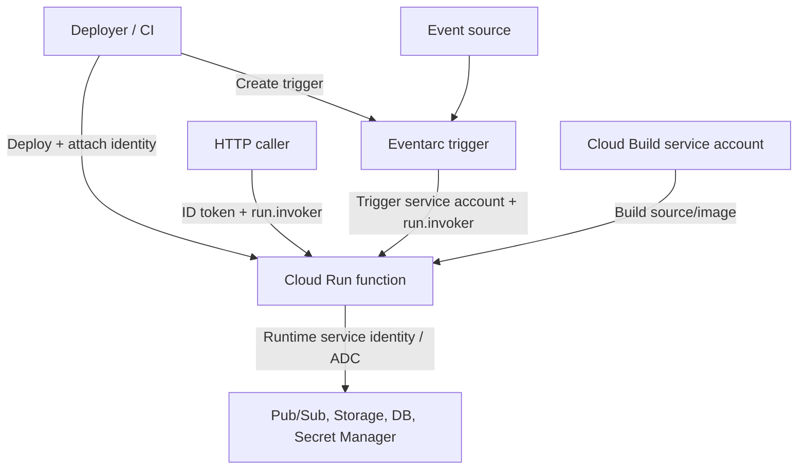

# Cấu hình quyền gọi, trigger và xác minh sau triển khai

## Mục tiêu học tập

**Spring Cloud Function** cho phép viết logic nghiệp vụ thành `Supplier<O>`, `Function<I,O>` và `Consumer<I>`, đăng ký trong Spring context rồi tra cứu bằng `FunctionCatalog`. Nhờ adapter, cùng một hàm có thể phục vụ HTTP, message/event hoặc môi trường serverless. Khi đưa ứng dụng lên **Google Cloud**, chỉ cấu hình đúng Java entry point và function definition là chưa đủ: bạn còn phải thiết lập **quyền gọi, danh tính của trigger, danh tính runtime, loại trigger và cách kiểm tra kết quả sau deploy**.

Sau bài học, bạn có thể:

- Phân biệt tài khoản triển khai, người gọi HTTP, service account của Eventarc trigger, service identity của function và service account dùng để build.
- Chọn đúng IAM role cho Cloud Functions 1st gen, Cloud Run functions (2nd gen) và Cloud Run Admin API.
- Bảo vệ HTTP function bằng IAM, gửi ID token và chỉ mở public khi yêu cầu nghiệp vụ thực sự cần.
- Cấu hình Eventarc trigger cho Pub/Sub, Cloud Storage hoặc nguồn sự kiện khác; cấp quyền đúng cho trigger service account.
- Triển khai một HTTP function và một event-driven function bằng Google Cloud CLI, hiểu chỗ cần thay theo thế hệ/API.
- Xác minh trạng thái service/revision, IAM policy, trigger, log, HTTP response và side effect của event.
- Phân tích lỗi 401/403, trigger active nhưng không giao event, lỗi thiếu quyền truy cập Google API, retry và xử lý trùng.
- Thiết kế checklist release, smoke test, rollback và nguyên tắc least privilege.

**Phạm vi:** ví dụ ưu tiên **Cloud Run functions** theo Cloud Run Admin API và Eventarc hiện đại; có đối chiếu Cloud Functions v2 API và 1st gen khi IAM khác nhau. Với Spring Cloud Function, ví dụ dùng `FunctionCatalog` và các bean nghiệp vụ; **`GcfJarLauncher` chỉ được dùng khi phiên bản GCP adapter/Functions Framework đã xác nhận tương thích với loại trigger và runtime đích**. HTTP handler hoặc CloudEvents handler thuần Java là các hợp đồng khác.

## 1. Trước khi cấp quyền, xác định đúng năm danh tính

Một function thường liên quan đến nhiều principal. Nếu gộp tất cả vào một service account có quyền rộng, việc điều tra sự cố và giới hạn thiệt hại sẽ khó hơn.

| Danh tính | Ai sử dụng? | Nhiệm vụ | Quyền điển hình |
| --- | --- | --- | --- |
| **Deployer** | Người hoặc CI/CD triển khai | Tạo/cập nhật function, gắn service account, tạo trigger | Cloud Run Source Developer hoặc Cloud Functions Developer/Admin; Service Account User; quyền Eventarc khi tạo trigger |
| **HTTP caller / invoker** | Người dùng hoặc service gọi HTTP | Gửi request tới endpoint được bảo vệ | `roles/run.invoker` trên Cloud Run service/function; 1st gen dùng `roles/cloudfunctions.invoker` |
| **Eventarc trigger service account** | Eventarc khi chuyển event tới function | Nhận sự kiện từ provider và gọi service đích | `roles/run.invoker` trên service; `roles/eventarc.eventReceiver` cho nguồn Eventarc phù hợp |
| **Runtime service identity** | Code đang chạy trong function | Gọi Google APIs như Pub/Sub, Storage, Secret Manager, Cloud SQL | Chỉ các quyền dữ liệu mà nghiệp vụ cần |
| **Build service account / service agents** | Cloud Build, Eventarc, Cloud Functions | Build source, quản lý transport/trigger và tài nguyên nền tảng | Vai trò build/service-agent tương ứng; thường được cấu hình riêng |

Các danh tính này **không tự động tương đương**:

- Deployer có quyền deploy không có nghĩa người đó được quyền gọi endpoint.
- HTTP caller có quyền `run.invoker` không có nghĩa code trong function có quyền đọc Cloud Storage.
- Runtime service account có quyền đọc bucket không có nghĩa Eventarc được phép gọi function.
- Trigger service account có `run.invoker` không có nghĩa nó được quyền đọc database mà function sử dụng.
- Build service account tạo image không phải danh tính nghiệp vụ của code khi chạy.



**Nguyên tắc:** dùng service account riêng cho từng workload hoặc từng trách nhiệm khi có thể; chỉ cấp role cần thiết ở phạm vi hẹp nhất. Tránh dùng tài khoản người dùng cá nhân, key JSON tải về hoặc default service account có quyền `Editor` làm identity dài hạn cho production.

## 2. Chọn đúng IAM role theo thế hệ

Một lỗi phổ biến là dùng `roles/cloudfunctions.invoker` cho function thế hệ mới. Role này dành cho **HTTP function 1st gen**; thế hệ 2 và function tạo bằng Cloud Run cần **Cloud Run Invoker**.

| Nền tảng / cách tạo resource | Role để principal gọi HTTP | Tài nguyên gắn policy |
| --- | --- | --- |
| Cloud Functions **1st gen** | `roles/cloudfunctions.invoker` | Cloud Function 1st gen |
| Cloud Functions **2nd gen** qua Cloud Functions v2 API | `roles/run.invoker` | Cloud Run service underlying function |
| Cloud Run functions qua **Cloud Run Admin API** | `roles/run.invoker` | Cloud Run service/function |
| Cloud Run service tổng quát | `roles/run.invoker` | Cloud Run service |

Cloud Functions v2 API cũng sử dụng quyền `run.routes.invoke`, thường được cấp qua `roles/run.invoker`. Vì vậy, **không chỉ nhìn tên sản phẩm**: phải biết function được tạo qua Cloud Functions API hay Cloud Run API để dùng đúng lệnh quản trị IAM.

### 2.1. Các role chính cần phân biệt

| Role | Ai thường nhận? | Mục đích |
| --- | --- | --- |
| `roles/cloudfunctions.invoker` | HTTP caller của 1st gen | Gọi HTTP function thế hệ 1 có xác thực |
| `roles/run.invoker` | HTTP caller hoặc Eventarc trigger service account | Gọi Cloud Run function/service có xác thực |
| `roles/eventarc.eventReceiver` | Eventarc trigger service account | Nhận event từ event provider theo contract Eventarc |
| `roles/eventarc.admin` | Deployer/operator quản lý trigger | Tạo, sửa, xóa và quản lý Eventarc trigger |
| `roles/iam.serviceAccountUser` | Deployer | Gắn/actAs service account làm runtime hoặc trigger identity |
| `roles/run.sourceDeveloper` | Deployer dùng Cloud Run source deploy | Triển khai Cloud Run từ source |
| `roles/serviceusage.serviceUsageConsumer` | Deployer | Sử dụng project/API khi deploy |
| `roles/run.builder` | Build service account | Build source thành image theo quy trình Cloud Run source deployment |

Các role trên là **nhóm quyền thường gặp**, không phải danh sách đầy đủ cho mọi project. API được bật, build service account, Artifact Registry, tổ chức và loại trigger có thể yêu cầu thêm quyền. Cấp role tại project chỉ khi cần; ưu tiên gắn role trên service hoặc service account cụ thể.

### 2.2. Deployer cần quyền gì?

Với triển khai Cloud Run function từ source qua `gcloud run deploy`, tài liệu Google liệt kê cho deployer:

- **Cloud Run Source Developer** — `roles/run.sourceDeveloper` trên project.
- **Service Usage Consumer** — `roles/serviceusage.serviceUsageConsumer` trên project.
- **Service Account User** — `roles/iam.serviceAccountUser` trên service identity mà deployer cần gắn.

Cloud Build service account mặc định hoặc build service account được chỉ định còn cần **Cloud Run Builder** — `roles/run.builder` theo cấu hình build source. Nếu deployer tạo Eventarc trigger, người đó còn cần quyền quản lý Eventarc và quyền sử dụng trigger service account.

Với `gcloud functions deploy`/Cloud Functions v2 API, role quản trị tương ứng là **Cloud Functions Developer** hoặc **Cloud Functions Admin**. Đừng trộn role triển khai của hai API trong một lệnh duy nhất rồi giả định nó áp dụng cho mọi resource.

### 2.3. Service Account User không phải quyền gọi function

`roles/iam.serviceAccountUser` chứa quyền `iam.serviceAccounts.actAs`. Nó cho phép deployer **gắn/đóng vai service account** trong cấu hình workload. Role này không cấp `run.routes.invoke`, không cho phép gọi HTTP endpoint và cũng không tự cấp quyền đọc Cloud Storage.

Ví dụ cấp cho deployer quyền gắn runtime service account cụ thể:

```bash
gcloud iam service-accounts add-iam-policy-binding \
  runtime-orders@PROJECT_ID.iam.gserviceaccount.com \
  --member="user:DEPLOYER_EMAIL" \
  --role="roles/iam.serviceAccountUser"
```

`PROJECT_ID` và `DEPLOYER_EMAIL` là placeholder cần thay. Cấp trên **service account** giúp thu hẹp quyền hơn so với cấp `roles/iam.serviceAccountUser` trên toàn project.

## 3. Cấu hình quyền gọi HTTP function

### 3.1. Private là mặc định nên dùng cho API nội bộ

Cloud Run functions yêu cầu xác thực theo mặc định. Một caller cần cả:

1. Một **ID token hợp lệ** để chứng minh danh tính.
2. Quyền **Cloud Run Invoker** trên service, thường là `roles/run.invoker`.

Nếu function dùng Cloud Functions v2 API, tài liệu invocation cũng xác nhận role `roles/run.invoker`. Với 1st gen, role tương ứng là `roles/cloudfunctions.invoker`.

Ví dụ cấp quyền gọi cho một service account cụ thể trên Cloud Run service:

```bash
gcloud run services add-iam-policy-binding order-http \
  --region=REGION_ID \
  --member="serviceAccount:api-caller@PROJECT_ID.iam.gserviceaccount.com" \
  --role="roles/run.invoker"
```

Nếu caller là người dùng:

```bash
gcloud run services add-iam-policy-binding order-http \
  --region=REGION_ID \
  --member="user:CALLER_EMAIL" \
  --role="roles/run.invoker"
```

Đây là policy trên **service đích**, không phải trên Pub/Sub topic hoặc runtime service account. Thay tên service, region, project và principal bằng giá trị thực.

### 3.2. Khi nào cho phép truy cập công khai?

Một webhook public hoặc endpoint không yêu cầu đăng nhập có thể cho phép unauthenticated invocation. Với Cloud Run, việc này tương đương gắn `roles/run.invoker` cho special principal **`allUsers`**:

```bash
gcloud run services add-iam-policy-binding order-webhook \
  --region=REGION_ID \
  --member="allUsers" \
  --role="roles/run.invoker"
```

Lệnh này làm endpoint có thể được gọi bởi mọi người trên Internet. Chỉ dùng khi yêu cầu nghiệp vụ thực sự cần public access, đã có lớp xác thực/chữ ký webhook phù hợp nếu cần, và chính sách tổ chức cho phép. **Không** bật public chỉ để né lỗi 401/403 trong quá trình thử nghiệm.

Đối với function tạo bằng Cloud Functions v2 API, có thể cấu hình public access lúc deploy bằng `--allow-unauthenticated`; tùy chọn này thay đổi IAM policy. Với function tạo qua Cloud Run Admin API, hãy dùng cơ chế quản lý access của Cloud Run.

Một organization policy như **Domain Restricted Sharing** có thể ngăn việc thêm `allUsers`. Trong môi trường đó, hãy giữ endpoint private và cấp quyền cho user/service account cụ thể.

### 3.3. Gọi HTTP private bằng ID token

Trong môi trường phát triển, nếu Google Cloud CLI đã đăng nhập bằng principal có quyền `roles/run.invoker`, có thể lấy URL và gửi request:

```bash
SERVICE_URL="$(gcloud run services describe order-http \
  --region=REGION_ID \
  --format='value(status.url)')"

ID_TOKEN="$(gcloud auth print-identity-token)"

curl -i -X POST "$SERVICE_URL/" \
  -H "Authorization: Bearer $ID_TOKEN" \
  -H "Content-Type: text/plain" \
  --data-binary "ord-42"
```

`gcloud auth print-identity-token` hữu ích cho **smoke test của developer**. Với service-to-service production, nên tạo ID token cho service account với **audience đúng là URL của service**, và cấp `roles/run.invoker` cho service account caller. Không lưu token lâu dài, không ghi token vào log hoặc source control.

Nếu token hợp lệ nhưng thiếu quyền invoke, request vẫn bị từ chối. Ngược lại, một principal có role nhưng không gửi token phù hợp cũng không vượt qua xác thực.

## 4. Phân biệt runtime service identity với caller và trigger

Khi code Spring Cloud Function gọi Google API, nó dùng **service identity** của Cloud Run function. Đây là danh tính của workload đang chạy, được Application Default Credentials (ADC) sử dụng để lấy credential; ứng dụng không cần lưu key JSON của service account.

Ví dụ function cần đọc object từ Cloud Storage:

- Caller bên ngoài cần `roles/run.invoker` để gọi function.
- Runtime service account cần role đọc object/bucket, ví dụ role Storage phù hợp với phạm vi tài nguyên.
- Deployer cần `roles/iam.serviceAccountUser` trên runtime service account để gắn nó khi deploy.

Ba quyền này phục vụ ba mục đích khác nhau.

### 4.1. Tạo runtime service account riêng

```bash
gcloud iam service-accounts create runtime-orders \
  --display-name="Runtime identity for order function"
```

Địa chỉ service account có dạng:

```text
runtime-orders@PROJECT_ID.iam.gserviceaccount.com
```

Cấp cho identity **chỉ role dữ liệu cần thiết**. Ví dụ, nếu function cần đọc object trong một bucket cụ thể, hãy xem xét grant role ở bucket thay vì grant toàn project.

Triển khai function và gắn runtime service account:

```bash
gcloud run deploy order-http \
  --source . \
  --function example.gcp.OrderHttpFunction \
  --base-image java21 \
  --region REGION_ID \
  --service-account=runtime-orders@PROJECT_ID.iam.gserviceaccount.com
```

Đây là ví dụ **Cloud Run Admin API source deployment** cho Java Functions Framework. `example.gcp.OrderHttpFunction` phải là Java entry point thực sự triển khai hợp đồng handler tương ứng. Nếu project dùng Spring Cloud Function GCP adapter với `GcfJarLauncher`, chỉ thay class này sau khi đã xác nhận adapter đó tương thích với runtime/trigger đích; **tên bean `normalizeOrderId` không phải entry point**.

Đối với Cloud Functions v2 API, `gcloud functions deploy` có cờ `--service-account` để chọn runtime service account. Lệnh và cấu hình cụ thể phụ thuộc API đang quản lý resource.

### 4.2. Không tự cấp quyền Editor cho runtime

Không dùng các cách sau trong production:

- Gán `roles/owner` hoặc `roles/editor` cho runtime service account để “cho chắc”.
- Dùng service account mặc định của Compute Engine mà không kiểm tra role đã được cấp.
- Tải JSON key của service account về máy và nhúng vào JAR.
- Dùng một service account chung có quyền đọc/ghi mọi bucket, topic, secret và database.

Nếu function không gọi Google API nào, runtime identity có thể không cần thêm role dữ liệu nào. Nếu function truy cập Secret Manager, cấp `roles/secretmanager.secretAccessor` trên secret cần đọc cho **runtime service account**, không phải cho HTTP caller.

## 5. Cấu hình HTTP trigger khi triển khai

Với Cloud Run functions mới, có thể deploy Java function từ source:

```bash
gcloud run deploy order-http \
  --source . \
  --function example.gcp.OrderHttpFunction \
  --base-image java21 \
  --region REGION_ID \
  --service-account=runtime-orders@PROJECT_ID.iam.gserviceaccount.com
```

Trong ví dụ này, **không thêm** `--allow-unauthenticated`, vì endpoint nên yêu cầu xác thực theo mặc định. Nếu đây là webhook public đã được thiết kế như vậy, có thể chủ động thêm `--allow-unauthenticated` và xem lại IAM policy sau deploy.

Nếu dùng Cloud Functions v2 API cho một function HTTP đã tồn tại hoặc để tương thích quy trình cũ:

```bash
gcloud functions deploy order-http \
  --gen2 \
  --region=REGION_ID \
  --runtime=SUPPORTED_JAVA_RUNTIME \
  --source=. \
  --entry-point=JAVA_HANDLER_FQCN \
  --trigger-http \
  --service-account=runtime-orders@PROJECT_ID.iam.gserviceaccount.com
```

`SUPPORTED_JAVA_RUNTIME` và `JAVA_HANDLER_FQCN` là placeholder. Với Cloud Functions v2 API, `--entry-point` phải trỏ tới Java function target phù hợp; không phải tên bean Spring. **Không sao chép lệnh Java 11 cũ** từ tài liệu GCP adapter vào runtime mới.

### 5.1. Cấu hình một endpoint private và một endpoint public

| Loại endpoint | IAM mong muốn | Cách kiểm tra |
| --- | --- | --- |
| API nội bộ | Chỉ caller/service account được cấp `roles/run.invoker` | Request có ID token hợp lệ |
| Webhook public | `allUsers` có `roles/run.invoker`, có lớp kiểm tra chữ ký nếu cần | Request không token vẫn vào được, nhưng business auth vẫn phải được kiểm tra |
| Function event-driven | Event source/trigger identity có quyền invoke | Publish event đúng nguồn; không mở public HTTP chỉ để thử |

**HTTP URL tồn tại không chứng minh function có thể được gọi.** Cần kiểm tra auth mode, IAM policy, ingress và token/audience.

## 6. Cấu hình Eventarc trigger cho function nhận sự kiện

Với event-driven function trên Cloud Run, Eventarc chuyển sự kiện thành **HTTP POST có CloudEvent envelope** tới function. Trong Spring Cloud Function, bean thường là `Consumer<CloudEvent>` hoặc `Consumer<DomainEvent>` sau khi adapter/handler chuyển đổi payload. Chọn đúng Java entry point theo hợp đồng event; một HTTP handler không tự trở thành CloudEvents handler chỉ vì đã tạo trigger.

### 6.1. Bật API cần thiết

Với Pub/Sub/Eventarc và Cloud Run source deployment:

```bash
gcloud services enable \
  run.googleapis.com \
  cloudbuild.googleapis.com \
  artifactregistry.googleapis.com \
  logging.googleapis.com \
  eventarc.googleapis.com \
  eventarcpublishing.googleapis.com \
  pubsub.googleapis.com
```

Chỉ bật API phù hợp với dịch vụ thực tế của bạn. Việc bật API có thể cần quyền `serviceusage.services.enable` và project đã liên kết billing theo yêu cầu build/deploy.

### 6.2. Tạo service account dành riêng cho Eventarc trigger

```bash
gcloud iam service-accounts create eventarc-orders \
  --display-name="Eventarc identity for order events"
```

Trigger identity sẽ có email:

```text
eventarc-orders@PROJECT_ID.iam.gserviceaccount.com
```

Đây là danh tính **Eventarc sử dụng để gọi function đích**, không nhất thiết là runtime service account của function.

Nếu nguồn sự kiện yêu cầu quyền nhận event từ Eventarc provider, cấp:

```bash
gcloud projects add-iam-policy-binding PROJECT_ID \
  --member="serviceAccount:eventarc-orders@PROJECT_ID.iam.gserviceaccount.com" \
  --role="roles/eventarc.eventReceiver"
```

**Ngoại lệ quan trọng:** Google ghi rõ không cần `roles/eventarc.eventReceiver` khi trigger nhận **direct events từ Cloud Pub/Sub** theo hướng dẫn Eventarc Pub/Sub. Với những nguồn Eventarc khác, kiểm tra role của provider/trigger trong tài liệu tương ứng.

### 6.3. Cấp quyền gọi function đích cho trigger identity

Nếu function đích yêu cầu authentication, Eventarc trigger service account phải có **Cloud Run Invoker** trên service:

```bash
gcloud run services add-iam-policy-binding order-events \
  --region=REGION_ID \
  --member="serviceAccount:eventarc-orders@PROJECT_ID.iam.gserviceaccount.com" \
  --role="roles/run.invoker"
```

Không cấp role này cho service account runtime chỉ vì nó xử lý event. **Principal trong `--member` phải là service account được cấu hình cho Eventarc trigger**.

### 6.4. Tạo Eventarc trigger cho Pub/Sub topic hiện có

Giả sử:

- Cloud Run service đích: `order-events`.
- Pub/Sub topic: `orders-topic`.
- Eventarc trigger identity: `eventarc-orders@PROJECT_ID.iam.gserviceaccount.com`.

Lệnh:

```bash
gcloud eventarc triggers create orders-published \
  --location=REGION_ID \
  --destination-run-service=order-events \
  --destination-run-region=REGION_ID \
  --event-filters="type=google.cloud.pubsub.topic.v1.messagePublished" \
  --transport-topic=projects/PROJECT_ID/topics/orders-topic \
  --service-account=eventarc-orders@PROJECT_ID.iam.gserviceaccount.com
```

Đây là ví dụ **Pub/Sub direct event** với topic đã tồn tại. Trigger và topic phải đáp ứng quy tắc location/project của Eventarc; Pub/Sub trigger của Eventarc chỉ hỗ trợ location đơn vùng. Destination service nhận HTTP POST tại root path `/` trừ khi cấu hình path khác.

Không thêm `--max-retry-attempts=1` nếu bạn muốn hành vi retry tiêu chuẩn. Trong tài liệu Eventarc, flag đó giới hạn **một lần delivery**; không phải lựa chọn nên bật mặc định cho consumer production.

### 6.5. Trigger cho Cloud Storage hoặc nguồn Eventarc khác

Với nguồn không phải direct Pub/Sub, command thường có cấu trúc:

```bash
gcloud eventarc triggers create storage-object-created \
  --location=REGION_ID \
  --destination-run-service=order-events \
  --destination-run-region=REGION_ID \
  --event-filters="type=EVENT_TYPE" \
  --event-filters="bucket=BUCKET_NAME" \
  --service-account=eventarc-orders@PROJECT_ID.iam.gserviceaccount.com
```

`EVENT_TYPE` phải lấy từ danh sách **Google event types supported by Eventarc** cho đúng provider và loại sự kiện; `BUCKET_NAME` là bucket thật. Không tự đoán tên event type. Với direct Cloud Storage event, service agent của Cloud Storage có thể cần `roles/pubsub.publisher` để phát sự kiện qua transport; kiểm tra hướng dẫn role theo trigger cụ thể.

### 6.6. Các quy tắc trigger phải nhớ

- Eventarc trigger cần **identity riêng**; Google khuyến nghị user-managed service account.
- Trigger identity cần `roles/run.invoker` nếu service đích yêu cầu authentication.
- `roles/eventarc.eventReceiver` được cấp cho các event provider cần role đó; direct Pub/Sub là ngoại lệ theo tài liệu.
- Trigger location phải tương thích với nguồn sự kiện; đặc biệt Pub/Sub Eventarc chỉ hỗ trợ location đơn vùng.
- Event filters là **điều kiện AND**: event phải khớp mọi filter đã đặt.
- Loại event filter chính không thể đổi sau khi trigger được tạo; nếu đổi loại sự kiện, tạo trigger mới rồi chuyển traffic/nguồn và xóa trigger cũ theo kế hoạch.
- Sau khi tạo, trigger có thể cần **tới hai phút hoặc lâu hơn** để propagation và bắt đầu lọc event; không kết luận thất bại ngay lập tức.
- Trigger active không chứng minh nó có thể invoke service; phải kiểm tra IAM và gửi một event thật.

## 7. Cấu hình quyền cho Eventarc và service agents

Google service agents có trách nhiệm quản lý transport và resource nền tảng. Khi tạo Eventarc resource lần đầu, role **Eventarc Service Agent** thường được cấp tự động. Với Cloud Functions v2 API, **Cloud Functions Service Agent** cũng có role riêng khi bật API.

Không tùy tiện xóa role service agent. Nếu role đã bị gỡ hoặc service agent bị mất quyền, trigger có thể được tạo nhưng không hoạt động đúng; hãy phục hồi đúng predefined service-agent role theo tài liệu Google thay vì cấp `Editor`.

### Bảng phân quyền theo luồng Eventarc

| Principal | Role | Gắn ở đâu? | Khi nào cần? |
| --- | --- | --- | --- |
| Deployer | `roles/eventarc.admin` hoặc quyền tương đương | Project/Eventarc resource | Khi tạo/quản lý trigger |
| Deployer | `roles/iam.serviceAccountUser` | Trigger service account | Khi gắn trigger identity |
| Trigger service account | `roles/eventarc.eventReceiver` | Project | Khi event provider yêu cầu; không cần cho direct Pub/Sub |
| Trigger service account | `roles/run.invoker` | Cloud Run service đích | Khi service đích cần authenticated invocation |
| Eventarc service agent | `roles/eventarc.serviceAgent` | Project | Quản lý transport; thường được Google cấp tự động |
| Cloud Storage service agent | `roles/pubsub.publisher` | Project | Một số direct Cloud Storage event trigger cần publish transport message |
| Runtime service account | Role dữ liệu nghiệp vụ | Resource data cụ thể | Khi code trong function gọi Google API |

**Không gom các role này vào một service account duy nhất.** Khi cần cross-project service account, còn có yêu cầu IAM và organization policy riêng; phải đọc hướng dẫn cross-project trước khi tạo trigger.

## 8. Xác minh sau khi triển khai: đừng chỉ nhìn dòng “Deploying… done”

Sau deploy, cần kiểm tra **resource, revision, IAM, trigger, request/event và log**. Một lệnh deploy exit code 0 chỉ chứng minh thao tác deploy đã hoàn tất theo API; nó không chứng minh caller được phép gọi hoặc Eventarc đã chuyển đúng payload.

### 8.1. Kiểm tra Cloud Run service và revision

```bash
gcloud run services describe order-http \
  --region=REGION_ID \
  --format=yaml
```

Kiểm tra những trường quan trọng:

- `status.url`: URL service được cấp.
- `status.conditions`: trạng thái Ready và thông tin lỗi.
- `status.latestReadyRevisionName`: revision đã sẵn sàng mới nhất.
- `spec.template.spec.serviceAccountName`: runtime service account được gắn.
- `spec.template.spec.containers`: cấu hình image/env/port liên quan.

Lấy URL riêng:

```bash
gcloud run services describe order-http \
  --region=REGION_ID \
  --format='value(status.url)'
```

Với resource tạo qua **Cloud Functions v2 API**, có thể kiểm tra bằng:

```bash
gcloud functions describe order-http \
  --gen2 \
  --region=REGION_ID
```

Với **Cloud Run Admin API**, dùng `gcloud run services describe`; không dùng lệnh Cloud Functions để quản lý resource được tạo trực tiếp bằng Cloud Run API.

### 8.2. Kiểm tra IAM policy của endpoint

```bash
gcloud run services get-iam-policy order-http \
  --region=REGION_ID
```

Xác nhận:

- Caller/service account mong muốn có `roles/run.invoker`.
- Endpoint private không vô tình có member `allUsers`.
- Nếu endpoint public theo yêu cầu, việc cấp `allUsers` là có chủ đích và được review.
- Eventarc trigger service account có `roles/run.invoker` trên service đích.

Với Cloud Functions 1st gen, kiểm tra IAM policy của function bằng lệnh Cloud Functions tương ứng và xác nhận `roles/cloudfunctions.invoker` được cấp cho principal cần thiết.

### 8.3. Kiểm tra Eventarc trigger

Liệt kê trigger:

```bash
gcloud eventarc triggers list --location=-
```

Mô tả trigger cụ thể:

```bash
gcloud eventarc triggers describe orders-published \
  --location=REGION_ID \
  --format=yaml
```

Đối chiếu:

- Trigger tồn tại và trạng thái/condition không báo lỗi.
- `eventFilters` có đúng event type, topic/bucket/resource cần theo dõi.
- `destination` đúng service và region.
- `serviceAccount` là trigger identity đã cấp quyền.
- Transport topic/subscription được tạo theo cấu hình.

Nếu trigger vừa tạo, đợi thời gian propagation theo tài liệu trước khi kết luận event bị mất. Nếu trigger active nhưng log function không có request, kiểm tra source, filters, location và quyền invoke.

### 8.4. Kiểm tra log của function

Với Cloud Run service/function:

```bash
gcloud run services logs read order-http \
  --region=REGION_ID \
  --limit=50
```

Hoặc đọc qua Cloud Logging:

```bash
gcloud logging read \
  'resource.type="cloud_run_revision" AND resource.labels.service_name="order-http"' \
  --limit=50
```

Với Cloud Functions v2 API, có thể dùng:

```bash
gcloud functions logs read order-http \
  --gen2 \
  --region=REGION_ID \
  --limit=50
```

Log cần giúp phân biệt:

- Startup/bean registration/FunctionCatalog lỗi.
- HTTP request tới handler hay event trigger gọi handler.
- Lỗi parse JSON/CloudEvent hoặc chuyển đổi message.
- Lỗi nghiệp vụ và lỗi Google API do runtime identity thiếu quyền.
- Retry/duplicate và kết quả side effect.

Không log token, secret hoặc toàn bộ payload có thông tin cá nhân. Nên ghi correlation ID, event ID, function name, revision và kết quả xử lý ở mức an toàn.

## 9. Smoke test HTTP sau deploy

Với endpoint private, lấy URL và ID token:

```bash
SERVICE_URL="$(gcloud run services describe order-http \
  --region=REGION_ID \
  --format='value(status.url)')"
ID_TOKEN="$(gcloud auth print-identity-token)"

curl -i -X POST "$SERVICE_URL/" \
  -H "Authorization: Bearer $ID_TOKEN" \
  -H "Content-Type: text/plain" \
  --data-binary " ord-42 "
```

Với Spring Cloud Function HTTP adapter, kiểm tra response theo contract của function:

- HTTP status đúng với logic nghiệp vụ.
- Body đã được chuyển đổi đúng kiểu.
- Function definition chọn đúng bean hoặc composition.
- Logs cho thấy handler và bean chạy trên revision mới.

Nếu code nhận JSON DTO, gửi `Content-Type: application/json` và kiểm tra response JSON thực tế. Nếu function trả `Message<T>`, chỉ những header/status mà adapter hỗ trợ mới được ánh xạ; không suy ra mọi Spring `MessageHeaders` đều trở thành HTTP response headers.

### 9.1. Phân biệt 401, 403 và 404

| Mã | Nguyên nhân thường gặp | Việc cần kiểm tra |
| --- | --- | --- |
| **401 Unauthorized** | Thiếu token, token sai/expired hoặc audience không phù hợp | Authorization header, ID token, audience/issuer |
| **403 Forbidden** | Token nhận diện được principal nhưng principal thiếu `run.invoker`, hoặc ingress/org policy chặn | IAM policy trên service, principal, ingress |
| **404 Not Found** | URL/route sai, service chưa sẵn sàng hoặc function không có endpoint tương ứng | URL `status.url`, root path, revision, handler |
| **500 Internal Server Error** | Exception trong handler, Spring context, converter hoặc nghiệp vụ | Cloud Run logs và stack trace an toàn |
| **502/503** | Container không sẵn sàng, startup/timeout hoặc upstream issue | Revision conditions, startup logs, health/startup behavior |

Một trang web mở trong browser có thể trả 403 vì browser không tự gửi ID token. Điều đó không chứng minh service URL sai.

## 10. Smoke test Eventarc và Pub/Sub

### 10.1. Gửi một event kiểm thử

Với Pub/Sub topic đã cấu hình trong Eventarc:

```bash
gcloud pubsub topics publish orders-topic \
  --message='{"orderId":"ORD-42","action":"CREATED"}'
```

Publisher gửi **message data**; Pub/Sub/Eventarc đóng gói thành CloudEvent khi chuyển đến Cloud Run. Nếu ứng dụng mong JSON trong `message.data`, handler phải đọc đúng CloudEvent envelope và giải mã Base64 theo contract. Không tự Base64 hóa payload trước khi publish trừ khi nghiệp vụ của bạn thực sự muốn payload là một chuỗi Base64.

### 10.2. Xác minh event đến đúng function

1. Mở log của Cloud Run service và tìm request mới.
2. Xác nhận event type/source và event ID được ghi an toàn.
3. Xác nhận `Consumer`/function được chọn từ `FunctionCatalog` thực sự chạy.
4. Kiểm tra kết quả side effect ở hệ thống đích (database, object hoặc trạng thái nghiệp vụ).
5. Kiểm tra trigger health và retry nếu event không được xử lý.

**Trigger active không đồng nghĩa event đã được xử lý.** Cần chứng minh event đã đi qua source → Eventarc → authenticated HTTP invocation → handler → function → side effect.

### 10.3. Retry và xử lý trùng

Eventarc có cơ chế retry theo cấu hình. Nếu delivery thất bại, một event có thể được giao lại. Vì vậy:

- Dùng `CloudEvent.id` hoặc message ID phù hợp làm idempotency key.
- Ghi nhận trạng thái xử lý trong kho bền vững với transaction/unique constraint.
- Chỉ trả thành công sau khi side effect đạt trạng thái bền vững.
- Phân loại lỗi tạm thời và lỗi payload không thể sửa; dùng dead-letter/quarantine theo chính sách hệ thống.
- Không dùng `static Set` hoặc bộ nhớ singleton làm nguồn duy nhất để chống trùng giữa nhiều instance.

Trong lệnh Eventarc, `--max-retry-attempts=1` có nghĩa chỉ một lần delivery attempt theo tài liệu; đừng bật nó chỉ để che giấu lỗi xử lý.

## 11. Xác minh Spring Cloud Function trong môi trường cloud

Sau khi xác nhận IAM và trigger, cần xác nhận tầng Spring:

### 11.1. Function bean được đăng ký

Ví dụ ứng dụng:

```java
@Bean
public Function<String, String> normalizeOrderId() {
    return value -> value.trim().toUpperCase(Locale.ROOT);
}
```

Và `application.properties`:

```properties
spring.cloud.function.definition=normalizeOrderId
```

Nếu có composition:

```properties
spring.cloud.function.definition=normalizeOrderId|appendTag
```

Hãy kiểm tra bean names đúng với `FunctionCatalog`, kiểu input/output tương thích và adapter đang gọi đúng function definition. **`GcfJarLauncher` là Java handler của GCP adapter trong mô hình tương thích, không phải tên bean.** Nếu deploy một `CloudEventsFunction` thuần Java, class handler là entry point; muốn dùng catalog phải có bridge/bootstrap Spring đã được kiểm thử.

### 11.2. Xác minh runtime service account

Kiểm tra service account được gắn trong cấu hình service/revision bằng `gcloud run services describe`. Sau đó kiểm tra role của identity đó trên tài nguyên mà function truy cập.

Nếu function gọi Cloud Storage:

- HTTP caller có `roles/run.invoker` không đủ để đọc bucket.
- Eventarc trigger identity có `roles/run.invoker` không đủ để đọc bucket.
- **Runtime service account** mới cần quyền Storage phù hợp để code đọc object.

Nếu ứng dụng dùng Cloud Client Libraries, ưu tiên **Application Default Credentials** từ runtime service identity. Không tạo key JSON thủ công chỉ để tránh lỗi permission.

### 11.3. Xác minh cấu hình/secret mà không lộ dữ liệu

Có thể log một số metadata an toàn như function definition, build version, revision hoặc tên profile. Không in toàn bộ `System.getenv()`, vì có thể làm lộ secrets và token. Với Secret Manager, kiểm tra service account runtime có `roles/secretmanager.secretAccessor` trên secret cụ thể, và xác minh code đọc được secret trong smoke test có kiểm soát.

## 12. Lỗi thường gặp và cách xử lý

| Triệu chứng | Nguyên nhân có thể | Cách xử lý |
| --- | --- | --- |
| HTTP 403 dù đã cấp `roles/cloudfunctions.invoker` cho gen2 | Dùng role 1st gen cho function 2nd gen | Cấp `roles/run.invoker` trên Cloud Run service |
| HTTP 403 trên Cloud Run Admin API function | Caller thiếu `run.routes.invoke` hoặc ingress/org policy chặn | Kiểm tra `roles/run.invoker`, token, ingress |
| HTTP 401 | Không gửi ID token hoặc token sai audience/issuer | Gửi token hợp lệ; dùng audience đúng URL service |
| Browser 403 nhưng curl có token chạy | Browser không tự gửi Authorization ID token | Thử bằng authenticated client |
| Eventarc trigger tạo được nhưng không gọi service | Trigger identity thiếu `roles/run.invoker` | Gắn role trên đúng service cho trigger SA |
| Eventarc source không phát event | Thiếu `roles/eventarc.eventReceiver` hoặc quyền service agent/provider | Kiểm tra role theo nguồn; direct Pub/Sub là ngoại lệ eventReceiver |
| Trigger active nhưng chưa có log | Event filter/topic/location sai hoặc chưa propagation | Kiểm tra trigger describe, publish event mới, chờ propagation |
| Event được giao nhưng function không đọc được | Sai CloudEvent envelope/Content-Type hoặc Java handler signature | Kiểm tra `CloudEventsFunction`, payload parser và adapter |
| Function chạy nhưng không truy cập được bucket/topic | Runtime service account thiếu quyền dữ liệu | Cấp role tối thiểu trên tài nguyên cho runtime identity |
| Deploy báo không thể attach service account | Deployer thiếu `roles/iam.serviceAccountUser` trên service account | Cấp role trên đúng service account |
| Cloud Build không build được source | Build service account thiếu `roles/run.builder` hoặc Artifact Registry access | Kiểm tra build identity và build logs |
| Event xử lý hai lần | Retry/redelivery, side effect chưa idempotent | Dedupe theo event ID trong storage bền vững |
| Event bị mất sau exception | Retry tắt hoặc handler nuốt lỗi | Kiểm tra retry policy và propagate lỗi tạm thời |
| Function trả 500 do Secret Manager | Runtime identity không có secret accessor hoặc secret version sai | Kiểm tra IAM trên secret và version |
| Cloud Run function khởi động lỗi sau deploy | Sai entry point, dependency hoặc Spring context | Kiểm tra revision conditions/startup logs, classpath và FunctionCatalog |
| Function chạy local nhưng cloud fail | Khác runtime, IAM, env, ingress hoặc trigger | So sánh revision config, service identity và cloud logs |
| Không tìm thấy bean dù definition đúng | Bean chưa được đăng ký hoặc sai package/component scan | Kiểm tra `@Bean`, component scan, catalog test |
| Eventarc trigger service account bị dùng nhầm làm runtime SA | Gộp hai identity | Tách trigger identity và runtime identity; cấp role riêng |
| Xóa role Eventarc service agent khiến trigger lỗi | Service agent mất quyền quản lý transport | Khôi phục đúng service-agent role theo tài liệu Google |

### Quy trình chẩn đoán theo tầng

1. **Resource:** function/service đã Ready và có URL/revision chưa?
2. **Caller:** principal, token, audience, `run.invoker`/`cloudfunctions.invoker` có đúng không?
3. **Trigger:** event source, filters, location, trigger identity và retry có đúng không?
4. **Target invocation:** trigger service account có `roles/run.invoker` trên đích không?
5. **Runtime identity:** code có quyền đọc/ghi Google APIs cần thiết không?
6. **Spring:** entry point, context, `FunctionCatalog`, function definition và conversion có đúng không?
7. **Business:** validation, transaction, idempotency và side effect có thành công không?

Không sửa bean name để chữa IAM 403; không cấp Editor cho runtime chỉ vì Storage access denied; không mở public endpoint để chữa lỗi Eventarc thiếu `run.invoker`.

## 13. Rollback và xác nhận release

Trước khi deploy production:

- Lưu lại **revision/source commit**, runtime Java, entry point, function definition, trigger filters và danh tính service account.
- Giữ cấu hình IAM tối thiểu, biết rõ caller/trigger/runtime nào được cấp quyền.
- Chạy unit test, Spring context/catalog test và local Functions Framework test.
- Sau deploy, kiểm tra Ready condition, IAM policy, trigger health, HTTP smoke test/event smoke test và logs.
- Kiểm tra side effect thực tế bằng dữ liệu test có thể nhận diện, không dùng giao dịch khách hàng thật.
- Với Eventarc, kiểm tra retry và duplicate behavior trước khi tăng traffic.
- Chuẩn bị bản source/config trước đó và quy trình chuyển traffic/redeploy về revision đã biết hoạt động.

Cloud Run hỗ trợ revisions và traffic management; tuy nhiên, rollback code không tự hoàn tác **database migration, event đã xử lý, IAM policy hoặc trigger filters**. Nếu thay đổi schema/side effect, cần kế hoạch rollback dữ liệu và tương thích ngược.

### Checklist release

| Hạng mục | Điều kiện PASS |
| --- | --- |
| Deployer | Có role đúng theo API; chỉ actAs các service account cần thiết |
| Build | Build service account có quyền build và ghi Artifact Registry cần thiết |
| Runtime service identity | Chỉ có role dữ liệu nghiệp vụ cần dùng |
| HTTP caller | Principal đúng có `roles/run.invoker` hoặc role 1st gen tương ứng |
| Public access | Chỉ bật `allUsers` nếu yêu cầu public được duyệt |
| Eventarc identity | Trigger SA riêng, có `run.invoker` và role Event Receiver khi cần |
| Service agents | Không bị gỡ role mặc định cần thiết |
| Trigger | Event type/filter/topic/region/destination chính xác |
| Handler | Java entry point và loại signature khớp trigger/runtime |
| Spring | Function bean, `FunctionCatalog`, definition và conversion đúng |
| Runtime | Service Ready, revision mới sẵn sàng, runtime service account đúng |
| Smoke test HTTP | ID token hoặc public policy hoạt động đúng, body/status đúng |
| Smoke test event | Publish test event và xác minh side effect/log |
| Retry/idempotency | Duplicate không gây side effect trùng |
| Observability | Log đủ chẩn đoán, không lộ token/secret/payload nhạy cảm |
| Rollback | Có revision/source/config trước đó và kế hoạch dữ liệu tương thích |

## 14. Bài tập thực hành

### Bài tập 1 — Phân loại danh tính

Một function nhận HTTP, sau đó ghi file vào Cloud Storage. Xác định:

- Deployer account.
- HTTP caller.
- Runtime service account.

Nêu role mà mỗi danh tính cần. Giải thích tại sao `roles/run.invoker` không cấp quyền ghi bucket và tại sao runtime service account không nên nhận quyền invoke function nếu không có nhu cầu.

### Bài tập 2 — Khắc phục HTTP 403

Một Cloud Run function đã deploy thành công nhưng caller nhận 403. IAM policy hiện có `roles/cloudfunctions.invoker` cho caller. Hãy xác định sai sót nếu function được tạo bằng Cloud Run Admin API, rồi viết lệnh cấp `roles/run.invoker` trên service cho đúng principal.

### Bài tập 3 — Cấu hình Eventarc Pub/Sub

Tạo service account `eventarc-orders`, cấp `roles/run.invoker` trên service đích và tạo Eventarc trigger với event type `google.cloud.pubsub.topic.v1.messagePublished`. Giải thích tại sao direct Pub/Sub event không cần `roles/eventarc.eventReceiver` theo hướng dẫn Google.

### Bài tập 4 — Phân biệt hai service account

Trigger service account có quyền invoke service, runtime service account có quyền đọc bucket. Đổi nhầm hai email trong cấu hình. Dự đoán lỗi và giải thích cách phát hiện qua IAM policy/log.

### Bài tập 5 — Xác minh sau deploy

Viết một checklist sử dụng:

- `gcloud run services describe`.
- `gcloud run services get-iam-policy`.
- `gcloud eventarc triggers describe`.
- `gcloud run services logs read`.
- Một HTTP request có ID token hoặc một Pub/Sub publish.

Phân biệt bằng chứng resource Ready với bằng chứng business function đã xử lý đúng.

### Bài tập 6 — Retry và idempotency

Một Pub/Sub event làm function ghi đơn hàng vào database. Sau khi commit, function timeout trước khi trả thành công nên event bị giao lại. Thiết kế idempotency key, transaction/unique constraint và cách quan sát duplicate.

### Câu hỏi tự kiểm tra

1. **Role invoke cho HTTP function 1st gen là gì?** `roles/cloudfunctions.invoker`.
2. **Role invoke cho Cloud Run functions/gen2 là gì?** `roles/run.invoker`.
3. **Caller cần gì ngoài role invoke?** ID token hợp lệ khi endpoint yêu cầu authentication.
4. **Runtime service account dùng để làm gì?** Gọi Google APIs từ code đang chạy.
5. **Eventarc trigger service account dùng để làm gì?** Nhận/gửi sự kiện và invoke function đích.
6. **Direct Pub/Sub Eventarc trigger có cần `roles/eventarc.eventReceiver` không?** Theo hướng dẫn Google, không cần role này cho direct Pub/Sub event; vẫn cần quyền invoke target nếu target private.
7. **Deployer cần `roles/iam.serviceAccountUser` để làm gì?** Gắn/actAs service account, không phải gọi endpoint.
8. **Tại sao trigger active chưa đủ chứng minh event được xử lý?** Còn cần đúng filter, identity, target invoke, handler, conversion và side effect.
9. **Khi nào dùng `allUsers`?** Chỉ khi endpoint thực sự cần public access và chính sách tổ chức cho phép.
10. **Tại sao không dùng `roles/editor` cho runtime?** Quá rộng; vi phạm least privilege.
11. **Nếu Spring `FunctionCatalog` test pass nhưng cloud 403 thì cần kiểm tra gì?** IAM caller/trigger, ID token, ingress và service policy trước.
12. **Nếu event được giao lại, consumer cần bảo đảm điều gì?** Idempotency và side effect bền vững.

## 15. Tổng kết và tài liệu tham khảo

Triển khai Spring Cloud Function lên Google Cloud cần phân biệt **ai deploy**, **ai gọi**, **ai chuyển event** và **code chạy dưới danh tính nào**. HTTP caller cần quyền invoke; Eventarc trigger service account cần quyền nhận event phù hợp và invoke service; runtime service identity cần quyền dữ liệu cho nghiệp vụ; deployer cần quyền quản lý resource và gắn service account. **Cloud Functions 1st gen** dùng `roles/cloudfunctions.invoker`, còn **Cloud Run functions/Cloud Functions v2 API** dùng `roles/run.invoker`.

Quy trình đáng tin cậy là: **chọn API/trigger → chuẩn bị service account và IAM → deploy function với handler phù hợp → tạo trigger → kiểm tra service/revision/policy/trigger → smoke test HTTP hoặc event → đọc log và xác minh side effect → kiểm tra retry/idempotency → chuẩn bị rollback**. Đừng xem deploy thành công là bằng chứng endpoint hoặc event pipeline đã hoạt động.

Tài liệu chính thức:

- [Google Cloud — Deploy a Cloud Run function](https://docs.cloud.google.com/run/docs/deploy-functions): source deployment, API, deployer/build/runtime service account và authentication.
- [Google Cloud — Roles and permissions for Cloud Run functions targets](https://docs.cloud.google.com/eventarc/standard/docs/functions/roles-permissions): Eventarc trigger identity, `roles/eventarc.eventReceiver`, `roles/run.invoker` và service agents.
- [Google Cloud — Route Pub/Sub events to Cloud Run](https://docs.cloud.google.com/eventarc/standard/docs/run/route-trigger-cloud-pubsub): tạo Pub/Sub trigger, `--transport-topic`, event type, identity và xác minh trigger.
- [Google Cloud — Authenticate for invocation](https://docs.cloud.google.com/functions/docs/securing/authenticating): ID token và `run.routes.invoke` cho Cloud Functions v2 API.
- [Google Cloud — IAM roles for Cloud Functions](https://docs.cloud.google.com/iam/docs/roles-permissions/cloudfunctions): `roles/cloudfunctions.invoker` cho 1st gen và khác biệt với gen2.
- [Google Cloud — Configure service identity for services](https://docs.cloud.google.com/run/docs/configuring/services/service-identity): runtime service identity, ADC và quyền truy cập Google APIs.
- [Google Cloud — Create triggers with Eventarc](https://docs.cloud.google.com/run/docs/triggering/trigger-with-events): trigger location, service account, retry và thời gian propagation.
- [Google Cloud — Manage Cloud Run services](https://docs.cloud.google.com/run/docs/managing/services): describe service, URL, revision và IAM.
- [Google Cloud — Logging and viewing logs in Cloud Run](https://docs.cloud.google.com/run/docs/logging): Logs Explorer và `gcloud run services logs read`.
- [Spring Cloud Function — Google Cloud Functions adapter](https://docs.spring.io/spring-cloud-function/reference/adapters/gcp-intro.html): `GcfJarLauncher`, function model, HTTP/background adapter và đóng gói.

**Lưu ý phiên bản:** tên role, cờ CLI, API quản lý và contract event phụ thuộc generation/API. Ví dụ Cloud Run Admin API trong bài dùng Eventarc hiện đại; nếu quản lý function bằng Cloud Functions v2 API hoặc 1st gen, hãy dùng đúng lệnh/role của thế hệ đó. Các bước build và Content QA chuyên môn của module được thực hiện riêng sau STEP 4.
