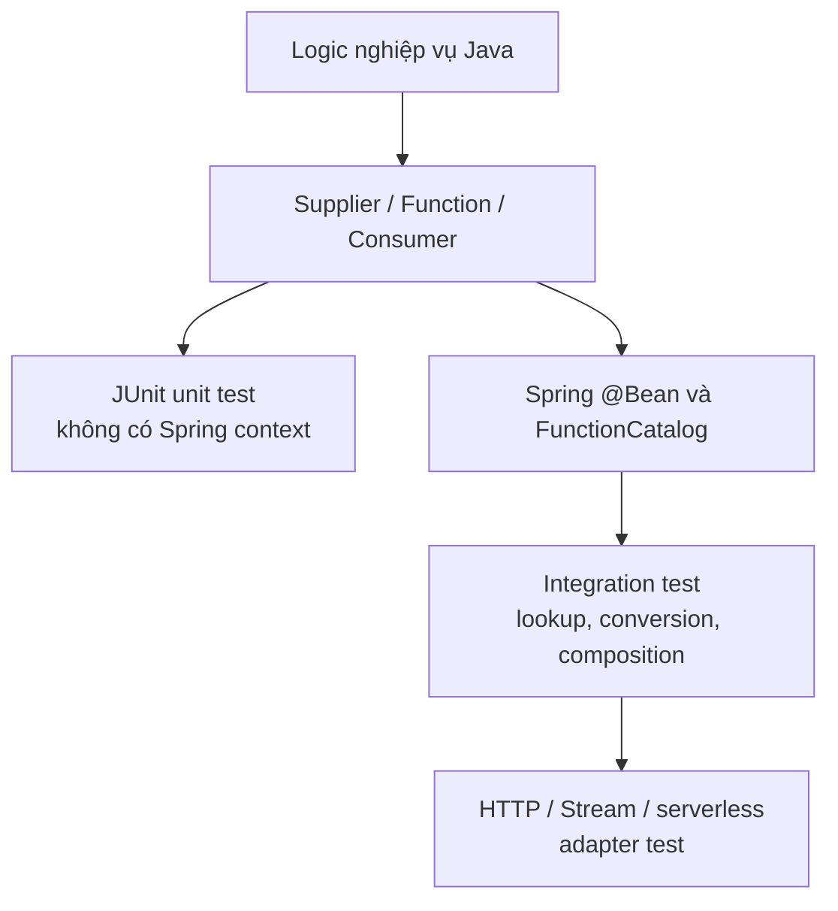

# Kiểm thử đơn vị hàm Java không khởi động Spring

**Chương:** Kiểm thử  
**Module:** Spring Cloud Function (`SPRING_CLOUD_FUNCTION`)

Spring Cloud Function cho phép biểu diễn logic nghiệp vụ bằng các giao diện Java chuẩn: `Supplier<T>`, `Function<T,R>` và `Consumer<T>`. Cùng logic ấy có thể được đăng ký vào `FunctionCatalog` rồi được gọi qua mã Java, HTTP, sự kiện hoặc môi trường serverless. Tuy nhiên, **một hàm Java không cần khởi động Spring để chạy hay để được kiểm thử**.

Khi cần chứng minh quy tắc chuẩn hóa mã đơn hàng, tính toán kết quả hoặc chuyển dữ liệu tới một cổng nghiệp vụ, JUnit có thể tạo hàm và gọi trực tiếp `get()`, `apply(...)`, `accept(...)`. Phương pháp này giúp kiểm thử nhanh, cô lập, không phụ thuộc database, broker, HTTP server hay `ApplicationContext`.

Bài học xây dựng một bộ kiểm thử JUnit 5 hoàn chỉnh **không dùng `@SpringBootTest`, không inject Spring bean và không tra cứu qua `FunctionCatalog`**. Sau đó, ta chỉ ra những hợp đồng vẫn cần kiểm thử tích hợp khi triển khai hàm qua adapter.

## 1. Phạm vi: unit test kiểm tra cái gì?

Sau bài học, bạn có thể:

1. Kiểm thử `Function` với đầu vào hợp lệ, không hợp lệ và trường hợp biên.
2. Kiểm thử `Supplier` bằng nguồn dữ liệu giả, xác minh thời điểm đọc nguồn.
3. Kiểm thử `Consumer` bằng fake/spy, xác minh tác dụng phụ và số lần gọi.
4. Kiểm thử composition Java bằng `andThen(...)` mà không tạo Spring context.
5. Kiểm soát các nguồn không xác định như đồng hồ, số ngẫu nhiên và I/O.
6. Phân biệt unit test nghiệp vụ với integration test cho catalog, message conversion và adapter.

| Điều cần xác minh | JUnit Java thuần | Kiểm thử tích hợp |
| --- | --- | --- |
| `"  ord-42  "` được chuẩn hóa thành `"ORD-42"` | **Có** | Không bắt buộc cho riêng logic |
| Chuỗi trống bị từ chối | **Có** | Không bắt buộc cho riêng logic |
| `Supplier` chỉ đọc dữ liệu khi gọi `get()` | **Có**, qua nguồn giả | Khi cần kiểm tra nguồn thật |
| `Consumer` gửi đúng mã tới cổng ghi nhận | **Có**, qua fake | Khi cần kiểm tra database/broker thật |
| `@Bean` có tạo bean đúng tên không | Không | **Có** |
| `FunctionCatalog.lookup(...)` tìm được definition không | Không | **Có** |
| JSON/`Message<byte[]>` được đổi thành DTO đúng không | Không, nếu test chỉ truyền DTO | **Có** |
| HTTP, Stream hay serverless gọi được hàm không | Không | **Có** |



**Nguyên tắc:** chỉ khởi động những thành phần mà câu hỏi kiểm thử thực sự yêu cầu. Một phép kiểm tra đầu ra chuỗi thường không cần khởi động toàn bộ ứng dụng Spring Boot.

## 2. Hợp đồng của ba giao diện hàm

| Loại | Chữ ký Java | Lời gọi trong test | Nội dung cần khẳng định |
| --- | --- | --- | --- |
| `Function<T,R>` | `R apply(T input)` | `function.apply(value)` | Giá trị trả về, ngoại lệ, quy tắc dữ liệu |
| `Supplier<T>` | `T get()` | `supplier.get()` | Giá trị, thời điểm đọc nguồn, số lần gọi |
| `Consumer<T>` | `void accept(T input)` | `consumer.accept(value)` | Dữ liệu gửi đi, side effect, số lần gọi |

Ví dụ tối giản:

```java
import java.util.function.Function;
import static org.junit.jupiter.api.Assertions.assertEquals;

Function<String, Integer> length = String::length;
assertEquals(6, length.apply("ORD-42").intValue());
```

Đây là phép kiểm tra thuần Java. Cách viết `Function<String,Integer>` xác định rõ đầu vào và đầu ra của mã nghiệp vụ. Unit test không cần biết Spring sẽ đặt tên bean gì hoặc bọc hàm như thế nào.

Với `Consumer`, một `assertDoesNotThrow(...)` đơn độc thường không đủ: nếu yêu cầu là ghi đúng một mã đơn hàng, test phải **xem cổng nhận đã nhận giá trị nào và bao nhiêu lần**.

## 3. Thiết kế lớp nghiệp vụ có thể kiểm thử riêng

Thay vì đặt logic chỉ bên trong một bean phụ thuộc framework, hãy tách logic thành factory Java thuần. Lớp dưới đây cung cấp:

- `normalizeOrderId()`: bỏ khoảng trắng đầu/cuối, viết hoa và từ chối mã trống.
- `orderIdLength()`: đếm số ký tự trong mã.
- `normalizedOrderIdSupplier(source)`: lấy giá trị từ nguồn được cung cấp rồi chuẩn hóa.
- `auditOrderId(sink)`: chuẩn hóa và gửi mã tới cổng ghi nhận.

**File:** `src/main/java/example/functions/OrderFunctions.java`

```java
package example.functions;

import java.util.Locale;
import java.util.Objects;
import java.util.function.Consumer;
import java.util.function.Function;
import java.util.function.Supplier;

public final class OrderFunctions {

    private OrderFunctions() {
        // Chỉ cung cấp các phương thức tạo hàm.
    }

    public interface AuditSink {
        void record(String normalizedOrderId);
    }

    public static Function<String, String> normalizeOrderId() {
        return raw -> {
            if (raw == null) {
                throw new IllegalArgumentException(
                    "Order ID must not be null");
            }

            String trimmed = raw.trim();
            if (trimmed.isBlank()) {
                throw new IllegalArgumentException(
                    "Order ID must not be blank");
            }

            return trimmed.toUpperCase(Locale.ROOT);
        };
    }

    public static Function<String, Integer> orderIdLength() {
        return String::length;
    }

    public static Supplier<String> normalizedOrderIdSupplier(
            Supplier<String> source) {
        Objects.requireNonNull(source, "source");

        Function<String, String> normalize = normalizeOrderId();
        return () -> normalize.apply(source.get());
    }

    public static Consumer<String> auditOrderId(AuditSink sink) {
        Objects.requireNonNull(sink, "sink");

        Function<String, String> normalize = normalizeOrderId();
        return raw -> sink.record(normalize.apply(raw));
    }
}
```

Mẫu dùng các API tương thích Java 17; `String.isBlank()` đã có từ Java 11. Trong ví dụ, quy tắc loại bỏ khoảng trắng dùng `trim()`; nếu nghiệp vụ yêu cầu loại Unicode whitespace, cần xác định lại hợp đồng và cân nhắc `strip()` cùng test tương ứng.

### 3.1. Tại sao cách thiết kế này tách được Spring?

Lớp `OrderFunctions` không import Spring, không tự truy cập HTTP client, database hoặc message broker. Những phần có thể gây tác dụng phụ được đưa ra thành dependency:

- `Supplier<String> source` có thể được thay bằng lambda trả dữ liệu cố định.
- `AuditSink` có thể được thay bằng một fake ghi nhận lời gọi trong bộ nhớ.
- `Function<String,String>` hoàn toàn xác định với một đầu vào và một quy tắc chuẩn hóa rõ ràng.

Khi tạo `Supplier`, ta **chưa gọi `source.get()`**. Nguồn chỉ được đọc khi có lời gọi `get()` tới supplier kết quả.

`Objects.requireNonNull(...)` thể hiện rõ hợp đồng dependency: không được cung cấp nguồn hoặc sink bằng `null`. Hợp đồng này cũng có thể được test.

### 3.2. Đưa chính logic đó vào Spring Cloud Function

Trong ứng dụng thật, có thể dùng một lớp cấu hình **riêng biệt**:

```java
package example.functions;

import java.util.function.Function;
import org.springframework.context.annotation.Bean;
import org.springframework.context.annotation.Configuration;

@Configuration
public class OrderFunctionConfiguration {

    @Bean("normalizeOrderId")
    public Function<String, String> normalizeOrderId() {
        return OrderFunctions.normalizeOrderId();
    }

    @Bean("orderIdLength")
    public Function<String, Integer> orderIdLength() {
        return OrderFunctions.orderIdLength();
    }
}
```

Trong unit test, **không cần import hoặc tạo** `OrderFunctionConfiguration`. Các phép kiểm tra sẽ gọi factory Java trực tiếp. Khi cần xác minh Spring có đăng ký hai bean đúng tên hoặc `FunctionCatalog` có tìm được chúng, hãy viết một integration test riêng.

## 4. Thư viện kiểm thử: JUnit Jupiter

Trong dự án Spring Boot, `spring-boot-starter-test` thường bao gồm JUnit Jupiter và các thư viện kiểm thử cần thiết.

**Maven** (sử dụng dependency management của Spring Boot):

```xml
<dependency>
    <groupId>org.springframework.boot</groupId>
    <artifactId>spring-boot-starter-test</artifactId>
    <scope>test</scope>
</dependency>
```

**Gradle Kotlin DSL** (dự án đã quản lý phiên bản Spring Boot):

```kotlin
dependencies {
    testImplementation("org.springframework.boot:spring-boot-starter-test")
}

tasks.test {
    useJUnitPlatform()
}
```

Dự án Java không dùng Spring Boot có thể dùng trực tiếp JUnit Jupiter với phiên bản phù hợp. Việc thư viện Spring có trên classpath **không tự tạo Spring context**; chỉ những test thực sự khởi tạo context mới phải chịu chi phí đó.

Trong bài này, test dùng `@Test`, `@ParameterizedTest`, `@MethodSource` và các assertion của JUnit. Không cần `@SpringBootTest`, `@ContextConfiguration`, `@Autowired` hay `SpringExtension`.

## 5. Bộ kiểm thử đầy đủ: OrderFunctionsTest.java

**File:** `src/test/java/example/functions/OrderFunctionsTest.java`

```java
package example.functions;

import static org.junit.jupiter.api.Assertions.*;

import java.util.ArrayList;
import java.util.List;
import java.util.concurrent.atomic.AtomicInteger;
import java.util.function.Consumer;
import java.util.function.Function;
import java.util.function.Supplier;
import java.util.stream.Stream;

import org.junit.jupiter.api.Test;
import org.junit.jupiter.params.ParameterizedTest;
import org.junit.jupiter.params.provider.Arguments;
import org.junit.jupiter.params.provider.MethodSource;

class OrderFunctionsTest {

    static Stream<Arguments> validOrderIds() {
        return Stream.of(
            Arguments.of("  ord-42  ", "ORD-42"),
            Arguments.of("ab-9", "AB-9"),
            Arguments.of("  x-1", "X-1"),
            Arguments.of("café", "CAFÉ")
        );
    }

    @ParameterizedTest
    @MethodSource("validOrderIds")
    void normalizerProducesExpectedValue(
            String raw, String expected) {
        Function<String, String> normalize =
            OrderFunctions.normalizeOrderId();

        assertEquals(expected, normalize.apply(raw));
    }

    @Test
    void normalizerRejectsNullAndBlankValues() {
        Function<String, String> normalize =
            OrderFunctions.normalizeOrderId();

        assertThrows(
            IllegalArgumentException.class,
            () -> normalize.apply(null));
        assertThrows(
            IllegalArgumentException.class,
            () -> normalize.apply(""));
        assertThrows(
            IllegalArgumentException.class,
            () -> normalize.apply(" \t "));
    }

    @Test
    void normalizerUsesLocaleIndependentRule() {
        Function<String, String> normalize =
            OrderFunctions.normalizeOrderId();
        assertEquals("I", normalize.apply(" i "));
    }

    @Test
    void functionsCanComposeWithoutSpring() {
        Function<String, Integer> pipeline =
            OrderFunctions.normalizeOrderId()
                .andThen(OrderFunctions.orderIdLength());

        assertEquals(6, pipeline.apply("  ord-42  ").intValue());
    }

    @Test
    void supplierReadsSourceOnlyOnGet() {
        AtomicInteger calls = new AtomicInteger();
        Supplier<String> fakeSource = () -> {
            int current = calls.incrementAndGet();
            return current == 1 ? "  ord-42  " : "  ab-9  ";
        };

        Supplier<String> subject =
            OrderFunctions.normalizedOrderIdSupplier(fakeSource);

        assertEquals(0, calls.get());
        assertEquals("ORD-42", subject.get());
        assertEquals(1, calls.get());
        assertEquals("AB-9", subject.get());
        assertEquals(2, calls.get());
    }

    @Test
    void supplierRejectsInvalidSourceData() {
        Supplier<String> subject =
            OrderFunctions.normalizedOrderIdSupplier(() -> "   ");

        assertThrows(
            IllegalArgumentException.class,
            subject::get);
    }

    @Test
    void consumerRecordsNormalizedValueOnce() {
        RecordingAuditSink sink = new RecordingAuditSink();
        Consumer<String> subject =
            OrderFunctions.auditOrderId(sink);

        subject.accept("  ord-42  ");

        assertEquals(List.of("ORD-42"), sink.values);
    }

    @Test
    void consumerDoesNotWriteInvalidValue() {
        RecordingAuditSink sink = new RecordingAuditSink();
        Consumer<String> subject =
            OrderFunctions.auditOrderId(sink);

        assertThrows(
            IllegalArgumentException.class,
            () -> subject.accept("  \t "));
        assertTrue(sink.values.isEmpty());
    }

    @Test
    void consumerPropagatesSinkFailure() {
        IllegalStateException failure =
            new IllegalStateException("Audit unavailable");
        OrderFunctions.AuditSink broken = value -> {
            throw failure;
        };

        Consumer<String> subject =
            OrderFunctions.auditOrderId(broken);

        IllegalStateException observed = assertThrows(
            IllegalStateException.class,
            () -> subject.accept(" ord-42 "));

        assertSame(failure, observed);
    }

    @Test
    void collaboratorsMustNotBeNull() {
        assertThrows(
            NullPointerException.class,
            () -> OrderFunctions.normalizedOrderIdSupplier(null));
        assertThrows(
            NullPointerException.class,
            () -> OrderFunctions.auditOrderId(null));
    }

    private static final class RecordingAuditSink
            implements OrderFunctions.AuditSink {

        private final List<String> values = new ArrayList<>();

        @Override
        public void record(String normalizedOrderId) {
            values.add(normalizedOrderId);
        }
    }
}
```

**Kết quả mong đợi:** các trường hợp test đều đạt khi chạy với mã `OrderFunctions` ở mục 3. Mỗi bộ dữ liệu từ `validOrderIds()` tạo một lượt chạy `@ParameterizedTest` riêng.

Mọi đối tượng trong test được tạo bằng Java; không có Spring context, Web server hoặc broker. Những phần có thể ảnh hưởng tới dữ liệu thật đều được thay bằng giá trị cố định hay fake lưu trong bộ nhớ.

## 6. Đọc kết quả kiểm thử Function

### 6.1. Giá trị bình thường và dữ liệu biên

Một phép thử với `"ord-42"` chưa thể phát hiện thiếu bước `trim()` hoặc cách xử lý input `null`. Bộ test trên kiểm tra nhiều trường hợp:

| Input | Kỳ vọng |
| --- | --- |
| `"ab-9"` | `"AB-9"` |
| `"  ord-42  "` | `"ORD-42"` |
| `"café"` | `"CAFÉ"` |
| `""` | `IllegalArgumentException` |
| `" \t "` | `IllegalArgumentException` |
| `null` | `IllegalArgumentException` |

Ngoại lệ là một phần hợp đồng. Nếu sản phẩm đổi quy tắc thành “chuỗi trống trả chuỗi trống”, việc cập nhật mã và test phải là thay đổi nghiệp vụ có chủ đích.

### 6.2. Locale và tính lặp lại

`String.toUpperCase()` không truyền locale có thể bị ảnh hưởng bởi locale mặc định của hệ điều hành. Dùng `Locale.ROOT` trong hàm chuẩn hóa mã giúp kết quả ổn định trong bối cảnh định danh kỹ thuật. Test `normalizerUsesLocaleIndependentRule` kiểm tra quy tắc với chữ `i`.

Nếu sản phẩm xử lý văn bản ngôn ngữ tự nhiên, quy tắc locale sẽ khác; không mặc định mọi dữ liệu chữ đều phải áp dụng `Locale.ROOT`.

### 6.3. Composition Java chưa phải composition của catalog

```java
Function<String, Integer> pipeline =
    OrderFunctions.normalizeOrderId()
        .andThen(OrderFunctions.orderIdLength());

assertEquals(6, pipeline.apply("  ord-42  ").intValue());
```

Đây là composition thuần Java với `andThen(...)`. Nó chứng minh kết quả nghiệp vụ và tương thích kiểu `String → String → Integer`, **không chứng minh** Spring Cloud Function có thể tra cứu chuỗi definition `"normalizeOrderId|orderIdLength"`. Việc tra cứu đó cần integration test với các bean được Spring đăng ký.

## 7. Kiểm thử Supplier: điều khiển nguồn và thời điểm đọc

`Supplier<T>` không nhận tham số trong `get()`, nhưng **không có nghĩa nó không có phụ thuộc bên ngoài**. Một nguồn mã đơn hàng có thể đọc từ API, một bảng cơ sở dữ liệu, bộ sinh số ngẫu nhiên hoặc một message broker.

Nếu test gọi trực tiếp nguồn thật, kết quả có thể phụ thuộc mạng, dữ liệu hiện tại hoặc trạng thái dịch vụ. Đây không còn là unit test cô lập.

### 7.1. Thay nguồn thật bằng lambda

```java
Supplier<String> fakeSource = () -> "  ord-42  ";
Supplier<String> subject =
    OrderFunctions.normalizedOrderIdSupplier(fakeSource);

assertEquals("ORD-42", subject.get());
```

Lời gọi `OrderFunctions.normalizedOrderIdSupplier(fakeSource)` mới tạo đối tượng hàm; bên trong factory không truy cập nguồn ngay. Test `supplierReadsSourceOnlyOnGet` dùng `AtomicInteger` để theo dõi:

| Trạng thái | Số lần gọi `source.get()` |
| --- | --- |
| Vừa tạo subject | 0 |
| Sau `subject.get()` lần đầu | 1 |
| Sau `subject.get()` lần hai | 2 |

`AtomicInteger` ở đây chỉ làm bộ đếm dễ quan sát. Bài test này **không phải** test độ an toàn khi nhiều luồng cùng gọi supplier.

### 7.2. Những tình huống lỗi cần test

Ngoài nguồn cố định, hãy thử các tình huống:

- Nguồn trả về `null`, `""` hoặc một chuỗi chỉ gồm khoảng trắng.
- Nguồn ném ngoại lệ, chẳng hạn `IllegalStateException` mô phỏng sự cố.
- Nguồn trả các mã khác nhau qua các lần gọi, nếu hợp đồng yêu cầu đọc lại.
- Source dependency bằng `null` ngay khi tạo factory; trong ví dụ phải bị từ chối bởi `Objects.requireNonNull`.

Ví dụ test lỗi nguồn:

```java
IllegalStateException failure =
    new IllegalStateException("Source unavailable");
Supplier<String> broken = () -> {
    throw failure;
};

Supplier<String> subject =
    OrderFunctions.normalizedOrderIdSupplier(broken);

assertSame(
    failure,
    assertThrows(IllegalStateException.class, subject::get));
```

Hàm mẫu chuyển tiếp ngoại lệ từ nguồn. Nếu nghiệp vụ cần retry, timeout hoặc trả mã dự phòng, hãy đưa quy tắc đó vào một thành phần được thiết kế riêng và kiểm thử chính sách của nó. **Không tự giả định mọi Supplier đều retry** chỉ vì có thể được gọi từ broker.

## 8. Kiểm thử Consumer: quan sát side effect

`Consumer<T>` trả `void`. Vì vậy, kết quả kiểm thử phải dựa trên **tác dụng phụ đã được kiểm soát** chứ không phải giá trị trả về.

Trong ví dụ, `AuditSink` định nghĩa cổng ghi nhận:

```java
public interface AuditSink {
    void record(String normalizedOrderId);
}
```

Fake trong `OrderFunctionsTest` ghi nội dung nhận được vào một `List<String>`. Đây là một dạng *test double* đơn giản:

```java
RecordingAuditSink sink = new RecordingAuditSink();
Consumer<String> subject = OrderFunctions.auditOrderId(sink);

subject.accept("  ord-42  ");

assertEquals(List.of("ORD-42"), sink.values);
```

Danh sách chỉ có **một phần tử** xác minh được cả nội dung lẫn số lần gọi. Một test chỉ chứa `assertDoesNotThrow(() -> subject.accept(...))` sẽ không phát hiện trường hợp code quên ghi hoặc ghi hai lần.

### 8.1. Tránh ghi dữ liệu thật trong unit test

Nếu production dùng:

```java
@Bean
public Consumer<String> auditOrderId(AuditRepository repository) {
    return id -> repository.save(id);
}
```

thì việc gọi bean đó với một repository thật có thể tạo bản ghi không mong muốn. Với mục tiêu unit test, hãy truyền cổng ghi nhận giả hoặc mock repository thay vì kết nối database. Việc kiểm tra repository thật, transaction và schema thuộc integration test.

### 8.2. Fake và Mockito

Trong nhiều trường hợp, fake thủ công đủ rõ ràng. Nếu dự án đã có Mockito, cũng có thể xác minh tương tác bằng mock:

```java
OrderFunctions.AuditSink sink =
    org.mockito.Mockito.mock(OrderFunctions.AuditSink.class);

Consumer<String> subject = OrderFunctions.auditOrderId(sink);
subject.accept("  ord-42  ");

org.mockito.Mockito.verify(sink, org.mockito.Mockito.times(1))
    .record("ORD-42");
```

Mockito không bắt buộc khởi động Spring. API `Mockito.mock(...)` tạo test double trực tiếp; những annotation thay thế bean trong Spring context như `@MockBean` hoặc `@MockitoBean` là công cụ cho một phạm vi khác.

**Không mock chính hàm cần kiểm tra.** Nếu test cấu hình một `Function` mock để trả `"ORD-42"` rồi chỉ kiểm tra mock trả đúng giá trị đã lập trình trước, bạn chưa hề chạy logic chuẩn hóa thực sự.

### 8.3. Ngoại lệ và chính sách side effect

`auditOrderId` gọi `normalizeOrderId` **trước khi** gọi `sink.record(...)`. Vì vậy, khi đầu vào không hợp lệ, test phải thấy ngoại lệ và **không có bản ghi nào**:

```java
RecordingAuditSink sink = new RecordingAuditSink();
Consumer<String> subject = OrderFunctions.auditOrderId(sink);

assertThrows(
    IllegalArgumentException.class,
    () -> subject.accept("  \t "));
assertTrue(sink.values.isEmpty());
```

Trong ví dụ này, chính sách lỗi từ `AuditSink.record(...)` là **chuyển tiếp ngoại lệ**. Test `consumerPropagatesSinkFailure` dùng `assertSame(...)` để chứng minh ngoại lệ từ cổng không bị biến mất hoặc biến thành kết quả thành công giả.

Nếu sau này có retry hay phát thông điệp vào dead-letter queue, hãy quy định rõ ranh giới xử lý và tạo test tương ứng. Không thêm các hành vi đó chỉ để “làm test xanh”.

## 9. DTO Java vẫn kiểm thử được mà không cần JSON converter

Một `Function<OrderRequest,OrderDecision>` cũng là hàm Java có thể gọi trực tiếp. Với Java 17, ví dụ file `OrderPolicy.java`:

```java
package example.functions;

import java.util.function.Function;

public final class OrderPolicy {

    private OrderPolicy() {}

    public record Request(String orderId, int quantity) {}
    public record Decision(String orderId, boolean accepted) {}

    public static Function<Request, Decision> decide() {
        return request -> {
            String id = OrderFunctions.normalizeOrderId()
                .apply(request.orderId());
            return new Decision(id, request.quantity() > 0);
        };
    }
}
```

Unit test:

```java
import static org.junit.jupiter.api.Assertions.assertEquals;
import org.junit.jupiter.api.Test;

class OrderPolicyTest {
    @Test
    void positiveQuantityIsAccepted() {
        OrderPolicy.Decision result =
            OrderPolicy.decide().apply(
                new OrderPolicy.Request(" ord-42 ", 3));

        assertEquals(
            new OrderPolicy.Decision("ORD-42", true),
            result);
    }
}
```

Test chỉ truyền DTO Java đã được tạo với đúng kiểu. Nó xác minh quy tắc nghiệp vụ và cách kết hợp các hàm, **chưa xác minh** quá trình nhận HTTP JSON hay `Message<byte[]>` và chuyển thành `OrderPolicy.Request`.

Khi test conversion, bạn cần bối cảnh khác: metadata kiểu, content type, converter, wrapper của Spring Cloud Function và adapter thực tế. Không suy rằng một hàm xử lý DTO tốt trong unit test thì cấu hình JSON đã đúng.

## 10. Loại bỏ những nguồn làm test không xác định

### 10.1. Thời gian

Hạn chế gọi `Instant.now()` trực tiếp trong hàm mà đầu ra phụ thuộc thời gian. Thay bằng cách truyền `Clock`:

```java
import java.time.Clock;
import java.time.Instant;
import java.util.function.Supplier;

// Phương thức đặt trong một lớp Java phù hợp:
public static Supplier<Instant> timestampSupplier(Clock clock) {
    return clock::instant;
}
```

Và trong test:

```java
Clock clock = Clock.fixed(
    Instant.parse("2026-01-01T00:00:00Z"),
    java.time.ZoneOffset.UTC);

assertEquals(
    Instant.parse("2026-01-01T00:00:00Z"),
    timestampSupplier(clock).get());
```

Giá trị thời gian được cố định, nên test không lệ thuộc lúc chạy. Hai đoạn là ví dụ minh họa; nếu sử dụng trong dự án, cần đặt phương thức cùng các import thích hợp trong lớp source tương ứng.

### 10.2. Số ngẫu nhiên và UUID

Nếu supplier gọi `UUID.randomUUID()`, đừng kỳ vọng giá trị UUID cố định. Có thể kiểm tra định dạng/độ duy nhất theo yêu cầu, hoặc truyền bộ sinh UUID dưới dạng dependency để unit test cung cấp dữ liệu có thể dự đoán.

Một test chỉ xanh khi chạy trên máy phát triển vì dữ liệu ngẫu nhiên “tình cờ đúng” là dấu hiệu của test không đáng tin cậy.

### 10.3. Global state

Không dùng một `List` static chung để ghi sự kiện từ nhiều test; dữ liệu có thể rò rỉ giữa các test, gây phụ thuộc thứ tự hoặc lỗi khi test chạy song song.

Trong bộ test mẫu, mỗi `@Test` tạo `RecordingAuditSink` mới. Đó là cách cô lập trạng thái đơn giản nhưng hiệu quả.

### 10.4. I/O và chờ đợi

Tránh `Thread.sleep(...)` để “ổn định” test của hàm đồng bộ. Nếu code thật có tác vụ bất đồng bộ, cần một mô hình đồng bộ hóa rõ ràng hoặc test scheduler phù hợp, không dựa vào một khoảng chờ tùy ý.

Unit test thuần không nên gọi API hay ghi database chỉ để chứng minh việc chuẩn hóa và tạo đối tượng. Những kiểm tra tích hợp thực tế có giá trị, nhưng hãy chạy trong bộ test riêng.

## 11. Ranh giới với FunctionCatalog và message conversion

Khi ứng dụng đăng ký `OrderFunctions.normalizeOrderId()` dưới tên bean `normalizeOrderId`, các phép thử sau thuộc hai tầng khác nhau:

**Unit test:**

```java
Function<String, String> normalize =
    OrderFunctions.normalizeOrderId();
assertEquals("ORD-42", normalize.apply(" ord-42 "));
```

**Integration test (minh họa):**

```java
// Giả sử Spring test đã tạo context và tiêm FunctionCatalog catalog.
Function<String, String> normalize =
    catalog.lookup(Function.class, "normalizeOrderId");
assertNotNull(normalize);
assertEquals("ORD-42", normalize.apply(" ord-42 "));
```

| Cần chứng minh | Tầng nên dùng |
| --- | --- |
| Logic chuẩn hóa, kiểm tra đầu vào, tính toán | Unit test Java |
| Tên `@Bean`, phát hiện bean trong `FunctionCatalog` | Spring integration test |
| Composition bằng function definition `"a|b"` | Spring integration test |
| Conversion từ JSON/`Message<byte[]>` thành DTO | Integration test có converter/wrapper |
| `spring.cloud.function.definition` và Stream binding | Spring Cloud Stream integration test |
| HTTP mapping, method và status code | Web adapter test |
| Serverless handler và cấu hình triển khai | Serverless/deployment test |

Một số integration test có thể dùng context nhỏ bằng `ApplicationContextRunner` thay vì `@SpringBootTest` toàn ứng dụng. Tuy nhiên, **đã tạo Spring context thì không còn là unit test thuần theo phạm vi bài này**.

### 11.1. Dùng Spring Message như một đối tượng Java vẫn được

Nếu chính hợp đồng nghiệp vụ là `Function<Message<String>,String>`, bạn vẫn có thể test trực tiếp mà không khởi động Spring, miễn là dependency `spring-messaging` đã có:

```java
import java.util.function.Function;
import org.springframework.messaging.Message;
import org.springframework.messaging.support.MessageBuilder;

Function<Message<String>, String> withSource = message ->
    message.getHeaders().getOrDefault("source", "unknown")
        + ":" + message.getPayload();

Message<String> input = MessageBuilder.withPayload("ORD-42")
    .setHeader("source", "unit-test")
    .build();

assertEquals("unit-test:ORD-42", withSource.apply(input));
```

Đây vẫn là test logic trên một object `Message` đã được tạo đúng kiểu. Nó **không** test converter biến JSON/bytes thành payload `String` hoặc DTO.

### 11.2. Không suy đoán endpoint chỉ từ kết quả unit test

Việc `OrderFunctions.normalizeOrderId()` chạy đúng **không bảo đảm**:

- Spring đã đăng ký bean tên `normalizeOrderId`.
- Bean đó không bị loại bằng `spring.cloud.function.ineligible-definitions`.
- `FunctionCatalog.lookup("normalizeOrderId")` phân giải thành công.
- Function definition dành cho adapter đúng tên và chữ ký.
- HTTP route, Stream binding hoặc serverless entry point đã tồn tại.

Đó là các hợp đồng khác và cần test ở đúng tầng. Cách phân tách này giúp khi integration test thất bại, nhóm phát triển xác định vấn đề là registration, conversion, adapter hay logic nghiệp vụ.

## 12. Chạy riêng bộ kiểm thử đơn vị

Cấu trúc file thường dùng:

```text
src/
  main/java/example/functions/
    OrderFunctions.java
  test/java/example/functions/
    OrderFunctionsTest.java
```

Trong dự án Maven có Maven Wrapper:

```bash
./mvnw -Dtest=OrderFunctionsTest test
```

Trong dự án Gradle có Gradle Wrapper:

```bash
./gradlew test --tests "example.functions.OrderFunctionsTest"
```

Trên Windows, dùng `mvnw.cmd` hoặc `gradlew.bat`. Những lệnh trên là **hướng dẫn thực hành**, không phải kết quả một lần chạy thực tế. Bài viết không yêu cầu chạy build hay kiểm thử để viết Markdown.

Nếu dự án cấu hình JUnit trực tiếp thay vì Spring Boot Test starter, hãy chắc chắn test runner hỗ trợ JUnit Platform. Với Gradle, `useJUnitPlatform()` giúp phát hiện kiểm thử Jupiter.

### 12.1. Đọc một test thất bại

Nếu kết quả là:

```text
Expected: ORD-42
Actual:   ord-42
```

hãy điều tra logic viết hoa hoặc hàm đang được gọi. Không cần sửa cấu hình `FunctionCatalog` hoặc HTTP.

Nếu fake audit cho:

```text
Expected: [ORD-42]
Actual:   [ORD-42, ORD-42]
```

đó là dấu hiệu `Consumer` đã ghi hai lần thay vì một lần. Tìm trong đường gọi `sink.record(...)` và logic điều khiển; test này không sử dụng broker nên không thể quy lỗi cho việc broker redelivery.

Nếu gặp `NoClassDefFoundError` liên quan JUnit, cần kiểm tra classpath/dependency và test runner trước; đó là lỗi môi trường kiểm thử, chưa phải bằng chứng hàm nghiệp vụ sai.

## 13. Các lỗi thiết kế test thường gặp

| Ngộ nhận | Vấn đề | Cách làm phù hợp |
| --- | --- | --- |
| “Dùng Spring Cloud Function nên mọi test cần `@SpringBootTest`.” | Logic dựa trên giao diện Java chuẩn | Tạo và gọi hàm trực tiếp với JUnit |
| “Có dependency Spring Boot Test thì context tự khởi động.” | Dependency chỉ cung cấp thư viện | Không dùng annotation/cơ chế tạo context trong unit test |
| “Supplier không nhận tham số nên không có dependency.” | Nó có thể đọc đồng hồ, mạng, database | Truyền nguồn dưới dạng dependency và fake nó |
| “Consumer trả `void` nên chỉ cần `assertDoesNotThrow`.” | Không chứng minh side effect đúng | Fake/spy quan sát nội dung và số lần gọi |
| “Mock chính Function rồi assert kết quả.” | Không chạy implementation thật | Gọi Function thật, chỉ mock dependency ngoài |
| “Test `andThen(...)` đã kiểm tra `a|b` trong FunctionCatalog.” | Hai cơ chế composition khác tầng | Test catalog bằng Spring context riêng |
| “DTO unit test xanh nghĩa là HTTP JSON chạy đúng.” | Chưa kiểm tra serialization/conversion | Tạo integration test với payload thực |
| “Dùng `Thread.sleep(...)` sẽ hết flaky.” | Chưa kiểm soát nguồn thời gian hoặc async | Inject `Clock`/scheduler hoặc dùng đồng bộ hóa đúng |
| “Test có thể dùng fake static chia sẻ.” | Dễ rò rỉ trạng thái và phụ thuộc thứ tự | Tạo fake mới trong mỗi test |
| “Không cần assertion vì test đã gọi phương thức.” | Không xác minh kết quả nghiệp vụ | Dùng assertion cụ thể, có thể dự đoán |

## 14. Checklist cho unit test trong CI

- [ ] Test gọi mã Java thực, không khởi động Spring khi chỉ cần logic thuần.
- [ ] Có dữ liệu bình thường, dữ liệu biên và trường hợp lỗi theo hợp đồng.
- [ ] `Supplier` dùng nguồn giả, không lệ thuộc API hoặc đồng hồ thật.
- [ ] `Consumer` có fake/spy kiểm tra dữ liệu, số lần gọi và ngoại lệ.
- [ ] Không có I/O thật không cần thiết hoặc trạng thái static chia sẻ giữa các test.
- [ ] Assertion diễn đạt rõ yêu cầu, không chỉ kiểm tra “không lỗi”.
- [ ] Kiểu generic `Supplier`/`Function`/`Consumer` phù hợp với logic thực.
- [ ] Test composition Java không bị nhầm với test catalog definition.
- [ ] JSON/Message conversion, binding và adapter được kiểm tra ở tầng tích hợp riêng.
- [ ] Các test chạy được độc lập, không phụ thuộc thứ tự hoặc thời điểm chạy.

## 15. Bài tập thực hành

1. **Function:** thêm bộ dữ liệu `"  abc-009  "` và chuỗi chứa tab; kiểm tra cả giá trị bình thường và ngoại lệ cho đầu vào không hợp lệ.
2. **Unicode:** thử khoảng trắng Unicode ở hai đầu mã. So sánh `trim()` và `strip()` rồi xác định quy tắc nghiệp vụ trước khi đổi mã nguồn.
3. **Supplier:** tạo nguồn giả trả giá trị hợp lệ ở lần một, `null` ở lần hai; xác minh thời điểm đọc và chính sách lỗi.
4. **Consumer:** dùng fake đếm số lần gọi và lưu danh sách mã. Test lần lượt input hợp lệ, input trống và lỗi từ sink.
5. **Composition:** kiểm tra `normalizeOrderId().andThen(orderIdLength())` với ba input; giải thích vì sao output có kiểu `Integer`.
6. **Tích hợp:** đăng ký `normalizeOrderId` bằng `@Bean` rồi tạo một integration test riêng kiểm tra lookup trong `FunctionCatalog`, giữ nguyên unit test cũ.
7. **DTO:** bổ sung test cho `OrderPolicy.decide()` với quantity âm, bằng 0 và dương; sau đó thiết kế integration test JSON cho cùng hàm.
8. **Chống flaky:** viết một `Supplier<Instant>` nhận `Clock` và test bằng `Clock.fixed(...)` thay vì đọc thời gian thực.

### Câu hỏi phỏng vấn

**Hỏi:** Vì sao logic Spring Cloud Function có thể unit test mà không cần Spring?

**Đáp:** Vì `Supplier`, `Function` và `Consumer` là những giao diện Java tiêu chuẩn. Một đối tượng triển khai chúng có thể được tạo và gọi trực tiếp. Spring Cloud Function chỉ bổ sung khâu nhận diện bean, tra cứu qua catalog, conversion và adapter; những phần đó có thể được kiểm thử ở tầng tích hợp riêng.

**Hỏi:** Muốn unit test một `Consumer` sẽ phát sự kiện vào broker, nên làm gì?

**Đáp:** Đẩy thao tác phát sự kiện ra sau một cổng/interface, dùng fake hoặc mock để xác minh nội dung và số lần gửi. Kiểm tra broker thật nhận sự kiện là integration test khác.

## 16. Tổng kết

- **Unit test hàm Java không cần Spring context** khi logic và các dependency của nó có thể được khởi tạo trực tiếp.
- `Function.apply(...)` kiểm tra kết quả và ngoại lệ; `Supplier.get()` cần kiểm tra nguồn và thời điểm đọc; `Consumer.accept(...)` cần quan sát side effect.
- Truyền dependency qua constructor/factory giúp cô lập logic khỏi I/O và dữ liệu không xác định.
- JUnit 5 với `@Test`, `@ParameterizedTest`, `assertEquals` và `assertThrows` đủ cho phần lớn quy tắc nghiệp vụ của các hàm đơn giản.
- Composition bằng `andThen(...)` là Java composition; `FunctionCatalog`, definition `"a|b"`, message conversion và HTTP/Stream/serverless adapter cần integration test riêng.
- Phân tầng test giúp bộ unit test nhanh, dễ tìm lỗi, đồng thời vẫn có đủ kiểm chứng cho cùng logic khi tái sử dụng qua nhiều giao thức.

### Tài liệu tham khảo

- [Java 17 — java.util.function](https://docs.oracle.com/en/java/javase/17/docs/api/java.base/java/util/function/package-summary.html): các giao diện `Supplier`, `Function`, `Consumer` và phương thức hàm.
- [JUnit 5 User Guide](https://junit.org/junit5/docs/current/user-guide/): `@Test`, `@ParameterizedTest`, `@MethodSource` và assertion.
- [Spring Cloud Function — Programming Model](https://docs.spring.io/spring-cloud-function/reference/spring-cloud-function/programming-model.html): functional bean, catalog, conversion và composition.
- [Spring Cloud Function — Functional Bean Definitions](https://docs.spring.io/spring-cloud-function/reference/functional.html): đăng ký và quan sát các functional bean trong catalog.
