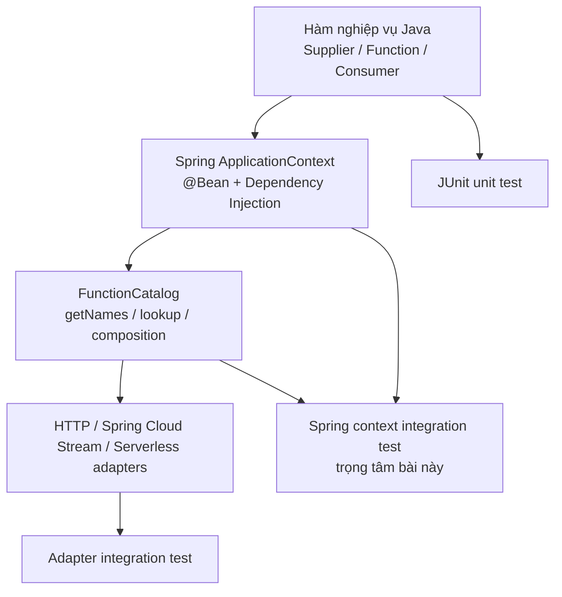
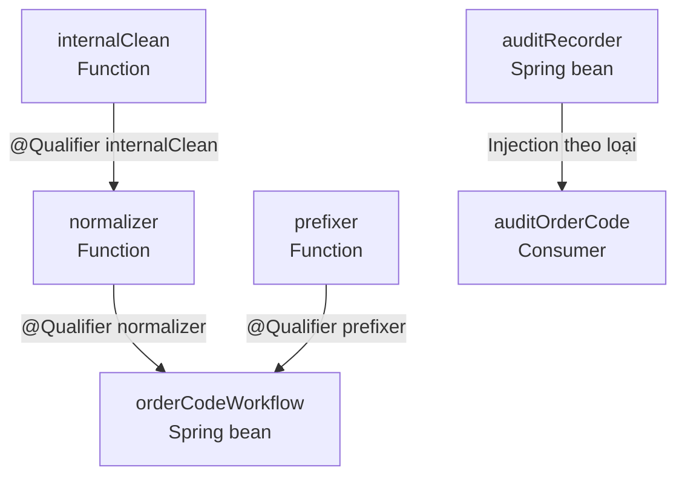
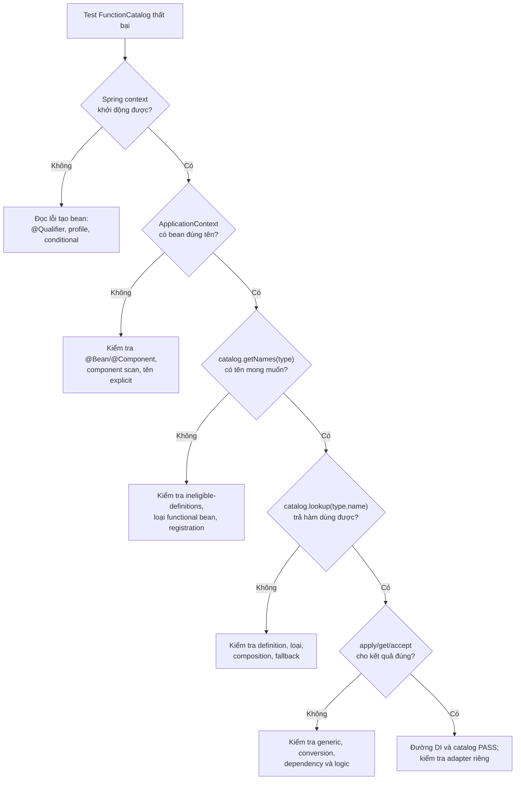

# Kiểm thử dependency injection và đăng ký FunctionCatalog

**Chương:** Kiểm thử  
**Module:** Spring Cloud Function (`SPRING_CLOUD_FUNCTION`)

Trong Spring Cloud Function, lập trình viên thường tạo logic nghiệp vụ bằng ba giao diện Java chuẩn: `Supplier<T>`, `Function<T,R>` và `Consumer<T>`. Logic đó có thể được Spring quản lý như bean, được tìm theo tên qua `FunctionCatalog` và tái sử dụng từ mã Java, HTTP, sự kiện trong Spring Cloud Stream hoặc môi trường serverless.

Unit test thuần Java chứng minh một hàm trả kết quả đúng với đầu vào xác định. Nhưng nó **không chứng minh** Spring đã tạo bean đúng cách, dependency injection đã liên kết đúng đối tượng, hoặc `FunctionCatalog` có tìm được tên và loại hàm mà adapter dự kiến sử dụng.

Bài học tập trung vào **kiểm thử tích hợp ở tầng Spring context và FunctionCatalog**: tạo một application context nhỏ, inject các functional bean, xác minh tên được đăng ký, tra cứu hàm và kiểm tra đường đi từ dependency injection đến logic nghiệp vụ. Chúng ta chưa cần khởi động HTTP server hay message broker.

## 1. Mục tiêu và phạm vi

Sau bài học, bạn có thể:

1. Kiểm tra Spring tạo đủ `Supplier`, `Function`, `Consumer` và các dependency liên quan.
2. Xác minh constructor injection và `@Qualifier` chọn đúng bean khi có nhiều `Function` cùng kiểu raw.
3. Đối chiếu `ApplicationContext` với danh sách tên của `FunctionCatalog`.
4. Tra cứu một hàm theo tên và loại, rồi kiểm tra kết quả từ wrapper catalog.
5. Xác minh composition qua definition, nhưng không nhầm nó với composition Java thông thường.
6. Viết negative test cho tên sai, bean bị loại, cấu hình profile và lỗi wiring.
7. Biết phần nào cần test HTTP, message converter hoặc serverless adapter ở cấp tích hợp cao hơn.

| Điều cần chứng minh | Unit test Java thuần | Spring context + FunctionCatalog test |
| --- | --- | --- |
| `normalizeOrderCode.apply(" ord-42 ")` trả `ORD-42` | Có | Có, nhưng chạy context không cần thiết nếu chỉ kiểm tra logic |
| `@Bean("normalizer")` tạo Spring bean đúng tên | Không | **Có** |
| `@Qualifier("normalizer")` inject đúng hàm vào service | Không | **Có** |
| Catalog nhận diện `normalizer` là `Function` | Không | **Có** |
| `catalog.lookup("normalizer")` trả về hàm sử dụng được | Không | **Có** |
| `"normalizer|prefixer"` được catalog ghép hợp lệ | Không | **Có** |
| HTTP POST gửi JSON được convert đúng sang DTO | Không | Chưa đầy đủ; cần test converter/Web adapter |
| Stream binding đưa sự kiện đến broker | Không | Chưa đầy đủ; cần test Stream/binder |

**Mục tiêu cốt lõi:** kiểm chứng **hợp đồng đăng ký và wiring**, thay vì chỉ kiểm tra kết quả của một lambda tự tạo bằng Java.

## 2. Kiến trúc kiểm thử: phân biệt ba tầng



**`ApplicationContext`** quản lý bean, phụ thuộc, scope và vòng đời Spring. Một bean `Function<String,String>` có thể được inject trực tiếp bằng tên hoặc qualifier.

**`FunctionCatalog`** nhận diện những functional bean đủ điều kiện và cung cấp cách tra cứu bằng tên, loại hoặc function definition. Hàm tra cứu qua catalog có thể là wrapper do Spring Cloud Function quản lý, với những khả năng bổ sung như conversion và composition.

**Adapter** là tầng tiếp theo: Spring Cloud Function Web ánh xạ HTTP, Spring Cloud Stream tạo các binding sự kiện, còn serverless adapter chuyển invocation của nền tảng thành lời gọi hàm. Test catalog chạy xanh **chưa chứng minh** các adapter được cấu hình chính xác.

## 3. Chuẩn bị môi trường JUnit và Spring Cloud Function

Ví dụ giả định dự án Spring Boot với phiên bản Spring Cloud Function **tương thích**. Dùng BOM hoặc cơ chế quản lý dependency của dự án để phân giải phiên bản; không ghép tùy ý những major version Spring Boot/Spring Cloud Function không hỗ trợ nhau.

### 3.1. Maven

Các dependency điển hình:

```xml
<dependencies>
    <dependency>
        <groupId>org.springframework.boot</groupId>
        <artifactId>spring-boot-starter</artifactId>
    </dependency>
    <dependency>
        <groupId>org.springframework.cloud</groupId>
        <artifactId>spring-cloud-function-context</artifactId>
    </dependency>
    <dependency>
        <groupId>org.springframework.boot</groupId>
        <artifactId>spring-boot-starter-test</artifactId>
        <scope>test</scope>
    </dependency>
</dependencies>
```

Đoạn này chỉ là phần `dependencies`, không phải POM hoàn chỉnh: dự án cần parent/BOM và cấu hình build tương ứng. Spring Cloud Function context đủ cho các ví dụ catalog; không cần cài Web adapter hoặc broker.

### 3.2. Gradle Kotlin DSL

Trong dự án đã cấu hình phiên bản dependency:

```kotlin
dependencies {
    implementation("org.springframework.boot:spring-boot-starter")
    implementation("org.springframework.cloud:spring-cloud-function-context")
    testImplementation("org.springframework.boot:spring-boot-starter-test")
}

tasks.test {
    useJUnitPlatform()
}
```

Công cụ kiểm thử sử dụng **JUnit Jupiter (JUnit 5)** và Spring Boot Test. `@SpringBootTest` sẽ tạo `ApplicationContext` thật cho fixture đã chỉ định; vì thế đây là integration test cấp Spring, không còn là unit test Java thuần.

### 3.3. Vì sao webEnvironment = NONE?

Ở bài này, mục tiêu là DI và catalog. Chúng ta sẽ dùng:

```java
@SpringBootTest(
    classes = FunctionRegistrationApplication.class,
    webEnvironment = SpringBootTest.WebEnvironment.NONE
)
```

Tham số `webEnvironment = NONE` yêu cầu test không khởi động embedded web server. Nó **vẫn tạo Spring context**, khởi chạy auto-configuration cần thiết và cho phép inject `FunctionCatalog`.

## 4. Ứng dụng mẫu: nhiều hàm, dependency rõ ràng

Chúng ta chủ động đăng ký **nhiều functional bean**. Nhờ đó, test tên sai không bị cơ chế *single-function fallback* trong ứng dụng chỉ có một hàm che giấu.

**File:** `src/main/java/example/testing/FunctionRegistrationApplication.java`

```java
package example.testing;

import java.util.List;
import java.util.Locale;
import java.util.concurrent.CopyOnWriteArrayList;
import java.util.function.Consumer;
import java.util.function.Function;
import java.util.function.Supplier;

import org.springframework.beans.factory.annotation.Qualifier;
import org.springframework.boot.SpringApplication;
import org.springframework.boot.autoconfigure.SpringBootApplication;
import org.springframework.context.annotation.Bean;

@SpringBootApplication(proxyBeanMethods = false)
public class FunctionRegistrationApplication {

    public static void main(String[] args) {
        SpringApplication.run(
            FunctionRegistrationApplication.class, args);
    }

    // Hàm hỗ trợ cũng là một functional bean trong Spring.
    @Bean("internalClean")
    public Function<String, String> internalClean() {
        return String::trim;
    }

    // Tên bean là "normalizer"; tên phương thức Java khác tên bean.
    @Bean("normalizer")
    public Function<String, String> normalizeOrderCode(
            @Qualifier("internalClean")
            Function<String, String> clean) {
        return raw -> {
            if (raw == null || raw.isBlank()) {
                throw new IllegalArgumentException("Invalid order ID");
            }
            return clean.apply(raw).toUpperCase(Locale.ROOT);
        };
    }

    @Bean("prefixer")
    public Function<String, String> addPrefix() {
        return value -> "ID-" + value;
    }

    @Bean("orderCodeSupplier")
    public Supplier<String> orderCodeSupplier() {
        return () -> "  ord-42  ";
    }

    @Bean("auditOrderCode")
    public Consumer<String> auditOrderCode(AuditRecorder recorder) {
        return recorder::record;
    }

    @Bean
    public AuditRecorder auditRecorder() {
        return new AuditRecorder();
    }

    @Bean
    public OrderCodeWorkflow orderCodeWorkflow(
            @Qualifier("normalizer")
            Function<String, String> normalize,
            @Qualifier("prefixer")
            Function<String, String> prefix) {
        return new OrderCodeWorkflow(normalize, prefix);
    }

    public static final class OrderCodeWorkflow {
        private final Function<String, String> normalize;
        private final Function<String, String> prefix;

        public OrderCodeWorkflow(
                Function<String, String> normalize,
                Function<String, String> prefix) {
            this.normalize = normalize;
            this.prefix = prefix;
        }

        public String format(String value) {
            return prefix.apply(normalize.apply(value));
        }
    }

    public static final class AuditRecorder {
        private final List<String> events =
            new CopyOnWriteArrayList<>();

        public void record(String event) {
            events.add(event);
        }

        public List<String> snapshot() {
            return List.copyOf(events);
        }

        public void clear() {
            events.clear();
        }
    }
}
```

### 4.1. Đọc đúng ý nghĩa từng bean

| Spring bean | Loại | Hợp đồng | Vai trò |
| --- | --- | --- | --- |
| `internalClean` | `Function<String,String>` | `" ord-42 " → "ord-42"` | Helper, được inject vào `normalizer` |
| `normalizer` | `Function<String,String>` | `" ord-42 " → "ORD-42"` | Chuẩn hóa nghiệp vụ |
| `prefixer` | `Function<String,String>` | `"ORD-42" → "ID-ORD-42"` | Bổ sung tiền tố |
| `orderCodeSupplier` | `Supplier<String>` | `get() → "  ord-42  "` | Cung cấp mã thử nghiệm |
| `auditOrderCode` | `Consumer<String>` | `accept(code)` | Ghi vào cổng giả |
| `auditRecorder` | Lớp Java thường | Ghi/đọc danh sách sự kiện | Collaborator, **không phải** functional bean |
| `orderCodeWorkflow` | Lớp Java thường | `format(input)` | Chứng minh constructor injection |

`AuditRecorder` là đối tượng giữ trạng thái để kiểm tra `Consumer` mà không cần database/broker. Nó không phải mock thay thế Spring bean; nó được Spring tạo thật, và test có thể đọc trạng thái qua `snapshot()`.

**Lưu ý:** `internalClean` là một `Function`, vì vậy nó có thể được catalog nhận diện như một ứng viên. Nếu chỉ muốn dùng nó làm helper nội bộ, có thể dùng `spring.cloud.function.ineligible-definitions=internalClean` trong cấu hình tương ứng; bài này sẽ kiểm tra riêng trường hợp đó.

### 4.2. Những đường phụ thuộc phải được tạo đúng



`OrderCodeWorkflow` phụ thuộc **hai bean có cùng kiểu `Function<String,String>`**. Việc ghi rõ `@Qualifier` ở hai tham số ngăn Spring chọn nhầm hoặc gặp ambiguity. Nếu đổi tên bean mà quên sửa qualifier, startup của test context có thể thất bại trước khi bất kỳ `@Test` nào chạy.

## 5. Bộ kiểm thử đăng ký và dependency injection

**File:** `src/test/java/example/testing/FunctionRegistrationTest.java`

```java
package example.testing;

import static org.junit.jupiter.api.Assertions.*;

import java.util.Set;
import java.util.function.Consumer;
import java.util.function.Function;
import java.util.function.Supplier;

import org.junit.jupiter.api.BeforeEach;
import org.junit.jupiter.api.Test;
import org.springframework.beans.factory.annotation.Autowired;
import org.springframework.beans.factory.annotation.Qualifier;
import org.springframework.boot.test.context.SpringBootTest;
import org.springframework.cloud.function.context.FunctionCatalog;
import org.springframework.context.ApplicationContext;

@SpringBootTest(
    classes = FunctionRegistrationApplication.class,
    webEnvironment = SpringBootTest.WebEnvironment.NONE
)
class FunctionRegistrationTest {

    @Autowired
    private ApplicationContext context;

    @Autowired
    private FunctionCatalog catalog;

    @Autowired
    @Qualifier("normalizer")
    private Function<String, String> directNormalizer;

    @Autowired
    @Qualifier("prefixer")
    private Function<String, String> directPrefixer;

    @Autowired
    @Qualifier("orderCodeSupplier")
    private Supplier<String> supplier;

    @Autowired
    @Qualifier("auditOrderCode")
    private Consumer<String> auditConsumer;

    @Autowired
    private FunctionRegistrationApplication.OrderCodeWorkflow workflow;

    @Autowired
    private FunctionRegistrationApplication.AuditRecorder recorder;

    @BeforeEach
    void resetRecorder() {
        recorder.clear();
    }

    @Test
    void springContextContainsExpectedBeans() {
        assertTrue(context.containsBean("internalClean"));
        assertTrue(context.containsBean("normalizer"));
        assertTrue(context.containsBean("prefixer"));
        assertTrue(context.containsBean("orderCodeSupplier"));
        assertTrue(context.containsBean("auditOrderCode"));
        assertTrue(context.containsBean("orderCodeWorkflow"));

        // normalizer là tên bean, không phải normalizeOrderCode.
        assertFalse(context.containsBean("normalizeOrderCode"));
    }

    @Test
    void qualifierWiresCorrectFunctions() {
        assertEquals(
            "ORD-42", directNormalizer.apply("  ord-42  "));
        assertEquals("ID-ORD-42", directPrefixer.apply("ORD-42"));
        assertEquals("ID-ORD-42", workflow.format("  ord-42  "));
    }

    @Test
    void catalogListsExpectedNamesByKind() {
        Set<String> functions = catalog.getNames(Function.class);
        Set<String> suppliers = catalog.getNames(Supplier.class);
        Set<String> consumers = catalog.getNames(Consumer.class);

        assertTrue(functions.containsAll(
            Set.of("internalClean", "normalizer", "prefixer")));
        assertTrue(suppliers.contains("orderCodeSupplier"));
        assertTrue(consumers.contains("auditOrderCode"));
    }

    @Test
    void catalogLookupExecutesRegisteredFunction() {
        Function<String, String> fromCatalog =
            catalog.lookup(Function.class, "normalizer");

        assertNotNull(fromCatalog);
        assertEquals("ORD-42", fromCatalog.apply("  ord-42  "));
        assertEquals(
            directNormalizer.apply("  ord-42  "),
            fromCatalog.apply("  ord-42  "));
    }

    @Test
    void catalogCanResolveComposition() {
        Function<String, String> pipeline =
            catalog.lookup(Function.class, "normalizer|prefixer");

        assertNotNull(pipeline);
        assertEquals("ID-ORD-42", pipeline.apply("  ord-42  "));
        assertEquals("ID-ORD-42", workflow.format("  ord-42  "));
    }

    @Test
    void supplierAndConsumerUseTheirOwnInterfaces() {
        assertEquals("  ord-42  ", supplier.get());

        Function<String, String> normalize =
            catalog.lookup(Function.class, "normalizer");
        assertNotNull(normalize);

        auditConsumer.accept(normalize.apply(supplier.get()));
        assertEquals(Set.of("ORD-42"),
            Set.copyOf(recorder.snapshot()));
        assertEquals(1, recorder.snapshot().size());
    }

    @Test
    void catalogAlsoResolvesSupplierAndConsumer() {
        Supplier<String> fromCatalog =
            catalog.lookup(Supplier.class, "orderCodeSupplier");
        Consumer<String> sinkFromCatalog =
            catalog.lookup(Consumer.class, "auditOrderCode");

        assertNotNull(fromCatalog);
        assertNotNull(sinkFromCatalog);
        assertEquals("  ord-42  ", fromCatalog.get());

        sinkFromCatalog.accept("ORD-42");
        assertEquals(1, recorder.snapshot().size());
        assertEquals("ORD-42", recorder.snapshot().get(0));
    }

    @Test
    void catalogDoesNotInventAnUnknownName() {
        String unknown = "notARegisteredFunction";
        assertFalse(catalog.getNames(null).contains(unknown));

        // Nhiều functional bean hợp lệ: không dựa vào
        // single-function fallback của ứng dụng chỉ có một hàm.
        assertNull(catalog.lookup(Function.class, unknown));
    }

    @Test
    void beanNamesAreNotJavaMethodNames() {
        assertTrue(catalog.getNames(Function.class)
            .contains("normalizer"));
        assertFalse(catalog.getNames(Function.class)
            .contains("normalizeOrderCode"));
    }
}
```

Các test sử dụng cùng một application context để quan sát bean thật và wrapper catalog. Trong test đọc/ghi `AuditRecorder`, `@BeforeEach` xóa dữ liệu test trước đó. Việc dùng trạng thái trong context được tái sử dụng chỉ phù hợp khi có cơ chế cô lập rõ ràng như vậy; với test chạy song song hoặc ứng dụng phức tạp, cần xem xét test double và cách quản lý context riêng.

### 5.1. Không test catalog bằng số lượng tuyệt đối

Test không viết:

```java
// Dễ giòn, không khuyến nghị:
// assertEquals(5, catalog.size());
// assertEquals(5, catalog.getNames(null).size());
```

Một số bản Spring Cloud Function có hàm hạ tầng như `functionRouter`; registry còn có quy tắc lọc/đăng ký riêng. Vì vậy, **kiểm tra những tên nghiệp vụ cần có** an toàn hơn việc yêu cầu catalog có đúng năm phần tử.

### 5.2. Không giả định wrapper cùng object với bean trực tiếp

```java
Function<String, String> direct =
    context.getBean("normalizer", Function.class);

Function<String, String> wrapped =
    catalog.lookup(Function.class, "normalizer");
```

Hai đối tượng có thể cho cùng kết quả nhưng catalog có thể trả về wrapper được instrument để hỗ trợ conversion/composition. Không nên viết `assertSame(direct, wrapped)` như một hợp đồng ổn định. Test bằng kết quả, tên và loại hàm mới phản ánh mục tiêu tích hợp.

## 6. Phân biệt registration với dependency injection

Có ít nhất **hai câu hỏi riêng** cần đặt khi một hàm không chạy:

1. **Spring DI đúng chưa?** `OrderCodeWorkflow` có được tạo và nhận đúng `normalizer`, `prefixer` không?
2. **Catalog đúng chưa?** Các functional bean có được Spring Cloud Function nhận diện và tra cứu theo tên không?

| Quan sát | Ý nghĩa |
| --- | --- |
| `context.containsBean("normalizer") == true` | Bean có trong Spring context |
| `workflow.format(" ord-42 ")` trả đúng | Constructor injection và đường xử lý trong service chạy được |
| `catalog.getNames(Function.class).contains("normalizer")` | Catalog nhận diện tên trong nhóm `Function` |
| `catalog.lookup(Function.class, "normalizer") != null` | Catalog phân giải được tên/definition |
| `wrapped.apply(...)` trả đúng | Hàm tìm qua catalog thực sự thực thi được |

Một `Function` có thể tồn tại trong Spring context nhưng không nằm trong catalog vì bộ lọc `ineligible-definitions` hoặc cách đăng ký. Ngược lại, một hàm có trong catalog không tự bảo đảm bất kỳ service nào đã inject đúng nó.

### 6.1. Constructor injection tốt hơn chọn bean bằng thứ tự

`OrderCodeWorkflow` yêu cầu hai bean:

```java
@Bean
public OrderCodeWorkflow orderCodeWorkflow(
        @Qualifier("normalizer")
        Function<String, String> normalize,
        @Qualifier("prefixer")
        Function<String, String> prefix) {
    return new OrderCodeWorkflow(normalize, prefix);
}
```

Nếu bỏ `@Qualifier` và không có cơ chế lựa chọn bean rõ ràng, Spring có thể gặp nhiều bean `Function` và báo ambiguity. Đừng giải quyết bằng cách dựa vào thứ tự khai báo hoặc thứ tự tên trong catalog: chúng không mô tả ý định nghiệp vụ.

Các lựa chọn hợp lệ khác có thể gồm một interface riêng cho collaborator, `@Primary` khi thật sự có lựa chọn mặc định, hoặc đưa logic thuần vào một service không phải functional bean. Tất cả cần được kiểm tra bằng test injection.

### 6.2. Bean factory và FunctionCatalog có phạm vi khác nhau

```java
String[] rawSpringNames =
    context.getBeanNamesForType(Function.class);

Set<String> catalogNames =
    catalog.getNames(Function.class);
```

API thứ nhất hỏi Spring về những bean có thể xem là `Function`; API thứ hai hỏi Spring Cloud Function về các tên chức năng được nhận diện. Không giả định hai danh sách luôn bằng nhau: framework có thể lọc bean không phù hợp hoặc có đăng ký chức năng riêng.

## 7. Tra cứu theo tên, theo loại và kiểm tra chữ ký

Khi truy vấn:

```java
Function<String, String> operation =
    catalog.lookup(Function.class, "normalizer");
```

`Function.class` xác định **nhóm giao diện**, còn `"normalizer"` là tên/definition. Java type erasure có nghĩa tham số `Function.class` **không xác minh được** toàn bộ generic `String → String`.

Chẳng hạn, nếu bean thực tế là:

```java
@Bean("orderIdLength")
public Function<String, Integer> orderIdLength() {
    return String::length;
}
```

thì gán nó vào biến `Function<String,String>` là sai hợp đồng, dù trình biên dịch có thể suy kiểu generic từ vị trí nhận khi gọi overload `lookup`. Kiểm thử cần xác minh kiểu thực từ chữ ký bean, hoặc dùng dữ liệu thử để kiểm tra output.

Đối với ba giao diện, hãy kiểm tra bằng API phù hợp:

```java
Set<String> supplierNames = catalog.getNames(Supplier.class);
Set<String> functionNames = catalog.getNames(Function.class);
Set<String> consumerNames = catalog.getNames(Consumer.class);
```

Trong fixture:

- `orderCodeSupplier` thuộc nhóm `Supplier`; gọi `get()`.
- `normalizer` và `prefixer` thuộc nhóm `Function`; gọi `apply(input)`.
- `auditOrderCode` thuộc nhóm `Consumer`; gọi `accept(input)`.

Wrapper bên trong catalog có thể triển khai nhiều giao diện để hỗ trợ cơ chế thực thi chung. Vì vậy, không chỉ dựa vào `instanceof Function` trên object wrapper để suy ra một hàm nghiệp vụ vốn là `Supplier` hay `Consumer`.

## 8. Kiểm thử composition qua FunctionCatalog

Với hai bean `normalizer` và `prefixer`, Spring Cloud Function có thể phân giải:

```java
Function<String, String> pipeline =
    catalog.lookup(Function.class, "normalizer|prefixer");
assertNotNull(pipeline);
assertEquals("ID-ORD-42", pipeline.apply(" ord-42 "));
```

Điều này **khác** với kiểm thử mã Java thuần:

```java
Function<String, String> manual =
    directNormalizer.andThen(directPrefixer);
assertEquals("ID-ORD-42", manual.apply(" ord-42 "));
```

Kết quả có thể giống nhau, nhưng chỉ test đầu tiên kiểm chứng catalog hiểu hai tên và ghép chúng thành definition hợp lệ. Đây là lý do bài kiểm thử registration cần thêm composition case.

Một negative case bổ sung có thể kiểm tra từng phần của definition `normalizer|notRegistered` qua `getNames(Function.class)` trước khi lookup, thay vì kỳ vọng framework ở mọi phiên bản luôn ném cùng một loại ngoại lệ khi ghép thiếu hàm.

## 9. Negative test: bean có trong Spring nhưng bị loại khỏi catalog

Một ứng dụng có thể dùng `Function<String,String>` làm helper nội bộ mà không muốn framework coi nó là chức năng cho adapter. Spring Cloud Function hỗ trợ danh sách tên bean không đủ điều kiện:

```properties
spring.cloud.function.ineligible-definitions=internalClean
```

**Điểm cần test:** thuộc tính này lọc ứng viên trong `FunctionCatalog`, **không xóa bean khỏi Spring `ApplicationContext`**. Bean `normalizer` vẫn có thể inject và gọi `internalClean` trực tiếp.

Tạo lớp test thứ hai với **context được cấu hình riêng**:

**File:** `src/test/java/example/testing/IneligibleFunctionTest.java`

```java
package example.testing;

import static org.junit.jupiter.api.Assertions.*;

import java.util.function.Function;
import org.junit.jupiter.api.Test;
import org.springframework.beans.factory.annotation.Autowired;
import org.springframework.boot.test.context.SpringBootTest;
import org.springframework.cloud.function.context.FunctionCatalog;
import org.springframework.context.ApplicationContext;

@SpringBootTest(
    classes = FunctionRegistrationApplication.class,
    webEnvironment = SpringBootTest.WebEnvironment.NONE,
    properties = {
        "spring.cloud.function.ineligible-definitions=internalClean"
    }
)
class IneligibleFunctionTest {

    @Autowired
    ApplicationContext context;

    @Autowired
    FunctionCatalog catalog;

    @Test
    void helperBeanRemainsInjectableInSpring() {
        assertTrue(context.containsBean("internalClean"));
        assertNotNull(context.getBean("internalClean"));
    }

    @Test
    void helperIsNotARegularCatalogCandidate() {
        assertFalse(catalog.getNames(Function.class)
            .contains("internalClean"));
        assertTrue(catalog.getNames(Function.class)
            .contains("normalizer"));
        assertTrue(catalog.getNames(Function.class)
            .contains("prefixer"));
    }

    @Test
    void normalizerStillUsesTheExcludedCollaborator() {
        Function<String, String> normalize =
            catalog.lookup(Function.class, "normalizer");
        assertNotNull(normalize);
        assertEquals("ORD-42", normalize.apply("  ord-42  "));
    }
}
```

Test này có giá trị vì nó phân biệt được hai điều vốn dễ bị nhầm: **bean vẫn được Spring tạo** và **bean không còn là ứng viên catalog**. Việc một tên không được liệt kê trong `catalog.getNames(...)` phù hợp hơn để kiểm tra trạng thái lọc so với chỉ yêu cầu `lookup("internalClean") == null`.

Trong một application context chỉ có một functional bean đủ điều kiện, Spring Cloud Function có thể bật *single-function fallback*: một tên lookup sai vẫn được ánh xạ về hàm duy nhất. Vì vậy, **`lookup("internalClean") != null` không luôn chứng minh bean bị lọc vẫn được catalog đăng ký**. Fixture của bài vốn có nhiều functional bean, nhưng cách kiểm tra tên trong danh mục vẫn rõ ràng hơn.

### 9.1. Context của hai lớp test có khác nhau không?

`FunctionRegistrationTest` dùng cấu hình mặc định, còn `IneligibleFunctionTest` khai báo một property khác. Spring Boot Test có thể cache context theo cấu hình; các test với tập property khác sẽ có khóa cấu hình phù hợp và không nên xem như đang dùng chung một catalog có thể đổi property tùy ý.

Đừng sửa `application.yml` giữa hai lần test rồi mong catalog đã khởi tạo tự đọc lại và lọc ngay. Trong kiểm thử đăng ký, thay đổi environment cần được áp dụng **trước khi context được tạo**.

## 10. Negative test: dependency injection bị lỗi ngay lúc khởi tạo

Một vấn đề khác là test **không chạy được** vì Spring không thể tạo service. Ví dụ:

```java
@Bean
public OrderCodeWorkflow orderCodeWorkflow(
        @Qualifier("normaliser") // Tên này không tồn tại.
        Function<String, String> normalize,
        @Qualifier("prefixer")
        Function<String, String> prefix) {
    return new OrderCodeWorkflow(normalize, prefix);
}
```

Tên bean thật là `normalizer`; `normaliser` là một lỗi chính tả. Với một tham số `@Qualifier` không có bean tương ứng, Spring có thể báo lỗi wiring như `UnsatisfiedDependencyException`, bên trong là nguyên nhân thiếu bean.

Nếu dùng `@SpringBootTest` trực tiếp cho cấu hình cố ý sai, test sẽ thất bại ngay trong bước dựng context; khó viết assertion bình thường bên trong test method. Để **kiểm thử một cấu hình lỗi có chủ đích**, Spring Boot cung cấp `ApplicationContextRunner`.

### 10.1. ApplicationContextRunner cho test DI âm tính

Đây là **ví dụ độc lập**, không dùng `FunctionRegistrationApplication` và **không kiểm thử catalog**. Đặt nó trong package `example.wiringprobe` (nằm ngoài vùng component scan mặc định của ứng dụng `example.testing`) để cấu hình lỗi không vô tình được nạp vào các integration test khác. Nó chỉ kiểm tra Spring DI khi qualifier không tồn tại:

```java
package example.wiringprobe;

import static org.assertj.core.api.Assertions.assertThat;

import java.util.function.Function;
import org.junit.jupiter.api.Test;
import org.springframework.beans.factory.NoSuchBeanDefinitionException;
import org.springframework.beans.factory.annotation.Qualifier;
import org.springframework.boot.test.context.runner.ApplicationContextRunner;
import org.springframework.context.annotation.Bean;
import org.springframework.context.annotation.Configuration;

class MissingQualifierTest {

    private final ApplicationContextRunner runner =
        new ApplicationContextRunner()
            .withUserConfiguration(BrokenWiring.class);

    @Test
    void missingQualifierMakesContextFail() {
        runner.run(context -> {
            assertThat(context).hasFailed();
            assertThat(context.getStartupFailure())
                .hasRootCauseInstanceOf(
                    NoSuchBeanDefinitionException.class);
        });
    }

    @Configuration(proxyBeanMethods = false)
    static class BrokenWiring {
        @Bean("available")
        Function<String, String> available() {
            return String::trim;
        }

        @Bean
        NeedsFunction needsFunction(
                @Qualifier("missing")
                Function<String, String> function) {
            return new NeedsFunction(function);
        }
    }

    static class NeedsFunction {
        private final Function<String, String> delegate;

        NeedsFunction(Function<String, String> delegate) {
            this.delegate = delegate;
        }
    }
}
```

`ApplicationContextRunner` dựng một Spring context nhỏ với những bean được chỉ định, chạy assertion trong callback rồi đóng context. Nó phù hợp để kiểm thử auto-configuration hoặc điều kiện wiring theo từng tập property.

**Quan trọng:** chỉ thêm `ApplicationContextRunner` với `BrokenWiring` ở trên **không tự có Spring Cloud Function auto-configuration và FunctionCatalog**. Đây là negative test của **DI**, không thể được dùng để kết luận `FunctionCatalog.lookup(...)` hoạt động hay không. Nếu muốn test catalog với runner, bạn phải thiết lập đúng các cấu hình Spring Cloud Function cần thiết của phiên bản thực tế.

### 10.2. Phân biệt test startup fail với test lookup fail

| Test thất bại ở đâu? | Hướng tìm nguyên nhân |
| --- | --- |
| Context không khởi động | Thiếu bean, qualifier sai, vòng phụ thuộc, cấu hình không được nạp |
| Context khởi động nhưng catalog không có tên | Bean không phải functional bean, bị lọc, sai tên/registration |
| Catalog trả hàm nhưng gọi sai kết quả | Chữ ký, conversion hoặc logic nghiệp vụ |
| Catalog đúng nhưng HTTP/Stream lỗi | Adapter, route, binding, binder hoặc serialization |

Đừng giải quyết lỗi `@Qualifier` bằng cách sửa definition trong catalog. Hai cơ chế thuộc hai tầng khác nhau.

## 11. Profile, Conditional và tên bean: viết test đúng bối cảnh

Các bean có thể chỉ xuất hiện khi một điều kiện được thỏa mãn. Ví dụ:

```java
@Bean("premiumNormalizer")
@Profile("premium")
public Function<String, String> premiumNormalizer() {
    return value -> "PREMIUM-" + value;
}
```

Đoạn bean này là một **mở rộng tùy chọn** cho ứng dụng mẫu; khi muốn dùng cần import `org.springframework.context.annotation.Profile` và đặt phương thức trong một lớp cấu hình Spring.

Với bean được gắn profile, test phải kiểm tra **hai trạng thái**:

- Không bật `premium`: bean không nên có trong `ApplicationContext`; catalog cũng không nên liệt kê tên đó.
- Bật `premium`: bean được tạo và có thể được catalog nhận diện theo tên nếu không bị lọc.

Có thể dùng hai lớp test với `@ActiveProfiles("premium")` cho trường hợp bật và một lớp không bật profile cho trường hợp mặc định, hoặc dùng context runner với tập property khác nhau.

**Không bật profile ngoài ý muốn trong test global.** Khi chạy CI, một biến môi trường hoặc property có thể làm thay đổi các bean đủ điều kiện, kéo theo thay đổi danh sách catalog và cơ chế fallback.

Tương tự, `@ConditionalOnProperty` có thể khiến bean **không được tạo**; đó là một tình huống khác với `spring.cloud.function.ineligible-definitions`, nơi bean có thể vẫn tồn tại trong Spring context nhưng bị loại khỏi danh mục ứng viên.

## 12. Những điều không nên làm khi kiểm thử registration

### 12.1. Chỉ test một hàm rồi dựa vào tên giả

Spring Cloud Function có cơ chế *single-function fallback* trong những cấu hình chỉ có một functional bean đủ điều kiện. Khi fallback bật, catalog có thể trả về hàm duy nhất kể cả khi tra cứu bằng tên rỗng hoặc không khớp.

Vì thế, đoạn kiểm tra sau không đủ để chứng minh tên đã được đăng ký:

```java
Function<String, String> candidate =
    catalog.lookup(Function.class, "possiblyWrongName");

assertNotNull(candidate); // Chưa chứng minh tên đúng.
```

Hãy yêu cầu tên thật nằm trong `catalog.getNames(Function.class)`; đồng thời dùng nhiều functional bean trong fixture để tránh phụ thuộc fallback. Nếu dự án dùng phiên bản hỗ trợ `spring.cloud.function.single-function-fallback-enabled=false`, bạn cũng có thể cấu hình chế độ nghiêm ngặt và xác minh bằng một test riêng.

### 12.2. Dùng @MockBean/@MockitoBean thay thế chính function cần đăng ký

Khi mục tiêu là xác minh Spring Cloud Function nhận diện một bean `Function<String,String>` thật, không nên thay ngay chính bean đó bằng mock. Mock có thể thay đổi metadata kiểu hoặc làm test chỉ kiểm tra những lời gọi được lập trình trước, chứ không còn kiểm tra logic/registration thực tế.

Nếu cần cô lập dependency ngoài, hãy mock **collaborator**: repository, HTTP client, gateway hoặc cổng ghi nhận, còn functional bean muốn đăng ký nên giữ nguyên. Cách hỗ trợ mock bean trong Spring Boot/Spring Test khác nhau giữa các phiên bản (ví dụ `@MockBean` ở một số dòng cũ và `@MockitoBean` ở các dòng mới); hãy xem đúng tài liệu phiên bản của dự án.

Trong fixture này, `AuditRecorder` đã là một collaborator trong bộ nhớ, nên không cần mock broker.

### 12.3. Test dùng ApplicationContext rồi gọi thẳng bean nhưng bỏ qua catalog

Nếu mục tiêu là **đăng ký FunctionCatalog**, test:

```java
Function<String, String> direct =
    context.getBean("normalizer", Function.class);

assertEquals("ORD-42", direct.apply(" ord-42 "));
```

chưa đủ. Phải bổ sung:

```java
assertTrue(catalog.getNames(Function.class)
    .contains("normalizer"));

Function<String, String> fromCatalog =
    catalog.lookup(Function.class, "normalizer");

assertNotNull(fromCatalog);
assertEquals("ORD-42", fromCatalog.apply(" ord-42 "));
```

Lý do: Spring bean có thể tồn tại nhưng bị loại khỏi catalog hoặc được đăng ký theo cách khác. Mỗi API trả lời một câu hỏi riêng.

### 12.4. Đòi hỏi identity của wrapper

Đừng yêu cầu:

```java
// Không phải hợp đồng ổn định:
// assertSame(direct, fromCatalog);
```

Catalog có thể cung cấp wrapper được Spring Cloud Function instrument để hỗ trợ conversion, composition và metadata. Hãy xác minh tên, loại và kết quả nghiệp vụ, thay vì dựa vào lớp implementation hay địa chỉ object.

### 12.5. Dùng test context nặng khi không cần

Nếu chỉ cần kiểm tra logic `String::trim` hoặc `normalize.apply(...)`, một unit test Java không Spring sẽ nhanh và dễ debug hơn. Chỉ tạo Spring context cho các hợp đồng mà Spring tham gia: dependency injection, auto-configuration, bean name, catalog lookup hoặc property filtering.

## 13. Đường chẩn đoán lỗi registration và DI



| Triệu chứng | Nguyên nhân có thể | Cách kiểm tra có trọng tâm |
| --- | --- | --- |
| `NoSuchBeanDefinitionException` | Bean/qualifier không tồn tại | Tên `@Bean`, profile, import, component scan |
| `NoUniqueBeanDefinitionException` | Nhiều `Function` cùng loại, injection không rõ | `@Qualifier`, interface riêng hoặc lựa chọn mặc định có chủ đích |
| Context không có `FunctionCatalog` | Thiếu dependency hoặc cấu hình Spring Cloud Function phù hợp | Dependency tree, Spring Boot/Spring Cloud Function tương thích, auto-configuration |
| Có bean trong Spring nhưng không có trong catalog | Bị lọc, không đúng loại, đăng ký khác | `getBeanNamesForType`, `getNames`, `ineligible-definitions` |
| Catalog có tên nhưng lookup sai tên | Nhầm tên phương thức với tên bean | `@Bean("...")`, function definition |
| Tên sai nhưng lookup vẫn có hàm | Single-function fallback | Kiểm tra danh sách tên, tăng số ứng viên trong fixture |
| Composition không chạy | Thiếu bước hoặc kiểu không phù hợp | Kiểm tra từng tên và chữ ký input/output |
| Test Supplier/Consumer phụ thuộc thời gian hoặc I/O | Dùng service thật hay state chia sẻ | Dùng fake/test double, cô lập dữ liệu |
| Test PASS nhưng HTTP/Stream thất bại | Registration đúng, adapter sai | Route, binding, binder, content type, serialization |

### 13.1. Hãy đọc log startup trước

Nếu Spring không dựng được context, những assertion bên trong test method có thể chưa được thực thi. Thông điệp đầu tiên nên tìm là nguyên nhân gốc (*root cause*) trong chuỗi ngoại lệ khởi tạo bean.

Ví dụ một `@Qualifier("normaliser")` sai khác `@Qualifier("normalizer")` có thể làm Spring báo thiếu bean dù bean `normalizer` đã được khai báo chính xác. Đổi function definition của adapter không giải quyết được lỗi injection này.

### 13.2. Kiểm tra dependency khi catalog không có

Không nên tự tạo một mock `FunctionCatalog` rồi coi đó là bằng chứng Spring Cloud Function đã được cấu hình. Nếu `@Autowired FunctionCatalog` thất bại, hãy xác nhận:

1. Dependency `spring-cloud-function-context` có trong runtime classpath.
2. Auto-configuration của phiên bản đang dùng có được khởi động hay không.
3. Test đang tải đúng lớp application/configuration.
4. Không có cấu hình loại bỏ bean catalog hoặc thay thế nhầm bởi fixture khác.

Đây là vấn đề **thiết lập context**, chưa phải lỗi logic nghiệp vụ.

## 14. Tăng hiệu quả và độ ổn định của bộ test

### 14.1. Context reuse và state isolation

Spring Boot Test thường cache context giữa những test có cùng cấu hình để giảm thời gian khởi động. Điều này tốt cho hiệu năng nhưng có thể làm dữ liệu trong singleton bean tồn tại qua nhiều test.

Trong ví dụ, `AuditRecorder` là singleton có danh sách các sự kiện; `@BeforeEach` dọn trạng thái trước từng test. Với test chạy song song, cách dọn trạng thái trong một singleton vẫn có thể xảy ra tranh chấp, vì vậy cần fixture cô lập hơn hoặc tắt chạy song song cho nhóm kiểm thử này.

Chỉ dùng `@DirtiesContext` khi thật sự cần hủy context sau test; dùng nó quá rộng sẽ khiến suite test phải khởi tạo lại Spring thường xuyên và chậm không cần thiết.

### 14.2. Không cần full Web environment

`SpringBootTest.WebEnvironment.NONE` đủ để test DI và catalog, trong khi `RANDOM_PORT` cần HTTP server cho một mục tiêu khác. Không phải cứ dùng Spring Cloud Function là phải có web stack.

### 14.3. Phân chia suite theo hợp đồng

| Bộ test | Thành phần | Tần suất phù hợp |
| --- | --- | --- |
| Unit test `Function` Java | JUnit Jupiter, không Spring | Mỗi lần thay đổi logic |
| Registration/DI test | Spring context và `FunctionCatalog` | Mỗi lần đổi cấu hình/bean hoặc CI |
| Converter test | Message converter và DTO metadata | Khi đổi payload/DTO/content type |
| Stream/Web/serverless test | Adapter, binding/route/handler | Khi đổi cấu hình tích hợp và trước triển khai |

Mục tiêu không phải giảm số test bằng mọi giá, mà là để test nào thất bại thì thông tin lỗi chỉ rõ thành phần cần sửa.

## 15. Cách chạy test và đọc kết quả

Với cấu trúc dự án:

```text
src/
  main/java/example/testing/
    FunctionRegistrationApplication.java
  test/java/example/testing/
    FunctionRegistrationTest.java
    IneligibleFunctionTest.java
  test/java/example/wiringprobe/
    MissingQualifierTest.java
```

Chạy một lớp test với Maven Wrapper:

```bash
./mvnw -Dtest=FunctionRegistrationTest test
```

Hoặc Gradle Wrapper:

```bash
./gradlew test --tests "example.testing.FunctionRegistrationTest"
```

Chạy cả bộ integration test khi cấu hình/bean thay đổi. Các lệnh này chỉ là **hướng dẫn cho người học**; bài viết không thực thi build hoặc kết nối hệ thống bên ngoài.

Khi đọc báo cáo:

- **Context startup failure:** xem lỗi thiếu bean, lỗi qualifier hoặc cấu hình trước.
- **Assertion ở `getNames(...)` thất bại:** xem registration, tên bean, loại interface và cấu hình lọc.
- **Assertion ở `lookup(...)` thất bại:** xem tên/definition và quy tắc lookup.
- **Assertion ở `apply(...)` thất bại:** xem dữ liệu đầu vào/đầu ra, generic, conversion và logic nghiệp vụ.
- **Chỉ adapter test thất bại:** xem cấu hình HTTP/Stream/serverless; không mặc định catalog sai.

### 15.1. Kiểm tra resolved dependency khi lỗi khác giữa máy và CI

Trong Maven:

```bash
./mvnw dependency:tree -Dincludes=org.springframework.cloud:spring-cloud-function-context
```

Trong Gradle:

```bash
./gradlew dependencyInsight --dependency spring-cloud-function-context --configuration runtimeClasspath
```

Hãy đối chiếu artifact thực tế đã phân giải với tài liệu đúng phiên bản. Những khác biệt về danh sách hàm hạ tầng, fallback hoặc API wrapper có thể khiến một assertion quá gắn với implementation bị lỗi sau nâng cấp.

## 16. Bài tập thực hành

1. **Kiểm tra bean:** bổ sung một bean `Function<String,Integer>` tên `codeLength`. Viết test xác minh `ApplicationContext` và `FunctionCatalog.getNames(Function.class)` đều nhận diện đúng.
2. **Sai qualifier:** đổi `@Qualifier("normalizer")` thành `@Qualifier("normaliser")` trong một fixture tách biệt. Dùng `ApplicationContextRunner` để xác minh context thất bại vì thiếu dependency.
3. **Thêm condition:** đưa một bean `@Profile("premium")` vào configuration. Viết hai test với và không có profile để kiểm tra tên/registration.
4. **Lọc helper:** dùng `spring.cloud.function.ineligible-definitions=internalClean`. Chứng minh `internalClean` vẫn là Spring bean nhưng không còn thuộc tập ứng viên catalog.
5. **Composition:** kiểm tra `normalizer|prefixer` và `prefixer|normalizer` với cùng một input. Giải thích vì sao việc đảo thứ tự có thể tạo kết quả khác, dù hai hàm cùng chữ ký.
6. **Supplier/Consumer:** dùng supplier tạo mã, function chuẩn hóa và consumer ghi vào `AuditRecorder`. Xác minh giá trị và số lần ghi; đừng gửi sự kiện thật vào broker.
7. **Giới hạn phạm vi:** tạo unit test cho logic normalize thuần Java và so sánh tốc độ/phạm vi kiểm chứng với `@SpringBootTest`.
8. **Adapter:** bổ sung Spring Cloud Function Web hoặc Spring Cloud Stream trong dự án thử nghiệm. Viết test riêng kiểm tra HTTP mapping hoặc message binding sau khi test catalog đã PASS.

### Câu hỏi phỏng vấn

**Hỏi:** Một `Function<String,String>` hoạt động trong unit test Java nhưng `FunctionCatalog.lookup("normalizer")` trả về `null`. Bạn kiểm tra gì?

**Đáp:** Trước hết xác minh Spring context có bean tên `normalizer`, tiếp đó kiểm tra bean có đúng functional interface, không bị `ineligible-definitions` loại, catalog có liệt kê tên qua `getNames(Function.class)` và function definition có viết đúng hay không. Unit test Java không chứng minh được registration.

**Hỏi:** Khi có ba bean `Function<String,String>`, làm sao bảo đảm service được inject đúng hàm?

**Đáp:** Dùng dependency injection tường minh với `@Qualifier` hoặc các loại interface riêng và viết test gọi service để xác minh kết quả. Không trông cậy vào thứ tự bean hoặc vào tên trong catalog.

**Hỏi:** Nếu `ApplicationContextRunner` kiểm tra một qualifier sai, nó có tự kiểm chứng `FunctionCatalog` không?

**Đáp:** Không. Runner chỉ khởi tạo những cấu hình được cung cấp. Test của bài dùng nó để kiểm tra Spring DI; muốn kiểm chứng catalog cần đăng ký đầy đủ thành phần Spring Cloud Function hoặc sử dụng một Spring Boot test có context phù hợp.

## 17. Tổng kết

- **Dependency injection và FunctionCatalog registration là hai hợp đồng khác nhau**: Spring phải tạo/inject bean đúng, còn catalog phải nhận diện và phân giải tên/loại/definition tương ứng.
- Dùng `@SpringBootTest(webEnvironment = NONE)` để kiểm tra cả DI và catalog mà không cần HTTP server hoặc message broker.
- Kiểm tra `ApplicationContext.containsBean(...)`, `catalog.getNames(type)`, `lookup(type,name)` và **đầu ra của lời gọi thực tế**. Không dùng duy nhất một phép kiểm tra `lookup(...) != null`.
- Khi có nhiều bean cùng kiểu `Function`, `@Qualifier` làm rõ ý định wiring. Test startup thất bại có thể được cô lập bằng `ApplicationContextRunner`.
- Phân biệt bean bị lọc khỏi catalog với bean bị xóa khỏi Spring context; phân biệt *single-function fallback* với một tên đã đăng ký thật.
- Test registration không tự chứng minh conversion JSON/Message, HTTP routing, Stream binding hoặc serverless entry point. Những phần đó cần adapter integration test.

### Tài liệu tham khảo

- [Spring Cloud Function — Programming Model](https://docs.spring.io/spring-cloud-function/reference/spring-cloud-function/programming-model.html): mô hình `FunctionCatalog`, composition, single-function fallback và `ineligible-definitions`.
- [Spring Cloud Function — Functional Bean Definitions](https://docs.spring.io/spring-cloud-function/reference/functional.html): cách quan sát danh sách tên, tra cứu và kiểm thử hàm qua catalog.
- [Spring Boot — Testing Spring Boot Applications](https://docs.spring.io/spring-boot/reference/testing/spring-boot-applications.html): sử dụng `@SpringBootTest` và các tùy chọn tạo context.
- [Spring Boot — ApplicationContextRunner API](https://docs.spring.io/spring-boot/api/java/org/springframework/boot/test/context/runner/ApplicationContextRunner.html): test cấu hình theo trường hợp và quan sát lỗi dựng context.
