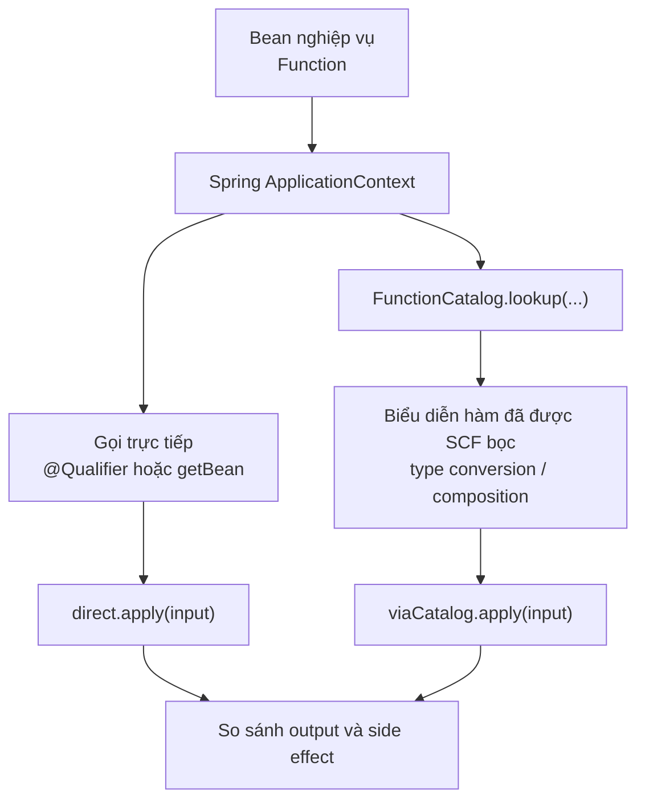
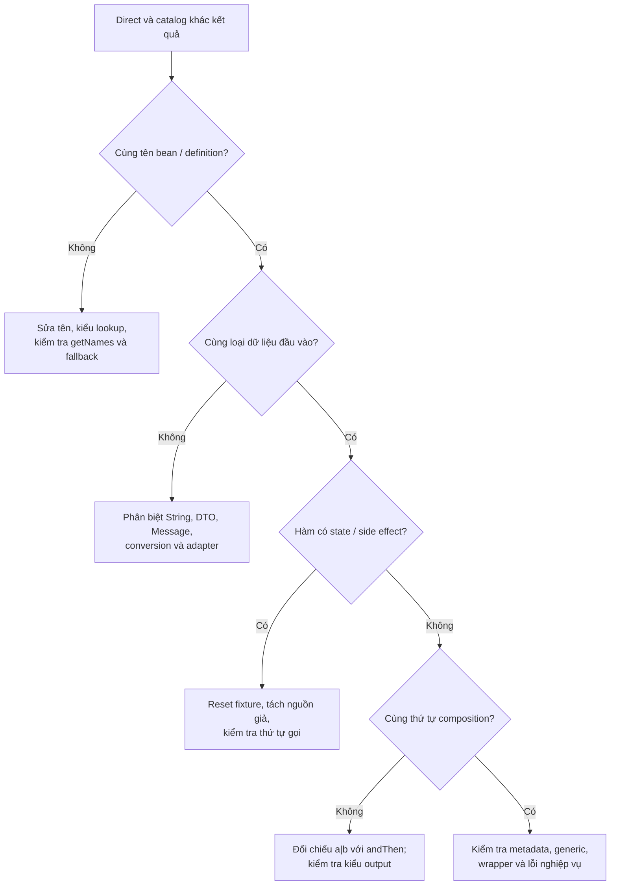

# So sánh kết quả gọi bean với kết quả gọi qua catalog

**Chương:** Kiểm thử  
**Module:** Spring Cloud Function (`SPRING_CLOUD_FUNCTION`)

Spring Cloud Function cho phép viết logic nghiệp vụ bằng `Supplier<T>`, `Function<T,R>` hoặc `Consumer<T>`, rồi tái sử dụng cùng hàm trong mã Java, HTTP, xử lý sự kiện và môi trường serverless. Một functional bean có thể được gọi **trực tiếp** qua dependency injection hoặc `ApplicationContext`; cũng có thể được tra cứu **qua `FunctionCatalog`** để sử dụng cơ chế wrapper, composition và chuyển đổi dữ liệu của Spring Cloud Function.

Một câu hỏi kiểm thử thường gặp là: **“Với cùng một hàm và một đầu vào, gọi trực tiếp Spring bean có cho kết quả giống gọi qua catalog không?”** Câu trả lời là: với đầu vào đã đúng hợp đồng Java và hàm xác định, hai đường gọi thường phải cho **cùng kết quả nghiệp vụ**. Tuy nhiên, không thể dùng sự tương đương về giá trị để kết luận hai đường gọi giống nhau hoàn toàn. Catalog có thể cung cấp đối tượng đã được bọc (*wrapped/instrumented*) và thích ứng với `Message<?>`, conversion hoặc function definition theo những quy tắc riêng.

Bài học này hướng dẫn xây dựng một bộ kiểm thử tích hợp ở tầng Spring context để đối chiếu **giá trị trả về, ngoại lệ, side effect và composition**, đồng thời chỉ ra những điều **không nên so sánh** như object identity hoặc header chưa được cam kết giữ nguyên.

## 1. Mục tiêu, phạm vi và tiêu chí so sánh

Sau bài học, bạn có thể:

1. Lấy đúng bean bằng `@Qualifier` và đúng hàm thông qua `FunctionCatalog.lookup(...)`.
2. Đưa **cùng đầu vào, cùng trạng thái ban đầu** vào hai đường gọi để so sánh công bằng.
3. Viết JUnit 5/Spring Boot Test so sánh `Function`, `Supplier` và `Consumer`.
4. So sánh giá trị DTO bằng equality có ý nghĩa thay vì so sánh địa chỉ đối tượng.
5. So sánh Java composition bằng `andThen(...)` với catalog composition bằng `a|b`.
6. Phân biệt lỗi nghiệp vụ với khác biệt do wrapper, converter hoặc adapter.
7. Phát hiện một bài test “xanh” nhưng thực chất chưa chứng minh đúng tên, đúng kiểu hoặc đúng đường gọi.

**Phạm vi chính:** khởi tạo Spring context và `FunctionCatalog`, nhưng **không khởi động HTTP server, không kết nối broker và không deploy serverless**. Bài chỉ so sánh hai cách gọi cùng logic trong môi trường Java/Spring. Khi cần xác minh JSON, `Message<byte[]>` hoặc binding thực tế, phải xây integration test bổ sung phù hợp.

| Phép đối chiếu | Nên làm? | Lý do |
| --- | --- | --- |
| Cùng `String` đầu vào, hai đường cùng trả `String` mong đợi | **Có** | Kiểm tra kết quả nghiệp vụ |
| Cùng DTO đầu vào, hai đường trả DTO có cùng giá trị | **Có** | Kiểm tra hợp đồng dữ liệu |
| Cùng trạng thái ban đầu, `Consumer` tạo cùng side effect | **Có** | So sánh tác động có thể quan sát |
| Cùng `Supplier` xác định, hai đường trả giá trị kỳ vọng | **Có** | Kiểm tra chức năng nguồn |
| Java `a.andThen(b)` và catalog `a|b` trả kết quả tương đương | **Có** | Kiểm tra composition |
| `assertSame(directBean, catalogFunction)` | **Không** | Catalog có thể trả wrapper |
| So sánh tên class của direct bean và catalog wrapper | **Không** | Lớp triển khai là chi tiết framework |
| So sánh toàn bộ header `Message<?>` nếu không định nghĩa hợp đồng | **Không** | Wrapper/adapter có thể xử lý envelope và headers |
| Kết luận HTTP/Stream/serverless hoạt động từ một lần `apply(String)` | **Không** | Chưa kiểm tra giao thức và converter |

## 2. Mô hình: một logic, hai đường thực thi



Đường trực tiếp là lời gọi Java tới bean Spring (có thể vẫn có Spring AOP proxy thông thường). Đường catalog dùng hàm được `FunctionCatalog` nhận diện, có thể được bọc bởi Spring Cloud Function. Khi input đã đúng kiểu và hàm không có hành vi phụ thuộc môi trường, kết quả nghiệp vụ nên tương đương.

**Định nghĩa “tương đương” trong bài:**

- Với `Function<T,R>`: cả hai đường trả **cùng giá trị nghiệp vụ `R`** cho một `T` hợp lệ.
- Với `Supplier<R>`: kết quả tương đương khi nguồn **xác định** và trạng thái đọc dữ liệu đã được kiểm soát.
- Với `Consumer<T>`: so sánh **tác dụng phụ có thể quan sát** sau mỗi lần gọi, thay vì kết quả trả về `void`.
- Với composition: so sánh kết quả của **cùng chuỗi thao tác theo cùng thứ tự**.

Khi dùng nguồn thời gian thực, số ngẫu nhiên, I/O hoặc mutable state, hai lần gọi liên tiếp có thể trả kết quả khác nhau ngay cả khi logic hoàn toàn đúng. Phải kiểm soát hoặc thiết lập lại trạng thái trước khi kết luận.

## 3. Chuẩn bị dependency và JUnit

Ví dụ sử dụng Spring Boot, Spring Cloud Function context và JUnit Jupiter, với các phiên bản **tương thích nhau** theo dependency management của dự án. Dùng `spring-cloud-function-context` để có catalog; không cần dependency Web/Stream nếu chỉ kiểm thử cách gọi Java.

**Maven** (trích phần dependencies; POM thực tế cần parent/BOM):

```xml
<dependencies>
    <dependency>
        <groupId>org.springframework.boot</groupId>
        <artifactId>spring-boot-starter</artifactId>
    </dependency>
    <dependency>
        <groupId>org.springframework.cloud</groupId>
        <artifactId>spring-cloud-function-context</artifactId>
    </dependency>
    <dependency>
        <groupId>org.springframework.boot</groupId>
        <artifactId>spring-boot-starter-test</artifactId>
        <scope>test</scope>
    </dependency>
</dependencies>
```

**Gradle Kotlin DSL** (dự án đã quản lý phiên bản):

```kotlin
dependencies {
    implementation("org.springframework.boot:spring-boot-starter")
    implementation("org.springframework.cloud:spring-cloud-function-context")
    testImplementation("org.springframework.boot:spring-boot-starter-test")
}

tasks.test {
    useJUnitPlatform()
}
```

Bộ kiểm thử dùng:

```java
@SpringBootTest(
    classes = DirectCatalogComparisonApplication.class,
    webEnvironment = SpringBootTest.WebEnvironment.NONE
)
```

Test này **có tạo Spring ApplicationContext**; nó không phải unit test Java thuần. `WebEnvironment.NONE` chỉ nói rằng không khởi động embedded web server, trong khi Spring DI và `FunctionCatalog` vẫn có thể hoạt động.

## 4. Ứng dụng mẫu: Function, Supplier, Consumer và DTO

Ta khai báo nhiều functional bean ngay từ đầu để không phụ thuộc vào cơ chế *single-function fallback*. Tên bean được viết tường minh, và các hàm có kết quả xác định để phép so sánh có ý nghĩa.

**File:** `src/main/java/example/testing/DirectCatalogComparisonApplication.java`

```java
package example.testing;

import java.util.List;
import java.util.Locale;
import java.util.concurrent.CopyOnWriteArrayList;
import java.util.function.Consumer;
import java.util.function.Function;
import java.util.function.Supplier;

import org.springframework.beans.factory.annotation.Qualifier;
import org.springframework.boot.SpringApplication;
import org.springframework.boot.autoconfigure.SpringBootApplication;
import org.springframework.context.annotation.Bean;

@SpringBootApplication(proxyBeanMethods = false)
public class DirectCatalogComparisonApplication {

    public static void main(String[] args) {
        SpringApplication.run(
            DirectCatalogComparisonApplication.class, args);
    }

    public record OrderInput(String code, int quantity) {}

    public record OrderDecision(
        String normalizedCode, boolean accepted) {}

    @Bean("normalizeOrderCode")
    public Function<String, String> normalizeOrderCode() {
        return raw -> {
            if (raw == null || raw.isBlank()) {
                throw new IllegalArgumentException(
                    "Order code must not be blank");
            }
            return raw.trim().toUpperCase(Locale.ROOT);
        };
    }

    @Bean("addPrefix")
    public Function<String, String> addPrefix() {
        return code -> "ID-" + code;
    }

    @Bean("codeLength")
    public Function<String, Integer> codeLength() {
        return String::length;
    }

    @Bean("validateOrder")
    public Function<OrderInput, OrderDecision> validateOrder(
            @Qualifier("normalizeOrderCode")
            Function<String, String> normalize) {
        return input -> new OrderDecision(
            normalize.apply(input.code()),
            input.quantity() > 0
        );
    }

    @Bean("issueOrderCode")
    public Supplier<String> issueOrderCode() {
        return () -> "  ord-42  ";
    }

    @Bean("auditLog")
    public AuditLog auditLog() {
        return new AuditLog();
    }

    @Bean("auditOrderCode")
    public Consumer<String> auditOrderCode(AuditLog log) {
        return log::record;
    }

    public static final class AuditLog {

        private final List<String> entries =
            new CopyOnWriteArrayList<>();

        public void record(String code) {
            entries.add(code);
        }

        public List<String> snapshot() {
            return List.copyOf(entries);
        }

        public void clear() {
            entries.clear();
        }
    }
}
```

Các lớp `record` yêu cầu Java 16 trở lên; sử dụng Java 17 là một lựa chọn phù hợp cho ví dụ. `AuditLog` là một bean Spring thường, không triển khai `Supplier`, `Function` hoặc `Consumer`; nó giúp quan sát side effect mà không ghi database hoặc phát sự kiện thật.

### 4.1. Hợp đồng của từng bean

| Bean | Loại | Hành vi ví dụ |
| --- | --- | --- |
| `normalizeOrderCode` | `Function<String,String>` | `"  ord-42  " → "ORD-42"` |
| `addPrefix` | `Function<String,String>` | `"ORD-42" → "ID-ORD-42"` |
| `codeLength` | `Function<String,Integer>` | `"ID-ORD-42" → 9` |
| `validateOrder` | `Function<OrderInput,OrderDecision>` | Chuẩn hóa mã và đánh giá `quantity > 0` |
| `issueOrderCode` | `Supplier<String>` | Luôn trả `"  ord-42  "` |
| `auditOrderCode` | `Consumer<String>` | Ghi giá trị vào `AuditLog` |

Hai đặc điểm bảo đảm kiểm thử không gây hiểu nhầm:

1. **Nhiều ứng viên hợp lệ**: một tên sai không bị fallback của trường hợp chỉ có một hàm che giấu.
2. **Kết quả xác định**: `issueOrderCode` không dùng đồng hồ/UUID; `auditOrderCode` ghi vào một danh sách có thể xóa giữa các phép thử.

### 4.2. Vì sao validateOrder inject Function khác?

`validateOrder` có tham số:

```java
@Qualifier("normalizeOrderCode")
Function<String, String> normalize
```

Vì trong context có nhiều bean loại `Function`, `@Qualifier` buộc Spring inject đúng hàm chuẩn hóa. Bài test đầu tiên của chủ đề này so sánh **bean `validateOrder` được Spring tạo đúng dependency** với **wrapper được catalog trả về**, không phải tự tạo một lambda khác trong test.

Nếu `@Qualifier` sai, Spring có thể không dựng được context. Khi đó, thất bại xảy ra **trước khi test so sánh output chạy**, và nên được xử lý như lỗi registration/DI, không phải sự khác biệt giữa direct và catalog.

## 5. Bộ test đầy đủ đối chiếu trực tiếp và catalog

**File:** `src/test/java/example/testing/DirectVsCatalogTest.java`

```java
package example.testing;

import static org.junit.jupiter.api.Assertions.*;

import java.util.List;
import java.util.Set;
import java.util.function.Consumer;
import java.util.function.Function;
import java.util.function.Supplier;
import java.util.stream.Stream;

import org.junit.jupiter.api.BeforeEach;
import org.junit.jupiter.api.Test;
import org.junit.jupiter.params.ParameterizedTest;
import org.junit.jupiter.params.provider.Arguments;
import org.junit.jupiter.params.provider.MethodSource;
import org.springframework.beans.factory.annotation.Autowired;
import org.springframework.beans.factory.annotation.Qualifier;
import org.springframework.boot.test.context.SpringBootTest;
import org.springframework.cloud.function.context.FunctionCatalog;
import org.springframework.context.ApplicationContext;

@SpringBootTest(
    classes = DirectCatalogComparisonApplication.class,
    webEnvironment = SpringBootTest.WebEnvironment.NONE
)
class DirectVsCatalogTest {

    @Autowired
    ApplicationContext context;

    @Autowired
    FunctionCatalog catalog;

    @Autowired
    @Qualifier("normalizeOrderCode")
    Function<String, String> directNormalize;

    @Autowired
    @Qualifier("addPrefix")
    Function<String, String> directPrefix;

    @Autowired
    @Qualifier("codeLength")
    Function<String, Integer> directLength;

    @Autowired
    @Qualifier("validateOrder")
    Function<
        DirectCatalogComparisonApplication.OrderInput,
        DirectCatalogComparisonApplication.OrderDecision
    > directValidate;

    @Autowired
    @Qualifier("issueOrderCode")
    Supplier<String> directSupplier;

    @Autowired
    @Qualifier("auditOrderCode")
    Consumer<String> directConsumer;

    @Autowired
    DirectCatalogComparisonApplication.AuditLog auditLog;

    @BeforeEach
    void resetLog() {
        auditLog.clear();
    }

    static Stream<Arguments> orderCodes() {
        return Stream.of(
            Arguments.of("  ord-42  ", "ORD-42"),
            Arguments.of("ab-9", "AB-9"),
            Arguments.of(" x-1 ", "X-1")
        );
    }

    @ParameterizedTest
    @MethodSource("orderCodes")
    void directAndCatalogNormalizeToSameValue(
            String input, String expected) {
        Function<String, String> viaCatalog =
            catalog.lookup(
                Function.class, "normalizeOrderCode");

        assertNotNull(viaCatalog);
        assertEquals(expected, directNormalize.apply(input));
        assertEquals(expected, viaCatalog.apply(input));
        assertEquals(
            directNormalize.apply(input),
            viaCatalog.apply(input));
    }

    @Test
    void catalogUsesTheSameRegisteredBusinessName() {
        assertTrue(context.containsBean("normalizeOrderCode"));
        Set<String> names = catalog.getNames(Function.class);
        assertTrue(names.contains("normalizeOrderCode"));
        assertTrue(names.contains("addPrefix"));
        assertTrue(names.contains("codeLength"));
        assertTrue(names.contains("validateOrder"));
    }

    @Test
    void directAndCatalogSupplierReturnSameValue() {
        Supplier<String> viaCatalog =
            catalog.lookup(Supplier.class, "issueOrderCode");

        assertNotNull(viaCatalog);
        assertEquals("  ord-42  ", directSupplier.get());
        assertEquals(directSupplier.get(), viaCatalog.get());
    }

    @Test
    void directAndCatalogConsumerProduceSameEffect() {
        Consumer<String> viaCatalog =
            catalog.lookup(Consumer.class, "auditOrderCode");

        assertNotNull(viaCatalog);

        directConsumer.accept("ORD-42");
        List<String> directEvents = auditLog.snapshot();

        auditLog.clear();
        viaCatalog.accept("ORD-42");
        List<String> catalogEvents = auditLog.snapshot();

        assertEquals(List.of("ORD-42"), directEvents);
        assertEquals(directEvents, catalogEvents);
    }

    @Test
    void directAndCatalogDtoResultsMatchByValue() {
        Function<
            DirectCatalogComparisonApplication.OrderInput,
            DirectCatalogComparisonApplication.OrderDecision
        > viaCatalog = catalog.lookup(
            Function.class, "validateOrder");

        assertNotNull(viaCatalog);

        var input =
            new DirectCatalogComparisonApplication.OrderInput(
                "  ord-42  ", 3);
        var expected =
            new DirectCatalogComparisonApplication.OrderDecision(
                "ORD-42", true);

        assertEquals(expected, directValidate.apply(input));
        assertEquals(expected, viaCatalog.apply(input));
        assertEquals(directValidate.apply(input),
            viaCatalog.apply(input));
    }

    @Test
    void catalogCompositionMatchesJavaComposition() {
        Function<String, String> directPipeline =
            directNormalize.andThen(directPrefix);
        Function<String, String> viaCatalog =
            catalog.lookup(
                Function.class, "normalizeOrderCode|addPrefix");

        assertNotNull(viaCatalog);
        assertEquals("ID-ORD-42",
            directPipeline.apply("  ord-42  "));
        assertEquals(directPipeline.apply("  ord-42  "),
            viaCatalog.apply("  ord-42  "));
    }

    @Test
    void compositionWithIntegerOutputAlsoMatches() {
        Function<String, Integer> directPipeline =
            directNormalize.andThen(directPrefix)
                .andThen(directLength);
        Function<String, Integer> viaCatalog =
            catalog.lookup(
                Function.class,
                "normalizeOrderCode|addPrefix|codeLength");

        assertNotNull(viaCatalog);
        assertEquals(9, directPipeline.apply("  ord-42  ")
            .intValue());
        assertEquals(directPipeline.apply("  ord-42  "),
            viaCatalog.apply("  ord-42  "));
    }

    @Test
    void unknownNamesMustNotBeMistakenForRegisteredNames() {
        String unknown = "normaliseOrderCode";
        assertFalse(catalog.getNames(null).contains(unknown));

        // Fixture có nhiều functional bean đủ điều kiện.
        assertNull(catalog.lookup(Function.class, unknown));
    }
}
```

**Kết quả kỳ vọng:** toàn bộ các ca so sánh giá trị trên có cùng kết quả nghiệp vụ. Test không cần HTTP/Stream adapter để chạy, vì `@SpringBootTest(webEnvironment = NONE)` đã đủ cung cấp bean và catalog.

### 5.1. Những assertion thực sự có ý nghĩa

Mỗi phép thử tốt thường có ba lớp kiểm tra:

1. **Đúng tên được nhận diện:** `catalog.getNames(type).contains(name)`.
2. **Tra cứu thành công:** kết quả `lookup(type,name)` không phải `null`.
3. **Đúng hành vi:** output hoặc side effect phù hợp kỳ vọng nghiệp vụ và tương đương với bean trực tiếp.

Chỉ viết `assertNotNull(catalog.lookup(...))` chưa kiểm chứng kết quả. Chỉ viết `assertEquals(direct.apply(input), viaCatalog.apply(input))` cũng chưa đủ nếu **cả hai đường cùng triển khai một logic sai**: cần thêm giá trị mong đợi độc lập, như `"ORD-42"` hoặc `9`.

### 5.2. Không suy ra rằng catalog trả lại đúng object của Spring

Không viết:

```java
// Đây KHÔNG phải hợp đồng được bảo đảm:
// assertSame(directNormalize,
//     catalog.lookup(Function.class, "normalizeOrderCode"));
```

Spring Cloud Function có thể bọc functional bean bằng một `FunctionInvocationWrapper` hoặc cấu trúc triển khai tương đương. Wrapper có trách nhiệm bổ sung metadata, conversion và composition. Giá trị nghiệp vụ đúng quan trọng hơn việc tham chiếu hai object có trùng nhau hay không.

## 6. Công bằng trong so sánh: cùng input, cùng điều kiện

Một so sánh chỉ có ý nghĩa khi mỗi đường gọi được thử với **cùng dữ liệu đầu vào** và **trạng thái môi trường tương đương**.

| Loại hàm | Điều kiện cần giữ giống nhau |
| --- | --- |
| `Function<String,String>` thuần | Cùng chuỗi, encoding/locale và quy tắc xử lý |
| `Function<DTO,DTO>` | Cùng dữ liệu DTO, tránh đối tượng bị mutate |
| `Supplier` | Nguồn xác định hoặc reset nguồn trước mỗi lời gọi |
| `Consumer` | Reset nơi ghi và ghi nhận số lần gọi/giá trị |
| Composition | Cùng thứ tự hàm và kiểu input/output |
| Hàm có transaction hoặc side effect | Cô lập tài nguyên và trạng thái test, tránh ghi trùng dữ liệu thật |

### 6.1. Tránh Supplier lấy dữ liệu ngẫu nhiên

Ví dụ so sánh không đáng tin:

```java
@Bean("randomCode")
public Supplier<String> randomCode() {
    return () -> java.util.UUID.randomUUID().toString();
}
```

Hai lần gọi `get()` liên tiếp có thể trả hai UUID khác nhau, dù direct bean và catalog đều hoạt động đúng. Do đó:

```java
assertEquals(directSupplier.get(), catalogSupplier.get());
```

chỉ phù hợp khi source **xác định hoặc được đồng bộ trạng thái**. Với nguồn ngẫu nhiên, hãy inject nguồn UUID giả trong fixture hoặc so sánh những thuộc tính được hợp đồng bảo đảm, như định dạng, thay vì giá trị tuyệt đối.

### 6.2. Tránh double side effect của Consumer

Nếu `Consumer` ghi database hoặc phát message thật, việc gọi cả direct và catalog liên tiếp sẽ **thực hiện hai tác dụng phụ**, có thể tạo hai sự kiện và làm bẩn dữ liệu test.

Trong ví dụ, `AuditLog` là một fake có bộ nhớ. Ta:

1. Gọi direct consumer.
2. Chụp snapshot.
3. Xóa trạng thái.
4. Gọi consumer từ catalog với **cùng input**.
5. So sánh snapshot và kỳ vọng độc lập.

Như vậy, test xác minh tác dụng phụ mà không gửi message hay ghi cơ sở dữ liệu thật. Nếu muốn kiểm tra broker thực, tạo adapter integration test riêng với tài nguyên và cleanup thích hợp.

### 6.3. DTO nên có equality theo giá trị

Trong ví dụ, `OrderInput` và `OrderDecision` là Java `record` nên có `equals/hashCode` dựa trên các thành phần. Test:

```java
assertEquals(expected, directValidate.apply(input));
assertEquals(expected, viaCatalog.apply(input));
```

kiểm tra **nội dung nghiệp vụ**, không kiểm tra object identity. Với DTO class thông thường không cài đặt equality, hãy so sánh từng trường cần thiết hoặc dùng bộ assertion theo thuộc tính; tránh `assertSame(expected, actual)` cho object mới tạo mỗi lần.

### 6.4. Đừng chỉ so sánh hai kết quả với nhau

Giả sử do lỗi cả hai đường đều viết hoa sai thành `"Ord-42"`. Một test chỉ có:

```java
assertEquals(direct.apply(input), fromCatalog.apply(input));
```

vẫn chạy xanh vì hai bên cùng sai. Hãy kết hợp:

```java
assertEquals("ORD-42", direct.apply(input));
assertEquals("ORD-42", fromCatalog.apply(input));
```

Nguyên tắc này đặc biệt quan trọng khi cùng bean đích được gọi từ hai đường: tính tương đương không thay thế **oracle** là kết quả nghiệp vụ mong đợi.

## 7. Khi nào kết quả không nhất thiết cùng hình dạng?

Điểm khác biệt lớn nhất giữa direct bean và catalog là **catalog cung cấp biểu diễn đã được Spring Cloud Function bọc**. Theo tài liệu chính thức, wrapper có thể bổ sung xử lý chuyển đổi kiểu, composition và thích ứng với các dạng thông điệp mà bên gọi cung cấp.

| Ngữ cảnh | Gọi bean trực tiếp | Gọi qua FunctionCatalog |
| --- | --- | --- |
| Đầu vào Java `String` đúng kiểu | Bean chạy `apply(String)` | Wrapper chuyển lời gọi tới logic, có thể không cần conversion |
| Đầu vào Java DTO đúng kiểu | Bean nhận đúng DTO | Wrapper có thể gọi bean với DTO phù hợp |
| Đầu vào `Message<String>` cho một hàm `Function<String,String>` | **Không khớp** chữ ký trực tiếp; cần lớp gọi trích payload | Wrapper có thể hỗ trợ tháo envelope/chuyển kiểu |
| Đầu vào `Message<byte[]>` mang JSON | Bean DTO không tự deserialize JSON | Có thể dùng converter khi metadata và cấu hình phù hợp |
| Definition `normalizeOrderCode|addPrefix` | Phải tự lấy hai bean và ghép | Catalog phân giải chuỗi composition |
| Header input/output | Logic direct chỉ thấy header nếu chữ ký nhận `Message` | Wrapper/adapter có các quy tắc header riêng |

**Không lấy sự khác nhau về object được truyền vào làm bằng chứng hai cách gọi xử lý khác nghiệp vụ.** Nếu direct nhận `String` còn catalog nhận `Message<byte[]>` thì ta đang kiểm tra **hai hợp đồng đầu vào khác nhau**. Muốn so sánh cùng logic, nên trước tiên dùng dữ liệu Java đúng kiểu ở cả hai bên, sau đó viết test conversion riêng.

### 7.1. Quan sát wrapper khi đầu vào là Message

Spring Cloud Function có thể nhận một `Message<?>`, sử dụng payload và metadata để xử lý rồi tạo kết quả thích hợp. Ví dụ thăm dò dưới đây chỉ dùng để **quan sát đường catalog**, không phải test buộc output phải có một class cụ thể:

```java
import org.springframework.messaging.Message;
import org.springframework.messaging.MessageHeaders;
import org.springframework.messaging.support.MessageBuilder;
import org.springframework.cloud.function.context.catalog.SimpleFunctionRegistry.FunctionInvocationWrapper;

// Đặt trong một phương thức có FunctionCatalog catalog.
FunctionInvocationWrapper wrapper =
    catalog.lookup("normalizeOrderCode");
if (wrapper == null) {
    throw new IllegalStateException("Missing normalizeOrderCode");
}

Message<String> input = MessageBuilder
    .withPayload("  ord-42  ")
    .setHeader(MessageHeaders.CONTENT_TYPE, "text/plain")
    .build();

Object result = wrapper.apply(input);
Object payload = result instanceof Message<?> message
    ? message.getPayload() : result;

System.out.println("Result type: " + result.getClass());
System.out.println("Payload type: " + payload.getClass());
System.out.println("Payload: " + payload);
```

Đoạn trên dùng lớp triển khai `FunctionInvocationWrapper` để quan sát, nên **phải đối chiếu API với phiên bản dependency cụ thể**. Trong test sản phẩm, không nên gắn mọi assertion nghiệp vụ vào lớp triển khai này. Ngoài ra, kiểu payload có thể phụ thuộc content type và converter; ví dụ `byte[]` không thể đem so sánh trực tiếp với `String` bằng `assertEquals`.

Vì vậy:

- Với test **so sánh logic**, truyền `String` trực tiếp ở cả hai đường như mục 5.
- Với test **conversion**, quyết định trước kiểu input, kiểu output, content type và converter mong đợi.
- Với test **HTTP hoặc message adapter**, kiểm tra cả status/header/serialization theo hợp đồng giao thức, thay vì chỉ so sánh Java object.

### 7.2. Không tự giả định header được giữ nguyên

Giả sử input chứa header `source=mobile`. Khi gọi một `Function<String,String>` qua catalog bằng `Message<?>`, framework có thể xử lý envelope và header theo quy tắc của từng phiên bản/cấu hình. Không nên mặc định mọi header input đều được copy ra output.

Nếu cần bảo toàn một header nghiệp vụ, hãy dùng hợp đồng rõ ràng:

- Hàm nhận và trả `Message<T>`, tự chọn header cần mang sang kết quả; hoặc
- Sử dụng tùy chọn truyền header mà Spring Cloud Function/adapter hỗ trợ trong phiên bản đang dùng; và
- Viết integration test riêng khẳng định header cụ thể thực sự còn ở kết quả.

Một test trên `Function<String,String>` với đầu vào `String` không cung cấp bằng chứng gì về propagation của headers.

## 8. Ngoại lệ: so sánh hợp đồng thay vì cố so sánh stack trace

Trong fixture, `normalizeOrderCode` từ chối input `null` và chuỗi chỉ chứa khoảng trắng. Với direct bean:

```java
assertThrows(
    IllegalArgumentException.class,
    () -> directNormalize.apply("  "));
```

Khi gọi qua catalog, cùng lỗi nghiệp vụ có thể được chuyển tiếp hoặc xuất hiện dưới một wrapper exception tùy đường thực thi, phiên bản và adapter. Không nên mặc định hai exception phải có **cùng class, cùng stack trace hoặc cùng message đầy đủ**.

Hãy phân biệt:

1. **Lỗi hợp đồng nghiệp vụ:** input không được phép, logic chủ động từ chối.
2. **Lỗi tra cứu:** tên/definition không phân giải được, sai functional interface hoặc composition không hợp lệ.
3. **Lỗi chuyển đổi:** byte array/JSON/Message không chuyển thành kiểu bean yêu cầu.
4. **Lỗi adapter:** status HTTP, routing, binding hoặc serialization không phù hợp.

### 8.1. Kiểm tra điều đúng ở đúng tầng

Ví dụ trong test direct:

```java
IllegalArgumentException failure = assertThrows(
    IllegalArgumentException.class,
    () -> directNormalize.apply(null));

assertEquals(
    "Order code must not be blank",
    failure.getMessage());
```

Đây là phép test hợp đồng Java rõ ràng. Đối với catalog, test có thể xác nhận rằng input bất hợp lệ bị từ chối, nhưng **kiểu ngoại lệ bên ngoài** có thể cần quy định riêng nếu muốn dùng như API ổn định.

Nếu ứng dụng thực tế có HTTP adapter, còn phải kiểm tra lỗi đó được ánh xạ thành HTTP status và response body như thế nào. Đừng kết luận từ `assertThrows(...)` trên bean rằng HTTP đã trả đúng `400 Bad Request`.

### 8.2. Đầu ra khác nhau không phải lúc nào cũng là bug

Có hai ví dụ dễ nhầm:

- Direct bean trả `OrderDecision`, còn một adapter trả JSON biểu diễn `OrderDecision`. Khác **hình thức biểu diễn**, nhưng có thể cùng nội dung nghiệp vụ.
- Direct bean nhận `String` và trả `String`, còn wrapper nhận `Message<?>`, xử lý payload và trả một envelope khác. Nếu test buộc object hai bên phải cùng class, nó có thể thất bại dù giá trị nghiệp vụ vẫn đúng.

Muốn so sánh qua giao thức, hãy chuẩn hóa kết quả theo **hợp đồng quan sát được**, ví dụ JSON field `normalizedCode` hoặc payload cụ thể, rồi so sánh giá trị domain. Không làm mất các thông tin mà giao thức thực sự cần, như status, content type hoặc header đã được yêu cầu.

## 9. Kiểm tra tên bean và tránh single-function fallback

Hai đường gọi có cơ chế chọn tên khác nhau:

| Spring bean trực tiếp | FunctionCatalog |
| --- | --- |
| `@Qualifier("normalizeOrderCode")` | `lookup(Function.class, "normalizeOrderCode")` |
| `context.getBean("normalizeOrderCode")` | `getNames(Function.class)` và `lookup(...)` |
| Tên thiếu có thể dẫn đến lỗi DI / `NoSuchBeanDefinitionException` | Tên thiếu có thể không được phân giải, hoặc bị fallback nếu chỉ có một hàm |

Vì vậy, một phép so sánh trước tiên cần xác nhận **hai đường đều hướng về cùng tên bean dự kiến**.

```java
String name = "normalizeOrderCode";

assertTrue(context.containsBean(name));
assertTrue(catalog.getNames(Function.class).contains(name));

Function<String, String> fromCatalog =
    catalog.lookup(Function.class, name);
assertNotNull(fromCatalog);
```

Không nên dùng `lookup("tenSai") != null` làm bằng chứng tên thật đã tồn tại. Theo cơ chế *single-function fallback*, trong ứng dụng chỉ có một functional bean đủ điều kiện, catalog có thể trả về hàm duy nhất ngay cả khi tên yêu cầu rỗng hoặc không khớp.

Fixture của bài có nhiều functional bean, giúp phép thử âm tính có ý nghĩa rõ hơn. Trong các phiên bản hỗ trợ, bạn cũng có thể tắt fallback bằng:

```properties
spring.cloud.function.single-function-fallback-enabled=false
```

Hãy đối chiếu công tắc này với đúng phiên bản Spring Cloud Function đang dùng. Không coi một property trong file cấu hình là bằng chứng chắc chắn rằng phiên bản hiện tại đã áp dụng nó.

## 10. Nếu bean bị lọc khỏi catalog thì so sánh ra sao?

Spring Cloud Function có cấu hình lọc ứng viên:

```properties
spring.cloud.function.ineligible-definitions=internalClean
```

Bean `internalClean` vẫn có thể tồn tại trong `ApplicationContext` và được gọi trực tiếp, nhưng không còn là ứng viên được catalog nhận diện theo cách thông thường. Lúc này **không thể bắt buộc cả hai đường gọi đều trả một đối tượng hàm**.

Đây không phải “hành vi nghiệp vụ khác nhau”: khác biệt là **quy tắc công bố/đăng ký hàm**.

Một test thích hợp:

```java
assertTrue(context.containsBean("internalClean"));
assertFalse(catalog.getNames(Function.class)
    .contains("internalClean"));
```

**Không viết** một test yêu cầu `catalog.lookup("internalClean")` trả đúng bean khi chính configuration đã đánh dấu nó ineligible. Nếu catalog chỉ còn một ứng viên, còn phải xét thêm single-function fallback: lookup tên bị lọc có thể trả **một hàm khác** chứ không phải helper đó.

Khi xuất HTTP hoặc Stream, còn phải kiểm tra `spring.cloud.function.definition` trỏ đến **hàm được phép dùng**. Lọc ứng viên catalog cũng không phải một lớp bảo mật cho controller tùy chỉnh: một HTTP controller tự viết vẫn có thể inject và gọi trực tiếp helper đó.

## 11. Kiểm thử composition: cùng thứ tự mới có ý nghĩa

Trong ứng dụng mẫu:

```java
Function<String, String> direct =
    directNormalize.andThen(directPrefix);

Function<String, String> catalogPipeline =
    catalog.lookup(
        Function.class, "normalizeOrderCode|addPrefix");
```

Hai pipeline đều thực hiện:

```text
Input
  -> normalizeOrderCode
  -> addPrefix
  -> Output
```

Chúng đáng được so sánh vì có **cùng thứ tự và hợp đồng kiểu dữ liệu**.

Nếu đổi thứ tự catalog thành:

```java
Function<String, String> reversed =
    catalog.lookup(
        Function.class, "addPrefix|normalizeOrderCode");
```

thì không nên yêu cầu `reversed.apply(input)` luôn bằng `direct.apply(input)`. Với chuỗi có khoảng trắng, việc thêm tiền tố trước khi chuẩn hóa có thể làm kết quả khác đi.

### 11.1. Definition gồm ba bước và kiểu đầu ra thay đổi

```java
Function<String, Integer> direct =
    directNormalize
        .andThen(directPrefix)
        .andThen(directLength);

Function<String, Integer> viaCatalog =
    catalog.lookup(
        Function.class,
        "normalizeOrderCode|addPrefix|codeLength");

assertNotNull(viaCatalog);
assertEquals(9, direct.apply("  ord-42  ").intValue());
assertEquals(
    direct.apply("  ord-42  "),
    viaCatalog.apply("  ord-42  "));
```

Kết quả là `Integer`, **không phải** `String`. Kiểu trả về của composition là đầu ra của bước cuối cùng. Gán kết quả `Function<String,Integer>` vào biến `Function<String,String>` là sai hợp đồng; do Java type erasure, lỗi có thể bộc lộ ở runtime nếu lạm dụng generic của `lookup`.

### 11.2. Không nhầm `|` với `;`

`spring.cloud.function.definition=normalizeOrderCode|addPrefix` mô tả **một pipeline**. Trong các adapter hỗ trợ danh sách, `normalizeOrderCode;addPrefix` có thể chỉ định **hai definition độc lập**, không có nghĩa output của hàm thứ nhất tự chạy qua hàm thứ hai.

Vì vậy, test so sánh Java `andThen(...)` phải dùng function definition có dấu `|`, không dùng `;`.

## 12. Nếu hàm dùng Reactive API thì so sánh điều gì?

Với hàm reactive:

```java
Function<Flux<String>, Flux<String>> normalizeStream =
    flux -> flux.map(
        s -> s.trim().toUpperCase(Locale.ROOT));
```

đầu ra là một **publisher**, không phải một `String`. Hai publisher có thể là hai object hoàn toàn khác nhau mà cùng phát chuỗi phần tử.

Trong một dự án dùng Project Reactor và `reactor-test`, hãy so sánh các phần tử, terminal signal và lỗi theo hợp đồng:

```java
// Pseudocode kiểm thử khi đã có các dependency Reactor:
// StepVerifier.create(direct.apply(Flux.just(" ord-42 ")))
//     .expectNext("ORD-42")
//     .verifyComplete();
//
// StepVerifier.create(viaCatalog.apply(Flux.just(" ord-42 ")))
//     .expectNext("ORD-42")
//     .verifyComplete();
```

Đây chỉ là minh họa mở rộng, không nằm trong fixture JUnit chạy được ở mục 5. Với Reactive API, cần tính tới cold/hot publisher, thời điểm subscription, backpressure, concurrency và side effect. Đừng dùng `assertEquals(directPublisher, catalogPublisher)` để kết luận hai luồng tương đương.

Ngoài ra, Spring Cloud Function/adapter có quy tắc khác nhau khi gọi hàm reactive so với hàm imperative xử lý từng bản tin. Vì vậy, kiểm thử catalog với một publisher chưa tự chứng minh Stream binder hoặc serverless adapter quản lý subscription đúng.

## 13. Chẩn đoán khi hai kết quả không giống nhau



| Triệu chứng | Nguyên nhân thường gặp | Hướng xác minh |
| --- | --- | --- |
| Direct có hàm nhưng `lookup` trả `null` | Sai tên, bị lọc, sai loại hoặc đăng ký catalog | `containsBean`, `getNames(type)`, tên `@Bean` |
| Lookup tên sai vẫn trả hàm | Single-function fallback | Xem tên thực trong catalog, kiểm tra số ứng viên |
| Hai kết quả `String` khác nhau | Không cùng input, thứ tự composition khác, logic có state | In input/output test, cố định dữ liệu |
| Supplier hai lần trả hai giá trị khác | Thời gian, UUID, API hoặc bộ đếm | Fake nguồn; reset trước mỗi lời gọi |
| Consumer tạo hai bản ghi | Test đã gọi trực tiếp rồi catalog mà không xóa trạng thái | Tách/khôi phục fake trước khi so sánh |
| DTO output cùng dữ liệu nhưng `assertEquals` fail | DTO không cài value equality | Dùng record hoặc so sánh từng trường |
| Input `Message<?>` tạo output khác class | Wrapper/converter xử lý payload và envelope | Kiểm tra kiểu payload, content type, header contract |
| Catalog call thất bại nhưng bean direct đúng | Lỗi conversion, metadata hoặc definition | Thử cùng input Java đúng kiểu trước |
| Java composition đúng, catalog composition sai | Thiếu bean, sai definition hoặc đổi thứ tự | Kiểm tra từng tên và chuỗi `a|b` |
| Test catalog PASS nhưng HTTP 404 | Sai route/export Web adapter | Viết HTTP integration test riêng |

### 13.1. Đọc log theo tầng

Để xác định nguyên nhân nhanh, kiểm tra theo thứ tự:

1. **Context:** bean đã được Spring tạo chưa?
2. **Registration:** tên/loại có trong `FunctionCatalog.getNames(...)` không?
3. **Lookup:** catalog có phân giải đúng tên/definition không?
4. **Payload:** cùng kiểu vào, cùng dữ liệu và cùng converter không?
5. **Logic:** giá trị output hay side effect có đúng hợp đồng không?
6. **Adapter:** nếu chạy qua HTTP/Stream/serverless, route, binding và serialization có đúng không?

Không sửa body của `normalizeOrderCode` chỉ vì HTTP trả `404` khi một phép gọi Java qua catalog đã chạy đúng. Khả năng cao lỗi nằm ở Web mapping hoặc cấu hình export của adapter.

### 13.2. Khi so sánh ngoại lệ, tìm root cause

Nếu direct bean ném một `IllegalArgumentException`, còn catalog wrapper báo ngoại lệ khác ở lớp ngoài, hãy xem nguyên nhân gốc và dữ liệu đã được truyền. Một wrapper hoặc adapter có thể thêm thông tin lỗi hoặc ném ngoại lệ trong conversion **trước cả khi hàm nghiệp vụ được gọi**.

Phân biệt kết quả:

- Cả hai gọi cùng logic và từ chối cùng input: có thể đúng hợp đồng.
- Catalog không gọi tới logic vì lỗi converter: khác vấn đề với lỗi validation.
- Direct và catalog hướng tới hai tên khác nhau: đang so sánh hai chức năng, không phải hai cách gọi một hàm.

## 14. Chống test giòn và xử lý trạng thái dùng chung

### 14.1. Spring context có thể được cache

Spring Boot Test thường tái sử dụng một context cho các test có cấu hình tương đương. Bean singleton như `AuditLog` có thể giữ dữ liệu từ test trước. Do đó:

```java
@BeforeEach
void resetLog() {
    auditLog.clear();
}
```

giúp các test ở mục 5 bắt đầu với dữ liệu sạch. Tuy nhiên, nếu nhiều test song song sử dụng cùng singleton, việc xóa trạng thái vẫn có thể gây race condition. Cần quản lý mức song song, tách fixture hoặc dùng mock/fake riêng cho từng test khi phù hợp.

### 14.2. Không kiểm tra catalog bằng số lượng tuyệt đối

Tránh:

```java
// Không khuyến nghị:
// assertEquals(6, catalog.getNames(null).size());
// assertEquals(6, catalog.size());
```

Spring Cloud Function có thể đăng ký những hàm hạ tầng hoặc xử lý danh mục theo phiên bản. Test nên khẳng định **những tên nghiệp vụ cần có** và **những tên không được phép xuất hiện**, thay vì dựa vào số lượng toàn catalog.

### 14.3. Không ép kiểu generic chỉ vì lookup biên dịch được

```java
// Bean codeLength thực tế là Function<String, Integer>.
Function<String, String> wrong =
    catalog.lookup(Function.class, "codeLength");
```

Đây là một phép gán sai hợp đồng dù Java có thể chấp nhận thông qua suy luận generic. Khi dùng giá trị trả về, code có thể thất bại vì kiểu thực là `Integer`.

Trong test so sánh, duy trì đúng kiểu từ chữ ký bean:

```java
Function<String, Integer> correct =
    catalog.lookup(Function.class, "codeLength");

assertNotNull(correct);
assertEquals(6, correct.apply("ORD-42").intValue());
```

### 14.4. Test không nên thay thế function thật bằng mock

Nếu mục tiêu là xác nhận cùng hàm nghiệp vụ được gọi từ bean trực tiếp và catalog, đừng mock chính `normalizeOrderCode` hoặc `validateOrder`. Điều đó có thể khiến bạn chỉ so sánh hai đường gọi một mock đã được lập trình sẵn.

Hãy giữ functional bean thật, còn những collaborator ngoài như repository, HTTP client, broker gateway thì dùng test double. Nếu muốn chứng minh wiring thực tế, test không được vô tình loại bỏ toàn bộ logic cần kiểm chứng.

## 15. Cách chạy và đọc kết quả

Cấu trúc minh họa:

```text
src/
  main/java/example/testing/
    DirectCatalogComparisonApplication.java
  test/java/example/testing/
    DirectVsCatalogTest.java
```

Maven Wrapper:

```bash
./mvnw -Dtest=DirectVsCatalogTest test
```

Gradle Wrapper:

```bash
./gradlew test --tests "example.testing.DirectVsCatalogTest"
```

Những lệnh này là **hướng dẫn dành cho người học**, không phải kết quả đã chạy trong quá trình viết bài.

Khi một test thất bại:

- **Context không khởi động:** kiểm tra `@Bean`, `@Qualifier`, dependency và phiên bản.
- **Không tìm thấy tên:** kiểm tra `FunctionCatalog.getNames(...)`, tên bean và ineligible.
- **Lookup tìm được nhưng output sai:** kiểm tra input, generic, business logic và wrapper conversion.
- **Consumer so sánh sai:** kiểm tra `AuditLog.clear()` và số lần gọi.
- **Composition sai:** kiểm tra thứ tự và kiểu đầu vào/đầu ra của từng bước.

### 15.1. Đối chiếu phiên bản thực tế khi kết quả khác nhau

Maven:

```bash
./mvnw dependency:tree -Dincludes=org.springframework.cloud:spring-cloud-function-context
```

Gradle:

```bash
./gradlew dependencyInsight --dependency spring-cloud-function-context --configuration runtimeClasspath
```

Nếu wrapper, converter hoặc fallback có hành vi khác giữa môi trường phát triển và CI, hãy so sánh artifact `spring-cloud-function-context` thật sự đã được phân giải. Không suy phiên bản Spring Cloud Function chỉ từ tên Spring Boot hoặc tên release train.

## 16. Bài tập thực hành

1. **So sánh Function:** thêm trường hợp `"  ab-009  "` vào `@MethodSource`; kiểm tra đồng thời giá trị trực tiếp, giá trị catalog và expected.
2. **Kiểm thử DTO:** mở rộng `validateOrder` để từ chối số lượng bằng 0; viết test với `OrderInput(" ord-42 ", 0)` và xác minh cả hai đường có cùng `OrderDecision`.
3. **Giá trị và identity:** thử in class của `directNormalize` và hàm từ catalog. Tại sao không nên yêu cầu chúng có cùng lớp hoặc cùng object identity?
4. **Supplier:** thay supplier cố định bằng một nguồn tăng bộ đếm; giải thích vì sao so sánh hai lần `get()` liên tiếp không còn công bằng. Đưa nguồn giả/reset vào fixture.
5. **Consumer:** gọi direct rồi catalog với cùng input mà không xóa `AuditLog`. Quan sát danh sách có hai sự kiện; sửa test để so sánh side effect trên hai trạng thái tương đương.
6. **Composition:** viết test cho `normalizeOrderCode|addPrefix|codeLength` và so sánh với `andThen(...)`. Kiểm tra kiểu đầu ra `Integer`.
7. **Sai tên:** thử lookup `normaliseOrderCode`. Dùng `getNames(Function.class)` để giải thích khác biệt giữa tên thực và tên đánh máy sai.
8. **Message:** xây test riêng sử dụng `Message<String>` mang header `source=test`, quan sát kiểu payload output; chỉ đưa assertion về header vào test sau khi xác định hợp đồng converter/propagation của phiên bản đang dùng.
9. **Adapter:** nếu dự án có Spring Cloud Function Web hoặc Spring Cloud Stream, mở rộng bộ test với HTTP request hoặc message binding để xác minh cùng logic được đưa ra ngoài đúng cách. Không coi test catalog hiện tại là đủ.

### Câu hỏi phỏng vấn

**Hỏi:** Hai lời gọi `direct.apply(input)` và `catalog.lookup(...).apply(input)` cùng cho `ORD-42`. Điều đó chứng minh gì?

**Đáp:** Với input được thử, bean Java và hàm do catalog phân giải cho cùng kết quả nghiệp vụ. Nó chưa chứng minh hai object có cùng identity, wrapper không thực hiện conversion, hoặc HTTP/Stream/serverless adapter đã được cấu hình đúng.

**Hỏi:** Vì sao không dùng `assertSame(directBean, fromCatalog)`?

**Đáp:** Catalog có thể trả về hàm đã được bọc bởi Spring Cloud Function. Hợp đồng quan trọng là tên/loại được phân giải và hành vi nghiệp vụ, không phải lớp triển khai hay địa chỉ đối tượng.

**Hỏi:** Muốn so sánh hai `Consumer` phát sự kiện, phải làm gì?

**Đáp:** Truyền cùng input, cô lập cổng phát sự kiện bằng fake hoặc mock, reset trạng thái trước từng đường gọi, rồi so sánh số lần và nội dung sự kiện. Kiểm tra broker nhận message thật cần integration test riêng.

## 17. Tổng kết

- **Đường trực tiếp** dùng bean Spring theo khai báo; **đường catalog** dùng hàm được Spring Cloud Function nhận diện và có thể được bọc để phục vụ conversion, composition và adapter.
- Khi **cùng input đúng kiểu**, cùng logic xác định và trạng thái tương đương, test nên xác minh **cùng kết quả nghiệp vụ** từ hai đường.
- Với `Function`, so sánh output; với `Supplier`, kiểm soát nguồn; với `Consumer`, reset và so sánh side effect; với DTO, dùng value equality.
- Không kiểm tra object identity, class cụ thể của wrapper hoặc toàn bộ header khi hợp đồng không đòi hỏi. Không đồng nhất các dạng `String`, `Message<?>`, JSON và reactive publisher.
- Đối với composition, so sánh Java `andThen(...)` với đúng definition `a|b`, đúng thứ tự và đúng kiểu output.
- Kết hợp assertion **expected value** với assertion **direct == catalog** để tránh hai đường cùng sai mà test vẫn xanh.
- Spring context test không tự chứng minh HTTP, message broker hoặc serverless hoạt động; conversion/adapter cần bộ integration test riêng theo phiên bản và giao thức.

### Tài liệu tham khảo

- [Spring Cloud Function — Programming Model](https://docs.spring.io/spring-cloud-function/reference/spring-cloud-function/programming-model.html): giải thích khác biệt giữa lấy bean trực tiếp và catalog wrapper, conversion, composition, Message và fallback.
- [Spring Cloud Function — Functional Bean Definitions](https://docs.spring.io/spring-cloud-function/reference/functional.html): quan sát `FunctionCatalog`, lấy danh sách tên và tra cứu hàm.
- [Spring Boot — Testing Spring Boot Applications](https://docs.spring.io/spring-boot/reference/testing/spring-boot-applications.html): `@SpringBootTest`, context và các chế độ webEnvironment.
- [JUnit 5 User Guide](https://junit.org/junit5/docs/current/user-guide/): parameterized tests, `@MethodSource` và assertions.
- [Spring Cloud Function 4.3 — Programming Model](https://docs.spring.io/spring-cloud-function/reference/4.3/spring-cloud-function/programming-model.html): tham khảo ví dụ envelope Message và header propagation; cần đối chiếu đúng version đang sử dụng.
