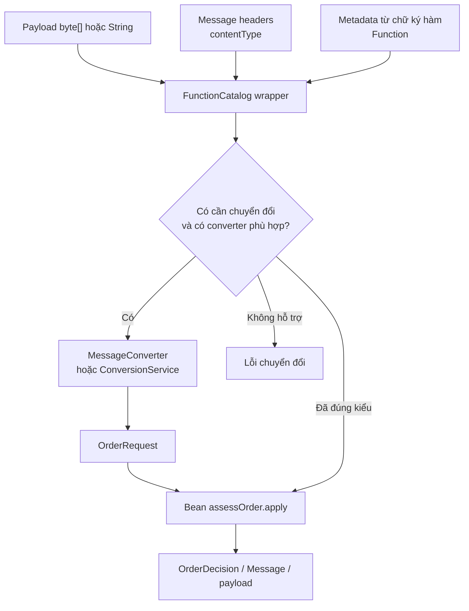
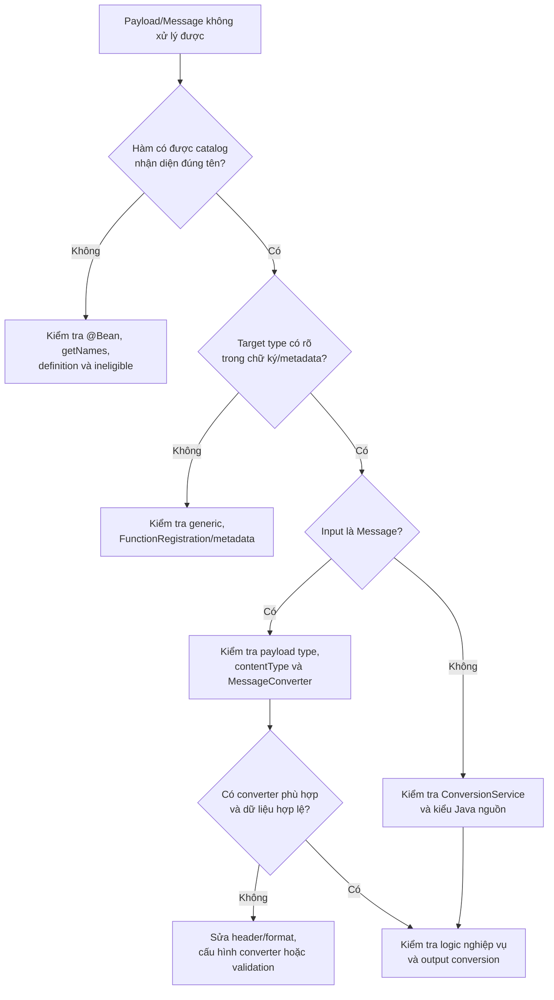

# Kiểm thử kiểu dữ liệu, contentType và MessageConverter

**Chương:** Kiểm thử  
**Module:** Spring Cloud Function (`SPRING_CLOUD_FUNCTION`)

Spring Cloud Function giúp đóng gói logic nghiệp vụ thành `Supplier`, `Function` và `Consumer` để cùng một hàm được gọi từ Java, HTTP, hệ thống sự kiện hoặc môi trường serverless. Tại ranh giới các giao thức đó, dữ liệu có thể xuất hiện ở nhiều dạng: đối tượng Java, chuỗi ký tự, mảng byte, JSON hoặc `Message<?>` có header.

Trong khi một bean `Function<OrderRequest, OrderDecision>` chỉ mô tả hợp đồng Java, `FunctionCatalog` cung cấp biểu diễn hàm đã được Spring Cloud Function bọc để hỗ trợ chuyển đổi đầu vào và đầu ra khi phù hợp. Muốn tự tin rằng một request JSON hoặc một message sự kiện được xử lý đúng, **chỉ kiểm thử `function.apply(new OrderRequest(...))` là chưa đủ**.

Bài học này hướng dẫn xây dựng các phép thử có mục tiêu cho **kiểu dữ liệu**, **header `contentType`** và **`MessageConverter`**, từ kiểm tra `Message<byte[]>` chứa JSON, dữ liệu `text/plain`, trường hợp không chuyển đổi được, tới bộ chuyển đổi tùy chỉnh. Nội dung cũng phân biệt ranh giới kiểm thử logic Java, wrapper/catalog và adapter HTTP hoặc Spring Cloud Stream.

## 1. Mục tiêu học tập

Sau bài học, bạn có thể:

1. Giải thích sự khác nhau giữa **kiểu Java của payload**, **kiểu đầu vào hàm** và **MIME type được mô tả bởi `contentType`**.
2. Xây `Message<byte[]>` với `contentType=application/json` rồi kiểm thử đường gọi qua `FunctionCatalog` tới `Function<DTO, DTO>`.
3. Kiểm tra `text/plain` và `application/octet-stream` với kiểu dữ liệu phù hợp.
4. Viết negative test cho JSON lỗi cú pháp, đầu vào không hợp đồng và converter không hỗ trợ.
5. Tách test converter khỏi test chức năng nghiệp vụ và test adapter.
6. Đăng ký `MessageConverter` tùy chỉnh ở Spring context và kiểm thử khi nào nó được chọn.
7. Chẩn đoán lỗi conversion mà không suy nhầm thành lỗi tên hàm, binding hoặc nghiệp vụ.

**Điều kiện nền tảng:** biết khai báo `@Bean` của Spring Boot, các giao diện `Function<T,R>` và cách dùng JUnit 5. Ví dụ viết cho Java 17 với Spring Boot/Spring Cloud Function có phiên bản tương thích.

## 2. Ba mảnh thông tin quyết định conversion

Hãy tưởng tượng một hàm nghiệp vụ:

```java
@Bean("assessOrder")
public Function<OrderRequest, OrderDecision> assessOrder() {
    return request -> new OrderDecision(
        request.orderCode(),
        request.quantity() > 0
    );
}
```

Hàm cần một `OrderRequest`. Nhưng adapter có thể nhận bytes:

```text
7B 22 6F 72 64 65 72 43 6F 64 65 22 ... (UTF-8 JSON)
```

và đưa tới framework một `Message<byte[]>` với header:

```text
contentType = application/json
```

Để chọn được converter, Spring Cloud Function cân nhắc:

| Thông tin | Ví dụ | Dùng để làm gì? |
| --- | --- | --- |
| **Kiểu payload hiện tại** | `byte[]` trong `Message<byte[]>` | Xác định dữ liệu đã có ở dạng gì |
| **Kiểu đích của hàm** | `OrderRequest` từ `Function<OrderRequest, OrderDecision>` | Xác định đối tượng cần tạo để gọi hàm |
| **`contentType`** | `application/json` | Gợi ý cách diễn giải payload và chọn converter |

**Không thể chỉ nhìn `contentType` mà suy ra kiểu Java đích.** Một message JSON có thể cần chuyển thành `OrderRequest`, `Customer`, `Map` hay một kiểu khác tùy chữ ký hàm. Ngược lại, một chữ ký `OrderRequest` không đủ nếu payload là định dạng tùy chỉnh mà không có converter hỗ trợ.



Sơ đồ là mô hình khái niệm. Không phải mọi lần gọi đều chạy converter: khi payload đã đúng kiểu đích, framework có thể truyền trực tiếp. Sau khi hàm xử lý, kiểu kết quả do wrapper/adapter trả về cũng có thể khác theo cấu hình.

### 2.1. MessageConverter khác ConversionService thế nào?

Tài liệu Spring Cloud Function phân biệt:

- **`MessageConverter`:** chuyển từ `Message<?>`, sử dụng payload, header `contentType` và kiểu đích cần thiết.
- **`ConversionService`:** chuyển các giá trị Java **không đi qua `Message<?>`**, tùy converter/formatter được đăng ký và logic chuyển đổi của framework.

Nếu bạn muốn chứng minh chính `MessageConverter` xử lý JSON bytes, hãy truyền một **`Message<byte[]>`** qua đường catalog/wrapper hoặc kiểm tra riêng bộ chuyển đổi. Nếu bạn truyền trực tiếp `new OrderRequest(...)`, có thể hoàn toàn **không có conversion**.

### 2.2. Các converter thường gặp

| MIME type | Thành phần chuyển đổi thường dùng | Kịch bản hợp lý |
| --- | --- | --- |
| `application/json` | JSON converter của Spring Cloud Function, thường dùng Jackson hoặc Gson | `byte[]`/JSON `String` sang POJO khi đúng metadata |
| `text/plain` | String converter | Dữ liệu văn bản sang `String` |
| `application/octet-stream` | Byte-array converter | Giữ/chuyển payload dạng bytes |
| `application/x-order-code` | Converter tùy chỉnh nếu được đăng ký | Định dạng không phải JSON của ứng dụng |

Converter chỉ làm được những thao tác mà nó hỗ trợ. **`application/octet-stream` không có nghĩa framework biết cách phân tích một đối tượng `OrderRequest` từ mọi bytes bất kỳ.**

### 2.3. Khi không có header contentType

Tài liệu Spring Cloud Function mô tả giá trị mặc định thường là `application/json` khi phải chọn content type. Điều này hữu ích với một số payload JSON, nhưng không nên dùng việc bỏ header như một quy tắc test chắc chắn trên mọi adapter, phiên bản và dạng dữ liệu.

Ở các test mẫu, ta **đặt header tường minh**, để kết quả phản ánh đúng trường hợp đang kiểm tra. Chỉ kiểm thử fallback mặc định sang JSON trong một test riêng, sau khi đã cố định dependency và cấu hình.

## 3. Chọn đúng cấp độ kiểm thử

| Phép thử | Có Spring context? | Kiểm tra chính xác điều gì? |
| --- | --- | --- |
| `assessOrder.apply(new OrderRequest(...))` | Không bắt buộc | Logic nghiệp vụ với input đã đúng kiểu |
| Gọi `MessageConverter.fromMessage(message, OrderRequest.class)` | Không bắt buộc | Một converter cụ thể biến message thành kiểu đích |
| `FunctionCatalog.lookup("assessOrder")` rồi `apply(Message<byte[]>)` | **Có** | Metadata kiểu, converter/wrapper và thực thi hàm |
| Cấu hình custom converter bean + catalog | **Có** | Framework nhận custom converter và áp dụng ở đường catalog |
| HTTP POST JSON tới endpoint | Có Web adapter | Mapping, HTTP headers, request/response và conversion |
| Gửi message qua Stream binder | Có Stream test/binder | Binding, destination, content type, serialization và handler |
| Gọi serverless handler | Có adapter tương ứng | Event mapping, entry point và packaging |

Bài học tập trung vào **hai tầng giữa**: converter riêng và catalog trong Spring context. Chúng thường chạy mà không cần HTTP server hay message broker thật, giúp tìm lỗi nhanh hơn.

## 4. Chuẩn bị dự án Spring Boot và JUnit 5

Ví dụ sử dụng Spring Boot, `spring-cloud-function-context` và một thư viện JSON như Jackson. Trong dự án thực, hãy dùng Spring Cloud BOM và phiên bản Spring Boot/Spring Cloud Function tương thích.

### 4.1. Maven

Trích phần dependencies (parent/BOM được cấu hình ở POM bên ngoài):

```xml
<dependencies>
    <dependency>
        <groupId>org.springframework.boot</groupId>
        <artifactId>spring-boot-starter</artifactId>
    </dependency>
    <dependency>
        <groupId>org.springframework.cloud</groupId>
        <artifactId>spring-cloud-function-context</artifactId>
    </dependency>
    <dependency>
        <groupId>com.fasterxml.jackson.core</groupId>
        <artifactId>jackson-databind</artifactId>
    </dependency>
    <dependency>
        <groupId>org.springframework.boot</groupId>
        <artifactId>spring-boot-starter-test</artifactId>
        <scope>test</scope>
    </dependency>
</dependencies>
```

Spring Cloud Function có thể dùng cơ chế JSON khác tùy classpath và cấu hình. Bài này **chọn Jackson có chủ đích** để test giải mã/chuẩn hóa JSON ở bước kiểm tra output, không khẳng định mọi ứng dụng Spring Cloud Function bắt buộc dùng Jackson.

### 4.2. Gradle Kotlin DSL

Trong dự án đã có dependency management tương ứng:

```kotlin
dependencies {
    implementation("org.springframework.boot:spring-boot-starter")
    implementation("org.springframework.cloud:spring-cloud-function-context")
    implementation("com.fasterxml.jackson.core:jackson-databind")
    testImplementation("org.springframework.boot:spring-boot-starter-test")
}

tasks.test {
    useJUnitPlatform()
}
```

Không cần `spring-cloud-function-web` hoặc Spring Cloud Stream để kiểm thử `FunctionCatalog` trực tiếp. Test dùng `@SpringBootTest(webEnvironment = NONE)`, nghĩa là **có Spring context nhưng không mở HTTP server**.

## 5. Ứng dụng mẫu: một hàm nhận DTO, một hàm nhận String

**File:** `src/main/java/example/testing/ContentTypeTestingApplication.java`

```java
package example.testing;

import java.util.Locale;
import java.util.function.Function;

import org.springframework.boot.SpringApplication;
import org.springframework.boot.autoconfigure.SpringBootApplication;
import org.springframework.context.annotation.Bean;

@SpringBootApplication(proxyBeanMethods = false)
public class ContentTypeTestingApplication {

    public static void main(String[] args) {
        SpringApplication.run(ContentTypeTestingApplication.class, args);
    }

    // Record lồng trong class: tiện dùng trong fixture.
    public record OrderRequest(String orderCode, int quantity) {}

    public record OrderDecision(
            String normalizedCode, boolean accepted) {}

    @Bean("assessOrder")
    public Function<OrderRequest, OrderDecision> assessOrder() {
        return request -> {
            if (request == null || request.orderCode() == null
                    || request.orderCode().isBlank()) {
                throw new IllegalArgumentException(
                    "Order code must not be blank");
            }
            String code =
                request.orderCode().trim().toUpperCase(Locale.ROOT);
            return new OrderDecision(code, request.quantity() > 0);
        };
    }

    @Bean("normalizeCode")
    public Function<String, String> normalizeCode() {
        return raw -> raw.trim().toUpperCase(Locale.ROOT);
    }

    @Bean("rawSize")
    public Function<byte[], Integer> rawSize() {
        return bytes -> bytes.length;
    }

    @Bean("echoBytes")
    public Function<byte[], byte[]> echoBytes() {
        return bytes -> bytes;
    }
}
```

Đây là ví dụ có **bốn bean `Function` đủ điều kiện**, tránh phụ thuộc vào *single-function fallback*. Kiểu tham số và kết quả trong từng phương thức `@Bean` được khai báo rõ ràng để Spring Cloud Function có thể suy metadata.

**Hợp đồng nghiệp vụ:**

| Bean | Java input | Java output | Ví dụ |
| --- | --- | --- | --- |
| `assessOrder` | `OrderRequest` | `OrderDecision` | `(" ord-42 ", 2) → ("ORD-42", true)` |
| `normalizeCode` | `String` | `String` | `" ord-42 " → "ORD-42"` |
| `rawSize` | `byte[]` | `Integer` | `{65,66,67} → 3` |
| `echoBytes` | `byte[]` | `byte[]` | `{65,66,67} → {65,66,67}` |

Hàm `assessOrder` xác minh mã không rỗng, nhưng **không thực hiện đầy đủ JSON Schema validation**. Một JSON hợp lệ về cú pháp vẫn có thể thiếu trường, chứa giá trị mặc định hoặc không đạt yêu cầu nghiệp vụ. Cần kiểm tra hai lớp lỗi này riêng.

### 5.1. Gọi trực tiếp để kiểm tra “logic còn tốt”

Ví dụ test Java trên bean:

```java
OrderRequest request = new OrderRequest(" ord-42 ", 2);

Function<OrderRequest, OrderDecision> direct =
    context.getBean("assessOrder", Function.class);

assertEquals(
    new OrderDecision("ORD-42", true),
    direct.apply(request));
```

Trong đoạn này, `OrderRequest` và `OrderDecision` là record được import từ `ContentTypeTestingApplication`. Vì đầu vào **đã là DTO**, test chưa chứng minh converter hoạt động. Đường so sánh quan trọng hơn sẽ truyền JSON `byte[]` trong `Message<?>` qua catalog.

## 6. Tạo Message có contentType rõ ràng

Spring Messaging cung cấp `MessageBuilder` và hằng `MessageHeaders.CONTENT_TYPE`:

```java
import java.nio.charset.StandardCharsets;
import org.springframework.messaging.Message;
import org.springframework.messaging.MessageHeaders;
import org.springframework.messaging.support.MessageBuilder;

String json = """
    {"orderCode":" ord-42 ","quantity":2}
    """;

Message<byte[]> message = MessageBuilder
    .withPayload(json.getBytes(StandardCharsets.UTF_8))
    .setHeader(MessageHeaders.CONTENT_TYPE, "application/json")
    .build();
```

Ở đây có ba lớp thông tin:

- `message.getClass()`: lớp triển khai message của Spring.
- `message.getPayload().getClass()`: `byte[].class`, **chưa phải** `OrderRequest.class`.
- `message.getHeaders().get(MessageHeaders.CONTENT_TYPE)`: metadata content type, thông thường được dùng để chọn cách giải mã.

Kiểm tra trước khi đưa message vào catalog:

```java
assertInstanceOf(byte[].class, message.getPayload());
assertEquals(
    "application/json",
    message.getHeaders().get(MessageHeaders.CONTENT_TYPE));
```

Đoạn so sánh header ở trên đúng khi ta **đặt chuỗi literal** như ví dụ. Trong adapter thực, giá trị có thể được chuẩn hóa thành `MimeType`/`MediaType`; để kiểm tra tổng quát, nên so sánh loại MIME về mặt ngữ nghĩa thay vì luôn ép kiểu `String`.

### 6.1. Đừng nhầm HTTP Content-Type với tên header trong Message

Một HTTP request dùng header `Content-Type: application/json`. Khi adapter chuyển request thành Spring `Message<?>`, thông tin ấy thường xuất hiện dưới khóa `contentType` của Spring Messaging (`MessageHeaders.CONTENT_TYPE`).

Test trong bài tạo `Message<?>` trực tiếp, nên **không kiểm thử mapping HTTP header**. Khi làm Web integration test, cần xác minh request có thực sự đến adapter với đúng `Content-Type` và đường dẫn.

### 6.2. Vì sao dùng byte[] thay vì String JSON?

JSON được chuyển thành `byte[]` giúp test mô phỏng tốt hơn một dạng payload thô thường gặp ở message transports. Một chuỗi JSON cũng có thể được converter xử lý, nhưng kết quả còn phụ thuộc adapter và đường đi của converter.

Trong cùng suite, có thể kiểm tra cả `Message<byte[]>` và `Message<String>` để xác nhận hành vi mong muốn của phiên bản. Đừng mặc định mọi broker đều luôn cung cấp `byte[]`: một số adapter có thể đã deserialize payload trước khi gọi catalog.

## 7. Test tích hợp JSON → DTO qua FunctionCatalog

**File:** `src/test/java/example/testing/ContentTypeCatalogTest.java`

Lớp test sau thực hiện ba phép kiểm tra: bean xử lý đúng DTO trực tiếp, catalog nhận JSON bytes có content type, và kết quả catalog thể hiện cùng dữ liệu nghiệp vụ. Dạng output có thể là `OrderDecision`, `Message<OrderDecision>` hoặc dữ liệu đã được serialize theo cấu hình, nên helper test **chuẩn hóa output về DTO** trước khi assertion.

```java
package example.testing;

import static org.junit.jupiter.api.Assertions.*;

import java.nio.charset.StandardCharsets;
import java.util.function.Function;

import com.fasterxml.jackson.databind.ObjectMapper;
import org.junit.jupiter.api.Test;
import org.springframework.beans.factory.annotation.Autowired;
import org.springframework.beans.factory.annotation.Qualifier;
import org.springframework.boot.test.context.SpringBootTest;
import org.springframework.cloud.function.context.FunctionCatalog;
import org.springframework.messaging.Message;
import org.springframework.messaging.MessageHeaders;
import org.springframework.messaging.support.MessageBuilder;

import example.testing.ContentTypeTestingApplication.OrderRequest;
import example.testing.ContentTypeTestingApplication.OrderDecision;

@SpringBootTest(
    classes = ContentTypeTestingApplication.class,
    webEnvironment = SpringBootTest.WebEnvironment.NONE
)
class ContentTypeCatalogTest {

    @Autowired
    FunctionCatalog catalog;

    @Autowired
    @Qualifier("assessOrder")
    Function<OrderRequest, OrderDecision> direct;

    private final ObjectMapper jsonMapper = new ObjectMapper();

    private Message<byte[]> jsonMessage(String json) {
        return MessageBuilder
            .withPayload(json.getBytes(StandardCharsets.UTF_8))
            .setHeader(MessageHeaders.CONTENT_TYPE, "application/json")
            .build();
    }

    private OrderDecision asDecision(Object result)
            throws Exception {
        Object payload = result instanceof Message<?> m
            ? m.getPayload() : result;

        if (payload instanceof OrderDecision decision) {
            return decision;
        }
        if (payload instanceof byte[] bytes) {
            return jsonMapper.readValue(bytes, OrderDecision.class);
        }
        if (payload instanceof String text) {
            return jsonMapper.readValue(text, OrderDecision.class);
        }
        throw new AssertionError(
            "Unexpected result payload type: "
                + (payload == null ? "null" : payload.getClass()));
    }

    @Test
    void javaDtoWorksWithoutMessageConversion() {
        OrderDecision actual =
            direct.apply(new OrderRequest(" ord-42 ", 2));
        assertEquals(
            new OrderDecision("ORD-42", true), actual);
    }

    @Test
    void jsonBytesAreConvertedBeforeCallingBusinessFunction()
            throws Exception {
        assertTrue(catalog.getNames(Function.class)
            .contains("assessOrder"));

        Function<Message<byte[]>, Object> wrapped =
            catalog.lookup(Function.class, "assessOrder");
        assertNotNull(wrapped);

        Message<byte[]> incoming =
            jsonMessage("""
                {"orderCode":" ord-42 ","quantity":2}
                """);
        Object result = wrapped.apply(incoming);

        assertEquals(
            new OrderDecision("ORD-42", true),
            asDecision(result));
    }

    @Test
    void anotherValidJsonValueReachesTheSameFunction()
            throws Exception {
        Function<Message<byte[]>, Object> wrapped =
            catalog.lookup(Function.class, "assessOrder");
        assertNotNull(wrapped);

        Object result = wrapped.apply(
            jsonMessage("""
                {"orderCode":" ab-9 ","quantity":0}
                """));

        assertEquals(
            new OrderDecision("AB-9", false),
            asDecision(result));
    }
}
```

**Điều các test chứng minh:**

1. Spring có bean `assessOrder` hoạt động với DTO Java.
2. `FunctionCatalog` nhận diện đúng tên hàm.
3. Khi đưa vào `Message<byte[]>` chứa JSON và `contentType=application/json`, đường catalog có thể giải mã thành kiểu đích và gọi logic.
4. Giá trị kết quả phản ánh các trường từ JSON đầu vào, không chỉ là một object được tạo sẵn ở test.

**Điều chưa chứng minh:** HTTP đã expose endpoint nào, broker nào được kết nối, hoặc mọi hệ thống ngoài đều gửi header đúng. Đó là các hợp đồng adapter riêng.

### 7.1. Vì sao helper asDecision cần thiết?

Nếu test viết:

```java
// Dễ phụ thuộc representation do wrapper/adapter trả về:
// assertInstanceOf(OrderDecision.class, wrapped.apply(incoming));
```

thì một thay đổi cấu hình serialize output thành `Message<byte[]>` sẽ làm assertion thất bại dù nội dung nghiệp vụ vẫn đúng. Helper `asDecision(...)` chấp nhận các representation đã **được test quy định**, rồi so sánh `OrderDecision`.

Không dùng helper để che mọi lỗi: nếu payload có kiểu bất ngờ, nó ném `AssertionError`. Khi test **hợp đồng serialization** cụ thể, hãy bổ sung assertion độc lập về kiểu payload, content type và nội dung bytes thay vì luôn chuẩn hóa chúng đi.

### 7.2. Test không được “tự deserialize input thay cho framework”

Trong `jsonBytesAreConvertedBeforeCallingBusinessFunction`, test không gọi `ObjectMapper.readValue(...)` trên **input** trước khi gọi catalog. Nó tạo `Message<byte[]>` rồi truyền nguyên message cho wrapper.

Nếu test tự deserialize JSON thành `OrderRequest` rồi gọi `direct.apply(request)`, test chỉ chứng minh Jackson và logic Java riêng rẽ, **không chứng minh Spring Cloud Function đã nối converter với FunctionCatalog**.

## 8. Test text/plain → String và dữ liệu nhị phân

### 8.1. Byte payload có text/plain

Với `normalizeCode` nhận `String`, test một `Message<byte[]>`:

```java
@Test
void textPlainBytesAreSeenAsText() {
    Function<Message<byte[]>, Object> wrapped =
        catalog.lookup(Function.class, "normalizeCode");
    assertNotNull(wrapped);

    Message<byte[]> incoming = MessageBuilder
        .withPayload(
            "  ord-42  ".getBytes(StandardCharsets.UTF_8))
        .setHeader(MessageHeaders.CONTENT_TYPE, "text/plain")
        .build();

    Object result = wrapped.apply(incoming);
    Object payload = result instanceof Message<?> m
        ? m.getPayload() : result;

    String output = payload instanceof byte[] bytes
        ? new String(bytes, StandardCharsets.UTF_8)
        : (String) payload;

    assertEquals("ORD-42", output);
}
```

Đặt phương thức này trong `ContentTypeCatalogTest` để sử dụng các import và biến `catalog` đã khai báo. Khi tích hợp phiên bản/adapters khác, nếu payload đầu ra có một representation đặc biệt, điều cần phân biệt là **nội dung văn bản** và **serialization** đang được kiểm chứng ở tầng nào.

### 8.2. application/octet-stream và echoBytes

Khi hàm thực sự nhận/trả `byte[]`, `application/octet-stream` là lựa chọn tự nhiên. Dùng `echoBytes` để tránh trộn phép thử byte array với chính sách serialize output `Integer`:

```java
@Test
void octetStreamPreservesRawPayloadForByteArrayFunction() {
    Function<Message<byte[]>, Object> wrapped =
        catalog.lookup(Function.class, "echoBytes");
    assertNotNull(wrapped);

    byte[] raw = new byte[] {65, 66, 67, 68};
    Message<byte[]> incoming = MessageBuilder
        .withPayload(raw)
        .setHeader(
            MessageHeaders.CONTENT_TYPE,
            "application/octet-stream")
        .build();

    Object result = wrapped.apply(incoming);
    Object payload = result instanceof Message<?> m
        ? m.getPayload() : result;

    assertInstanceOf(byte[].class, payload);
    assertArrayEquals(raw, (byte[]) payload);
}
```

Test minh họa kiểm tra **nội dung byte array** thay vì dựa vào so sánh object identity. Nếu muốn kiểm tra `rawSize`, hãy viết test riêng cho `rawSize.apply(raw) == 4`; nếu gọi `rawSize` qua catalog với output `Integer`, còn phải xác định content type và quy tắc serialize output theo phiên bản.

## 9. Test trực tiếp một MessageConverter

Đôi khi muốn xác minh converter độc lập với `FunctionCatalog`. Đối với Spring Messaging, giao diện converter có hai phương thức trọng tâm:

```java
Object fromMessage(Message<?> message, Class<?> targetClass);
Message<?> toMessage(Object payload, MessageHeaders headers);
```

Ý nghĩa: converter có **quyền từ chối** một cặp payload/target type/MIME type không hỗ trợ. Converter riêng có thể trả `null` hoặc phát sinh ngoại lệ tùy implementation; wrapper khi không phân giải được input cuối cùng sẽ báo lỗi.

### 9.1. Kiểm thử Spring Messaging StringMessageConverter

Một ví dụ unit test của chính converter:

```java
import static org.junit.jupiter.api.Assertions.*;
import java.nio.charset.StandardCharsets;
import org.junit.jupiter.api.Test;
import org.springframework.messaging.Message;
import org.springframework.messaging.MessageHeaders;
import org.springframework.messaging.converter.StringMessageConverter;
import org.springframework.messaging.support.MessageBuilder;

class StandaloneConverterTest {

    @Test
    void stringConverterUsesTargetTypeAndTextMimeType() {
        Message<byte[]> message = MessageBuilder
            .withPayload(
                "ord-42".getBytes(StandardCharsets.UTF_8))
            .setHeader(
                MessageHeaders.CONTENT_TYPE, "text/plain")
            .build();

        StringMessageConverter converter =
            new StringMessageConverter();

        Object result =
            converter.fromMessage(message, String.class);

        assertEquals("ord-42", result);
    }
}
```

Test này chỉ chứng minh một converter của **Spring Messaging** có thể xử lý cặp `Message<byte[]>`/`String.class` với `text/plain`. Nó **không thay thế** test xem Spring Cloud Function đã lựa chọn converter nào từ danh sách converter của chính framework.

### 9.2. Vì sao chỉ test converter riêng chưa đủ?

Một converter có thể hoạt động khi gọi trực tiếp nhưng **chưa được Spring Cloud Function đăng ký** hoặc chưa được wrapper lựa chọn do content type/target type khác.

Vì vậy, khi thêm converter tùy chỉnh, nên có ít nhất:

1. Một **unit test của converter** để kiểm tra định dạng và kiểu đích.
2. Một **integration test với `FunctionCatalog`** để xác minh bean converter được nhận diện và sử dụng trong đường gọi hàm.
3. Nếu có adapter, một test **Web/Stream/serverless** để kiểm chứng payload và headers do adapter cung cấp.

## 10. Negative test: JSON sai, kiểu dữ liệu sai và contentType không phù hợp

Một bộ kiểm thử conversion chỉ có positive case chưa đủ. Người dùng ngoài có thể gửi JSON lỗi cú pháp, body không đúng cấu trúc, content type khác thực tế hoặc payload không thuộc kiểu được framework hỗ trợ.

### 10.1. JSON lỗi cú pháp

Thêm phép thử vào `ContentTypeCatalogTest`:

```java
@Test
void malformedJsonCannotBecomeOrderRequest() {
    Function<Message<byte[]>, Object> wrapped =
        catalog.lookup(Function.class, "assessOrder");
    assertNotNull(wrapped);

    Message<byte[]> invalid =
        jsonMessage("{\"orderCode\":");

    assertThrows(
        RuntimeException.class,
        () -> wrapped.apply(invalid));
}
```

Đây là một negative test của **đường catalog/conversion**: chuỗi JSON không hợp lệ không thể tạo `OrderRequest` đúng đắn. Test cố ý kiểm tra nhóm `RuntimeException` thay vì một class exception cụ thể của Jackson hay Spring, bởi ngoại lệ bên ngoài có thể thay đổi theo converter và wrapper.

Trong dự án thật, nếu lỗi conversion được ánh xạ sang một exception hợp đồng cụ thể, bạn có thể assert sâu hơn. Nhưng hãy phân biệt lỗi do converter trước khi gọi bean với lỗi validation do chính bean chủ động ném.

### 10.2. JSON hợp lệ về cú pháp nhưng sai dữ liệu nghiệp vụ

Ví dụ:

```json
{"orderCode":"  ","quantity":2}
```

Payload là JSON hợp lệ. Converter có thể tạo `OrderRequest("  ", 2)`, nhưng logic `assessOrder` từ chối mã trắng. Test thuần Java chỉ cần:

```java
assertThrows(
    IllegalArgumentException.class,
    () -> direct.apply(new OrderRequest("  ", 2)));
```

Còn test qua message nên chứng minh input từ JSON **không tạo ra một kết quả thành công**, đồng thời kiểm tra log/root cause để biết lỗi bắt nguồn từ validation:

```java
@Test
void validJsonSyntaxCanStillViolateDomainRules() {
    Function<Message<byte[]>, Object> wrapped =
        catalog.lookup(Function.class, "assessOrder");
    assertNotNull(wrapped);

    Message<byte[]> invalidDomain =
        jsonMessage("""
            {"orderCode":"  ","quantity":2}
            """);

    assertThrows(RuntimeException.class,
        () -> wrapped.apply(invalidDomain));
}
```

Đừng ép loại ngoại lệ bên ngoài phải giống 100% khi gọi bean trực tiếp: wrapper có thể bổ sung ngữ cảnh hoặc có bước conversion trước business function.

### 10.3. JSON thiếu field không nhất thiết bị converter từ chối

Xét:

```json
{"orderCode":"ord-42"}
```

Với Java `record OrderRequest(String orderCode, int quantity)`, việc thiếu `quantity` **có thể** được JSON mapper diễn giải thành giá trị mặc định `0`, tùy cấu hình deserialization. Không nên viết test mặc định “thiếu trường luôn ném lỗi” nếu chưa khai báo yêu cầu dữ liệu bắt buộc và cấu hình mapper/validation tương ứng.

Muốn yêu cầu `quantity` luôn có mặt, cân nhắc cấu hình JSON mapper, dùng kiểu nullable và validation rõ ràng, hoặc thêm lớp xác thực request ở adapter. Sau đó viết test riêng cho **JSON schema/input validation**, không đổ hết trách nhiệm này cho `MessageConverter`.

### 10.4. contentType không phù hợp: cẩn trọng với kết luận

Tình huống:

```text
Payload thực tế: {"orderCode":"ord-42","quantity":2}
contentType: text/plain
Kiểu đích: OrderRequest
```

Không nên mặc định “chắc chắn converter sẽ ném lỗi” ở mọi phiên bản. Một số đường xử lý có thể thử converter khác hoặc dùng heuristics để nhận diện chuỗi JSON. Ngược lại, một số đường khác từ chối vì `text/plain` không phù hợp với kiểu đích `OrderRequest`.

**Cách kiểm thử tốt:**

1. Cố định phiên bản Spring Cloud Function và stack converter.
2. Gửi cùng payload với `application/json` và `text/plain`.
3. Ghi nhận kết quả hoặc ngoại lệ của từng trường hợp.
4. Assert **hợp đồng ứng dụng thực sự yêu cầu**, không khẳng định một quy tắc chung chưa kiểm chứng.

Ở tầng converter riêng, có thể kiểm tra rõ một converter có hoặc không hỗ trợ một MIME type. Ở tầng catalog, việc lựa chọn converter chịu thêm chính sách của wrapper/framework.

### 10.5. Phân biệt lỗi trước và sau conversion

| Tình huống | Conversion | Business function | Phép kiểm tra chính |
| --- | --- | --- | --- |
| JSON đúng, DTO đúng | Thành công | Chạy và trả decision | Output đúng giá trị |
| JSON lỗi cú pháp | Không thể giải mã đúng | Không nên xử lý như request hợp lệ | Không có output thành công |
| JSON đúng, `orderCode` trắng | Có thể thành công | Từ chối input | Exception nghiệp vụ |
| JSON thiếu quantity | Phụ thuộc cấu hình mapper | Có thể nhận mặc định 0 | Validation theo hợp đồng |
| contentType không tương thích | Có thể từ chối / thử đường khác | Phụ thuộc conversion | Xác minh phiên bản/stack |
| Bean không có trong catalog | Chưa đến bước conversion | Không được gọi | `getNames`/`lookup` |

## 11. Viết MessageConverter tùy chỉnh

Giả sử một hệ thống cũ gửi mã đơn hàng theo định dạng:

```text
ord-42|2
```

Đây **không phải JSON**. Adapter dùng MIME type tùy chỉnh:

```text
contentType: application/x-order-pipe
```

Nếu yêu cầu Spring Cloud Function chuyển `Message<byte[]>` này thành `OrderRequest`, ta có thể tạo `MessageConverter` riêng. Theo tài liệu chính thức, một `MessageConverter` tùy chỉnh được khai báo như Spring bean để bổ sung vào stack converter.

### 11.1. Cài đặt converter cho một kiểu đích

**File:** `src/main/java/example/testing/OrderPipeMessageConverter.java`

```java
package example.testing;

import java.nio.charset.StandardCharsets;

import org.springframework.messaging.Message;
import org.springframework.messaging.converter.AbstractMessageConverter;
import org.springframework.util.MimeType;

import example.testing.ContentTypeTestingApplication.OrderRequest;

public final class OrderPipeMessageConverter
        extends AbstractMessageConverter {

    public OrderPipeMessageConverter() {
        super(new MimeType("application", "x-order-pipe"));
    }

    @Override
    protected boolean supports(Class<?> clazz) {
        return OrderRequest.class.equals(clazz);
    }

    @Override
    protected Object convertFromInternal(
            Message<?> message,
            Class<?> targetClass,
            Object conversionHint) {

        Object payload = message.getPayload();
        if (!(payload instanceof byte[] bytes)) {
            throw new IllegalArgumentException(
                "Expected byte[] for application/x-order-pipe");
        }

        String raw = new String(bytes, StandardCharsets.UTF_8);
        String[] parts = raw.split("\\|", -1);
        if (parts.length != 2 || parts[0].isBlank()) {
            throw new IllegalArgumentException(
                "Expected orderCode|quantity");
        }

        int quantity = Integer.parseInt(parts[1].trim());
        return new OrderRequest(parts[0], quantity);
    }
}
```

Converter chỉ hỗ trợ **`OrderRequest.class`** và MIME type **`application/x-order-pipe`**. Nó minh họa conversion theo định dạng, **không phải** một cơ chế cho phép deserialize mọi Java class từ dữ liệu bên ngoài.

Phương thức `convertFromInternal(...)` giả định dữ liệu ở dạng bytes. Nếu adapter đã chuyển payload sang String trước đó, bạn có thể bổ sung xử lý String một cách có chủ đích, kèm test. Không nên biến custom converter thành nơi chấp nhận bất kỳ loại dữ liệu nào mà không kiểm soát.

### 11.2. Đăng ký converter với Spring Cloud Function

Thêm vào **bên trong `ContentTypeTestingApplication`**:

```java
import org.springframework.messaging.converter.MessageConverter;

@Bean("orderPipeMessageConverter")
public MessageConverter orderPipeMessageConverter() {
    return new OrderPipeMessageConverter();
}
```

Đoạn mã là phần bổ sung có chủ đích cho fixture ở mục 5; đặt import ở đầu file và phương thức trong class ứng dụng khi triển khai. Đừng tạo một bean `Function` mới chỉ để đăng ký converter: converter là một loại Spring bean riêng.

Theo tài liệu Spring Cloud Function, converter tùy chỉnh có thể được đặt **trước** stack converter có sẵn. Điều này cho phép xử lý định dạng mới hoặc ghi đè hành vi, nhưng cũng có nguy cơ chiếm precedence nếu triển khai quá rộng. Test `supports(...)` và MIME type giúp hạn chế tác động phụ.

### 11.3. Unit test custom converter

**File:** `src/test/java/example/testing/OrderPipeMessageConverterTest.java`

```java
package example.testing;

import static org.junit.jupiter.api.Assertions.*;

import java.nio.charset.StandardCharsets;

import org.junit.jupiter.api.Test;
import org.springframework.messaging.Message;
import org.springframework.messaging.MessageHeaders;
import org.springframework.messaging.support.MessageBuilder;

import example.testing.ContentTypeTestingApplication.OrderRequest;

class OrderPipeMessageConverterTest {

    private final OrderPipeMessageConverter converter =
        new OrderPipeMessageConverter();

    private Message<byte[]> message(String data) {
        return MessageBuilder
            .withPayload(
                data.getBytes(StandardCharsets.UTF_8))
            .setHeader(
                MessageHeaders.CONTENT_TYPE,
                "application/x-order-pipe")
            .build();
    }

    @Test
    void convertsValidPipeFormatToOrderRequest() {
        Object result =
            converter.fromMessage(
                message(" ord-42 |2"), OrderRequest.class);

        assertEquals(
            new OrderRequest(" ord-42 ", 2), result);
    }

    @Test
    void rejectsMalformedPipeFormat() {
        assertThrows(
            IllegalArgumentException.class,
            () -> converter.fromMessage(
                message("invalid-format"), OrderRequest.class));
    }
}
```

Test đầu tiên chứng minh converter tạo đúng DTO. Test thứ hai xác minh dữ liệu không đúng định dạng không được coi là hợp lệ. Các test này không khởi động Spring và không tra cứu catalog.

### 11.4. Integration test custom converter qua catalog

Sau khi thêm converter bean ở mục 11.2, thêm phương thức sau vào `ContentTypeCatalogTest`:

```java
@Test
void customMimeTypeUsesRegisteredConverter()
        throws Exception {
    Function<Message<byte[]>, Object> wrapped =
        catalog.lookup(Function.class, "assessOrder");
    assertNotNull(wrapped);

    Message<byte[]> incoming = MessageBuilder
        .withPayload(
            " ord-42 |2".getBytes(StandardCharsets.UTF_8))
        .setHeader(
            MessageHeaders.CONTENT_TYPE,
            "application/x-order-pipe")
        .build();

    Object result = wrapped.apply(incoming);

    assertEquals(
        new OrderDecision("ORD-42", true),
        asDecision(result));
}
```

Test này mới chứng minh **đăng ký Spring bean converter + selection qua FunctionCatalog + gọi logic đích**. Nếu converter unit test PASS nhưng integration test FAIL, hãy điều tra cách Spring Cloud Function thu thập converter, content type của message, kiểu đích mà wrapper suy ra và version thực tế.

### 11.5. MIME type chứa tham số type: lưu ý bảo mật

Trong những phiên bản Spring Cloud Function hỗ trợ `application/json;type=fully.qualified.ClassName`, tham số `type` có thể cung cấp kiểu đích động khi chữ ký hàm không xác định đủ kiểu. Tài liệu hiện hành yêu cầu whitelist các lớp được phép trong:

```text
META-INF/deserializable.types
```

Ví dụ nội dung file whitelist khi ứng dụng **thực sự cần** cơ chế này:

```text
example.testing.ContentTypeTestingApplication$OrderRequest
```

Không cho phép người gửi tùy ý chỉ định class để deserialize nếu chưa kiểm soát chặt chẽ. Với hàm đã khai báo `Function<OrderRequest,OrderDecision>`, **ưu tiên metadata kiểu từ chữ ký hàm** và tránh mở rộng danh sách class động không cần thiết.

## 12. Header và kiểu output: không assertion theo giả định

Một `Message<?>` có thể mang thêm header:

```java
Message<byte[]> incoming = MessageBuilder
    .withPayload(json.getBytes(StandardCharsets.UTF_8))
    .setHeader(MessageHeaders.CONTENT_TYPE, "application/json")
    .setHeader("source", "order-service")
    .build();
```

Header `source` có thể quan trọng cho routing, trace hoặc quy tắc nghiệp vụ. Tuy nhiên, **không tự mặc định wrapper luôn copy toàn bộ input headers sang output**.

Theo tài liệu Spring Cloud Function, nếu muốn truyền header cần thiết, có thể:

- Khai báo hàm nhận/trả `Message<T>` để đọc và xây output header tường minh.
- Dùng cấu hình propagation phù hợp với đúng function và phiên bản, chẳng hạn `spring.cloud.function.configuration.assessOrder.copy-input-headers=true` nếu được hỗ trợ.
- Viết adapter integration test kiểm tra header thật đến/đi qua HTTP hoặc Stream.

### 12.1. Hàm chủ động nhận Message

Ví dụ một hàm muốn đọc header mà không cần tự chuyển message sang DTO:

```java
@Bean("identifySource")
public Function<Message<String>, String> identifySource() {
    return input -> input.getHeaders()
        .getOrDefault("source", "unknown")
        + ":" + input.getPayload();
}
```

Cần import `org.springframework.messaging.Message` và `java.util.function.Function`. Trường hợp này, **bean Java đã nhận Message từ chữ ký**, nên unit test trực tiếp có thể truyền `Message<String>` và kiểm tra logic header mà không cần catalog.

### 12.2. Phân biệt hai loại test

| Test | Assertion phù hợp |
| --- | --- |
| `Function<Message<String>,String>` trực tiếp | Logic đọc header và payload chính xác |
| `Function<OrderRequest,OrderDecision>` qua catalog | Payload JSON được chuyển thành DTO và business result đúng |
| Wrapper với cấu hình copy-input-headers | Header được yêu cầu còn ở output, theo đúng config/version |
| HTTP/Stream adapter | Header mapping, content type, encoding và serialization tại ranh giới giao thức |

Nếu mục tiêu là kiểm tra content type negotiation, không nhất thiết phải assert tất cả headers. Chọn phép kiểm tra đủ chặt để chứng minh đúng chức năng, nhưng không quá phụ thuộc vào metadata không thuộc hợp đồng.

## 13. Conversion trong function composition

Spring Cloud Function có thể ghép các hàm theo definition như `a|b`. Khả năng conversion hữu ích không chỉ ở đầu vào đầu tiên mà đôi khi còn ở **ranh giới kiểu giữa các bước**.

Ví dụ:

```java
@Bean("normalizeCode")
public Function<String, String> normalizeCode() {
    return value -> value.trim().toUpperCase(Locale.ROOT);
}

@Bean("codeLength")
public Function<String, Integer> codeLength() {
    return String::length;
}
```

Định nghĩa:

```properties
spring.cloud.function.definition=normalizeCode|codeLength
```

biểu diễn:

```text
String -> normalizeCode -> String -> codeLength -> Integer
```

Test đơn giản:

```java
Function<String, Integer> pipeline =
    catalog.lookup(
        Function.class, "normalizeCode|codeLength");

assertNotNull(pipeline);
assertEquals(
    6, pipeline.apply("  ord-42  ").intValue());
```

Nếu muốn ví dụ này chạy, cần đăng ký thêm bean `codeLength` vào fixture của mục 5. Đây là ví dụ **mở rộng**, không được lẫn với ba bean đã có trong file ban đầu.

Khi composition dùng `Message<byte[]>` hoặc các kiểu giữa các bước không tương thích trực tiếp, cần test riêng:

1. Từng hàm theo kiểu Java khai báo.
2. Definition có đủ tên và đúng thứ tự.
3. Chuyển đổi ở ranh giới được cho phép bởi metadata, converter và phiên bản.
4. Kết quả cuối cùng theo đúng kiểu của bước cuối.

**Không coi conversion là công cụ sửa một mô hình dữ liệu thiếu nhất quán.** Một pipeline chuẩn nên có hợp đồng rõ giữa từng bước; việc framework có thể chuyển kiểu không thay thế thiết kế input/output.

## 14. HTTP, Spring Cloud Stream và serverless cần test gì thêm?

Test trực tiếp với catalog là trung gian hữu ích, nhưng adapter có trách nhiệm đưa dữ liệu từ giao thức vào mô hình Spring Cloud Function.

| Adapter | Input thực tế | Kiểm chứng thêm |
| --- | --- | --- |
| Spring Cloud Function Web | HTTP method, path, headers, body | `Content-Type`, route/export, status code, response serialization |
| Spring Cloud Stream | Message từ binder, destination và binding | Header mapping, content-type producer/consumer, converter, output binding |
| Serverless adapter | Event theo định dạng cloud provider | Entry point, envelope/event mapping, packaging và serialization |
| Java trực tiếp | DTO/primitive đã có trong bộ nhớ | Không cần adapter; test logic và catalog riêng |

### 14.1. Test HTTP dạng minh họa

Khi dự án có Spring Cloud Function Web và endpoint được export phù hợp, một request ví dụ:

```bash
curl -i \
  -H "Content-Type: application/json" \
  --data '{"orderCode":" ord-42 ","quantity":2}' \
  http://localhost:8080/assessOrder
```

Trong một Web integration test tự động, ngoài kết quả `accepted`, hãy kiểm tra:

- HTTP method/path được ánh xạ đúng.
- `Content-Type` request thực tế được adapter chuyển vào thông điệp phù hợp.
- HTTP status và body khi JSON lỗi cú pháp.
- `Content-Type` của response và các field JSON.

Đoạn `curl` là minh họa cho ứng dụng có Web adapter; **bài này không chạy server hoặc phát HTTP request thật**.

### 14.2. Test Spring Cloud Stream

Với function definition:

```properties
spring.cloud.function.definition=assessOrder
```

Spring Cloud Stream có thể tạo binding tương ứng khi đã có binder và cấu hình thích hợp. Để test content type end-to-end, có thể dùng Spring Cloud Stream Test Binder phù hợp với phiên bản dự án, gửi message qua test input destination, nhận output rồi kiểm tra payload và headers.

**Không suy rằng catalog test PASS nghĩa là binder đã cấu hình đúng.** Binding name, destination, partition, consumer group và content type trên producer/consumer còn có thể làm đường nhận/gửi message khác với lời gọi Java.

### 14.3. Serverless và envelope

Trong serverless, event thường có envelope riêng của cloud provider và có thể phải được adapter giải mã trước khi đưa vào hàm. Một `OrderRequest` đã được catalog xử lý trong Spring context không tự chứng minh handler serverless sẽ nhận đúng kiểu event. Cần kiểm thử entry point với payload mẫu của nền tảng và packaging/deploy khi thích hợp.

## 15. Ma trận test nên giữ khi nâng cấp phiên bản

| ID | Hàm | Payload gửi vào | contentType | Kỳ vọng chính |
| --- | --- | --- | --- | --- |
| T01 | `assessOrder` | `OrderRequest` Java | Không có `Message` | Logic tạo `OrderDecision` đúng |
| T02 | `assessOrder` | `Message<byte[]>` JSON hợp lệ | `application/json` | Chuyển thành DTO và trả decision đúng |
| T03 | `assessOrder` | JSON với `quantity=0` | `application/json` | Decision `accepted=false` |
| T04 | `assessOrder` | JSON lỗi cú pháp | `application/json` | Không có kết quả thành công |
| T05 | `assessOrder` | JSON hợp lệ, `orderCode` trắng | `application/json` | Validation nghiệp vụ từ chối |
| T06 | `normalizeCode` | `Message<byte[]>` văn bản | `text/plain` | Nội dung kết quả `ORD-42` |
| T07 | `echoBytes` | `Message<byte[]>` | `application/octet-stream` | Nội dung bytes được giữ nguyên |
| T08 | `assessOrder` | `Message<byte[]>` `ord-42|2` | `application/x-order-pipe` | Custom converter thành `OrderRequest` |
| T09 | Custom converter trực tiếp | `ord-42|2` | `application/x-order-pipe` | `fromMessage` tạo DTO |
| T10 | Custom converter trực tiếp | Dữ liệu sai định dạng | `application/x-order-pipe` | Phát hiện dữ liệu không hợp lệ |
| T11 | `assessOrder` | JSON hợp lệ nhưng header `text/plain` | `text/plain` | Ghi nhận hành vi theo stack converter/version |
| T12 | HTTP/Stream adapter | Body/event JSON | Theo giao thức | Route/binding, content type, serialization đúng |

T01–T10 có thể được triển khai từ các ví dụ trong bài. T11 cần **quy định kỳ vọng theo phiên bản và yêu cầu ứng dụng** trước khi viết assertion cứng; T12 thuộc suite adapter test.

### 15.1. Kiểm tra version thực tế

Với Maven:

```bash
./mvnw dependency:tree -Dincludes=org.springframework.cloud:spring-cloud-function-context
```

Với Gradle:

```bash
./gradlew dependencyInsight --dependency spring-cloud-function-context --configuration runtimeClasspath
```

Spring Cloud Function có phiên bản artifact riêng; không suy hoàn toàn từ tên Spring Boot hoặc release train. Khi conversion khác nhau giữa local và CI, so sánh dependency tree, thư viện Jackson/Gson, custom converter và cấu hình environment trước.

## 16. Checklist chẩn đoán khi conversion thất bại



Checklist thực tế:

1. **Tên và loại hàm:** `catalog.getNames(Function.class)` có chứa tên không? Lookup có trả hàm không?
2. **Chữ ký:** `Function<OrderRequest, OrderDecision>` có metadata rõ ràng, hay chỉ dùng raw `Function`?
3. **Payload thực tế:** `byte[]`, `String`, `Map`, DTO hay `Message<?>`?
4. **Header:** `contentType` tồn tại không, có đúng MIME type và encoding không?
5. **Converter:** Jackson/Gson hoặc converter tùy chỉnh có trên classpath/context? Converter có hỗ trợ target type không?
6. **Dữ liệu:** JSON hợp lệ cú pháp? Các trường phù hợp schema và validation?
7. **Kết quả:** wrapper trả DTO, `Message<?>` hay bytes? Assertion đang so sánh nội dung hay class?
8. **Adapter:** khi lỗi chỉ xuất hiện từ HTTP/Stream/serverless, kiểm tra header mapping, serialization và binding.
9. **Phiên bản:** kiểm tra mã nguồn/tài liệu đúng bản và resolved dependencies.

### 16.1. Những lỗi suy luận thường gặp

| Ngộ nhận | Vấn đề | Cách kiểm chứng |
| --- | --- | --- |
| “Có `contentType=application/json` thì chắc chắn thành DTO.” | Cần target type và converter hỗ trợ | Test input JSON + metadata thật qua catalog |
| “DTO unit test xanh nghĩa là conversion cũng đúng.” | Không chạy converter | Test `Message<byte[]>` qua wrapper |
| “Mọi lỗi JSON đều do business function.” | Converter có thể lỗi trước khi gọi bean | Tách test direct DTO và test conversion |
| “JSON thiếu trường chắc chắn bị reject.” | Deserializer có thể dùng giá trị mặc định | Khai báo validation và test schema |
| “`text/plain` luôn không thể đọc JSON.” | Framework có thể dùng nhiều đường chuyển đổi | Cố định phiên bản và test hành vi thật |
| “Nếu payload là Message, kết quả luôn phải là Message.” | Wrapper có thể trích payload/serialize output khác | Assert domain result, test envelope riêng |
| “Custom converter bean không cần test catalog.” | Registration/precedence có thể sai | Unit test và integration test riêng |
| “Custom converter có thể deserialize class từ header bất kỳ.” | Nguy cơ bảo mật/allowlist | Chữ ký kiểu cụ thể, whitelist nếu cần |
| “Catalog PASS nghĩa là HTTP/Stream đã PASS.” | Adapter còn mapping/binding | Viết adapter test tương ứng |
| “Chỉ cần so sánh raw byte[] bằng assertEquals.” | Mảng Java so sánh reference | Dùng `assertArrayEquals` hoặc decode đúng format |

## 17. Thực hành và câu hỏi phỏng vấn

### 17.1. Bài tập

1. **JSON tích cực:** thêm test cho `{"orderCode":" x-3 ","quantity":10}`; dự đoán `OrderDecision("X-3",true)`.
2. **JSON âm tính:** gửi JSON lỗi cú pháp và JSON với mã trắng; phân biệt lỗi converter với lỗi business validation.
3. **Text:** thay `text/plain` bằng `application/json` trong test `normalizeCode`; quan sát behavior và giải thích vì sao cùng payload bytes có thể được diễn giải khác.
4. **Binary:** chạy test `echoBytes` với `assertArrayEquals`; bổ sung test riêng cho `rawSize` để phân biệt chuyển đổi input bytes với serialize output `Integer`.
5. **Custom converter:** mở rộng `OrderPipeMessageConverter` để hỗ trợ payload `String` bên cạnh `byte[]`, thêm unit test và catalog integration test cho cả hai.
6. **Header:** bổ sung header `source=mobile`; xác định rõ hợp đồng propagation trước khi assert có mặt ở output.
7. **Missing field:** thử JSON thiếu `quantity`. Dùng một rule validation có chủ đích nếu nghiệp vụ yêu cầu không được thiếu trường.
8. **Composition:** thêm hàm `codeLength`, tra cứu `normalizeCode|codeLength` rồi kiểm tra output `Integer`.
9. **HTTP:** khi cài Web adapter, gửi HTTP POST `Content-Type: application/json` và kiểm tra response/status trên server test.
10. **Stream:** dùng Test Binder nếu dự án có Spring Cloud Stream; kiểm tra payload và headers ở cả input/output binding.

### 17.2. Câu hỏi phỏng vấn

**Hỏi:** Tại sao `contentType=application/json` chưa đủ để tạo `OrderRequest`?

**Đáp:** `contentType` giúp chọn cách diễn giải dữ liệu, nhưng framework vẫn cần biết **kiểu đích** của hàm và có converter phù hợp. JSON hợp lệ không nói được phải tạo `OrderRequest` hay một loại object khác nếu thiếu metadata.

**Hỏi:** Gọi `assessOrder.apply(new OrderRequest(...))` thành công có chứng minh converter JSON hoạt động không?

**Đáp:** Không. Test đó bỏ qua chuyển đổi từ message/bytes. Cần gửi `Message<byte[]>` JSON qua `FunctionCatalog` hoặc kiểm thử trực tiếp converter.

**Hỏi:** Thế nào là kiểm thử một MessageConverter tùy chỉnh đầy đủ?

**Đáp:** Cần unit test dữ liệu và MIME type mà converter hỗ trợ, rồi integration test với Spring context/FunctionCatalog để chứng minh converter bean đã được đăng ký và được chọn; nếu hàm được đưa ra Web/Stream, thêm adapter test.

**Hỏi:** Khi output từ catalog có thể là DTO hoặc `Message<byte[]>`, nên so sánh thế nào?

**Đáp:** Với test giá trị nghiệp vụ, chuyển output về representation đã thống nhất theo hợp đồng rồi so sánh DTO/field. Với test serialization, kiểm tra cụ thể class payload, bytes, content type và headers.

## 18. Tổng kết

- Kiểm thử conversion phải xem đồng thời **kiểu payload hiện có**, **kiểu đích khai báo trong chữ ký hàm** và **`contentType`**.
- Với input `Message<?>`, Spring Cloud Function có thể sử dụng `MessageConverter`; với input Java không phải Message, có thể sử dụng `ConversionService`.
- Với JSON, hãy chứng minh đường `Message<byte[]>` → `FunctionCatalog` → DTO → kết quả nghiệp vụ bằng integration test, không chỉ unit test `apply(DTO)`.
- Kiểm thử `text/plain` và `application/octet-stream` theo kiểu dữ liệu đích hợp lý. Không gán khả năng deserialize object tùy ý cho MIME type nhị phân.
- Negative test phải tách **JSON lỗi cú pháp**, **payload đúng JSON nhưng sai nghiệp vụ**, **contentType/target type không tương thích** và **lỗi adapter**.
- Converter tùy chỉnh nên có unit test riêng **và** test đăng ký/selection qua catalog. Giới hạn kiểu được phép deserialize, nhất là khi MIME type có tham số class động.
- Không giả định wrapper luôn trả một kiểu output hay giữ mọi header; chỉ assert các điều thuộc hợp đồng cần kiểm tra.
- Catalog test là nền tảng, nhưng HTTP, Stream và serverless vẫn yêu cầu test riêng cho headers, binding, serialization và giao thức.

### Tài liệu tham khảo

- [Spring Cloud Function — Programming Model, Type conversion và MessageConverters](https://docs.spring.io/spring-cloud-function/reference/spring-cloud-function/programming-model.html): content-type negotiation, `MessageConverter`, `ConversionService`, converter mặc định và tùy chỉnh.
- [Spring Cloud Function 4.3 — Programming Model](https://docs.spring.io/spring-cloud-function/reference/4.3/spring-cloud-function/programming-model.html): tham khảo hành vi theo dòng phiên bản.
- [Spring Messaging — MessageConverter API](https://docs.spring.io/spring-framework/docs/current/javadoc-api/org/springframework/messaging/converter/MessageConverter.html): hợp đồng `fromMessage/toMessage`.
- [Spring Boot — Testing Spring Boot Applications](https://docs.spring.io/spring-boot/reference/testing/spring-boot-applications.html): test context và cấu hình `@SpringBootTest`.
- [JUnit 5 User Guide](https://junit.org/junit5/docs/current/user-guide/): JUnit Jupiter assertions và kiểm thử tham số hóa.
