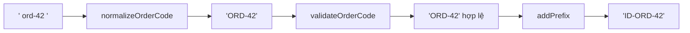
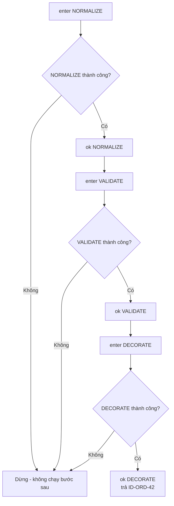
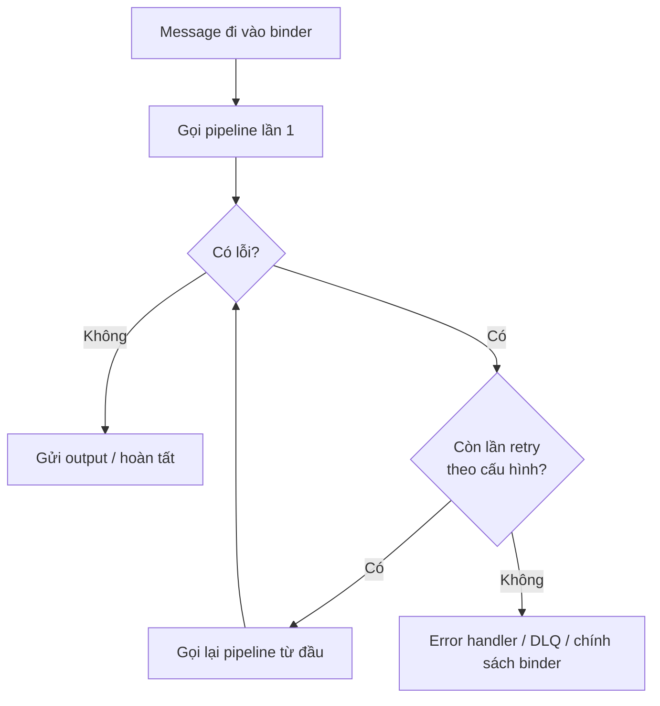
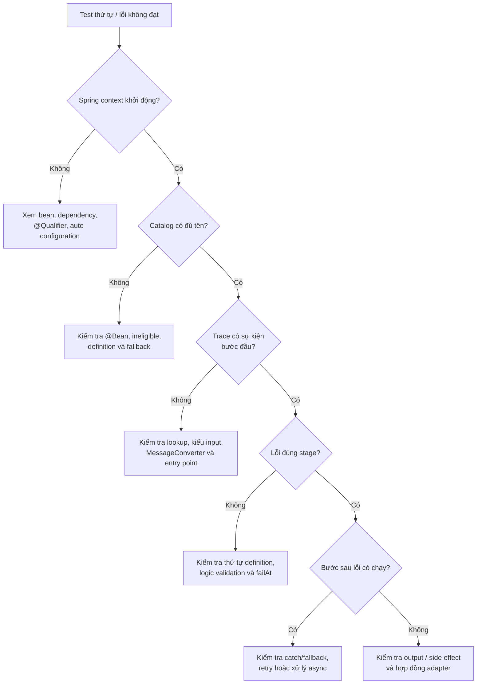

# Kiểm thử thứ tự ghép và lỗi tại từng bước

**Chương:** Kiểm thử  
**Module:** Spring Cloud Function (`SPRING_CLOUD_FUNCTION`)

Spring Cloud Function khuyến khích đóng gói logic nghiệp vụ thành các `Supplier`, `Function` và `Consumer` để sử dụng lại từ mã Java, HTTP, hệ thống sự kiện hoặc môi trường serverless. Khi một nghiệp vụ gồm nhiều thao tác, Spring Cloud Function cho phép **ghép hàm (function composition)** bằng định nghĩa như `normalizeOrderCode|validateOrderCode|addPrefix`. Một thay đổi nhỏ trong thứ tự hoặc một lỗi tại bước giữa có thể làm thay đổi hoàn toàn đầu ra và tác dụng phụ của hệ thống.

Kiểm thử composition vì vậy không chỉ là `assertEquals(expected, pipeline.apply(input))`. Chúng ta còn cần xác định **bước nào được gọi, bước nào đã hoàn tất, bước nào thất bại và liệu bước phía sau có vô tình chạy tiếp hay không**. Đặc biệt với `Consumer` ghi database/phát sự kiện, kiểm tra rằng tác dụng phụ *không xảy ra* sau lỗi là một yêu cầu quan trọng.

Bài này xây dựng hai tầng kiểm thử: (1) composition Java thuần bằng `Function.andThen(...)`, và (2) composition qua `FunctionCatalog.lookup(...)` trong Spring context. Mã mẫu dùng JUnit 5, một bộ ghi vết trong bộ nhớ và các lỗi có thể kích hoạt tại từng bước. Không yêu cầu khởi động HTTP server hoặc message broker.

## 1. Mục tiêu và tiêu chí hoàn thành

Sau bài học, bạn có thể:

1. Xác minh thứ tự thực thi của một chuỗi `Function<A,B>|Function<B,C>|Function<C,D>`.
2. So sánh kết quả Java `andThen(...)` với function definition qua `FunctionCatalog`.
3. Kích hoạt lỗi có kiểm soát tại bước đầu, giữa hoặc cuối và kiểm tra phần chuỗi đã chạy.
4. Phân biệt **bước đã được gọi** với **bước hoàn tất thành công**.
5. Kiểm tra trường hợp validation của nghiệp vụ thất bại và bảo đảm bước có side effect không được chạy.
6. Kiểm tra thay đổi hợp đồng với `Supplier|Function`, `Function|Consumer` và các trường hợp không ghép được.
7. Phân biệt lỗi trong chuỗi imperative với retry, DLQ, reactive stream và adapter bên ngoài.

Một bộ test tốt cần chứng minh **bốn điều** với mỗi kịch bản quan trọng:

| Điều cần kiểm tra | Câu hỏi |
| --- | --- |
| Đầu ra hoặc ngoại lệ | Chuỗi kết thúc thành công hay thất bại đúng kỳ vọng? |
| **Thứ tự bước** | Các bước được gọi theo đúng definition không? |
| **Điểm thất bại** | Bước nào được gọi nhưng chưa hoàn tất? |
| **Không chạy tiếp** | Bước sau lỗi, đặc biệt nơi có side effect, có được bỏ qua không? |

## 2. Hai cách ghép hàm: Java và FunctionCatalog

Với ba hàm Java:

```java
Function<String, String> normalize = input ->
    input.trim().toUpperCase(Locale.ROOT);

Function<String, String> validate = input -> {
    if (!input.matches("ORD-[0-9]+")) {
        throw new IllegalArgumentException("Invalid order code");
    }
    return input;
};

Function<String, String> decorate =
    input -> "ID-" + input;
```

**Java composition:**

```java
Function<String, String> direct =
    normalize.andThen(validate).andThen(decorate);

String result = direct.apply("  ord-42  ");
// ID-ORD-42
```

**Composition do Spring Cloud Function phân giải:**

```java
Function<String, String> viaCatalog =
    catalog.lookup(
        Function.class,
        "normalizeOrderCode|validateOrderCode|addPrefix");

if (viaCatalog == null) {
    throw new IllegalStateException("Pipeline not found");
}

String result = viaCatalog.apply("  ord-42  ");
// ID-ORD-42
```

Ở đây, `catalog` phải được Spring tiêm kiểu `org.springframework.cloud.function.context.FunctionCatalog`. Cách Java ghép **đối tượng hàm**; cách catalog ghép **những functional bean theo tên** và có thể sử dụng wrapper để quản lý metadata/conversion.

Theo tài liệu Spring Cloud Function, dấu `|` là dấu ghép theo thứ tự, và `,` cũng được hỗ trợ như dấu composition. Trong ví dụ và kiểm thử, nên dùng `|` vì dễ đọc:

```properties
spring.cloud.function.definition=normalizeOrderCode|validateOrderCode|addPrefix
```

Thuộc tính này giúp adapter chọn pipeline; còn trong test Java, có thể gọi `catalog.lookup(...)` với definition tường minh mà không cần HTTP hay broker.

### 2.1. Tại sao thứ tự rất quan trọng?



Nếu `validateOrderCode` chạy trước `normalizeOrderCode`, input `"  ord-42  "` chưa đáp ứng mẫu `ORD-[0-9]+` và bị từ chối. Nếu `addPrefix` chạy trước validation, giá trị `ID-ORD-42` có thể không còn phù hợp hợp đồng của validator.

| Definition | Kết quả với `"  ord-42  "` | Lý do |
| --- | --- | --- |
| `normalizeOrderCode|validateOrderCode|addPrefix` | `ID-ORD-42` | Thứ tự đúng |
| `validateOrderCode|normalizeOrderCode|addPrefix` | Lỗi validation | Chưa chuẩn hóa |
| `normalizeOrderCode|addPrefix|validateOrderCode` | Lỗi validation | Tiền tố mới không khớp validator |
| `normalizeOrderCode|addPrefix` | `ID-ORD-42` | Không kiểm tra định dạng ở bước giữa |

Một test chỉ so sánh output của chuỗi “đúng” sẽ không đủ để phát hiện việc một bước được bỏ qua, thay thế hoặc đảo thứ tự nhưng vô tình vẫn cho cùng kết quả trong vài dữ liệu thử.

### 2.2. Ghép tuần tự và chọn nhiều definition không giống nhau

| Chuỗi | Ý nghĩa |
| --- | --- |
| `a|b|c` | Một pipeline: gọi `a` rồi `b` rồi `c` |
| `a,b,c` | Cú pháp composition thay thế được tài liệu hỗ trợ |
| `a;b;c` | Danh sách **nhiều definition độc lập** ở các adapter hỗ trợ, không phải chuỗi tuần tự |

Không sử dụng `;` trong test nhằm chứng minh thứ tự ghép `a → b → c`.

## 3. Lỗi trong chuỗi imperative thường chặn bước phía sau

Với Java `Function.andThen(...)`, bước sau chỉ được gọi khi bước trước trả về thành công. Nếu một bước ném ngoại lệ **đồng bộ** và không có lớp bao nào tự xử lý, các bước phía sau sẽ không chạy trong lần gọi đó.

```java
List<String> called = new ArrayList<>();

Function<String, String> first = input -> {
    called.add("first");
    return input + "-A";
};

Function<String, String> second = input -> {
    called.add("second");
    throw new IllegalStateException("second failed");
};

Function<String, String> third = input -> {
    called.add("third");
    return input + "-C";
};

Function<String, String> chain =
    first.andThen(second).andThen(third);

assertThrows(
    IllegalStateException.class,
    () -> chain.apply("X"));
assertEquals(List.of("first", "second"), called);
```

Trong ví dụ trên cần import `java.util.ArrayList`, `java.util.List`, `java.util.function.Function` và JUnit assertions. Test chứng minh `third` không chạy khi `second` ném lỗi.

**Giới hạn:** đây là quy tắc của composition imperative đồng bộ. Nếu một bước **tự bắt lỗi**, trả về giá trị dự phòng, lập lịch xử lý bất đồng bộ hoặc trả `Flux`/`Mono`, “bước thất bại” và “bước sau có chạy hay không” phải được định nghĩa theo hợp đồng khác. Spring Cloud Stream binder cũng có thể gửi lại **toàn bộ message** sau một lỗi; đó là một lần invocation mới, không phải bước sau chạy tiếp trong chính lần invocation đã lỗi.

## 4. Thiết kế bộ ghi vết để nhận ra bước nào dừng

Thay vì chỉ thu thập tên các bước đã được gọi, ta ghi **hai sự kiện**:

- `enter:NORMALIZE` — bắt đầu bước chuẩn hóa.
- `ok:NORMALIZE` — bước chuẩn hóa đã kết thúc thành công.

Nếu test ghi `enter:VALIDATE` nhưng **không có `ok:VALIDATE`**, ta biết lỗi xuất hiện trong hoặc ngay sau khi bắt đầu bước validation. Các sự kiện bước kế tiếp phải vắng mặt khi lỗi chưa được xử lý.

| Trường hợp | Trace kỳ vọng |
| --- | --- |
| Thành công | `enter:NORMALIZE, ok:NORMALIZE, enter:VALIDATE, ok:VALIDATE, enter:DECORATE, ok:DECORATE` |
| Lỗi chuẩn hóa | `enter:NORMALIZE` |
| Lỗi validation | `enter:NORMALIZE, ok:NORMALIZE, enter:VALIDATE` |
| Lỗi thêm tiền tố | `enter:NORMALIZE, ok:NORMALIZE, enter:VALIDATE, ok:VALIDATE, enter:DECORATE` |

Bộ ghi vết trong bài là **test fixture**, không phải một framework tracing của production. Nó chạy trong bộ nhớ, không cần database, message broker hay hệ thống quan sát bên ngoài.



## 5. Ứng dụng Spring Boot mẫu cho các kịch bản lỗi

**File:** `src/main/java/example/testing/PipelineTestingApplication.java`

Ứng dụng khai báo ba `Function<String,String>`, một `Supplier<String>` và một `Consumer<String>`. Tất cả dùng chung `PipelineProbe` để test có thể đặt “lỗi xảy ra tại bước nào” và quan sát thứ tự. Trong sản phẩm thực, logic nghiệp vụ nên được tách riêng; cơ chế cài lỗi bằng `failAt` chỉ phục vụ fixture kiểm thử.

```java
package example.testing;

import java.util.List;
import java.util.Locale;
import java.util.concurrent.CopyOnWriteArrayList;
import java.util.function.Consumer;
import java.util.function.Function;
import java.util.function.Supplier;

import org.springframework.boot.SpringApplication;
import org.springframework.boot.autoconfigure.SpringBootApplication;
import org.springframework.context.annotation.Bean;

@SpringBootApplication(proxyBeanMethods = false)
public class PipelineTestingApplication {

    public static void main(String[] args) {
        SpringApplication.run(PipelineTestingApplication.class, args);
    }

    public enum Stage {
        SOURCE, NORMALIZE, VALIDATE, DECORATE, SINK
    }

    public static final class StageFailure
            extends RuntimeException {
        private final Stage stage;

        public StageFailure(Stage stage) {
            super("Injected failure at " + stage);
            this.stage = stage;
        }

        public Stage stage() {
            return stage;
        }
    }

    public static final class PipelineProbe {
        private final List<String> trace =
            new CopyOnWriteArrayList<>();
        private final List<String> audited =
            new CopyOnWriteArrayList<>();
        private volatile Stage failAt;

        public void reset(Stage stageToFail) {
            trace.clear();
            audited.clear();
            failAt = stageToFail;
        }

        public void enter(Stage stage) {
            trace.add("enter:" + stage);
            if (failAt == stage) {
                throw new StageFailure(stage);
            }
        }

        public void success(Stage stage) {
            trace.add("ok:" + stage);
        }

        public void record(String value) {
            audited.add(value);
        }

        public List<String> trace() {
            return List.copyOf(trace);
        }

        public List<String> audited() {
            return List.copyOf(audited);
        }
    }

    @Bean
    public PipelineProbe pipelineProbe() {
        return new PipelineProbe();
    }

    @Bean("normalizeOrderCode")
    public Function<String, String> normalizeOrderCode(
            PipelineProbe probe) {
        return input -> {
            probe.enter(Stage.NORMALIZE);
            if (input == null) {
                throw new IllegalArgumentException(
                    "Order code must not be null");
            }
            String result =
                input.trim().toUpperCase(Locale.ROOT);
            probe.success(Stage.NORMALIZE);
            return result;
        };
    }

    @Bean("validateOrderCode")
    public Function<String, String> validateOrderCode(
            PipelineProbe probe) {
        return value -> {
            probe.enter(Stage.VALIDATE);
            if (!value.matches("ORD-[0-9]+")) {
                throw new IllegalArgumentException(
                    "Invalid order code: expected ORD-<digits>");
            }
            probe.success(Stage.VALIDATE);
            return value;
        };
    }

    @Bean("addPrefix")
    public Function<String, String> addPrefix(
            PipelineProbe probe) {
        return value -> {
            probe.enter(Stage.DECORATE);
            String result = "ID-" + value;
            probe.success(Stage.DECORATE);
            return result;
        };
    }

    @Bean("issueOrderCode")
    public Supplier<String> issueOrderCode(
            PipelineProbe probe) {
        return () -> {
            probe.enter(Stage.SOURCE);
            String value = "  ord-42  ";
            probe.success(Stage.SOURCE);
            return value;
        };
    }

    @Bean("auditOrderCode")
    public Consumer<String> auditOrderCode(
            PipelineProbe probe) {
        return value -> {
            probe.enter(Stage.SINK);
            probe.record(value);
            probe.success(Stage.SINK);
        };
    }
}
```

Hai phương thức `PipelineProbe.trace()` và `PipelineProbe.audited()` trả danh sách snapshot để test không cần đọc trực tiếp cấu trúc lưu trữ. `PipelineProbe.reset(...)` xóa dữ liệu và chọn một điểm lỗi; truyền `null` để không chèn lỗi.

**Lưu ý về concurrency:** các test sử dụng một singleton `PipelineProbe` trong Spring context. Fixture này phù hợp khi những test dùng chung context **không chạy đồng thời**. Dù dùng `CopyOnWriteArrayList` và `volatile`, chuỗi thao tác `reset → apply → snapshot` không trở thành một transaction thread-safe. Không chạy các scenario này song song trên cùng probe; nếu cần parallel test, hãy tách context hoặc sử dụng fixture riêng cho từng scenario.

### 5.1. Dữ liệu của từng bước và kết quả kỳ vọng

| Bean | Input | Output | Dấu vết được ghi |
| --- | --- | --- | --- |
| `normalizeOrderCode` | `"  ord-42  "` | `"ORD-42"` | `enter:NORMALIZE`, `ok:NORMALIZE` |
| `validateOrderCode` | `"ORD-42"` | `"ORD-42"` | `enter:VALIDATE`, `ok:VALIDATE` |
| `addPrefix` | `"ORD-42"` | `"ID-ORD-42"` | `enter:DECORATE`, `ok:DECORATE` |
| `issueOrderCode` | Không nhận input | `"  ord-42  "` | `enter:SOURCE`, `ok:SOURCE` |
| `auditOrderCode` | `"ORD-42"` | Không có output nghiệp vụ | `enter:SINK`, `ok:SINK` và ghi audit |

### 5.2. Đăng ký nhiều hàm để tránh nhầm single-function fallback

Fixture có nhiều functional bean. Điều đó có ích vì trong một số phiên bản/cấu hình, khi chỉ có một hàm đủ điều kiện, `FunctionCatalog.lookup("tenSai")` có thể trả về hàm duy nhất do *single-function fallback*.

Trước khi thực thi pipeline, test sẽ kiểm tra từng tên xuất hiện trong `catalog.getNames(Function.class)`. Không coi việc `lookup(...) != null` là bằng chứng duy nhất rằng một tên đã được đăng ký chính xác.

## 6. Khung kiểm thử: SpringBootTest không cần Web server

**File:** `src/test/java/example/testing/PipelineCompositionTest.java`

Bộ test dưới đây dùng Spring Boot Test và JUnit Jupiter. Một lần `@SpringBootTest(webEnvironment = NONE)` tạo Spring context thật có các bean ở mục 5, đủ để kiểm tra definition qua catalog nhưng không mở HTTP server/broker.

Các dependency thường cần trong dự án đã có dependency management Spring Boot/Spring Cloud tương thích:

```xml
<dependency>
    <groupId>org.springframework.cloud</groupId>
    <artifactId>spring-cloud-function-context</artifactId>
</dependency>
<dependency>
    <groupId>org.springframework.boot</groupId>
    <artifactId>spring-boot-starter-test</artifactId>
    <scope>test</scope>
</dependency>
```

Đây là **trích đoạn dependencies**, không phải POM đầy đủ. Cần Spring Boot và cơ chế quản lý phiên bản của dự án. Không thêm Spring Cloud Stream binder chỉ để thử thứ tự ghép bằng catalog.

Trong bài, mọi phương thức test chạy với:

```java
@SpringBootTest(
    classes = PipelineTestingApplication.class,
    webEnvironment = SpringBootTest.WebEnvironment.NONE
)
```

Khác với unit test Java thuần, kiểm thử này **có Spring context**, vì mục tiêu bao gồm registration, lookup và composition của Spring Cloud Function.

### 6.1. Toàn bộ lớp PipelineCompositionTest

```java
package example.testing;

import static org.junit.jupiter.api.Assertions.*;

import java.util.List;
import java.util.Set;
import java.util.function.Consumer;
import java.util.function.Function;
import java.util.function.Supplier;
import java.util.stream.Stream;

import org.junit.jupiter.api.BeforeEach;
import org.junit.jupiter.api.Test;
import org.junit.jupiter.api.parallel.Execution;
import org.junit.jupiter.api.parallel.ExecutionMode;
import org.junit.jupiter.params.ParameterizedTest;
import org.junit.jupiter.params.provider.Arguments;
import org.junit.jupiter.params.provider.MethodSource;
import org.springframework.beans.factory.annotation.Autowired;
import org.springframework.beans.factory.annotation.Qualifier;
import org.springframework.boot.test.context.SpringBootTest;
import org.springframework.cloud.function.context.FunctionCatalog;

import example.testing.PipelineTestingApplication.PipelineProbe;
import example.testing.PipelineTestingApplication.Stage;
import example.testing.PipelineTestingApplication.StageFailure;

@SpringBootTest(
    classes = PipelineTestingApplication.class,
    webEnvironment = SpringBootTest.WebEnvironment.NONE
)
@Execution(ExecutionMode.SAME_THREAD)
class PipelineCompositionTest {

    @Autowired
    private FunctionCatalog catalog;

    @Autowired
    private PipelineProbe probe;

    @Autowired
    @Qualifier("normalizeOrderCode")
    private Function<String, String> normalize;

    @Autowired
    @Qualifier("validateOrderCode")
    private Function<String, String> validate;

    @Autowired
    @Qualifier("addPrefix")
    private Function<String, String> decorate;

    @BeforeEach
    void resetProbe() {
        probe.reset(null);
    }

    private Function<String, String> directPipeline() {
        return normalize.andThen(validate).andThen(decorate);
    }

    private Function<String, String> catalogPipeline() {
        Function<String, String> result =
            catalog.lookup(
                Function.class,
                "normalizeOrderCode|validateOrderCode|addPrefix");
        assertNotNull(result, "Cannot resolve composed function");
        return result;
    }

    private static List<String> successfulTrace() {
        return List.of(
            "enter:NORMALIZE", "ok:NORMALIZE",
            "enter:VALIDATE", "ok:VALIDATE",
            "enter:DECORATE", "ok:DECORATE"
        );
    }

    @Test
    void catalogContainsEveryStepByItsExactName() {
        Set<String> names = catalog.getNames(Function.class);
        assertTrue(names.containsAll(Set.of(
            "normalizeOrderCode",
            "validateOrderCode",
            "addPrefix"
        )));
    }

    @Test
    void javaAndCatalogFollowTheSameOrder() {
        String input = "  ord-42  ";

        String directResult = directPipeline().apply(input);
        List<String> directTrace = probe.trace();

        probe.reset(null);

        String catalogResult = catalogPipeline().apply(input);
        List<String> catalogTrace = probe.trace();

        assertEquals("ID-ORD-42", directResult);
        assertEquals("ID-ORD-42", catalogResult);
        assertEquals(directResult, catalogResult);
        assertEquals(successfulTrace(), directTrace);
        assertEquals(successfulTrace(), catalogTrace);
    }

    static Stream<Arguments> injectedFailures() {
        return Stream.of(
            Arguments.of(
                Stage.NORMALIZE,
                List.of("enter:NORMALIZE")
            ),
            Arguments.of(
                Stage.VALIDATE,
                List.of(
                    "enter:NORMALIZE", "ok:NORMALIZE",
                    "enter:VALIDATE"
                )
            ),
            Arguments.of(
                Stage.DECORATE,
                List.of(
                    "enter:NORMALIZE", "ok:NORMALIZE",
                    "enter:VALIDATE", "ok:VALIDATE",
                    "enter:DECORATE"
                )
            )
        );
    }

    @ParameterizedTest
    @MethodSource("injectedFailures")
    void eachFailureStopsAtTheSameStageForBothPaths(
            Stage failAt, List<String> expectedTrace) {
        String input = "  ord-42  ";

        probe.reset(failAt);
        RuntimeException directError = assertThrows(
            RuntimeException.class,
            () -> directPipeline().apply(input));
        List<String> directTrace = probe.trace();

        probe.reset(failAt);
        RuntimeException catalogError = assertThrows(
            RuntimeException.class,
            () -> catalogPipeline().apply(input));
        List<String> catalogTrace = probe.trace();

        StageFailure directFailure =
            findCause(directError, StageFailure.class);
        StageFailure catalogFailure =
            findCause(catalogError, StageFailure.class);

        assertNotNull(directFailure);
        assertNotNull(catalogFailure);
        assertEquals(failAt, directFailure.stage());
        assertEquals(failAt, catalogFailure.stage());
        assertEquals(expectedTrace, directTrace);
        assertEquals(expectedTrace, catalogTrace);
        assertTrue(probe.audited().isEmpty());
    }

    @Test
    void validationErrorPreventsDecoration() {
        RuntimeException error = assertThrows(
            RuntimeException.class,
            () -> catalogPipeline().apply(" invalid-code "));

        IllegalArgumentException businessError =
            findCause(error, IllegalArgumentException.class);

        assertNotNull(businessError);
        assertEquals(
            "Invalid order code: expected ORD-<digits>",
            businessError.getMessage());
        assertEquals(
            List.of(
                "enter:NORMALIZE", "ok:NORMALIZE",
                "enter:VALIDATE"
            ),
            probe.trace());
    }

    @Test
    void reversedOrderFailsBeforeNormalization() {
        Function<String, String> reversed =
            catalog.lookup(
                Function.class,
                "validateOrderCode|normalizeOrderCode|addPrefix");
        assertNotNull(reversed);

        assertThrows(
            RuntimeException.class,
            () -> reversed.apply("  ord-42  "));

        assertEquals(
            List.of("enter:VALIDATE"),
            probe.trace());
    }

    @Test
    void sourceThenFunctionsBehavesAsSupplier() {
        Supplier<String> sourcePipeline =
            catalog.lookup(
                Supplier.class,
                "issueOrderCode|normalizeOrderCode|validateOrderCode");
        assertNotNull(sourcePipeline);

        assertEquals("ORD-42", sourcePipeline.get());
        assertEquals(
            List.of(
                "enter:SOURCE", "ok:SOURCE",
                "enter:NORMALIZE", "ok:NORMALIZE",
                "enter:VALIDATE", "ok:VALIDATE"
            ),
            probe.trace());
    }

    @Test
    void sourceFailurePreventsEveryDownstreamFunction() {
        Supplier<String> sourcePipeline =
            catalog.lookup(
                Supplier.class,
                "issueOrderCode|normalizeOrderCode|validateOrderCode");
        assertNotNull(sourcePipeline);

        probe.reset(Stage.SOURCE);
        RuntimeException error = assertThrows(
            RuntimeException.class, sourcePipeline::get);
        StageFailure failure =
            findCause(error, StageFailure.class);

        assertNotNull(failure);
        assertEquals(Stage.SOURCE, failure.stage());
        assertEquals(
            List.of("enter:SOURCE"),
            probe.trace());
    }

    @Test
    void functionThenConsumerRunsSinkLast() {
        Consumer<String> sinkPipeline =
            catalog.lookup(
                Consumer.class,
                "normalizeOrderCode|validateOrderCode|auditOrderCode");
        assertNotNull(sinkPipeline);

        sinkPipeline.accept("  ord-42  ");

        assertEquals(List.of("ORD-42"), probe.audited());
        assertEquals(
            List.of(
                "enter:NORMALIZE", "ok:NORMALIZE",
                "enter:VALIDATE", "ok:VALIDATE",
                "enter:SINK", "ok:SINK"
            ),
            probe.trace());
    }

    @Test
    void validationFailureSkipsConsumerSideEffect() {
        Consumer<String> sinkPipeline =
            catalog.lookup(
                Consumer.class,
                "normalizeOrderCode|validateOrderCode|auditOrderCode");
        assertNotNull(sinkPipeline);

        probe.reset(Stage.VALIDATE);
        RuntimeException error = assertThrows(
            RuntimeException.class,
            () -> sinkPipeline.accept("  ord-42  "));
        assertNotNull(findCause(error, StageFailure.class));

        assertEquals(
            List.of(
                "enter:NORMALIZE", "ok:NORMALIZE",
                "enter:VALIDATE"
            ),
            probe.trace());
        assertTrue(probe.audited().isEmpty());
    }

    @Test
    void sinkFailureDoesNotCreateAnAuditRecord() {
        Consumer<String> sinkPipeline =
            catalog.lookup(
                Consumer.class,
                "normalizeOrderCode|validateOrderCode|auditOrderCode");
        assertNotNull(sinkPipeline);

        probe.reset(Stage.SINK);
        RuntimeException error = assertThrows(
            RuntimeException.class,
            () -> sinkPipeline.accept("  ord-42  "));
        StageFailure failure =
            findCause(error, StageFailure.class);
        assertNotNull(failure);
        assertEquals(Stage.SINK, failure.stage());

        assertEquals(
            List.of(
                "enter:NORMALIZE", "ok:NORMALIZE",
                "enter:VALIDATE", "ok:VALIDATE",
                "enter:SINK"
            ),
            probe.trace());
        assertTrue(probe.audited().isEmpty());
    }

    private static <T extends Throwable> T findCause(
            Throwable error, Class<T> expectedType) {
        Throwable current = error;
        for (int depth = 0; current != null && depth < 30; depth++) {
            if (expectedType.isInstance(current)) {
                return expectedType.cast(current);
            }
            if (current == current.getCause()) {
                break;
            }
            current = current.getCause();
        }
        return null;
    }
}
```

Test có các nhánh **thành công, lỗi tại từng bước, sai thứ tự, validation lỗi và side effect của Consumer**. Hàm `findCause(...)` tìm lỗi được cài đặt bởi fixture trong chuỗi `cause`, giúp test không phụ thuộc tuyệt đối vào lớp exception bên ngoài mà wrapper dùng trong từng phiên bản.

### 6.2. Vì sao có @Execution(SAME_THREAD)?

Các test dùng một bean singleton `PipelineProbe` để lưu trace. `@Execution(ExecutionMode.SAME_THREAD)` giúp các phương thức test **trong lớp này** được thực thi tuần tự theo ngữ cảnh JUnit Jupiter. Điều đó không bảo đảm cô lập nếu **lớp test khác cùng dùng context/probe và được chạy song song**. Khi dự án bật parallel execution cho toàn suite, nên chuyển tới fixture riêng hoặc cơ chế đồng bộ hóa tài nguyên test phù hợp.

Các test vẫn có thể chạy theo **thứ tự bất kỳ**, vì `@BeforeEach` đặt lại trạng thái; chúng không dựa vào việc test thành công chạy trước test thất bại.

### 6.3. Cảnh báo về chữ ký generic của lookup

`catalog.lookup(Function.class, definition)` chỉ nhận raw `Function.class` để chọn nhóm giao diện. Java không kiểm tra được đầy đủ generic `String → String` ở runtime. Vì vậy, mỗi test phải biết hợp đồng input/output của từng bean và pipeline. Đừng gán một pipeline trả `Integer` thành `Function<String,String>` rồi coi việc biên dịch thành công là bằng chứng đúng kiểu.

## 7. Đọc kết quả failure injection

Ba trường hợp lỗi chủ động được kích hoạt bằng:

```java
probe.reset(Stage.NORMALIZE);
probe.reset(Stage.VALIDATE);
probe.reset(Stage.DECORATE);
```

Trong mỗi trường hợp, test đưa cùng đầu vào `"  ord-42  "` vào đường Java và đường catalog, sau đó so sánh:

| `failAt` | Bước được gọi | Bước hoàn tất | Bước không được gọi |
| --- | --- | --- | --- |
| `NORMALIZE` | NORMALIZE | Không có | VALIDATE, DECORATE |
| `VALIDATE` | NORMALIZE, VALIDATE | NORMALIZE | DECORATE |
| `DECORATE` | NORMALIZE, VALIDATE, DECORATE | NORMALIZE, VALIDATE | Không còn bước phía sau |

Điểm khác biệt giữa **được gọi** và **hoàn tất** đặc biệt quan trọng. Nếu chỉ ghi `List.of("normalize", "validate")`, bạn chưa biết validation đã thành công hay bị lỗi sau khi bắt đầu.

### 7.1. Vì sao cần kiểm tra ngoại lệ và trace?

Giả sử test chỉ có:

```java
assertThrows(
    RuntimeException.class,
    () -> catalogPipeline().apply("  ord-42  "));
```

Nó có thể xanh vì lỗi khác hoàn toàn, chẳng hạn converter hoặc một bước không liên quan. Test trong bài bổ sung:

```java
StageFailure failure =
    findCause(error, StageFailure.class);
assertNotNull(failure);
assertEquals(failAt, failure.stage());
assertEquals(expectedTrace, probe.trace());
```

Nhờ đó ta biết lỗi **đúng bước dự định** và không xảy ra lời gọi thừa sau điểm lỗi.

### 7.2. Vì sao không luôn assert class exception ngoài cùng?

Khi chỉ dùng Java `andThen(...)`, một `StageFailure` sẽ thường thoát ra trực tiếp vì không có lớp bọc đặc thù. Khi đi qua `FunctionCatalog`, wrapper có thể thêm xử lý metadata/conversion và tùy phiên bản có thể dùng lớp exception bên ngoài khác.

Với kiểm thử hành vi nghiệp vụ, nên:

1. Kiểm tra **nguyên nhân liên quan** (ở đây là `StageFailure.stage()`).
2. Kiểm tra trace và side effect.
3. Chỉ khẳng định exact outer exception nếu ứng dụng đã quy định nó như một hợp đồng ổn định.

Nếu lỗi xuất hiện **trước khi functional bean được gọi** (ví dụ conversion input hoặc lookup không phân giải), trace có thể rỗng. Khi đó không được ghi sai kết luận rằng bước đầu đã chạy.

### 7.3. Lỗi validation là một tình huống khác failure injection

`StageFailure` là lỗi do test cố tình cài. Còn chuỗi `" invalid-code "` bị `validateOrderCode` từ chối do **quy tắc nghiệp vụ**. Cả hai đều cần test:

| Nguồn lỗi | Mục tiêu |
| --- | --- |
| `probe.reset(Stage.VALIDATE)` | Chứng minh pipeline dừng đúng khi một bước bất kỳ ném lỗi |
| `validateOrderCode` kiểm tra regex thất bại | Chứng minh validation thực sự từ chối dữ liệu không hợp lệ |
| Conversion tạo lỗi trước khi gọi bean | Chứng minh ranh giới dữ liệu; cần test converter riêng |

Đừng chỉ cài ngoại lệ giả rồi bỏ qua những nhánh validation/điều kiện nghiệp vụ thật của từng hàm.

## 8. Test sai thứ tự nhằm phòng regression

Một thay đổi cấu hình từ:

```properties
spring.cloud.function.definition=normalizeOrderCode|validateOrderCode|addPrefix
```

thành:

```properties
spring.cloud.function.definition=validateOrderCode|normalizeOrderCode|addPrefix
```

có thể khiến request hợp lệ bị từ chối. Test `reversedOrderFailsBeforeNormalization` chứng minh:

- `validateOrderCode` được gọi trước.
- Trace có `enter:VALIDATE` nhưng không có `ok:VALIDATE`.
- `normalizeOrderCode` và `addPrefix` không chạy.

Điều này giúp tìm lỗi cấu hình thứ tự, không chỉ lỗi bên trong từng bean. Một test tích hợp adapter nên kiểm tra **definition thực sự được cấu hình từ môi trường**, bởi test gọi `catalog.lookup(...)` bằng chuỗi cố định sẽ không phát hiện property cấu hình production bị sửa.

### 8.1. Test cấu hình môi trường và test definition trực tiếp

Hai kiểu test có mục đích khác nhau:

| Test | Điều được xác minh |
| --- | --- |
| `catalog.lookup(Function.class, "normalize|validate|decorate")` | Catalog hiểu chuỗi mà test chỉ định |
| Đọc `spring.cloud.function.definition` từ Environment rồi phân giải | Property được nạp và chọn đúng definition |
| HTTP/Stream/serverless adapter gọi hàm từ property thực tế | Cấu hình selection và adapter đã hoạt động end-to-end |

Để kiểm thử **property** cùng fixture, có thể tạo một lớp test riêng:

```java
@SpringBootTest(
    classes = PipelineTestingApplication.class,
    webEnvironment = SpringBootTest.WebEnvironment.NONE,
    properties = {
        "spring.cloud.function.definition="
            + "normalizeOrderCode|validateOrderCode|addPrefix"
    }
)
class ConfiguredDefinitionTest {

    @Autowired
    private org.springframework.core.env.Environment environment;

    @Autowired
    private FunctionCatalog catalog;

    @Test
    void configuredDefinitionHasTheIntendedOrder() {
        String definition = environment.getRequiredProperty(
            "spring.cloud.function.definition");
        assertEquals(
            "normalizeOrderCode|validateOrderCode|addPrefix",
            definition);
        assertNotNull(catalog.lookup(Function.class, definition));
    }
}
```

Đoạn trên là một ví dụ lớp test **bổ sung**, cần import `SpringBootTest`, `Autowired`, `Test`, `FunctionCatalog`, `Function` và JUnit assertions như ở mục 6. Nó không gửi message qua binder: property đúng trong Spring Environment **chưa đủ** để chứng minh Stream binding hoặc HTTP mapping đã xuất hiện.

## 9. Kiểm tra không tạo tác dụng phụ sau lỗi

Với pipeline kết thúc bằng `Consumer`:

```text
normalizeOrderCode
    |
validateOrderCode
    |
auditOrderCode  (side effect)
```

Nếu validation thất bại, test phải chứng minh **không có bản ghi audit**. Trong ví dụ:

```java
probe.reset(Stage.VALIDATE);
assertThrows(
    RuntimeException.class,
    () -> sinkPipeline.accept("  ord-42  "));

assertTrue(probe.audited().isEmpty());
assertFalse(probe.trace().contains("enter:SINK"));
```

Lý do hai assertion này bổ sung cho nhau:

- Danh sách audit rỗng cho thấy **chưa có bản ghi hoàn tất** trong fake.
- Trace không có `enter:SINK` cho thấy **sink chưa được gọi**.

Nếu chỉ kiểm tra audit rỗng, một bug trong sink có thể đã gọi tới cổng ghi nhận rồi thất bại **trước khi lưu**, khiến test bỏ sót việc sink thực tế đã chạy. Nếu hệ thống có side effect bên ngoài, cần dùng fake/spy ghi lại cả **lần thử gửi** và **lần gửi thành công**, tùy điều cần chứng minh.

### 9.1. Nếu lỗi xảy ra ngay trong Consumer

Test `sinkFailureDoesNotCreateAnAuditRecord` đặt `failAt=SINK`. Kỳ vọng:

```text
enter:NORMALIZE
ok:NORMALIZE
enter:VALIDATE
ok:VALIDATE
enter:SINK
```

Không có `ok:SINK` và không có audit record, bởi fixture ném lỗi **trước** khi gọi `record(...)`.

Trong hệ thống thật, một `Consumer` có thể ghi xong rồi ném lỗi. Lúc đó, việc retry message có thể gây side effect lặp lại. Cần thiết kế idempotency, transaction hoặc deduplication nếu nghiệp vụ yêu cầu *effectively once*; bản thân composition không bảo đảm exactly-once.

### 9.2. Tại sao không dùng một fake ghi dữ liệu thật?

Nếu `Consumer` phát event tới broker hoặc ghi database trong test, mỗi lần chạy có thể tạo dữ liệu tồn tại sau test. Điều này làm test khó lặp lại và còn có nguy cơ gây tác động tới hệ thống thật. Dùng `PipelineProbe` trong bộ nhớ để xác minh thứ tự và điều kiện dừng; sau đó dùng **integration test riêng** để chứng minh tính đúng đắn của message binding hoặc transaction.

## 10. Cách kiểm thử Java thuần không cần Spring context

Để kiểm tra bản chất **thứ tự và short-circuit của `Function.andThen(...)`**, một lớp JUnit không có Spring thường là lựa chọn nhanh nhất. Test dưới đây không dùng `@SpringBootTest`, không có `FunctionCatalog`, không cần fixture ứng dụng mục 5:

**File:** `src/test/java/example/testing/PlainJavaCompositionTest.java`

```java
package example.testing;

import static org.junit.jupiter.api.Assertions.*;

import java.util.ArrayList;
import java.util.List;
import java.util.function.Function;

import org.junit.jupiter.api.Test;

class PlainJavaCompositionTest {

    @Test
    void stagesExecuteLeftToRight() {
        List<String> trace = new ArrayList<>();

        Function<String, String> first = input -> {
            trace.add("first");
            return input + "-A";
        };
        Function<String, String> second = input -> {
            trace.add("second");
            return input + "-B";
        };
        Function<String, String> third = input -> {
            trace.add("third");
            return input + "-C";
        };

        String result =
            first.andThen(second).andThen(third).apply("X");

        assertEquals("X-A-B-C", result);
        assertEquals(
            List.of("first", "second", "third"),
            trace);
    }

    @Test
    void downstreamStageIsSkippedAfterException() {
        List<String> trace = new ArrayList<>();

        Function<String, String> first = input -> {
            trace.add("first");
            return input;
        };
        Function<String, String> second = input -> {
            trace.add("second");
            throw new IllegalArgumentException("bad input");
        };
        Function<String, String> third = input -> {
            trace.add("third");
            return input;
        };

        Function<String, String> pipeline =
            first.andThen(second).andThen(third);

        assertThrows(
            IllegalArgumentException.class,
            () -> pipeline.apply("X"));
        assertEquals(List.of("first", "second"), trace);
    }
}
```

**Unit test Java** chỉ trả lời câu hỏi `andThen` thực thi và dừng như thế nào đối với các function Java được truyền vào. Nó chưa chứng minh Spring đã đăng ký bean đúng tên, `FunctionCatalog` hiểu function definition, hay một adapter sẽ chọn đúng pipeline từ cấu hình. Vì vậy, unit test này **bổ sung**, không thay thế các test mục 6.

### 10.1. Giữ dữ liệu thử dễ dự đoán

Không chọn hàm `Supplier` gọi `UUID.randomUUID()`, `System.currentTimeMillis()` hoặc một API thật rồi so sánh hai lần thực thi như thể cùng trạng thái. Mỗi lần đọc có thể cho kết quả khác nhau dù thứ tự ghép đúng.

Thay vào đó, dùng source trả dữ liệu cố định hoặc dependency fake có thể reset. Khi so sánh direct composition với catalog composition, nên gọi hai đường với:

- **Cùng input**.
- **Cùng cấu hình failure injection**.
- **Cùng trạng thái ban đầu của fake/trace**.
- **Cùng định nghĩa các bước và thứ tự**.

Nếu không reset, trace của đường thứ hai sẽ nối tiếp đường thứ nhất và test sẽ báo lỗi sai chỗ.

## 11. Ghép Supplier, Function và Consumer: loại của pipeline thay đổi

Spring Cloud Function hỗ trợ các dạng composition khác ngoài `Function|Function`. Khi thay đổi loại giao diện cuối cùng, **phương thức mà test phải gọi** cũng thay đổi.

| Chuỗi | Loại kết quả | Phương thức test | Điểm cần xác minh |
| --- | --- | --- | --- |
| `Function<A,B>|Function<B,C>` | `Function<A,C>` | `apply(input)` | Thứ tự và output |
| `Supplier<A>|Function<A,B>` | `Supplier<B>` | `get()` | Nguồn chạy trước, biến đổi sau |
| `Function<A,B>|Consumer<B>` | `Consumer<A>` | `accept(input)` | Chuyển đổi trước side effect |
| `Supplier<A>|Consumer<A>` | `Runnable` | `run()` | Lấy nguồn rồi tiêu thụ, không có output nghiệp vụ |
| `Consumer<A>|Function<A,B>` | Không ghép hợp lệ theo cách thông thường | Không có phép gọi pipeline chuẩn | Consumer không tạo output cho Function |
| `Consumer<A>|Supplier<B>` | Không ghép hợp lệ theo cách thông thường | Không có phép gọi pipeline chuẩn | Consumer không sinh dữ liệu chuyển tiếp |

Các loại sau composition được tài liệu Spring Cloud Function mô tả; **không giả định** wrapper có thể tự sửa một chuỗi không hợp lệ.

### 11.1. Supplier bị lỗi: không gọi Function theo sau

Trong `sourceFailurePreventsEveryDownstreamFunction`:

```java
probe.reset(Stage.SOURCE);
sourcePipeline.get();
```

Lời gọi trên **có chủ đích ném lỗi**. Test chính thức dùng `assertThrows(...)` và yêu cầu trace chỉ có `enter:SOURCE`. Không có `enter:NORMALIZE` hoặc `enter:VALIDATE`.

Điều đó chứng minh pipeline kết thúc sớm ngay ở nguồn, không phải chỉ kiểm tra rằng `Supplier.get()` đã ném một exception.

### 11.2. Function|Consumer: không có giá trị trả về để so sánh

Với:

```java
Consumer<String> sinkPipeline =
    catalog.lookup(
        Consumer.class,
        "normalizeOrderCode|validateOrderCode|auditOrderCode");
```

test phải dùng `sinkPipeline.accept(input)`, rồi kiểm tra `probe.audited()` và trace. **Không ép kiểu về `Function<String,String>` và chờ kết quả** vì output cuối là một `Consumer`.

### 11.3. Supplier|Consumer cho ra Runnable

Về mô hình, `issueOrderCode|auditOrderCode` tạo ra một pipeline không nhận input và không trả output nghiệp vụ; Java giao diện tương ứng là `Runnable`. Khi áp dụng trong dự án cụ thể, đối chiếu overload `FunctionCatalog.lookup(...)` và cách adapter kích hoạt `Runnable` theo phiên bản.

Một kiểm thử phù hợp phải xác minh **nguồn được gọi trước sink** và sink nhận đúng dữ liệu. Không dùng `Function.apply(input)` cho một composition không có input.

### 11.4. Không assert lỗi cố định cho definition không hợp lệ

Nếu thử ghép `auditOrderCode|normalizeOrderCode`, đây là một chuỗi không có quan hệ dữ liệu hợp lệ theo mô hình `Consumer|Function`. Tùy phiên bản, framework có thể báo lỗi khi phân giải, trả về giá trị không sử dụng được hoặc lỗi khi gọi. Kiểm thử tốt nên:

1. Xác định chữ ký của các thành phần.
2. Ngăn definition không được phép trong cấu hình hoặc lớp chọn hàm.
3. Xác minh không có pipeline hợp lệ được chạy với chuỗi đó.

Không buộc một exception class cụ thể của lớp registry thành hợp đồng dài hạn nếu tài liệu không cam kết.

## 12. Phân biệt lỗi do bước nghiệp vụ với lỗi conversion

Trong các test chính, tất cả các `Function` nhận/trả `String`. Mục đích là cô lập **thứ tự ghép và điểm lỗi** khỏi conversion.

Nhưng trong ứng dụng thật, có thể có:

```java
record OrderRequest(String code, int quantity) {}
record ValidatedOrder(String code, int quantity) {}
record Receipt(String code, long total) {}
```

với chuỗi:

```text
decodeRequest : Message<byte[]> -> OrderRequest
validateOrder : OrderRequest -> ValidatedOrder
calculate     : ValidatedOrder -> Receipt
```

Nếu `decodeRequest` hoặc wrapper conversion lỗi **trước khi chạy `validateOrder`**, trace của validation phải rỗng. Đừng ghi nhận điều đó là lỗi nghiệp vụ validation.

| Lỗi | Dấu hiệu trong trace | Đường kiểm thử phù hợp |
| --- | --- | --- |
| Tên function không tồn tại | Không có sự kiện từ bean | `getNames(...)`, `lookup(...)` và cấu hình |
| Payload không thể convert sang input type | Có thể không có sự kiện từ bước đầu | Test `MessageConverter`/contentType riêng |
| Bước normalize ném lỗi | `enter:NORMALIZE`, không có `ok:NORMALIZE` | Failure injection / business input |
| Bước validate từ chối input | Đã có `ok:NORMALIZE`, dừng ở `enter:VALIDATE` | Validation test |
| Bước sink ném lỗi | Các bước trước hoàn tất, có `enter:SINK` | Consumer/side-effect test |
| HTTP/Stream xử lý lỗi | Có thể có exception mapping, retry hoặc DLQ | Adapter/binder integration test |

### 12.1. Tại sao không dùng mismatch kiểu để test thứ tự?

Ví dụ ghép một `Function<String,Integer>` trước một `Function<OrderRequest,Receipt>` sẽ phụ thuộc vào conversion mà Spring Cloud Function có hoặc không hỗ trợ theo metadata/cấu hình. Một lỗi ở đây không nhất thiết nói được thứ tự ghép đúng hay sai.

Khi kiểm thử thứ tự, trước tiên dùng các bước **tương thích kiểu rõ ràng**. Sau đó thêm test riêng cho ranh giới DTO, `Message<?>`, `contentType` và `MessageConverter` theo yêu cầu của ứng dụng.

### 12.2. Composition qua catalog không đồng nghĩa mọi đầu ra là String

Nếu:

```text
normalize : String -> String
parse     : String -> Integer
format    : Integer -> Receipt
```

thì pipeline có kiểu hợp đồng `Function<String,Receipt>`. Việc dùng `catalog.lookup(Function.class, definition)` không kiểm tra toàn bộ generic ở compile time do Java *type erasure*. Test cần khẳng định **giá trị, trường dữ liệu và kiểu output thực tế** chứ không chỉ tin vào kiểu biến được gán.

## 13. Reactive composition: thời điểm lỗi có thể khác

Spring Cloud Function hỗ trợ reactive function, chẳng hạn:

```java
Function<Flux<String>, Flux<String>> reactive =
    flux -> flux
        .map(value -> value.trim().toUpperCase(Locale.ROOT))
        .map(value -> {
            if (!value.matches("ORD-[0-9]+")) {
                throw new IllegalArgumentException("Invalid code");
            }
            return value;
        })
        .map(value -> "ID-" + value);
```

Đoạn mã giả định có import `reactor.core.publisher.Flux`, `java.util.Locale` và `java.util.function.Function`. Với kiểu reactive:

- Hàm có thể **xây publisher** khi `apply(...)` được gọi.
- Logic trong `map(...)` thường chạy **khi có subscription**, không phải ngay lúc dựng publisher.
- Lỗi từ `map` được biểu diễn thành **onError signal**, có thể không ném trực tiếp trong lời gọi `apply(...)`.
- Những operator như `onErrorResume(...)` hoặc `retryWhen(...)` có thể thay đổi cách xử lý lỗi và số lần các bước chạy.

### 13.1. Dùng StepVerifier thay vì chỉ assertThrows

Với dependency `reactor-test` tương thích, có thể viết:

```java
import static org.junit.jupiter.api.Assertions.*;

import java.util.Locale;
import java.util.function.Function;

import org.junit.jupiter.api.Test;
import reactor.core.publisher.Flux;
import reactor.test.StepVerifier;

class ReactiveCompositionTest {

    @Test
    void downstreamStopsAfterErrorSignal() {
        Function<Flux<String>, Flux<String>> pipeline =
            source -> source
                .map(s -> s.trim().toUpperCase(Locale.ROOT))
                .map(s -> {
                    if (!s.matches("ORD-[0-9]+")) {
                        throw new IllegalArgumentException(
                            "Invalid code");
                    }
                    return s;
                })
                .map(s -> "ID-" + s);

        StepVerifier.create(
                pipeline.apply(
                    Flux.just(" ord-1 ", "invalid", " ord-3 ")))
            .expectNext("ID-ORD-1")
            .expectError(IllegalArgumentException.class)
            .verify();
    }
}
```

Trong ví dụ, sau khi phần tử thứ hai gây lỗi, publisher kết thúc bằng `onError`; không có kết quả cho phần tử thứ ba. Test này **không yêu cầu Spring**, nhưng cần Reactor và `reactor-test`.

**Đừng suy ra** từ test `Flux` rằng Spring Cloud Stream binder sẽ retry từng message theo cơ chế imperative. Tài liệu Stream phân biệt rõ: retry/DLQ của message handler imperative không tự áp dụng tương tự cho một reactive function nhận cả publisher. Với reactive, hãy thiết kế và test chính sách lỗi bằng operator phù hợp.

### 13.2. Một lỗi reactive không nhất thiết dừng mọi subscription

Nếu có `onErrorResume` hoặc `onErrorContinue`, cách các phần tử tiếp theo được xử lý có thể thay đổi. Cần quyết định hợp đồng mong muốn, sau đó viết StepVerifier kiểm tra **thứ tự giá trị, completion, error và số lần side effect**. Không dùng giả định chung “mọi lỗi luôn chặn tất cả các bước” trong luồng reactive mà chưa xét operator.

## 14. Retry và DLQ: một lần gọi lỗi có thể được gọi lại

Các test chính chỉ thực hiện **một lần invocation trực tiếp**. Trong Spring Cloud Stream, khi một imperative message handler ném lỗi, binder có thể áp dụng retry, error handler hoặc DLQ tùy cấu hình và binder.



**Hệ quả:** khi có retry, các bước đã thành công *trước điểm lỗi* có thể được gọi **nhiều lần qua các lần thử khác nhau**. Test của một lần `catalogPipeline.apply(input)` chỉ chứng minh các bước sau lỗi không chạy **trong chính lần gọi đó**.

### 14.1. Cần thêm những test nào khi triển khai với Stream?

Với một function definition:

```properties
spring.cloud.function.definition=normalizeOrderCode|validateOrderCode|addPrefix
```

hãy lập test tích hợp với Spring Cloud Stream Test Binder hoặc binder thật phù hợp để xác minh:

- Message đến binding chính xác và được đưa vào pipeline đúng thứ tự.
- Khi validation lỗi, output thành công không được phát như bình thường.
- Số lần handler được gọi khớp chính sách `max-attempts` thực tế.
- Nếu có DLQ, message thất bại được đưa tới đích phù hợp sau khi hết retry.
- Side effect trước điểm lỗi không bị nhân bản ngoài yêu cầu; nếu có thể lặp, ứng dụng có cơ chế idempotency.

Một số binder mặc định dùng nhiều lần thử, nhưng **không hard-code số lần retry trong unit test của composition**. Cần kiểm tra version, binder và các thuộc tính consumer đang cấu hình.

### 14.2. Mặc định không có retry trong Java Function.andThen

```java
Function<String, String> pipeline =
    normalize.andThen(validate).andThen(decorate);

pipeline.apply(" invalid ");
```

Lời gọi Java này tự nó **không có cơ chế retry**. Nếu `validate` ném exception, lần gọi kết thúc. Retry chỉ xuất hiện nếu mã người gọi, adapter hoặc một wrapper được cấu hình thực hiện gọi lại.

Không đồng nhất test Java `assertThrows(...)` với việc Stream đã cấu hình DLQ, cũng không suy ra rằng Spring Cloud Function tự động bảo đảm exactly-once.

## 15. Ma trận kiểm thử khuyến nghị

Khi bổ sung một bước mới vào pipeline, hãy cập nhật ma trận kiểm thử theo **thứ tự, input/output và điểm lỗi**. Ma trận sau áp dụng cho fixture ở mục 5:

| ID | Definition / trường hợp | Input hoặc failAt | Kỳ vọng chính |
| --- | --- | --- | --- |
| T01 | `normalize|validate|decorate` theo Java `andThen` | `"  ord-42  "` | `ID-ORD-42`, trace thành công |
| T02 | Cùng chuỗi qua catalog | `"  ord-42  "` | Cùng output và trace T01 |
| T03 | Sai thứ tự: validate trước normalize | `"  ord-42  "` | Dừng ở `enter:VALIDATE` |
| T04 | Chuỗi đúng; lỗi bước đầu | `NORMALIZE` | Chỉ có `enter:NORMALIZE` |
| T05 | Chuỗi đúng; lỗi bước giữa | `VALIDATE` | Normalize hoàn tất, validate dừng, decorate không chạy |
| T06 | Chuỗi đúng; lỗi bước cuối | `DECORATE` | Hai bước đầu hoàn tất, decorate dừng |
| T07 | Dữ liệu không qua validation | `" invalid-code "` | Lỗi domain ở validate, không decorate |
| T08 | `Supplier|Function|Function` | Không chèn lỗi | SOURCE trước NORMALIZE/VALIDATE, output `ORD-42` |
| T09 | Supplier lỗi | `SOURCE` | Không gọi các function tiếp theo |
| T10 | `Function|Function|Consumer` | Không chèn lỗi | Audit đúng một giá trị, sink chạy cuối |
| T11 | Validator lỗi trước Consumer | `VALIDATE` | Audit rỗng, không có `enter:SINK` |
| T12 | Consumer lỗi ngay trước ghi | `SINK` | Có `enter:SINK`, không có `ok:SINK` và không ghi |
| T13 | Definition thành phần sai tên | `missingStage` | Danh mục không có tên; không chọn thành công nhầm hàm |
| T14 | Composition không tương thích chữ ký | `Consumer|Function` | Phát hiện cấu hình không hợp lệ, không dựa vào lỗi nội bộ cụ thể |
| T15 | Reactive pipeline có phần tử không hợp lệ | `"ord-1", "invalid", "ord-3"` | Emit phần tử đầu, kết thúc bằng `onError` theo hợp đồng |
| T16 | Stream handler ném lỗi | Message broker/test binder | Kiểm tra retry, DLQ và số lần gọi theo cấu hình |

T01–T12 được minh họa đầy đủ bằng mã hoặc phương thức test ở các mục trước. T13–T16 là các ca mở rộng cần thêm cấu hình hoặc thư viện thích hợp. Chúng không phải những test đã được chạy trong bài viết.

### 15.1. Cặp assertion tối thiểu cho một failure case

Khi thêm một stage mới, đừng chỉ kiểm tra exception. Một ca kiểm thử lỗi tốt thường có:

```java
assertNotNull(findCause(error, StageFailure.class));
assertEquals(expectedTrace, probe.trace());
assertTrue(probe.audited().isEmpty());
```

Ba assertion trả lời ba câu hỏi: **có lỗi đúng nguồn không**, **đã đi qua những bước nào**, và **side effect có bị chặn đúng không**.

### 15.2. Test tên definition trước khi test lỗi thực thi

Để tránh một test “lỗi tại VALIDATE” thực chất chỉ thất bại vì bean chưa được đăng ký, hãy xác minh:

```java
assertTrue(catalog.getNames(Function.class)
    .containsAll(Set.of(
        "normalizeOrderCode",
        "validateOrderCode",
        "addPrefix")));
```

Với ứng dụng chỉ có một hàm đủ điều kiện, Spring Cloud Function có thể sử dụng *single-function fallback* theo phiên bản/cấu hình; vì vậy lookup tên không khớp có thể trả hàm duy nhất. Kiểm tra **tên trong catalog** và bảo đảm fixture có nhiều hàm phù hợp.

## 16. Chẩn đoán test thất bại



| Triệu chứng | Nguyên nhân có thể | Hướng kiểm tra |
| --- | --- | --- |
| `catalog.lookup(...)` trả `null` | Sai tên, bean chưa đăng ký, definition không thể ghép | `getNames(...)`, khai báo `@Bean` |
| Test dự kiến lỗi validation nhưng trace rỗng | Lỗi xảy ra trước invocation, chẳng hạn input conversion | Thử đầu vào Java `String` đúng kiểu, xem root cause |
| `ok:VALIDATE` xuất hiện dù test muốn lỗi tại VALIDATE | `failAt` chưa được đặt/reset đúng hoặc test dùng probe khác | Kiểm tra bean được inject và trạng thái trước khi gọi |
| Trace có thêm các sự kiện từ lần thử khác | Shared singleton, parallel test hoặc retry | Cô lập fixture, bảo đảm một invocation |
| Output đúng nhưng trace sai | Thứ tự hoặc một bước bị bỏ qua/thay thế | Test cả output lẫn trace |
| Lỗi ở DECORATE nhưng vẫn có audit | Side effect chạy ngoài chuỗi hoặc catch/fallback | Kiểm tra vị trí sink và dữ liệu ghi nhận |
| Direct `andThen` đúng, catalog pipeline sai | Sai function definition hoặc metadata/conversion | Đối chiếu từng tên và hợp đồng input/output |
| Consumer không ném lỗi như kỳ vọng | Cơ chế xử lý lỗi khác hoặc test sai loại hàm | Kiểm tra `accept(...)`, wrapper/version và log |
| Reactive test không ném lỗi từ `apply(...)` | Lỗi xảy ra khi subscribe | Dùng `StepVerifier` |
| Broker ghi cùng sự kiện hai lần | Retry/redelivery hoặc xử lý không idempotent | Test binder, deduplication, consumer retry |
| Web báo lỗi nhưng catalog test xanh | Sai HTTP route/content type/status mapping | Web integration test riêng |

### 16.1. Dấu vết không thay thế distributed tracing

`PipelineProbe` chỉ tồn tại trong một JVM và một lần test. Nếu quy trình thực tế gọi nhiều microservice qua HTTP/message broker, trace nội bộ của một function không chứng minh các dịch vụ ngoài đã được gọi theo đúng thứ tự. Khi đó cần thêm correlation ID, distributed tracing và integration test qua ranh giới mạng.

### 16.2. Kiểm tra trạng thái thành công sau lỗi

Sau một test thất bại, nên có test chạy lại pipeline với `probe.reset(null)` và dữ liệu hợp lệ để chứng minh lỗi không làm rò rỉ trạng thái fixture. Với stateful bean trong production, còn phải kiểm tra khả năng phục hồi, transaction rollback và cách xử lý partial side effect.

Nếu lỗi xuất hiện do dữ liệu nghiệp vụ không hợp lệ, không nên mặc định cùng dữ liệu sẽ thành công khi retry. Một input sai format thường cần được từ chối hoặc chuyển tới kênh xử lý lỗi, thay vì retry vô hạn.

## 17. Cách chạy các test

Cấu trúc file minh họa:

```text
src/
  main/java/example/testing/
    PipelineTestingApplication.java
  test/java/example/testing/
    PipelineCompositionTest.java
    PlainJavaCompositionTest.java
    ReactiveCompositionTest.java   (tùy chọn)
    ConfiguredDefinitionTest.java   (tùy chọn)
```

Chạy test chính với Maven Wrapper:

```bash
./mvnw -Dtest=PipelineCompositionTest test
```

Hoặc Gradle Wrapper:

```bash
./gradlew test --tests "example.testing.PipelineCompositionTest"
```

Chạy test Java thuần:

```bash
./mvnw -Dtest=PlainJavaCompositionTest test
```

Trên Windows, dùng `mvnw.cmd` hoặc `gradlew.bat` tương ứng. Những lệnh này là **hướng dẫn người học**, không phải kết quả đã chạy trong quá trình biên soạn tài liệu.

### 17.1. Cách đọc một assertion thất bại

Nếu JUnit báo:

```text
Expected:
  [enter:NORMALIZE, ok:NORMALIZE, enter:VALIDATE]
Actual:
  [enter:NORMALIZE, ok:NORMALIZE,
   enter:VALIDATE, ok:VALIDATE, enter:DECORATE]
```

đây không phải chỉ là “output sai”. Trace cho thấy validation đã **hoàn tất** thay vì ném lỗi và bước decorate còn được gọi. Hãy điều tra flag `failAt`, logic thực thi validation hoặc phiên bản bean đã được catalog phân giải.

Nếu test báo:

```text
Expected: [ORD-42]
Actual:   [ORD-42, ORD-42]
```

thì có thể side effect bị ghi hai lần. Trước khi sửa function, hãy xác định đó là hai lần gọi test không reset hay một lần nhận message bị binder retry/redelivery.

### 17.2. Khi kết quả khác giữa local và CI

Nếu môi trường CI có behavior khác, kiểm tra các điểm:

- Spring Boot/Spring Cloud Function version đã được phân giải.
- Có test song song dùng cùng singleton probe không?
- Property `spring.cloud.function.definition` có bị profile hoặc environment ghi đè?
- Có bean khác được auto-register hoặc bị `ineligible-definitions` lọc không?
- Có adapter/binder nào kích hoạt retry ngoài dự định?

Không xem danh sách tên của catalog hoặc thứ tự bean trong Spring context là thứ tự pipeline. **Thứ tự pipeline do function definition quyết định.**

## 18. Bài tập thực hành

1. **Thứ tự đúng:** chạy `javaAndCatalogFollowTheSameOrder`. Giải thích vì sao cần đồng thời assert output `ID-ORD-42` và sáu sự kiện trace.
2. **Sai bước đầu:** đặt `failAt=NORMALIZE`, dự đoán trace trước khi chạy. Tại sao không có `enter:VALIDATE`?
3. **Sai bước giữa:** đặt `failAt=VALIDATE`. Chứng minh `NORMALIZE` đã hoàn tất nhưng `DECORATE` không chạy.
4. **Sai bước cuối:** đặt `failAt=DECORATE`. Phân biệt `enter:DECORATE` với `ok:DECORATE`.
5. **Validation thật:** đổi input thành `" bad-code "` và so sánh lỗi nghiệp vụ với lỗi `StageFailure` nhân tạo.
6. **Đổi thứ tự:** thử `normalizeOrderCode|addPrefix|validateOrderCode`. Dùng trace giải thích tại sao validation không còn nhận dữ liệu đúng format.
7. **Thêm bước:** đăng ký một `Function<String,String>` tên `appendRegion`, thêm `Stage.REGION` và test bốn tình huống lỗi tương ứng.
8. **Sink:** viết một fake tách biệt hai sự kiện “attempt write” và “write completed”. Kiểm tra chúng khi sink lỗi trước hoặc sau lần ghi.
9. **Supplier|Consumer:** kiểm thử `issueOrderCode|auditOrderCode` với kết quả composition dạng `Runnable` trong phiên bản dự án đang dùng; xác minh source chạy trước sink.
10. **Reactive:** chuyển ba bước thành pipeline `Flux<String>` và dùng `StepVerifier` để chứng minh `onError` chặn các phần tử tiếp theo theo hợp đồng.
11. **Retry:** với Spring Cloud Stream Test Binder, cấu hình số lần thử có chủ đích. Kiểm tra mỗi lần retry khởi động lại pipeline từ đầu và xác minh không ghi trùng ngoài yêu cầu.
12. **Property thực tế:** tạo test đọc `spring.cloud.function.definition` từ `Environment` và phát hiện một cấu hình production vô tình đảo thứ tự.

### Câu hỏi phỏng vấn

**Hỏi:** Vì sao test một pipeline chỉ bằng kết quả cuối cùng là chưa đủ?

**Đáp:** Có thể có bước bị bỏ qua, đảo thứ tự hoặc tạo side effect ngoài ý muốn mà dữ liệu thử hiện tại vẫn cho cùng output. Test trace và trạng thái sau lỗi giúp xác minh đúng cấu trúc thực thi.

**Hỏi:** Khi hàm thứ hai trong `a|b|c` ném lỗi đồng bộ chưa được xử lý, hàm `c` có chạy không?

**Đáp:** Trong một invocation composition imperative bình thường, `c` không được gọi. Tuy nhiên, nếu code bắt lỗi, trả fallback hoặc adapter retry toàn bộ invocation, kết quả phải xét theo hợp đồng xử lý lỗi cụ thể.

**Hỏi:** Vì sao `Consumer` cần test khác `Function`?

**Đáp:** `Consumer.accept(...)` không có output nghiệp vụ. Phải kiểm tra tác dụng phụ, nội dung/số lần ghi và sự vắng mặt của side effect sau khi bước trước lỗi.

**Hỏi:** Spring Cloud Stream có thể retry toàn bộ pipeline sau lỗi không?

**Đáp:** Có thể, tùy binder, phiên bản và cấu hình error handling cho imperative message handler. Vì vậy, một bước đã chạy ở lần thử đầu có thể chạy lại ở lần thử sau. Cần integration test binder và thiết kế idempotency nếu side effect không được phép lặp.

**Hỏi:** Vì sao với `Flux` không nên chỉ dùng `assertThrows(() -> pipeline.apply(flux))`?

**Đáp:** Phần logic trong các operator reactive thường thực thi khi publisher được subscribe. Lỗi có thể là `onError`, nên dùng `StepVerifier` để kiểm tra các signal và thứ tự phần tử.

## 19. Ghi nhớ

- **Function composition là quan hệ có thứ tự.** `a|b|c` gọi `a`, rồi `b`, rồi `c`; không thể thay bằng một danh sách definition độc lập có dấu `;`.
- Kiểm thử tốt cần chứng minh **output, thứ tự, điểm lỗi và việc không chạy tiếp**. Ghi cả `enter` và `ok` để phân biệt “được gọi” với “hoàn tất”.
- Với `Function.andThen(...)` hoặc function composition imperative thông thường, một ngoại lệ đồng bộ chưa được xử lý khiến các bước sau không chạy trong invocation đó.
- `FunctionCatalog` thêm lớp đăng ký/tra cứu/metadata/conversion; test Java thuần **không thay thế** Spring context test cho function definition.
- `Supplier|Function` vẫn tạo `Supplier`; `Function|Consumer` tạo `Consumer`; `Supplier|Consumer` có thể tạo `Runnable`. Mỗi loại cần phương thức gọi và assertion phù hợp.
- Với `Consumer`, luôn kiểm tra side effect **không xảy ra sau lỗi**; một lần retry ở adapter có thể tạo lời gọi mới và side effect lặp.
- Lỗi conversion, lỗi business step, lỗi reactive signal và lỗi binder retry/DLQ cần được kiểm thử ở **các tầng riêng**.
- Dùng fixture có nguồn xác định, trạng thái được reset và test tuần tự hoặc cô lập để tránh kết quả flaky.

### Tài liệu tham khảo

- [Spring Cloud Function — Programming Model và Function Composition](https://docs.spring.io/spring-cloud-function/reference/spring-cloud-function/programming-model.html): `andThen`, composition theo definition, cách ghép `Supplier`/`Function`/`Consumer` và wrapper.
- [Spring Cloud Function 4.3 — Programming Model](https://docs.spring.io/spring-cloud-function/reference/4.3/spring-cloud-function/programming-model.html): ví dụ một dòng phiên bản cụ thể, hữu ích khi đối chiếu behavior của dự án.
- [Java 17 — java.util.function.Function](https://docs.oracle.com/en/java/javase/17/docs/api/java.base/java/util/function/Function.html): hợp đồng `andThen(...)`.
- [JUnit 5 User Guide](https://junit.org/junit5/docs/current/user-guide/): `@ParameterizedTest`, `@MethodSource`, `@Execution` và assertions.
- [Reactor — Testing](https://projectreactor.io/docs/core/release/reference/testing.html): `StepVerifier` kiểm tra các signal `onNext`, `onError`, `onComplete`.
- [Spring Cloud Stream — Error Handling](https://docs.spring.io/spring-cloud-stream/reference/spring-cloud-stream/overview-error-handling.html): retry, error handler, DLQ và khác biệt giữa imperative với reactive function.
