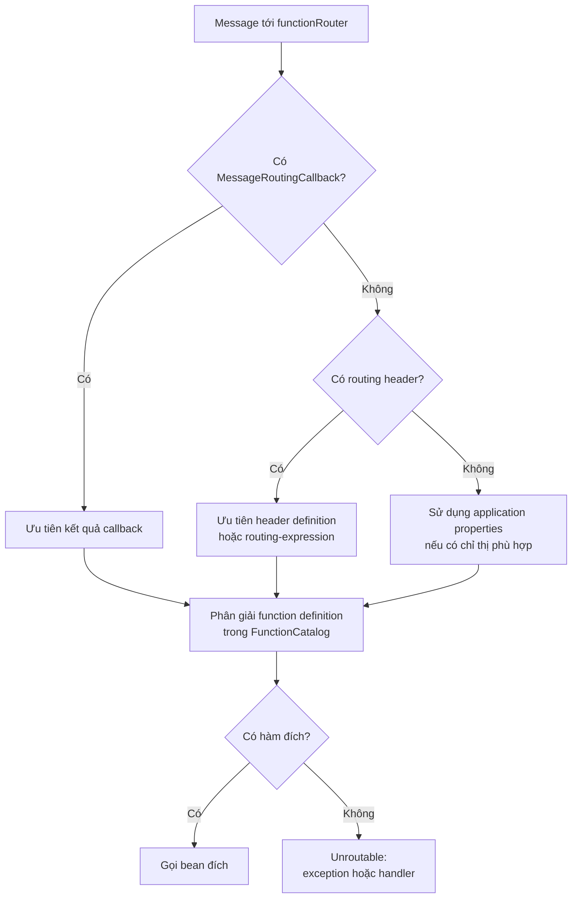
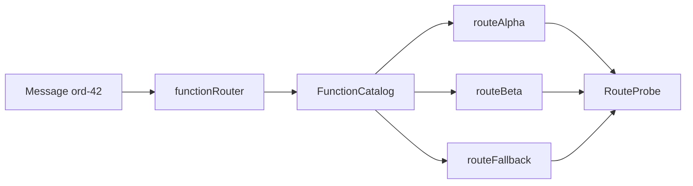
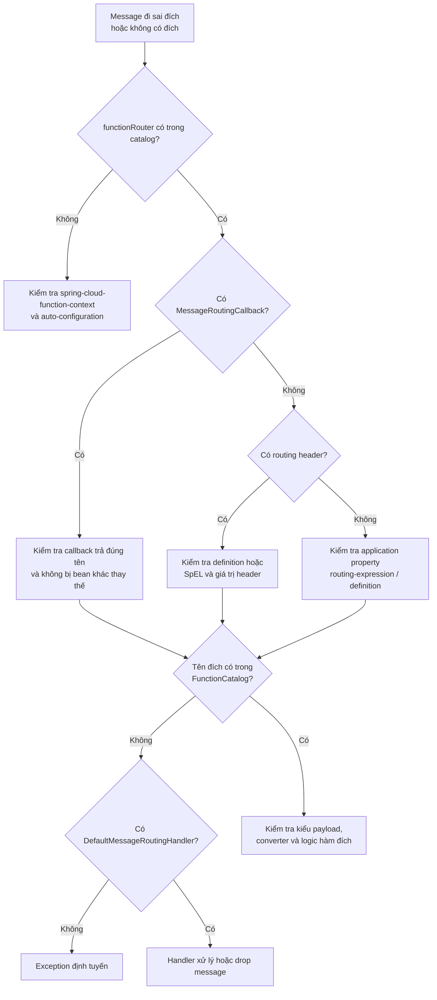

# Kiểm thử ưu tiên định tuyến và thông điệp không có đích

**Chương:** Kiểm thử  
**Module:** Spring Cloud Function (`SPRING_CLOUD_FUNCTION`)

Spring Cloud Function cho phép viết nghiệp vụ dưới dạng `Supplier`, `Function` và `Consumer` rồi dùng lại cùng logic thông qua Java, HTTP, sự kiện hoặc serverless. Khi một ứng dụng nhận nhiều loại yêu cầu qua một điểm vào, tính năng **function routing** chuyển mỗi yêu cầu tới một functional bean thích hợp trong `FunctionCatalog`. Ví dụ, một thông điệp đơn hàng có thể được chuyển tới `routeAlpha` hoặc `routeBeta` dựa trên header, callback hoặc cấu hình.

Kiểm thử routing không chỉ là xác nhận thông điệp được xử lý thành công. Ta cần trả lời hai câu hỏi quan trọng: **khi có nhiều chỉ thị định tuyến mâu thuẫn, chỉ thị nào thắng?** Và **khi chỉ thị trỏ tới hàm không tồn tại, thông điệp sẽ được xử lý như thế nào?**

Bài này xây dựng một bộ kiểm thử JUnit 5 với Spring Boot và `FunctionCatalog`, không cần HTTP server hoặc message broker. Nội dung đi từ quy tắc ưu tiên, `MessageRoutingCallback`, header `spring.cloud.function.definition`, biểu thức SpEL, application properties tới `DefaultMessageRoutingHandler` và các tình huống thông điệp không tìm được đích. Cuối cùng, ta phân biệt routing trong một lần gọi Java với xử lý lỗi ở Spring Cloud Stream hoặc adapter khác.

## 1. Mục tiêu và phạm vi kiểm thử

Sau bài học, bạn có thể:

1. Giải thích vai trò của functional bean `functionRouter` được Spring Cloud Function đăng ký.
2. Kiểm tra ba tầng ưu tiên: **`MessageRoutingCallback` → Message headers → application properties**.
3. Viết test chứng minh header ghi đè cấu hình application khi không có callback.
4. Viết test chứng minh callback được ưu tiên hơn header và cấu hình application.
5. Kiểm tra routing-expression dùng SpEL với header do ứng dụng kiểm soát.
6. Phát hiện function definition chỉ đến đích không tồn tại hoặc bị loại khỏi catalog.
7. Kiểm tra chính sách mặc định ném lỗi và chính sách xử lý thay thế với `DefaultMessageRoutingHandler`.
8. Phân biệt *không xác định được đích*, *đích có tên nhưng không tồn tại*, *đích tồn tại nhưng hàm xử lý lỗi* và *router bị cấu hình sai*.
9. Tổ chức test tách Spring context để không bị biến trạng thái, fallback hoặc cấu hình của test khác ảnh hưởng.

| Cấp độ | Đối tượng được kiểm tra | Chưa được chứng minh |
| --- | --- | --- |
| Unit test của callback | Logic chọn tên hàm từ một `Message<?>` | Callback đã được `functionRouter` sử dụng |
| Spring context + `FunctionCatalog` | Ưu tiên, phân giải tên và xử lý thông điệp không có đích | HTTP route hoặc message binding đã được tạo |
| Spring Cloud Function Web test | Header HTTP đi vào router, status và response | Binder hoặc broker đã phát/nhận sự kiện |
| Spring Cloud Stream test | Binder, routing, error handling và output | Cấu hình serverless handler |
| Serverless adapter test | Event envelope và entry point | Hành vi của broker không liên quan |

**Giới hạn bài này:** sử dụng các hàm **imperative** (ví dụ `Function<String,String>`) và Spring `Message<?>`. Định tuyến *theo từng thông điệp* bằng header không áp dụng giống như vậy cho hàm reactive nhận toàn bộ `Flux`; phần giới hạn được giải thích ở mục 14.

## 2. functionRouter là gì?

Spring Cloud Function đăng ký một hàm định tuyến với tên **`functionRouter`** trong `FunctionCatalog`. Tên này cũng có thể được lấy qua hằng `RoutingFunction.FUNCTION_NAME` của phiên bản tương ứng. Về ý tưởng, router nhận một yêu cầu, tìm **function definition đích** rồi gọi hàm đã được catalog đăng ký theo tên.

Ví dụ:

```text
Incoming Message: "ord-42"
  header spring.cloud.function.definition = routeAlpha
        |
        v
     functionRouter
        |
        v
 FunctionCatalog.lookup("routeAlpha")
        |
        v
   routeAlpha("ord-42")
        |
        v
   "ALPHA:ord-42"
```

Để gọi router trực tiếp trong test, có thể làm:

```java
FunctionCatalog catalog = /* do Spring inject */;

Function<Message<String>, Object> router =
    catalog.lookup(Function.class, "functionRouter");

if (router == null) {
    throw new IllegalStateException("functionRouter not registered");
}
```

Đây là ví dụ về khai báo biến và lookup; trong lớp test hoàn chỉnh ở mục 7, `catalog` được inject bằng `@Autowired`. Đừng nhầm **tra cứu chính router** với **tra cứu một hàm đích**: `catalog.lookup("routeAlpha")` gọi một chức năng đã định danh, còn `catalog.lookup("functionRouter")` chọn chức năng đích dựa trên chỉ thị routing.

### 2.1. Ba nguồn chỉ thị định tuyến

Spring Cloud Function hỗ trợ các cơ chế chính:

| Nguồn | Cách cung cấp | Ví dụ |
| --- | --- | --- |
| `MessageRoutingCallback` | Đăng ký callback như Spring bean | Trả về `"routeAlpha"` từ quy tắc nghiệp vụ |
| Message header tĩnh | `spring.cloud.function.definition` | Header bằng `routeBeta` |
| Message header động | `spring.cloud.function.routing-expression` | SpEL `headers.routeKey` |
| Application property | `spring.cloud.function.routing-expression` hoặc cấu hình definition phù hợp | `spring.cloud.function.routing-expression='routeFallback'` |

Hai hình thức header cùng nằm ở **một mức ưu tiên**; tài liệu về thứ tự ưu tiên chỉ phân biệt tầng callback, tầng header và tầng properties. Đừng tự khẳng định khi **cả hai header routing** cùng có mặt thì header nào thắng trong mọi phiên bản nếu chưa đối chiếu mã nguồn/runtime. Các test của bài chủ động đặt **một loại header routing cho mỗi yêu cầu**.

### 2.2. Bảng ưu tiên chính thức

**Định tuyến imperative từ cao xuống thấp:**



**Quy tắc cần nhớ:**

1. **`MessageRoutingCallback` cao nhất** khi dùng imperative function, ngay cả khi message và application đã có chỉ thị khác.
2. **Message headers thứ hai** nếu không có callback.
3. **Application properties thấp nhất** và là nguồn chỉ thị có thể sử dụng cho các dạng hàm, kể cả reactive theo giới hạn của framework.

**Lưu ý:** thứ tự ưu tiên không đồng nghĩa một header sai tên sẽ được tự động bỏ qua để dùng application property. Nếu một chỉ thị có ưu tiên cao hơn **đã chọn đích không tồn tại**, đó có thể trở thành *unroutable message*, thay vì tự tìm một tên khác có ưu tiên thấp hơn.

## 3. Hai khái niệm không được nhập nhằng

### 3.1. Chọn entry point và chọn đích bên trong router

Một cấu hình trong Spring Cloud Stream có thể chọn router làm function được bind:

```properties
spring.cloud.function.definition=functionRouter
```

Ở ngữ cảnh đó, `functionRouter` là **entry point**. Khi router chạy, nó vẫn cần **chỉ thị chọn hàm đích** (callback, header hoặc routing expression phù hợp).

Ví dụ trong ứng dụng có một router và nhiều hàm nghiệp vụ:

```properties
spring.cloud.function.definition=functionRouter
spring.cloud.function.routing-expression='routeFallback'
```

Trong bài, ta **không bật Stream binder** và luôn gọi `catalog.lookup("functionRouter")` tường minh. Khi muốn kiểm tra application-level fallback route, test chỉ cần cấu hình `spring.cloud.function.routing-expression='routeFallback'`; tránh trộn nhầm việc chọn entry point với việc chỉ định fallback cho router.

### 3.2. Đích không tồn tại khác một hàm nghiệp vụ ném lỗi

| Tình huống | Router có gọi một functional bean nghiệp vụ? | Cần kiểm tra gì? |
| --- | --- | --- |
| Header chọn `routeAlpha`, bean tồn tại | Có | Kết quả, hàm nào được gọi |
| Header chọn `missingRoute`, bean không có trong catalog | Không có hàm đích hợp lệ | Ngoại lệ định tuyến hoặc handler |
| Không có header/callback/property nào xác định đích | Chưa rõ đích | Chính sách không có route và log/root cause |
| Header chọn `routeAlpha`, hàm ném lỗi | Có, rồi lỗi nghiệp vụ | Lỗi từ hàm, không phải “no destination” |
| Header chọn bean bị `ineligible-definitions` loại | Bean có thể tồn tại trong Spring nhưng không là ứng viên catalog | Tên ở `getNames(...)` và chính sách router |

Nếu một application property đang chọn `routeFallback` và **message không có header**, thông điệp đó **không phải “không có đích”**: router đã có chỉ thị cấp application. Test lỗi không có đích cần một context **không có fallback chỉ thị hợp lệ**, hoặc một header trỏ tường minh tới tên không tồn tại.

## 4. Cấu hình dependency và phạm vi chạy

Đây là bài **kiểm thử Spring context**, không phải unit test Java thuần. Ví dụ giả định dự án Spring Boot + Spring Cloud Function context + JUnit Jupiter có dependency management tương thích.

**Maven (trích dependencies, chưa phải toàn bộ POM):**

```xml
<dependencies>
    <dependency>
        <groupId>org.springframework.boot</groupId>
        <artifactId>spring-boot-starter</artifactId>
    </dependency>
    <dependency>
        <groupId>org.springframework.cloud</groupId>
        <artifactId>spring-cloud-function-context</artifactId>
    </dependency>
    <dependency>
        <groupId>org.springframework.boot</groupId>
        <artifactId>spring-boot-starter-test</artifactId>
        <scope>test</scope>
    </dependency>
</dependencies>
```

**Gradle Kotlin DSL (dự án đã quản lý phiên bản):**

```kotlin
dependencies {
    implementation("org.springframework.boot:spring-boot-starter")
    implementation("org.springframework.cloud:spring-cloud-function-context")
    testImplementation("org.springframework.boot:spring-boot-starter-test")
}

tasks.test {
    useJUnitPlatform()
}
```

Sử dụng `@SpringBootTest(webEnvironment = SpringBootTest.WebEnvironment.NONE)` để tạo `ApplicationContext` và `FunctionCatalog` nhưng **không mở HTTP server**. Không cần thêm Spring Cloud Stream binder hoặc kết nối broker chỉ để kiểm tra thứ tự ưu tiên ở tầng router.

**Chú ý phiên bản:** tài liệu tham khảo Spring Cloud Function 4.1/4.2 và dòng hiện hành đều mô tả thứ tự ưu tiên này. Tuy nhiên, chữ ký `MessageRoutingCallback.routingResult(...)` có thay đổi ở một số dòng cũ; các ví dụ mã của bài dùng chữ ký **trả về `String`** theo tài liệu hiện hành. Khi áp dụng cho phiên bản cũ hơn, cần kiểm tra API tương ứng thay vì sao chép mù quáng.

## 5. Ứng dụng Spring Boot mẫu: ba đích phân biệt được

Ta tạo ba `Function<String,String>` để dễ chứng minh router thực sự đã chọn bean nào. Thêm một bean `RouteProbe` ghi lại danh sách tên đích được gọi. Những hàm này không tạo tác dụng phụ bên ngoài; mọi dấu vết đều nằm trong bộ nhớ.

**File:** `src/main/java/example/routing/RoutingPriorityApplication.java`

```java
package example.routing;

import java.util.List;
import java.util.concurrent.CopyOnWriteArrayList;
import java.util.function.Function;

import org.springframework.boot.SpringApplication;
import org.springframework.boot.autoconfigure.SpringBootApplication;
import org.springframework.context.annotation.Bean;

@SpringBootApplication(proxyBeanMethods = false)
public class RoutingPriorityApplication {

    public static void main(String[] args) {
        SpringApplication.run(RoutingPriorityApplication.class, args);
    }

    public static final class RouteProbe {
        private final List<String> invoked =
            new CopyOnWriteArrayList<>();

        public void hit(String name) {
            invoked.add(name);
        }

        public List<String> snapshot() {
            return List.copyOf(invoked);
        }

        public void reset() {
            invoked.clear();
        }
    }

    @Bean
    public RouteProbe routeProbe() {
        return new RouteProbe();
    }

    @Bean("routeAlpha")
    public Function<String, String> routeAlpha(RouteProbe probe) {
        return input -> {
            probe.hit("routeAlpha");
            return "ALPHA:" + input;
        };
    }

    @Bean("routeBeta")
    public Function<String, String> routeBeta(RouteProbe probe) {
        return input -> {
            probe.hit("routeBeta");
            return "BETA:" + input;
        };
    }

    @Bean("routeFallback")
    public Function<String, String> routeFallback(RouteProbe probe) {
        return input -> {
            probe.hit("routeFallback");
            return "FALLBACK:" + input;
        };
    }
}
```

### 5.1. Tại sao cần ba hàm có kết quả dễ phân biệt?

| Bean | Output khi input là `"ord-42"` | Dấu vết |
| --- | --- | --- |
| `routeAlpha` | `ALPHA:ord-42` | `[routeAlpha]` |
| `routeBeta` | `BETA:ord-42` | `[routeBeta]` |
| `routeFallback` | `FALLBACK:ord-42` | `[routeFallback]` |

Một test ưu tiên đúng phải chỉ ra **một đích cụ thể đã được chọn**; không chỉ kiểm tra `router.apply(...) != null`. `RouteProbe` giúp phát hiện trường hợp một đích khác bị gọi trước hoặc cả hai đích đều bị gọi không mong muốn.

Vì có nhiều functional bean, test không phụ thuộc vào *single-function fallback* — cơ chế có thể che tên sai trong ứng dụng chỉ có một hàm đủ điều kiện. Một tên đích không được liệt kê trong `FunctionCatalog.getNames(Function.class)` vẫn cần được coi là không có route hợp lệ.

### 5.2. Mô hình Spring bean và catalog



`RouteProbe` là một bean thường, không phải một `Function` hay `Consumer`. Nó giúp quan sát kết quả định tuyến mà không phải lắng nghe HTTP request hoặc message broker.

## 6. Thiết kế helper để so sánh kết quả đúng ngữ nghĩa

Khi gọi qua `FunctionCatalog`, kết quả có thể là payload Java trực tiếp hoặc một `Message<?>` tùy đường conversion/wrapper. Với test chỉ muốn biết **hàm nào xử lý thông điệp** và **giá trị nghiệp vụ là gì**, có thể chuẩn hóa representation trước khi assertion:

```java
import java.nio.charset.StandardCharsets;
import org.springframework.messaging.Message;

static String payloadText(Object result) {
    Object value = result instanceof Message<?> message
        ? message.getPayload() : result;

    if (value instanceof byte[] bytes) {
        return new String(bytes, StandardCharsets.UTF_8);
    }
    return String.valueOf(value);
}
```

Đây là một helper trong test, **không phải converter để xử lý mọi kiểu dữ liệu của production**. Nếu mục tiêu của test là serialization hoặc propagation header, cần assertion cụ thể về payload class, encoding và header; không bỏ qua chúng bằng một helper chung.

Một phương thức tạo message nhất quán:

```java
import org.springframework.messaging.Message;
import org.springframework.messaging.support.MessageBuilder;

static Message<String> messageWithDefinition(
        String body, String destination) {
    return MessageBuilder
        .withPayload(body)
        .setHeader("spring.cloud.function.definition", destination)
        .build();
}
```

Các đoạn code trong mục này là helper minh họa. Bên dưới, lớp test đầy đủ chứa các phương thức tương ứng để người học có thể ghép mã mà không cần suy đoán.

## 7. Test mức ưu tiên thứ hai: header thắng application property

Trước tiên, **không đăng ký `MessageRoutingCallback`**. Context được cấu hình với chỉ thị cấp application:

```properties
spring.cloud.function.routing-expression='routeFallback'
```

Ta kỳ vọng:

- Message **không có routing header** đi tới `routeFallback`.
- Message có header `spring.cloud.function.definition=routeBeta` đi tới `routeBeta`, không phải `routeFallback`.
- Message có header `spring.cloud.function.routing-expression=headers.routeKey` và `routeKey=routeAlpha` đi tới `routeAlpha`.
- Hai message khác nhau có thể chọn hai đích khác nhau trong cùng context imperative.

**File:** `src/test/java/example/routing/HeaderAndPropertyRoutingTest.java`

```java
package example.routing;

import static org.junit.jupiter.api.Assertions.*;

import java.nio.charset.StandardCharsets;
import java.util.List;
import java.util.Set;
import java.util.function.Function;

import org.junit.jupiter.api.BeforeEach;
import org.junit.jupiter.api.Test;
import org.junit.jupiter.api.parallel.Execution;
import org.junit.jupiter.api.parallel.ExecutionMode;
import org.springframework.beans.factory.annotation.Autowired;
import org.springframework.boot.test.context.SpringBootTest;
import org.springframework.cloud.function.context.FunctionCatalog;
import org.springframework.messaging.Message;
import org.springframework.messaging.support.MessageBuilder;

import example.routing.RoutingPriorityApplication.RouteProbe;

@SpringBootTest(
    classes = RoutingPriorityApplication.class,
    webEnvironment = SpringBootTest.WebEnvironment.NONE,
    properties = {
        "spring.cloud.function.routing-expression='routeFallback'"
    }
)
@Execution(ExecutionMode.SAME_THREAD)
class HeaderAndPropertyRoutingTest {

    @Autowired
    FunctionCatalog catalog;

    @Autowired
    RouteProbe probe;

    @BeforeEach
    void reset() {
        probe.reset();
    }

    private Function<Message<String>, Object> router() {
        assertTrue(catalog.getNames(Function.class)
            .containsAll(Set.of(
                "routeAlpha", "routeBeta", "routeFallback")));

        Function<Message<String>, Object> function =
            catalog.lookup(Function.class, "functionRouter");
        assertNotNull(function);
        return function;
    }

    private static String text(Object result) {
        Object payload = result instanceof Message<?> m
            ? m.getPayload() : result;
        if (payload instanceof byte[] bytes) {
            return new String(bytes, StandardCharsets.UTF_8);
        }
        return String.valueOf(payload);
    }

    private static Message<String> withDefinition(
            String input, String destination) {
        return MessageBuilder.withPayload(input)
            .setHeader(
                "spring.cloud.function.definition", destination)
            .build();
    }

    @Test
    void propertyWinsWhenMessageHasNoRoutingHeader() {
        Message<String> incoming =
            MessageBuilder.withPayload("ord-42").build();

        Object result = router().apply(incoming);

        assertEquals("FALLBACK:ord-42", text(result));
        assertEquals(List.of("routeFallback"), probe.snapshot());
    }

    @Test
    void staticMessageHeaderOverridesApplicationProperty() {
        Message<String> incoming =
            withDefinition("ord-42", "routeBeta");

        Object result = router().apply(incoming);

        assertEquals("BETA:ord-42", text(result));
        assertEquals(List.of("routeBeta"), probe.snapshot());
    }

    @Test
    void spelHeaderSelectsDestinationFromAnotherHeader() {
        Message<String> incoming = MessageBuilder
            .withPayload("ord-42")
            .setHeader(
                "spring.cloud.function.routing-expression",
                "headers.routeKey")
            .setHeader("routeKey", "routeAlpha")
            .build();

        Object result = router().apply(incoming);

        assertEquals("ALPHA:ord-42", text(result));
        assertEquals(List.of("routeAlpha"), probe.snapshot());
    }

    @Test
    void successiveMessagesCanChooseDifferentTargets() {
        Function<Message<String>, Object> routing = router();

        Object first =
            routing.apply(withDefinition("one", "routeAlpha"));
        Object second =
            routing.apply(withDefinition("two", "routeBeta"));

        assertEquals("ALPHA:one", text(first));
        assertEquals("BETA:two", text(second));
        assertEquals(
            List.of("routeAlpha", "routeBeta"),
            probe.snapshot());
    }

    @Test
    void headerCanChooseAnExplicitComposition() {
        Message<String> incoming = withDefinition(
            "ord-42", "routeAlpha|routeBeta");

        Object result = router().apply(incoming);

        assertEquals("BETA:ALPHA:ord-42", text(result));
        assertEquals(
            List.of("routeAlpha", "routeBeta"),
            probe.snapshot());
    }

    @Test
    void invalidHigherPriorityHeaderIsNotTheFallbackRoute() {
        Message<String> incoming = withDefinition(
            "ord-42", "destinationDoesNotExist");

        assertFalse(catalog.getNames(Function.class)
            .contains("destinationDoesNotExist"));

        assertThrows(
            RuntimeException.class,
            () -> router().apply(incoming));
        assertTrue(probe.snapshot().isEmpty());
    }
}
```

**Ý nghĩa các test:**

- `propertyWinsWhenMessageHasNoRoutingHeader` kiểm tra mức ưu tiên thấp nhất.
- `staticMessageHeaderOverridesApplicationProperty` kiểm tra xung đột giữa header và application property.
- `spelHeaderSelectsDestinationFromAnotherHeader` kiểm tra routing-expression ở tầng header.
- `successiveMessagesCanChooseDifferentTargets` kiểm tra khả năng định tuyến theo từng message của hàm imperative.
- `headerCanChooseAnExplicitComposition` minh họa header tĩnh có thể chứa một definition ghép hàm khi các bước tương thích kiểu.
- `invalidHigherPriorityHeaderIsNotTheFallbackRoute` kiểm tra trường hợp **header ưu tiên hơn nhưng chỉ tới đích sai**; không tự chuyển thông điệp sang `routeFallback` rồi coi đó là hành vi ưu tiên đúng.

### 7.1. Vì sao vừa assert output vừa assert trace?

Nếu test chỉ có:

```java
assertEquals("BETA:ord-42", text(router.apply(incoming)));
```

thì chưa trực tiếp biết có một route khác bị gọi để thực hiện side effect trước đó hay không. Với các hàm mẫu, `probe.snapshot()` ghi lại **đích thực sự được gọi**, giúp xác minh không có hai chức năng bị chạy ngoài dự kiến.

Ở production, một `Function` có thể ghi database hoặc phát event; lỗi chọn đích không chỉ làm output sai mà còn có thể tạo side effect không mong muốn. Đó là lý do các test routing nên quan sát ít nhất một **dấu vết thực thi** nếu có thể.

### 7.2. Vì sao không test cả hai routing header cùng lúc?

Tầng message headers chứa hai cách diễn đạt: `spring.cloud.function.definition` và `spring.cloud.function.routing-expression`. Trong bài, **mỗi message chỉ mang một loại chỉ thị routing**, tránh đặt cả hai cùng lúc rồi mặc định một thứ tự giải quyết xung đột nội bộ mà tài liệu tổng quát không cam kết.

Nếu dự án thật cho phép cả hai xuất hiện, hãy bổ sung một **test tương thích theo phiên bản** xác minh đúng lựa chọn; tốt hơn nữa, chuẩn hóa ingress chỉ cho phép một cơ chế routing trên mỗi message.

### 7.3. SpEL và kiểu dữ liệu từ header

Biểu thức:

```text
headers.routeKey
```

đọc giá trị `routeKey` từ header và dùng kết quả như tên function definition. Trong test, `routeKey` chứa chuỗi `routeAlpha` đã được đăng ký. Điều này khác với:

```text
'routeAlpha'
```

là biểu thức SpEL trả về **chuỗi cố định**. Nếu muốn lấy tên từ header, đừng đặt thêm dấu nháy đơn quanh toàn bộ biểu thức `headers.routeKey`.

Với biểu thức đi qua Message header, Spring Cloud Function dùng `SimpleEvaluationContext` có giới hạn hơn; biểu thức lấy từ application property dùng `StandardEvaluationContext`. Cần kiểm tra bảo mật kỹ nếu cho phép bên ngoài điều khiển expression hoặc function name (xem mục 13).

## 8. Test mức ưu tiên cao nhất: MessageRoutingCallback

Để chứng minh callback đứng trên header và property, ta tạo **một context riêng** và đăng ký `MessageRoutingCallback` bằng `@TestConfiguration`. Callback chọn `routeAlpha` cố định cho fixture; thông điệp lại yêu cầu `routeBeta` trong header, còn application property chỉ `routeFallback`.

Vậy **nếu callback thắng**, output phải là `ALPHA:ord-42` và trace chỉ có `routeAlpha`.

**File:** `src/test/java/example/routing/CallbackPriorityRoutingTest.java`

```java
package example.routing;

import static org.junit.jupiter.api.Assertions.*;

import java.nio.charset.StandardCharsets;
import java.util.List;
import java.util.function.Function;

import org.junit.jupiter.api.BeforeEach;
import org.junit.jupiter.api.Test;
import org.springframework.beans.factory.annotation.Autowired;
import org.springframework.boot.test.context.SpringBootTest;
import org.springframework.boot.test.context.TestConfiguration;
import org.springframework.cloud.function.context.FunctionCatalog;
import org.springframework.cloud.function.context.MessageRoutingCallback;
import org.springframework.context.annotation.Bean;
import org.springframework.context.annotation.Import;
import org.springframework.messaging.Message;
import org.springframework.messaging.support.MessageBuilder;

import example.routing.RoutingPriorityApplication.RouteProbe;

@SpringBootTest(
    classes = RoutingPriorityApplication.class,
    webEnvironment = SpringBootTest.WebEnvironment.NONE,
    properties = {
        "spring.cloud.function.routing-expression='routeFallback'"
    }
)
@Import(CallbackPriorityRoutingTest.CallbackConfig.class)
class CallbackPriorityRoutingTest {

    @Autowired
    FunctionCatalog catalog;

    @Autowired
    RouteProbe probe;

    @BeforeEach
    void reset() {
        probe.reset();
    }

    @Test
    void callbackOverridesHeaderAndApplicationProperty() {
        Function<Message<String>, Object> router =
            catalog.lookup(Function.class, "functionRouter");
        assertNotNull(router);

        Message<String> incoming = MessageBuilder
            .withPayload("ord-42")
            .setHeader(
                "spring.cloud.function.definition", "routeBeta")
            .build();

        Object result = router.apply(incoming);
        Object payload = result instanceof Message<?> message
            ? message.getPayload() : result;
        String output = payload instanceof byte[] bytes
            ? new String(bytes, StandardCharsets.UTF_8)
            : String.valueOf(payload);

        assertEquals("ALPHA:ord-42", output);
        assertEquals(List.of("routeAlpha"), probe.snapshot());
    }

    @TestConfiguration(proxyBeanMethods = false)
    static class CallbackConfig {

        @Bean
        MessageRoutingCallback routingCallback() {
            return new MessageRoutingCallback() {
                @Override
                public String routingResult(Message<?> message) {
                    return "routeAlpha";
                }
            };
        }
    }
}
```

**Điều test chứng minh:** một `MessageRoutingCallback` đã được đăng ký đúng vào Spring context và được router ưu tiên sử dụng, dù hai tầng thấp hơn đưa ra những chỉ thị khác nhau.

### 8.1. Cách tránh callback lẫn sang các test khác

Lớp `CallbackConfig` được đánh dấu `@TestConfiguration` và chỉ được import bằng `@Import(...)` ở lớp test này. Nó **không nằm trong cấu hình ứng dụng chung**. Nhờ vậy, `HeaderAndPropertyRoutingTest` không vô tình thấy callback; nếu callback hiện diện ở đó, các test header ưu tiên property sẽ không còn đo đúng điều cần đo.

Không tạo callback bằng `System.setProperty(...)` hoặc trạng thái static toàn JVM. Cấu hình callback thuộc từng Spring context; test nên dùng context khác nhau hoặc fixture tách biệt rõ ràng.

### 8.2. Ví dụ callback theo quy tắc nghiệp vụ

Trong ứng dụng thật, callback có thể chọn một nhóm chức năng từ header được tin cậy:

```java
@Bean
MessageRoutingCallback businessRoutingCallback() {
    return new MessageRoutingCallback() {
        @Override
        public String routingResult(Message<?> message) {
            Object key = message.getHeaders().get("routeClass");
            if ("premium".equals(key)) {
                return "routeAlpha";
            }
            if ("standard".equals(key)) {
                return "routeBeta";
            }
            return "routeFallback";
        }
    };
}
```

Đoạn code này là ví dụ thiết kế bổ sung: cần đặt trong một Spring configuration, có import `@Bean`, `MessageRoutingCallback` và `Message` thích hợp. Chỉ cho phép các **tên hàm do ứng dụng định nghĩa** thay vì trả thẳng bất kỳ tên nào do client gửi đến. Nếu có một lựa chọn `routeFallback` được cho phép, route đó là **quyết định nghiệp vụ tường minh của callback**, không phải cơ chế “không có đích tự động chạy fallback”.

## 9. Test thông điệp không có hàm đích: mặc định phát sinh lỗi

Tài liệu Spring Cloud Function mô tả: **khi route-to function không có trong `FunctionCatalog`, router thông thường phát sinh ngoại lệ cho biết không tìm được đích**. Điều này có ích nếu ứng dụng muốn lỗi trở nên rõ ràng, để tầng HTTP/binder/handler tương ứng có thể xử lý.

Một bài test âm tính cần dùng context:

- Có `functionRouter` và nhiều bean đích thật.
- **Không** đăng ký `DefaultMessageRoutingHandler`.
- Không có `MessageRoutingCallback` âm thầm thay thế chỉ thị routing.
- Không có application routing property tự động chọn một đích khác.
- Message **chỉ rõ** một function definition không tồn tại, ví dụ `missingOrderRoute`.

**File:** `src/test/java/example/routing/UnknownDestinationTest.java`

```java
package example.routing;

import static org.junit.jupiter.api.Assertions.*;

import java.util.List;
import java.util.function.Function;

import org.junit.jupiter.api.BeforeEach;
import org.junit.jupiter.api.Test;
import org.springframework.beans.factory.annotation.Autowired;
import org.springframework.boot.test.context.SpringBootTest;
import org.springframework.cloud.function.context.FunctionCatalog;
import org.springframework.messaging.Message;
import org.springframework.messaging.support.MessageBuilder;

import example.routing.RoutingPriorityApplication.RouteProbe;

@SpringBootTest(
    classes = RoutingPriorityApplication.class,
    webEnvironment = SpringBootTest.WebEnvironment.NONE
)
class UnknownDestinationTest {

    @Autowired
    FunctionCatalog catalog;

    @Autowired
    RouteProbe probe;

    @BeforeEach
    void reset() {
        probe.reset();
    }

    @Test
    void unknownDefinitionFailsWithoutFallbackHandler() {
        String missing = "missingOrderRoute";
        assertFalse(catalog.getNames(Function.class)
            .contains(missing));

        Function<Message<String>, Object> router =
            catalog.lookup(Function.class, "functionRouter");
        assertNotNull(router);

        Message<String> orphan = MessageBuilder
            .withPayload("ord-42")
            .setHeader(
                "spring.cloud.function.definition", missing)
            .build();

        assertThrows(
            RuntimeException.class,
            () -> router.apply(orphan));

        // Không được âm thầm gọi một route khác.
        assertEquals(List.of(), probe.snapshot());
    }
}
```

Test khẳng định **lỗi ở lớp định tuyến** và không có hàm nghiệp vụ nào trong fixture được gọi. Đừng buộc outer exception phải là một class cụ thể như `IllegalStateException` hoặc message tiếng Anh chính xác nếu các phiên bản framework có thể bọc/đổi cách diễn đạt. Muốn kiểm tra mã lỗi API ổn định, hãy thiết kế contract lỗi tại adapter và test riêng.

### 9.1. Không có chỉ thị routing khác với chỉ thị trỏ tới tên sai

Hai đầu vào:

```text
Message A:
  payload = ord-42
  không có routing header
  không có callback/application route

Message B:
  payload = ord-42
  spring.cloud.function.definition = missingOrderRoute
```

không cùng một lỗi cấu hình. Với A, router có thể không nhận được **định nghĩa đích nào**. Với B, router nhận một **tên đích cụ thể nhưng tên đó không tồn tại**. Test chính của mục này dùng B, vì trường hợp không phân giải được hàm đích đã được tài liệu hóa rõ.

Nếu yêu cầu ứng dụng bắt buộc phải có route cho mọi message, hãy thêm test với A trong **context không có application route** và xác minh hành vi theo phiên bản thực tế. Không gắn test “thiếu header thì phải lỗi” vào context đã đặt `routing-expression='routeFallback'`: trong context ấy, message thiếu header vẫn có đích hợp lệ.

### 9.2. Nếu tên bean tồn tại trong Spring nhưng bị loại khỏi catalog

Một bean `Function` có thể hiện diện trong `ApplicationContext` nhưng bị loại khỏi `FunctionCatalog`:

```properties
spring.cloud.function.ineligible-definitions=routeBeta
```

Khi ấy `routeBeta` không còn là ứng viên route-to bình thường. Đừng dùng `context.containsBean("routeBeta") == true` làm bằng chứng router buộc phải gọi được nó.

Một negative test bổ sung có thể kiểm tra:

```java
assertTrue(context.containsBean("routeBeta"));
assertFalse(catalog.getNames(Function.class)
    .contains("routeBeta"));
```

Ví dụ này giả định context có cả `ApplicationContext context` và `FunctionCatalog catalog` đã được inject, cùng property loại trừ được nạp **trước khi context tạo**. Việc chứng minh chính router không gọi được `routeBeta` nên được viết trong một lớp test/context riêng, không sửa property giữa các phương thức test.

## 10. DefaultMessageRoutingHandler: ghi nhận và tiếp tục luồng

Đôi khi một thông điệp không có hàm đích **không cần làm hỏng toàn bộ luồng**. Spring Cloud Function cung cấp chiến lược:

```java
org.springframework.cloud.function.context.DefaultMessageRoutingHandler
```

Khi được đăng ký làm bean, handler này cho phép xử lý các thông điệp không định tuyến được. Triển khai mặc định chỉ ghi log về thông điệp không có đích, để luồng tiếp tục thay vì ném ngoại lệ routing; về hiệu ứng, thông điệp có thể bị bỏ qua.

**Quan trọng:** chiến lược này **không tự định tuyến tới bean `routeFallback`**. Nếu cần gửi tới một hàm fallback thực sự, bạn phải chọn hàm đó bằng quy tắc riêng (callback, expression hoặc header) và kiểm thử nghiệp vụ của fallback. `DefaultMessageRoutingHandler` cũng không tương đương với broker DLQ hoặc retry.

### 10.1. Tạo handler kiểm thử có ghi nhận message

Thay vì chỉ log, ta định nghĩa một subclass của `DefaultMessageRoutingHandler` ghi lại thông điệp đã bị đưa vào xử lý:

**File:** `src/test/java/example/routing/UnroutableHandlerTest.java`

```java
package example.routing;

import static org.junit.jupiter.api.Assertions.*;

import java.util.List;
import java.util.concurrent.CopyOnWriteArrayList;
import java.util.function.Function;

import org.junit.jupiter.api.BeforeEach;
import org.junit.jupiter.api.Test;
import org.springframework.beans.factory.annotation.Autowired;
import org.springframework.boot.test.context.SpringBootTest;
import org.springframework.boot.test.context.TestConfiguration;
import org.springframework.cloud.function.context.DefaultMessageRoutingHandler;
import org.springframework.cloud.function.context.FunctionCatalog;
import org.springframework.context.annotation.Bean;
import org.springframework.context.annotation.Import;
import org.springframework.messaging.Message;
import org.springframework.messaging.support.MessageBuilder;

import example.routing.RoutingPriorityApplication.RouteProbe;

@SpringBootTest(
    classes = RoutingPriorityApplication.class,
    webEnvironment = SpringBootTest.WebEnvironment.NONE
)
@Import(UnroutableHandlerTest.UnroutableConfig.class)
class UnroutableHandlerTest {

    @Autowired
    FunctionCatalog catalog;

    @Autowired
    RouteProbe routes;

    @Autowired
    RejectedRecorder rejected;

    @BeforeEach
    void reset() {
        routes.reset();
        rejected.clear();
    }

    @Test
    void unknownTargetGoesToHandlerInsteadOfEscapingAsError() {
        Function<Message<String>, Object> router =
            catalog.lookup(Function.class, "functionRouter");
        assertNotNull(router);

        Message<String> incoming = MessageBuilder
            .withPayload("orphan-message")
            .setHeader(
                "spring.cloud.function.definition",
                "missingOrderRoute")
            .build();

        // Giá trị return của router không phải hợp đồng nghiệp vụ
        // khi DefaultMessageRoutingHandler bỏ qua một message.
        assertDoesNotThrow(() -> router.apply(incoming));

        assertEquals(1, rejected.snapshot().size());
        assertEquals(
            "orphan-message",
            rejected.snapshot().get(0).getPayload());
        assertEquals(List.of(), routes.snapshot());
    }

    static final class RejectedRecorder {
        private final List<Message<?>> messages =
            new CopyOnWriteArrayList<>();

        void record(Message<?> message) {
            messages.add(message);
        }

        List<Message<?>> snapshot() {
            return List.copyOf(messages);
        }

        void clear() {
            messages.clear();
        }
    }

    @TestConfiguration(proxyBeanMethods = false)
    static class UnroutableConfig {

        @Bean
        RejectedRecorder rejectedRecorder() {
            return new RejectedRecorder();
        }

        @Bean
        DefaultMessageRoutingHandler defaultMessageRoutingHandler(
                RejectedRecorder rejected) {
            return new DefaultMessageRoutingHandler() {
                @Override
                public void accept(Message<?> message) {
                    rejected.record(message);
                }
            };
        }
    }
}
```

**Phép kiểm tra quan trọng:**

1. Lời gọi router **không phát tán ngoại lệ routing** ra bên ngoài khi handler được cấu hình phù hợp.
2. Handler nhận được thông điệp không định tuyến được.
3. Không bean nghiệp vụ nào trong fixture bị gọi ngoài ý muốn.

Không assert “router nhất thiết trả `null`”, “luôn trả payload cũ” hoặc “luôn trả `Message<?>`” nếu adapter và phiên bản không cam kết giá trị đó. Với chính sách **drop**, đầu ra nghiệp vụ thường không phải điều cần kiểm tra; trọng tâm là **message được phân loại và không có side effect đích sai**.

### 10.2. Vì sao không đặt handler chung trong RoutingPriorityApplication?

Nếu đặt `DefaultMessageRoutingHandler` ở cấu hình ứng dụng chung, lớp `UnknownDestinationTest` sẽ thấy handler và có thể **không còn ném ngoại lệ**, khiến negative test mặc định mất ý nghĩa.

Trong bài, `@TestConfiguration` chỉ được import ở `UnroutableHandlerTest`. Hai context khác nhau cho phép kiểm tra song song hai chính sách:

| Context | Handler đăng ký? | Thông điệp chỉ `missingOrderRoute` |
| --- | --- | --- |
| `UnknownDestinationTest` | Không | Kỳ vọng exception |
| `UnroutableHandlerTest` | Có | Handler được gọi; không phát tán lỗi routing |

Nếu Spring Boot Test cache context, khóa cache sẽ tính tới những cấu hình test khác nhau. Tránh lưu danh sách message bị loại vào biến static dùng chung giữa các context.

### 10.3. Thiết kế chính sách xử lý không có đích trong production

Một hệ thống thật có thể quyết định:

- **Fail fast:** để router báo lỗi, adapter xử lý qua error channel/HTTP status tùy trường hợp.
- **Drop có kiểm soát:** handler đếm metric, log với correlation ID rồi bỏ thông điệp theo chính sách đã duyệt.
- **Chuyển sang kênh kiểm tra:** custom handler gọi một cổng quarantine hoặc nơi lưu bản ghi lỗi có kiểm soát.
- **Routing fallback hợp lệ:** callback áp dụng một nhánh `routeFallback` đã định nghĩa rõ đầu vào/đầu ra.

Không trộn lẫn bốn hành vi. “Không ném exception” **không có nghĩa message đã được xử lý thành công về nghiệp vụ**, và “được ghi log” **không đồng nghĩa được gửi vào DLQ**. Nếu tổ chức cần tránh mất message, hãy kiểm thử cả chính sách lưu/quarantine, độ bền, số lần gửi và cách xử lý khi nơi lưu thất bại.

## 11. Test lọc chủ đích khác thông điệp không có đích

Spring Cloud Function có thể dùng routing expression để tạo bộ lọc hai nhánh:

```text
được phép → routeAlpha
không được phép → devNull
```

Ví dụ bean:

```java
@Bean("devNull")
public Consumer<?> devNull() {
    return message -> {
        // Có thể ghi metric hoặc thực sự bỏ qua.
    };
}
```

Và một routing expression minh họa (đặt trong cấu hình tin cậy):

```properties
spring.cloud.function.routing-expression=headers.allowed == true ? 'routeAlpha' : 'devNull'
```

Đây là **định tuyến tới một đích có tên hợp lệ** là `devNull`, không phải thông điệp không tìm được đích. Vì vậy, kiểm thử nên chứng minh:

1. Hai bean `routeAlpha` và `devNull` được catalog đăng ký.
2. Trường hợp được phép thực hiện `routeAlpha`.
3. Trường hợp không được phép thực hiện `devNull` và không có side effect của `routeAlpha`.
4. Nếu `devNull` chỉ bỏ qua, metric/log tương ứng vẫn được kiểm tra theo yêu cầu.

Tùy loại hàm và cấu hình, routing tới `Consumer` có thể không có output nghiệp vụ. Vì vậy, đừng áp dụng cùng assertion output của `Function<String,String>` cho mọi nhánh lọc.

**Khác biệt cốt lõi:**

| Trường hợp | Đích tồn tại trong catalog? | Chính sách cần kiểm thử |
| --- | --- | --- |
| Filter chọn `devNull` | Có | Nhánh bỏ qua chủ động |
| Router chọn `missingOrderRoute` | Không | Ngoại lệ hoặc default handler |
| Callback chọn `routeFallback` | Có | Nhánh fallback nghiệp vụ |
| Header không có nhưng property chọn `routeFallback` | Có | Ưu tiên property thấp nhất |

## 12. Ma trận kiểm thử ưu tiên và thông điệp không có đích

Khi thêm function mới hoặc thay đổi routing expression, hãy sử dụng một ma trận với **nguồn chỉ thị**, **tên đích dự kiến**, **kết quả nghiệp vụ**, **số lần gọi hàm** và **chính sách lỗi**.

| ID | Callback | Header routing | Property routing | Kỳ vọng |
| --- | --- | --- | --- | --- |
| R01 | Không | Không | `routeFallback` | `routeFallback` được gọi |
| R02 | Không | `definition=routeBeta` | `routeFallback` | `routeBeta` được gọi |
| R03 | Không | `routing-expression=headers.routeKey`, `routeKey=routeAlpha` | `routeFallback` | `routeAlpha` được gọi |
| R04 | `routeAlpha` | `definition=routeBeta` | `routeFallback` | Callback thắng, `routeAlpha` được gọi |
| R05 | Không | `definition=routeAlpha|routeBeta` | `routeFallback` | Hai function được gọi theo thứ tự |
| R06 | Không | Hai message với `routeAlpha` và `routeBeta` | `routeFallback` | Mỗi message đi đúng đích |
| R07 | Không | `definition=missingOrderRoute` | Không | Exception nếu chưa có handler |
| R08 | Không | `definition=missingOrderRoute` | Không | Có handler: ghi nhận message, không gọi bean nghiệp vụ |
| R09 | Không | `definition=missingOrderRoute` | `routeFallback` | Không tự lấy property làm fallback sau header sai |
| R10 | Không | Không | Không | Không xác định được đích; kiểm tra runtime/version riêng |
| R11 | Không | `definition=routeBeta` | routeBeta bị lọc khỏi catalog | Kiểm tra `ineligible-definitions` và chính sách unroutable |
| R12 | Không | Hai header routing xung đột | `routeFallback` | Xác minh hành vi cụ thể theo version, ưu tiên không được giả định |
| R13 | Callback trả tên không tồn tại | `definition=routeBeta` | `routeFallback` | Không giả định tự động rơi về header; kiểm tra policy unroutable |
| R14 | Không | Chọn một `Consumer` hợp lệ | Không | Kiểm tra side effect, không đòi output từ Consumer |
| R15 | Không | Routing reactive per-message | Có property | Không test per-message như imperative; dùng routing cấp stream |

R01–R09 có các test Spring Boot/JUnit cụ thể ở mục 7–10. R10–R15 là **những ca mở rộng cần viết theo yêu cầu ứng dụng**, không phải kết quả đã chạy. Sự hiện diện của một hàng trong ma trận **không có nghĩa framework đảm bảo một loại exception hoặc return value giống nhau giữa mọi phiên bản**.

### 12.1. Bộ assertion tối thiểu cho một tuyến hợp lệ

```java
assertTrue(catalog.getNames(Function.class)
    .contains("routeBeta"));

Object result = router.apply(incoming);

assertEquals("BETA:ord-42", payloadText(result));
assertEquals(List.of("routeBeta"), probe.snapshot());
```

Đoạn này giả định những biến `catalog`, `router`, `incoming`, `probe` và helper `payloadText(...)` đã được khai báo trong test. Nó minh họa bốn phép kiểm tra khác nhau:

1. Tên đích là ứng viên hợp lệ.
2. Router thực thi được.
3. Đầu ra nghiệp vụ khớp kỳ vọng.
4. **Đúng một hàm đích** được gọi.

Nếu chỉ kiểm tra output mà không kiểm tra trace, bạn có thể bỏ sót một side effect từ nhánh sai.

### 12.2. Bộ assertion tối thiểu cho đích không tồn tại

```java
assertFalse(catalog.getNames(Function.class)
    .contains("missingOrderRoute"));

assertThrows(RuntimeException.class,
    () -> router.apply(orphanMessage));

assertTrue(probe.snapshot().isEmpty());
```

Đoạn này áp dụng cho **context không có default routing handler**. Không dùng nó nguyên xi trong context có custom handler vì chính sách ở đó là xử lý thông điệp thay vì phát tán lỗi.

### 12.3. Bộ assertion tối thiểu cho handler thay thế

```java
assertDoesNotThrow(() -> router.apply(orphanMessage));
assertEquals(1, rejected.snapshot().size());
assertTrue(probe.snapshot().isEmpty());
```

Các biến ở đây thuộc fixture `UnroutableHandlerTest`. **Không assert output nghiệp vụ** cho một thông điệp đã được chủ động drop. Nếu ứng dụng yêu cầu lưu quarantine bền vững, hãy thay assertion trên fake bằng integration test cho cổng lưu sự kiện.

## 13. Bảo mật khi cho client cung cấp tên hàm hoặc SpEL

Định tuyến động rất hữu ích nhưng cũng có nguy cơ mở khả năng gọi các chức năng mà client không nên được chọn. Đặc biệt:

- Header `spring.cloud.function.definition` có thể chứa tên bean hoặc một **composition**.
- Header `spring.cloud.function.routing-expression` là một biểu thức SpEL.
- HTTP adapter có thể chuyển một số header HTTP thành Spring `Message`.
- Một `MessageRoutingCallback` tự viết có thể đọc các header nghiệp vụ và quyết định tên đích.

Tài liệu Spring Cloud Function mô tả biện pháp hạn chế: biểu thức SpEL từ **Message header** được đánh giá bằng `SimpleEvaluationContext`, còn expression đặt ở cấu hình ứng dụng có thể dùng `StandardEvaluationContext` với khả năng rộng hơn. **Đó không phải một hệ thống phân quyền hoàn chỉnh.**

### 13.1. Không dùng tên do client gửi như lệnh tùy ý

Ví dụ thiếu an toàn về thiết kế:

```java
@Bean
MessageRoutingCallback unsafeCallback() {
    return new MessageRoutingCallback() {
        @Override
        public String routingResult(Message<?> message) {
            // Không nên tin toàn bộ giá trị từ request bên ngoài.
            return String.valueOf(
                message.getHeaders().get("targetFunction"));
        }
    };
}
```

Nếu bên ngoài điều khiển `targetFunction` mà không có kiểm tra, client có thể cố gắng chọn mọi function definition mà hệ thống nhận diện. Điều này không mặc nhiên có nghĩa Spring Cloud Function cho phép gọi mọi thứ trong JVM, nhưng nó là một bề mặt điều phối cần được giới hạn bằng thiết kế.

Thay thế bằng tập giá trị cho phép:

```java
@Bean
MessageRoutingCallback safeCallback() {
    return new MessageRoutingCallback() {
        @Override
        public String routingResult(Message<?> message) {
            Object requested =
                message.getHeaders().get("operation");

            if ("normalize".equals(requested)) {
                return "routeAlpha";
            }
            if ("review".equals(requested)) {
                return "routeBeta";
            }
            return "routeFallback";
        }
    };
}
```

Hai đoạn là **các lựa chọn thay thế nhau**, không được cùng đăng ký như hai bean callback trong một context thử nghiệm vì sẽ tạo nhiều strategy và không còn phản ánh quy tắc ưu tiên rõ ràng.

### 13.2. Kiểm thử chính sách allowlist

| Header `operation` | Function definition trả về | Lý do |
| --- | --- | --- |
| `normalize` | `routeAlpha` | Hoạt động được cho phép |
| `review` | `routeBeta` | Hoạt động được cho phép |
| `deleteEverything` | `routeFallback` | Không được coi là tên hàm có thể thực thi tùy ý |
| Không có header | `routeFallback` | Chính sách dự phòng được ứng dụng xác định rõ |

Sau khi test callback trực tiếp, cần test **trên router thực tế** để bảo đảm bean callback đã được chọn và đứng trên routing header của client. Hãy thêm kiểm thử **authorization** ở tầng HTTP/API nếu chức năng được expose ra ngoài; kiểm tra allowlist tên hàm không thay thế quyền truy cập của từng người dùng.

### 13.3. Không coi DefaultMessageRoutingHandler là một ranh giới bảo mật

Một thông điệp chọn tên không tồn tại rồi bị handler bỏ qua không chứng minh client không thể chọn một tên **có tồn tại nhưng không được phép**. Những tên đó vẫn cần:

- Chính sách giới hạn function definition hoặc callback mapping.
- Authentication/authorization của API hoặc ingress.
- Kiểm soát chức năng nào được export và ai được gọi.
- Test truy cập trái phép và audit phù hợp.

Nếu application property hoặc môi trường có thể bị thay đổi qua endpoint quản trị, cần bảo vệ chúng; SpEL có khả năng mở rộng hơn ở tầng property làm việc này đặc biệt quan trọng.

## 14. Reactive: không dùng các test header cho routing theo từng phần tử

Một imperative `Function<String,String>` xử lý một message tại một thời điểm, nên `MessageRoutingCallback` và routing header có ý nghĩa cho từng message.

Nhưng một reactive function như:

```java
Function<Flux<String>, Flux<String>> processStream =
    flux -> flux.map(String::toUpperCase);
```

nhận **một publisher** đại diện cả luồng. Framework không gọi `Function.apply(...)` riêng cho mỗi message trong cách thực thi reactive tương ứng. Theo tài liệu Spring Cloud Function, định tuyến reactive **chỉ dùng chỉ thị từ application properties**, không sử dụng routing header của từng phần tử theo cách imperative.

| Trường hợp | Routing per-message bằng header? | Kiểm thử phù hợp |
| --- | --- | --- |
| `Function<String,String>` imperative | Có | JUnit test từng `Message<?>` |
| `Function<Message<String>,Message<String>>` imperative | Có, theo cấu hình/adapter phù hợp | JUnit test header, payload, callback |
| `Function<Flux<String>,Flux<String>>` reactive | Không theo mô hình per-message đó | Test routing cấp stream qua application properties |

Nếu muốn định tuyến từng phần tử trong Reactor, có thể viết logic reactive chuyên biệt như `groupBy` hoặc `flatMap` theo quy tắc nghiệp vụ, nhưng đó **không phải** phép kiểm tra ưu tiên `MessageRoutingCallback → headers → properties` của imperative router trong bài.

Để chạy ví dụ Reactor, cần dependency và import `reactor.core.publisher.Flux`. Mục này mang tính giải thích; các test chính ở mục 7–10 không dùng Reactor.

## 15. Ranh giới với HTTP, Spring Cloud Stream và serverless

Các test của bài gọi `functionRouter` từ Spring context với một `Message<?>` được tạo trong bộ nhớ. Đó là bước quan trọng, nhưng **chưa chứng minh adapter đã chuyển dữ liệu từ giao thức ngoài vào đúng header và payload**.

### 15.1. Spring Cloud Function Web

Nếu có Web adapter, một HTTP request có thể cung cấp routing instruction qua header. Cần test thêm:

- Đường dẫn và HTTP method thực sự được ánh xạ tới router.
- Header HTTP được chuyển vào Spring `Message<?>` như dự kiến.
- Client có được phép cung cấp `spring.cloud.function.definition` hoặc routing-expression hay không.
- Khi route-to function không có trong catalog, status/body/exception handler được ánh xạ theo **hợp đồng API của ứng dụng**.

Không suy ra “HTTP nhất định trả 404” từ một test `assertThrows(RuntimeException.class)` ở tầng catalog: HTTP status phụ thuộc vào adapter, error handling và cấu hình ứng dụng.

### 15.2. Spring Cloud Stream

Với Spring Cloud Stream, thường có cấu hình chọn router làm function cho binding:

```properties
spring.cloud.function.definition=functionRouter
```

Khi đó cần test bổ sung bằng **Spring Cloud Stream Test Binder** hoặc binder thật phù hợp với dependency:

1. Message đến đúng input binding.
2. Các routing headers/metadata được bảo toàn từ adapter vào router.
3. Hàm đích đúng được gọi và output phát tới đúng binding.
4. Trường hợp unroutable đi qua error handling hoặc default handler theo cấu hình.
5. Retry, DLQ, số lần tiêu thụ và acknowledgment được kiểm tra tại tầng binder.

Nếu custom `DefaultMessageRoutingHandler` chỉ ghi log và không ném lỗi, có thể không có error để đưa vào đường retry/DLQ của binder. Nếu nghiệp vụ cần lưu thông điệp không có đích, phải thiết kế và test riêng luồng quarantine/DLQ; **không mặc định handler chính là DLQ**.

### 15.3. Serverless

Ở một số nền tảng serverless, chỉ có một entry point để nhận sự kiện, nên `functionRouter` là cách thuận tiện để chọn nhiều hàm nghiệp vụ trong cùng ứng dụng. Test của bài chứng minh logic routing trong Spring context, nhưng khi triển khai thật còn phải kiểm tra:

- Handler name/entry point và packaging.
- Event envelope của nền tảng cloud được giải mã thành `Message<?>` như thế nào.
- Routing metadata có được chuyển từ event sang message không.
- Chính sách xử lý lỗi, retry và lưu message của nền tảng khi function không có đích.

Không sử dụng kết quả test catalog để suy kết quả retry của AWS Lambda hoặc của một hệ thống FaaS cụ thể; mỗi adapter/nền tảng có hợp đồng riêng.

## 16. Quy trình chẩn đoán khi định tuyến sai

Khi một message đi tới sai đích hoặc trở thành unroutable, hãy kiểm tra **tầng chọn chỉ thị trước**, rồi mới đến danh mục hàm và xử lý payload.



### 16.1. Checklist theo thứ tự thực hành

1. **Catalog có router không?** Kiểm tra `catalog.lookup(Function.class, "functionRouter")` trong context thực.
2. **Có callback không?** Nếu có, nó đứng trên headers/properties đối với imperative function. Kiểm tra nó chọn tên nào.
3. **Message có routing header nào?** Ghi nhận `spring.cloud.function.definition` hoặc `spring.cloud.function.routing-expression` và các header được SpEL tham chiếu.
4. **Application property thực sự là gì?** Kiểm tra `Environment`, profile, property source ưu tiên cao hơn; phân biệt cấu hình chọn entry point và cấu hình route.
5. **Tên function đích có tồn tại?** Dùng `catalog.getNames(Function.class)`, cùng nhóm `Consumer` nếu đích là consumer; không chỉ hỏi Spring `containsBean(...)`.
6. **Tên có bị lọc không?** Xem `spring.cloud.function.ineligible-definitions`.
7. **Có single-function fallback không?** Tránh suy một tên sai là hợp lệ chỉ từ `lookup(...) != null` khi chỉ có một functional bean đủ điều kiện.
8. **Hàm đích có chạy không?** Dùng trace/fake để đếm số lần gọi, tránh suy từ output mơ hồ.
9. **Payload có đúng chữ ký không?** Chỉ sau khi tên hợp lệ mới kiểm tra `MessageConverter`, content type, DTO và exception nghiệp vụ.
10. **Đang có default routing handler không?** Nếu có, thông điệp có thể được drop mà không ném lỗi; kiểm tra metric/log/quarantine.
11. **Có adapter ngoài không?** HTTP mapping, Stream binding, serverless event và chính sách error handling được kiểm tra riêng.

### 16.2. Bảng triệu chứng và hướng khắc phục

| Triệu chứng | Nguyên nhân thường gặp | Cách xác minh |
| --- | --- | --- |
| Header yêu cầu `routeBeta` nhưng chạy `routeAlpha` | Có `MessageRoutingCallback` ưu tiên cao hơn | Kiểm tra bean callback và test xung đột ba nguồn |
| Không có header nhưng chạy `routeFallback` | Application routing property đang có hiệu lực | Kiểm tra `Environment`, đừng coi message thiếu route |
| Có header nhưng không gọi route theo property | Header được ưu tiên hơn property | Test `staticMessageHeaderOverridesApplicationProperty` |
| Routing expression trả tên sai | SpEL viết sai, thiếu header tham chiếu | Dùng test `headers.routeKey` với header cụ thể |
| Route được ghi trong Spring nhưng router báo thiếu | Bean bị ineligible hoặc không thuộc danh mục phù hợp | So sánh `ApplicationContext` và `FunctionCatalog.getNames(...)` |
| Message đến tên không tồn tại rồi ném lỗi | Mặc định không có handler thay thế | Test `UnknownDestinationTest` |
| Message không có đích nhưng không có lỗi | Có `DefaultMessageRoutingHandler` | Test recorder và kiểm tra chính sách drop |
| Message được drop nhưng nghiệp vụ yêu cầu không mất dữ liệu | Chính sách handler chưa phù hợp | Thiết kế quarantine/DLQ bền vững và test adapter |
| Lỗi trong `routeBeta` bị gọi là “unroutable” | Nhầm lỗi nghiệp vụ/conversion với lỗi tra cứu | Xác minh tên có trong catalog và trace bean |
| Test qua catalog PASS nhưng HTTP sai status | Mapping/error handler ở tầng Web | Viết HTTP integration test |
| Stream message bị xử lý lặp | Retry/redelivery của binder | Kiểm tra error handling và idempotency |
| Thay phiên bản làm test callback không biên dịch | Chữ ký `routingResult(...)` khác dòng phiên bản | Xem API `MessageRoutingCallback` của artifact đang dùng |

### 16.3. Quan sát Environment nhưng không làm rò dữ liệu

Trong test Spring Boot đã inject `Environment`:

```java
String configured = environment.getProperty(
    "spring.cloud.function.routing-expression");

assertEquals("'routeFallback'", configured);
```

Đây là một phép kiểm tra **giá trị cấu hình** hữu ích khi nghi ngờ profile hoặc biến môi trường ghi đè property. Đoạn code giả định `environment` được inject kiểu `org.springframework.core.env.Environment`. Trong production, chỉ log những giá trị an toàn; không dump toàn bộ environment nếu có token, mật khẩu hoặc thông tin nhạy cảm.

## 17. Chạy test và giữ fixture ổn định

Cấu trúc gợi ý:

```text
src/
  main/java/example/routing/
    RoutingPriorityApplication.java
  test/java/example/routing/
    HeaderAndPropertyRoutingTest.java
    CallbackPriorityRoutingTest.java
    UnknownDestinationTest.java
    UnroutableHandlerTest.java
```

Chạy một lớp với Maven Wrapper:

```bash
./mvnw -Dtest=HeaderAndPropertyRoutingTest test
```

Chạy cả các lớp:

```bash
./mvnw -Dtest=HeaderAndPropertyRoutingTest,CallbackPriorityRoutingTest,UnknownDestinationTest,UnroutableHandlerTest test
```

Hoặc với Gradle Wrapper:

```bash
./gradlew test --tests "example.routing.*RoutingTest" --tests "example.routing.UnknownDestinationTest" --tests "example.routing.UnroutableHandlerTest"
```

Lưu ý: câu lệnh Gradle trên có thể cần chỉnh pattern theo cách Gradle của dự án nhận tên test; cách chắc chắn nhất là chạy `./gradlew test` hoặc chọn trực tiếp từng fully-qualified class.

Những lệnh trên là **hướng dẫn thực hành**. Bài viết không chạy Gradle, Maven, broker hoặc Content QA chuyên môn.

### 17.1. Không để callback và handler lẫn vào context khác

Lớp `HeaderAndPropertyRoutingTest` không import callback/handler. Lớp `CallbackPriorityRoutingTest` import callback. Lớp `UnroutableHandlerTest` import handler. Đây là chủ ý để các test đo **những chính sách khác nhau**, không che giấu nhau.

Đừng:

- Đặt callback của test vào application configuration dùng chung.
- Dùng `System.setProperty(...)` cho routing expression rồi quên khôi phục trong test khác.
- Sửa property trong một context đã được tạo rồi mong router đăng ký lại ngay.
- Dùng cùng một recorder static cho mọi lớp test.
- Chạy test song song trên một singleton probe khi không có cơ chế cô lập.

Spring Boot Test có cơ chế cache context theo cấu hình; context được import callback/handler hoặc có các property khác nhau có thể được tạo tách biệt. Tuy nhiên, test cùng context vẫn có thể chia sẻ bean singleton. `@BeforeEach` giúp reset trong mỗi lớp; nếu bật parallel test ở toàn suite, cần kiểm soát thêm tài nguyên dùng chung giữa các lớp.

### 17.2. Kiểm tra đúng dependency khi nâng cấp

Maven:

```bash
./mvnw dependency:tree -Dincludes=org.springframework.cloud:spring-cloud-function-context
```

Gradle:

```bash
./gradlew dependencyInsight --dependency spring-cloud-function-context --configuration runtimeClasspath
```

Thay đổi major version có thể ảnh hưởng API callback, wrapper, exception hoặc cách xử lý header. Khi test thất bại sau nâng cấp, kiểm tra dependency đã phân giải và tài liệu **đúng phiên bản**, tránh sửa assertion theo kết quả tình cờ của một phiên bản cũ.

## 18. Bài tập thực hành

1. **Ưu tiên property:** bỏ mọi routing header, bật `routing-expression='routeFallback'` và dự đoán output/trace trước khi chạy.
2. **Ưu tiên header:** gửi header tĩnh chọn `routeBeta` trong context có property `routeFallback`. Vì sao không gọi fallback?
3. **SpEL header:** dùng `spring.cloud.function.routing-expression=headers.routeKey` với `routeKey=routeAlpha`, sau đó đổi thành `routeBeta` và so sánh trace.
4. **Ưu tiên callback:** import một `MessageRoutingCallback` luôn trả `routeAlpha`; gửi header chọn `routeBeta`. Xác minh callback thắng.
5. **Header đích sai:** trong context có property `routeFallback`, gửi header `missingOrderRoute`. Giải thích tại sao không nên mặc định rơi về fallback cấp thấp hơn.
6. **No destination:** khởi động context không có callback, routing header hay property; quan sát exception/root cause theo phiên bản. Phân biệt nó với case tên `missingOrderRoute`.
7. **Default handler:** thêm `DefaultMessageRoutingHandler` vào context riêng. Kiểm tra thông điệp được recorder nhận và không hàm nghiệp vụ nào bị gọi.
8. **Ineligible:** loại `routeBeta` bằng `spring.cloud.function.ineligible-definitions`, giữ bean Spring. Viết test xác minh router không nên chọn được tên đã bị lọc.
9. **Allowed destinations:** viết callback chỉ cho phép `routeAlpha` hoặc `routeBeta` dựa trên header `operation`, không cho phép tên function tùy ý từ client.
10. **Consumer:** thêm bean `Consumer<String>` ghi fake audit, rồi dùng router chọn nó. Thiết kế assertion dựa trên số lần và nội dung ghi thay vì return value.
11. **Composition:** gửi header `definition=routeAlpha|routeBeta`. Vì sao output thành `BETA:ALPHA:ord-42` và trace phải chứa hai tên theo thứ tự?
12. **Bảo mật:** giả lập HTTP client gửi routing-expression không được cho phép. Thiết kế kiểm thử tại tầng ingress để chỉ các operations hợp lệ được dịch thành tên đích.
13. **Stream:** với Test Binder, kiểm tra routing header đi tới router và chính sách retry/DLQ khi không có đích theo cấu hình thực tế.
14. **Reactive:** mô tả tại sao routing header theo từng message không áp dụng giống như imperative function nhận `Message<?>`. Thiết kế bài kiểm thử routing cấp stream bằng property.

### Câu hỏi phỏng vấn

**Hỏi:** Khi callback chọn `routeAlpha`, message header chọn `routeBeta` và application property chọn `routeFallback`, hàm nào được gọi?

**Đáp:** Theo thứ tự ưu tiên routing imperative được Spring Cloud Function tài liệu hóa, callback đứng cao nhất. Nếu callback trả `routeAlpha` hợp lệ, router sẽ chọn nó. Test cần xác minh cả output và trace, không chỉ nhìn cấu hình.

**Hỏi:** Vì sao một message thiếu routing header vẫn có thể được xử lý thành công?

**Đáp:** Router còn có thể nhận chỉ thị từ `MessageRoutingCallback` hoặc application properties. Message chỉ thực sự thiếu đích nếu không có cơ chế áp dụng nào chọn được tên hợp lệ.

**Hỏi:** Header chọn function không tồn tại thì router tự dùng fallback property không?

**Đáp:** Không được dựa vào một cơ chế tự động như vậy. Header ưu tiên cao hơn property; đích sai có thể làm message không định tuyến được. Hãy định nghĩa fallback như một quyết định nghiệp vụ rõ ràng trong callback/route policy và test riêng.

**Hỏi:** `DefaultMessageRoutingHandler` có đồng nghĩa với DLQ?

**Đáp:** Không. Handler mặc định có thể ghi log rồi bỏ qua thông điệp không có đích; DLQ là cơ chế vận chuyển/lưu trữ lỗi của adapter hoặc binder. Nếu cần bảo toàn thông điệp, phải tích hợp lưu/quarantine và test độ bền tương ứng.

**Hỏi:** Vì sao phải tách context kiểm thử “ném lỗi” và “có handler”?

**Đáp:** Handler làm thay đổi chính sách lỗi. Nếu tồn tại trong mọi context, một test muốn khẳng định ngoại lệ mặc định có thể bị handler che mất. Import handler bằng `@TestConfiguration` riêng giúp mỗi test đo đúng chính sách.

**Hỏi:** Routing per-message qua header có áp dụng cho `Function<Flux<T>,Flux<R>>` không?

**Đáp:** Không theo mô hình routing header của imperative function. Với reactive, Spring Cloud Function định tuyến trên đơn vị công việc là toàn stream và sử dụng chỉ thị cấp application properties.

## 19. Tổng kết

- Spring Cloud Function cung cấp `functionRouter` để chọn một functional bean hoặc composition làm đích xử lý.
- Đối với hàm imperative, **thứ tự ưu tiên là `MessageRoutingCallback` → Message headers → Application properties**.
- Message header có thể mang một definition tĩnh hoặc routing-expression SpEL. Không mặc định một thứ tự giữa hai header cùng tầng ưu tiên khi chúng xung đột.
- Test tốt phải xác minh **đúng tên đích, output nghiệp vụ và dấu vết hàm được gọi**; riêng message không có đích cần xác minh thêm **chính sách lỗi**.
- **Đích không tồn tại** mặc định dẫn đến lỗi routing. Khi đăng ký `DefaultMessageRoutingHandler`, có thể ghi nhận và xử lý/drop thay vì phát tán lỗi; đó không phải cơ chế fallback nghiệp vụ hoặc DLQ tự động.
- Một header trỏ tên sai không nên được coi là tự động chuyển sang application property có ưu tiên thấp hơn. Fallback cần được thiết kế tường minh.
- Với callback, nên trả các tên hàm được **allowlist** theo nghiệp vụ. SpEL, headers và tên function được gửi từ bên ngoài cần được bảo vệ ở tầng ingress/API.
- Test catalog không thay thế test HTTP routing, Stream binding, broker retry/DLQ hoặc serverless event. Reactive function cũng có quy tắc định tuyến khác với imperative per-message.

### Tài liệu tham khảo

- [Spring Cloud Function — Programming Model: Function Routing and Filtering](https://docs.spring.io/spring-cloud-function/reference/spring-cloud-function/programming-model.html): `functionRouter`, ưu tiên callback/header/properties, SpEL, `DefaultMessageRoutingHandler` và function filtering.
- [Spring Cloud Function — Programming Model 4.2](https://docs.spring.io/spring-cloud-function/reference/4.2/spring-cloud-function/programming-model.html): đối chiếu cơ chế routing ở dòng phiên bản cụ thể.
- [Spring Cloud Stream — Event Routing](https://docs.spring.io/spring-cloud-stream/reference/spring-cloud-stream/event-routing.html): cách dùng callback và routing khi tích hợp message binder.
- [Spring Cloud Stream — Error Handling](https://docs.spring.io/spring-cloud-stream/reference/spring-cloud-stream/overview-error-handling.html): retry, error channels và DLQ ở tầng Stream.
- [Spring Boot — Testing Spring Boot Applications](https://docs.spring.io/spring-boot/reference/testing/spring-boot-applications.html): `@SpringBootTest`, context cache và test configuration.
- [JUnit 5 User Guide](https://junit.org/junit5/docs/current/user-guide/): JUnit Jupiter assertions, test lifecycle và thực thi song song.
