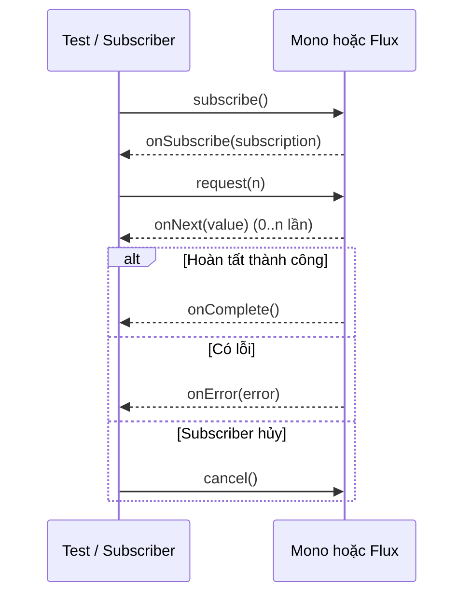

# Kiểm thử Mono, Flux, lỗi và hủy bằng StepVerifier

**Chương:** Kiểm thử  
**Module:** Spring Cloud Function (`SPRING_CLOUD_FUNCTION`)

Spring Cloud Function hỗ trợ viết logic nghiệp vụ bằng các giao diện Java chuẩn và cả kiểu reactive của Project Reactor như `Mono<T>`, `Flux<T>`. Một hàm reactive có thể nhận một publisher, biến đổi luồng dữ liệu rồi trả publisher mới; cùng logic đó có thể được Spring Cloud Function gọi từ Java, HTTP, sự kiện hoặc môi trường serverless.

Với reactive code, chỉ gọi phương thức rồi kiểm tra một giá trị trả về thường không đủ. Publisher thường **chưa thực thi cho tới khi có subscriber**, dữ liệu được phát theo tín hiệu `onNext`, kết thúc bằng `onComplete` hoặc `onError`, và subscriber có thể gửi tín hiệu hủy `cancel` trước khi luồng hoàn tất. Vì vậy, kiểm thử cần xác minh cả **giá trị, thứ tự tín hiệu, lỗi, demand và cancellation**.

Project Reactor cung cấp **`StepVerifier`** trong module `reactor-test` để viết một kịch bản kiểm thử theo đúng các tín hiệu Reactive Streams. Bài học này hướng dẫn kiểm thử `Mono` và `Flux`, lỗi và phục hồi lỗi, backpressure, hủy subscription, giải phóng tài nguyên, thời gian ảo, rồi áp dụng các kỹ thuật đó cho reactive function được đăng ký trong `FunctionCatalog`.

## 1. Mục tiêu học tập

Sau bài học, bạn có thể:

1. Phân biệt publisher, subscription, demand và terminal signal trong Reactor.
2. Kiểm thử `Mono<T>` với dữ liệu, empty completion và lỗi bằng `StepVerifier`.
3. Kiểm thử `Flux<T>` với nhiều phần tử, thứ tự, filter/map và kết thúc luồng.
4. Chứng minh lỗi kết thúc luồng và ngăn phần tử sau lỗi được xử lý.
5. Kiểm thử `onErrorResume`, retry và phân biệt lỗi được phục hồi với lỗi được truyền tiếp.
6. Kiểm soát demand bằng `thenRequest(...)` và xác minh backpressure.
7. Kiểm thử hủy bằng `thenCancel()`, `doOnCancel(...)` và cleanup tài nguyên.
8. Dùng `withVirtualTime(...)` để kiểm thử delay/backoff mà không chờ thời gian thực.
9. Kiểm tra reactive function của Spring Cloud Function được gọi để tạo stream và stream chỉ xử lý dữ liệu khi được subscribe.
10. Phân biệt test reactive function trong JVM với test adapter, binder và serverless bên ngoài.

| Chủ đề | Assertion chính của StepVerifier |
| --- | --- |
| `Mono` phát một giá trị | `expectNext(value).verifyComplete()` |
| `Mono.empty()` | `verifyComplete()` và không có `onNext` |
| `Mono.error(...)` | `expectError(...)` |
| `Flux` phát nhiều giá trị | `expectNext(...).verifyComplete()` |
| Thứ tự phần tử | `expectNextSequence(...)` |
| Demand/backpressure | `create(publisher, initialRequest)` và `thenRequest(n)` |
| Cancellation | `thenCancel().verify()` |
| Delay/backoff | `withVirtualTime(...)` và `thenAwait(...)` |

## 2. Hiểu đúng publisher và subscription

Trong Reactor, `Mono<T>` biểu diễn một luồng có tối đa một phần tử, còn `Flux<T>` biểu diễn luồng có thể phát từ không đến nhiều phần tử. Cả hai đều là publisher: chúng mô tả **một quá trình phát tín hiệu**, không phải một giá trị đã được tính ngay khi biến được tạo.



Các tín hiệu cần phân biệt:

- `onSubscribe`: subscriber nhận subscription.
- `request(n)`: subscriber yêu cầu tối đa thêm `n` phần tử.
- `onNext(value)`: publisher phát một phần tử theo demand.
- `onComplete`: publisher kết thúc thành công.
- `onError(error)`: publisher kết thúc do lỗi.
- `cancel()`: subscriber không còn muốn nhận dữ liệu; publisher nên dừng công việc và giải phóng tài nguyên phù hợp.

### 2.1. Tạo publisher không đồng nghĩa với chạy pipeline

```java
AtomicInteger processed = new AtomicInteger();

Flux<Integer> pipeline = Flux.range(1, 3)
    .doOnNext(value -> processed.incrementAndGet());

assertEquals(0, processed.get());

StepVerifier.create(pipeline)
    .expectNext(1, 2, 3)
    .verifyComplete();

assertEquals(3, processed.get());
```

Pipeline được mô tả trước, còn các toán tử xử lý dữ liệu chạy khi có subscription. Một số nguồn eager có thể tạo dữ liệu hoặc thực hiện side effect ngay lúc khởi tạo; muốn trì hoãn việc đó, hãy dùng `defer(...)` và thiết kế nguồn theo hợp đồng rõ ràng.

### 2.2. Mono và Flux không phải hai kiểu collection

| Kiểu | Số phần tử | Ví dụ |
| --- | --- | --- |
| `Mono<T>` | 0 hoặc 1 | Tìm một đơn hàng, tính một kết quả |
| `Flux<T>` | 0 đến nhiều | Đọc danh sách đơn hàng, stream sự kiện |
| `Mono<Void>` | Không phát giá trị; chỉ hoàn tất hoặc lỗi | Một thao tác ghi/xóa bất đồng bộ |
| `Flux<Void>` | Thường không phải kiểu dữ liệu phần tử hữu ích | Nên xem lại hợp đồng luồng |

Đối với `Mono<Void>`, không viết `expectNext(...)`. Hợp đồng cần kiểm tra là hoàn tất hay lỗi, cùng với side effect đã xảy ra.

## 3. StepVerifier là gì?

`StepVerifier` là DSL khai báo một kịch bản kiểm tra các tín hiệu mà subscriber sẽ nhận. Ta tạo verifier bằng `StepVerifier.create(publisher)` hoặc `StepVerifier.withVirtualTime(...)`, nối các kỳ vọng, rồi **bắt buộc kích hoạt việc xác minh** bằng một phương thức terminal như `verifyComplete()`, `verifyError()`, `verify()` hoặc `thenCancel().verify()`.

Ví dụ ngắn:

```java
StepVerifier.create(Flux.just("A", "B"))
    .expectNext("A")
    .expectNext("B")
    .verifyComplete();
```

Đọc theo thứ tự:

1. Subscribe vào publisher.
2. Kỳ vọng phần tử thứ nhất là `"A"`.
3. Kỳ vọng phần tử thứ hai là `"B"`.
4. Kỳ vọng publisher hoàn tất bình thường và chạy kịch bản test.

### 3.1. Các nhóm API thường dùng

| Nhóm | API | Mục đích |
| --- | --- | --- |
| Subscription | `expectSubscription()` | Khẳng định subscription đã được tạo |
| Phần tử | `expectNext(...)`, `assertNext(...)` | Kiểm tra giá trị kế tiếp |
| Chuỗi | `expectNextSequence(...)`, `expectNextCount(n)` | Kiểm tra danh sách hoặc số lượng |
| Terminal | `verifyComplete()`, `expectError(...)` | Kiểm tra hoàn tất hoặc lỗi |
| Demand | `thenRequest(n)` | Yêu cầu thêm phần tử trong kịch bản |
| Hủy | `thenCancel()` | Hủy subscription tại vị trí hiện tại |
| Thời gian | `thenAwait(duration)`, `expectNoEvent(duration)` | Chờ hoặc xác minh không có tín hiệu |
| Context | `expectAccessibleContext()` | Kiểm tra Reactor Context nếu hợp đồng cần |

Mặc định, `StepVerifier.create(publisher)` yêu cầu lượng phần tử không giới hạn. Khi muốn kiểm tra backpressure, truyền initial request rõ ràng, ví dụ `StepVerifier.create(publisher, 0)`, rồi điều khiển demand bằng `thenRequest(n)`.

**Lưu ý:** `verify()` có thể chờ vô hạn nếu publisher không phát terminal signal. Trong test có nguy cơ treo, dùng `verify(Duration)` hoặc cấu hình timeout phù hợp để CI kết thúc có kiểm soát.

## 4. Chuẩn bị dependency cho JUnit 5 và Reactor Test

Để dùng `StepVerifier`, test classpath cần artifact `reactor-test` cùng phiên bản tương thích với `reactor-core`. Trong dự án Spring Boot có dependency management, có thể dùng starter test và khai báo Reactor Test ở scope test.

**Maven** (trích dependency; phiên bản do BOM tương thích quản lý):

```xml
<dependencies>
    <dependency>
        <groupId>org.springframework.boot</groupId>
        <artifactId>spring-boot-starter</artifactId>
    </dependency>
    <dependency>
        <groupId>org.springframework.cloud</groupId>
        <artifactId>spring-cloud-function-context</artifactId>
    </dependency>
    <dependency>
        <groupId>io.projectreactor</groupId>
        <artifactId>reactor-core</artifactId>
    </dependency>
    <dependency>
        <groupId>io.projectreactor</groupId>
        <artifactId>reactor-test</artifactId>
        <scope>test</scope>
    </dependency>
    <dependency>
        <groupId>org.springframework.boot</groupId>
        <artifactId>spring-boot-starter-test</artifactId>
        <scope>test</scope>
    </dependency>
</dependencies>
```

**Gradle Kotlin DSL** (dự án đã quản lý phiên bản):

```kotlin
dependencies {
    implementation("org.springframework.boot:spring-boot-starter")
    implementation("org.springframework.cloud:spring-cloud-function-context")
    implementation("io.projectreactor:reactor-core")
    testImplementation("io.projectreactor:reactor-test")
    testImplementation("org.springframework.boot:spring-boot-starter-test")
}

tasks.test {
    useJUnitPlatform()
}
```

Không chọn ngẫu nhiên một phiên bản `reactor-test` mới hơn `reactor-core`. Hãy dùng dependency management của Spring Boot/Spring Cloud tương thích hoặc kiểm tra dependency tree của dự án. Các ví dụ dưới đây sử dụng JUnit Jupiter và Reactor API phổ biến.

## 5. Mã nghiệp vụ reactive mẫu

Ta xây dựng một chính sách đơn hàng nhỏ để dùng trong test:

- `assessOrder(Mono<OrderRequest>)` kiểm tra một đơn hàng và trả một `OrderDecision`.
- `normalizeOrders(Flux<String>)` chuẩn hóa một luồng mã đơn hàng.
- `validateOrders(Flux<String>)` phát lỗi nếu gặp mã không hợp lệ.
- `delayedStatus(Mono<String>)` minh họa một kết quả phát sau thời gian trễ.

**File:** `src/main/java/example/reactive/OrderReactiveFunctions.java`

```java
package example.reactive;

import java.time.Duration;
import java.util.Locale;
import java.util.function.Function;

import reactor.core.publisher.Flux;
import reactor.core.publisher.Mono;

public final class OrderReactiveFunctions {

    private OrderReactiveFunctions() {}

    public record OrderRequest(String orderCode, int quantity) {}

    public record OrderDecision(
            String normalizedCode, boolean accepted) {}

    public static Function<Mono<OrderRequest>, Mono<OrderDecision>>
            assessOrder() {
        return request -> request.map(value -> {
            if (value.orderCode() == null
                    || value.orderCode().isBlank()) {
                throw new IllegalArgumentException(
                    "Order code must not be blank");
            }
            String normalized = value.orderCode()
                .trim().toUpperCase(Locale.ROOT);
            return new OrderDecision(
                normalized, value.quantity() > 0);
        });
    }

    public static Function<Flux<String>, Flux<String>>
            normalizeOrders() {
        return orders -> orders
            .map(String::trim)
            .filter(value -> !value.isEmpty())
            .map(value -> value.toUpperCase(Locale.ROOT));
    }

    public static Function<Flux<String>, Flux<String>>
            validateOrders() {
        return orders -> orders.map(value -> {
            if (!value.matches("ORD-[0-9]+")) {
                throw new IllegalArgumentException(
                    "Invalid order code: " + value);
            }
            return value;
        });
    }

    public static Function<Mono<String>, Mono<String>>
            delayedStatus() {
        return status -> status.delayElement(
            Duration.ofSeconds(5));
    }
}
```

Các hàm là factory Java thuần, không cần Spring để tạo hoặc kiểm thử. Khi đăng ký trong ứng dụng, ta có thể dùng chúng làm implementation cho các functional bean. Test đơn vị ở các mục tiếp theo gọi trực tiếp các hàm này.

### 5.1. Đừng gọi block trong reactive function

Không viết:

```java
// Không nên trong reactive pipeline:
OrderRequest request = mono.block();
return Mono.just(assessSynchronously(request));
```

Gọi `block()` sẽ chặn thread hiện tại và làm mất lợi ích của composition reactive. Hãy dùng `map(...)` khi biến đổi đồng bộ, `flatMap(...)` khi gọi một hàm trả publisher, và để subscriber điều khiển việc thực thi.

## 6. Kiểm thử Mono: giá trị, empty và lỗi

`Mono<T>` có ba kết quả thường cần kiểm tra:

1. Phát một giá trị rồi `onComplete`.
2. Không phát giá trị và `onComplete`.
3. Phát `onError`.

**File:** `src/test/java/example/reactive/MonoStepVerifierTest.java`

```java
package example.reactive;

import static org.junit.jupiter.api.Assertions.*;

import org.junit.jupiter.api.Test;
import reactor.core.publisher.Mono;
import reactor.test.StepVerifier;

import example.reactive.OrderReactiveFunctions.OrderRequest;
import example.reactive.OrderReactiveFunctions.OrderDecision;

class MonoStepVerifierTest {

    @Test
    void emitsOneOrderDecisionAndCompletes() {
        Mono<OrderRequest> input =
            Mono.just(new OrderRequest(" ord-42 ", 2));

        Mono<OrderDecision> result =
            OrderReactiveFunctions.assessOrder().apply(input);

        StepVerifier.create(result)
            .expectNext(new OrderDecision("ORD-42", true))
            .verifyComplete();
    }

    @Test
    void emptyInputCompletesWithoutDecision() {
        Mono<OrderRequest> input = Mono.empty();

        Mono<OrderDecision> result =
            OrderReactiveFunctions.assessOrder().apply(input);

        StepVerifier.create(result)
            .verifyComplete();
    }

    @Test
    void invalidOrderEmitsIllegalArgumentError() {
        Mono<OrderRequest> input =
            Mono.just(new OrderRequest("  ", 2));

        Mono<OrderDecision> result =
            OrderReactiveFunctions.assessOrder().apply(input);

        StepVerifier.create(result)
            .expectErrorMatches(error ->
                error instanceof IllegalArgumentException
                    && error.getMessage().contains("must not be blank"))
            .verify();
    }

    @Test
    void errorCanBeRecoveredIntoFallbackValue() {
        Mono<String> result = Mono.<String>error(
                new IllegalStateException("inventory unavailable"))
            .onErrorResume(
                IllegalStateException.class,
                error -> Mono.just("temporarily-unavailable"));

        StepVerifier.create(result)
            .expectNext("temporarily-unavailable")
            .verifyComplete();
    }
}
```

### 6.1. Mono.empty không giống Mono.just(null)

Reactor không cho phép phát một giá trị `null` bằng `Mono.just(null)`. Muốn biểu diễn không có kết quả, dùng `Mono.empty()`. Vì vậy:

```java
StepVerifier.create(Mono.empty())
    .verifyComplete();
```

không có `onNext`, nhưng vẫn có terminal signal `onComplete`. Test chỉ dùng `verifyComplete()` sẽ chấp nhận cả luồng rỗng và luồng đã phát giá trị nếu không có expectation khác; nếu yêu cầu **phải có một giá trị**, hãy thêm `expectNext(...)`.

### 6.2. expectError và expectErrorMatches

`expectError(IllegalArgumentException.class)` kiểm tra kiểu lỗi. `expectErrorMatches(...)` cho phép kiểm tra thêm message hoặc thuộc tính. Tránh kiểm tra toàn bộ stack trace hay message phụ thuộc converter/framework nếu đó không phải hợp đồng ứng dụng.

### 6.3. Error recovery thay đổi terminal signal

`onErrorResume(...)` thay luồng lỗi bằng một publisher khác. Test trên chứng minh lỗi nguồn được chuyển thành một giá trị fallback rồi hoàn tất bình thường. Nếu nghiệp vụ cần **truyền lỗi ra ngoài**, không gắn recovery vào pipeline và kiểm tra `expectError...` thay vì kỳ vọng fallback.

## 7. Kiểm thử Flux: nhiều phần tử, thứ tự và luồng rỗng

`Flux<T>` có thể phát nhiều `onNext` trước khi hoàn tất hoặc lỗi. Với luồng hữu hạn, test thường cần xác minh **đủ phần tử, đúng thứ tự và có terminal signal**.

**File:** `src/test/java/example/reactive/FluxStepVerifierTest.java`

```java
package example.reactive;

import static org.junit.jupiter.api.Assertions.*;

import java.util.List;
import java.util.concurrent.CopyOnWriteArrayList;

import org.junit.jupiter.api.Test;
import reactor.core.publisher.Flux;
import reactor.test.StepVerifier;

class FluxStepVerifierTest {

    @Test
    void normalizesValuesAndPreservesOrder() {
        Flux<String> input =
            Flux.just(" ord-1 ", "ord-2", "  ord-3");

        Flux<String> result =
            OrderReactiveFunctions.normalizeOrders().apply(input);

        StepVerifier.create(result)
            .expectNext("ORD-1", "ORD-2", "ORD-3")
            .verifyComplete();
    }

    @Test
    void emptyFluxCompletesWithoutValues() {
        Flux<String> result =
            OrderReactiveFunctions.normalizeOrders()
                .apply(Flux.empty());

        StepVerifier.create(result)
            .verifyComplete();
    }

    @Test
    void validatorPassesAllValidValues() {
        Flux<String> normalized =
            OrderReactiveFunctions.normalizeOrders()
                .apply(Flux.just("ord-1", " ord-2 "));

        Flux<String> result =
            OrderReactiveFunctions.validateOrders()
                .apply(normalized);

        StepVerifier.create(result)
            .expectNextSequence(List.of("ORD-1", "ORD-2"))
            .verifyComplete();
    }

    @Test
    void errorStopsProcessingLaterElements() {
        List<String> visited = new CopyOnWriteArrayList<>();

        Flux<String> result = Flux.just(
                "ord-1", "invalid-code", "ord-3")
            .doOnNext(visited::add)
            .map(String::toUpperCase)
            .transform(
                OrderReactiveFunctions.validateOrders()::apply);

        StepVerifier.create(result)
            .expectNext("ORD-1")
            .expectErrorMatches(error ->
                error instanceof IllegalArgumentException
                    && error.getMessage().contains("invalid-code"))
            .verify();

        assertEquals(
            List.of("ord-1", "invalid-code"),
            visited);
    }
}
```

### 7.1. expectNextSequence và expectNextCount

`expectNextSequence(iterable)` phù hợp khi cần so sánh toàn bộ dãy theo thứ tự. `expectNextCount(n)` chỉ xác minh số lượng phần tử tiếp theo, không xác minh giá trị. Nếu nội dung có ý nghĩa nghiệp vụ, ưu tiên `expectNext(...)`, `assertNext(...)` hoặc `expectNextSequence(...)`.

### 7.2. Flux rỗng và Flux<Void>

`Flux.empty()` hoàn tất bình thường mà không phát giá trị. Test:

```java
StepVerifier.create(Flux.empty())
    .verifyComplete();
```

không tương đương với `Flux.never()`: `never` không phát giá trị, không hoàn tất và không lỗi. Với publisher không kết thúc, test phải chủ động hủy hoặc dùng timeout để tránh treo.

### 7.3. Lỗi giữa luồng chặn các phần tử sau

Trong `errorStopsProcessingLaterElements`, `visited` ghi nhận phần tử **đã đi tới bước validation**. Sau `"invalid-code"`, publisher phát `onError` và kết thúc; `"ord-3"` không được chuyển qua mapper validation.

Nếu có toán tử `onErrorContinue(...)` hoặc cơ chế phục hồi khác, hợp đồng thay đổi: một phần tử lỗi có thể bị bỏ qua và phần tử sau vẫn được xử lý. Khi đó phải viết test riêng cho chính sách phục hồi, không dùng kỳ vọng dừng luồng ở ví dụ này.

## 8. Kiểm thử lỗi và phục hồi lỗi trong Flux

Reactor biểu diễn lỗi bằng terminal signal `onError`. Khi lỗi xảy ra, một Flux thông thường không tiếp tục phát các phần tử tiếp theo trong cùng subscription. Tuy nhiên, các toán tử như `onErrorResume`, `onErrorReturn` hoặc `retryWhen` có thể thay đổi hành vi.

### 8.1. onErrorResume chuyển sang publisher khác

```java
Flux<String> recovered = Flux.just("ord-1", "bad", "ord-3")
    .map(value -> {
        if ("bad".equals(value)) {
            throw new IllegalArgumentException("bad order");
        }
        return value.toUpperCase();
    })
    .onErrorResume(
        IllegalArgumentException.class,
        error -> Flux.just("QUARANTINED"));

StepVerifier.create(recovered)
    .expectNext("ORD-1")
    .expectNext("QUARANTINED")
    .verifyComplete();
```

Khi một lỗi terminal đã xảy ra, `onErrorResume` đăng ký publisher thay thế. Nó **không tiếp tục publisher ban đầu từ phần tử kế tiếp**. Trong ví dụ, `"ord-3"` không được phát; giá trị `"QUARANTINED"` đến từ publisher thay thế.

### 8.2. retryWhen có thể chạy lại cả nguồn

```java
AtomicInteger attempts = new AtomicInteger();

Mono<String> operation = Mono.defer(() -> {
    int current = attempts.incrementAndGet();
    if (current < 3) {
        return Mono.error(
            new IllegalStateException("temporary failure"));
    }
    return Mono.just("completed");
}).retryWhen(
    Retry.max(2));

StepVerifier.create(operation)
    .expectNext("completed")
    .verifyComplete();

assertEquals(3, attempts.get());
```

Đoạn trên cần import `java.util.concurrent.atomic.AtomicInteger` và `reactor.util.retry.Retry`. `Mono.defer(...)` tạo lại thao tác mỗi lần được subscribe/retry. `Retry.max(2)` cho phép tối đa hai lần retry sau lần đầu, nên tổng số lần gọi trong trường hợp này là ba.

**Không retry mọi lỗi một cách mù quáng.** Lỗi validation thường không tự hết khi gọi lại. Chỉ retry các lỗi có thể tạm thời và cần xem side effect có an toàn khi thực hiện lặp hay không.

### 8.3. Phân biệt retry với fallback

| Toán tử | Ý nghĩa |
| --- | --- |
| `onErrorResume(...)` | Chuyển sang publisher thay thế sau lỗi |
| `onErrorReturn(value)` | Trả một giá trị dự phòng rồi hoàn tất |
| `retry(n)` / `retryWhen(...)` | Đăng ký lại nguồn khi gặp lỗi theo chính sách |
| `doOnError(...)` | Quan sát lỗi; không tự phục hồi |

Test cần kiểm tra số lần thực thi khi retry, giá trị thay thế khi fallback và lỗi terminal nếu chính sách retry đã hết lượt. Không coi `doOnError` là recovery.

## 9. Kiểm thử backpressure và demand

Reactive Streams dùng demand để subscriber yêu cầu số lượng phần tử. `StepVerifier.create(publisher, initialRequest)` cho phép kiểm soát lượng yêu cầu ban đầu; `thenRequest(n)` tăng demand trong kịch bản.

```java
@Test
void requestsValuesInBatches() {
    StepVerifier.create(Flux.range(1, 4), 0)
        .expectSubscription()
        .thenRequest(1)
        .expectNext(1)
        .thenRequest(2)
        .expectNext(2, 3)
        .thenRequest(1)
        .expectNext(4)
        .verifyComplete();
}
```

Với initial request bằng `0`, subscriber chưa yêu cầu phần tử nào. Sau mỗi `thenRequest(n)`, publisher có thể phát tối đa số phần tử đã yêu cầu và verifier kiểm tra chúng.

### 9.1. Chứng minh publisher chưa phát khi demand bằng 0

```java
@Test
void noElementIsDeliveredBeforeDemand() {
    AtomicInteger delivered = new AtomicInteger();
    Flux<Integer> source = Flux.range(1, 3)
        .doOnNext(value -> delivered.incrementAndGet());

    StepVerifier.create(source, 0)
        .expectSubscription()
        .then(() -> assertEquals(0, delivered.get()))
        .thenRequest(1)
        .expectNext(1)
        .then(() -> assertEquals(1, delivered.get()))
        .thenCancel()
        .verify();
}
```

Phương thức `then(Runnable)` thực thi assertion tại đúng thời điểm trong kịch bản. Test này chứng minh phần tử không được giao tới subscriber trước demand và chỉ một phần tử được yêu cầu trước khi hủy.

### 9.2. Không suy luận rằng mọi publisher đều phải phát đúng số phần tử ngay lập tức

Backpressure giới hạn **số phần tử subscriber yêu cầu**, nhưng nguồn có thể cần thời gian, scheduler hoặc một tín hiệu bên ngoài để tạo phần tử. Test nên dùng publisher có hành vi xác định như `Flux.range(...)` khi mục tiêu là demand. Nếu nguồn bất đồng bộ, cần kiểm soát scheduler hoặc dùng `TestPublisher` thay vì dựa vào timing ngẫu nhiên.

## 10. Kiểm thử cancellation và cleanup

Hủy subscription là một phần của hợp đồng reactive. Khi subscriber không còn quan tâm, publisher nên dừng công việc và giải phóng tài nguyên. Test cần chứng minh:

- `cancel()` đã được gửi.
- Công việc sau điểm hủy không tiếp tục được giao cho subscriber.
- Hook cleanup hoặc `doFinally(...)` chạy theo yêu cầu.

### 10.1. Kiểm tra doOnCancel

```java
@Test
void cancellationInvokesCancelHook() {
    AtomicBoolean cancelled = new AtomicBoolean();
    List<Integer> processed = new CopyOnWriteArrayList<>();

    Flux<Integer> source = Flux.range(1, 10)
        .doOnNext(processed::add)
        .doOnCancel(() -> cancelled.set(true));

    StepVerifier.create(source, 0)
        .expectSubscription()
        .thenRequest(2)
        .expectNext(1, 2)
        .thenCancel()
        .verify();

    assertTrue(cancelled.get());
    assertEquals(List.of(1, 2), processed);
}
```

Test dùng initial demand bằng 0 rồi yêu cầu hai phần tử, nên nguồn đồng bộ chỉ giao hai giá trị trước khi verifier gửi cancel. Danh sách `processed` chứng minh phần tử tiếp theo chưa được xử lý trong lần subscription này.

### 10.2. Kiểm tra Mono.never

```java
@Test
void neverMonoCanBeCancelled() {
    AtomicBoolean cancelled = new AtomicBoolean();

    Mono<String> never = Mono.<String>never()
        .doOnCancel(() -> cancelled.set(true));

    StepVerifier.create(never)
        .expectSubscription()
        .thenCancel()
        .verify();

    assertTrue(cancelled.get());
}
```

`Mono.never()` không phát giá trị, không lỗi và không hoàn tất. Không được dùng `verifyComplete()` cho publisher này vì test sẽ chờ vô hạn nếu không có timeout. Kịch bản phải chủ động hủy hoặc có timeout phù hợp.

### 10.3. Kiểm tra giải phóng tài nguyên với Flux.using

```java
@Test
void cancellationReleasesResource() {
    AtomicBoolean closed = new AtomicBoolean();

    Flux<Integer> source = Flux.using(
        () -> "test-resource",
        resource -> Flux.range(1, 5),
        resource -> closed.set(true)
    );

    StepVerifier.create(source, 0)
        .expectSubscription()
        .thenRequest(1)
        .expectNext(1)
        .thenCancel()
        .verify();

    assertTrue(closed.get());
}
```

`Flux.using(...)` quản lý vòng đời tài nguyên và gọi cleanup khi sequence kết thúc hoặc bị hủy. Test xác minh đường cancellation không bỏ qua bước đóng tài nguyên.

### 10.4. doFinally và SignalType

Nếu cần phân biệt hoàn tất, lỗi và hủy:

```java
AtomicReference<SignalType> finalSignal =
    new AtomicReference<>();

Flux<Integer> source = Flux.range(1, 5)
    .doFinally(finalSignal::set);

StepVerifier.create(source, 0)
    .expectSubscription()
    .thenRequest(1)
    .expectNext(1)
    .thenCancel()
    .verify();

assertEquals(SignalType.CANCEL, finalSignal.get());
```

Đoạn code cần import `java.util.concurrent.atomic.AtomicReference` và `reactor.core.publisher.SignalType`. `doFinally(...)` chạy sau khi sequence kết thúc, và nhận loại tín hiệu cuối. Nó hữu ích để kiểm tra metric, trace hoặc cleanup hook.

**Đừng nhầm cancel với onComplete.** Cancellation do subscriber chủ động gửi, không phải một terminal signal mà publisher phát xuống subscriber như `onComplete` hoặc `onError`.

## 11. Kiểm thử thời gian bằng VirtualTimeScheduler

Không nên dùng `Thread.sleep(...)` để chờ một `Mono.delay(...)` hoặc retry backoff. Chờ thật khiến test chậm, dễ flaky và phụ thuộc lịch chạy của CI. `StepVerifier.withVirtualTime(...)` tạo scheduler thời gian ảo để kiểm tra những operator dùng scheduler mặc định mà không phải đợi thời gian thực.

### 11.1. Kiểm tra Mono.delay

```java
@Test
void delayCanBeTestedWithoutWaitingOneDay() {
    StepVerifier.withVirtualTime(
            () -> Mono.delay(Duration.ofDays(1)))
        .expectSubscription()
        .expectNoEvent(Duration.ofDays(1))
        .expectNext(0L)
        .verifyComplete();
}
```

`expectSubscription()` cần đứng trước `expectNoEvent(...)` vì subscription cũng là một event. Sau đó, verifier tiến đồng hồ ảo qua một ngày, nhận giá trị `0L` từ `Mono.delay` và xác minh hoàn tất.

### 11.2. Quy tắc quan trọng: tạo publisher bên trong Supplier

Đúng:

```java
StepVerifier.withVirtualTime(
    () -> Flux.interval(Duration.ofSeconds(1)).take(3))
    .thenAwait(Duration.ofSeconds(3))
    .expectNext(0L, 1L, 2L)
    .verifyComplete();
```

Không nên tạo publisher trước rồi trả lại biến đã tạo:

```java
// Không dùng cách này cho virtual time:
Flux<Long> source =
    Flux.interval(Duration.ofSeconds(1)).take(3);

StepVerifier.withVirtualTime(() -> source)
    .thenAwait(Duration.ofSeconds(3))
    .expectNext(0L, 1L, 2L)
    .verifyComplete();
```

Lý do: `withVirtualTime(...)` cần cài scheduler ảo **trước khi operator được tạo**. Nếu publisher đã được tạo bên ngoài, nó có thể đã giữ scheduler thật. Tạo toàn bộ chuỗi trong lambda giúp operator nhận scheduler ảo.

### 11.3. Kiểm thử retry backoff bằng thời gian ảo

```java
@Test
void retryBackoffUsesVirtualTime() {
    AtomicInteger attempts = new AtomicInteger();

    StepVerifier.withVirtualTime(() ->
            Mono.defer(() -> {
                int attempt = attempts.incrementAndGet();
                if (attempt < 3) {
                    return Mono.error(
                        new IllegalStateException("temporary"));
                }
                return Mono.just("completed");
            }).retryWhen(
                Retry.fixedDelay(
                    2, Duration.ofSeconds(10))))
        .expectSubscription()
        .thenAwait(Duration.ofSeconds(20))
        .expectNext("completed")
        .verifyComplete();

    assertEquals(3, attempts.get());
}
```

Hai khoảng backoff 10 giây được tiến bằng đồng hồ ảo. Toàn bộ publisher, bao gồm `Mono.defer(...)` và `retryWhen(...)`, được tạo **bên trong Supplier**. Không dùng `Thread.sleep(20_000)`.

Đoạn test cần các import `java.time.Duration`, `java.util.concurrent.atomic.AtomicInteger`, `reactor.core.publisher.Mono`, `reactor.util.retry.Retry` và `reactor.test.StepVerifier`.

### 11.4. Giới hạn của virtual time

- Operator phải dùng scheduler được Reactor thay thế bằng virtual scheduler; scheduler tùy chỉnh được tạo trước đó có thể không chịu ảnh hưởng.
- Một số pipeline lồng scheduler hoặc tạo delay bên trong nhiều nhánh có thể cần điều chỉnh thứ tự tạo/subscription.
- Publisher vô hạn có thể không hoàn tất; hãy giới hạn bằng `take(n)` hoặc chủ động hủy.
- Virtual time kiểm soát **thời gian Reactor**, không tự giả lập đồng hồ hệ điều hành, timeout của HTTP client bên ngoài hay thời gian xử lý broker thật.

## 12. TestPublisher và PublisherProbe cho tình huống cần kiểm soát

Ngoài `StepVerifier`, `reactor-test` có hai công cụ bổ trợ hữu ích:

- **`TestPublisher`**: nguồn test cho phép chủ động phát phần tử, lỗi hoặc hoàn tất vào thời điểm test lựa chọn.
- **`PublisherProbe`**: bọc một publisher để kiểm tra publisher có được subscribe, request hoặc cancel hay không.

### 12.1. Dùng TestPublisher để điều khiển tín hiệu

```java
@Test
void testPublisherControlsValuesAndError() {
    TestPublisher<String> source = TestPublisher.create();

    StepVerifier.create(
            source.flux().map(String::toUpperCase))
        .expectSubscription()
        .then(() -> source.next("ord-1"))
        .expectNext("ORD-1")
        .then(() -> source.error(
            new IllegalStateException("source failed")))
        .expectErrorMessage("source failed")
        .verify();
}
```

Test có thể kích hoạt tín hiệu tại một thời điểm xác định, thay vì dùng thread/sleep để đua với nguồn bất đồng bộ. `TestPublisher` cũng có các chế độ kiểm tra tuân thủ Reactive Streams; chỉ dùng chế độ vi phạm khi đang kiểm tra cách pipeline phản ứng với một publisher không tuân thủ. TestPublisher thường phát trực tiếp tới subscriber hiện tại và không nên được dùng đồng thời từ nhiều thread trong test song song nếu chưa có đồng bộ hóa.

### 12.2. Dùng PublisherProbe để kiểm tra nhánh fallback

```java
@Test
void fallbackPublisherIsActuallySubscribed() {
    PublisherProbe<String> fallback =
        PublisherProbe.of(Mono.just("fallback"));

    Mono<String> result = Mono.<String>error(
            new IllegalStateException("failed"))
        .onErrorResume(error -> fallback.mono());

    StepVerifier.create(result)
        .expectNext("fallback")
        .verifyComplete();

    fallback.assertWasSubscribed();
    fallback.assertWasRequested();
    fallback.assertWasNotCancelled();
}
```

Test không chỉ xác minh fallback output; nó còn chứng minh nhánh fallback thực sự được subscribe và có demand. Điều này hữu ích khi một nhánh có logic quan trọng nhưng kết quả cuối có thể giống với một đường khác.

### 12.3. PublisherProbe và cancellation

```java
@Test
void cancellationReachesDelegatedPublisher() {
    PublisherProbe<Integer> probe =
        PublisherProbe.of(Flux.range(1, 5));

    StepVerifier.create(probe.flux(), 0)
        .expectSubscription()
        .thenRequest(1)
        .expectNext(1)
        .thenCancel()
        .verify();

    probe.assertWasSubscribed();
    probe.assertWasRequested();
    probe.assertWasCancelled();
}
```

Ở đây, probe giúp chứng minh tín hiệu cancel được truyền tới publisher được ủy quyền. Nếu pipeline có nhiều nhánh, đặt một probe ở từng nhánh để xác minh đúng publisher được kích hoạt/hủy.

## 13. Reactive function trong Spring Cloud Function

Spring Cloud Function hỗ trợ các hàm dùng `Mono` và `Flux` như kiểu input/output. Một khác biệt quan trọng:

- Với **imperative function** như `Function<String,String>`, framework gọi hàm cho từng event/message theo mô hình imperative.
- Với **reactive function** như `Function<Flux<String>,Flux<String>>`, framework gọi hàm để nhận một stream; các toán tử trong stream xử lý từng phần tử khi có subscription.

Điều này ảnh hưởng trực tiếp tới test. Đừng kỳ vọng thân hàm reactive được gọi một lần cho mỗi phần tử. Cần phân biệt **số lần gọi function để dựng publisher** và **số phần tử được xử lý sau subscription**.

### 13.1. Ứng dụng Spring Boot có reactive functional bean

**File:** `src/main/java/example/reactive/ReactiveFunctionApplication.java`

```java
package example.reactive;

import java.util.List;
import java.util.Locale;
import java.util.concurrent.CopyOnWriteArrayList;
import java.util.concurrent.atomic.AtomicInteger;
import java.util.function.Function;

import org.springframework.boot.SpringApplication;
import org.springframework.boot.autoconfigure.SpringBootApplication;
import org.springframework.context.annotation.Bean;

import reactor.core.publisher.Flux;
import reactor.core.publisher.Mono;

@SpringBootApplication(proxyBeanMethods = false)
public class ReactiveFunctionApplication {

    public static void main(String[] args) {
        SpringApplication.run(
            ReactiveFunctionApplication.class, args);
    }

    public record OrderRequest(String orderCode, int quantity) {}

    public record OrderDecision(
        String normalizedCode, boolean accepted) {}

    public static final class ReactiveProbe {
        private final AtomicInteger functionInvocations =
            new AtomicInteger();
        private final List<String> processed =
            new CopyOnWriteArrayList<>();

        public void invoked() {
            functionInvocations.incrementAndGet();
        }

        public void processed(String value) {
            processed.add(value);
        }

        public int invocationCount() {
            return functionInvocations.get();
        }

        public List<String> processedValues() {
            return List.copyOf(processed);
        }

        public void reset() {
            functionInvocations.set(0);
            processed.clear();
        }
    }

    @Bean
    public ReactiveProbe reactiveProbe() {
        return new ReactiveProbe();
    }

    @Bean("normalizeFlux")
    public Function<Flux<String>, Flux<String>> normalizeFlux(
            ReactiveProbe probe) {
        return input -> {
            probe.invoked();
            return input.map(value -> {
                probe.processed(value);
                return value.trim().toUpperCase(Locale.ROOT);
            });
        };
    }

    @Bean("assessMono")
    public Function<Mono<OrderRequest>, Mono<OrderDecision>>
            assessMono() {
        return request -> request.map(value -> {
            if (value.orderCode() == null
                    || value.orderCode().isBlank()) {
                throw new IllegalArgumentException(
                    "Order code must not be blank");
            }
            return new OrderDecision(
                value.orderCode().trim().toUpperCase(Locale.ROOT),
                value.quantity() > 0);
        });
    }
}
```

`ReactiveProbe` chỉ dùng để kiểm tra hai thời điểm: function body được gọi bao nhiêu lần và mapper đã xử lý những input nào. Nó không thuộc logic nghiệp vụ production.

### 13.2. Test reactive function trực tiếp và qua catalog

**File:** `src/test/java/example/reactive/ReactiveFunctionCatalogTest.java`

```java
package example.reactive;

import static org.junit.jupiter.api.Assertions.*;

import java.util.List;
import java.util.function.Function;

import org.junit.jupiter.api.BeforeEach;
import org.junit.jupiter.api.Test;
import org.springframework.beans.factory.annotation.Autowired;
import org.springframework.beans.factory.annotation.Qualifier;
import org.springframework.boot.test.context.SpringBootTest;
import org.springframework.cloud.function.context.FunctionCatalog;

import reactor.core.publisher.Flux;
import reactor.core.publisher.Mono;
import reactor.test.StepVerifier;

import example.reactive.ReactiveFunctionApplication.OrderRequest;
import example.reactive.ReactiveFunctionApplication.OrderDecision;
import example.reactive.ReactiveFunctionApplication.ReactiveProbe;

@SpringBootTest(
    classes = ReactiveFunctionApplication.class,
    webEnvironment = SpringBootTest.WebEnvironment.NONE
)
class ReactiveFunctionCatalogTest {

    @Autowired
    FunctionCatalog catalog;

    @Autowired
    ReactiveProbe probe;

    @Autowired
    @Qualifier("normalizeFlux")
    Function<Flux<String>, Flux<String>> directNormalize;

    @BeforeEach
    void resetProbe() {
        probe.reset();
    }

    @Test
    void directReactiveFunctionBuildsStreamBeforeProcessingItems() {
        Flux<String> result =
            directNormalize.apply(Flux.just(" a ", "b"));

        assertEquals(1, probe.invocationCount());
        assertTrue(probe.processedValues().isEmpty());

        StepVerifier.create(result)
            .expectNext("A", "B")
            .verifyComplete();

        assertEquals(List.of(" a ", "b"),
            probe.processedValues());
    }

    @Test
    void catalogReactiveFunctionProcessesStreamOncePerInvocation() {
        Function<Flux<String>, Flux<String>> fromCatalog =
            catalog.lookup(Function.class, "normalizeFlux");
        assertNotNull(fromCatalog);

        Flux<String> result =
            fromCatalog.apply(Flux.just(" ord-1 ", "ord-2"));

        StepVerifier.create(result)
            .expectNext("ORD-1", "ORD-2")
            .verifyComplete();

        assertEquals(1, probe.invocationCount());
        assertEquals(List.of(" ord-1 ", "ord-2"),
            probe.processedValues());
    }

    @Test
    void reactiveMonoFunctionWorksThroughCatalog() {
        Function<Mono<OrderRequest>, Mono<OrderDecision>> assess =
            catalog.lookup(Function.class, "assessMono");
        assertNotNull(assess);

        Mono<OrderDecision> result = assess.apply(
            Mono.just(new OrderRequest(" ord-42 ", 3)));

        StepVerifier.create(result)
            .expectNext(new OrderDecision("ORD-42", true))
            .verifyComplete();
    }
}
```

Các test xác minh:

1. Function reactive được gọi để xây publisher; mapper xử lý phần tử khi subscription diễn ra.
2. Với một lần gọi `apply(Flux)`, function body không bị gọi lại cho từng item.
3. `FunctionCatalog` vẫn phân giải được bean reactive và trả publisher có thể kiểm tra bằng StepVerifier.
4. Một hàm `Mono<OrderRequest> → Mono<OrderDecision>` có thể được test cùng cách với một luồng đơn.

**Không suy luận** từ test trên rằng HTTP/Stream/serverless đã subscribe đúng hoặc quản lý lifecycle đúng. Test chỉ kiểm tra function và publisher trong Spring context.

### 13.3. Reactive Supplier và polling

Spring Cloud Function cũng hỗ trợ `Supplier<Flux<T>>` hoặc `Supplier<Mono<T>>`. Một reactive supplier thường được gọi để tạo stream mà consumer sẽ subscribe; nó không có nghĩa supplier được gọi một lần cho mỗi phần tử.

Với một reactive supplier phát **luồng hữu hạn** cần polling lại, Spring Cloud Function cung cấp marker `@PollableBean` để báo cho framework tích hợp biết rằng supplier có thể cần được poll lần nữa. Annotation này **không tự thực hiện polling**; hành vi polling thuộc framework/adapter sử dụng supplier.

Nếu dùng `@PollableBean(splittable = true)`, hãy kiểm tra cả việc tạo stream, polling và cách tách phần tử ở tầng tích hợp tương ứng. Test `StepVerifier` trên một Flux đã được tạo không tự chứng minh poller của adapter hoạt động.

## 14. Cancellation khi publisher được subscribe nhiều lần

Một Flux cold thường chạy lại pipeline cho mỗi subscriber. Nếu publisher có side effect trong toán tử, subscribe lần thứ hai có thể thực hiện side effect lần thứ hai.

```java
@Test
void coldFluxReplaysForEachSubscription() {
    AtomicInteger processed = new AtomicInteger();

    Flux<Integer> source = Flux.range(1, 2)
        .doOnNext(value -> processed.incrementAndGet());

    StepVerifier.create(source)
        .expectNext(1, 2)
        .verifyComplete();

    StepVerifier.create(source)
        .expectNext(1, 2)
        .verifyComplete();

    assertEquals(4, processed.get());
}
```

Một publisher đã được tạo không đồng nghĩa với một lần xử lý duy nhất. Nếu test gọi `StepVerifier.create(...)` hai lần trên cùng cold publisher, hai subscription sẽ chạy lại các toán tử nguồn.

### 14.1. Hủy một subscriber không nhất thiết hủy mọi subscriber

Nếu nhiều subscriber cùng nghe một nguồn chia sẻ, cancellation của một subscriber có thể không làm nguồn dừng nếu vẫn còn subscriber khác. Vì vậy, test một luồng chia sẻ cần xác định rõ:

- Publisher là cold hay hot/shared.
- Ai sở hữu subscription và nguồn.
- Khi một subscriber cancel, nguồn có còn subscriber khác không.
- Cleanup chỉ xảy ra khi subscription hiện tại kết thúc hay khi toàn nguồn không còn người nghe.

Đừng áp dụng kết luận từ test `Flux.range(...).doOnCancel(...)` đơn giản cho một pipeline có `share()`, `publish().refCount(...)` hoặc kết nối nguồn bên ngoài.

### 14.2. Kiểm tra hủy một luồng interval

```java
@Test
void intervalStopsAfterCancellation() {
    AtomicBoolean cancelled = new AtomicBoolean();

    StepVerifier.withVirtualTime(() ->
            Flux.interval(Duration.ofSeconds(1))
                .doOnCancel(() -> cancelled.set(true)))
        .expectSubscription()
        .thenAwait(Duration.ofSeconds(2))
        .expectNext(0L, 1L)
        .thenCancel()
        .verify();

    assertTrue(cancelled.get());
}
```

Test dùng virtual time để tiến hai giây, nhận hai tick đầu, rồi hủy luồng vô hạn. Nếu bỏ `thenCancel()` và chờ `verifyComplete()`, test sẽ không hoàn tất vì `Flux.interval(...)` không tự kết thúc.

## 15. Đưa StepVerifier vào ranh giới kiểm thử Spring Cloud Function

Khi reactive bean đã được đăng ký trong Spring, có thể tra cứu qua `FunctionCatalog` rồi đưa publisher trả về cho StepVerifier. Hai việc cần giữ riêng:

1. **Catalog/DI:** Spring đã đăng ký đúng functional bean và trả về hàm reactive theo tên.
2. **Reactive execution:** publisher phát đúng dữ liệu, lỗi và terminal signal khi subscriber tham gia.

```java
Function<Flux<String>, Flux<String>> normalize =
    catalog.lookup(Function.class, "normalizeFlux");

Flux<String> output =
    normalize.apply(Flux.just(" ord-1 ", "ord-2"));

StepVerifier.create(output)
    .expectNext("ORD-1", "ORD-2")
    .verifyComplete();
```

Đoạn code trên là mẫu rút gọn của test mục 13. Nó kiểm tra **publisher do catalog trả về**; không cần gọi `block()` và không cần tự `subscribe()` trước.

### 15.1. Vì sao không gọi subscribe() trước StepVerifier?

Không viết:

```java
Flux<String> output = normalize.apply(input);
output.subscribe(); // Một subscription thật đã bắt đầu.

StepVerifier.create(output)
    .expectNext("ORD-1")
    .verifyComplete();
```

Đoạn này tạo hai subscriber. Với cold publisher, logic có thể chạy hai lần; với hot publisher, StepVerifier có thể bỏ lỡ tín hiệu đã phát trước khi nó subscribe. Hãy để StepVerifier là subscriber của test, trừ khi mục tiêu đang kiểm tra rõ ràng nhiều subscription.

### 15.2. Đừng dùng block để biến reactive test thành synchronous test

```java
// Không cần thiết:
OrderDecision value = result.block();
assertEquals(expected, value);
```

`block()` làm mất khả năng kiểm tra sequence, demand, cancellation và terminal signal. `StepVerifier` vừa subscribe, vừa quan sát các tín hiệu, vừa đưa ra assertion theo thời gian.

### 15.3. Kiểm tra lỗi của reactive function qua catalog

Nếu một reactive function phát lỗi:

```java
Function<Flux<String>, Flux<String>> validate =
    catalog.lookup(Function.class, "validateFlux");

Flux<String> output =
    validate.apply(Flux.just("ORD-1", "bad", "ORD-3"));

StepVerifier.create(output)
    .expectNext("ORD-1")
    .expectError(IllegalArgumentException.class)
    .verify();
```

Test nên thêm một probe ở bước xử lý để xác minh `ORD-3` không được xử lý sau lỗi, như ví dụ mục 7. Lưu ý, khi lỗi xảy ra do **converter trước khi publisher được tạo**, trace bên trong reactive function có thể chưa có phần tử nào.

## 16. Lỗi thường gặp khi viết StepVerifier

| Cách viết sai hoặc thiếu | Vấn đề | Cách sửa |
| --- | --- | --- |
| Tạo verifier nhưng không gọi terminal verify | Test không thực sự chạy kịch bản | Gọi `verifyComplete()`, `verify()` hoặc phương thức tương ứng |
| Dùng `verifyComplete()` cho `Mono.never()` | Publisher không hoàn tất, test treo | Dùng `thenCancel()` hoặc timeout |
| Dùng `expectNext(null)` | Reactive Streams không phát giá trị null | Dùng `Mono.empty()` hoặc kiểu wrapper biểu diễn absence |
| Chỉ assert giá trị, không assert complete/error | Có thể bỏ sót terminal signal sai | Thêm `verifyComplete()` hoặc `expectError(...)` |
| Dùng `Thread.sleep(...)` cho delay | Chậm và flaky | Dùng `withVirtualTime(...)` |
| Tạo publisher trước `withVirtualTime(...)` | Operator có thể giữ scheduler thật | Tạo toàn bộ pipeline trong Supplier |
| Dùng demand mặc định rồi suy luận backpressure | Request ban đầu có thể không giới hạn | Truyền initial request và dùng `thenRequest(...)` |
| Gọi `subscribe()` rồi mới tạo StepVerifier | Có hai subscription, side effect lặp | Để StepVerifier quản lý subscription |
| Chỉ assert `doOnCancel` đã chạy | Chưa chứng minh phần tử sau cancel không được xử lý | Kiểm tra cả processed list hoặc PublisherProbe |
| Nhầm cancel với complete | Hai tín hiệu khác nhau | Kiểm tra `SignalType.CANCEL` và terminal signal phù hợp |
| Chỉ assert outer exception của wrapper | Có thể thay đổi theo framework/version | Kiểm tra lỗi nghiệp vụ/root cause theo hợp đồng |
| Dùng StepVerifier để kết luận binder đã retry | Test chưa chạy qua adapter | Viết Spring Cloud Stream integration test |

### 16.1. verify() có thể chờ vô hạn

Các phương thức `verifyComplete()` và `verify()` chờ tín hiệu terminal. Nếu publisher không hoàn tất, test có thể treo tới khi runner timeout. Có thể đặt timeout ở một kịch bản:

```java
StepVerifier.create(Mono.delay(Duration.ofMillis(10)))
    .expectNext(0L)
    .expectComplete()
    .verify(Duration.ofSeconds(2));
```

Đối với test virtual time, vẫn nên tránh tạo pipeline không thể phát terminal signal hoặc vô hạn mà không có `take(...)`/cancellation.

### 16.2. Không coi mỗi lần subscribe là một lần gọi business function imperative

Với reactive function, body hàm được gọi để nhận publisher; một subscription có thể kích hoạt xử lý các phần tử. Nếu publisher cold được subscribe nhiều lần, các toán tử có thể chạy lại cho mỗi subscription dù body tạo publisher chỉ được gọi một lần trước đó.

Vì vậy, test nên ghi nhận riêng:

- Số lần gọi reactive function để tạo publisher.
- Số lần subscribe vào publisher.
- Số phần tử được xử lý trong từng subscription.
- Số lần side effect được thực hiện.

## 17. Ma trận kiểm thử Mono, Flux, lỗi và cancellation

| ID | Tình huống | Cách kiểm thử | Kỳ vọng |
| --- | --- | --- | --- |
| M01 | `Mono.just(value)` | `expectNext(value).verifyComplete()` | Một giá trị rồi hoàn tất |
| M02 | `Mono.empty()` | `verifyComplete()` | Không có giá trị, hoàn tất |
| M03 | `Mono.error(error)` | `expectErrorMatches(...)` | Lỗi đúng loại/thuộc tính |
| M04 | `onErrorResume` | `expectNext(fallback).verifyComplete()` | Lỗi được thay bằng fallback |
| F01 | `Flux.just(...)` | `expectNextSequence(...)` | Đủ phần tử và đúng thứ tự |
| F02 | `Flux.empty()` | `verifyComplete()` | Luồng rỗng hoàn tất |
| F03 | Lỗi giữa Flux | `expectNext(...).expectError(...)` | Không xử lý phần tử sau lỗi |
| F04 | `onErrorResume` | Kiểm tra chuỗi output | Publisher thay thế chạy sau lỗi |
| F05 | `retryWhen` | Đếm attempts | Số lần thử đúng chính sách |
| B01 | Demand bằng 0 | `create(publisher, 0)` | Chưa giao phần tử |
| B02 | Yêu cầu từng đợt | `thenRequest(n)` | Số phần tử theo demand |
| C01 | Cancel Flux | `thenCancel()` | Cancel hook được gọi |
| C02 | Cancel Mono.never | `thenCancel()` | Subscription được hủy |
| C03 | Cancel tài nguyên | `Flux.using(...)` | Cleanup được gọi |
| C04 | Cancel publisher được ủy quyền | `PublisherProbe` | Probe xác nhận cancelled |
| T01 | Delay theo thời gian | `withVirtualTime(...)` | Không chờ thời gian thực |
| T02 | Retry backoff | `withVirtualTime(...)` | Attempts và thời điểm đúng |
| S01 | Reactive function qua catalog | `lookup(...) + StepVerifier` | Publisher đúng dữ liệu/tín hiệu |
| S02 | Reactive function body | Probe invocation/processed | Body một lần mỗi stream invocation |

Ma trận là khung thiết kế; không phải mọi hàng đều cần xuất hiện trong mỗi class test. Chọn các ca liên quan đến hợp đồng và rủi ro của hàm thực tế.

## 18. Chạy test và chẩn đoán

Cấu trúc ví dụ:

```text
src/
  main/java/example/reactive/
    OrderReactiveFunctions.java
    ReactiveFunctionApplication.java
  test/java/example/reactive/
    MonoStepVerifierTest.java
    FluxStepVerifierTest.java
    ReactiveFunctionCatalogTest.java
    ReactiveTimingTest.java          (tùy chọn)
```

Chạy một lớp với Maven Wrapper:

```bash
./mvnw -Dtest=MonoStepVerifierTest test
```

Chạy bộ reactive test với Gradle Wrapper:

```bash
./gradlew test --tests "example.reactive.*StepVerifierTest" --tests "example.reactive.ReactiveFunctionCatalogTest"
```

Các lệnh là hướng dẫn cho người học, không phải kết quả đã chạy trong quá trình viết bài.

### 18.1. Đọc failure message theo tín hiệu

- **Expected onNext nhưng nhận onError:** kiểm tra mapper/validation và vị trí lỗi.
- **Expected onComplete nhưng không có terminal signal:** publisher có thể là `never`, nguồn vô hạn hoặc không được trigger.
- **Expected error nhưng nhận fallback:** pipeline có `onErrorResume` hoặc error handler.
- **Expected cancel hook nhưng không chạy:** verifier chưa cancel, nguồn đã complete trước đó, hoặc cancellation chưa được truyền tới nguồn.
- **Expected 2 item nhưng nhận 3:** demand ban đầu, cách phát của nguồn hoặc vị trí cancellation chưa được kiểm soát.
- **Virtual time không phát giá trị:** publisher có thể được tạo trước scheduler ảo, dùng scheduler riêng hoặc chưa tiến clock đủ.
- **Catalog test không tìm được hàm:** kiểm tra tên bean, functional registration và dependency Spring Cloud Function.

### 18.2. Khi khác biệt giữa direct function và catalog

Kiểm tra theo thứ tự:

1. Cả hai có cùng kiểu `Mono<T>`/`Flux<T>` không?
2. Cùng publisher input và cùng số subscription không?
3. Có converter hoặc wrapper làm thay đổi payload/terminal behavior không?
4. Có scheduler riêng, side effect hoặc state chia sẻ không?
5. Có retry/error recovery ở một đường nhưng không có ở đường còn lại không?
6. Test đang kiểm tra function body, publisher hay adapter?

Không kết luận một publisher đúng/sai chỉ từ tên class của wrapper. Hãy kiểm tra tín hiệu và dữ liệu mà subscriber thực sự nhận.

## 19. Bài tập thực hành

1. **Mono thành công:** viết test cho `assessOrder()` với quantity dương và quantity bằng 0; xác minh hai `OrderDecision`.
2. **Mono rỗng:** tạo một nguồn `Mono<OrderRequest>` rỗng và chứng minh function không phát decision.
3. **Mono lỗi:** gửi mã đơn hàng chỉ có khoảng trắng, xác minh `IllegalArgumentException` qua StepVerifier.
4. **Flux thứ tự:** chuẩn hóa năm mã đơn hàng; dùng `expectNextSequence(...)` kiểm tra đúng thứ tự.
5. **Flux lỗi:** chèn mã sai ở phần tử thứ ba; ghi danh sách đã xử lý và chứng minh phần tử thứ tư không đi qua validator.
6. **Fallback:** dùng `onErrorResume` trả publisher quarantine; thêm `PublisherProbe` để chứng minh nhánh đó được subscribe.
7. **Retry:** tạo nguồn lỗi hai lần rồi thành công; đếm attempts và dùng virtual time cho backoff.
8. **Backpressure:** bắt đầu với demand bằng 0, yêu cầu lần lượt 1, 2 và 1 phần tử; quan sát nguồn chỉ phát theo demand.
9. **Cancellation:** hủy sau hai phần tử; xác minh `doOnCancel` và danh sách processed không có phần tử thứ ba.
10. **Cleanup:** dùng `Flux.using(...)` hoặc `usingWhen(...)` để quản lý tài nguyên; test cleanup khi complete, error và cancel.
11. **Virtual time:** kiểm thử `Flux.interval(...)` mà không chờ đồng hồ thật; tạo publisher trong Supplier.
12. **FunctionCatalog:** đăng ký một reactive function mới và kiểm tra bằng `catalog.lookup(...)` + StepVerifier.
13. **Invocation/subscription:** đếm số lần reactive function body được gọi và số phần tử xử lý; giải thích vì sao hai con số khác nhau.
14. **Cold publisher:** subscribe cùng một Flux hai lần và xác minh side effect lặp; sau đó thiết kế cách chia sẻ hoặc idempotency nếu nghiệp vụ cần.
15. **Adapter:** dùng Spring Cloud Stream Test Binder để kiểm tra lifecycle của message, error handling và cancellation/retry theo binder; không thay thế test này bằng StepVerifier trên Flux trong bộ nhớ.

### Câu hỏi phỏng vấn

**Hỏi:** `Mono.empty()` khác `Mono.never()` thế nào?

**Đáp:** `empty` phát `onComplete` ngay mà không có `onNext`. `never` không phát dữ liệu và không có terminal signal; test phải hủy hoặc dùng timeout.

**Hỏi:** Vì sao dùng StepVerifier thay cho `block()`?

**Đáp:** StepVerifier kiểm tra chuỗi tín hiệu, lỗi, completion, demand và cancellation mà không biến test thành lời gọi blocking lấy một giá trị.

**Hỏi:** Khi Flux phát lỗi ở phần tử thứ hai, phần tử thứ ba có được xử lý không?

**Đáp:** Trong một pipeline không recovery, không. `onError` là terminal signal của subscription đó. Nếu có `onErrorResume`, `retryWhen` hoặc toán tử xử lý lỗi khác, hành vi phải theo chính sách được cấu hình.

**Hỏi:** `thenCancel()` chứng minh điều gì?

**Đáp:** Nó gửi cancellation từ subscriber tại vị trí đó. Muốn chứng minh cleanup hoặc nguồn dừng thật, hãy kiểm tra thêm `doOnCancel`, `doFinally(SignalType.CANCEL)`, `PublisherProbe.assertWasCancelled()` hoặc trạng thái tài nguyên.

**Hỏi:** Tại sao reactive function trong Spring Cloud Function không được gọi một lần cho mỗi item?

**Đáp:** Reactive function nhận một publisher và trả một publisher. Framework gọi function để lấy stream; các toán tử trong stream xử lý phần tử khi subscriber đăng ký. Đây là mô hình khác với imperative function được gọi cho từng event.

## 20. Tổng kết

- `Mono` và `Flux` mô tả publisher; dữ liệu được xử lý khi có subscription, theo demand và terminal signal.
- `StepVerifier` kiểm tra các tín hiệu `onNext`, `onComplete`, `onError` và hành động `cancel` theo một kịch bản rõ ràng.
- Với `Mono`, kiểm tra giá trị, empty và lỗi. Với `Flux`, kiểm tra chuỗi phần tử, thứ tự và lỗi giữa luồng.
- Dùng `thenRequest(...)` để kiểm tra demand/backpressure; dùng `thenCancel()` cùng probe hoặc cleanup hook để kiểm tra hủy.
- Dùng `withVirtualTime(...)` cho delay/retry và tạo publisher bên trong Supplier để scheduler ảo có hiệu lực.
- `TestPublisher` kiểm soát tín hiệu đầu vào; `PublisherProbe` xác minh subscribe/request/cancel của một nhánh.
- Với reactive function Spring Cloud Function, phân biệt **một lần gọi function để tạo stream** với **các lần xử lý phần tử khi subscription diễn ra**.
- StepVerifier test trong JVM không chứng minh binder, HTTP adapter hoặc serverless platform đã quản lý subscription, retry, error channel và lifecycle đúng; cần test tích hợp ở tầng adapter.

### Tài liệu tham khảo

- [Project Reactor Reference — Testing](https://projectreactor.io/docs/core/release/reference/testing.html): StepVerifier, TestPublisher, PublisherProbe và virtual time.
- [StepVerifier API — reactor-test](https://projectreactor.io/docs/test/release/api/reactor/test/StepVerifier.html): API expectation, demand, cancellation và verify.
- [PublisherProbe API — reactor-test](https://projectreactor.io/docs/test/release/api/reactor/test/publisher/PublisherProbe.html): kiểm tra subscription, request và cancellation của publisher được ủy quyền.
- [Spring Cloud Function — Programming Model](https://docs.spring.io/spring-cloud-function/reference/spring-cloud-function/programming-model.html): reactive signatures, invocation model, Supplier/Function và FunctionCatalog.
- [Spring Cloud Function 4.2 — Programming Model](https://docs.spring.io/spring-cloud-function/reference/4.2/spring-cloud-function/programming-model.html): tham khảo dòng phiên bản cụ thể khi đối chiếu behavior.
- [Reactive Streams Specification](https://www.reactive-streams.org/): Publisher, Subscriber, Subscription và demand.
- [JUnit 5 User Guide](https://junit.org/junit5/docs/current/user-guide/): JUnit Jupiter và assertions.
