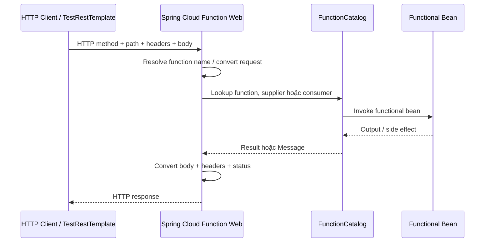
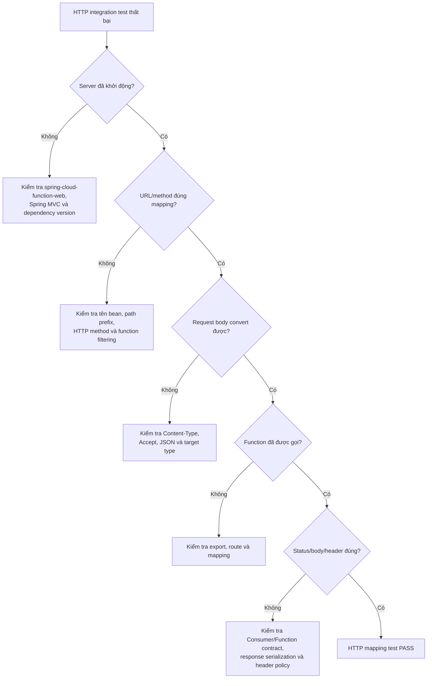

# Kiểm thử HTTP mapping, method, header và mã phản hồi

**Chương:** Kiểm thử  
**Module:** Spring Cloud Function (`SPRING_CLOUD_FUNCTION`)

Spring Cloud Function cho phép khai báo logic nghiệp vụ bằng `Supplier`, `Function` và `Consumer`, sau đó công bố các functional bean qua HTTP bằng module `spring-cloud-function-web`. Khi adapter Web được bật trong ứng dụng Spring Boot có Spring MVC, tên bean có thể trở thành một phần của URL. Một hàm `Function<String,String>` có thể nhận request body và trả kết quả, một `Supplier<String>` có thể cung cấp dữ liệu qua GET, còn một `Consumer<String>` có thể nhận lệnh ghi nhận qua POST, PUT hoặc DELETE.

Kiểm thử HTTP vì vậy cần quan sát cả **đường dẫn, HTTP method, request body, Content-Type, Accept, headers, response body và status code**. Một unit test gọi `function.apply("hello")` không chứng minh endpoint đã được map đúng, adapter đã chuyển header thành Spring `Message<?>` hay response trả đúng mã HTTP.

Bài học này hướng dẫn xây integration test với `@SpringBootTest(webEnvironment = RANDOM_PORT)` và `TestRestTemplate`. Ta sẽ kiểm tra mapping mặc định của Function/Supplier/Consumer, các method GET/POST/PUT/DELETE, dữ liệu JSON và text, header request/response, query parameter, function composition, giới hạn export, cấu hình CRUD method mapping và cách kiểm tra status code. Các ví dụ dùng HTTP server thật trong test nhưng không gọi dịch vụ bên ngoài.

## 1. Mục tiêu học tập

Sau bài học, bạn có thể:

1. Giải thích cách Spring Cloud Function Web ánh xạ functional bean thành HTTP endpoint.
2. Kiểm thử URL theo tên function, supplier hoặc consumer.
3. Xác minh hành vi của GET, POST, PUT và DELETE cùng status code tương ứng.
4. Phân biệt request body, path variable, query parameter và HTTP header.
5. Kiểm tra Content-Type/Accept và response serialization.
6. Kiểm thử header đi vào `Message<?>` và header đầu ra được chuyển thành HTTP response header.
7. Kiểm thử function composition, root path mapping và function filtering.
8. Dùng `spring.cloud.function.http.<method-name>` để ánh xạ function theo HTTP method.
9. Kiểm tra lỗi JSON, route không tồn tại và method không được phép ở đúng tầng.
10. Phân biệt hợp đồng status mặc định của Spring Cloud Function Web với status tùy chỉnh do MVC advice hoặc adapter riêng quy định.

## 2. Spring Cloud Function Web tạo endpoint như thế nào?

Module `spring-cloud-function-web` có auto-configuration để công bố functional bean trong Spring context thành endpoint HTTP khi ứng dụng có Spring MVC. Mặc định, endpoint dùng root path `/`; có thể đổi bằng:

```properties
spring.cloud.function.web.path=/api/functions
```

Tên functional bean thường trở thành một phần của URL:

```text
GET  /api/functions/greeting
POST /api/functions/uppercase
POST /api/functions/audit
```

Adapter hỗ trợ nội dung plain text và JSON. Nó tập trung cung cấp một lớp HTTP đơn giản cho các function stateless; **không thay thế đầy đủ Spring MVC hoặc Spring WebFlux**. Nếu ứng dụng cần routing REST phức tạp, authorization theo resource, multipart, validation theo API contract hoặc nhiều status code động, hãy cân nhắc controller chuyên biệt.

### 2.1. Bảng mapping mặc định

Bảng dưới đây tóm tắt hợp đồng được tài liệu Spring Cloud Function Web mô tả ở dòng hiện hành:

| Functional bean | HTTP method | Path | Request | Response | Status |
| --- | --- | --- | --- | --- | --- |
| `Supplier<T>` | GET | `/{supplier}` | Không cần body | Giá trị do supplier phát ra | **200 OK** |
| `Consumer<T>` | POST | `/{consumer}` | JSON object hoặc text | Phản chiếu input và gọi consumer | **202 Accepted** |
| `Consumer<T>` | PUT | `/{consumer}` | JSON object hoặc text | Phản chiếu input và gọi consumer | **202 Accepted** |
| `Consumer<T>` | DELETE | `/{consumer}` | JSON object hoặc text | Không có body | **204 No Content** |
| `Function<I,O>` | POST | `/{function}` | JSON object hoặc text | Kết quả của function | **200 OK** |
| `Function<I,O>` | PUT | `/{function}` | JSON object hoặc text | Kết quả của function | **200 OK** |
| `Function<I,O>` | GET | `/{function}/{item}` | Giá trị lấy từ path | Kết quả của function | **200 OK** |

Đây là hành vi mặc định của adapter, không phải quy tắc chung cho mọi REST API. Khi ứng dụng có cấu hình method mapping, function filtering, controller tùy chỉnh hoặc version khác, cần kiểm tra lại hợp đồng đang chạy.

### 2.2. Sơ đồ request và response



Một test tích hợp HTTP đi qua cả chuỗi này. Nó có thể phát hiện lỗi mà unit test function không nhìn thấy: endpoint chưa được export, URL sai, method sai, content negotiation không khớp, header không được chuyển hoặc response status khác kỳ vọng.

## 3. Chọn đúng dependency

Để chạy HTTP integration test, cần Spring Cloud Function Web và Spring MVC. Phiên bản Spring Boot/Spring Cloud Function phải tương thích; nên dùng Spring Cloud BOM hoặc dependency management của dự án thay vì tự chọn từng phiên bản.

**Maven** (trích dependencies):

```xml
<dependencies>
    <dependency>
        <groupId>org.springframework.cloud</groupId>
        <artifactId>spring-cloud-function-web</artifactId>
    </dependency>
    <dependency>
        <groupId>org.springframework.boot</groupId>
        <artifactId>spring-boot-starter-web</artifactId>
    </dependency>
    <dependency>
        <groupId>org.springframework.boot</groupId>
        <artifactId>spring-boot-starter-test</artifactId>
        <scope>test</scope>
    </dependency>
</dependencies>
```

**Gradle Kotlin DSL** (dự án đã quản lý phiên bản):

```kotlin
dependencies {
    implementation("org.springframework.cloud:spring-cloud-function-web")
    implementation("org.springframework.boot:spring-boot-starter-web")
    testImplementation("org.springframework.boot:spring-boot-starter-test")
}

tasks.test {
    useJUnitPlatform()
}
```

Trong một ứng dụng chỉ muốn bật Web adapter cho test, có thể đặt `spring-boot-starter-web` ở test scope theo cấu hình phù hợp. Nếu ứng dụng thực sự chạy HTTP ở production, web runtime dependency phải có trong runtime classpath.

## 4. Ứng dụng mẫu: Function, Supplier, Consumer và Message

Ta khai báo nhiều bean để kiểm tra nhiều kiểu endpoint trong cùng một Spring Boot application:

- `uppercase` và `reverse` là function xử lý chuỗi.
- `greeting` là supplier trả một giá trị.
- `audit` là consumer ghi nhận dữ liệu trong bộ nhớ.
- `assessOrder` nhận DTO JSON và trả DTO.
- `headerEcho` nhận/trả `Message<String>` để kiểm tra header.
- `requestInfo` đọc query parameter được adapter đưa vào message header.

**File:** `src/main/java/example/http/HttpMappingApplication.java`

```java
package example.http;

import java.util.List;
import java.util.Locale;
import java.util.Map;
import java.util.concurrent.CopyOnWriteArrayList;
import java.util.function.Consumer;
import java.util.function.Function;
import java.util.function.Supplier;

import org.springframework.boot.SpringApplication;
import org.springframework.boot.autoconfigure.SpringBootApplication;
import org.springframework.context.annotation.Bean;
import org.springframework.messaging.Message;
import org.springframework.messaging.support.MessageBuilder;

@SpringBootApplication(proxyBeanMethods = false)
public class HttpMappingApplication {

    public static void main(String[] args) {
        SpringApplication.run(HttpMappingApplication.class, args);
    }

    public record OrderRequest(String orderCode, int quantity) {}

    public record OrderResult(
        String normalizedCode, boolean accepted) {}

    public static final class AuditRecorder {
        private final List<String> values =
            new CopyOnWriteArrayList<>();

        public void record(String value) {
            values.add(value);
        }

        public List<String> snapshot() {
            return List.copyOf(values);
        }

        public void clear() {
            values.clear();
        }
    }

    @Bean
    AuditRecorder auditRecorder() {
        return new AuditRecorder();
    }

    @Bean("uppercase")
    Function<String, String> uppercase() {
        return value -> value.toUpperCase(Locale.ROOT);
    }

    @Bean("reverse")
    Function<String, String> reverse() {
        return value -> new StringBuilder(value)
            .reverse().toString();
    }

    @Bean("greeting")
    Supplier<String> greeting() {
        return () -> "hello-from-supplier";
    }

    @Bean("audit")
    Consumer<String> audit(AuditRecorder recorder) {
        return recorder::record;
    }

    @Bean("assessOrder")
    Function<OrderRequest, OrderResult> assessOrder() {
        return request -> {
            if (request.orderCode() == null
                    || request.orderCode().isBlank()) {
                throw new IllegalArgumentException(
                    "orderCode must not be blank");
            }
            String normalized =
                request.orderCode().trim().toUpperCase(Locale.ROOT);
            return new OrderResult(
                normalized, request.quantity() > 0);
        };
    }

    @Bean("headerEcho")
    Function<Message<String>, Message<String>> headerEcho() {
        return input -> {
            Object clientId =
                input.getHeaders().get("x-client-id");
            String result = String.valueOf(clientId)
                + ":" + input.getPayload();

            return MessageBuilder.withPayload(result)
                .setHeader("x-function-result", "processed")
                .build();
        };
    }

    @Bean("requestInfo")
    Function<Message<String>, String> requestInfo() {
        return input -> {
            Object params =
                input.getHeaders().get("http_request_param");
            return input.getPayload() + "|" + params;
        };
    }
}
```

### 4.1. Vì sao có AuditRecorder?

`Consumer<String>` trả `void` nên không có response nghiệp vụ như một function. `AuditRecorder` cho phép test xác minh **consumer đã được gọi với giá trị nào**, còn HTTP response vẫn được kiểm tra riêng theo hợp đồng adapter.

Không ghi database hoặc gửi message thật trong bài này. Khi cần kiểm tra persistence/broker, hãy dùng integration test dành riêng cho adapter và tài nguyên đó.

### 4.2. Nhiều function trong catalog nghĩa là path phải rõ

Fixture có nhiều functional bean. Vì vậy, test luôn dùng path có tên như `/uppercase`, `/greeting` hoặc `/audit`. Quy tắc bỏ tên path chỉ phù hợp khi catalog chỉ có một function/consumer/supplier đủ điều kiện theo cấu hình.

## 5. Test HTTP server bằng RANDOM_PORT và TestRestTemplate

Spring Cloud Function có hướng dẫn kiểm thử functional application bằng `@SpringBootTest(webEnvironment = RANDOM_PORT)` và `TestRestTemplate`. Cách này khởi động embedded server trên một cổng ngẫu nhiên, tránh xung đột cổng giữa các test.

**File:** `src/test/java/example/http/FunctionHttpMappingTest.java`

```java
package example.http;

import static org.junit.jupiter.api.Assertions.*;

import java.net.URI;
import java.util.List;

import org.junit.jupiter.api.BeforeEach;
import org.junit.jupiter.api.Test;
import org.springframework.beans.factory.annotation.Autowired;
import org.springframework.boot.test.context.SpringBootTest;
import org.springframework.boot.test.web.client.TestRestTemplate;
import org.springframework.http.HttpMethod;
import org.springframework.http.HttpStatus;
import org.springframework.http.MediaType;
import org.springframework.http.RequestEntity;
import org.springframework.http.ResponseEntity;

import example.http.HttpMappingApplication.AuditRecorder;
import example.http.HttpMappingApplication.OrderResult;

@SpringBootTest(
    classes = HttpMappingApplication.class,
    webEnvironment = SpringBootTest.WebEnvironment.RANDOM_PORT
)
class FunctionHttpMappingTest {

    @Autowired
    TestRestTemplate rest;

    @Autowired
    AuditRecorder recorder;

    @BeforeEach
    void resetRecorder() {
        recorder.clear();
    }

    @Test
    void postFunctionMapsBodyAndReturnsOk() {
        RequestEntity<String> request =
            RequestEntity.post(URI.create("/uppercase"))
                .contentType(MediaType.TEXT_PLAIN)
                .accept(MediaType.TEXT_PLAIN)
                .body("hello");

        ResponseEntity<String> response =
            rest.exchange(request, String.class);

        assertEquals(HttpStatus.OK, response.getStatusCode());
        assertEquals("HELLO", response.getBody());
    }

    @Test
    void putFunctionAlsoReturnsOk() {
        RequestEntity<String> request =
            RequestEntity.put(URI.create("/uppercase"))
                .contentType(MediaType.TEXT_PLAIN)
                .accept(MediaType.TEXT_PLAIN)
                .body("hello");

        ResponseEntity<String> response =
            rest.exchange(request, String.class);

        assertEquals(HttpStatus.OK, response.getStatusCode());
        assertEquals("HELLO", response.getBody());
    }

    @Test
    void getSupplierReturnsItsValue() {
        ResponseEntity<String> response =
            rest.getForEntity("/greeting", String.class);

        assertEquals(HttpStatus.OK, response.getStatusCode());
        assertEquals("hello-from-supplier", response.getBody());
    }

    @Test
    void getFunctionPathVariableBecomesFunctionInput() {
        ResponseEntity<String> response =
            rest.getForEntity("/uppercase/hello", String.class);

        assertEquals(HttpStatus.OK, response.getStatusCode());
        assertEquals("HELLO", response.getBody());
    }

    @Test
    void postConsumerReturnsAcceptedAndMirrorsInput() {
        RequestEntity<String> request =
            RequestEntity.post(URI.create("/audit"))
                .contentType(MediaType.TEXT_PLAIN)
                .accept(MediaType.TEXT_PLAIN)
                .body("order-42");

        ResponseEntity<String> response =
            rest.exchange(request, String.class);

        assertEquals(HttpStatus.ACCEPTED, response.getStatusCode());
        assertEquals("order-42", response.getBody());
        assertEquals(List.of("order-42"), recorder.snapshot());
    }

    @Test
    void putConsumerReturnsAccepted() {
        RequestEntity<String> request =
            RequestEntity.put(URI.create("/audit"))
                .contentType(MediaType.TEXT_PLAIN)
                .body("order-43");

        ResponseEntity<String> response =
            rest.exchange(request, String.class);

        assertEquals(HttpStatus.ACCEPTED, response.getStatusCode());
        assertEquals(List.of("order-43"), recorder.snapshot());
    }

    @Test
    void deleteConsumerReturnsNoContent() {
        RequestEntity<String> request =
            RequestEntity.method(
                    HttpMethod.DELETE, URI.create("/audit"))
                .contentType(MediaType.TEXT_PLAIN)
                .body("order-44");

        ResponseEntity<String> response =
            rest.exchange(request, String.class);

        assertEquals(HttpStatus.NO_CONTENT, response.getStatusCode());
        assertNull(response.getBody());
        assertEquals(List.of("order-44"), recorder.snapshot());
    }

    @Test
    void postJsonConvertsDtoAndReturnsJson() {
        String json = """
            {"orderCode":" ord-42 ","quantity":3}
            """;
        RequestEntity<String> request =
            RequestEntity.post(URI.create("/assessOrder"))
                .contentType(MediaType.APPLICATION_JSON)
                .accept(MediaType.APPLICATION_JSON)
                .body(json);

        ResponseEntity<OrderResult> response =
            rest.exchange(request, OrderResult.class);

        assertEquals(HttpStatus.OK, response.getStatusCode());
        assertNotNull(response.getBody());
        assertEquals("ORD-42",
            response.getBody().normalizedCode());
        assertTrue(response.getBody().accepted());
    }
}
```

Đây là integration test qua HTTP server thật trong JVM. Các test không gọi function bằng `FunctionCatalog.lookup(...)`; thay vào đó chúng đi qua HTTP adapter để kiểm tra mapping và response.

### 5.1. Vì sao dùng RequestEntity?

`RequestEntity` cho phép khai báo method, URI, header, content type, accept và body trong cùng một request. Điều đó giúp test thể hiện rõ hợp đồng HTTP thay vì dựa vào overload đơn giản có thể dùng header mặc định khác với mong muốn.

### 5.2. TestRestTemplate không ném exception cho mọi status 4xx/5xx

`TestRestTemplate` được thiết kế cho integration test; theo mặc định nó không dùng error handler ném exception cho các response lỗi như một số client khác. Test có thể nhận `ResponseEntity<?>` rồi kiểm tra status và body. Dù vậy, hãy kiểm tra cấu hình custom của test client nếu dự án đã thay error handler.

## 6. Kiểm thử HTTP header và Message<?> 

Spring Cloud Function Web chuyển request headers thành message headers khi functional bean khai báo input/output là `Message<?>`. Nếu output cũng là `Message<?>`, output message headers có thể được chuyển thành HTTP response headers.

Ví dụ `headerEcho` ở mục 4 nhận header `x-client-id` rồi trả header `x-function-result`. Test:

```java
@Test
void requestHeaderBecomesMessageHeaderAndOutputHeaderBecomesHttpHeader() {
    RequestEntity<String> request =
        RequestEntity.post(URI.create("/headerEcho"))
            .contentType(MediaType.TEXT_PLAIN)
            .accept(MediaType.TEXT_PLAIN)
            .header("x-client-id", "client-7")
            .header("x-request-id", "req-42")
            .body("hello");

    ResponseEntity<String> response =
        rest.exchange(request, String.class);

    assertEquals(HttpStatus.OK, response.getStatusCode());
    assertEquals("client-7:hello", response.getBody());
    assertEquals(
        "processed",
        response.getHeaders().getFirst("x-function-result"));
    assertEquals(
        "req-42",
        response.getHeaders().getFirst("x-request-id"));
}
```

Đặt phương thức này trong `FunctionHttpMappingTest` để dùng chung `rest`. Assertion xác minh:

1. Request header `x-client-id` đã tới function dưới dạng message header.
2. Function đọc được giá trị header và dùng nó trong output.
3. Header do function tạo ra được phản chiếu vào HTTP response.
4. Header request thông thường như `x-request-id` được chuyển tiếp theo chính sách mặc định.

Tài liệu mô tả **hầu hết** request `HttpHeaders` được sao chép sang response headers theo mặc định. Không nên suy ra mọi header đều được phép truyền lại; một số header có thể bị lọc hoặc bị HTTP server quản lý riêng.

### 6.1. Bỏ qua các header không muốn trả về

Có thể cấu hình danh sách header cần bỏ khỏi response:

```properties
spring.cloud.function.http.ignored-headers=x-request-id,x-internal-token
```

Các tên được phân tách bằng dấu phẩy. Để kiểm thử property này, dùng một context khác:

```java
package example.http;

import static org.junit.jupiter.api.Assertions.*;

import java.net.URI;

import org.junit.jupiter.api.Test;
import org.springframework.beans.factory.annotation.Autowired;
import org.springframework.boot.test.context.SpringBootTest;
import org.springframework.boot.test.web.client.TestRestTemplate;
import org.springframework.http.HttpStatus;
import org.springframework.http.MediaType;
import org.springframework.http.RequestEntity;
import org.springframework.http.ResponseEntity;

@SpringBootTest(
    classes = HttpMappingApplication.class,
    webEnvironment = SpringBootTest.WebEnvironment.RANDOM_PORT,
    properties = {
        "spring.cloud.function.http.ignored-headers=x-request-id"
    }
)
class IgnoredHttpHeadersTest {

    @Autowired
    TestRestTemplate rest;

    @Test
    void configuredRequestHeaderIsNotCopiedToResponse() {
        RequestEntity<String> request =
            RequestEntity.post(URI.create("/headerEcho"))
                .contentType(MediaType.TEXT_PLAIN)
                .header("x-client-id", "client-7")
                .header("x-request-id", "req-42")
                .body("hello");

        ResponseEntity<String> response =
            rest.exchange(request, String.class);

        assertEquals(HttpStatus.OK, response.getStatusCode());
        assertNull(
            response.getHeaders().getFirst("x-request-id"));
        assertEquals(
            "processed",
            response.getHeaders().getFirst("x-function-result"));
    }
}
```

Đây là một lớp test riêng để property được nạp **trước khi Spring context khởi tạo**. Không sửa property trong một context đã chạy rồi mong adapter thay đổi ngay chính sách header.

### 6.2. Không trả lại mọi request header một cách vô điều kiện

Header có thể chứa token, cookie hoặc thông tin nội bộ. Trước khi copy header sang response, hãy xác định header nào thực sự thuộc API contract. `spring.cloud.function.http.ignored-headers` là một cơ chế lọc header; nó không thay thế authentication, authorization hoặc việc che dữ liệu nhạy cảm trong log.

## 7. Kiểm thử query parameter và path variable

### 7.1. Path variable là input cho Function

Đường dẫn:

```text
GET /uppercase/hello
```

đưa giá trị `hello` vào function `uppercase`. Đây là một mapping khác với POST body:

```text
POST /uppercase
Content-Type: text/plain

hello
```

Hai request có thể tạo cùng kết quả nhưng cần test riêng vì nguồn dữ liệu khác nhau.

### 7.2. Query parameter được đưa vào message header

Spring Cloud Function Web đưa request parameters vào header `http_request_param` với giá trị là một `Map`. Vì vậy, nếu function cần query parameter, input signature nên nhận `Message<?>`:

```java
@Bean("requestInfo")
Function<Message<String>, String> requestInfo() {
    return input -> {
        Object params =
            input.getHeaders().get("http_request_param");
        return input.getPayload() + "|" + params;
    };
}
```

Test:

```java
@Test
void queryParametersAreAvailableInMessageHeaders() {
    ResponseEntity<String> response =
        rest.getForEntity(
            "/requestInfo/hello?name=Bill",
            String.class);

    assertEquals(HttpStatus.OK, response.getStatusCode());
    assertNotNull(response.getBody());
    assertTrue(response.getBody().contains("name=Bill"));
}
```

Đặt phương thức trong `FunctionHttpMappingTest`. Cách biểu diễn cụ thể của Map phụ thuộc adapter/phiên bản; test kiểm tra nội dung cần thiết thay vì buộc chuỗi `Map.toString()` phải có một định dạng không thuộc hợp đồng.

Trong mã production, có thể dùng hằng `HeaderUtils.HTTP_REQUEST_PARAM` thay vì viết chuỗi header trực tiếp; hãy import hằng từ đúng package của phiên bản Spring Cloud Function đang dùng.

## 8. Content-Type và Accept: request body không phải response body

Hai header thường bị nhầm:

- **`Content-Type`**: định dạng của request body mà client gửi lên.
- **`Accept`**: định dạng response mà client muốn nhận.

Ví dụ với function chuỗi:

```http
POST /uppercase
Content-Type: text/plain
Accept: text/plain

hello
```

Response:

```http
HTTP/1.1 200 OK
Content-Type: text/plain

HELLO
```

Với DTO, dùng JSON:

```http
POST /assessOrder
Content-Type: application/json
Accept: application/json

{"orderCode":" ord-42 ","quantity":3}
```

Response là JSON biểu diễn `OrderResult`. Nếu test chỉ gửi body JSON nhưng không đặt `Content-Type`, converter có thể không diễn giải payload theo cách bạn mong muốn. Nếu không đặt `Accept`, response có thể được chọn theo content negotiation mặc định của client/server.

### 8.1. Kiểm tra Content-Type response

Thêm vào test function:

```java
assertTrue(
    response.getHeaders().getContentType()
        .isCompatibleWith(MediaType.TEXT_PLAIN));
```

Với response JSON:

```java
assertTrue(
    response.getHeaders().getContentType()
        .isCompatibleWith(MediaType.APPLICATION_JSON));
```

Kiểm tra tương thích MIME type tốt hơn so sánh chuỗi literal khi response có tham số charset.

### 8.2. Consumer với JSON array hoặc text nhiều dòng

Adapter hỗ trợ body dạng JSON array hoặc text nhiều dòng cho Consumer; các phần tử được đưa tới consumer lần lượt. Có thể kiểm tra:

```java
@Test
void consumerReceivesItemsFromJsonArray() {
    RequestEntity<String> request =
        RequestEntity.post(URI.create("/audit"))
            .contentType(MediaType.APPLICATION_JSON)
            .accept(MediaType.APPLICATION_JSON)
            .body("[\"order-1\",\"order-2\"]");

    ResponseEntity<String> response =
        rest.exchange(request, String.class);

    assertEquals(HttpStatus.ACCEPTED, response.getStatusCode());
    assertEquals(
        List.of("order-1", "order-2"),
        recorder.snapshot());
}
```

Test này cần đặt trong `FunctionHttpMappingTest` và `@BeforeEach` đã xóa recorder. Nếu một ứng dụng khai báo consumer input là DTO hoặc kiểu collection, kết quả conversion sẽ phụ thuộc chữ ký hàm; hãy điều chỉnh body và expected theo kiểu thực tế.

## 9. Mapping path, root path và composition

### 9.1. Khi catalog có một function duy nhất

Nếu chỉ có một functional bean đủ điều kiện trong catalog, tên function trong path có thể được bỏ:

```bash
curl -H "Content-Type: text/plain" \
     -H "Accept: text/plain" \
     -d "hello" \
     http://localhost:8080/uppercase

curl -H "Content-Type: text/plain" \
     -H "Accept: text/plain" \
     -d "hello" \
     http://localhost:8080/
```

Hai request có thể gọi cùng function khi catalog chỉ có function đó. **Không dùng quy tắc này trong fixture nhiều function** của bài; luôn ghi rõ tên path.

### 9.2. Function composition trong URL

Có thể gọi composition bằng dấu pipe hoặc dấu phẩy trong path:

```bash
curl -H "Content-Type: text/plain" \
     -H "Accept: text/plain" \
     -d "hello" \
     http://localhost:8080/uppercase,reverse
```

Kết quả là `OLLEH`. Dấu phẩy dễ dùng trong shell hơn dấu pipe vì pipe có ý nghĩa đặc biệt trong nhiều command line.

### 9.3. Ánh xạ composition về root path

Khi có nhiều function nhưng muốn ánh xạ một composition vào `/`, có thể cấu hình:

```properties
spring.cloud.function.definition=uppercase|reverse
```

Khi đó test có thể gửi POST đến root:

```java
RequestEntity<String> request =
    RequestEntity.post(URI.create("/"))
        .contentType(MediaType.TEXT_PLAIN)
        .accept(MediaType.TEXT_PLAIN)
        .body("hello");

ResponseEntity<String> response =
    rest.exchange(request, String.class);

assertEquals(HttpStatus.OK, response.getStatusCode());
assertEquals("OLLEH", response.getBody());
```

Đây là test cho **một context có property composition riêng**. Đừng thêm property đó vào test class chung rồi tiếp tục kỳ vọng tất cả function đều có root mapping riêng.

### 9.4. Function filtering bằng dấu chấm phẩy

Khi chỉ muốn export một tập function/composition, property `spring.cloud.function.definition` có thể liệt kê nhiều definition bằng dấu `;`:

```properties
spring.cloud.function.definition=uppercase;reverse
```

Chỉ hai function được liệt kê được export; root path không được map theo kiểu composition trong trường hợp này. Một danh sách:

```properties
spring.cloud.function.definition=uppercase|reverse;greeting
```

export composition `uppercase|reverse` và function `greeting`.

**Phân biệt:**

| Ký hiệu | Ý nghĩa |
| --- | --- |
| `uppercase|reverse` | Một function composition, bước sau nhận output bước trước |
| `uppercase;reverse` | Hai definition được export độc lập |

Test filtering cần dùng context riêng và xác minh cả endpoint được export lẫn endpoint không được export. Đừng mặc định status của path không export giống nhau ở mọi version nếu chưa cố định MVC error mapping.

## 10. Mapping function theo HTTP method với spring.cloud.function.http

Ngoài mapping mặc định, Spring Cloud Function hỗ trợ ánh xạ function theo method:

```properties
spring.cloud.function.http.GET=uppercase;reverse;foo|bar
spring.cloud.function.http.POST=reverse
spring.cloud.function.http.DELETE=deleteById
```

Ý nghĩa:

- GET cho phép các function/composition được liệt kê ở property GET.
- POST cho phép function/composition trong property POST.
- DELETE có thể gắn tới consumer hoặc function phù hợp với hợp đồng nghiệp vụ.
- Dấu `;` liệt kê nhiều definition cùng method; dấu `|` ghép các bước thành một pipeline.

Đây là cơ chế ánh xạ method ở adapter Web, không phải khai báo controller annotation `@GetMapping`/`@PostMapping`.

### 10.1. Context test method mapping

Một lớp test riêng có thể bật:

```java
package example.http;

import static org.junit.jupiter.api.Assertions.*;

import java.net.URI;

import org.junit.jupiter.api.Test;
import org.springframework.beans.factory.annotation.Autowired;
import org.springframework.boot.test.context.SpringBootTest;
import org.springframework.boot.test.web.client.TestRestTemplate;
import org.springframework.http.HttpStatus;
import org.springframework.http.MediaType;
import org.springframework.http.RequestEntity;
import org.springframework.http.ResponseEntity;

@SpringBootTest(
    classes = HttpMappingApplication.class,
    webEnvironment = SpringBootTest.WebEnvironment.RANDOM_PORT,
    properties = {
        "spring.cloud.function.http.GET=uppercase",
        "spring.cloud.function.http.POST=reverse"
    }
)
class HttpMethodMappingTest {

    @Autowired
    TestRestTemplate rest;

    @Test
    void configuredGetMappingInvokesUppercase() {
        ResponseEntity<String> response =
            rest.getForEntity(
                "/uppercase/hello", String.class);

        assertEquals(HttpStatus.OK, response.getStatusCode());
        assertEquals("HELLO", response.getBody());
    }

    @Test
    void configuredPostMappingInvokesReverse() {
        RequestEntity<String> request =
            RequestEntity.post(URI.create("/reverse"))
                .contentType(MediaType.TEXT_PLAIN)
                .accept(MediaType.TEXT_PLAIN)
                .body("hello");

        ResponseEntity<String> response =
            rest.exchange(request, String.class);

        assertEquals(HttpStatus.OK, response.getStatusCode());
        assertEquals("olleh", response.getBody());
    }
}
```

Đây là **ví dụ context riêng**, cần import các kiểu Spring HTTP như ở mục 5. Các function không được liệt kê cho method đó sẽ không có mapping tương ứng theo cấu hình. Nếu muốn test chính xác response khi gọi sai method, hãy ghi nhận status thực tế của phiên bản đang dùng (thường được xử lý ở tầng MVC như 404/405); không biến một status chưa được quy định trong hợp đồng ứng dụng thành kỳ vọng dùng chung cho mọi version.

## 11. Kiểm thử custom web path

Nếu ứng dụng dùng:

```properties
spring.cloud.function.web.path=/api/functions
```

đường dẫn phải bao gồm prefix:

```text
POST /api/functions/uppercase
GET  /api/functions/greeting
```

Một lớp test tách biệt:

```java
package example.http;

import static org.junit.jupiter.api.Assertions.*;

import org.junit.jupiter.api.Test;
import org.springframework.beans.factory.annotation.Autowired;
import org.springframework.boot.test.context.SpringBootTest;
import org.springframework.boot.test.web.client.TestRestTemplate;
import org.springframework.http.HttpStatus;
import org.springframework.http.ResponseEntity;

@SpringBootTest(
    classes = HttpMappingApplication.class,
    webEnvironment = SpringBootTest.WebEnvironment.RANDOM_PORT,
    properties = {
        "spring.cloud.function.web.path=/api/functions"
    }
)
class CustomWebPathTest {

    @Autowired
    TestRestTemplate rest;

    @Test
    void endpointUsesConfiguredPrefix() {
        ResponseEntity<String> response =
            rest.getForEntity(
                "/api/functions/greeting", String.class);

        assertEquals(HttpStatus.OK, response.getStatusCode());
        assertEquals("hello-from-supplier", response.getBody());
    }
}
```

Nếu test cũ gọi `/greeting` nhưng cấu hình đã đổi prefix, lỗi thường nằm ở URL test chứ không phải bean Supplier.

## 12. Kiểm thử mã phản hồi thành công

Status code là một phần của HTTP contract. Với Spring Cloud Function Web, cần kiểm tra cả mã và body:

| Hành vi | Expected status | Body |
| --- | --- | --- |
| GET Supplier | `200 OK` | Giá trị supplier |
| POST Function | `200 OK` | Function result |
| PUT Function | `200 OK` | Function result |
| GET Function với path item | `200 OK` | Function result |
| POST Consumer | `202 Accepted` | Input được phản chiếu |
| PUT Consumer | `202 Accepted` | Input được phản chiếu |
| DELETE Consumer | `204 No Content` | Không có body |

**Đừng chỉ kiểm tra status.** Một response `200` với body sai vẫn là lỗi; một response `204` có body ngoài dự kiến cũng vi phạm hợp đồng HTTP.

### 12.1. Consumer POST/PUT và DELETE không cùng body contract

POST/PUT Consumer phản chiếu input trong response và đẩy body vào consumer. DELETE Consumer có status `204 No Content` và không có body. Đây là lý do test mục 5 kiểm tra:

```java
assertEquals(HttpStatus.ACCEPTED, response.getStatusCode());
assertEquals("order-42", response.getBody());
```

với POST/PUT, nhưng:

```java
assertEquals(HttpStatus.NO_CONTENT, response.getStatusCode());
assertNull(response.getBody());
```

với DELETE.

### 12.2. Không tự giả định status tùy chỉnh cho mọi adapter

Các status `200`, `202` và `204` ở bảng trên là mapping mặc định của **Spring Cloud Function Web**. Nếu muốn trả status tùy chỉnh như `422 Unprocessable Entity` theo quy tắc API, hãy dùng cơ chế Spring MVC phù hợp (ví dụ `@RestControllerAdvice`) hoặc endpoint/controller chuyên biệt, rồi test HTTP response thực tế.

Không lấy header đặc thù của một serverless adapter làm hợp đồng chung cho Web adapter. Ví dụ `FunctionInvoker.HTTP_STATUS_CODE` là cơ chế của GCP adapter; không mặc định nó điều khiển status của `spring-cloud-function-web`.

## 13. Kiểm thử lỗi HTTP: JSON sai và lỗi nghiệp vụ

Có ít nhất hai tầng lỗi khác nhau:

1. **Lỗi trước khi gọi function:** JSON không parse được, content type không hỗ trợ hoặc request mapping không hợp lệ.
2. **Lỗi trong function:** dữ liệu đã được chuyển thành Java object nhưng vi phạm quy tắc nghiệp vụ.

Test nên phân biệt hai trường hợp thay vì chỉ khẳng định “request lỗi”.

### 13.1. JSON sai cú pháp

Thêm vào `FunctionHttpMappingTest`:

```java
@Test
void malformedJsonReturnsBadRequest() {
    RequestEntity<String> request =
        RequestEntity.post(URI.create("/assessOrder"))
            .contentType(MediaType.APPLICATION_JSON)
            .accept(MediaType.APPLICATION_JSON)
            .body("{\"orderCode\":");

    ResponseEntity<String> response =
        rest.exchange(request, String.class);

    assertEquals(
        HttpStatus.BAD_REQUEST,
        response.getStatusCode());
}
```

Spring MVC không thể deserialize JSON lỗi cú pháp thành DTO; thông thường lỗi request body được ánh xạ thành `400 Bad Request`. Nếu ứng dụng có custom exception resolver, hãy kiểm tra contract cụ thể của ứng dụng.

### 13.2. Function ném lỗi nghiệp vụ

Hàm `assessOrder` trong ví dụ ném `IllegalArgumentException` khi mã đơn hàng trống. HTTP status cho lỗi do function ném ra có thể được điều chỉnh bởi exception handling của Spring MVC/ứng dụng; không nên coi một mã lỗi chung là hợp đồng mặc định cho mọi phiên bản.

Nếu muốn API trả `422 Unprocessable Entity`, có thể định nghĩa advice:

**File:** `src/main/java/example/http/FunctionHttpErrorAdvice.java`

```java
package example.http;

import java.util.Map;

import org.springframework.http.HttpStatus;
import org.springframework.http.ResponseEntity;
import org.springframework.web.bind.annotation.ExceptionHandler;
import org.springframework.web.bind.annotation.RestControllerAdvice;

@RestControllerAdvice
public class FunctionHttpErrorAdvice {

    @ExceptionHandler(IllegalArgumentException.class)
    public ResponseEntity<Map<String, String>> invalidInput(
            IllegalArgumentException error) {
        return ResponseEntity
            .status(HttpStatus.UNPROCESSABLE_ENTITY)
            .body(Map.of("error", error.getMessage()));
    }
}
```

Test:

```java
@Test
void domainValidationErrorUsesConfigured422Response() {
    RequestEntity<String> request =
        RequestEntity.post(URI.create("/assessOrder"))
            .contentType(MediaType.APPLICATION_JSON)
            .accept(MediaType.APPLICATION_JSON)
            .body("""
                {"orderCode":"  ","quantity":2}
                """);

    ResponseEntity<String> response =
        rest.exchange(request, String.class);

    assertEquals(
        HttpStatus.UNPROCESSABLE_ENTITY,
        response.getStatusCode());
    assertNotNull(response.getBody());
    assertTrue(response.getBody().contains("orderCode"));
}
```

Ví dụ này kiểm tra **chính sách lỗi do ứng dụng định nghĩa**, không phải một status tùy chỉnh được Spring Cloud Function tự suy ra từ exception. Nếu không đăng ký advice, status mặc định sẽ do MVC/error handling hiện hành quyết định.

### 13.3. Unsupported media type và method không hợp lệ

Một request có Content-Type không được adapter hỗ trợ có thể nhận `415 Unsupported Media Type`. Một method không có mapping có thể nhận `405 Method Not Allowed` hoặc phản hồi khác tùy cách endpoint được đăng ký, Spring Boot/MVC và cấu hình filtering.

Hãy tạo test âm tính theo đúng phiên bản:

- Gửi XML tới function chỉ hỗ trợ JSON/text và kiểm tra status/body thực tế.
- Gửi GET tới endpoint Consumer chỉ được expose theo method khác và kiểm tra status.
- Kiểm tra header `Allow` nếu API contract yêu cầu.

Không ghi cứng một mã status chưa được tài liệu mapping của adapter cam kết; hãy cố định phiên bản và chính sách error handling của ứng dụng trước khi dùng assertion đó làm regression contract.

## 14. Kiểm thử response headers và header filtering

Ngoài header do function trả, Spring Cloud Function Web mặc định copy phần lớn request HTTP headers sang response. Nếu cần bỏ một số header, cấu hình:

```properties
spring.cloud.function.http.ignored-headers=x-request-id,x-internal-token
```

Ma trận test:

| Request header | Có trong output Message? | Có trong HTTP response? |
| --- | --- | --- |
| Header function đọc trực tiếp (ví dụ `x-client-id`) | Có nếu adapter chuyển vào `Message<?>` | Không tự động nếu function không trả lại; còn tùy chính sách copy request header |
| Header function tự tạo (ví dụ `x-function-result`) | Có | Được chuyển từ output Message sang HTTP header |
| Header bị liệt kê trong `ignored-headers` | Có thể có ở input | Bị loại khỏi response theo cấu hình |
| Header HTTP do server quản lý | Tùy server | Có thể được chuẩn hóa/ghi đè |

### 14.1. Tránh assert toàn bộ response headers

HTTP server có thể thêm header như `Date`, `Content-Length` hoặc header liên quan kết nối. Những giá trị này không ổn định. Chỉ assert các header thuộc hợp đồng ứng dụng, ví dụ:

```java
assertEquals(
    "processed",
    response.getHeaders().getFirst("x-function-result"));
```

Không so sánh toàn bộ `HttpHeaders` với một object literal.

## 15. Test function filtering và endpoint không được export

Khi catalog có nhiều bean, ứng dụng có thể chỉ export một tập:

```properties
spring.cloud.function.definition=uppercase;reverse
```

Điều này hữu ích để giới hạn endpoint được tạo. Test cần kiểm tra:

1. `/uppercase` và `/reverse` hoạt động.
2. `/greeting` không được export trong context này.
3. Root path không được coi là một composition mặc định khi dùng danh sách lọc.

Một test minh họa:

```java
package example.http;

import static org.junit.jupiter.api.Assertions.*;

import org.junit.jupiter.api.Test;
import org.springframework.beans.factory.annotation.Autowired;
import org.springframework.boot.test.context.SpringBootTest;
import org.springframework.boot.test.web.client.TestRestTemplate;
import org.springframework.http.HttpStatus;
import org.springframework.http.ResponseEntity;

@SpringBootTest(
    classes = HttpMappingApplication.class,
    webEnvironment = SpringBootTest.WebEnvironment.RANDOM_PORT,
    properties = {
        "spring.cloud.function.definition=uppercase;reverse"
    }
)
class FunctionFilteringHttpTest {

    @Autowired
    TestRestTemplate rest;

    @Test
    void listedFunctionIsExported() {
        ResponseEntity<String> response =
            rest.postForEntity(
                "/uppercase", "hello", String.class);
        assertEquals(HttpStatus.OK, response.getStatusCode());
        assertEquals("HELLO", response.getBody());
    }

    @Test
    void unlistedSupplierIsNotAnExportedEndpoint() {
        ResponseEntity<String> response =
            rest.getForEntity("/greeting", String.class);
        assertTrue(response.getStatusCode().is4xxClientError());
    }
}
```

Test thứ hai chỉ yêu cầu status thuộc nhóm 4xx vì cách Spring MVC xử lý mapping không tồn tại có thể phụ thuộc version/configuration. Nếu API của bạn cam kết chính xác `404`, hãy thay bằng assertion `NOT_FOUND` sau khi xác minh contract runtime.

## 16. Security: HTTP mapping không tự cung cấp authorization nghiệp vụ

Khi function được export thành HTTP endpoint, tên bean trở thành bề mặt truy cập. Cần kiểm soát:

- Function nào được export qua `spring.cloud.function.definition`.
- Ai được gọi endpoint qua authentication/authorization.
- Có cho phép client gửi routing header hoặc routing expression hay không.
- Có lộ thông tin nhạy cảm qua header echo, error message hoặc response body hay không.
- Consumer nào tạo side effect và có yêu cầu chống gọi lặp không.

Spring Cloud Function Web không thay thế Spring Security hoặc toàn bộ khả năng bảo mật của Spring MVC. Với endpoint production, hãy kiểm thử cả request được phép và request không được phép bằng security test tương ứng.

Đặc biệt, không nên expose mọi functional bean chỉ vì chúng nằm trong catalog. Function filtering giúp giới hạn mapping được export, nhưng quyền truy cập từng chức năng vẫn cần được bảo vệ tại tầng web/security.

## 17. Ma trận kiểm thử HTTP mapping

| ID | Request | Kỳ vọng status | Kỳ vọng body/header |
| --- | --- | --- | --- |
| H01 | GET `/greeting` | 200 | Giá trị Supplier |
| H02 | POST `/uppercase` text/plain | 200 | Chuỗi đã viết hoa |
| H03 | PUT `/uppercase` text/plain | 200 | Chuỗi đã viết hoa |
| H04 | GET `/uppercase/hello` | 200 | Path item trở thành input |
| H05 | POST `/audit` text/plain | 202 | Body phản chiếu; recorder có input |
| H06 | PUT `/audit` text/plain | 202 | Recorder có input |
| H07 | DELETE `/audit` text/plain | 204 | Không body; recorder có input |
| H08 | POST `/assessOrder` JSON | 200 | DTO JSON đúng |
| H09 | POST `/headerEcho` + x-client-id | 200 | Payload và output header đúng |
| H10 | GET `/requestInfo/hello?name=Bill` | 200 | Query parameter có trong message header |
| H11 | POST `/assessOrder` JSON sai cú pháp | 400 | Request không deserialize được |
| H12 | Function ném IllegalArgumentException + advice | 422 | Error body theo contract ứng dụng |
| H13 | Function filtering bỏ `greeting` | 4xx | Endpoint không được export |
| H14 | `ignored-headers=x-request-id` | 200 | Response không có header đã lọc |
| H15 | `web.path=/api/functions` | 200 | Endpoint nằm dưới prefix |
| H16 | CRUD mapping GET/POST | 200 | Function đúng method được gọi |
| H17 | Method không có mapping | Theo MVC/version | Kiểm tra 404/405 và Allow nếu cần |
| H18 | Content-Type không hỗ trợ | Thường 415 | Kiểm tra error mapping thực tế |

Ma trận là danh sách regression đề xuất. H01–H10 và H12–H16 có ví dụ code trong bài; H17–H18 cần được cố định theo cấu hình MVC/version của ứng dụng.

## 18. Chẩn đoán khi HTTP test thất bại



| Triệu chứng | Nguyên nhân thường gặp | Hướng xử lý |
| --- | --- | --- |
| Không khởi động được context | Thiếu Web MVC hoặc dependency không tương thích | Dependency tree và auto-configuration |
| `404 Not Found` | Sai path, prefix hoặc function không được export | Tên bean, `web.path`, function filtering |
| `405 Method Not Allowed` | Method không nằm trong mapping | Bảng method mặc định và `spring.cloud.function.http.*` |
| `415 Unsupported Media Type` | Content-Type không được hỗ trợ | Request header và converter |
| `400 Bad Request` | JSON lỗi hoặc không convert được request | Body, Content-Type, DTO |
| `500 Internal Server Error` | Function ném lỗi chưa được xử lý | Root cause và exception advice |
| Status 202 nhưng recorder rỗng | Consumer không được gọi như dự kiến hoặc test dùng sai bean | Assert side effect và bean name |
| Response body khác format | Accept/content negotiation | Đặt Accept rõ ràng, kiểm tra Content-Type |
| Header không có trong response | Function không trả Message/header hoặc bị lọc | Chữ ký Message, output headers, ignored-headers |
| Query param không đọc được | Function không nhận Message hoặc sai header key | `http_request_param` |
| Test dùng root path nhưng 404 | Catalog có nhiều function hoặc definition không map root | Gọi tên function hoặc cấu hình definition |
| Status test không ổn định giữa version | Dựa vào error mapping chưa được quy định | Cố định Spring Boot/Spring Cloud version |

### 18.1. Đọc log server và response cùng nhau

Khi test nhận 4xx/5xx, kiểm tra cả:

- URL thực tế và HTTP method.
- Request Content-Type, Accept và body.
- Response status, Content-Type, body và các header thuộc contract.
- Log server và root cause nếu function hoặc converter ném exception.
- Bean recorder để biết function/consumer có thực sự được gọi không.

Đừng chỉ nhìn status rồi sửa logic function. `404` thường là vấn đề mapping/export; `400` thường xảy ra trước hoặc trong conversion; lỗi business thường xuất hiện sau khi function đã được gọi.

### 18.2. Kiểm tra phiên bản dependency

Maven:

```bash
./mvnw dependency:tree -Dincludes=org.springframework.cloud:spring-cloud-function-web
```

Gradle:

```bash
./gradlew dependencyInsight --dependency spring-cloud-function-web --configuration runtimeClasspath
```

Đối chiếu phiên bản `spring-cloud-function-web`, Spring Boot, Spring MVC và Spring Cloud Function context. Không suy version từ tên starter hoặc một ví dụ trên mạng cũ.

## 19. Cách chạy test

Cấu trúc file minh họa:

```text
src/
  main/java/example/http/
    HttpMappingApplication.java
    FunctionHttpErrorAdvice.java       (tùy chọn)
  test/java/example/http/
    FunctionHttpMappingTest.java
    IgnoredHttpHeadersTest.java
    HttpMethodMappingTest.java
    CustomWebPathTest.java
    FunctionFilteringHttpTest.java
```

Maven Wrapper:

```bash
./mvnw -Dtest=FunctionHttpMappingTest test
```

Gradle Wrapper:

```bash
./gradlew test --tests "example.http.FunctionHttpMappingTest"
```

Chạy các lớp test cấu hình riêng:

```bash
./mvnw -Dtest=FunctionHttpMappingTest,IgnoredHttpHeadersTest,HttpMethodMappingTest,CustomWebPathTest,FunctionFilteringHttpTest test
```

Các lệnh là hướng dẫn cho người học, không phải kết quả build đã chạy trong quá trình biên soạn bài.

## 20. Bài tập thực hành và câu hỏi phỏng vấn

### 20.1. Bài tập

1. **Supplier:** thêm một `Supplier<List<String>>` và test GET trả JSON array cùng Content-Type.
2. **Function:** thêm `Function<OrderRequest,OrderResult>` có validation; test POST JSON và PUT JSON.
3. **Consumer:** thêm test POST JSON array để xác minh consumer nhận từng phần tử.
4. **DELETE:** xác minh status 204 và body rỗng; kiểm tra consumer có được gọi theo hợp đồng hay không.
5. **Header:** thêm `x-tenant-id` vào request và trả `x-result-code` từ Message output.
6. **Header filtering:** thêm property `spring.cloud.function.http.ignored-headers=x-tenant-id` và kiểm tra response không echo header.
7. **Query parameter:** thêm nhiều query parameter và đọc từ `http_request_param`.
8. **Content negotiation:** gửi cùng input với Accept text/plain và application/json; giải thích response khác nhau thế nào.
9. **Composition:** map `uppercase|reverse` vào root path và test output.
10. **Filtering:** chỉ export `uppercase;reverse` rồi xác minh `greeting` không được export.
11. **CRUD method:** map GET sang function đọc dữ liệu, POST sang function ghi và DELETE sang consumer xóa; test từng status.
12. **Custom status:** dùng `@RestControllerAdvice` để ánh xạ lỗi nghiệp vụ thành 422 và viết HTTP integration test.
13. **Method không hợp lệ:** thử POST vào endpoint chỉ cho GET; ghi nhận status và header Allow theo version.
14. **Security:** bảo vệ một function bằng Spring Security; test cả request được phép và không được phép.
15. **Web path:** đổi root thành `/api/functions` và cập nhật test URL.

### 20.2. Câu hỏi phỏng vấn

**Hỏi:** POST vào một `Function<String,String>` thường trả status nào?

**Đáp:** Mapping mặc định của Spring Cloud Function Web trả `200 OK` và body là kết quả function.

**Hỏi:** POST vào một `Consumer<String>` trả status nào?

**Đáp:** Mapping mặc định trả `202 Accepted` và phản chiếu input trong response, đồng thời gửi request body tới consumer.

**Hỏi:** DELETE vào Consumer có body response không?

**Đáp:** Mapping mặc định trả `204 No Content`, không có response body.

**Hỏi:** Làm thế nào function đọc được HTTP request header?

**Đáp:** Khai báo input là `Message<?>`; adapter chuyển request headers thành message headers. Nếu function trả `Message<?>`, output headers có thể được chuyển thành HTTP response headers.

**Hỏi:** Query parameter được đặt ở đâu?

**Đáp:** Trong message header `http_request_param` với giá trị dạng Map; function cần nhận Message để đọc.

**Hỏi:** `spring.cloud.function.definition=foo|bar` khác `foo;bar` thế nào?

**Đáp:** Dấu pipe tạo một composition theo thứ tự; dấu chấm phẩy liệt kê các function/composition được export độc lập.

**Hỏi:** Nếu function ném IllegalArgumentException, Spring Cloud Function Web luôn trả 400 phải không?

**Đáp:** Không nên mặc định như vậy. Status phụ thuộc exception handling của Spring MVC và ứng dụng. Nếu API cần 422 hoặc mã cụ thể, hãy định nghĩa exception advice/controller contract và test qua HTTP.

## 21. Tổng kết

- Spring Cloud Function Web công bố functional bean thành HTTP endpoint khi có cấu hình Web MVC phù hợp.
- URL thường chứa tên bean: `/{function}`, `/{supplier}` hoặc `/{consumer}`; Function còn hỗ trợ GET với path item.
- Mapping mặc định: Supplier GET trả 200; Function POST/PUT trả 200; Consumer POST/PUT trả 202; Consumer DELETE trả 204.
- Dùng `@SpringBootTest(RANDOM_PORT)` và `TestRestTemplate` để kiểm thử qua HTTP server thực trong JVM.
- Luôn đặt Content-Type/Accept rõ ràng khi kiểm thử JSON/text; kiểm tra cả response body và Content-Type.
- Function nhận/trả `Message<?>` có thể đọc request headers và tạo response headers. Phần lớn request headers được copy theo mặc định; có thể lọc bằng `spring.cloud.function.http.ignored-headers`.
- Query parameter nằm trong header `http_request_param`; path variable có thể trở thành input cho function.
- Dùng `spring.cloud.function.definition` để map composition/root path hoặc lọc function export; dùng `spring.cloud.function.http.<method-name>` cho CRUD method mapping.
- Status lỗi không phải lúc nào cũng là một hợp đồng cố định của Spring Cloud Function; hãy định nghĩa và kiểm thử chính sách error handling của ứng dụng.
- HTTP integration test không thay thế test authorization, database, message broker hoặc serverless adapter.

### Tài liệu tham khảo

- [Spring Cloud Function — Standalone Web Applications](https://docs.spring.io/spring-cloud-function/reference/spring-cloud-function/standalone-web-applications.html): mapping method/path/status, content negotiation, header propagation, query parameters, function filtering và CRUD method mapping.
- [Spring Cloud Function — Functional Bean Definitions / Testing Functional Applications](https://docs.spring.io/spring-cloud-function/reference/functional.html): ví dụ `@SpringBootTest(RANDOM_PORT)`, `TestRestTemplate` và kiểm thử qua `FunctionCatalog`.
- [Spring Cloud Function — Programming Model](https://docs.spring.io/spring-cloud-function/reference/spring-cloud-function/programming-model.html): functional bean, Message headers, conversion và FunctionCatalog.
- [Spring Boot — Testing Spring Boot Applications](https://docs.spring.io/spring-boot/reference/testing/spring-boot-applications.html): test web environment, embedded server và Spring Boot test utilities.
- [Spring Framework — TestRestTemplate API](https://docs.spring.io/spring-boot/api/java/org/springframework/boot/test/web/client/TestRestTemplate.html): gửi request và nhận `ResponseEntity` trong integration test.
