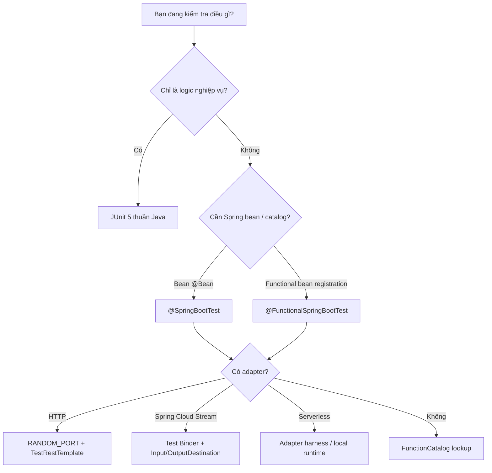
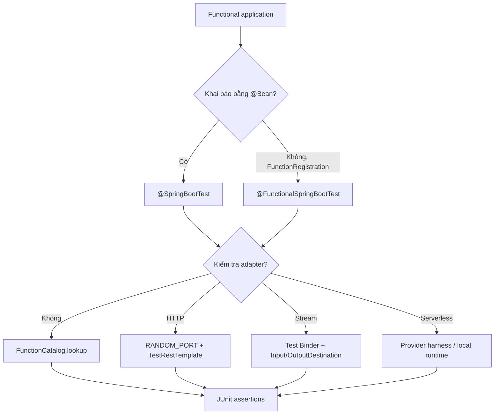

# Kiểm thử functional application theo tiện ích phù hợp phiên bản

**Chương:** Kiểm thử  
**Module:** Spring Cloud Function (`SPRING_CLOUD_FUNCTION`)

Spring Cloud Function cho phép xây dựng ứng dụng từ các functional bean `Supplier`, `Function` và `Consumer`, sau đó đưa cùng logic vào nhiều môi trường thực thi như Java, HTTP, Spring Cloud Stream hoặc serverless. Một bài kiểm thử tốt cần xác minh không chỉ kết quả của hàm, mà còn cách Spring đăng ký hàm vào context, cách `FunctionCatalog` phân giải và bọc hàm, cũng như cách adapter truyền dữ liệu vào/ra.

Spring Cloud Function hỗ trợ cả hai phong cách khai báo: **Spring Boot bean truyền thống** bằng `@Bean` và **functional bean definition** bằng `FunctionRegistration` cùng `FunctionalSpringApplication`. Hai phong cách này có cách khởi tạo test context khác nhau. Với bean truyền thống, dùng `@SpringBootTest`; với functional bean definition, Spring Cloud Function cung cấp `@FunctionalSpringBootTest`. Nếu ứng dụng công bố HTTP endpoint, bổ sung `TestRestTemplate` với server ngẫu nhiên; nếu ứng dụng dùng Spring Cloud Stream, dùng test binder và các destination giả lập phù hợp phiên bản.

Bài học tập trung vào việc **chọn đúng tiện ích kiểm thử theo cách ứng dụng được đăng ký và adapter đang sử dụng**. Ta sẽ viết test cho `FunctionCatalog`, kiểm tra function wrapper, functional bean definition, HTTP server, Stream Test Binder và ranh giới serverless. Các ví dụ sử dụng JUnit 5, Spring Boot Test và Spring Cloud Function hiện hành; không cần kết nối broker hoặc triển khai cloud thật để kiểm tra logic cốt lõi.

## 1. Mục tiêu học tập

Sau bài học, bạn có thể:

1. Phân biệt kiểm thử function Java thuần, kiểm thử Spring context và kiểm thử adapter.
2. Chọn `@SpringBootTest` cho ứng dụng khai báo functional bean bằng `@Bean`.
3. Chọn `@FunctionalSpringBootTest` cho ứng dụng dùng functional bean definition/registration.
4. Dùng `FunctionCatalog.lookup(...)` để kiểm tra hàm theo đúng cách Spring Cloud Function phân giải.
5. Phân biệt bean thô trong `ApplicationContext` với function wrapper từ `FunctionCatalog`.
6. Kiểm tra HTTP application bằng `@SpringBootTest(RANDOM_PORT)` và `TestRestTemplate`.
7. Kiểm tra message handler bằng Spring Cloud Stream Test Binder, `InputDestination` và `OutputDestination`.
8. Hiểu cách lựa chọn API theo phiên bản Spring Cloud Function, Spring Boot và Spring Cloud Stream.
9. Phân biệt test logic trong JVM với test đóng gói, adapter serverless và môi trường triển khai thật.
10. Tránh những test xanh giả do single-function fallback, sai functional registration, sai function definition hoặc thiếu converter.

## 2. Chọn đúng tầng kiểm thử

Một functional application có thể được kiểm tra ở nhiều tầng. Không phải test nào cũng cần khởi động toàn bộ Spring context hoặc adapter.

| Tầng | Công cụ phù hợp | Điều được xác minh |
| --- | --- | --- |
| Logic Java thuần | JUnit 5 | Quy tắc nghiệp vụ của `Function.apply`, `Supplier.get`, `Consumer.accept` |
| Spring bean/context | `@SpringBootTest` | Bean được tạo, dependency injection, configuration |
| Functional bean definition | `@FunctionalSpringBootTest` | Functional registration và FunctionCatalog |
| Function wrapper | `FunctionCatalog.lookup(...)` | Type conversion, composition và wrapper của Spring Cloud Function |
| HTTP adapter | `RANDOM_PORT` + `TestRestTemplate` | Endpoint, method, headers, body, status và serialization |
| Stream adapter | Test Binder + destination | Binding, message conversion, output và function definition |
| Serverless adapter | Adapter-specific harness/local runtime | Event envelope, handler và serialization theo nhà cung cấp |
| Packaging/deployment | Smoke test artifact hoặc môi trường staging | JAR/package, entry point, runtime config và hạ tầng |

**Nguyên tắc lựa chọn:** kiểm tra ở tầng thấp nhất có thể chứng minh hợp đồng đang quan tâm, rồi bổ sung test ở ranh giới adapter khi dữ liệu đi qua giao thức.



Không nên dùng một công cụ cho mọi tầng. Ví dụ, `FunctionCatalog.lookup(...)` không chứng minh HTTP route đã được export; Test Binder không chứng minh Kafka broker thật đã được cấu hình đúng; và test một hàm Java thuần không chứng minh Spring đã đăng ký đúng tên bean.

## 3. Hai phong cách khai báo functional application

### 3.1. Bean truyền thống bằng @Bean

Đây là phong cách phổ biến trong ứng dụng Spring Boot:

```java
@SpringBootApplication
public class SampleFunctionApplication {

    @Bean
    public Function<String, String> uppercase() {
        return value -> value.toUpperCase(Locale.ROOT);
    }
}
```

Spring Boot khởi tạo application context, đăng ký bean và Spring Cloud Function nhận diện các bean thuộc kiểu `Supplier`, `Function` hoặc `Consumer` để đưa vào `FunctionCatalog`.

Với phong cách này, test thường bắt đầu bằng:

```java
@SpringBootTest(
    classes = SampleFunctionApplication.class,
    webEnvironment = SpringBootTest.WebEnvironment.NONE
)
class SampleFunctionTest {
    // Inject FunctionCatalog và các dependency cần thiết.
}
```

### 3.2. Functional bean definition bằng FunctionRegistration

Spring Cloud Function còn hỗ trợ phong cách khai báo functional, trong đó ứng dụng đăng ký functional bean trực tiếp với `GenericApplicationContext`. Kiểu dữ liệu đầu vào/đầu ra được cung cấp bằng `FunctionRegistration`:

```java
@SpringBootConfiguration
public class FunctionalSampleApplication
        implements ApplicationContextInitializer<GenericApplicationContext> {

    public Function<String, String> uppercase() {
        return value -> value.toUpperCase(Locale.ROOT);
    }

    @Override
    public void initialize(GenericApplicationContext context) {
        context.registerBean(
            "uppercase",
            FunctionRegistration.class,
            () -> new FunctionRegistration<>(uppercase())
                .type(FunctionTypeUtils.functionType(
                    String.class, String.class))
        );
    }
}
```

Khác biệt chính:

| Bean truyền thống | Functional bean definition |
| --- | --- |
| Dùng `@SpringBootApplication` / `@Bean` | Dùng `@SpringBootConfiguration` và initializer hoặc class functional |
| Spring Boot tạo bean từ configuration | Ứng dụng chủ động gọi `context.registerBean(...)` |
| Có thể suy generic qua reflection của bean method | Nên đăng ký metadata kiểu rõ ràng qua `FunctionRegistration.type(...)` |
| Test context thường dùng `@SpringBootTest` | Test context có tiện ích `@FunctionalSpringBootTest` |

Phong cách functional có thể giảm overhead khởi tạo trong ứng dụng nhỏ. Nếu cần nhiều auto-configuration của Spring Boot hoặc tích hợp datastore, có thể dùng cấu hình hybrid và bật lại auto-configuration theo hướng dẫn Spring Cloud Function. Đừng chọn phong cách functional chỉ để đổi annotation test nếu ứng dụng thực tế vẫn dùng bean truyền thống.

Khi chuyển sang hybrid mode, hãy kiểm tra rõ cấu hình functional mode của phiên bản đang dùng. Tài liệu Spring Cloud Function mô tả việc dùng `@EnableAutoConfiguration` khi cần Boot integrations; nếu muốn Boot nắm lại quá trình khởi tạo trong hybrid configuration, có thể cần `spring.functional.enabled=false`.

## 4. Chọn tiện ích theo phiên bản

API kiểm thử của Spring Cloud Function và Spring Cloud Stream phát triển cùng các phiên bản Spring Boot tương ứng. Không lấy một annotation hoặc dependency từ tài liệu preview rồi áp dụng vào bản stable mà chưa kiểm tra artifact thực tế.

| Tình huống | Tiện ích | Cách dùng |
| --- | --- | --- |
| Spring Cloud Function bean style | `@SpringBootTest` | Tạo context từ class `@SpringBootApplication` |
| Spring Cloud Function functional bean style | `@FunctionalSpringBootTest` | Dùng test context loader dành cho functional definition |
| HTTP integration test | `TestRestTemplate` | Dùng `RANDOM_PORT` để gọi server thật trong JVM |
| Spring Cloud Stream stable docs | `TestChannelBinderConfiguration` | Import cấu hình test binder, inject destination |
| Spring Cloud Stream 5.1 preview docs | `@EnableTestBinder` | Chỉ dùng nếu API có trong phiên bản dependency đã resolve |
| JUnit 4 project cũ | `@RunWith(SpringRunner.class)` | Cần Spring test runner theo JUnit 4 |
| JUnit Jupiter | `@Test` + Spring Boot test annotation | Các annotation Spring Boot đã tích hợp extension phù hợp |

### 4.1. @FunctionalSpringBootTest có phải annotation thay thế cho mọi @SpringBootTest?

Không. `@FunctionalSpringBootTest` được thiết kế cho phong cách functional bean definition. Nó sử dụng cơ chế test context riêng để bật functional mode và đăng ký các function theo cách ứng dụng functional đã khai báo. Với ứng dụng `@Bean` thông thường, dùng `@SpringBootTest` là phù hợp.

Tài liệu Spring Cloud Function hiện hành vẫn mô tả cả hai cách. Annotation `@FunctionalSpringBootTest` có từ các phiên bản cũ của Spring Cloud Function và vẫn được tài liệu dòng 5.0.x sử dụng cho functional bean definition.

### 4.2. Kiểm tra version đã resolve

Maven:

```bash
./mvnw dependency:tree -Dincludes=org.springframework.cloud:spring-cloud-function-context,org.springframework.cloud:spring-cloud-function-web,org.springframework.cloud:spring-cloud-stream
```

Gradle:

```bash
./gradlew dependencyInsight --dependency spring-cloud-function-context --configuration testRuntimeClasspath
```

Khi dùng Stream Test Binder, kiểm tra thêm:

```bash
./gradlew dependencyInsight --dependency spring-cloud-stream-test-binder --configuration testRuntimeClasspath
```

Hãy đối chiếu dependency đã resolve với Spring Cloud BOM và Spring Boot version của dự án. Không ép một version mới của `spring-cloud-function-context` hoặc `spring-cloud-stream-test-binder` vào ứng dụng đang dùng release train cũ.

## 5. Dependencies cho functional application test

Nếu chỉ kiểm tra `FunctionCatalog` trong một ứng dụng Spring Boot, dependency chính là `spring-cloud-function-context`. Nếu muốn kiểm tra HTTP hoặc Stream, thêm adapter/test binder tương ứng.

**Maven** (trích POM, phiên bản được BOM quản lý):

```xml
<dependencies>
    <dependency>
        <groupId>org.springframework.cloud</groupId>
        <artifactId>spring-cloud-function-context</artifactId>
    </dependency>

    <!-- Chỉ cần khi kiểm thử HTTP adapter -->
    <dependency>
        <groupId>org.springframework.cloud</groupId>
        <artifactId>spring-cloud-function-web</artifactId>
    </dependency>
    <dependency>
        <groupId>org.springframework.boot</groupId>
        <artifactId>spring-boot-starter-web</artifactId>
        <scope>test</scope>
    </dependency>

    <!-- Dùng cho JUnit 5 / Spring Boot integration tests -->
    <dependency>
        <groupId>org.springframework.boot</groupId>
        <artifactId>spring-boot-starter-test</artifactId>
        <scope>test</scope>
    </dependency>

    <!-- Chỉ cần khi kiểm thử Spring Cloud Stream -->
    <dependency>
        <groupId>org.springframework.cloud</groupId>
        <artifactId>spring-cloud-stream-test-binder</artifactId>
        <scope>test</scope>
    </dependency>
</dependencies>
```

**Gradle Kotlin DSL:**

```kotlin
dependencies {
    implementation("org.springframework.cloud:spring-cloud-function-context")

    // HTTP adapter tests
    testImplementation("org.springframework.cloud:spring-cloud-function-web")
    testImplementation("org.springframework.boot:spring-boot-starter-web")

    // Spring Boot / JUnit tests
    testImplementation("org.springframework.boot:spring-boot-starter-test")

    // Stream binder tests
    testImplementation("org.springframework.cloud:spring-cloud-stream-test-binder")
}

tasks.test {
    useJUnitPlatform()
}
```

Trong dự án thật, chỉ thêm các dependency cần thiết cho tầng kiểm thử. Ví dụ, một module chỉ dùng `FunctionCatalog` không cần mang theo HTTP adapter hoặc Stream binder. Khi ứng dụng chạy HTTP ở production, `spring-cloud-function-web` và web runtime phải có trong runtime classpath, không chỉ test classpath.

## 6. Kiểm thử bean truyền thống bằng @SpringBootTest

Ta tạo một ứng dụng có hai function để tránh nhầm lẫn do cơ chế single-function fallback:

**File:** `src/main/java/example/testing/SampleFunctionApplication.java`

```java
package example.testing;

import java.util.Locale;
import java.util.function.Function;

import org.springframework.boot.SpringApplication;
import org.springframework.boot.autoconfigure.SpringBootApplication;
import org.springframework.context.annotation.Bean;

@SpringBootApplication
public class SampleFunctionApplication {

    public static void main(String[] args) {
        SpringApplication.run(
            SampleFunctionApplication.class, args);
    }

    @Bean("uppercase")
    public Function<String, String> uppercase() {
        return value -> value.toUpperCase(Locale.ROOT);
    }

    @Bean("reverse")
    public Function<String, String> reverse() {
        return value -> new StringBuilder(value)
            .reverse().toString();
    }
}
```

**File:** `src/test/java/example/testing/FunctionCatalogSpringBootTest.java`

```java
package example.testing;

import static org.junit.jupiter.api.Assertions.*;

import java.util.Set;
import java.util.function.Function;

import org.junit.jupiter.api.Test;
import org.springframework.beans.factory.annotation.Autowired;
import org.springframework.boot.test.context.SpringBootTest;
import org.springframework.cloud.function.context.FunctionCatalog;

@SpringBootTest(
    classes = SampleFunctionApplication.class,
    webEnvironment = SpringBootTest.WebEnvironment.NONE
)
class FunctionCatalogSpringBootTest {

    @Autowired
    FunctionCatalog catalog;

    @Test
    void catalogContainsNamedFunctions() {
        Set<String> names = catalog.getNames(Function.class);

        assertTrue(names.contains("uppercase"));
        assertTrue(names.contains("reverse"));
    }

    @Test
    void lookupInvokesFunctionByItsName() {
        Function<String, String> uppercase =
            catalog.lookup(Function.class, "uppercase");

        assertNotNull(uppercase);
        assertEquals("HELLO", uppercase.apply("hello"));
    }

    @Test
    void catalogComposesFunctionsInDeclaredOrder() {
        Function<String, String> pipeline =
            catalog.lookup(
                Function.class, "uppercase|reverse");

        assertNotNull(pipeline);
        assertEquals("OLLEH", pipeline.apply("hello"));
    }
}
```

### 6.1. Vì sao test context dùng WebEnvironment.NONE?

Test này chỉ cần Spring context để đăng ký bean và tạo `FunctionCatalog`. Không có yêu cầu HTTP nên không cần mở server. Dùng `NONE` giúp test nhanh và thể hiện đúng phạm vi cần kiểm tra.

### 6.2. Vì sao kiểm tra getNames trước hoặc bên cạnh lookup?

Khi catalog chỉ có một functional bean đủ điều kiện, một số cấu hình Spring Cloud Function có thể cho phép lookup theo tên không khớp như một cơ chế fallback. Nếu chỉ kiểm tra `lookup(...) != null`, test có thể xanh dù tên bean bị gõ sai.

Trong fixture có nhiều function, assertion `catalog.getNames(Function.class)` giúp xác minh tên thực sự được đăng ký. Với ứng dụng có nhiều loại functional bean, có thể kiểm tra thêm nhóm `Supplier.class` hoặc `Consumer.class`.

### 6.3. Lookup qua catalog khác lấy bean trực tiếp

Có thể inject bean:

```java
@Autowired
@Qualifier("uppercase")
Function<String, String> rawFunction;
```

hoặc lấy wrapper:

```java
Function<String, String> catalogFunction =
    catalog.lookup(Function.class, "uppercase");
```

Bean trực tiếp là implementation mà ứng dụng khai báo. Function lấy qua `FunctionCatalog` được Spring Cloud Function instrument/wrap để bổ sung các tính năng như type conversion và composition. Vì vậy:

- Unit test bean trực tiếp hữu ích để kiểm tra logic Java.
- Catalog test kiểm tra cách framework phân giải và gọi function.
- Không nên khẳng định hai object phải cùng identity hoặc cùng class.

## 7. Kiểm thử functional bean definition bằng @FunctionalSpringBootTest

Khi ứng dụng đăng ký function bằng `FunctionRegistration`, test nên sử dụng test context loader phù hợp với functional mode.

**File:** `src/main/java/example/testing/FunctionalSampleApplication.java`

```java
package example.testing;

import java.util.Locale;
import java.util.function.Function;

import org.springframework.boot.SpringBootConfiguration;
import org.springframework.cloud.function.context.FunctionRegistration;
import org.springframework.cloud.function.context.FunctionTypeUtils;
import org.springframework.cloud.function.context.FunctionalSpringApplication;
import org.springframework.context.ApplicationContextInitializer;
import org.springframework.context.support.GenericApplicationContext;

@SpringBootConfiguration
public class FunctionalSampleApplication
        implements ApplicationContextInitializer<GenericApplicationContext> {

    public static void main(String[] args) {
        FunctionalSpringApplication.run(
            FunctionalSampleApplication.class, args);
    }

    private Function<String, String> uppercase() {
        return value -> value.toUpperCase(Locale.ROOT);
    }

    @Override
    public void initialize(GenericApplicationContext context) {
        context.registerBean(
            "uppercase",
            FunctionRegistration.class,
            () -> new FunctionRegistration<>(uppercase())
                .type(FunctionTypeUtils.functionType(
                    String.class, String.class))
        );
    }
}
```

**File:** `src/test/java/example/testing/FunctionalDefinitionTest.java`

```java
package example.testing;

import static org.junit.jupiter.api.Assertions.*;

import java.util.Set;
import java.util.function.Function;

import org.junit.jupiter.api.Test;
import org.springframework.beans.factory.annotation.Autowired;
import org.springframework.cloud.function.context.FunctionCatalog;
import org.springframework.cloud.function.context.test.FunctionalSpringBootTest;

@FunctionalSpringBootTest(
    classes = FunctionalSampleApplication.class
)
class FunctionalDefinitionTest {

    @Autowired
    FunctionCatalog catalog;

    @Test
    void functionalRegistrationAppearsInCatalog() {
        Set<String> names = catalog.getNames(Function.class);
        assertTrue(names.contains("uppercase"));
    }

    @Test
    void functionalRegistrationCanBeLookedUpAndInvoked() {
        Function<String, String> function =
            catalog.lookup(Function.class, "uppercase");

        assertNotNull(function);
        assertEquals("HELLO", function.apply("hello"));
    }
}
```

### 7.1. Vai trò của @FunctionalSpringBootTest

Annotation `@FunctionalSpringBootTest` là tiện ích do Spring Cloud Function cung cấp trong package:

```java
org.springframework.cloud.function.context.test.FunctionalSpringBootTest
```

Nó sử dụng test context loader dành cho functional application và bật functional mode phù hợp. Các tiện ích test thông thường như `@Autowired`, JUnit và `FunctionCatalog` vẫn được dùng như trong Spring Boot Test.

Ở API của annotation, nó được tích hợp với Spring Boot Test và functional test context loader; vì vậy annotation này không phải một test runner độc lập. Tài liệu API lịch sử ghi nhận annotation từ Spring Cloud Function 2.0 và reference guide dòng 5.0.x vẫn dùng nó cho functional bean definition. Luôn kiểm tra artifact hiện tại nếu dự án đang dùng một release cũ hoặc custom dependency set.

### 7.2. Khi nào không dùng annotation này?

Nếu application chỉ khai báo:

```java
@Bean
Function<String, String> uppercase() {
    return value -> value.toUpperCase(Locale.ROOT);
}
```

thì dùng `@SpringBootTest`. Đừng thay tất cả test bằng `@FunctionalSpringBootTest` chỉ vì ứng dụng có các functional interface. Tên “functional” ở annotation này nói đến **functional bean definition mode**, không chỉ việc bean có kiểu `Function`.

### 7.3. Metadata kiểu dữ liệu là một phần của functional registration

Trong functional bean definition, framework không phải lúc nào cũng suy được generic như với một `@Bean` method. Vì vậy, `FunctionRegistration.type(...)` cung cấp metadata đầu vào/đầu ra:

```java
.type(FunctionTypeUtils.functionType(
    OrderRequest.class, OrderResult.class))
```

Nếu thiếu hoặc khai báo sai metadata, test lookup có thể vẫn thành công nhưng conversion hoặc composition có thể thất bại khi nhận dữ liệu thật. Hãy viết thêm test input/output có kiểu, không chỉ kiểm tra bean name.

## 8. Kiểm thử HTTP functional application

Khi muốn xác minh function được công bố thành HTTP endpoint, dùng Spring Cloud Function Web cùng Spring MVC. Với ứng dụng bean style, test dùng `@SpringBootTest`; với functional bean definition, tài liệu Spring Cloud Function minh họa cách dùng `@FunctionalSpringBootTest` cùng `TestRestTemplate`.

**Dependency bổ sung khi kiểm thử HTTP:**

```xml
<dependency>
    <groupId>org.springframework.cloud</groupId>
    <artifactId>spring-cloud-function-web</artifactId>
</dependency>
<dependency>
    <groupId>org.springframework.boot</groupId>
    <artifactId>spring-boot-starter-web</artifactId>
    <scope>test</scope>
</dependency>
```

Test ví dụ cho bean style:

**File:** `src/test/java/example/testing/HttpFunctionIntegrationTest.java`

```java
package example.testing;

import static org.junit.jupiter.api.Assertions.*;

import java.net.URI;

import org.junit.jupiter.api.Test;
import org.springframework.beans.factory.annotation.Autowired;
import org.springframework.boot.test.context.SpringBootTest;
import org.springframework.boot.test.web.client.TestRestTemplate;
import org.springframework.http.HttpStatus;
import org.springframework.http.MediaType;
import org.springframework.http.RequestEntity;
import org.springframework.http.ResponseEntity;

@SpringBootTest(
    classes = SampleFunctionApplication.class,
    webEnvironment = SpringBootTest.WebEnvironment.RANDOM_PORT
)
class HttpFunctionIntegrationTest {

    @Autowired
    TestRestTemplate rest;

    @Test
    void httpRequestInvokesFunctionAndReturnsResponse() {
        RequestEntity<String> request =
            RequestEntity.post(URI.create("/uppercase"))
                .contentType(MediaType.TEXT_PLAIN)
                .accept(MediaType.TEXT_PLAIN)
                .body("hello");

        ResponseEntity<String> response =
            rest.exchange(request, String.class);

        assertEquals(HttpStatus.OK, response.getStatusCode());
        assertEquals("HELLO", response.getBody());
    }
}
```

### 8.1. HTTP test cho functional bean definition

Với functional application ở mục 7, có thể dùng cùng mô hình HTTP test:

```java
package example.testing;

import static org.junit.jupiter.api.Assertions.*;

import org.junit.jupiter.api.Test;
import org.springframework.beans.factory.annotation.Autowired;
import org.springframework.boot.test.context.SpringBootTest;
import org.springframework.boot.test.web.client.TestRestTemplate;
import org.springframework.http.HttpStatus;
import org.springframework.http.ResponseEntity;
import org.springframework.cloud.function.context.test.FunctionalSpringBootTest;

@FunctionalSpringBootTest(
    classes = FunctionalSampleApplication.class,
    webEnvironment = SpringBootTest.WebEnvironment.RANDOM_PORT
)
class FunctionalHttpIntegrationTest {

    @Autowired
    TestRestTemplate rest;

    @Test
    void functionalRegistrationIsAvailableThroughHttp() {
        ResponseEntity<String> response =
            rest.postForEntity(
                "/uppercase", "hello", String.class);

        assertEquals(HttpStatus.OK, response.getStatusCode());
        assertEquals("HELLO", response.getBody());
    }
}
```

Đoạn test giả định HTTP dependencies ở trên có mặt trong test runtime. Nếu phiên bản `@FunctionalSpringBootTest` của dự án không nhận thuộc tính `webEnvironment` hoặc không khởi tạo web context theo cấu hình đó, đối chiếu Javadoc của phiên bản đang dùng; có thể dùng `@SpringBootTest` với functional configuration được nạp đúng cách. Không tự thêm annotation không có trong artifact.

### 8.2. Vì sao dùng RANDOM_PORT?

`RANDOM_PORT` khởi động embedded server thật trên cổng được cấp tự động. Test gọi server qua HTTP client và kiểm tra toàn bộ đường đi từ request tới function rồi response. Nó khác test MockMvc/WebTestClient dùng mock web environment; hai lựa chọn phục vụ các mục tiêu khác nhau.

Không cần `@SpringBootTest(RANDOM_PORT)` nếu chỉ muốn test logic hoặc FunctionCatalog. Khởi động server sẽ làm test chậm hơn và tăng số lượng thành phần tham gia.

## 9. Kiểm thử Spring Cloud Stream bằng Test Binder

Spring Cloud Stream sử dụng functional bean của Spring Cloud Function để xử lý message qua binder. Nếu cần xác minh binding, message conversion và output mà không kết nối Kafka/RabbitMQ thật, dùng **Spring Integration Test Binder**.

**Dependency test:**

```xml
<dependency>
    <groupId>org.springframework.cloud</groupId>
    <artifactId>spring-cloud-stream-test-binder</artifactId>
    <scope>test</scope>
</dependency>
```

Với tài liệu stable hiện hành, cấu hình thường dùng `@Import(TestChannelBinderConfiguration.class)` cùng `InputDestination` và `OutputDestination`.

**File:** `src/test/java/example/testing/StreamFunctionIntegrationTest.java`

```java
package example.testing;

import static org.junit.jupiter.api.Assertions.*;

import java.nio.charset.StandardCharsets;

import org.junit.jupiter.api.Test;
import org.springframework.beans.factory.annotation.Autowired;
import org.springframework.boot.test.context.SpringBootTest;
import org.springframework.context.annotation.Import;
import org.springframework.messaging.Message;
import org.springframework.messaging.support.GenericMessage;
import org.springframework.cloud.stream.binder.test.InputDestination;
import org.springframework.cloud.stream.binder.test.OutputDestination;
import org.springframework.cloud.stream.binder.test.TestChannelBinderConfiguration;

@SpringBootTest(
    classes = SampleFunctionApplication.class,
    properties = "spring.cloud.function.definition=uppercase"
)
@Import(TestChannelBinderConfiguration.class)
class StreamFunctionIntegrationTest {

    @Autowired
    InputDestination input;

    @Autowired
    OutputDestination output;

    @Test
    void inputMessageIsProcessedAndPublishedToOutput() {
        byte[] payload =
            "hello".getBytes(StandardCharsets.UTF_8);
        input.send(new GenericMessage<>(payload));

        Message<byte[]> result = output.receive();

        assertNotNull(result);
        assertArrayEquals(
            "HELLO".getBytes(StandardCharsets.UTF_8),
            result.getPayload());
    }
}
```

### 9.1. Test Binder kiểm tra điều gì?

- Function definition được chọn và binding được tạo.
- Message đi vào input destination.
- Framework chuyển payload tới function theo content type/kiểu input.
- Output được gửi tới output destination.
- Có thể kiểm tra message headers và payload sau khi xử lý.

Test Binder là broker trong JVM dựa trên Spring Integration. Nó hữu ích để kiểm tra ứng dụng như một Spring Cloud Stream application mà không cần hệ thống middleware thật.

### 9.2. API Test Binder thay đổi theo phiên bản

Đừng sao chép annotation từ một tài liệu preview sang dự án stable:

| Dòng tài liệu/API | Cấu hình thường gặp |
| --- | --- |
| Stable Spring Cloud Stream docs | Dependency `spring-cloud-stream-test-binder` + `@Import(TestChannelBinderConfiguration.class)` |
| Test API theo functional binding | `InputDestination` và `OutputDestination` |
| Tài liệu Spring Cloud Stream 5.1 preview | Có ví dụ `@EnableTestBinder` |
| Dự án cũ dùng channel API | Có thể gặp `MessageCollector` hoặc API test binder cũ; kiểm tra docs đúng release |

Khi biên dịch không tìm thấy `@EnableTestBinder`, không tự tạo annotation thay thế. Hãy dùng API test binder thực sự có trong dependency đã resolve. Ngược lại, nếu dự án dùng phiên bản đã cung cấp annotation đó, theo hướng dẫn của đúng dòng phiên bản.

### 9.3. Test destination được đặt tên rõ

Khi có nhiều function/binding, không nên dựa vào destination mặc định nếu test cần chứng minh function cụ thể. Có thể gửi/nhận bằng binding name:

```java
input.send(message, "uppercase-in-0");
Message<byte[]> result =
    output.receive(0, "uppercase-out-0");
```

Tên binding thường theo quy tắc `<functionName>-in-0` và `<functionName>-out-0`; nếu cấu hình destination tùy chỉnh, dùng đúng tên destination thay cho binding name. Kiểm tra binding name từ cấu hình và tài liệu phiên bản của dự án.

### 9.4. Test Binder không thay thế broker thật

Test Binder không xác minh:

- Kết nối broker, credentials, TLS hoặc network.
- Consumer group, partition assignment, rebalance và offset.
- Broker retry/DLQ, acknowledgment và semantics của Kafka/RabbitMQ thật.
- Serialization do một broker hoặc binder production riêng cấu hình.

Nếu cần kiểm tra những điều này, viết integration test riêng với middleware thật hoặc môi trường staging. Tài liệu Spring Cloud Stream cũng lưu ý không trộn test binder và binder middleware thật trong cùng một module test khi chúng cạnh tranh cấu hình binder mặc định; nên tách nhóm integration test thích hợp.

### 9.5. Vì sao cần chỉ định function definition?

Trong ví dụ có nhiều function, property:

```properties
spring.cloud.function.definition=uppercase
```

chỉ rõ function được gắn với binding. Nếu có nhiều function mà không xác định definition, framework có thể không biết function nào cần bind hoặc áp dụng cơ chế lựa chọn mặc định theo phiên bản. Luôn chỉ định definition trong test để kết quả rõ ràng.

### 9.6. Tách Test Binder khỏi test broker thật

Test Binder hoạt động trong JVM. Nếu cùng module có cả test binder và Kafka/Rabbit binder trên classpath, Test Binder có thể được chọn làm binder mặc định cho các test. Với test cần middleware thật, nên cấu hình/exclude test binder đúng cách hoặc tách nhóm test/module để không vô tình gửi message vào in-memory channel khi tưởng rằng đang kiểm tra broker.

## 10. Kiểm thử serverless application theo adapter

Spring Cloud Function tách business function khỏi runtime. Nhưng khi đóng gói serverless, adapter chịu trách nhiệm chuyển event của nhà cung cấp thành input cho function và chuyển output thành response/event tương ứng.

Ví dụ AWS Lambda sử dụng handler tổng quát:

```text
org.springframework.cloud.function.adapter.aws.FunctionInvoker
```

Adapter này kết nối AWS Lambda request/event với function trong Spring context. Khi ứng dụng có nhiều function, có thể chọn bằng `spring.cloud.function.definition` hoặc cơ chế routing phù hợp.

### 10.1. Ba nhóm test serverless

| Nhóm | Công cụ | Mục tiêu |
| --- | --- | --- |
| Business function | JUnit 5 + FunctionCatalog | Logic nghiệp vụ và output |
| Adapter/event mapping | Provider-specific test harness hoặc local runtime | Event envelope, headers, serialization và handler |
| Package/deployment smoke test | Artifact build + local provider runtime/staging | Manifest, entry point, dependency packaging và runtime config |

### 10.2. Không cần gọi cloud thật để kiểm tra mọi thứ

Test function qua catalog không cần AWS/Azure/GCP credentials. Có thể kiểm tra logic và function definition trong JVM. Khi kiểm tra adapter, dùng event fixture theo nhà cung cấp hoặc local runtime/harness tương ứng. Chỉ test triển khai thật ở môi trường integration/staging khi cần xác minh quyền truy cập, trigger, network, timeout và cấu hình cloud.

### 10.3. Ví dụ quy trình kiểm thử AWS

1. Unit test function nghiệp vụ bằng JUnit.
2. Spring context test: `catalog.lookup(...)` trả function đúng.
3. Adapter test: dùng event mẫu của AWS và kiểm tra output/exception theo adapter.
4. Packaging test: xác minh artifact Lambda chứa adapter cần thiết và handler entry point là `FunctionInvoker`.
5. Staging smoke test: invoke Lambda đã triển khai bằng event test an toàn.

Không coi việc `FunctionCatalog.lookup(...)` thành công là bằng chứng JAR đã được đóng gói đúng cho Lambda. Tương tự, không dùng test binder để chứng minh serverless event envelope đã được ánh xạ đúng.

## 11. Kiểm thử theo từng loại function

Functional application có thể đăng ký `Supplier`, `Function` và `Consumer`. Test phải gọi đúng phương thức và xác minh đúng loại kết quả.

| Functional bean | Cách gọi qua Java | Điều cần assert |
| --- | --- | --- |
| `Supplier<O>` | `get()` | Giá trị được tạo hoặc stream được trả |
| `Function<I,O>` | `apply(input)` | Output đúng với input |
| `Consumer<I>` | `accept(input)` | Side effect hoặc collaborator được gọi |
| `Function<Flux<I>,Flux<O>>` | `apply(flux)` rồi subscribe | Tín hiệu và phần tử của publisher |
| `Function<Mono<I>,Mono<O>>` | `apply(mono)` rồi subscribe | Value, empty hoặc error signal |

Ví dụ Consumer:

```java
@Bean
Consumer<String> audit(AuditRecorder recorder) {
    return recorder::record;
}
```

Trong test, inject `AuditRecorder` fake và kiểm tra nội dung được ghi. Không mong `Consumer.accept(...)` trả kết quả nghiệp vụ.

Với reactive function, dùng `StepVerifier` để kiểm tra publisher thay vì gọi `block()` trong test; nội dung này được trình bày riêng trong bài kiểm thử Mono/Flux.

## 12. Kiểm tra FunctionCatalog và metadata

`FunctionCatalog` là điểm vào để tìm functional bean theo tên và nhận wrapper do Spring Cloud Function quản lý.

```java
FunctionCatalog catalog = /* inject từ Spring context */;

Set<String> allNames = catalog.getNames(null);
Function<String, String> uppercase =
    catalog.lookup(Function.class, "uppercase");
```

Các test nên bao gồm:

1. Tên function xuất hiện trong catalog.
2. Lookup theo đúng loại và tên trả về function.
3. Gọi wrapper tạo kết quả mong đợi.
4. Composition phân giải đúng thứ tự nếu ứng dụng dùng composition.
5. Nếu function nhận DTO/Message, kiểm tra conversion và header trong một test phù hợp.

### 12.1. Tại sao lookup wrapper quan trọng?

Lấy bean trực tiếp từ `ApplicationContext` cho ta implementation như đã khai báo. Lookup qua catalog trả về wrapper được instrument để hỗ trợ type conversion, composition và những tính năng của Spring Cloud Function.

Vì vậy, hai bài test có ý nghĩa khác nhau:

| Kiểm tra | Cách viết | Mục tiêu |
| --- | --- | --- |
| Logic thuần | `rawFunction.apply("hello")` | Kiểm tra business implementation |
| Function framework | `catalog.lookup(...).apply(...)` | Kiểm tra catalog và wrapper |
| HTTP | Gửi request tới endpoint | Kiểm tra web adapter |
| Stream | Gửi message qua Test Binder | Kiểm tra binding và message adapter |

Đừng coi test raw bean đã chứng minh conversion JSON hoặc composition qua catalog hoạt động.

### 12.2. Cẩn thận với single-function fallback

Trong context chỉ có một functional bean đủ điều kiện, Spring Cloud Function có thể cho phép lookup bằng tên bất kỳ hoặc tên rỗng theo cơ chế fallback của catalog. Vì vậy, test kiểm tra sai tên không nên chỉ viết:

```java
assertNotNull(catalog.lookup(Function.class, "wrongName"));
```

Thay vào đó, kiểm tra danh sách tên:

```java
assertTrue(
    catalog.getNames(Function.class).contains("uppercase"));
assertFalse(
    catalog.getNames(Function.class).contains("wrongName"));
```

Khi muốn xác minh lookup tên không tồn tại, tạo fixture có nhiều function đủ điều kiện hoặc kiểm tra danh sách tên trước. Đừng để fallback khiến test xanh giả.

## 13. Cấu hình test và cô lập Spring context

Test functional application thường phụ thuộc vào:

- Functional bean nào được đăng ký.
- Function definition được chọn.
- Có bật functional mode hay không.
- Adapter Web/Stream nào nằm trên classpath.
- Profile hoặc property nào được nạp.

Hãy khai báo cấu hình ngay trên test class hoặc trong test configuration để kết quả có thể lặp lại.

### 13.1. Đặt function definition trong test properties

```java
@SpringBootTest(
    classes = SampleFunctionApplication.class,
    properties = {
        "spring.cloud.function.definition=uppercase"
    },
    webEnvironment = SpringBootTest.WebEnvironment.NONE
)
class SelectedFunctionTest {
    // Inject FunctionCatalog hoặc binder destination.
}
```

Đây là cách phù hợp khi ứng dụng có nhiều function nhưng test chỉ muốn kiểm tra một function. Không thay đổi `System.setProperty(...)` giữa các test rồi mong Spring context đã khởi tạo tự nạp lại property.

### 13.2. Dùng test configuration cho collaborator

Nếu function phụ thuộc repository, clock hoặc client, hãy inject một fake/mock test bean thay cho kết nối thật. Ví dụ:

```java
@TestConfiguration(proxyBeanMethods = false)
class FunctionTestConfig {

    @Bean
    Clock testClock() {
        return Clock.fixed(
            Instant.parse("2026-01-01T00:00:00Z"),
            ZoneOffset.UTC);
    }
}
```

Test configuration có thể được nạp bằng `@Import(FunctionTestConfig.class)`. Giữ test fixture riêng cho lớp test cần nó; tránh đưa fake vào application configuration production.

### 13.3. Tránh trạng thái dùng chung giữa các test

Nếu một function giữ state hoặc test recorder lưu kết quả, hãy reset state trong `@BeforeEach` hoặc tạo fixture mới theo test. Spring Test cache context nên bean singleton có thể tồn tại qua nhiều phương thức test.

Không dùng biến static để ghi kết quả giữa test. Khi bật parallel execution, hai test dùng cùng singleton recorder có thể ghi xen kẽ và tạo kết quả không xác định. Cần tách context hoặc dùng cơ chế cô lập đồng bộ hóa phù hợp.

### 13.4. JUnit 4 và JUnit Jupiter

Với JUnit Jupiter, các annotation Spring Boot Test đã tích hợp Spring Extension; thường không cần khai báo `@ExtendWith(SpringExtension.class)` riêng.

Với dự án JUnit 4 cũ, test Spring cần:

```java
@RunWith(SpringRunner.class)
@SpringBootTest(classes = SampleFunctionApplication.class)
public class LegacyFunctionTest {
    // JUnit 4 test methods
}
```

Không trộn annotation JUnit 4 và JUnit 5 một cách tùy tiện. Kiểm tra test engine có trong dependency và chọn cú pháp phù hợp với test runtime.

## 14. Ma trận chọn tiện ích theo loại ứng dụng

| Cách khai báo / adapter | Test context | Công cụ chính | Assertion |
| --- | --- | --- | --- |
| Function thuần Java | Không cần Spring | JUnit 5 | Input/output và side effect |
| `@Bean Function` | `@SpringBootTest` | `FunctionCatalog` | Tên, lookup, wrapper, output |
| Functional bean registration | `@FunctionalSpringBootTest` | `FunctionCatalog` | Registration, metadata, output |
| Bean style + HTTP | `@SpringBootTest(RANDOM_PORT)` | `TestRestTemplate` | Status, body, header |
| Functional style + HTTP | `@FunctionalSpringBootTest(RANDOM_PORT)` nếu hỗ trợ | `TestRestTemplate` | Endpoint và response |
| Stream function | `@SpringBootTest` + Test Binder | `InputDestination` / `OutputDestination` | Message input/output, binding |
| Reactive function | Context test hoặc direct function | `StepVerifier` | Signal, error, completion |
| Serverless | Context test + adapter harness | Provider-specific fixture | Event mapping và handler |
| Đóng gói artifact | Smoke test ngoài unit suite | Local runtime / staging | Entry point, packaging, runtime |

### 14.1. Cây quyết định nhanh



## 15. Chẩn đoán lỗi kiểm thử functional application

| Triệu chứng | Nguyên nhân có thể | Cách xử lý |
| --- | --- | --- |
| `@FunctionalSpringBootTest` không tìm thấy application | Thiếu hoặc sai functional configuration class | Chỉ định `classes=...` và kiểm tra initializer |
| Dùng `@FunctionalSpringBootTest` nhưng bean `@Bean` không được nạp như mong đợi | Chọn sai test loader cho bean style | Dùng `@SpringBootTest` cho ứng dụng truyền thống |
| `FunctionCatalog.lookup(...)` trả null | Bean chưa đăng ký hoặc tên sai | Kiểm tra `getNames(...)` và functional registration |
| Lookup tên sai vẫn trả function | Single-function fallback | Xác minh danh sách tên và fixture có nhiều function |
| Catalog lookup được nhưng conversion lỗi | Metadata generic hoặc converter không phù hợp | Kiểm tra chữ ký, `FunctionRegistration.type(...)` và content type |
| Function trực tiếp chạy nhưng catalog test khác | Wrapper/conversion/composition của catalog | So sánh raw bean với catalog wrapper |
| HTTP test 404 | Web adapter thiếu hoặc function không export | Kiểm tra `spring-cloud-function-web`, path và definition |
| HTTP test không khởi động server | Sai web dependency hoặc webEnvironment | Kiểm tra MVC/WebFlux và `RANDOM_PORT` |
| Test Binder không có output | Chưa cấu hình function definition/binding hoặc sai destination | Kiểm tra `spring.cloud.function.definition` và binding name |
| Không tìm thấy `@EnableTestBinder` | Dùng annotation preview trên bản stable | Dùng API test binder của version đã resolve |
| Test Binder hoạt động nhưng Kafka thật lỗi | Test binder không kiểm tra network/broker | Viết integration test với broker thật |
| Serverless test xanh nhưng deploy lỗi | Artifact/handler/runtime chưa được kiểm tra | Thêm packaging smoke test và provider staging test |
| Kết quả test không ổn định | Singleton state hoặc test chạy song song | Reset state, cô lập context hoặc đồng bộ hóa |

### 15.1. Khi lookup trả về null

Kiểm tra theo thứ tự:

1. Application context đã khởi tạo đúng configuration chưa?
2. Bean có thực sự là `Supplier`, `Function` hoặc `Consumer` không?
3. Functional registration có tên và metadata đúng không?
4. Bean có bị lọc bởi cấu hình hoặc không đủ điều kiện catalog không?
5. Test có dùng đúng loại lookup (Function/Supplier/Consumer) không?

### 15.2. Khi context không khởi động

Đừng vội thay annotation. Trước hết đọc root cause:

- Class functional app có đúng `@SpringBootConfiguration` và initializer không?
- `FunctionalSpringApplication.run(...)` có dùng đúng class không?
- Test có đang trộn `@SpringBootTest` và `@FunctionalSpringBootTest` trên cùng fixture không?
- Dependency Spring Boot/Spring Cloud Function có được quản lý cùng BOM không?
- Có auto-configuration cần thiết nhưng functional mode đã tắt hay chưa?

## 16. Bài tập thực hành

1. **Bean style:** viết một `Function<String,String>` và test bằng `@SpringBootTest` + `FunctionCatalog.lookup(...)`.
2. **Functional registration:** đăng ký cùng function bằng `FunctionRegistration`, sau đó chuyển test sang `@FunctionalSpringBootTest`.
3. **Metadata:** đổi function thành `Function<OrderRequest,OrderResult>` và khai báo đúng kiểu với `FunctionTypeUtils.functionType(...)`.
4. **Sai metadata:** thử bỏ hoặc đổi metadata kiểu; quan sát lỗi khi lookup hoặc conversion và giải thích root cause.
5. **Composition:** đăng ký hai function và test `normalize|uppercase` qua catalog.
6. **Supplier/Consumer:** đăng ký một supplier và consumer, xác minh `get()` và side effect của `accept(...)`.
7. **HTTP:** thêm `spring-cloud-function-web`, chạy server random port và test endpoint bằng `TestRestTemplate`.
8. **Stream:** thêm Test Binder, gửi message qua `InputDestination` và kiểm tra `OutputDestination`.
9. **Named destination:** đổi binding destination trong properties và sửa test dùng đúng tên destination.
10. **Version API:** kiểm tra phiên bản Stream Test Binder của dự án; ghi nhận dự án hỗ trợ `@Import(TestChannelBinderConfiguration.class)` hay `@EnableTestBinder`.
11. **Reactive:** kiểm tra function trả `Flux` bằng `StepVerifier` thay vì `block()`.
12. **Serverless:** viết event fixture của AWS/Azure/GCP và kiểm tra adapter mapping mà không cần deploy cloud thật.
13. **Packaging:** xây artifact adapter và tạo smoke test để xác minh handler/entry point.
14. **Isolation:** chạy test song song với recorder dùng chung, quan sát race condition rồi cô lập fixture.

### Câu hỏi phỏng vấn

**Hỏi:** Khi nào dùng `@FunctionalSpringBootTest` thay cho `@SpringBootTest`?

**Đáp:** Dùng `@FunctionalSpringBootTest` khi ứng dụng khai báo functional bean bằng functional definition/registration của Spring Cloud Function. Với ứng dụng Spring Boot khai báo bean bằng `@Bean`, dùng `@SpringBootTest`.

**Hỏi:** Tại sao test function qua FunctionCatalog thay vì lấy bean trực tiếp?

**Đáp:** Catalog trả về function wrapper được Spring Cloud Function instrument, hỗ trợ type conversion và composition. Lấy bean trực tiếp chỉ kiểm tra implementation đã khai báo.

**Hỏi:** Vì sao phải kiểm tra `getNames(...)` trước khi kết luận lookup tên sai?

**Đáp:** Single-function fallback có thể làm lookup tên không khớp vẫn trả về function duy nhất. Kiểm tra danh sách tên giúp phát hiện test xanh giả.

**Hỏi:** Test Binder chứng minh Kafka production đã hoạt động?

**Đáp:** Không. Test Binder dùng Spring Integration channels trong JVM. Nó kiểm tra function binding và message flow nhưng không kiểm tra broker, network, TLS, partition, consumer group hoặc offset.

**Hỏi:** Vì sao test serverless cần thêm adapter harness?

**Đáp:** FunctionCatalog test chỉ kiểm tra function trong Spring context. Adapter harness kiểm tra event envelope, serialization và handler mapping theo nhà cung cấp; packaging/staging test xác minh artifact và runtime thật.

## 17. Tổng kết

- Chọn test utility theo **phong cách khai báo functional bean**: `@SpringBootTest` cho bean truyền thống, `@FunctionalSpringBootTest` cho functional bean definition.
- Dùng `FunctionCatalog.lookup(...)` để kiểm tra wrapper và tên function theo cách Spring Cloud Function phân giải; kiểm tra `getNames(...)` để tránh single-function fallback làm test xanh giả.
- Dùng `RANDOM_PORT` + `TestRestTemplate` khi cần xác minh HTTP adapter; dùng Test Binder + destination khi cần kiểm tra Spring Cloud Stream.
- API Test Binder thay đổi theo release; stable docs và preview docs có thể dùng annotation khác nhau. Luôn đối chiếu dependency đã resolve.
- Test Binder không thay thế broker thật; context test không thay thế HTTP/Stream/serverless adapter test; test function không thay thế packaging smoke test.
- Với reactive function, xác minh publisher bằng StepVerifier; với Consumer, kiểm tra side effect thay vì output.
- Cô lập context và state giữa các test, quản lý dependency bằng BOM và giữ cấu hình test tường minh.

### Tài liệu tham khảo

- [Spring Cloud Function — Functional Bean Definitions / Testing Functional Applications](https://docs.spring.io/spring-cloud-function/reference/functional.html): `@FunctionalSpringBootTest`, `@SpringBootTest`, `FunctionCatalog` và functional bean registration.
- [Spring Cloud Function — Programming Model](https://docs.spring.io/spring-cloud-function/reference/spring-cloud-function.html): FunctionCatalog, function wrapper, type conversion, composition và adapter.
- [Spring Boot — Testing Spring Boot Applications](https://docs.spring.io/spring-boot/reference/testing/spring-boot-applications.html): `@SpringBootTest`, context loading và web environments.
- [Spring Cloud Stream — Testing](https://docs.spring.io/spring-cloud-stream/reference/spring-cloud-stream.html): Spring Integration Test Binder, `TestChannelBinderConfiguration`, `InputDestination` và `OutputDestination`.
- [Spring Cloud Stream 5.1 Preview — Test Binder](https://docs.spring.io/spring-cloud-stream/reference/5.1/spring-cloud-stream/spring_integration_test_binder.html): đối chiếu API preview như `@EnableTestBinder`.
- [Spring Cloud Function — AWS Lambda Adapter](https://docs.spring.io/spring-cloud-function/reference/adapters/aws-intro.html): `FunctionInvoker`, handler và function definition trong AWS Lambda.
