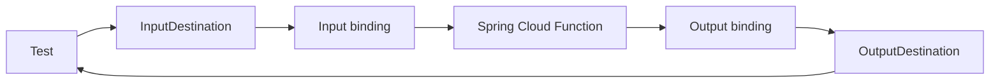
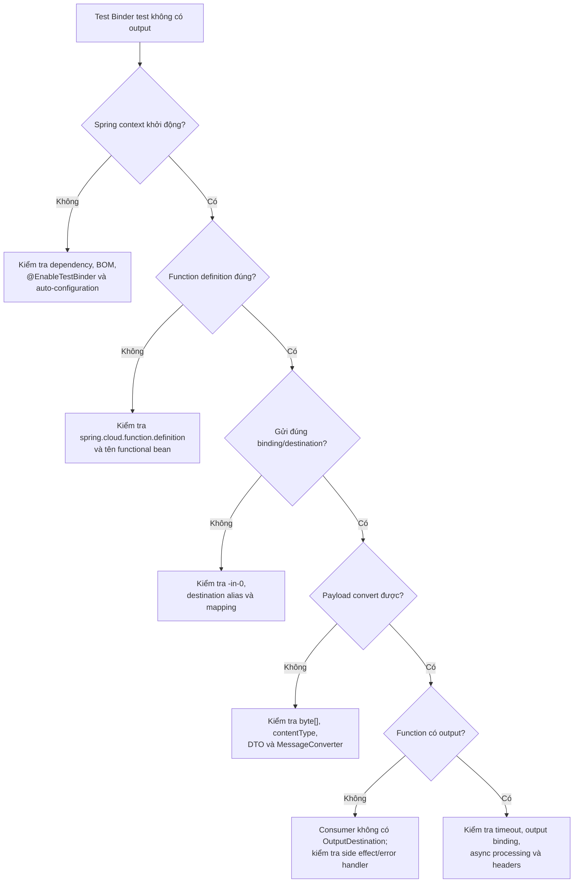

# Kiểm thử binder bằng Spring Cloud Stream Test Binder

**Chương:** Kiểm thử  
**Module:** Spring Cloud Function (`SPRING_CLOUD_FUNCTION`)

Spring Cloud Function cho phép viết nghiệp vụ bằng `Supplier`, `Function` và `Consumer`. Khi các function được kết nối với hệ thống message, Spring Cloud Stream chịu trách nhiệm liên kết input/output của function với destination bên ngoài thông qua binder. Để kiểm tra ứng dụng message-driven mà không cần cài Kafka, RabbitMQ hoặc kết nối broker thật, Spring Cloud Stream cung cấp **Spring Integration Test Binder**.

Test Binder chạy trong JVM và mô phỏng các destination bằng Spring Integration channel. Test có thể gửi một `Message<?>` vào `InputDestination`, để framework gọi function, rồi đọc message đầu ra từ `OutputDestination`. Cách này kiểm tra được một phần lớn đường đi của message trong ứng dụng: binding, function selection, conversion, header và output. Nó tạo cầu nối giữa unit test và integration test mà không cần network hoặc middleware thật.

Bài học này hướng dẫn cấu hình dependency, bật Test Binder theo API phiên bản, kiểm tra function một input/một output, nhiều function và destination tùy chỉnh, xác minh payload/header/content type, kiểm tra consumer và supplier, message bất đồng bộ, pollable source và giới hạn của Test Binder so với broker thật. Ta cũng phân biệt Test Binder mới với TestSupportBinder cũ, và những trường hợp cần integration test riêng.

## 1. Mục tiêu học tập

Sau bài học, bạn có thể:

1. Giải thích vai trò của binder trong Spring Cloud Stream.
2. Phân biệt Test Binder mới với TestSupportBinder cũ.
3. Thêm dependency `spring-cloud-stream-test-binder` đúng scope.
4. Bật Test Binder bằng API phù hợp với phiên bản Spring Cloud Stream.
5. Gửi và nhận message qua `InputDestination` và `OutputDestination`.
6. Kiểm tra function definition, binding name và destination tùy chỉnh.
7. Kiểm tra payload, content type, header và conversion.
8. Kiểm tra function, consumer, supplier và reactive function ở ranh giới binder.
9. Kiểm tra nhiều function/binding trong cùng ứng dụng.
10. Nhận biết giới hạn của Test Binder đối với broker, partition, consumer group, retry, DLQ và network.

## 2. Binder và Test Binder là gì?

Spring Cloud Stream cung cấp mô hình lập trình message-driven dựa trên functional bean của Spring Cloud Function. Một function có thể được kết nối với input/output binding; binder chịu trách nhiệm kết nối các binding đó tới middleware như Kafka hoặc RabbitMQ.

Ví dụ:

```text
Kafka topic / Rabbit exchange
          |
          v
     Input binding
          |
          v
    Function<String,String>
          |
          v
     Output binding
          |
          v
Kafka topic / Rabbit exchange
```

Trong production, binder cụ thể giao tiếp với broker. Trong test, **Spring Integration Test Binder** thay broker bằng các channel trong cùng JVM:



Test Binder dựa trên Spring Integration và đóng vai trò một message broker in-memory. Nó cho phép test ứng dụng qua abstraction của Spring Cloud Stream mà không cần broker thật. Đây là kiểm thử ứng dụng/binding trong JVM; không phải giả lập toàn bộ hành vi vận hành của Kafka hay RabbitMQ.

### 2.1. Test Binder mới và TestSupportBinder cũ

Hai thư viện có tên gần giống nhau nhưng API khác nhau:

| Đặc điểm | Spring Integration Test Binder | TestSupportBinder cũ |
| --- | --- | --- |
| Dependency | `spring-cloud-stream-test-binder` | `spring-cloud-stream-test-support` |
| Cách kiểm tra | `InputDestination` / `OutputDestination` | Bound channels / `MessageCollector` |
| Mục tiêu | Gần với binder API và integration flow hơn | Kiểm tra nhẹ các messaging component |
| Khuyến nghị | Dùng cho ứng dụng hiện đại | Chỉ dùng khi duy trì ứng dụng cũ |

**Không thêm cả hai dependency vào cùng một test suite theo thói quen.** Chúng có cơ chế auto-configuration và cách tương tác khác nhau. Nếu dự án cũ còn dùng `TestSupportBinder`, hãy giữ test tương thích với release hiện tại và lập kế hoạch chuyển đổi riêng.

### 2.2. Test Binder kiểm tra được điều gì?

- Function definition được chọn và binding được tạo.
- Message được gửi vào đúng input destination.
- Framework chuyển payload tới functional bean theo kiểu dữ liệu/content type.
- Function hoặc consumer xử lý message.
- Output message được gửi tới output destination.
- Payload và header sau khi xử lý có đúng hợp đồng.

Test Binder **không** kiểm tra kết nối broker, TLS, credentials, partition, consumer group, rebalance, offset hoặc network. Những hành vi này cần integration test với binder production và broker thật.

## 3. Chọn API theo phiên bản Spring Cloud Stream

API bật Test Binder đã thay đổi theo dòng phiên bản. Khi viết test, phải kiểm tra đúng tài liệu của dependency đã resolve.

| Dòng phiên bản | Cấu hình thường gặp | Ghi chú |
| --- | --- | --- |
| Spring Cloud Stream 5.1.x | `@EnableTestBinder` | API mới được tài liệu hiện hành dùng trong test class |
| Spring Cloud Stream 4.3.x | `@EnableTestBinder` | Có ví dụ tương tự trong reference 4.3 |
| Một số dòng cũ hơn | `@Import(TestChannelBinderConfiguration.class)` hoặc `getCompleteConfiguration(...)` | Dùng theo tài liệu release tương ứng |
| Spring Cloud Stream rất cũ | `spring-cloud-stream-test-support` + `MessageCollector` | API TestSupportBinder đã cũ |

Tài liệu stable hiện tại có ví dụ `@EnableTestBinder` cùng `@SpringBootTest`, `InputDestination` và `OutputDestination`. Một số tài liệu/ứng dụng cũ sử dụng `@Import(TestChannelBinderConfiguration.class)`. Không chép annotation từ một ví dụ cũ vào dự án mới nếu API hiện tại đã có cách bật đơn giản hơn; cũng không dùng `@EnableTestBinder` nếu artifact của dự án chưa cung cấp annotation đó.

Annotation `@EnableTestBinder` được bổ sung trong dòng Spring Cloud Stream 4.1.x; nếu ứng dụng đang ở release cũ hơn, hãy dùng đúng cách khởi tạo Test Binder mà phiên bản đó hỗ trợ.

### 3.1. Kiểm tra dependency đã resolve

Maven:

```bash
./mvnw dependency:tree -Dincludes=org.springframework.cloud:spring-cloud-stream,org.springframework.cloud:spring-cloud-stream-test-binder
```

Gradle:

```bash
./gradlew dependencyInsight --dependency spring-cloud-stream-test-binder --configuration testRuntimeClasspath
```

Đối chiếu phiên bản với Spring Cloud BOM và Spring Boot của dự án. Tránh ép một version Test Binder mới vào một ứng dụng đang dùng Spring Cloud release train cũ.

## 4. Thêm dependency Test Binder

Test Binder chỉ cần ở **test scope**:

**Maven:**

```xml
<dependency>
    <groupId>org.springframework.cloud</groupId>
    <artifactId>spring-cloud-stream-test-binder</artifactId>
    <scope>test</scope>
</dependency>
```

**Gradle Kotlin DSL:**

```kotlin
dependencies {
    testImplementation(
        "org.springframework.cloud:spring-cloud-stream-test-binder")
}
```

Nếu test dùng Spring Boot và JUnit Jupiter, dự án cũng cần dependency test phù hợp, thường là:

```kotlin
testImplementation("org.springframework.boot:spring-boot-starter-test")
```

Không đưa Test Binder vào production runtime chỉ để phục vụ test. Khi có Test Binder trên test classpath, Spring Cloud Stream có thể chọn binder này cho các test thay vì binder middleware thật; cần lưu ý khi cùng module còn có test Kafka/RabbitMQ.

## 5. Ứng dụng mẫu: Function<String,String>

Ta bắt đầu với function chuyển chuỗi thành chữ hoa:

**File:** `src/main/java/example/stream/UppercaseStreamApplication.java`

```java
package example.stream;

import java.util.Locale;
import java.util.function.Function;

import org.springframework.boot.SpringApplication;
import org.springframework.boot.autoconfigure.SpringBootApplication;
import org.springframework.context.annotation.Bean;

@SpringBootApplication
public class UppercaseStreamApplication {

    public static void main(String[] args) {
        SpringApplication.run(
            UppercaseStreamApplication.class, args);
    }

    @Bean
    public Function<String, String> uppercase() {
        return value -> value.toUpperCase(Locale.ROOT);
    }
}
```

Function có một input binding và một output binding. Theo quy ước, tên binding là:

```text
uppercase-in-0
uppercase-out-0
```

`uppercase` là tên functional bean; `in-0` là input đầu tiên và `out-0` là output đầu tiên.

## 6. Test Binder cơ bản với @EnableTestBinder

Với API hiện hành, đặt `@EnableTestBinder` trên một lớp cấu hình được Spring nạp vào test context. Để giữ application class production độc lập với Test Binder, ta tạo một `@TestConfiguration` riêng rồi import nó vào các test.

**File dùng chung:** `src/test/java/example/stream/StreamTestBinderConfiguration.java`

```java
package example.stream;

import org.springframework.boot.test.context.TestConfiguration;
import org.springframework.cloud.stream.binder.test.EnableTestBinder;

@TestConfiguration(proxyBeanMethods = false)
@EnableTestBinder
public class StreamTestBinderConfiguration {
}
```

Test dùng `@SpringBootTest` và `@Import(StreamTestBinderConfiguration.class)` để khởi tạo Spring context cùng Test Binder.

Các lớp test ví dụ trong phần tiếp theo giả định cùng package `example.stream`; nếu đặt ở package khác, import lớp `StreamTestBinderConfiguration` từ package đã khai báo.

**File:** `src/test/java/example/stream/UppercaseStreamTest.java`

```java
package example.stream;

import static org.junit.jupiter.api.Assertions.*;

import java.nio.charset.StandardCharsets;

import org.junit.jupiter.api.Test;
import org.springframework.beans.factory.annotation.Autowired;
import org.springframework.boot.test.context.SpringBootTest;
import org.springframework.cloud.stream.binder.test.InputDestination;
import org.springframework.cloud.stream.binder.test.OutputDestination;
import org.springframework.context.annotation.Import;
import org.springframework.messaging.MessageHeaders;
import org.springframework.messaging.support.MessageBuilder;
import org.springframework.util.MimeTypeUtils;

@SpringBootTest(
    classes = UppercaseStreamApplication.class,
    properties = "spring.cloud.function.definition=uppercase"
)
@Import(StreamTestBinderConfiguration.class)
class UppercaseStreamTest {

    @Autowired
    InputDestination input;

    @Autowired
    OutputDestination output;

    @Test
    void inputMessageIsConvertedProcessedAndPublished() {
        byte[] payload =
            "hello".getBytes(StandardCharsets.UTF_8);

        input.send(MessageBuilder.withPayload(payload)
            .setHeader(MessageHeaders.CONTENT_TYPE, MimeTypeUtils.TEXT_PLAIN)
            .build());

        Message<byte[]> result = output.receive(1000);

        assertNotNull(result);
        assertArrayEquals(
            "HELLO".getBytes(StandardCharsets.UTF_8),
            result.getPayload());
    }
}
```

Trong các dòng có annotation này, import `org.springframework.cloud.stream.binder.test.EnableTestBinder` vào lớp cấu hình test. Với release cũ chưa có annotation, dùng cách cấu hình Test Binder được tài liệu đúng release hướng dẫn, thường là `@Import(TestChannelBinderConfiguration.class)`.

### 6.1. Tại sao đặt spring.cloud.function.definition?

Khi ứng dụng chỉ có một function, framework đôi khi có thể chọn function đó theo cơ chế mặc định. Nhưng test nên khai báo tường minh:

```properties
spring.cloud.function.definition=uppercase
```

Điều này giúp test ổn định khi ứng dụng thêm function mới. Nếu không có definition rõ, việc lựa chọn function có thể thay đổi theo cấu hình hoặc số lượng bean đủ điều kiện.

### 6.2. Vì sao receive có timeout?

`OutputDestination.receive(...)` đọc message đã được publish tới output destination. Với xử lý đồng bộ, message có thể xuất hiện ngay; với flow bất đồng bộ hoặc scheduler, test cần đợi một khoảng thời gian có giới hạn. Dùng timeout tường minh giúp test thất bại có kiểm soát thay vì nhận `null` quá sớm hoặc chờ vô hạn.

Không dùng `Thread.sleep(...)` rồi gọi receive nếu API receive đã hỗ trợ timeout. Chỉ dùng cơ chế chờ có điều kiện khi test thật sự cần đồng bộ hóa với công việc bất đồng bộ.

## 7. Nhiều function trong một ứng dụng

Khi ứng dụng có nhiều function, hãy chỉ định definition và destination tường minh. Ví dụ:

```java
@SpringBootApplication
public class MultiFunctionApplication {

    @Bean
    Function<String, String> uppercase() {
        return value -> value.toUpperCase(Locale.ROOT);
    }

    @Bean
    Function<String, String> reverse() {
        return value -> new StringBuilder(value)
            .reverse().toString();
    }
}
```

Function `enrich` cần import `java.util.Locale`, `java.util.function.Function`, `org.springframework.messaging.Message`, `org.springframework.messaging.MessageHeaders`, `org.springframework.util.MimeTypeUtils` và `org.springframework.messaging.support.MessageBuilder`.

Test:

```java
package example.stream;

import static org.junit.jupiter.api.Assertions.*;

import java.nio.charset.StandardCharsets;

import org.junit.jupiter.api.Test;
import org.springframework.beans.factory.annotation.Autowired;
import org.springframework.boot.test.context.SpringBootTest;
import org.springframework.cloud.stream.binder.test.InputDestination;
import org.springframework.cloud.stream.binder.test.OutputDestination;
import org.springframework.context.annotation.Import;
import org.springframework.messaging.Message;
import org.springframework.messaging.MessageHeaders;
import org.springframework.messaging.support.MessageBuilder;
import org.springframework.util.MimeTypeUtils;

@SpringBootTest(
    classes = MultiFunctionApplication.class,
    properties = "spring.cloud.function.definition=uppercase;reverse"
)
@Import(StreamTestBinderConfiguration.class)
class MultiFunctionStreamTest {

    @Autowired
    InputDestination input;

    @Autowired
    OutputDestination output;

    @Test
    void sendsToEachNamedInputAndReadsMatchingOutput() {
        Message<byte[]> message = MessageBuilder
            .withPayload(
                "Hello".getBytes(StandardCharsets.UTF_8))
            .setHeader(MessageHeaders.CONTENT_TYPE, MimeTypeUtils.TEXT_PLAIN)
            .build();

        input.send(message, "uppercase-in-0");
        input.send(message, "reverse-in-0");

        Message<byte[]> upper =
            output.receive(1000, "uppercase-out-0");
        Message<byte[]> reversed =
            output.receive(1000, "reverse-out-0");

        assertNotNull(upper);
        assertNotNull(reversed);
        assertEquals("HELLO",
            new String(upper.getPayload(), StandardCharsets.UTF_8));
        assertEquals("olleH",
            new String(reversed.getPayload(), StandardCharsets.UTF_8));
    }
}
```

Trong trường hợp này, dấu chấm phẩy trong `spring.cloud.function.definition=uppercase;reverse` có nghĩa **hai definition độc lập** được bind riêng. Nó không tạo composition. Composition dùng dấu pipe:

```properties
spring.cloud.function.definition=uppercase|reverse
```

Khi đó chỉ có pipeline được chọn; input của bước đầu đi qua uppercase rồi reverse. Test cần gửi tới binding của definition đã cấu hình và xác minh output của toàn chuỗi.

### 7.1. Vì sao phải dùng tên binding?

`InputDestination.send(message)` và `OutputDestination.receive()` dùng destination mặc định. Khi có nhiều binding, tên rõ ràng tránh đọc nhầm output của function khác:

| Function | Input binding | Output binding |
| --- | --- | --- |
| `uppercase` | `uppercase-in-0` | `uppercase-out-0` |
| `reverse` | `reverse-in-0` | `reverse-out-0` |

Tên binding theo quy ước `<functionName>-in-0` và `<functionName>-out-0`. Nếu có nhiều input/output argument, chỉ số tăng tương ứng; hãy dùng binding name thực tế được framework tạo hoặc được ứng dụng cấu hình.

## 8. Destination tùy chỉnh

Binding name và destination là hai khái niệm khác nhau:

- **Binding name** là tên nội bộ Spring Cloud Stream dùng để cấu hình binding.
- **Destination** là tên logical của topic/queue/exchange mà binder production kết nối.

Ví dụ:

```properties
spring.cloud.function.definition=uppercase
spring.cloud.stream.bindings.uppercase-in-0.destination=orders-in
spring.cloud.stream.bindings.uppercase-out-0.destination=orders-out
```

Khi cấu hình destination như trên, Test Binder nhận/gửi theo tên destination:

```java
input.send(message, "orders-in");
Message<byte[]> result = output.receive(1000, "orders-out");
```

Test:

```java
import org.springframework.context.annotation.Import;

@SpringBootTest(
    classes = UppercaseStreamApplication.class,
    properties = {
        "spring.cloud.function.definition=uppercase",
        "spring.cloud.stream.bindings.uppercase-in-0.destination=orders-in",
        "spring.cloud.stream.bindings.uppercase-out-0.destination=orders-out"
    }
)
@Import(StreamTestBinderConfiguration.class)
class CustomDestinationTest {

    @Autowired
    InputDestination input;

    @Autowired
    OutputDestination output;

    @Test
    void usesConfiguredDestinationNames() {
        Message<byte[]> message = MessageBuilder
            .withPayload("hello".getBytes(StandardCharsets.UTF_8))
            .setHeader(MessageHeaders.CONTENT_TYPE, MimeTypeUtils.TEXT_PLAIN)
            .build();

        input.send(message, "orders-in");
        Message<byte[]> result = output.receive(1000, "orders-out");

        assertNotNull(result);
        assertEquals("HELLO",
            new String(result.getPayload(), StandardCharsets.UTF_8));
    }
}
```

Test class này cần import `org.springframework.context.annotation.Import`; `StreamTestBinderConfiguration` là lớp test config dùng chung ở mục 6.

Ví dụ CustomDestinationTest cần import `StandardCharsets`, `Message`, `MessageBuilder`, `MessageHeaders`, `MimeTypeUtils`, `InputDestination`, `OutputDestination`, `SpringBootTest`, `Import`, `Autowired` và JUnit.

Nếu không override destination, dùng binding name. Nếu có override, dùng destination đã cấu hình. Đây là nguyên nhân phổ biến khiến test không nhận được message dù function vẫn được đăng ký đúng.

## 9. Kiểm tra payload, content type và message headers

Test Binder hỗ trợ gửi một Spring `Message<?>` thay vì chỉ gửi byte array. Cách này cho phép kiểm tra cả payload và header.

### 9.1. Gửi JSON tới function nhận DTO

Ví dụ:

```java
public record Order(String id, int quantity) {}
public record OrderSummary(String id, boolean accepted) {}

@Bean
Function<Order, OrderSummary> validateOrder() {
    return order -> new OrderSummary(
        order.id(), order.quantity() > 0);
}
```

Test gửi JSON với content type rõ:

```java
Message<byte[]> message = MessageBuilder
    .withPayload("""
        {"id":"ORD-42","quantity":2}
        """.getBytes(StandardCharsets.UTF_8))
    .setHeader(MessageHeaders.CONTENT_TYPE, MimeTypeUtils.APPLICATION_JSON)
    .build();

input.send(message);
Message<byte[]> result = output.receive(1000);

assertNotNull(result);
String json = new String(result.getPayload(), StandardCharsets.UTF_8);
assertTrue(json.contains("\"id\":\"ORD-42\""));
assertTrue(json.contains("\"accepted\":true"));
```

Đoạn test cần import `MessageHeaders`, `MimeTypeUtils` và `MessageBuilder` từ Spring Messaging/Spring Core, cùng `InputDestination`, `OutputDestination` và các assertion JUnit.

Test này xác minh message converter có thể chuyển JSON thành DTO cho function và serialize output thành message. Nếu dự án dùng custom converter, hãy đưa converter vào Spring context và kiểm tra đúng MIME type.

Đoạn code DTO/function cần import `java.util.function.Function`, `org.springframework.context.annotation.Bean`, `org.springframework.messaging.MessageHeaders`, `org.springframework.util.MimeTypeUtils` và `org.springframework.messaging.support.MessageBuilder`.

### 9.2. Header đi cùng message

Function có thể nhận `Message<String>` và đọc header:

```java
@Bean
Function<Message<String>, Message<String>> enrich() {
    return input -> MessageBuilder
        .withPayload(input.getPayload().toUpperCase(Locale.ROOT))
        .setHeader("processed-by", "uppercase")
        .setHeader("correlation-id",
            input.getHeaders().get("correlation-id"))
        .setHeader(MessageHeaders.CONTENT_TYPE, MimeTypeUtils.TEXT_PLAIN)
        .build();
}
```

File `MultiFunctionApplication` cần import `java.util.Locale`, `java.util.function.Function`, `org.springframework.context.annotation.Bean` và `org.springframework.boot.autoconfigure.SpringBootApplication`.

Test:

```java
Message<String> message = MessageBuilder
    .withPayload("hello")
    .setHeader("correlation-id", "corr-42")
    .setHeader(MessageHeaders.CONTENT_TYPE, MimeTypeUtils.TEXT_PLAIN)
    .build();

input.send(message);
Message<byte[]> result = output.receive(1000);

assertNotNull(result);
assertEquals("HELLO",
    new String(result.getPayload(), StandardCharsets.UTF_8));
assertEquals("uppercase",
    result.getHeaders().get("processed-by"));
assertEquals("corr-42",
    result.getHeaders().get("correlation-id"));
```

Khi function trả một `Message<?>`, các header đầu ra thuộc message được publish. Framework cũng có quy tắc truyền tiếp hoặc lọc một số header; không mặc định mọi header đầu vào đều phải có ở output. Hãy assert những header thuộc hợp đồng ứng dụng.

Đoạn ví dụ header cần import `MessageHeaders`, `MimeTypeUtils` và `MessageBuilder`; đặt content type là `text/plain` để test tập trung vào header nghiệp vụ, không phụ thuộc JSON serialization của String.

### 9.3. Kiểm tra content type

Spring Cloud Stream dùng `MessageConverter` để chuyển payload. Content type có thể được lấy từ:

1. Header của message.
2. Binding property `spring.cloud.stream.bindings.<bindingName>.content-type`.
3. Giá trị mặc định `application/json`.

Ví dụ cấu hình:

```properties
spring.cloud.stream.bindings.uppercase-in-0.content-type=text/plain
spring.cloud.stream.bindings.uppercase-out-0.content-type=text/plain
```

Nếu test gửi payload dạng byte array nhưng function nhận `String`, hãy đảm bảo content type phù hợp. Khi conversion lỗi, kiểm tra exception/root cause và kiểu payload thực tế; không chỉ so sánh byte array output.

## 10. Kiểm thử Consumer và side effect

Consumer không trả output nghiệp vụ. Khi test một consumer binding, cần xác minh side effect qua collaborator hoặc recorder; không chờ `OutputDestination` có message nếu ứng dụng không tạo output binding.

**Ứng dụng mẫu:**

```java
@Bean
Consumer<String> audit(AuditRecorder recorder) {
    return recorder::record;
}
```

Recorder dùng trong test:

```java
public static class AuditRecorder {
    private final List<String> records =
        new CopyOnWriteArrayList<>();

    public void record(String value) {
        records.add(value);
    }

    public List<String> snapshot() {
        return List.copyOf(records);
    }

    public void clear() {
        records.clear();
    }
}
```

Test gửi message vào binding:

```java
@Test
void consumerReceivesInputAndPerformsSideEffect() {
    input.send(
        new GenericMessage<>("order-42"),
        "audit-in-0");

    await().atMost(Duration.ofSeconds(2))
        .untilAsserted(() ->
            assertEquals(
                List.of("order-42"),
                recorder.snapshot()));
}
```

Ví dụ sử dụng Awaitility:

```kotlin
testImplementation("org.awaitility:awaitility")
```

Trong Java test, thêm import `org.awaitility.Awaitility.await`, `java.time.Duration`, `java.util.List` và `java.util.concurrent.CopyOnWriteArrayList`.

Nếu consumer chạy trên listener thread, side effect có thể xảy ra sau khi `send(...)` trả về. Dùng Awaitility hoặc một cơ chế đồng bộ hóa có timeout để đợi điều kiện thay vì gọi `Thread.sleep(...)` với thời gian đoán trước. Đối với flow đồng bộ trong test binder, side effect có thể xuất hiện ngay, nhưng assertion có timeout vẫn rõ ràng và ổn định hơn.

Trong Java test, thêm import `org.awaitility.Awaitility.await`, `java.time.Duration`, `java.util.List` và `java.util.concurrent.CopyOnWriteArrayList`.

### 10.1. Reset recorder giữa các test

Nếu recorder là singleton Spring bean, hãy xóa trạng thái trong `@BeforeEach`:

```java
@BeforeEach
void reset() {
    recorder.clear();
}
```

Nếu test chạy song song, các phương thức test không nên dùng chung recorder mutable mà không cô lập. Có thể tách Spring context hoặc tắt parallel execution cho nhóm test dùng fixture chung.

### 10.2. Consumer lỗi không tạo output

Với consumer, test cần kiểm tra lỗi theo cơ chế adapter/error handling đang bật. Đừng khẳng định mọi exception từ consumer đều được ném trực tiếp về thread gọi `InputDestination.send(...)`; listener, error channel, retry và binder configuration có thể ảnh hưởng đường truyền lỗi.

Nếu cần test business exception đơn giản, unit test `consumer.accept(input)` trực tiếp. Nếu cần test error channel của Stream, cấu hình error handler/error destination cụ thể và kiểm tra nó bằng Test Binder theo API của phiên bản. Retry/DLQ của Kafka/Rabbit binder thật cần integration test riêng.

## 11. Kiểm thử Supplier và output binding

Supplier tạo dữ liệu cho output binding. Test Binder cho phép nhận message mà supplier phát ra thông qua `OutputDestination`.

**Supplier mẫu:**

```java
@Bean
Supplier<String> orderHeartbeat() {
    return () -> "heartbeat";
}
```

Để kiểm tra supplier, khai báo function definition:

```properties
spring.cloud.function.definition=orderHeartbeat
```

Supplier có thể được poll theo cấu hình của Spring Cloud Stream; test cần xác định cách kích hoạt poller và giới hạn số message. Không gọi `Supplier.get()` trực tiếp rồi kết luận binding output đã hoạt động. Test binder cần kiểm tra message thực sự đi tới output destination.

### 11.1. Kiểm thử supplier bằng poller

Ví dụ minh họa test cấu hình supplier và output binding. Cơ chế poll có thể khác theo phiên bản và cấu hình:

```java
@SpringBootTest(
    classes = HeartbeatApplication.class,
    properties = {
        "spring.cloud.function.definition=orderHeartbeat",
        "spring.cloud.stream.bindings.orderHeartbeat-out-0.producer.poller.fixed-delay=100"
    }
)
@Import(StreamTestBinderConfiguration.class)
@DirtiesContext(classMode = DirtiesContext.ClassMode.AFTER_CLASS)
class HeartbeatSupplierTest {

    @Autowired
    OutputDestination output;

    @Test
    void supplierPublishesToOutputBinding() {
        Message<byte[]> result = output.receive(3000);

        assertNotNull(result);
        assertEquals(
            "heartbeat",
            new String(result.getPayload(), StandardCharsets.UTF_8));
    }
}
```

Đây là ví dụ cho supplier imperative được poll. Property poller toàn cục `spring.cloud.stream.poller.*` đã deprecated từ Spring Cloud Stream 3.2; poller mặc định hiện dùng `spring.integration.poller.*`, còn ví dụ dùng property theo từng output binding để tránh cấu hình toàn cục. Hãy đối chiếu API poller với Spring Boot/Spring Cloud Stream release của dự án; không dùng test này cho reactive supplier `Supplier<Flux<T>>` mà không thiết kế kiểm thử lifecycle reactive tương ứng.

Test cần import `org.springframework.context.annotation.Import` và `org.springframework.test.annotation.DirtiesContext`; đóng context sau lớp test giúp dừng poller và tránh tiếp tục phát message khi Spring Test cache context. Test cũng dùng `StreamTestBinderConfiguration` đã khai báo ở mục 6.

Ví dụ cần import `java.util.function.Supplier`, `org.springframework.context.annotation.Bean`, `org.springframework.boot.test.context.SpringBootTest`, `org.springframework.context.annotation.Import`, `org.springframework.test.annotation.DirtiesContext`, `StreamTestBinderConfiguration`, `org.springframework.cloud.stream.binder.test.OutputDestination`, `org.springframework.messaging.Message`, `org.junit.jupiter.api.Test` và `java.nio.charset.StandardCharsets`.

### 11.2. Tránh supplier phát message không giới hạn trong test

Một supplier được poll liên tục có thể phát nhiều message trong lúc test chạy. Để test xác định:

- Dùng nguồn có số lần phát hữu hạn.
- Dùng recorder/counter để quan sát số lần supplier được gọi.
- Tắt poller hoặc đóng context ngay khi đã nhận message cần thiết.
- Đặt timeout cho receive.

Không dùng một supplier vô hạn mà không có cơ chế dừng, vì nó có thể khiến test suite khó ổn định.

## 12. Kiểm thử StreamBridge và destination động

Không phải message nào cũng đến từ input binding. Một ứng dụng có thể nhận HTTP request hoặc sự kiện từ nguồn ngoài, sau đó chủ động phát message bằng `StreamBridge`.

Ví dụ:

```java
@Bean
ApplicationRunner publisher(StreamBridge streamBridge) {
    return args -> streamBridge.send(
        "audit-out-0", "order-created");
}
```

Test Binder có thể kiểm tra output destination được tạo/bind và message đã gửi:

Nếu muốn kiểm tra payload String dạng text thuần, cấu hình output binding:

```properties
spring.cloud.stream.bindings.audit-out-0.content-type=text/plain
```

Ví dụ StreamBridge cần import `org.springframework.boot.ApplicationRunner` và `org.springframework.cloud.stream.function.StreamBridge`.

```java
Message<byte[]> result = output.receive(
    1000, "audit-out-0");

assertNotNull(result);
assertEquals(
    "order-created",
    new String(result.getPayload(), StandardCharsets.UTF_8));
```

Nếu ứng dụng khai báo output binding tường minh, dùng tên binding tương ứng. Nếu dùng destination động, cấu hình giới hạn destination hoặc binder phù hợp với ứng dụng để test không vô tình tạo destination ngoài ý muốn.

### 12.1. Test boolean trả về của StreamBridge

`StreamBridge.send(...)` trả boolean cho biết thao tác gửi đã được chấp nhận theo đường gửi tương ứng. Có thể kiểm tra cả kết quả trả về lẫn message ở output:

```java
boolean sent = streamBridge.send("audit-out-0", payload);
assertTrue(sent);
```

Tuy nhiên, `true` không chứng minh broker production đã persist message hoặc consumer đã nhận message. Test Binder chỉ xác minh đường gửi trong môi trường test binder.

## 13. Kiểm thử nhiều input/output và binding name

Một function có thể nhận nhiều input hoặc trả nhiều output tùy signature. Với những trường hợp đó, không nên dùng destination mặc định vì test có thể đọc nhầm message.

### 13.1. Hai function độc lập

Khi cấu hình:

```properties
spring.cloud.function.definition=uppercase;reverse
```

Test gửi từng message tới đúng input:

```java
input.send(message, "uppercase-in-0");
input.send(message, "reverse-in-0");
```

và nhận output tương ứng:

```java
Message<byte[]> upper =
    output.receive(1000, "uppercase-out-0");
Message<byte[]> reverse =
    output.receive(1000, "reverse-out-0");
```

### 13.2. Alias binding

Spring Cloud Stream cho phép đặt alias cho binding name bằng:

```properties
spring.cloud.stream.function.bindings.uppercase-in-0=input
spring.cloud.stream.function.bindings.uppercase-out-0=output
```

Khi đã alias, cấu hình binding và Test Binder cần dùng tên alias theo đúng mapping:

```java
input.send(message, "input");
Message<byte[]> result = output.receive(1000, "output");
```

Alias có thể làm test dễ đọc, nhưng cũng tăng số tên cần đồng bộ. Nếu không có lý do rõ ràng, giữ binding name mặc định sẽ đơn giản hơn.

### 13.3. Message không có output

Consumer không có output binding. Function có output binding; supplier có output binding nhưng không có input binding. Hãy đọc signature trước khi quyết định gọi `InputDestination` hoặc `OutputDestination`.

| Kiểu bean | Input binding | Output binding |
| --- | --- | --- |
| `Function<I,O>` | Có | Có |
| `Consumer<I>` | Có | Không |
| `Supplier<O>` | Không | Có |
| `Function<Flux<I>,Flux<O>>` | Có | Có |

Với function nhiều input/output hoặc reactive signature đặc biệt, binding count và tên cụ thể phụ thuộc signature. Hãy kiểm tra binding thực tế được framework đăng ký và test theo tên đó.

## 14. Kiểm thử lỗi và ErrorMessage

Khi imperative message handler (Function hoặc Consumer xử lý từng message) ném exception, Spring Cloud Stream chuyển lỗi về binder. Framework có thể retry message theo cấu hình; sau khi hết lượt retry, message đi theo chính sách error handling của ứng dụng hoặc binder.

Test Binder hữu ích để kiểm tra:

- Function có ném lỗi với input lỗi hay không.
- Error handler của ứng dụng có nhận được `ErrorMessage` hay không.
- Original message và nguyên nhân lỗi có được ghi nhận đúng không.

Tuy nhiên, Test Binder không chứng minh broker production sẽ requeue, commit offset hoặc gửi message vào DLQ giống hệt Kafka/RabbitMQ.

### 14.1. Đăng ký custom error handler

Spring Cloud Stream cho phép đăng ký một `Consumer<ErrorMessage>` làm error handler cho input binding:

```java
@Bean
Consumer<ErrorMessage> orderErrorHandler(ErrorRecorder recorder) {
    return error -> recorder.record(error);
}
```

Cấu hình:

```properties
spring.cloud.stream.bindings.uppercase-in-0.error-handler-definition=orderErrorHandler
```

Custom handler nhận `ErrorMessage` có thông tin về exception và message gốc gây lỗi. Khi viết test, kiểm tra:

1. Handler được gọi.
2. Payload lỗi/exception đúng loại.
3. Original message tương ứng với message đầu vào.
4. Không có output nghiệp vụ thành công ngoài dự kiến.

Ví dụ recorder:

```java
public class ErrorRecorder {
    private final List<ErrorMessage> errors =
        new CopyOnWriteArrayList<>();

    public void record(ErrorMessage message) {
        errors.add(message);
    }

    public List<ErrorMessage> snapshot() {
        return List.copyOf(errors);
    }

    public void clear() {
        errors.clear();
    }
}
```

Recorder cần import `java.util.List`, `java.util.concurrent.CopyOnWriteArrayList` và `org.springframework.messaging.support.ErrorMessage`.

### 14.2. Cấu hình custom error handler trong test

```java
@SpringBootTest(
    classes = FailingStreamApplication.class,
    properties = {
        "spring.cloud.function.definition=uppercase",
        "spring.cloud.stream.bindings.uppercase-in-0.error-handler-definition=orderErrorHandler"
    }
)
@Import(StreamTestBinderConfiguration.class)
class StreamErrorHandlerTest {

    @Autowired
    InputDestination input;

    @Autowired
    ErrorRecorder errors;

    @BeforeEach
    void reset() {
        errors.clear();
    }

    @Test
    void handlerReceivesErrorForFailedMessage() {
        input.send(new GenericMessage<>("bad"), "uppercase-in-0");

        await().atMost(Duration.ofSeconds(2))
            .untilAsserted(() -> assertEquals(1, errors.snapshot().size()));

        ErrorMessage error = errors.snapshot().get(0);
        assertNotNull(error.getPayload());
        assertNotNull(error.getOriginalMessage());
        assertEquals("bad", error.getOriginalMessage().getPayload());
    }
}
```

Fixture `FailingStreamApplication` cần có function `uppercase` ném lỗi khi nhận chuỗi `"bad"` và bean `ErrorRecorder`. Ví dụ này tập trung vào **custom application error handler**; không khẳng định Test Binder mô phỏng retry/DLQ của từng broker.

Lớp test cần import JUnit `@BeforeEach`/`@Test`, `InputDestination`, `StreamTestBinderConfiguration`, `Import`, `ErrorMessage`, `GenericMessage`, `Duration` và Awaitility. Đảm bảo function thực sự được bind bằng definition `uppercase` và error-handler property trỏ đúng tên bean.

### 14.3. Custom error handler và DLQ không tự chạy cùng nhau

Custom error handler của ứng dụng thay thế cơ chế error handler mặc định tương ứng; tài liệu Spring Cloud Stream lưu ý khi dùng custom handler, cơ chế gửi failed message tới DLQ có thể không còn được áp dụng như trước. Vì vậy:

- Nếu cần xử lý nghiệp vụ trong app, test `Consumer<ErrorMessage>`.
- Nếu cần broker-specific DLQ, test binder thật tương ứng với broker.
- Nếu cần cả hai, thiết kế luồng xử lý rõ ràng và test từng ranh giới.

Không assert một message đã xuất hiện trong DLQ Kafka/Rabbit chỉ bằng `OutputDestination`. Test Binder không tạo topic/queue DLQ production.

## 15. Kiểm thử retry ở mức ứng dụng

Spring Cloud Stream hỗ trợ retry cho imperative message handler. Có thể cấu hình số lần thử qua binding property:

```properties
spring.cloud.stream.bindings.uppercase-in-0.consumer.max-attempts=3
```

`max-attempts=3` nghĩa là tối đa ba lần xử lý bao gồm lần đầu, theo retry policy của framework. Có thể đếm số lần gọi bằng recorder:

```java
@Bean
Function<String, String> uppercase(AttemptRecorder recorder) {
    return value -> {
        int attempt = recorder.increment();
        if ("temporary".equals(value) && attempt < 3) {
            throw new IllegalStateException("try again");
        }
        return value.toUpperCase(Locale.ROOT);
    };
}
```

Một implementation test-only tối thiểu:

```java
static final class AttemptRecorder {
    private final AtomicInteger count = new AtomicInteger();

    int increment() {
        return count.incrementAndGet();
    }

    int value() {
        return count.get();
    }

    void reset() {
        count.set(0);
    }
}
```

Đặt recorder trong test configuration hoặc test fixture, inject cùng function và gọi `reset()` trước mỗi test. Class cần import `java.util.concurrent.atomic.AtomicInteger`.

Test:

```java
@Test
void retriesImperativeHandlerAndEventuallyPublishesOutput() {
    input.send(new GenericMessage<>("temporary"), "uppercase-in-0");

    Message<byte[]> result = output.receive(3000, "uppercase-out-0");

    assertNotNull(result);
    assertEquals("TEMPORARY",
        new String(result.getPayload(), StandardCharsets.UTF_8));
    assertEquals(3, attempts.value());
}
```

Đây là mẫu kiểm tra retry của **imperative handler**. Trong fixture thực tế, cần reset counter trước test và bảo đảm chỉ có một message được gửi. Retry có thể dùng backoff; hãy tránh chờ bằng `Thread.sleep(...)` và dùng timeout/assertion có điều kiện.

`AttemptRecorder` là test collaborator có phương thức `increment()` tăng bộ đếm thread-safe và `value()` trả số lần gọi hiện tại; reset bộ đếm trước mỗi test. Đoạn function cần import `java.util.Locale` và `java.util.function.Function`.

### 15.1. Không áp dụng retry template của imperative handler cho reactive function

Spring Cloud Stream phân biệt message handler imperative với reactive function. Reactive function nhận publisher và tự quản lý error signal; retry nên được thiết kế bằng Reactor operator như `retryWhen(...)` trong pipeline. Không mặc định `consumer.max-attempts` của binder tạo lại từng phần tử reactive như một imperative message listener.

### 15.2. Test Binder không kiểm tra delivery semantics của broker

Test Binder có thể giúp kiểm tra function được gọi, output được phát và một số logic retry/error handling của framework. Nó không kiểm tra:

- Kafka offset được commit ở thời điểm nào.
- Rabbit delivery tag, ack/nack hoặc requeue.
- Consumer restart và redelivery sau process crash.
- DLQ được tạo, bind và persist ở broker.
- Exactly-once hoặc at-least-once semantics qua network.

Những điều này phụ thuộc binder production và broker thật. Cần integration test riêng với Kafka/RabbitMQ hoặc môi trường staging.

## 16. Kiểm thử PollableMessageSource

Ngoài consumer event-driven, Spring Cloud Stream hỗ trợ `PollableMessageSource` để ứng dụng chủ động gọi `poll(...)`. Test Binder cũng hỗ trợ cách này.

Polling không tự xảy ra chỉ vì bean `PollableMessageSource` tồn tại. Ứng dụng phải quyết định poll bao lâu một lần, chạy ở thread nào và xử lý khi không có message.

Ví dụ logic:

```java
boolean received = source.poll(message -> {
    String value = (String) message.getPayload();
    streamBridge.send("processed-out-0", value.toUpperCase(Locale.ROOT));
});
```

Kết quả `true` nghĩa là poll đã lấy được message; `false` nghĩa là hiện không có message. Handler chỉ chạy khi poll nhận được message.

### 16.1. MessageSource mặc định của Test Binder

Test Binder có thể cung cấp một `MessageSource` mặc định cho pollable source, thường phát payload kiểm thử `"POLLED DATA"`. Nếu cần dữ liệu riêng, đăng ký bean `MessageSource<?>` trong test configuration:

```java
@Bean
MessageSource<?> testOrderSource() {
    AtomicInteger sequence = new AtomicInteger();
    return () -> new GenericMessage<>(
        "order-" + sequence.incrementAndGet());
}
```

Không đặt tên bean này là `messageSource` vì Spring Boot có thể đã có bean cùng tên nhưng kiểu khác.

Bean nguồn tùy chỉnh cần import `org.springframework.integration.core.MessageSource`, `java.util.concurrent.atomic.AtomicInteger` và `org.springframework.messaging.support.GenericMessage`.

### 16.2. Test pollable source có giới hạn

Test pollable source nên:

1. Tạo context với property `spring.cloud.stream.pollable-source=myDestination`.
2. Inject `PollableMessageSource` theo binding qualifier phù hợp.
3. Gọi `poll(...)` tường minh.
4. Xác minh payload nhận được và side effect/output.
5. Đóng context hoặc dừng poller sau số lần cần kiểm tra.

Ví dụ kiểm tra một lần poll:

```java
@Autowired
PollableMessageSource source;

@Test
void pollReadsOneMessageFromTestSource() {
    AtomicReference<String> received = new AtomicReference<>();

    boolean found = source.poll(message ->
        received.set((String) message.getPayload()));

    assertTrue(found);
    assertEquals("order-1", received.get());
}
```

Đây là ví dụ khi đã đăng ký `MessageSource<?>` tùy chỉnh ở mục 16.1 để phát `order-1` ở lần poll đầu. Khi chỉ có một pollable source, có thể inject theo kiểu; nếu có nhiều source, dùng qualifier tương ứng binding name. Test cần import `org.springframework.cloud.stream.binder.PollableMessageSource`, `org.springframework.beans.factory.annotation.Autowired`, `java.util.concurrent.atomic.AtomicReference` và JUnit.

Nếu test dùng `ApplicationRunner` và scheduler để poll liên tục, hãy giữ handle dừng tác vụ và chờ có timeout. Không để một thread poll vô hạn chạy qua các test khác.

## 17. Kiểm thử reactive function qua Test Binder

Spring Cloud Stream hỗ trợ reactive function như:

```java
@Bean
Function<Flux<String>, Flux<String>> uppercaseFlux() {
    return flux -> flux.map(
        value -> value.toUpperCase(Locale.ROOT));
}
```

Với reactive function, framework kết nối publisher của binding với publisher do function trả về. Test Binder giúp kiểm tra message stream ở ranh giới binding; còn quy tắc phát signal, lỗi, cancellation và backpressure của publisher nên được kiểm tra riêng bằng `StepVerifier`.

Phân biệt:

| Test | Điều chứng minh |
| --- | --- |
| `StepVerifier.create(function.apply(inputFlux))` | Reactive pipeline phát đúng signal và phần tử |
| Test Binder + Input/OutputDestination | Binding đưa message vào reactive function và nhận output |
| Kafka/Rabbit integration test | Broker thực xử lý message theo binder configuration |

Không suy ra cancellation/backpressure production chỉ từ Test Binder. In-memory channels có thể không thể hiện đúng scheduling, buffering hoặc demand như broker thật.

## 18. Giới hạn của Test Binder và khi nào cần broker thật

Test Binder là công cụ hữu ích, nhưng không phải broker emulator đầy đủ. Hãy dùng đúng phạm vi của nó.

| Năng lực | Test Binder | Broker thật |
| --- | --- | --- |
| Function selection và binding creation | Có | Có |
| Message payload và conversion | Có | Có |
| Input/output destination trong JVM | Có | Có |
| Header mapping trong message | Có | Có, phụ thuộc binder |
| Kafka partition assignment | Không | Có |
| Consumer group/rebalance | Không | Có |
| Offset commit và replay | Không | Có |
| Rabbit ack/nack/requeue | Không mô phỏng đầy đủ | Có |
| Network/TLS/credentials | Không | Có |
| Broker persistence và durability | Không | Có |
| Broker-specific retry/DLQ | Không chứng minh được | Có |

### 18.1. Không trộn Test Binder và binder production trong cùng module test

Khi Test Binder nằm trên test classpath, Spring Cloud Stream có thể chọn nó cho những binding cần binder trong test. Vì vậy, nếu cùng module có test cần Kafka/Rabbit thật, các test đó có nguy cơ vô tình dùng in-memory binder.

Khuyến nghị:

- Nhóm test nhanh dùng Test Binder trong module test chính.
- Nhóm integration test cần broker thật nên tách module hoặc cấu hình classpath/test profile rõ ràng.
- Không giả định chỉ thêm Kafka binder là test tự dùng Kafka khi Test Binder cũng có mặt.

### 18.2. Khi nào dùng Testcontainers hoặc môi trường broker thật?

Dùng broker thật khi cần xác minh:

- Topic/queue/exchange được tạo và bind đúng.
- Consumer group và concurrency hoạt động như mong đợi.
- Partition key, partition assignment hoặc ordering.
- Offset, acknowledgment, redelivery và requeue.
- TLS, authentication, network policy và credentials.
- DLQ, retry hoặc dead-letter routing theo cấu hình broker.

Testcontainers có thể khởi động Kafka/RabbitMQ tạm thời cho integration test. Đây là một tầng test khác với Test Binder; không cần thay mọi Test Binder test bằng broker thật.

## 19. Chẩn đoán khi Test Binder không nhận được message



| Triệu chứng | Nguyên nhân thường gặp | Hướng xử lý |
| --- | --- | --- |
| Không tìm thấy `InputDestination` | Test Binder chưa được bật hoặc dependency sai | Kiểm tra test binder artifact và annotation/configuration |
| Không tìm thấy `OutputDestination` | Context không có output binding hoặc binder config chưa nạp | Kiểm tra functional signature và auto-configuration |
| Test khởi động nhưng output là `null` | Chưa có message, sai destination hoặc xử lý async | Kiểm tra send target, timeout và function definition |
| Function không được gọi | Sai definition hoặc input binding name | Kiểm tra `spring.cloud.function.definition` và `-in-0` |
| Output nhận nhầm function | Dùng destination mặc định khi có nhiều binding | Gửi/nhận với tên cụ thể |
| Payload là byte[] thay vì DTO | Content type/target type không phù hợp | Đặt header/property content type và kiểm tra converter |
| Header bị mất | Function tạo message mới hoặc header bị lọc | Kiểm tra output Message và header propagation |
| Consumer test chờ output mãi | Consumer không có output binding | Assert recorder/side effect thay vì OutputDestination |
| Consumer side effect chưa xuất hiện | Listener xử lý bất đồng bộ | Dùng Awaitility hoặc synchronization có timeout |
| Retry count không đúng | Property đặt sai binding hoặc exception không retryable | Kiểm tra max-attempts và retryable exceptions |
| Error handler không được gọi | Sai error-handler-definition hoặc binding name | Kiểm tra property của input binding và Consumer<ErrorMessage> |
| Test Binder chạy thay Kafka test | Test binder nằm trên test classpath | Tách test module/classpath cho broker thật |
| Pollable source luôn trả false | Không có source message hoặc poller chưa cấu hình | Kiểm tra pollable-source và MessageSource fixture |

### 19.1. Checklist trước khi sửa code function

1. Xác minh test binder dependency được resolve đúng phiên bản.
2. Xác minh `@EnableTestBinder` hoặc cấu hình Test Binder tương ứng đã được nạp.
3. Xác minh `spring.cloud.function.definition`.
4. Xác minh binding name và destination alias.
5. Xác minh message payload, content type và headers.
6. Xác minh function có output hay là Consumer.
7. Xác minh output receive có timeout đủ cho flow bất đồng bộ.
8. Chỉ sau đó mới kiểm tra logic nghiệp vụ của function.

## 20. Ma trận kiểm thử đề xuất

| ID | Trường hợp | Công cụ | Kỳ vọng |
| --- | --- | --- | --- |
| TB01 | Function một input/output | InputDestination + OutputDestination | Payload được biến đổi đúng |
| TB02 | Nhiều function độc lập | Destination name tường minh | Output đúng function |
| TB03 | Function composition | Definition dùng `|` | Các bước chạy đúng thứ tự |
| TB04 | Destination tùy chỉnh | Binding destination property | Gửi/nhận bằng destination đã cấu hình |
| TB05 | JSON → DTO | Content-Type application/json | Converter tạo đúng kiểu |
| TB06 | Function nhận Message | Message headers | Header và payload đúng |
| TB07 | Function trả Message | Output Message | Header đầu ra đúng |
| TB08 | Consumer | Recorder/Awaitility | Side effect đúng, không đòi output |
| TB09 | Supplier | OutputDestination | Message được poll và publish |
| TB10 | StreamBridge | OutputDestination | Message gửi tới output/destination |
| TB11 | Error handler | Consumer<ErrorMessage> | Lỗi và original message được ghi nhận |
| TB12 | Retry imperative | AttemptRecorder | Số lần thử đúng cấu hình |
| TB13 | PollableMessageSource | poll() + MessageSource | Message được lấy và xử lý |
| TB14 | Reactive function | Test Binder + StepVerifier | Binding và publisher output đúng |
| TB15 | Kafka/Rabbit production | Testcontainers/broker thật | Network, partition, ack, DLQ theo broker |

TB01–TB10 là các ca thường phù hợp với Test Binder. TB11–TB14 cần fixture/cấu hình cụ thể và kiểm tra theo release. TB15 là integration test với binder production; không thực hiện bằng Test Binder.

## 21. Cách chạy test

Chạy một lớp test với Maven Wrapper:

```bash
./mvnw -Dtest=UppercaseStreamTest test
```

Chạy nhóm test Stream:

```bash
./mvnw -Dtest=UppercaseStreamTest,MultiFunctionStreamTest,CustomDestinationTest test
```

Với Gradle Wrapper:

```bash
./gradlew test --tests "example.stream.UppercaseStreamTest"
```

Chạy tất cả test của package:

```bash
./gradlew test --tests "example.stream.*"
```

Đây là lệnh hướng dẫn người học. Bài viết không chạy Maven, Gradle hoặc broker thật trong quá trình biên soạn.

## 22. Bài tập thực hành và câu hỏi phỏng vấn

### 22.1. Bài tập

1. **Function cơ bản:** tạo `Function<String,String>` và xác minh input/output bằng Test Binder.
2. **Nhiều function:** đăng ký `uppercase` và `reverse`, gửi tới hai input binding riêng và kiểm tra hai output.
3. **Composition:** thay definition bằng `uppercase|reverse` và so sánh với hai definition độc lập dùng dấu chấm phẩy.
4. **Destination tùy chỉnh:** ánh xạ input/output sang topic name riêng và dùng tên đó trong Test Binder.
5. **DTO conversion:** gửi JSON có content type rõ ràng tới function nhận record/POJO.
6. **Header:** gửi correlation ID và kiểm tra function trả lại header theo hợp đồng.
7. **Consumer:** tạo fake recorder và kiểm tra side effect bằng Awaitility.
8. **Supplier:** cấu hình poller có giới hạn và xác minh output được publish.
9. **StreamBridge:** phát message tới output binding/destination động rồi nhận lại bằng OutputDestination.
10. **Error handler:** đăng ký `Consumer<ErrorMessage>` và xác minh original message cùng exception.
11. **Retry:** tạo function thất bại hai lần rồi thành công; đếm attempts và kiểm tra output.
12. **Pollable source:** đăng ký `MessageSource<?>` fixture, gọi `PollableMessageSource.poll(...)` và kiểm tra output.
13. **Reactive:** kiểm tra binding reactive bằng Test Binder và pipeline bằng StepVerifier.
14. **Broker thật:** chạy Kafka hoặc RabbitMQ bằng Testcontainers để xác minh một hành vi mà Test Binder không mô phỏng.
15. **Test isolation:** chạy song song test dùng chung recorder, sau đó tách fixture để tránh trạng thái rò rỉ.

### 22.2. Câu hỏi phỏng vấn

**Hỏi:** Spring Integration Test Binder là gì?

**Đáp:** Đây là binder dành cho kiểm thử, dựa trên Spring Integration và mô phỏng destination trong JVM. Nó cho phép gửi/nhận message qua abstraction của Spring Cloud Stream mà không cần broker thật.

**Hỏi:** Tại sao dependency Test Binder phải ở test scope?

**Đáp:** Test Binder thay thế binder middleware trong quá trình test. Đưa nó vào production runtime có thể làm ứng dụng chọn sai binder và không kết nối broker dự kiến.

**Hỏi:** `InputDestination` và `OutputDestination` dùng để làm gì?

**Đáp:** `InputDestination` gửi message vào input binding; `OutputDestination` đọc message được publish từ output binding. Cả hai hỗ trợ chọn destination tường minh khi ứng dụng có nhiều binding.

**Hỏi:** Dấu pipe và dấu chấm phẩy trong function definition khác nhau thế nào?

**Đáp:** Dấu pipe tạo function composition theo thứ tự. Dấu chấm phẩy liệt kê nhiều function definition độc lập để bind riêng.

**Hỏi:** Test Binder có kiểm tra được Kafka partition hoặc consumer group không?

**Đáp:** Không. Test Binder chạy trong JVM và không mô phỏng network, partition assignment, consumer group, rebalance hoặc offset. Những phần đó cần integration test với Kafka binder thật.

**Hỏi:** Tại sao Consumer không có output để nhận?

**Đáp:** `Consumer.accept(...)` không trả kết quả nghiệp vụ và không tạo output binding. Test Consumer cần kiểm tra side effect, collaborator hoặc error handling.

**Hỏi:** Test Binder có thay thế DLQ test không?

**Đáp:** Không. DLQ phụ thuộc binder production và khả năng của broker. Test Binder có thể kiểm tra custom error handler trong ứng dụng, nhưng không chứng minh message được persist vào Kafka/Rabbit DLQ.

## 23. Tổng kết

- Spring Cloud Stream Test Binder là Spring Integration based in-JVM broker cho phép kiểm thử message flow mà không cần Kafka/RabbitMQ.
- Thêm `spring-cloud-stream-test-binder` ở test scope và bật bằng `@EnableTestBinder` hoặc cấu hình đúng theo release.
- Dùng `InputDestination` để gửi message và `OutputDestination` để nhận output; khi có nhiều binding, luôn chỉ định tên.
- Kiểm tra function definition, payload, content type, headers và conversion; Consumer cần assertion side effect thay vì output.
- Supplier, StreamBridge và PollableMessageSource cần kiểm tra đúng cách kích hoạt/publish.
- Error handler và retry của imperative function có thể được kiểm tra ở mức ứng dụng; DLQ, ack, requeue và broker delivery semantics cần binder thật.
- Test Binder không thay thế integration test với middleware production; không trộn Test Binder và binder thật trong cùng module test nếu chúng cạnh tranh auto-configuration.
- Chọn API bật Test Binder theo phiên bản Spring Cloud Stream đã resolve; không sao chép annotation/dependency từ release khác.

### Tài liệu tham khảo

- [Spring Cloud Stream — Testing / Spring Integration Test Binder](https://docs.spring.io/spring-cloud-stream/reference/spring-cloud-stream/spring_integration_test_binder.html): Test Binder, `@EnableTestBinder`, `InputDestination`, `OutputDestination`, nhiều binding, destination tùy chỉnh và PollableMessageSource.
- [Spring Cloud Stream — Functional Binding Names](https://docs.spring.io/spring-cloud-stream/reference/spring-cloud-stream/functional-binding-names.html): quy ước tên binding và alias.
- [Spring Cloud Stream — Content Type Negotiation](https://docs.spring.io/spring-cloud-stream/reference/spring-cloud-stream/content-type.html): message converter, content type và conversion.
- [Spring Cloud Stream — Error Handling](https://docs.spring.io/spring-cloud-stream/reference/spring-cloud-stream/overview-error-handling.html): retry, custom error handler, ErrorMessage và DLQ.
- [Spring Cloud Stream — Producing and Consuming Messages](https://docs.spring.io/spring-cloud-stream/reference/spring-cloud-stream/producing-and-consuming-messages.html): function binding, StreamBridge, reactive function và pollable consumer.
- [Spring Cloud Stream 4.3 Reference](https://docs.spring.io/spring-cloud-stream/reference/4.3/spring-cloud-stream.html): đối chiếu API stable 4.3.
- [Spring Cloud Stream 5.1 Reference](https://docs.spring.io/spring-cloud-stream/reference/5.1/spring-cloud-stream.html): đối chiếu API dòng 5.1.
