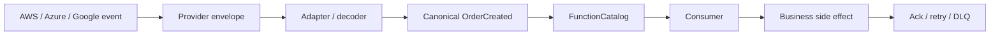
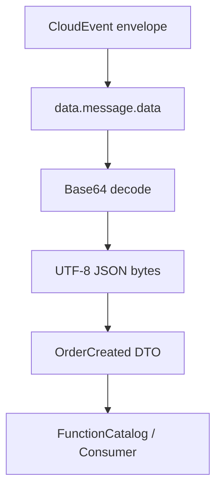
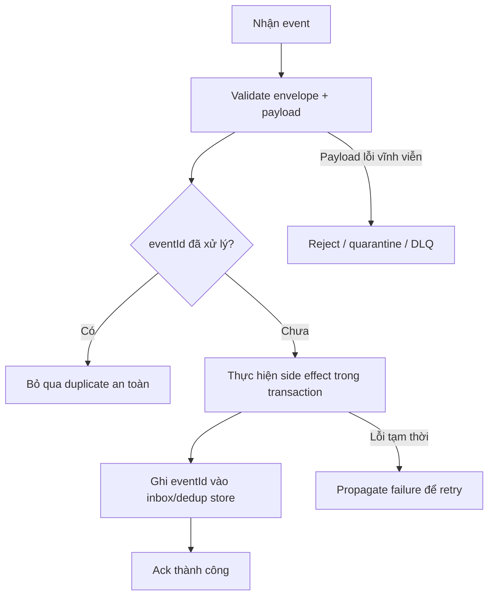
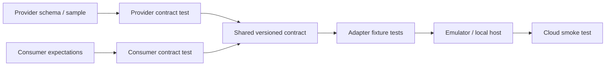

# Kiểm thử hợp đồng sự kiện AWS, Azure và Google Cloud

## Mục tiêu học tập

Spring Cloud Function cho phép xây dựng logic nghiệp vụ dưới dạng `Supplier<O>`, `Function<I,O>` và `Consumer<I>`, đăng ký trong Spring context rồi tra cứu bằng `FunctionCatalog`. Logic đó có thể được tái sử dụng qua HTTP, message hoặc môi trường serverless. Tuy nhiên, **mỗi nhà cung cấp cloud có hợp đồng sự kiện riêng**: cấu trúc envelope, metadata, cách mã hóa payload, batch, acknowledgement và retry đều có thể khác nhau.

Bài này sử dụng cùng một sự kiện nghiệp vụ **`OrderCreated`** để kiểm thử ba hệ sinh thái:

- **AWS:** SQS event source mapping và EventBridge event; phân biệt Lambda event envelope với nội dung message.
- **Microsoft Azure:** Event Grid schema và CloudEvents 1.0; nhận biết sự khác nhau với message từ Service Bus/Event Hubs.
- **Google Cloud:** Pub/Sub được chuyển qua Eventarc dưới dạng CloudEvent; giải mã `message.data` Base64 và phân biệt với background event kiểu cũ.

Sau bài học, bạn có thể:

1. Phân biệt **business contract**, **provider transport contract**, **adapter contract** và **function contract**.
2. Thiết kế một domain event chuẩn, version hóa schema và kiểm tra backward/forward compatibility.
3. Tạo fixture đại diện cho AWS SQS/EventBridge, Azure Event Grid/CloudEvents và Google Pub/Sub CloudEvent.
4. Viết decoder/mapper từ envelope của từng provider sang cùng một domain model.
5. Kiểm thử Spring Cloud Function qua `FunctionCatalog`, composition và `Consumer`.
6. Kiểm tra batch, retry, duplicate, dead-letter, ordering và idempotency theo semantics của từng nền tảng.
7. Kết hợp unit test, contract test, emulator/local runtime và smoke test trên cloud.

**Phạm vi:** ví dụ dùng Java, JUnit 5 và Jackson để minh họa cách kiểm thử. Các adapter của Spring Cloud Function, AWS Lambda, Azure Functions và Google Functions Framework có thể nhận kiểu Java khác nhau tùy phiên bản và trigger. Không giả định một adapter tự chuyển mọi envelope thành cùng một DTO nếu chưa kiểm tra contract thực tế.

## 1. Vì sao phải kiểm thử hợp đồng sự kiện?

Một message có thể được publish thành công nhưng consumer vẫn xử lý sai vì:

- Provider gửi envelope khác với JSON mà ứng dụng mong đợi.
- Payload nằm trong `body`, `detail`, `data` hoặc `message.data`, không phải root object.
- Payload được mã hóa Base64 hoặc chuyển thành bytes.
- Một lần gọi chứa một event, một mảng event hoặc batch nhiều record.
- Metadata định tuyến, event ID, source, timestamp hoặc schema version bị mất khi chuyển đổi.
- Adapter chọn sai bean, sai generic type hoặc sai function definition.
- Retry/batch semantics khiến một event được giao nhiều lần hoặc một phần batch thất bại.
- Schema được producer nâng cấp nhưng consumer cũ không đọc được.

**Contract test** xác nhận một bên phát và một bên nhận thống nhất về cấu trúc, kiểu dữ liệu và ý nghĩa của thông điệp. Với event-driven system, nên kiểm thử ít nhất bốn lớp:

| Lớp hợp đồng | Câu hỏi cần trả lời | Ví dụ |
| --- | --- | --- |
| **Domain contract** | Sự kiện nghiệp vụ có nghĩa gì? | `OrderCreated(orderId, quantity)` |
| **Provider/transport contract** | Cloud gửi event theo envelope nào? | SQS `Records[].body`, EventBridge `detail`, Eventarc CloudEvent |
| **Adapter contract** | Handler chuyển event thành kiểu Java nào? | `CloudEventsFunction.accept(CloudEvent)`, AWS Lambda event DTO |
| **Function contract** | Logic ứng dụng nhận gì và tạo side effect nào? | `Consumer<OrderCreated>` lưu đơn hàng |



Một unit test gọi trực tiếp `Consumer.accept(...)` chỉ xác minh lớp nghiệp vụ. Nó **không** xác nhận SQS record, Azure Event Grid event hay Google CloudEvent được parse đúng. Ngược lại, test một fixture JSON chỉ xác minh decoder nếu chưa chạy tới function và side effect.

## 2. Thiết kế domain event chuẩn độc lập provider

Không nên để logic nghiệp vụ phụ thuộc vào `SQSEvent.SQSMessage`, Azure Event Grid SDK type hoặc Google CloudEvent SDK type. Thay vào đó, định nghĩa **một domain event** mà cả ba adapter có thể tạo ra.

### 2.1. Hợp đồng nghiệp vụ

Ví dụ event `OrderCreated`:

```json
{
  "eventId": "evt-order-001",
  "eventType": "com.example.orders.created.v1",
  "source": "orders-service",
  "occurredAt": "2026-11-24T09:30:00Z",
  "schemaVersion": "1.0",
  "data": {
    "orderId": "ORD-42",
    "quantity": 2
  }
}
```

Ý nghĩa:

- `eventId`: ID ổn định để trace và hỗ trợ idempotency.
- `eventType`: loại sự kiện nghiệp vụ có version.
- `source`: hệ thống tạo event theo quy ước của ứng dụng.
- `occurredAt`: thời điểm nghiệp vụ xảy ra, không nhất thiết là thời điểm broker giao message.
- `schemaVersion`: version của payload do domain owner quản lý.
- `data`: phần dữ liệu nghiệp vụ.

Với CloudEvents, cặp **`source` + `id`** định danh event; nếu lưu khóa chống trùng cho nhiều nguồn, hãy dùng cặp này hoặc ánh xạ sang một ID domain duy nhất đã được producer bảo đảm ổn định. Không giả định `id` đứng riêng luôn duy nhất trên toàn hệ thống.

Không nhầm `schemaVersion` với version của envelope provider. Ví dụ EventBridge có trường `version` của envelope; CloudEvents có `specversion`; Azure Event Grid có `dataVersion`. Những trường này không tự động thay thế version nghiệp vụ.

### 2.2. Java record cho domain

```java
package example.events;

import java.time.Instant;

public record OrderCreated(
        String orderId,
        int quantity) {
}

public record EventMetadata(
        String eventId,
        String eventType,
        String source,
        Instant occurredAt,
        String schemaVersion) {
}

public record NormalizedEvent<T>(
        EventMetadata metadata,
        T data) {
}
```

Để biên dịch Java thông thường, đặt ba public record trên trong **ba file riêng**: `OrderCreated.java`, `EventMetadata.java` và `NormalizedEvent.java` (hoặc tổ chức thành nested record trong một class). Một code block ở đây chỉ trình bày các định nghĩa cạnh nhau để dễ đọc.

Tách metadata khỏi payload giúp:

- Dùng event ID làm idempotency key mà không nhét provider SDK vào domain.
- Theo dõi event source/type/time độc lập với business data.
- Dùng cùng `Consumer<NormalizedEvent<OrderCreated>>` cho nhiều adapter.
- Thêm tracing/correlation mà không đổi cấu trúc nghiệp vụ.

### 2.3. Quy tắc validation

Một event hợp lệ tối thiểu phải thỏa:

| Trường | Quy tắc gợi ý |
| --- | --- |
| `eventId` | Không rỗng; ổn định qua các lần retry |
| `eventType` | Nằm trong danh sách loại event consumer hỗ trợ |
| `source` | Thuộc nguồn được tin cậy/cấu hình |
| `occurredAt` | Parse được theo ISO-8601; có chính sách với event quá cũ/tương lai |
| `schemaVersion` | Version được consumer hỗ trợ |
| `orderId` | Không rỗng, độ dài trong giới hạn |
| `quantity` | Lớn hơn 0 và nằm trong giới hạn nghiệp vụ |

Không dùng giá trị mặc định như `eventId="unknown"` cho event thiếu ID. Điều đó khiến các event lỗi có thể bị gộp thành cùng một idempotency key hoặc khó trace.

## 3. AWS: SQS và EventBridge có hai envelope khác nhau

AWS Lambda không nhận mọi event theo cùng một cấu trúc. Loại trigger quyết định payload mà handler nhận.

### 3.1. SQS event source mapping

Khi SQS kích hoạt Lambda qua event source mapping, Lambda nhận một object chứa mảng **`Records`**. Mỗi record có metadata của SQS và trường `body` là nội dung message:

```json
{
  "Records": [
    {
      "messageId": "sqs-msg-001",
      "receiptHandle": "example-receipt-handle",
      "body": "{\"eventId\":\"evt-order-001\",\"eventType\":\"com.example.orders.created.v1\",\"source\":\"orders-service\",\"occurredAt\":\"2026-11-24T09:30:00Z\",\"schemaVersion\":\"1.0\",\"data\":{\"orderId\":\"ORD-42\",\"quantity\":2}}",
      "attributes": {
        "ApproximateReceiveCount": "1",
        "SentTimestamp": "1795512600000"
      },
      "messageAttributes": {},
      "eventSource": "aws:sqs",
      "eventSourceARN": "arn:aws:sqs:ap-southeast-1:123456789012:orders",
      "awsRegion": "ap-southeast-1"
    }
  ]
}
```

Điểm cần kiểm thử:

- `Records` có thể chứa **nhiều record**.
- `body` là chuỗi; nếu body là JSON thì cần parse thêm một lần.
- `messageId` của SQS khác `eventId` nghiệp vụ nằm trong body.
- `ApproximateReceiveCount` giúp quan sát số lần nhận; nó không phải business version.
- `SentTimestamp` là thời gian broker gửi message, khác `occurredAt`.
- `eventSourceARN` cho biết queue nguồn; không suy ra domain source chỉ từ ARN.

Một test chỉ gửi JSON body ở root sẽ không kiểm thử đúng SQS Lambda contract.

### 3.2. EventBridge event

EventBridge gửi event có envelope riêng, trong đó dữ liệu nghiệp vụ nằm ở **`detail`**:

```json
{
  "version": "0",
  "id": "eb-event-001",
  "detail-type": "com.example.orders.created.v1",
  "source": "com.example.orders",
  "account": "123456789012",
  "time": "2026-11-24T09:30:00Z",
  "region": "ap-southeast-1",
  "resources": [],
  "detail": {
    "schemaVersion": "1.0",
    "data": {
      "orderId": "ORD-42",
      "quantity": 2
    }
  }
}
```

Trong ví dụ này, **`detail.data`** là payload domain sau khi áp dụng wrapper của producer; contract có thể dùng cấu trúc khác, nhưng decoder và fixture phải thống nhất.

Không nhầm:

- `id` là ID EventBridge event.
- `detail-type` là loại event được producer khai báo.
- `source` là nguồn theo contract EventBridge.
- `time` là timestamp envelope.
- `detail` là payload nghiệp vụ.
- `version` là version của EventBridge envelope, không phải `schemaVersion` trong detail.

### 3.3. Kinesis là một hợp đồng khác

Nếu Lambda được kích hoạt từ Kinesis Data Streams, record thường có `kinesis.data` là Base64. Đây không phải SQS `body` hay EventBridge `detail`. Hãy có fixture riêng và kiểm tra:

- Partition key và sequence number.
- Shard/ordering semantics.
- Base64 decode và charset/binary format.
- Batch failure behavior theo cấu hình event source mapping.

**Không dùng một decoder AWS tổng quát** để đoán cấu trúc từ trường `data`. Hãy chọn decoder theo trigger đã triển khai.

## 4. Azure: Event Grid schema và CloudEvents 1.0

Azure hỗ trợ Event Grid schema và CloudEvents 1.0. Một ứng dụng phải biết endpoint/trigger được cấu hình theo schema nào. Cả hai đều mang metadata sự kiện, nhưng tên field và vị trí dữ liệu khác nhau.

### 4.1. Event Grid event schema

Event Grid schema thường gửi event dưới dạng **mảng JSON**. Ví dụ một event:

```json
[
  {
    "id": "az-event-001",
    "eventType": "com.example.orders.created.v1",
    "subject": "/orders/ORD-42",
    "eventTime": "2026-11-24T09:30:00Z",
    "data": {
      "orderId": "ORD-42",
      "quantity": 2
    },
    "dataVersion": "1.0",
    "metadataVersion": "1"
  }
]
```

Các trường:

- `id`: ID của event.
- `eventType`: loại event do publisher định nghĩa.
- `subject`: chủ thể/tài nguyên mà event nói tới.
- `eventTime`: thời điểm event.
- `data`: payload.
- `dataVersion`: version của schema payload.
- `metadataVersion`: version metadata của Event Grid schema.

Event Grid có thể giao **nhiều event trong một batch**. Test decoder chỉ xử lý object đơn lẻ sẽ bỏ sót contract batch nếu endpoint nhận array.

### 4.2. Azure Event Grid với CloudEvents 1.0

Khi endpoint dùng CloudEvents schema, envelope có các thuộc tính CloudEvents:

```json
[
  {
    "specversion": "1.0",
    "id": "az-event-002",
    "source": "/subscriptions/example/resourceGroups/orders",
    "type": "com.example.orders.created.v1",
    "subject": "orders/ORD-42",
    "time": "2026-11-24T09:30:00Z",
    "datacontenttype": "application/json",
    "data": {
      "schemaVersion": "1.0",
      "data": {
        "orderId": "ORD-42",
        "quantity": 2
      }
    }
  }
]
```

Các thuộc tính CloudEvents quan trọng gồm:

- `specversion`: version của CloudEvents specification.
- `id`: ID của event trong phạm vi source.
- `source`: nguồn tạo event.
- `type`: loại event.
- `subject`: chủ thể liên quan.
- `time`: thời điểm event.
- `datacontenttype`: content type của data.
- `dataschema`: URI schema nếu producer cung cấp.
- `data`: payload nghiệp vụ.

**`specversion=1.0` không có nghĩa payload domain là version 1.0.** Nếu cần domain schema version, đặt trong `data`, `dataschema` hoặc extension attribute theo contract được thống nhất.

### 4.3. Không nhầm Event Grid với Service Bus hoặc Event Hubs

Azure còn có các trigger message khác:

| Nguồn | Nội dung thường gặp | Metadata riêng |
| --- | --- | --- |
| Event Grid | Event Grid schema hoặc CloudEvent | `id`, `eventType/type`, `subject`, `dataVersion` |
| Service Bus | Message body/bytes | `messageId`, `deliveryCount`, `subject`, application properties, lock/session |
| Event Hubs | EventData body/bytes hoặc batch | partition, offset, sequence number, enqueued time, properties |
| Storage Queue | Queue message text | pop receipt, dequeue count, message ID theo binding |

Một Java Azure Function dùng `@EventGridTrigger` có contract khác với `@ServiceBusQueueTrigger` hoặc `@EventHubTrigger`. Đọc đúng Java binding/extension version và xác minh input type thực tế; không giả định Spring Cloud Function tự chuẩn hóa các binding đó.

### 4.4. Event Grid subscription validation

Khi tạo webhook subscription, Event Grid có thể gửi **subscription validation event**. Endpoint phải trả validation response đúng contract để hoàn tất đăng ký. Đây là một loại request control-plane/handshake, không phải `OrderCreated`.

Contract test cần có fixture cho:

- Event nghiệp vụ bình thường.
- Batch nhiều event.
- Subscription validation event.
- Event type không được hỗ trợ.
- Payload thiếu field hoặc schema version không hợp lệ.

Nếu dùng Azure Functions Event Grid trigger, host/binding có thể xử lý handshake theo cách riêng; kiểm tra extension/host contract thay vì tự thêm webhook validation code ở sai tầng.

## 5. Google Cloud: Pub/Sub qua Eventarc là CloudEvent

Cloud Run functions nhận event từ Eventarc theo hợp đồng **CloudEvents 1.0**. Với Pub/Sub, CloudEvent envelope có metadata bên ngoài, còn data chứa đối tượng `message`:

```json
{
  "specversion": "1.0",
  "id": "gcp-event-001",
  "source": "//pubsub.googleapis.com/projects/demo-project/topics/orders",
  "type": "google.cloud.pubsub.topic.v1.messagePublished",
  "time": "2026-11-24T09:30:00Z",
  "datacontenttype": "application/json",
  "data": {
    "message": {
      "data": "eyJvcmRlcklkIjoiT1JELTQyIiwicXVhbnRpdHkiOjJ9",
      "messageId": "1234567890",
      "publishTime": "2026-11-24T09:30:00Z",
      "attributes": {
        "eventType": "com.example.orders.created.v1",
        "domainSource": "orders-service",
        "schemaVersion": "1.0"
      }
    },
    "subscription": "projects/demo-project/subscriptions/orders-sub"
  }
}
```

Chuỗi Base64 `eyJvcmRlcklkIjoiT1JELTQyIiwicXVhbnRpdHkiOjJ9` giải mã thành JSON:

```json
{
  "orderId": "ORD-42",
  "quantity": 2
}
```

Đường chuyển đổi:



Điểm cần kiểm thử:

- `id`, `source`, `type`, `time` thuộc **CloudEvent envelope**.
- `message.messageId` thuộc Pub/Sub message; hai ID không đồng nghĩa.
- `message.data` là Base64, không phải JSON text trực tiếp.
- `message.attributes` là attributes của Pub/Sub.
- `subscription` thuộc event data của Pub/Sub notification.
- Event type phải đúng `google.cloud.pubsub.topic.v1.messagePublished` khi dùng Pub/Sub direct event.

### 5.1. Background event kiểu cũ khác CloudEvent

Một số tài liệu Spring Cloud Function GCP adapter cũ mô tả `Consumer<PubSubMessage>` và `GcfJarLauncher`. Đó là hợp đồng background adapter lịch sử. Cloud Run functions hiện đại dùng Java `CloudEventsFunction` cho event-driven handler.

| Mô hình | Input ở tầng handler | Dữ liệu Pub/Sub |
| --- | --- | --- |
| Background adapter cũ | DTO background như `PubSubMessage` | Có thể ánh xạ từ schema background trực tiếp |
| Cloud Run functions/Eventarc | `CloudEvent` | `event.data.message.data` |

Không dùng fixture JSON root `{"data":"..."}` của background adapter để test decoder CloudEvent; cấu trúc nested khác nhau. Cũng không giả định `GcfJarLauncher` tự triển khai mọi signature CloudEvents nếu phiên bản adapter chưa công bố hỗ trợ.

## 6. Bảng đối chiếu ba provider

| Nội dung | AWS SQS | Azure Event Grid | Google Pub/Sub/Eventarc |
| --- | --- | --- | --- |
| Envelope | `Records[]` | Event Grid array hoặc CloudEvents array | CloudEvent |
| Payload location | `Records[].body` | `data` | `data.message.data` |
| Encoding | Body thường là string; có thể là JSON | JSON object | Base64 bytes |
| Event ID | SQS `messageId` và business `eventId` | `id` | CloudEvent `id` và Pub/Sub `messageId` |
| Event type | Do body/route hoặc event source mapping xác định | `eventType` hoặc CloudEvents `type` | CloudEvents `type` |
| Source | Queue ARN/metadata hoặc body contract | Event Grid `topic`/subject hoặc CloudEvents `source` | CloudEvents `source` |
| Batch | Lambda event có `Records[]` | Event Grid có thể giao array/batch | Eventarc gửi CloudEvent theo delivery; batch không giống SQS records |
| Retry | SQS visibility/redelivery và Lambda event source mapping | Event Grid retry/dead-letter policy; binding khác có semantics riêng | Eventarc/Pub/Sub retry/delivery policy |

Trường `source` trong `NormalizedEvent` cần một quy tắc mapping rõ. AWS EventBridge `source` có thể là producer namespace; Azure Event Grid `topic` và Google CloudEvent `source` thường nhận diện resource/topic hạ tầng. Nếu domain cần tên hệ thống phát event, truyền `domainSource` trong payload/attribute hoặc dùng bảng mapping theo trigger đã xác thực; không gán ARN/topic thành domain source mà không thống nhất semantics.
| Partial failure | SQS Lambda có cơ chế partial batch response nếu bật | Phụ thuộc trigger/binding; không dùng response SQS | CloudEvent invocation xử lý theo delivery của trigger |

**Kết luận:** cùng một event nghiệp vụ không có nghĩa transport envelope giống nhau. Cần test từng provider adapter, sau đó test chung domain consumer.

## 7. Viết decoder từ provider envelope sang domain event

### 7.1. JSON envelope cho SQS

Vì SQS body có thể chứa event wrapper của ứng dụng, ví dụ:

```json
{
  "eventId": "evt-order-001",
  "eventType": "com.example.orders.created.v1",
  "source": "orders-service",
  "occurredAt": "2026-11-24T09:30:00Z",
  "schemaVersion": "1.0",
  "data": {
    "orderId": "ORD-42",
    "quantity": 2
  }
}
```

Decoder phải parse **SQS envelope**, lấy `body`, rồi parse **business event wrapper**. Nếu ứng dụng chỉ publish `OrderCreated` JSON thuần, mapping phải được điều chỉnh theo contract producer đó.

Ví dụ helper:

```java
import com.fasterxml.jackson.databind.JsonNode;
import com.fasterxml.jackson.databind.ObjectMapper;
import java.time.Instant;

NormalizedEvent<OrderCreated> fromSqsRecord(
        JsonNode record, ObjectMapper mapper) throws Exception {

    if (!"aws:sqs".equals(record.path("eventSource").asText())) {
        throw new IllegalArgumentException("Không phải SQS record");
    }

    JsonNode body = mapper.readTree(record.path("body").asText());
    OrderCreated payload = mapper.treeToValue(
            body.path("data"), OrderCreated.class);

    JsonNode attributes = record.path("attributes");
    Instant receivedAt = Instant.ofEpochMilli(
            Long.parseLong(attributes.path("SentTimestamp").asText()));

    EventMetadata metadata = new EventMetadata(
            body.path("eventId").asText(),
            body.path("eventType").asText(),
            body.path("source").asText(),
            Instant.parse(body.path("occurredAt").asText()),
            body.path("schemaVersion").asText());

    return new NormalizedEvent<>(metadata, payload);
}
```

Ở đây `receivedAt` minh họa thời gian broker gửi; nếu cần dùng nó thì nên đưa vào transport metadata riêng. Không thay `occurredAt` bằng `SentTimestamp`.

### 7.2. Decoder EventBridge

```java
NormalizedEvent<OrderCreated> fromEventBridge(
        JsonNode event, ObjectMapper mapper) throws Exception {

    OrderCreated payload = mapper.treeToValue(
            event.path("detail").path("data"), OrderCreated.class);

    String schemaVersion =
            event.path("detail").path("schemaVersion").asText();

    EventMetadata metadata = new EventMetadata(
            event.path("id").asText(),
            event.path("detail-type").asText(),
            event.path("source").asText(),
            Instant.parse(event.path("time").asText()),
            schemaVersion);

    return new NormalizedEvent<>(metadata, payload);
}
```

Ví dụ này giả định `detail` có field `schemaVersion`; nếu producer không gửi, phải xác định schema version qua registry/contract riêng, không lấy nhầm envelope `version=0`.

### 7.3. Decoder Azure Event Grid schema

```java
NormalizedEvent<OrderCreated> fromAzureEventGrid(
        JsonNode event, ObjectMapper mapper) throws Exception {

    OrderCreated payload = mapper.treeToValue(
            event.path("data"), OrderCreated.class);

    EventMetadata metadata = new EventMetadata(
            event.path("id").asText(),
            event.path("eventType").asText(),
            event.path("topic").asText(),
            Instant.parse(event.path("eventTime").asText()),
            event.path("dataVersion").asText());

    return new NormalizedEvent<>(metadata, payload);
}
```

Nếu publisher không gửi `topic` trong event fixture hoặc binding đã bỏ metadata đó, cần quy định source từ cấu hình trusted của trigger hoặc giữ metadata riêng. Không tạo source giả chỉ để lấp field.

### 7.4. Decoder Azure CloudEvents

```java
NormalizedEvent<OrderCreated> fromAzureCloudEvent(
        JsonNode event, ObjectMapper mapper) throws Exception {

    if (!"1.0".equals(event.path("specversion").asText())) {
        throw new IllegalArgumentException(
                "CloudEvents specversion không được hỗ trợ");
    }

    OrderCreated payload = mapper.treeToValue(
            event.path("data").path("data"), OrderCreated.class);

    EventMetadata metadata = new EventMetadata(
            event.path("id").asText(),
            event.path("type").asText(),
            event.path("source").asText(),
            Instant.parse(event.path("time").asText()),
            event.path("data").path("schemaVersion").asText());

    return new NormalizedEvent<>(metadata, payload);
}
```

`dataschema` là URI schema nếu producer cung cấp; nếu không, ứng dụng có thể dùng extension attribute hoặc version nằm trong data. Đừng tự coi `specversion` là version domain.

### 7.5. Decoder Google Pub/Sub CloudEvent

```java
import java.nio.charset.StandardCharsets;
import java.util.Base64;

NormalizedEvent<OrderCreated> fromGooglePubSubCloudEvent(
        JsonNode event, ObjectMapper mapper) throws Exception {

    if (!"1.0".equals(event.path("specversion").asText())) {
        throw new IllegalArgumentException(
                "CloudEvents specversion không được hỗ trợ");
    }
    if (!"google.cloud.pubsub.topic.v1.messagePublished"
            .equals(event.path("type").asText())) {
        throw new IllegalArgumentException(
                "CloudEvent type không phải Pub/Sub messagePublished");
    }

    JsonNode message = event.path("data").path("message");
    String encoded = message.path("data").asText(null);
    if (encoded == null) {
        throw new IllegalArgumentException("Thiếu Pub/Sub message.data");
    }

    byte[] bytes = Base64.getDecoder().decode(encoded);
    OrderCreated payload = mapper.readValue(
            new String(bytes, StandardCharsets.UTF_8),
            OrderCreated.class);

    JsonNode attrs = message.path("attributes");
    EventMetadata metadata = new EventMetadata(
            event.path("id").asText(),
            attrs.path("eventType").asText(),
            attrs.path("domainSource").asText(),
            Instant.parse(event.path("time").asText()),
            attrs.path("schemaVersion").asText());

    return new NormalizedEvent<>(metadata, payload);
}
```

Ví dụ này dùng CloudEvent `id` làm event ID chính và giữ Pub/Sub `messageId` trong transport metadata/log riêng nếu cần. Hệ thống có thể chọn một idempotency key khác theo contract; phải nhất quán khi retry và replay.

Trong fixture này, CloudEvent `type` vẫn là **loại transport** `google.cloud.pubsub.topic.v1.messagePublished`; `eventType` và `domainSource` của domain được truyền qua Pub/Sub attributes. Nếu publisher không gửi các attributes đó, decoder phải lấy domain metadata từ wrapper JSON trong `message.data` hoặc cấu hình mapping đã thống nhất. Không gán CloudEvent transport type làm domain event type một cách mặc định.

**Lưu ý:** các phương thức trên là code minh họa từng decoder. Chúng cần `ObjectMapper`, các record domain và imports Java tương ứng; cần bổ sung validation/null handling cho production. Mục đích là làm rõ mapping, không khẳng định các adapter cloud đều cung cấp trực tiếp `JsonNode`.

## 8. Kiểm thử fixture của ba provider bằng JUnit

Tạo thư mục test resource theo provider để fixture có thể được review và version hóa:

```text
src/test/resources/contracts/
├── aws/
│   ├── sqs-order-created.json
│   ├── eventbridge-order-created.json
│   └── sqs-two-records.json
├── azure/
│   ├── eventgrid-order-created.json
│   ├── cloudevents-order-created.json
│   └── eventgrid-batch.json
└── google/
    ├── pubsub-order-created-cloudevent.json
    └── pubsub-invalid-base64.json
```

Mỗi fixture nên được gắn metadata trong test hoặc tên file về:

- Provider, trigger và schema mode.
- Schema/event version.
- Ngày lấy mẫu và nguồn tài liệu/sample.
- Nội dung đã được ẩn danh nếu lấy từ production.
- Kết quả domain mong đợi.

### 8.1. Test SQS record

```java
import static org.junit.jupiter.api.Assertions.assertEquals;
import static org.junit.jupiter.api.Assertions.assertNotNull;
import static org.junit.jupiter.api.Assertions.assertTrue;
import static org.junit.jupiter.api.Assertions.assertThrows;

import com.fasterxml.jackson.databind.JsonNode;
import com.fasterxml.jackson.databind.ObjectMapper;
import java.io.InputStream;
import java.time.Instant;
import java.util.Base64;
import org.junit.jupiter.api.Test;

class AwsEventContractTest {

    private final ObjectMapper mapper = new ObjectMapper();

    @Test
    void decodesSqsRecordBody() throws Exception {
        try (InputStream in = getClass().getResourceAsStream(
                "/contracts/aws/sqs-order-created.json")) {
            JsonNode root = mapper.readTree(in);
            JsonNode record = root.path("Records").get(0);

            NormalizedEvent<OrderCreated> event =
                    fromSqsRecord(record, mapper);

            assertEquals("evt-order-001",
                    event.metadata().eventId());
            assertEquals("ORD-42", event.data().orderId());
            assertEquals(2, event.data().quantity());
        }
    }
}
```

Các phương thức kiểm thử ở mục 8.2–8.6 là những method bổ sung trong cùng test class hoặc các class riêng có khai báo lại imports/fixture helper tương ứng. Những hàm `fromSqsRecord`, `fromEventBridge`, `fromAzureEventGrid`, `fromAzureCloudEvent` và `fromGooglePubSubCloudEvent` là decoder đã minh họa ở mục 7; trong project thật, nên đặt chúng vào một class decoder/helper được test gọi tới.

Fixture SQS nên kiểm tra cả trường `body` là JSON string. Nếu test chỉ tạo một object Java rồi gọi mapper, nó bỏ qua một bước chuyển đổi quan trọng.

### 8.2. Test EventBridge detail

```java
@Test
void decodesEventBridgeDetail() throws Exception {
    try (InputStream in = getClass().getResourceAsStream(
            "/contracts/aws/eventbridge-order-created.json")) {
        JsonNode root = mapper.readTree(in);

        NormalizedEvent<OrderCreated> event =
                fromEventBridge(root, mapper);

        assertEquals("eb-event-001", event.metadata().eventId());
        assertEquals("com.example.orders.created.v1",
                event.metadata().eventType());
        assertEquals("ORD-42", event.data().orderId());
    }
}
```

### 8.3. Test Azure Event Grid array

```java
@Test
void decodesAzureEventGridBatchItem() throws Exception {
    try (InputStream in = getClass().getResourceAsStream(
            "/contracts/azure/eventgrid-order-created.json")) {
        JsonNode batch = mapper.readTree(in);
        assertTrue(batch.isArray());

        NormalizedEvent<OrderCreated> event =
                fromAzureEventGrid(batch.get(0), mapper);

        assertEquals("az-event-001", event.metadata().eventId());
        assertEquals("ORD-42", event.data().orderId());
    }
}
```

Ngoài fixture một event, phải có fixture nhiều event để xác minh code xử lý **tất cả phần tử trong batch** và giữ đúng thứ tự nếu contract yêu cầu.

### 8.4. Test Azure CloudEvents

```java
@Test
void decodesAzureCloudEvent() throws Exception {
    try (InputStream in = getClass().getResourceAsStream(
            "/contracts/azure/cloudevents-order-created.json")) {
        JsonNode batch = mapper.readTree(in);
        JsonNode eventNode = batch.isArray() ? batch.get(0) : batch;

        NormalizedEvent<OrderCreated> event =
                fromAzureCloudEvent(eventNode, mapper);

        assertEquals("az-event-002", event.metadata().eventId());
        assertEquals("com.example.orders.created.v1",
                event.metadata().eventType());
    }
}
```

Test chấp nhận array hay object chỉ phù hợp nếu **đầu vào thực tế của binding/endpoint được phép ở cả hai dạng**. Nếu contract cố định là array, nên assert array thay vì làm decoder quá rộng rồi che sai cấu hình.

### 8.5. Test Google Pub/Sub CloudEvent

```java
@Test
void decodesGooglePubSubCloudEvent() throws Exception {
    try (InputStream in = getClass().getResourceAsStream(
            "/contracts/google/pubsub-order-created-cloudevent.json")) {
        JsonNode root = mapper.readTree(in);

        NormalizedEvent<OrderCreated> event =
                fromGooglePubSubCloudEvent(root, mapper);

        assertEquals("gcp-event-001", event.metadata().eventId());
        assertEquals("ORD-42", event.data().orderId());
        assertEquals(2, event.data().quantity());
    }
}
```

Fixture này phải chứa `data.message.data` ở dạng Base64. Test chỉ đặt JSON trực tiếp vào `data` sẽ không mô phỏng đúng Pub/Sub CloudEvent.

### 8.6. Test lỗi payload

```java
@Test
void rejectsInvalidPubSubBase64() throws Exception {
    String invalid = "not-base64!";
    assertThrows(IllegalArgumentException.class,
            () -> Base64.getDecoder().decode(invalid));
}
```

Test production decoder nên kiểm tra thông báo lỗi và loại exception ở boundary. Không nên trả lỗi Base64 như một thành công rỗng hoặc âm thầm bỏ record.

## 9. Kiểm thử Spring Cloud Function và FunctionCatalog

Sau khi provider decoder tạo ra `NormalizedEvent<OrderCreated>`, phần nghiệp vụ không cần biết event đến từ AWS, Azure hay Google.

### 9.1. Bean nghiệp vụ

```java
@Configuration
public class OrderEventFunctions {

    @Bean
    public Consumer<NormalizedEvent<OrderCreated>> processOrderCreated(
            OrderService orderService) {
        return event -> orderService.createOrder(
                event.metadata().eventId(),
                event.data());
    }
}
```

`OrderService` là service nghiệp vụ do ứng dụng định nghĩa. Nó cần xử lý idempotency theo `eventId`, transaction và side effect bền vững.

### 9.2. Tra cứu và gọi consumer

```java
import static org.junit.jupiter.api.Assertions.assertNotNull;

import java.time.Instant;
import java.util.function.Consumer;
import org.junit.jupiter.api.Test;
import org.springframework.beans.factory.annotation.Autowired;
import org.springframework.boot.test.context.SpringBootTest;
import org.springframework.cloud.function.context.FunctionCatalog;

@SpringBootTest
class OrderFunctionCatalogTest {

    @Autowired
    FunctionCatalog catalog;

    @Test
    void exposesOrderConsumer() {
        Consumer<NormalizedEvent<OrderCreated>> consumer =
                catalog.lookup("processOrderCreated");

        assertNotNull(consumer);
        consumer.accept(new NormalizedEvent<>(
                new EventMetadata(
                        "evt-test-1",
                        "com.example.orders.created.v1",
                        "test",
                        Instant.parse("2026-11-24T09:30:00Z"),
                        "1.0"),
                new OrderCreated("ORD-42", 2)));
    }
}
```

Test này xác minh bean được đăng ký và catalog tra cứu được. Để kiểm tra side effect, inject mock/fake `OrderService` và verify lời gọi, dữ liệu, idempotency key.

### 9.3. Composition theo provider

Nếu muốn dùng composition:

```properties
spring.cloud.function.definition=decodeOrder|processOrderCreated
```

Chỉ composition khi kiểu output/input tương thích và adapter cung cấp đúng input cho hàm đầu. AWS SQS decoder, Azure Event Grid decoder và Google Pub/Sub decoder có input type khác nhau; có thể cần **ba decoder/handler ở biên**, cùng gọi một consumer domain. Đừng cố tạo một function nhận `Object` rồi đoán provider bằng field tùy ý nếu hệ thống có thể chọn handler tường minh.

## 10. Kiểm thử schema evolution và tương thích

Event contract sống lâu hơn một lần deploy. Producer và consumer thường được phát hành độc lập, do đó cần quy tắc versioning.

### 10.1. Quy tắc thay đổi an toàn

| Thay đổi | Thường tương thích? | Điều kiện |
| --- | --- | --- |
| Thêm field optional | Có thể tương thích ngược | Consumer cũ bỏ qua field không biết; field mới có default hợp lý |
| Thêm field required | Thường phá vỡ | Consumer/producer cũ có thể không cung cấp |
| Xóa field | Có thể phá vỡ | Consumer cũ còn đọc field |
| Đổi tên field | Phá vỡ nếu không alias | Dùng giai đoạn song song/alias hoặc version mới |
| Đổi kiểu `quantity` từ integer sang string | Phá vỡ | Tạo schema/version mới hoặc converter |
| Đổi ý nghĩa field nhưng giữ tên/kiểu | Phá vỡ ngữ nghĩa | Đổi event type/version và tài liệu |
| Thêm enum value | Có thể phá vỡ consumer strict | Consumer phải có chiến lược unknown value |
| Thay timestamp timezone/format | Có thể phá vỡ | Giữ ISO-8601 và semantics nhất quán |

**Additive change không tự động an toàn** nếu consumer dùng strict schema validation, switch exhaustive hoặc mapper từ chối unknown properties.

### 10.2. Version ở đâu?

| Provider | Metadata provider | Nơi nên đặt domain schema version |
| --- | --- | --- |
| AWS EventBridge | `version` của envelope, `detail-type`, `source` | `detail.schemaVersion`, event type có suffix version hoặc registry |
| AWS SQS | `messageId`, attributes, ARN; body do producer định nghĩa | Body wrapper hoặc message attribute theo contract |
| Azure Event Grid schema | `metadataVersion`, `dataVersion`, `eventType` | `dataVersion` hoặc event type/version |
| Azure CloudEvents | `specversion`, `type`, `dataschema` | `dataschema`, extension hoặc payload |
| Google Pub/Sub CloudEvent | `specversion`, `type`, Pub/Sub attributes | Pub/Sub attribute hoặc payload schema version |

Không tái sử dụng `specversion` làm domain version. CloudEvents 1.0 vẫn có thể mang nhiều phiên bản payload nghiệp vụ.

### 10.3. JSON Schema cho payload nghiệp vụ

Có thể lưu schema domain độc lập với envelope provider. Ví dụ JSON Schema cho phần `data` của `OrderCreated`:

```json
{
  "$schema": "https://json-schema.org/draft/2020-12/schema",
  "$id": "https://schemas.example.com/orders/order-created-1.0.json",
  "title": "OrderCreatedData",
  "type": "object",
  "required": ["orderId", "quantity"],
  "properties": {
    "orderId": {"type": "string", "minLength": 1, "maxLength": 64},
    "quantity": {"type": "integer", "minimum": 1},
    "currency": {"type": "string", "minLength": 3, "maxLength": 3}
  },
  "additionalProperties": true
}
```

`additionalProperties: true` cho phép consumer cũ bỏ qua field mở rộng; nếu đặt `false`, việc producer thêm field có thể làm contract test strict thất bại. Dù cho phép field lạ, consumer vẫn phải validate các field bắt buộc và giới hạn dữ liệu. JSON Schema chỉ xác minh cấu trúc; quy tắc nghiệp vụ như quyền tạo đơn, tồn kho hoặc trạng thái đơn cần test riêng.

### 10.3. Kiểm thử consumer cũ với event mới

Nên giữ fixture đại diện:

- Event version đang chạy ở production.
- Event version mới của producer.
- Event có field optional bị bỏ.
- Event có field chưa biết.
- Event có enum value mới.
- Event thiếu field bắt buộc hoặc sai kiểu.

Với Jackson, quyết định có bật `FAIL_ON_UNKNOWN_PROPERTIES` hay không phải là chủ ý của contract. Không tắt validation toàn cục chỉ để test pass; có thể bỏ qua field mở rộng nhưng vẫn kiểm tra field bắt buộc và semantics.

## 11. Batch, retry, acknowledgement và idempotency

Một contract test đa cloud phải kiểm tra **hành vi giao nhận**, không chỉ JSON.

### 11.1. AWS SQS và partial batch failure

Lambda có thể nhận nhiều SQS records trong một lần invocation. Nếu một record lỗi, hành vi mặc định có thể khiến cả batch được giao lại. Với event source mapping hỗ trợ **partial batch response**, handler trả danh sách message ID thất bại theo response contract `ReportBatchItemFailures`.

Ví dụ response:

```json
{
  "batchItemFailures": [
    {
      "itemIdentifier": "sqs-msg-002"
    }
  ]
}
```

Contract test nên xác nhận:

- Record thành công không bị đánh dấu thất bại.
- Record lỗi có `itemIdentifier` đúng là SQS message ID.
- Handler không nuốt exception khiến event bị ack nhầm.
- Queue có visibility timeout/DLQ/redrive policy phù hợp.
- Side effect của record đã thành công vẫn an toàn nếu batch được retry.

Partial batch response cần bật cấu hình phù hợp trên event source mapping. Chỉ trả JSON trên từ một function mà mapping chưa bật `ReportBatchItemFailures` không bảo đảm Lambda diễn giải như mong muốn.

### 11.2. AWS EventBridge

EventBridge có retry policy cho target delivery và có thể cấu hình dead-letter queue. Contract/integration test nên kiểm tra target nhận đúng envelope, event bị từ chối hoặc target lỗi được xử lý theo retry/DLQ policy, và consumer không tạo side effect trùng khi cùng event được gửi lại.

Không áp dụng SQS partial batch response cho EventBridge target; hai trigger có contract delivery khác nhau.

### 11.3. Azure Event Grid

Event Grid có retry và dead-letter options. Consumer cần:

- Xử lý duplicate theo event `id`.
- Phân biệt lỗi tạm thời với payload không hợp lệ.
- Trả response theo hợp đồng Event Grid/Functions host.
- Kiểm thử subscription validation riêng.
- Xác minh dead-letter destination và cảnh báo nếu delivery thất bại lâu dài.

Azure Service Bus trigger có lock, delivery count và dead-letter semantics riêng; không lấy retry behavior của Event Grid áp dụng cho Service Bus.

### 11.4. Google Pub/Sub/Eventarc

Eventarc/Pub/Sub có retry/delivery policy tùy trigger và cấu hình. Handler thường báo thành công khi invocation hoàn tất theo contract; exception/response lỗi có thể dẫn tới retry. Kiểm thử:

- Cùng CloudEvent ID được giao lại.
- Payload lỗi vĩnh viễn và lỗi dependency tạm thời.
- Dead-letter topic/policy nếu được cấu hình.
- Idempotency key và trạng thái lưu bền vững.
- Consumer không trả thành công trước khi side effect đã commit.

### 11.5. Quy tắc idempotency chung

Một cách xử lý:



**Không dùng bộ nhớ process** như `static Set<String>` làm nơi duy nhất chống duplicate. Serverless có thể scale ra nhiều instance, restart hoặc chạy song song. Dùng database unique constraint, inbox table, idempotency key hoặc transactional outbox phù hợp với hệ thống.

## 12. Công cụ kiểm thử local và giới hạn của emulator

| Nền tảng | Công cụ thường dùng | Kiểm tra được | Không chứng minh đầy đủ |
| --- | --- | --- | --- |
| AWS Lambda | AWS SAM CLI, Lambda runtime interface emulator | Handler contract, event fixtures, invocation local | IAM production, retry thật, mọi hành vi service AWS |
| AWS SQS/EventBridge | LocalStack hoặc môi trường AWS test | Publish/receive, event routing ở mức emulator | Mọi chi tiết quota, IAM và semantics production |
| Azure Functions | Azure Functions Core Tools | Host, binding và function invocation local | Azure identity/role và delivery cloud hoàn chỉnh |
| Azure Storage | Azurite | Blob/Queue/Table API được Azurite hỗ trợ | Event Grid/Service Bus behavior |
| Azure Service Bus | Service Bus emulator hoặc namespace test theo khả năng phiên bản | Queue/topic, message/lock cơ bản | Mọi tính năng/scale/security của Azure production |
| Google Cloud | Functions Framework | Java HTTP/CloudEvents handler local | Eventarc/IAM production |
| Google Pub/Sub | Pub/Sub emulator | Publish/subscribe và payload transport local | Toàn bộ Eventarc routing/IAM/retry cloud |

Emulator là công cụ tăng tốc feedback, **không phải bản sao hoàn hảo của cloud**. Đặc biệt, emulator có thể không tái tạo chính xác quyền IAM, service agent, retry schedule, ordering, DLQ hoặc giới hạn quota. Luôn có một smoke test trong project cloud kiểm soát trước khi release.

### 12.1. Dùng fixture cùng emulator

Nên dùng fixture JSON làm đầu vào cho:

1. Decoder unit test.
2. Contract test ở handler boundary.
3. Local Functions Framework/host test.
4. Publish message qua emulator nếu cần kiểm tra broker.
5. Cloud smoke test bằng event dữ liệu an toàn.

Giữ cùng một fixture canonical và fixture provider-specific giúp so sánh khác biệt mapping qua từng tầng.

## 13. Contract testing: consumer-driven và provider verification

Có hai cách tiếp cận bổ sung nhau:

### 13.1. Provider contract test

Producer xác minh event nó phát ra tuân theo schema đã công bố:

- JSON Schema/Avro/Protobuf validation.
- Event type, required fields, enum, timestamp và version.
- Golden fixture hoặc snapshot của event sample.
- Không đưa credential/PII vào fixture.

### 13.2. Consumer contract test

Consumer xác minh các event mà nó **thực sự cần hỗ trợ**:

- Provider envelope được parse đúng.
- Unknown fields được xử lý theo policy.
- Event version được hỗ trợ.
- Mapping metadata và payload chính xác.
- Side effect được gọi với canonical event.

### 13.3. Consumer-driven contract

Công cụ như **Pact message contracts** hoặc **Spring Cloud Contract messaging** có thể ghi nhận kỳ vọng producer/consumer và xác minh event/message exchange. Tuy nhiên, contract tool không thay thế provider adapter fixture: cần xác minh chính xác schema/envelope của AWS/Azure/GCP, không chỉ một message canonical do test tự tạo.

Một mô hình tốt:



## 14. Bảo mật và dữ liệu trong fixture

Event có thể chứa thông tin khách hàng, access token, payment metadata hoặc định danh tài nguyên. Khi lưu fixture:

- Dùng ID, account, email, ARN, subscription và bucket **giả lập/đã ẩn danh**.
- Không lưu secret hoặc token thật trong JSON test.
- Kiểm tra source/type/tenant/account/topic theo allowlist nếu contract yêu cầu.
- Không xem metadata do event publisher gửi là bằng chứng xác thực danh tính.
- Giới hạn kích thước payload và validate trước khi parse sâu.
- Xử lý Base64 sai, JSON lồng quá sâu, field lạ hoặc timestamp bất thường.
- Log event ID, type, source và correlation an toàn; tránh log toàn bộ body.

CloudEvent `source` hay AWS `eventSourceARN` có thể dùng để định tuyến/validate contract, nhưng quyền truy cập thật vẫn phải được bảo vệ bằng IAM, identity và trust boundary của nền tảng.

## 15. Bộ test tối thiểu nên có

| Nhóm test | AWS | Azure | Google Cloud |
| --- | --- | --- | --- |
| Happy path | SQS body, EventBridge detail | Event Grid schema, CloudEvents | Pub/Sub CloudEvent Base64 |
| Batch | SQS nhiều records | Event Grid event array | Contract batch nếu trigger/adapter hỗ trợ |
| Missing required field | body/detail thiếu `orderId` | data thiếu `orderId` | message.data thiếu field |
| Invalid encoding | Body không phải JSON | Data/content type sai | Base64 lỗi hoặc bytes không phải JSON |
| Unknown event type | detail-type không hỗ trợ | eventType/type lạ | CloudEvent type lạ |
| Version | body schemaVersion/detail | dataVersion/dataschema | Pub/Sub attributes/payload version |
| Duplicate | SQS message retry/EventBridge redelivery | Event Grid duplicate | CloudEvent redelivery |
| Failure handling | Partial batch/DLQ | Retry/dead-letter | Retry/dead-letter |
| Metadata | messageId, ARN, receive count | id, source, subject, time | CloudEvent id/source/type, Pub/Sub messageId |
| Adapter integration | Lambda handler/event source mapping | Functions host/binding | Functions Framework/CloudEventsFunction |

## 16. Quy trình thực hiện trong một dự án Spring Cloud Function

1. **Chốt domain event:** định nghĩa `OrderCreated`, event type và schema version.
2. **Thu thập provider contract:** lấy sample/documentation đúng trigger và adapter version.
3. **Lưu fixture:** mỗi provider/schema mode một file, không dùng chung envelope giả định.
4. **Viết decoder:** chuyển provider metadata/payload sang `NormalizedEvent<OrderCreated>`.
5. **Unit test decoder:** kiểm tra happy path, batch, missing field, unknown type, invalid Base64 và version.
6. **Test FunctionCatalog:** xác nhận bean `Consumer` được đăng ký và xử lý canonical event.
7. **Test adapter:** chạy handler/local host để chứng minh input thực tế được chuyển thành kiểu decoder mong đợi.
8. **Test broker/emulator:** publish/receive và kiểm tra delivery/batch nếu cần.
9. **Cloud smoke test:** dùng event an toàn, kiểm tra logs, side effect, retry và IAM.
10. **Version contract:** cập nhật schema/fixture, đánh giá tương thích trước khi phát hành producer hoặc consumer.

## 17. Bài tập thực hành

### Bài tập 1 — Chuẩn hóa ba event

Lấy fixture SQS, Azure Event Grid và Google Pub/Sub CloudEvent trong bài. Viết decoder để tạo cùng `NormalizedEvent<OrderCreated>`. Assert rằng `orderId`, `quantity`, event type, event ID và thời gian nghiệp vụ có ý nghĩa nhất quán.

### Bài tập 2 — Phân biệt ID

Một SQS record có `messageId=sqs-001`, body có `eventId=evt-001`; một Google CloudEvent có `id=gcp-001`, bên trong Pub/Sub có `messageId=pubsub-001`. Hãy chọn idempotency key và giải thích vì sao không được gộp các ID này mà không có quy tắc.

### Bài tập 3 — Kiểm thử batch

Tạo SQS fixture gồm ba record: hai hợp lệ và một lỗi. Viết test xác nhận record lỗi được đưa vào `batchItemFailures` khi partial batch response được bật, còn hai record thành công không bị đánh dấu lỗi.

### Bài tập 4 — Azure schema modes

Viết test cho cả Event Grid schema và CloudEvents 1.0. So sánh `eventType/dataVersion` với `type/dataschema/specversion`. Xác minh decoder từ chối schema mode không được cấu hình.

### Bài tập 5 — Google Base64

Tạo Pub/Sub CloudEvent fixture với `data.message.data` Base64. Kiểm thử payload đúng, Base64 lỗi, bytes không phải JSON và thiếu `message.data`.

### Bài tập 6 — Schema evolution

Producer thêm field `currency` optional vào `OrderCreated`. Chạy contract test với consumer cũ. Tiếp theo đổi `quantity` từ integer sang string và giải thích vì sao đây là thay đổi breaking.

### Bài tập 7 — Retry và idempotency

Mô phỏng consumer đã ghi đơn hàng nhưng bị timeout trước khi acknowledgement. Gửi lại cùng event ID. Xác minh database chỉ có một đơn hàng và log ghi nhận duplicate.

### Câu hỏi tự kiểm tra

1. **SQS Lambda event chứa payload nghiệp vụ ở đâu?** Trong `Records[].body`, thường là chuỗi cần parse.
2. **EventBridge đặt business payload ở đâu?** `detail`.
3. **Azure Event Grid schema và CloudEvents có giống nhau không?** Không; field metadata và version khác nhau.
4. **CloudEvents `specversion` có phải domain schema version không?** Không.
5. **Pub/Sub CloudEvent đặt Base64 ở đâu?** `data.message.data`.
6. **SQS `messageId` có giống business `eventId` không?** Không, trừ khi producer có quy tắc ánh xạ cụ thể.
7. **Một fixture canonical có thay thế provider fixtures không?** Không; cần test envelope và mapping của từng adapter.
8. **Unit test `Consumer.accept` có chứng minh Eventarc/SQS trigger chạy đúng không?** Không.
9. **Tại sao phải test batch và partial failure?** Vì một invocation có thể chứa nhiều event và chỉ một phần thất bại.
10. **Vì sao consumer cần idempotency?** Provider có thể giao lại event sau timeout/lỗi hoặc retry.
11. **Emulator có chứng minh IAM production đúng không?** Không.
12. **Khi thêm field optional có luôn tương thích không?** Không; phụ thuộc schema validation và hành vi consumer.

## 18. Tổng kết và tài liệu tham khảo

Kiểm thử hợp đồng sự kiện đa cloud cần tách **domain contract** khỏi **provider envelope**. AWS SQS đặt message trong `Records[].body`, EventBridge dùng `detail`; Azure Event Grid có Event Grid schema hoặc CloudEvents 1.0; Google Pub/Sub qua Eventarc dùng CloudEvent với `data.message.data` Base64. Các envelope này phải được kiểm thử riêng rồi mới chuyển thành cùng một domain event cho Spring Cloud Function.

Một bộ kiểm thử tốt bao gồm **fixture provider-specific → decoder/mapper → schema/version validation → FunctionCatalog/Consumer → batch/retry/idempotency → emulator/local host → cloud smoke test**. Điều này giúp phát hiện lỗi hợp đồng trước khi message production bị mất, retry vô hạn hoặc tạo side effect trùng.

Tài liệu chính thức:

- [AWS Lambda — Using AWS services as event sources](https://docs.aws.amazon.com/lambda/latest/dg/lambda-services.html): các event source và cách Lambda nhận event.
- [AWS Lambda — SQS event source mapping](https://docs.aws.amazon.com/lambda/latest/dg/with-sqs.html): SQS records, batch, retry và partial batch response.
- [Amazon EventBridge — Event structure](https://docs.aws.amazon.com/eventbridge/latest/userguide/eb-events-structure.html): envelope `id`, `source`, `detail-type`, `time`, `detail`.
- [Azure Event Grid — Event schema](https://learn.microsoft.com/azure/event-grid/event-schema): Event Grid schema, batch và data version.
- [Azure Event Grid — CloudEvents schema](https://learn.microsoft.com/azure/event-grid/cloud-event-schema): CloudEvents 1.0 và thuộc tính event.
- [Azure Functions — Event Grid trigger](https://learn.microsoft.com/azure/azure-functions/functions-bindings-event-grid-trigger): Java/host binding và trigger contract.
- [Google Cloud — Pub/Sub events for Cloud Run functions](https://cloud.google.com/eventarc/docs/cloudevents-json): CloudEvent envelope và Pub/Sub event data.
- [Google Cloud — Pub/Sub CloudEvent Java sample](https://cloud.google.com/functions/docs/samples/functions-cloudevent-pubsub): Java `CloudEventsFunction`, nested message và Base64.
- [CloudEvents specification](https://github.com/cloudevents/spec/blob/v1.0.2/cloudevents/spec.md): context attributes, data và event identity.
- [Spring Cloud Function Reference](https://docs.spring.io/spring-cloud-function/reference/): `FunctionCatalog`, composition, adapters và message conversion.
- [Spring Cloud Contract](https://docs.spring.io/spring-cloud-contract/reference/): contract testing và messaging.
- [Pact — Asynchronous messages](https://docs.pact.io/implementation_guides/javascript/docs/messages): consumer/provider message contracts.

**Lưu ý phiên bản:** schema và adapter signature phụ thuộc loại trigger, host/extension và phiên bản SDK. Fixture trong bài là ví dụ đã lược bớt định danh; khi triển khai, hãy lưu mẫu chính thức/đã ẩn danh của đúng trigger đang dùng và xác minh qua local host lẫn cloud test. Nội dung này hoàn thành bước soạn Knowledge, chưa thay thế vòng Content QA/refactor chuyên môn ở bước sau.
