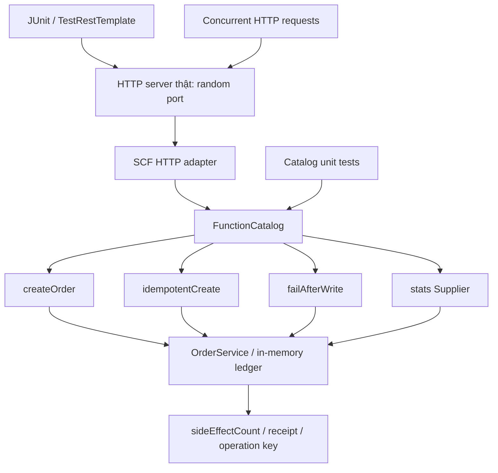

# Kiểm thử toàn trình, gọi lặp và nhiều lần gọi đồng thời trong Spring Cloud Function

## 1. Mục tiêu và bối cảnh

**Spring Cloud Function (SCF)** cho phép viết logic nghiệp vụ bằng `Supplier<T>`, `Function<I,O>` và `Consumer<T>`, đăng ký chúng qua `FunctionCatalog` rồi kết nối với HTTP, sự kiện hoặc serverless. Một function chạy đúng khi gọi trực tiếp chưa đủ để kết luận hệ thống hoạt động đúng: request còn đi qua adapter, routing, chuyển đổi dữ liệu, security, network, transaction và cơ chế retry của nguồn gọi.

Bài thực hành này tập trung vào ba cấp độ kiểm thử:

1. **Kiểm thử function và catalog:** xác minh logic nghiệp vụ, tên function, composition và kiểu dữ liệu.
2. **Kiểm thử toàn trình qua HTTP:** khởi chạy Spring Boot server thật trên cổng ngẫu nhiên, gửi JSON qua SCF HTTP adapter và xác minh response.
3. **Kiểm thử gọi lặp và đồng thời:** gửi cùng operation nhiều lần, mô phỏng response mất sau khi ghi dữ liệu, tạo concurrency và xác minh idempotency.

Bạn sẽ tạo một dịch vụ tạo đơn hàng trong bộ nhớ. Một endpoint cố ý không idempotent để làm lộ duplicate; một endpoint có idempotency key để trả lại kết quả đã lưu. Một endpoint khác cố ý ném lỗi **sau khi side effect đã xảy ra**, giúp kiểm tra trường hợp client không biết lần gọi trước đã thành công đến đâu.

### Sơ đồ kiểm thử



### Kết quả cần đạt

| Mã | Kết quả | Bằng chứng |
| --- | --- | --- |
| TEST-01 | Function có thể tra cứu và chạy qua FunctionCatalog | Unit test lookup và kết quả |
| TEST-02 | Composition thực thi đúng thứ tự | Kết quả của function chain |
| TEST-03 | HTTP adapter nhận JSON và trả JSON đúng | Test qua cổng random, không gọi lambda trực tiếp |
| TEST-04 | Gọi function không idempotent hai lần tạo hai effects | `sideEffectCount` bằng 2 |
| TEST-05 | Lỗi sau khi ghi không chứng minh ghi dữ liệu thất bại | Retry thường tạo effect lần hai |
| TEST-06 | Retry sau lỗi nhưng cùng idempotency key chỉ tạo một effect | Receipt cũ được trả lại |
| TEST-07 | Nhiều request đồng thời cùng key chỉ tạo một effect | Các response giống nhau, count bằng 1 |
| TEST-08 | Cùng key với payload khác bị từ chối | Conflict, không phát sinh effect mới |
| TEST-09 | Test không phụ thuộc thứ tự hoặc state của test khác | Reset state / key riêng |
| TEST-10 | Phân biệt được kiểm thử HTTP với kiểm thử event/serverless | Test matrix theo từng adapter |

**Phạm vi:** ví dụ dùng Java 17+, Spring Boot, SCF HTTP adapter, JUnit 5 và in-memory state. Không có database hoặc payment thật. Bài tập chứng minh hành vi trong một JVM; các giới hạn khi restart hoặc scale nhiều instances được phân tích riêng.

## 2. Chuẩn bị dự án

### 2.1. Công cụ

- JDK 17 trở lên.
- Maven 3.9+ hoặc Maven Wrapper.
- IDE/editor và terminal.
- Một dự án Spring Boot có Spring Cloud BOM tương thích.
- Không cần Docker hoặc broker để hoàn thành phần HTTP; phần mở rộng event adapter có thể dùng broker test riêng.

**Chọn version theo release train:** Spring Boot và Spring Cloud Function phải thuộc các dòng tương thích. Không tự thêm version riêng cho từng starter. Dự án đã có BOM thì giữ BOM hiện tại; trước khi đưa vào CI production, kiểm tra release notes và bản vá bảo mật được tổ chức hỗ trợ.

### 2.2. Dependencies Maven

Thêm các dependencies sau vào `pom.xml`. Spring Cloud starter version được quản lý bởi Spring Cloud BOM:

```xml
<dependencies>
    <dependency>
        <groupId>org.springframework.cloud</groupId>
        <artifactId>spring-cloud-starter-function-web</artifactId>
    </dependency>

    <dependency>
        <groupId>org.springframework.boot</groupId>
        <artifactId>spring-boot-starter-test</artifactId>
        <scope>test</scope>
    </dependency>
</dependencies>
```

`spring-boot-starter-test` cung cấp JUnit Jupiter, Spring Test và `TestRestTemplate` cho kiểm thử ứng dụng web. Không thêm version tùy ý vào dependency SCF nếu BOM đã quản lý nó.

### 2.3. Cấu trúc dự án

```text
scf-testing-lab/
├── pom.xml
└── src/
    ├── main/
    │   ├── java/demo/
    │   │   ├── TestingApplication.java
    │   │   ├── OrderCommand.java
    │   │   ├── OrderReceipt.java
    │   │   ├── TestStats.java
    │   │   └── OrderService.java
    │   └── resources/
    │       └── application.properties
    └── test/
        └── java/demo/
            ├── FunctionCatalogTest.java
            └── FunctionHttpE2ETest.java
```

Các file là phần người học tạo trong dự án lab độc lập.

## 3. Xác định contract nghiệp vụ cần kiểm thử

Một command tạo đơn hàng:

```json
{
  "requestId": "req-100",
  "orderId": "order-42",
  "quantity": 2
}
```

Ba trường có vai trò khác nhau:

- `requestId`: trong lab được dùng làm **idempotency key** ổn định cho một operation; mọi retry của operation đó phải gửi lại cùng giá trị.
- `orderId`: định danh tài nguyên nghiệp vụ.
- `quantity`: dữ liệu đầu vào của command.

Một request ID cho từng lần HTTP attempt không nhất thiết là idempotency key. Nếu client tạo UUID mới mỗi lần retry, server sẽ hiểu mỗi lần là operation khác. Production cần xác định key theo contract, thường scope theo tenant, operation type và caller.

### 3.1. Contract của các endpoint

| Method | Endpoint | Function | Hành vi |
| --- | --- | --- | --- |
| POST | `/functions/createOrder` | `createOrder` | Tạo effect mỗi lần gọi |
| POST | `/functions/failAfterWrite` | `failAfterWrite` | Lần đầu ghi xong rồi ném lỗi |
| POST | `/functions/idempotentCreate` | `idempotentCreate` | Cùng key/payload trả receipt đã lưu |
| POST | `/functions/idempotentFailAfterWrite` | `idempotentFailAfterWrite` | Lần đầu commit key/effect rồi ném lỗi; retry trả receipt cũ |
| GET | `/functions/stats` | `stats` | Đọc số side effects và keys |

Trong ví dụ này, các endpoint dùng JSON qua SCF HTTP adapter. Khi nâng cấp release train, cần xác nhận đúng mapping theo tài liệu và integration test của adapter.

### 3.2. Những điều phải kiểm tra ngoài business result

Một HTTP test toàn trình không chỉ so sánh body. Nó cần kiểm tra:

- HTTP status có thuộc nhóm mong đợi không?
- Request có đi qua đúng function name/path không?
- `Content-Type` và response converter có hoạt động không?
- DTO có được deserialize đúng kiểu không?
- Có side effect nào xảy ra ngoài dự kiến không?
- Gọi lặp có trả lại cùng receipt không?
- Hai request đồng thời có tạo hai effects không?
- Sau exception/timeout, state có phản ánh đúng những gì đã commit không?

## 4. Viết DTO cho request, response và thống kê

Tạo `src/main/java/demo/OrderCommand.java`:

```java
package demo;

public record OrderCommand(
        String requestId,
        String orderId,
        int quantity) {}
```

Tạo `src/main/java/demo/OrderReceipt.java`:

```java
package demo;

public record OrderReceipt(
        String requestId,
        String orderId,
        int quantity,
        int effectSequence,
        String status) {}
```

Tạo `src/main/java/demo/TestStats.java`:

```java
package demo;

public record TestStats(
        int sideEffectCount,
        int orderCount,
        int idempotencyKeyCount) {}
```

Các DTO là public record để Jackson có thể serialize/deserialize qua HTTP và các test có thể dùng trực tiếp. `effectSequence` là số thứ tự side effect trong JVM, chỉ phục vụ quan sát lab; không phải ID giao dịch production.

## 5. Xây dựng service có và không có idempotency

### 5.1. OrderService.java

Tạo `src/main/java/demo/OrderService.java`:

```java
package demo;

import java.util.concurrent.ConcurrentHashMap;
import java.util.concurrent.ConcurrentMap;
import java.util.concurrent.atomic.AtomicBoolean;
import java.util.concurrent.atomic.AtomicInteger;

import org.springframework.stereotype.Service;

@Service
public class OrderService {

    private final AtomicInteger sideEffectCount =
            new AtomicInteger();

    private final ConcurrentMap<String, OrderReceipt> orders =
            new ConcurrentHashMap<>();

    private final ConcurrentMap<String, StoredOperation> processed =
            new ConcurrentHashMap<>();

    private final AtomicBoolean failFirstAfterWrite =
            new AtomicBoolean(true);

    private final AtomicBoolean failFirstIdempotentAfterWrite =
            new AtomicBoolean(true);

    public OrderReceipt create(OrderCommand command) {
        validate(command);

        int sequence = sideEffectCount.incrementAndGet();
        OrderReceipt receipt = new OrderReceipt(
                command.requestId(),
                command.orderId(),
                command.quantity(),
                sequence,
                "CREATED");

        orders.put(command.orderId(), receipt);
        return receipt;
    }

    public OrderReceipt failAfterWrite(OrderCommand command) {
        OrderReceipt receipt = create(command);

        if (failFirstAfterWrite.compareAndSet(true, false)) {
            throw new SimulatedFailureException(
                    "Response failed after side effect");
        }

        return receipt;
    }

    public OrderReceipt createIdempotently(OrderCommand command) {
        validate(command);

        StoredOperation stored = processed.compute(
                command.requestId(),
                (key, existing) -> {
                    if (existing != null) {
                        if (!existing.command().equals(command)) {
                            throw new IdempotencyConflictException(
                                    "Idempotency key reused with another payload");
                        }
                        return existing;
                    }

                    OrderReceipt receipt = create(command);
                    return new StoredOperation(command, receipt);
                });

        return stored.receipt();
    }

    public OrderReceipt idempotentFailAfterWrite(
            OrderCommand command) {

        OrderReceipt receipt = createIdempotently(command);

        if (failFirstIdempotentAfterWrite.compareAndSet(true, false)) {
            throw new SimulatedFailureException(
                    "Response failed after idempotency state was stored");
        }

        return receipt;
    }

    public TestStats stats() {
        return new TestStats(
                sideEffectCount.get(),
                orders.size(),
                processed.size());
    }

    public void resetForTest() {
        orders.clear();
        processed.clear();
        sideEffectCount.set(0);
        failFirstAfterWrite.set(true);
        failFirstIdempotentAfterWrite.set(true);
    }

    private static void validate(OrderCommand command) {
        if (command == null
                || command.requestId() == null
                || command.requestId().isBlank()
                || command.orderId() == null
                || command.orderId().isBlank()
                || command.quantity() <= 0) {
            throw new IllegalArgumentException(
                    "requestId, orderId and positive quantity are required");
        }
    }

    private record StoredOperation(
            OrderCommand command,
            OrderReceipt receipt) {}
}

class SimulatedFailureException extends RuntimeException {
    SimulatedFailureException(String message) {
        super(message);
    }
}

class IdempotencyConflictException extends RuntimeException {
    IdempotencyConflictException(String message) {
        super(message);
    }
}
```

### 5.2. Giải thích các nhánh xử lý

- `create()` luôn tăng side effect counter; cùng command gọi hai lần tạo hai receipt khác sequence.
- `failAfterWrite()` gọi `create()` trước rồi mới ném exception ở invocation đầu tiên. Client thấy lỗi dù side effect đã xảy ra.
- `createIdempotently()` dùng `ConcurrentHashMap.compute()` để claim một key và lưu receipt trong một thao tác atomic theo key của JVM.
- Nếu cùng key nhưng payload khác, function ném `IdempotencyConflictException` và không tạo effect mới.
- `idempotentFailAfterWrite()` lưu key và receipt trước khi ném lỗi đầu tiên; lần retry tìm thấy key đã xử lý và trả lại receipt cũ.
- `resetForTest()` chỉ dùng để cô lập test. Không gọi phương thức reset này trong production.

**Giới hạn quan trọng:** `ConcurrentHashMap` chỉ chia sẻ state trong một JVM. Nó không bảo vệ được nhiều pod, Lambda environments hoặc process restart. Callback của `compute()` trong ví dụ chỉ thao tác bộ nhớ; không gọi payment/email API hoặc giữ một remote call dài bên trong callback production.

### 5.3. Side effect và business uniqueness là hai số đo khác nhau

`orders` được key theo `orderId`, nên ghi lại cùng order ID có thể ghi đè receipt hiện tại. `sideEffectCount` vẫn tăng cho mỗi lần thực thi. Vì vậy:

- `orderCount` đếm số order ID đang có trong map.
- `sideEffectCount` đếm số lần ghi effect.
- `idempotencyKeyCount` đếm số operation keys đã được lưu.

Không dùng một con số duy nhất để suy luận mọi duplicate đã được loại bỏ.

## 6. Đăng ký functional beans và cấu hình SCF HTTP adapter

### 6.1. TestingApplication.java

Tạo `src/main/java/demo/TestingApplication.java`:

```java
package demo;

import java.util.function.Function;
import java.util.function.Supplier;

import org.springframework.boot.SpringApplication;
import org.springframework.boot.autoconfigure.SpringBootApplication;
import org.springframework.context.annotation.Bean;

@SpringBootApplication
public class TestingApplication {

    public static void main(String[] args) {
        SpringApplication.run(TestingApplication.class, args);
    }

    @Bean
    public Function<OrderCommand, OrderReceipt> createOrder(
            OrderService service) {
        return service::create;
    }

    @Bean
    public Function<OrderCommand, OrderReceipt> failAfterWrite(
            OrderService service) {
        return service::failAfterWrite;
    }

    @Bean
    public Function<OrderCommand, OrderReceipt> idempotentCreate(
            OrderService service) {
        return service::createIdempotently;
    }

    @Bean
    public Function<OrderCommand, OrderReceipt> idempotentFailAfterWrite(
            OrderService service) {
        return service::idempotentFailAfterWrite;
    }

    @Bean
    public Function<String, String> normalize() {
        return value -> value.trim().replaceAll("\\s+", " ");
    }

    @Bean
    public Function<String, String> uppercase() {
        return value -> value.toUpperCase(java.util.Locale.ROOT);
    }

    @Bean
    public Supplier<TestStats> stats(OrderService service) {
        return service::stats;
    }
}
```

### 6.2. application.properties

Tạo `src/main/resources/application.properties`:

```properties
spring.application.name=scf-testing-lab
server.port=8080

spring.cloud.function.web.path=/functions

# Chỉ các function này được xuất qua HTTP adapter.
spring.cloud.function.definition=createOrder;failAfterWrite;idempotentCreate;idempotentFailAfterWrite;stats
```

`spring.cloud.function.web.path` đặt tiền tố endpoint. `spring.cloud.function.definition` liệt kê các function được xuất; dấu `;` tách các function độc lập. Mỗi function được gọi theo tên ở path.

Đường dẫn dự kiến:

- `POST /functions/createOrder`
- `POST /functions/failAfterWrite`
- `POST /functions/idempotentCreate`
- `POST /functions/idempotentFailAfterWrite`
- `GET /functions/stats`

Chỉ chạy ứng dụng lab trên máy phát triển hoặc mạng kiểm thử tin cậy; không expose các endpoint tạo dữ liệu hoặc cố ý ném lỗi ra Internet. Khi chạy test với `@SpringBootTest(webEnvironment = RANDOM_PORT)`, Spring Boot chọn cổng khả dụng và `TestRestTemplate` sử dụng cổng đó.

**Lưu ý theo release train:** SCF web adapter hỗ trợ mapping function qua HTTP, nhưng các chi tiết URL, method, filtering và converter phải được xác minh trên đúng phiên bản trong BOM. Không thay thế kiểm thử adapter bằng việc chỉ kiểm tra bean tồn tại.

## 7. Kiểm thử function và FunctionCatalog

### 7.1. Vì sao cần test catalog riêng?

Test trực tiếp `service.create()` xác minh logic Java, nhưng không xác minh function đã được Spring đăng ký. `FunctionCatalog` giúp tra cứu theo function definition, do đó cần kiểm tra:

- Tên function được đăng ký đúng.
- Function có đúng kiểu input/output.
- Composition tra cứu được và thực thi đúng thứ tự.
- Function không bị đổi tên hoặc trùng bean ngoài ý muốn.

### 7.2. FunctionCatalogTest.java

Ví dụ test:

```java
package demo;

import java.util.function.Function;

import org.junit.jupiter.api.Test;
import org.springframework.beans.factory.annotation.Autowired;
import org.springframework.boot.test.context.SpringBootTest;
import org.springframework.cloud.function.context.FunctionCatalog;

import static org.junit.jupiter.api.Assertions.assertEquals;
import static org.junit.jupiter.api.Assertions.assertNotNull;

@SpringBootTest(properties = {
    "spring.cloud.function.definition=createOrder;failAfterWrite;idempotentCreate;idempotentFailAfterWrite;stats;normalize|uppercase"
})
class FunctionCatalogTest {

    @Autowired
    FunctionCatalog catalog;

    @Autowired
    OrderService service;

    @Test
    void createOrderCanBeLookedUp() {
        Function<OrderCommand, OrderReceipt> function =
                catalog.lookup(Function.class, "createOrder");

        assertNotNull(function);

        OrderReceipt receipt = function.apply(
                new OrderCommand("unit-1", "order-1", 2));

        assertEquals("order-1", receipt.orderId());
        assertEquals(1, service.stats().sideEffectCount());
    }

    @Test
    void compositionExecutesInOrder() {
        Function<String, String> composition =
                catalog.lookup(Function.class, "normalize|uppercase");

        assertEquals("HELLO WORLD",
                composition.apply("  hello   world  "));
    }
}
```

Test `compositionExecutesInOrder()` tra cứu trực tiếp `normalize|uppercase` trong `FunctionCatalog`, nên xác minh composition của SCF chứ không chỉ kiểm tra `Function.andThen()` của Java.

**Type safety:** `FunctionCatalog.lookup()` có thể trả function với generic bị xóa tại runtime. Khi gán cho kiểu cụ thể, giữ cảnh báo unchecked có chủ đích và bảo đảm input/output DTO đúng với function đã đăng ký.

## 8. Kiểm thử toàn trình qua HTTP server thật

### 8.1. Tại sao dùng RANDOM_PORT?

`@SpringBootTest(webEnvironment = RANDOM_PORT)` khởi chạy application context và web server thật trên cổng khả dụng do hệ điều hành chọn. Request từ test đi qua:

```text
TestRestTemplate
  -> HTTP serialization
  -> socket/network loopback
  -> Spring Security/filter chain (nếu cấu hình)
  -> SCF HTTP adapter
  -> FunctionCatalog
  -> functional bean
  -> HTTP response conversion
```

Đây là kiểm thử toàn trình ở **ranh giới HTTP của ứng dụng**. Nó vẫn chưa kiểm tra reverse proxy, load balancer, production database hoặc broker thật.

### 8.2. FunctionHttpE2ETest.java

Tạo `src/test/java/demo/FunctionHttpE2ETest.java`:

```java
package demo;

import static org.junit.jupiter.api.Assertions.assertEquals;
import static org.junit.jupiter.api.Assertions.assertFalse;
import static org.junit.jupiter.api.Assertions.assertNotNull;
import static org.junit.jupiter.api.Assertions.assertTrue;

import java.util.ArrayList;
import java.util.List;
import java.util.concurrent.CountDownLatch;
import java.util.concurrent.ExecutorService;
import java.util.concurrent.Executors;
import java.util.concurrent.Future;
import java.util.concurrent.TimeUnit;

import org.junit.jupiter.api.BeforeEach;
import org.junit.jupiter.api.Test;
import org.springframework.beans.factory.annotation.Autowired;
import org.springframework.boot.test.context.SpringBootTest;
import org.springframework.boot.test.web.client.TestRestTemplate;
import org.springframework.http.ResponseEntity;

@SpringBootTest(
    webEnvironment = SpringBootTest.WebEnvironment.RANDOM_PORT,
    properties = {
        "spring.cloud.function.web.path=/functions",
        "spring.cloud.function.definition=createOrder;failAfterWrite;idempotentCreate;idempotentFailAfterWrite;stats"
    }
)
class FunctionHttpE2ETest {

    @Autowired
    TestRestTemplate http;

    @Autowired
    OrderService service;

    @BeforeEach
    void resetState() {
        service.resetForTest();
    }

    @Test
    void httpAdapterConvertsJsonAndInvokesFunction() {
        OrderCommand command =
                new OrderCommand("http-1", "order-http-1", 3);

        ResponseEntity<OrderReceipt> response =
                http.postForEntity(
                        "/functions/createOrder",
                        command,
                        OrderReceipt.class);

        assertTrue(response.getStatusCode().is2xxSuccessful());
        assertNotNull(response.getBody());
        assertEquals("order-http-1",
                response.getBody().orderId());
        assertEquals(3, response.getBody().quantity());
        assertEquals(1, response.getBody().effectSequence());

        ResponseEntity<TestStats> stats =
                http.getForEntity(
                        "/functions/stats",
                        TestStats.class);

        assertTrue(stats.getStatusCode().is2xxSuccessful());
        assertEquals(1, stats.getBody().sideEffectCount());
    }

    @Test
    void repeatedNonIdempotentCallCreatesTwoEffects() {
        OrderCommand command =
                new OrderCommand("repeat-1", "order-repeat", 1);

        ResponseEntity<OrderReceipt> first =
                http.postForEntity(
                        "/functions/createOrder",
                        command,
                        OrderReceipt.class);

        ResponseEntity<OrderReceipt> second =
                http.postForEntity(
                        "/functions/createOrder",
                        command,
                        OrderReceipt.class);

        assertTrue(first.getStatusCode().is2xxSuccessful());
        assertTrue(second.getStatusCode().is2xxSuccessful());
        assertEquals(1, first.getBody().effectSequence());
        assertEquals(2, second.getBody().effectSequence());

        assertEquals(2, service.stats().sideEffectCount());
    }

    @Test
    void failureAfterWriteThenRetryCreatesDuplicate() {
        OrderCommand command =
                new OrderCommand("failure-1", "order-failure", 1);

        ResponseEntity<String> first =
                http.postForEntity(
                        "/functions/failAfterWrite",
                        command,
                        String.class);

        // Adapter có thể ánh xạ exception khác nhau theo release train.
        assertFalse(first.getStatusCode().is2xxSuccessful());
        assertEquals(1, service.stats().sideEffectCount());

        ResponseEntity<OrderReceipt> retry =
                http.postForEntity(
                        "/functions/failAfterWrite",
                        command,
                        OrderReceipt.class);

        assertTrue(retry.getStatusCode().is2xxSuccessful());
        assertEquals(2, service.stats().sideEffectCount());
    }

    @Test
    void idempotentRetryAfterFailureReturnsStoredReceipt() {
        OrderCommand command =
                new OrderCommand("idem-fail-1", "order-idem-fail", 2);

        ResponseEntity<String> first =
                http.postForEntity(
                        "/functions/idempotentFailAfterWrite",
                        command,
                        String.class);

        assertFalse(first.getStatusCode().is2xxSuccessful());
        assertEquals(1, service.stats().sideEffectCount());
        assertEquals(1, service.stats().idempotencyKeyCount());

        ResponseEntity<OrderReceipt> retry =
                http.postForEntity(
                        "/functions/idempotentFailAfterWrite",
                        command,
                        OrderReceipt.class);

        assertTrue(retry.getStatusCode().is2xxSuccessful());
        assertNotNull(retry.getBody());
        assertEquals(1, retry.getBody().effectSequence());
        assertEquals(1, service.stats().sideEffectCount());
    }

    @Test
    void repeatedIdempotentCallReturnsSameReceipt() {
        OrderCommand command =
                new OrderCommand("idem-2", "order-idem-2", 5);

        ResponseEntity<OrderReceipt> first =
                http.postForEntity(
                        "/functions/idempotentCreate",
                        command,
                        OrderReceipt.class);

        ResponseEntity<OrderReceipt> second =
                http.postForEntity(
                        "/functions/idempotentCreate",
                        command,
                        OrderReceipt.class);

        assertTrue(first.getStatusCode().is2xxSuccessful());
        assertTrue(second.getStatusCode().is2xxSuccessful());
        assertEquals(first.getBody(), second.getBody());
        assertEquals(1, service.stats().sideEffectCount());
    }

    @Test
    void sameKeyWithDifferentPayloadDoesNotCreateAnotherEffect() {
        http.postForEntity(
                "/functions/idempotentCreate",
                new OrderCommand("idem-conflict", "order-a", 1),
                OrderReceipt.class);

        ResponseEntity<String> conflict =
                http.postForEntity(
                        "/functions/idempotentCreate",
                        new OrderCommand("idem-conflict", "order-b", 9),
                        String.class);

        assertFalse(conflict.getStatusCode().is2xxSuccessful());
        assertEquals(1, service.stats().sideEffectCount());
    }

    @Test
    void concurrentRequestsWithSameKeyCreateOneEffect()
            throws Exception {

        int workers = 12;
        OrderCommand command =
                new OrderCommand(
                        "idem-parallel-1",
                        "order-parallel",
                        4);

        List<OrderReceipt> receipts = runConcurrently(
                workers,
                () -> {
                    ResponseEntity<OrderReceipt> response =
                            http.postForEntity(
                                    "/functions/idempotentCreate",
                                    command,
                                    OrderReceipt.class);

                    if (!response.getStatusCode().is2xxSuccessful()
                            || response.getBody() == null) {
                        throw new IllegalStateException(
                                "Unexpected HTTP response: " +
                                response.getStatusCode());
                    }
                    return response.getBody();
                });

        assertEquals(workers, receipts.size());
        assertTrue(receipts.stream().allMatch(
                receipt -> receipt.equals(receipts.get(0))));

        ResponseEntity<TestStats> stats =
                http.getForEntity(
                        "/functions/stats",
                        TestStats.class);

        assertTrue(stats.getStatusCode().is2xxSuccessful());
        assertEquals(1, stats.getBody().sideEffectCount());
        assertEquals(1, stats.getBody().idempotencyKeyCount());
    }

    @Test
    void concurrentNonIdempotentCallsCreateOneEffectPerRequest()
            throws Exception {

        int workers = 8;

        List<OrderReceipt> receipts = runConcurrently(
                workers,
                new java.util.concurrent.atomic.AtomicInteger(),
                index -> {
                    OrderCommand command = new OrderCommand(
                            "attempt-" + index,
                            "same-business-order",
                            1);

                    ResponseEntity<OrderReceipt> response =
                            http.postForEntity(
                                    "/functions/createOrder",
                                    command,
                                    OrderReceipt.class);

                    if (!response.getStatusCode().is2xxSuccessful()
                            || response.getBody() == null) {
                        throw new IllegalStateException(
                                "Unexpected HTTP response: " +
                                response.getStatusCode());
                    }
                    return response.getBody();
                });

        assertEquals(workers, receipts.size());
        assertEquals(workers, service.stats().sideEffectCount());
    }

    private static <T> List<T> runConcurrently(
            int workers,
            java.util.concurrent.Callable<T> action)
            throws Exception {
        return runConcurrently(
                workers,
                new java.util.concurrent.atomic.AtomicInteger(),
                ignored -> action.call());
    }

    private static <T> List<T> runConcurrently(
            int workers,
            java.util.concurrent.atomic.AtomicInteger sequence,
            java.util.function.Function<Integer, T> action)
            throws Exception {

        ExecutorService pool =
                Executors.newFixedThreadPool(workers);
        CountDownLatch ready = new CountDownLatch(workers);
        CountDownLatch start = new CountDownLatch(1);
        List<Future<T>> futures = new ArrayList<>();

        try {
            for (int i = 0; i < workers; i++) {
                futures.add(pool.submit(() -> {
                    ready.countDown();

                    if (!start.await(10, TimeUnit.SECONDS)) {
                        throw new IllegalStateException(
                                "Workers did not receive start signal");
                    }

                    return action.apply(sequence.getAndIncrement());
                }));
            }

            if (!ready.await(10, TimeUnit.SECONDS)) {
                throw new IllegalStateException(
                        "Workers did not become ready");
            }

            start.countDown();

            List<T> results = new ArrayList<>();
            for (Future<T> future : futures) {
                results.add(future.get(20, TimeUnit.SECONDS));
            }
            return results;
        }
        finally {
            start.countDown();
            pool.shutdownNow();
            pool.awaitTermination(10, TimeUnit.SECONDS);
        }
    }
}
```

### 8.3. Đồng bộ worker trong concurrency test

Helper `runConcurrently()` dùng hai latch: `ready` chờ tất cả worker sẵn sàng, còn `start` phát tín hiệu bắt đầu. Overload thứ hai nhận `AtomicInteger` để cấp chỉ số riêng cho từng request khi test cần tạo các id khác nhau. Các assertion HTTP được thực hiện trong test thread sau khi thu kết quả từ `Future`; nếu một worker thất bại, `Future.get()` chuyển lỗi về test để suite fail.

**Lưu ý concurrency:** `TestRestTemplate` được cấu hình khi test context khởi động và được dùng đồng thời sau khi cấu hình hoàn tất. Nếu custom client interceptor hoặc request factory không thread-safe, tạo client riêng cho mỗi worker hoặc chuyển sang `java.net.http.HttpClient` dùng chung theo contract của nó.

## 9. Đọc kết quả của kiểm thử toàn trình

### 9.1. Một request thành công

Test `httpAdapterConvertsJsonAndInvokesFunction()` xác minh nhiều thứ cùng lúc:

1. Spring Boot context và HTTP server khởi chạy.
2. Request JSON được gửi tới đúng path.
3. SCF HTTP adapter định tuyến đến `createOrder`.
4. Input được chuyển thành `OrderCommand`.
5. Function gọi service và tạo receipt.
6. Response được serialize thành `OrderReceipt`.
7. Supplier `stats` trả trạng thái side effect đã ghi.

Nếu test gọi trực tiếp `service.create(command)`, các bước 2, 3 và 6 không được kiểm tra.

### 9.2. Gọi lặp function không idempotent

Test `repeatedNonIdempotentCallCreatesTwoEffects()` gửi cùng request body hai lần. Hai response có `effectSequence` khác nhau, còn side effect counter bằng 2.

Đây là hành vi đúng của function không có idempotency. Test không nên “sửa” bằng cách kỳ vọng response giống nhau khi contract hiện tại không hứa điều đó.

### 9.3. Lỗi sau side effect và retry

Test `failureAfterWriteThenRetryCreatesDuplicate()` xác minh:

- Request đầu trả non-2xx do function ném exception sau khi ghi.
- Service counter vẫn bằng 1 sau response lỗi.
- Retry cùng command đi vào function một lần nữa.
- Counter tăng lên 2.

Không khẳng định một status code cố định cho exception này khi chưa định nghĩa HTTP exception mapping. SCF/web runtime có thể ánh xạ exception khác nhau theo phiên bản. Nếu API production cần hợp đồng 4xx/5xx ổn định, tạo exception handler phù hợp với adapter và kiểm thử nó riêng.

### 9.4. Lỗi sau khi idempotency state đã lưu

Test `idempotentRetryAfterFailureReturnsStoredReceipt()` mô phỏng cửa sổ quan trọng:

```text
Lần 1:
  idempotency key chưa có
  -> tạo side effect
  -> lưu key + receipt
  -> response thất bại

Retry:
  cùng idempotency key
  -> tìm thấy key đã lưu
  -> trả lại receipt cũ
  -> không tạo side effect mới
```

Kết quả mong đợi: hai lần client thấy một lần lỗi và một lần thành công, nhưng `sideEffectCount` vẫn bằng 1.

Trong hệ thống database thật, phải lưu key và business record trong transaction bền vững. In-memory map không chứng minh được hành vi sau restart.

### 9.5. Cùng key, payload khác

Idempotency key chỉ có ý nghĩa nếu được gắn với một command cụ thể. Nếu client gửi cùng key nhưng đổi order ID hoặc quantity, function phải từ chối. Test chỉ khẳng định response non-2xx và counter không tăng; mã HTTP cụ thể cần được định nghĩa ở HTTP boundary.

## 10. Kiểm thử nhiều request đồng thời

### 10.1. Cùng key và cùng payload

Test `concurrentRequestsWithSameKeyCreateOneEffect()` gửi 12 HTTP requests song song với cùng key và cùng DTO. Các response phải chứa cùng receipt và side effect counter chỉ tăng một.

Đây là test concurrency ở **HTTP boundary**, không chỉ test `ConcurrentHashMap` bằng nhiều thread nội bộ. Nó đồng thời kiểm tra web server có nhận nhiều request, SCF adapter có định tuyến đúng và function có giữ state nhất quán.

### 10.2. Các key khác nhau nhưng cùng order ID

Test `concurrentNonIdempotentCallsCreateOneEffectPerRequest()` gửi nhiều key khác nhau nhưng cùng business order ID đến endpoint không idempotent. Mỗi invocation được thực thi và counter tăng theo số request.

Điều này cho thấy:

- Dedupe theo operation key chỉ loại trùng **cùng operation**.
- Nếu nghiệp vụ yêu cầu order ID chỉ được tạo một lần, cần unique constraint trên business key ở database.
- Một request ID mới không nên được dùng để vượt qua business uniqueness.

### 10.3. Vì sao dùng CountDownLatch trong test?

Helper đồng bộ các worker trước khi gửi request. Nếu không có latch, các thread có thể chạy lệch thời điểm và bài test không tạo đủ concurrency. Tuy nhiên, start latch chỉ giúp bắt đầu gần nhau; nó không đảm bảo tất cả request đến server cùng một nanosecond. Test cần xác minh invariant cuối cùng, không dựa vào timing chính xác.

### 10.4. Không bật parallel JUnit methods một cách tùy tiện

Test class dùng một Spring context và một singleton `OrderService`. `@BeforeEach resetState()` xóa state trước mỗi method. Vì vậy không bật JUnit parallel execution cho các method trong class này nếu chúng cùng chia sẻ context; một test có thể reset dữ liệu trong khi test khác đang gửi request.

Khi cần chạy test methods song song:

- Dùng key duy nhất cho mỗi test và bỏ reset toàn cục.
- Tạo application context/database schema riêng theo test.
- Hoặc chạy test suite với parallelism được kiểm soát và isolation rõ ràng.

## 11. Test isolation, determinism và dữ liệu test

### 11.1. Vì sao test phải độc lập?

Một test lặp lại nhiều lần phải có kết quả như nhau, bất kể test nào chạy trước. Nếu test dựa vào side effect count của test trước, kết quả sẽ phụ thuộc thứ tự và CI có thể lúc pass lúc fail.

Lab dùng `resetForTest()` trong `@BeforeEach` để:

- Xóa orders map.
- Xóa processed keys.
- Reset side effect counter.
- Đưa fault-injection flags về trạng thái ban đầu.

Không đưa reset endpoint ra HTTP. Test truy cập service trực tiếp chỉ để dọn state, còn hành vi nghiệp vụ vẫn được gọi qua HTTP.

### 11.2. Dùng key riêng theo test

Trong hệ thống có database dùng chung, mỗi test nên có namespace riêng:

```text
test run: ci-4821
test case: concurrent-idempotency
operation key: ci-4821-concurrent-idempotency
tenant: test-tenant
```

Không dùng cùng key cố định trên một môi trường staging lâu dài nếu state idempotency được giữ bền vững; lần chạy sau có thể đọc kết quả cũ và không thực thi code cần kiểm thử.

### 11.3. Cleanup có giới hạn

Nếu dùng database thật trong integration test:

- Tạo schema/database riêng hoặc transaction rollback phù hợp.
- Dùng test containers hoặc disposable database khi cần xác minh transaction và unique constraint.
- Không xóa dữ liệu production để “reset test”.
- Không dựa vào transaction test bao ngoài nếu HTTP request chạy ở thread khác và không tham gia transaction của test thread.

Điểm cuối đặc biệt quan trọng: `@Transactional` trên test method không tự đảm bảo transaction của HTTP server rollback cùng transaction của test. Request server là một execution path riêng.

## 12. Phân biệt unit, integration, end-to-end và contract tests

| Loại test | Phạm vi | Ví dụ trong SCF |
| --- | --- | --- |
| Unit | Một class/function, không khởi động Spring | Kiểm tra `OrderService` và validation |
| Catalog test | Spring context + function registry | `FunctionCatalog.lookup()` và composition |
| Adapter integration | Spring context + HTTP adapter | JSON mapping, path, method, response |
| E2E | Ứng dụng chạy như client nhìn thấy ở môi trường test | `RANDOM_PORT`, HTTP request và state |
| Contract | Hợp đồng giữa client và service | DTO, status, headers, error schema |
| Component test | Một service cùng dependency test doubles | Database mock/container, external API stub |
| System test | Nhiều service/broker/database thật | End-to-end event workflow trong staging |

Một test `FunctionCatalog` không thay thế HTTP E2E. Một HTTP E2E không thay thế broker integration. Mỗi test có một mục tiêu và một phạm vi bằng chứng riêng.

### 12.1. Test composition của SCF

Giả sử có hai bean:

```java
@Bean
Function<String, String> normalize() {
    return value -> value.trim().replaceAll("\\s+", " ");
}

@Bean
Function<String, String> uppercase() {
    return value -> value.toUpperCase(Locale.ROOT);
}
```

Test catalog bằng composition name:

```java
Function<String, String> chain =
        catalog.lookup(Function.class, "normalize|uppercase");

assertEquals("HELLO WORLD",
        chain.apply("  hello   world  "));
```

Cần kiểm tra cả:

- Lookup theo tên function.
- Thứ tự composition.
- Input/output type và conversion.
- Lỗi khi function name sai hoặc composition không tương thích.
- Function có được xuất qua adapter cần test hay không.

### 12.2. Event adapter cần test riêng

HTTP E2E không kiểm tra message serialization, consumer group, ack/offset, retry hoặc DLQ. Với Spring Cloud Stream hoặc broker adapter:

- Dùng binder test support khi chỉ cần kiểm tra logic binding cơ bản.
- Dùng Testcontainers/broker thật khi cần xác minh delivery, partition, ack hoặc redelivery semantics.
- Gửi cùng event ID nhiều lần để xác minh consumer idempotency.
- Kiểm tra crash sau commit trước ack và redelivery.
- Kiểm tra dead-letter route và replay có kiểm soát.

Không suy ra “event exactly-once” từ việc HTTP endpoint trả cùng receipt hai lần.

## 13. Fault injection và kiểm thử timeout

### 13.1. Tạo lỗi ở đúng vị trí

Một số fault injection hữu ích:

| Vị trí lỗi | Câu hỏi cần trả lời |
| --- | --- |
| Trước khi function bắt đầu | Request có đến ứng dụng không? |
| Sau khi deserialize, trước side effect | Retry có an toàn không? |
| Sau side effect, trước response | Dữ liệu đã ghi chưa? |
| Sau DB commit, trước broker ack | Message có được redeliver không? |
| Sau external API success, trước lưu kết quả | Có thể truy vấn/reconcile giao dịch không? |
| Khi nhiều request cùng key | Chỉ một worker có quyền thực thi không? |

Fault injection nên có chủ đích, giới hạn trong test profile và tự reset. Không tạo endpoint gây lỗi có thể được truy cập trong production.

### 13.2. Client timeout không chứng minh server rollback

Ví dụ dùng `curl` giới hạn thời gian chờ:

```bash
curl --max-time 1 -i \
  -X POST 'http://localhost:8080/functions/failAfterWrite' \
  -H 'Content-Type: application/json' \
  --data '{"requestId":"timeout-1","orderId":"timeout-order","quantity":1}'
```

Trong lab, endpoint `failAfterWrite` có thể trả lỗi nhanh thay vì timeout client. Để kiểm tra client timeout thật, thêm test-only delay hoặc proxy fault injection có kiểm soát. Sau timeout, đọc `/functions/stats` để xem side effect đã xảy ra chưa, rồi retry với cùng key trên endpoint idempotent.

**Không** đặt timeout 1 giây và kết luận server đã hủy function. HTTP client dừng chờ không đồng nghĩa thread server, transaction hoặc external API call đã bị hủy.

### 13.3. Đo latency ở HTTP boundary

```bash
curl -sS -o /dev/null \
  -w 'status=%{http_code} connect=%{time_connect}s ttfb=%{time_starttransfer}s total=%{time_total}s\n' \
  -X POST 'http://localhost:8080/functions/idempotentCreate' \
  -H 'Content-Type: application/json' \
  --data '{"requestId":"measure-1","orderId":"measure-order","quantity":1}'
```

- `time_connect`: thời gian kết nối TCP quan sát từ client.
- `time_starttransfer`: thời gian tới byte response đầu.
- `time_total`: tổng thời gian request.
- Các số đo bao gồm network và adapter; chúng không phải function duration thuần.

Đo nhiều lần và so sánh p50/p95/p99 trong điều kiện tương đương. Một lần gọi local không phải benchmark production.

## 14. Chạy test và đọc kết quả

Chạy toàn bộ suite:

```bash
mvn -B -ntp clean test
```

Hoặc chạy riêng catalog:

```bash
mvn -Dtest=FunctionCatalogTest test
```

Chạy riêng E2E:

```bash
mvn -Dtest=FunctionHttpE2ETest test
```

Khi test thất bại, kiểm tra theo thứ tự:

1. Spring context có khởi động không?
2. HTTP server có bind cổng random thành công không?
3. SCF có đăng ký đúng function definitions không?
4. Request có đến đúng path/method không?
5. JSON converter có nhận đúng DTO không?
6. Function có ném exception không?
7. State được reset trước test chưa?
8. Các request đồng thời có bị server/client pool giới hạn không?
9. Có assertion phụ thuộc status code mà adapter không cam kết không?

Không đổi assertion để test “xanh” khi chưa hiểu nguyên nhân.

### 14.1. Ví dụ bảng kết quả mong đợi

| Test | Kỳ vọng | Ý nghĩa |
| --- | --- | --- |
| `createOrder` qua HTTP | 2xx, receipt hợp lệ | Adapter + function hoạt động |
| Gọi `createOrder` hai lần | effect count 2 | Endpoint không idempotent |
| `failAfterWrite` lần đầu | non-2xx, count 1 | Side effect trước exception |
| Retry `failAfterWrite` | 2xx, count 2 | Retry thường tạo duplicate |
| `idempotentCreate` hai lần | receipt giống nhau, count 1 | Dedupe theo key |
| `idempotentFailAfterWrite` retry | response lần 2 thành công, count 1 | Replay kết quả đã lưu |
| Cùng key, payload khác | non-2xx, count không tăng | Key conflict |
| 12 request đồng thời cùng key | 12 response cùng receipt, count 1 | In-JVM atomicity theo key |
| 8 key khác nhau cùng order ID | count 8 ở endpoint non-idempotent | Operation key khác business unique key |

Các kết quả trên là **expected behavior của code lab**. Người học phải chạy Maven và lưu test report thực tế; bài viết không khẳng định một build cụ thể đã được chạy.

## 15. Những giới hạn phải kiểm tra trước production

### 15.1. In-memory state không bền vững

Sau khi restart JVM, `processed` rỗng. Hai instances cũng có hai maps riêng. E2E test với một process không chứng minh được dedupe qua restart/scale-out.

Production thường cần:

- Idempotency table hoặc kho trạng thái dùng chung.
- Unique constraint theo tenant + operation type + key.
- Request hash để phát hiện cùng key khác payload.
- State machine `PROCESSING`, `SUCCEEDED`, `FAILED_RETRYABLE`.
- Lease/timeout và recovery cho worker chết giữa chừng.
- Lưu response/result để retry nhận lại kết quả cũ.
- Retention/TTL có tính đến thời gian retry/replay tối đa.

### 15.2. Unique key không tự tạo atomicity giữa nhiều hệ thống

Một transaction DB không tự commit cùng payment API, email provider hoặc broker. Nếu có external side effect:

1. Lưu order và outbox event trong một transaction DB.
2. Worker đọc outbox và gửi event.
3. Downstream nhận stable event ID/idempotency key.
4. Consumer dedupe theo ID và lưu trạng thái xử lý.
5. Có reconciliation nếu external result không rõ sau timeout.

Outbox có thể gửi event nhiều lần khi worker crash sau publish nhưng trước khi đánh dấu đã gửi. Consumer vẫn phải idempotent.

### 15.3. Test song song trong một JVM chưa đủ

Cần bổ sung các test chạy trên nhiều instances hoặc database thật:

- Hai ứng dụng cùng claim một key.
- Restart giữa hai request.
- Crash sau DB commit, trước HTTP response/ack.
- Redelivery event sau external side effect.
- Hai request cùng order ID nhưng khác idempotency keys.
- Concurrent unique constraint conflict.
- Lease hết hạn khi worker cũ vẫn chạy.
- Replay event từ DLQ.

Dùng Testcontainers hoặc môi trường integration riêng khi cần xác minh database/broker semantics thực tế.

## 16. CI pipeline và test gates

| Stage | Kiểm tra | Điều kiện fail |
| --- | --- | --- |
| Compile | Maven compile | Compile errors |
| Unit | Service validation và business rules | Assertion fail |
| Catalog | Lookup và composition | Function thiếu hoặc sai thứ tự |
| HTTP E2E | Random port, JSON, routes, response | Status/body sai |
| Retry | Lỗi sau effect và retry | Side effect duplicate ngoài contract |
| Concurrency | N request cùng key | Nhiều hơn một effect |
| Conflict | Cùng key khác payload | Effect mới vẫn được tạo |
| Persistence | Restart/multi-instance với DB thật | Key không bền vững |
| Event adapter | Redelivery/ack/DLQ | Message lặp tạo side effect |
| Performance | Latency và throughput | Vượt SLO đã định |

Chuỗi lệnh CI tối thiểu:

```bash
mvn -B -ntp clean verify
```

Lưu test reports, commit SHA, image digest và environment metadata. Không ghi credential, raw payment data hoặc payload nhạy cảm vào log test.

### 16.1. Test phải chạy lại ổn định

- Mỗi test tự chuẩn bị state và không phụ thuộc test khác.
- Concurrency test dùng start barrier và deadline hợp lý.
- Không dùng sleep tùy tiện để giả định thread đã chạy đến một dòng code.
- Test timeout không phụ thuộc timing local quá ngắn.
- Không bật JUnit parallel nếu shared state chưa được cô lập.
- Khi test flaky, thu thập thread dump/log và cải thiện synchronization; không retry test vô hạn để che lỗi.

## 17. Runbook khi E2E hoặc concurrency test thất bại

1. **Xác nhận request:** URL, HTTP method, content type, payload và response status.
2. **Kiểm tra routing:** function definition, web path và tên function.
3. **Đối chiếu trace/log:** invocation ID, operation key hash, attempt number và thời điểm side effect.
4. **Đọc state:** side effect count, receipt và idempotency key đã lưu.
5. **Kiểm tra concurrency:** cùng key hay key khác; cùng order ID hay tài nguyên khác.
6. **Kiểm tra reset/isolation:** test khác có xóa state giữa lúc test đang chạy không?
7. **Kiểm tra adapter:** JSON converter, exception mapping, thread pool và request timeout.
8. **Tái hiện tối thiểu:** chạy riêng test method và giữ nguyên dữ liệu/key.
9. **Đối chiếu database/broker:** nếu lỗi chỉ xuất hiện ở multi-instance/event test.
10. **Sửa nguyên nhân và giữ regression test:** không chỉ thay assertion hoặc tăng timeout.

### Log fields hữu ích

```json
{
  "event": "function.test",
  "function": "idempotentCreate",
  "operationKeyHash": "sha256:...",
  "attemptId": "attempt-2",
  "traceId": "trace-abc",
  "instanceId": "test-app-1",
  "stage": "side_effect_committed",
  "durationMs": 12,
  "outcome": "success"
}
```

Không log secret hoặc payload nhạy cảm. `attemptId` có thể đổi giữa retry; operation key hash cần giữ ổn định để nối các lần thử của cùng nghiệp vụ.

## 18. Bài tập tự luyện

1. Viết unit test cho `OrderService.create()` với input hợp lệ và không hợp lệ.
2. Dùng `FunctionCatalog.lookup()` để lấy `createOrder` và gọi function.
3. Viết SCF composition `normalize|uppercase` và kiểm tra thứ tự.
4. Viết HTTP E2E test bằng `RANDOM_PORT` để gửi JSON.
5. Gọi `createOrder` hai lần với cùng request body. Giải thích vì sao có hai side effects.
6. Mô phỏng lỗi sau khi ghi dữ liệu nhưng trước response; kiểm tra counter trước và sau retry.
7. Viết test chứng minh `idempotentCreate` trả cùng receipt khi gọi lặp.
8. Gửi 20 request đồng thời cùng idempotency key. Xác minh chỉ có một side effect.
9. Gửi 10 request đồng thời với key khác nhau nhưng cùng order ID. Nêu vì sao idempotency key không thay thế business unique constraint.
10. Dùng cùng key với payload khác. Thiết kế error contract phù hợp.
11. Tắt `resetForTest()` và quan sát test phụ thuộc thứ tự như thế nào.
12. Bật JUnit parallel execution. Sửa test isolation để không còn race giữa test methods.
13. Viết Testcontainers test với PostgreSQL unique constraint cho hai app instances cùng claim một key.
14. Mô phỏng crash sau DB commit nhưng trước HTTP response. Retry phải trả lại receipt đã lưu.
15. Mô phỏng event redelivery sau commit nhưng trước ack. Consumer phải dedupe thế nào?
16. Đề xuất test cho DLQ replay và outbox worker restart.
17. Đo latency p95/p99 khi tăng số request đồng thời; phân biệt HTTP adapter time với function duration.
18. Viết contract test đảm bảo response schema không đổi khi nâng Spring Cloud release train.

## Tài liệu tham khảo chính thức

- [Spring Cloud Function — Programming Model](https://docs.spring.io/spring-cloud-function/reference/spring-cloud-function/programming-model.html): `Supplier`, `Function`, `Consumer`, `FunctionCatalog` và composition.
- [Spring Cloud Function — Standalone Web Applications](https://docs.spring.io/spring-cloud-function/reference/spring-cloud-function/standalone-web-applications.html): HTTP adapter, function mapping, composition và message conversion.
- [Spring Boot — Testing](https://docs.spring.io/spring-boot/reference/testing/spring-boot-applications.html): `@SpringBootTest`, random port và test context.
- [Spring Boot — TestRestTemplate API](https://docs.spring.io/spring-boot/api/java/org/springframework/boot/test/web/client/TestRestTemplate.html): HTTP integration testing trong ứng dụng Spring Boot.
- [JUnit 5 — User Guide](https://junit.org/junit5/docs/current/user-guide/): lifecycle, assertions và test execution.
- [Java — ConcurrentHashMap](https://docs.oracle.com/en/java/javase/17/docs/api/java.base/java/util/concurrent/ConcurrentHashMap.html): atomic map operations theo key.
- [Java — CountDownLatch](https://docs.oracle.com/en/java/javase/17/docs/api/java.base/java/util/concurrent/CountDownLatch.html): phối hợp nhiều worker trong concurrency tests.
- [PostgreSQL — INSERT / ON CONFLICT](https://www.postgresql.org/docs/current/sql-insert.html): unique conflict và atomic claim.
- [Spring Framework — Transaction Management](https://docs.spring.io/spring-framework/reference/data-access/transaction.html): transaction boundary và rollback.
- [Spring for Apache Kafka — Testing](https://docs.spring.io/spring-kafka/reference/testing.html): kiểm thử Kafka listener và broker integration.
- [Spring for Apache Kafka — Exactly Once Semantics](https://docs.spring.io/spring-kafka/reference/kafka/exactly-once.html): phạm vi và giới hạn của exactly-once.
- [AWS Lambda — Retry behavior](https://docs.aws.amazon.com/lambda/latest/dg/invocation-retries.html): khác biệt retry giữa synchronous, asynchronous và event sources.

> **Ghi nhớ:** Test function trực tiếp chỉ xác minh logic; test toàn trình phải đi qua adapter thật; test gọi lặp phải kiểm tra side effect; test đồng thời phải xác minh invariant cuối cùng. Hãy giữ **idempotency key ổn định**, kiểm tra **cả response lẫn state**, và kiểm thử retry/ack riêng cho từng adapter HTTP, event và serverless.
