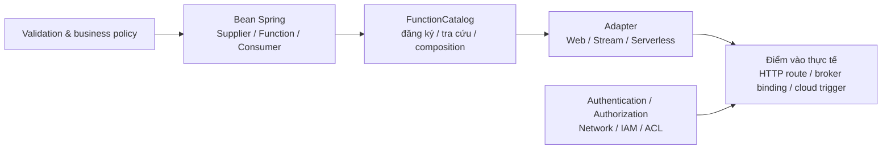
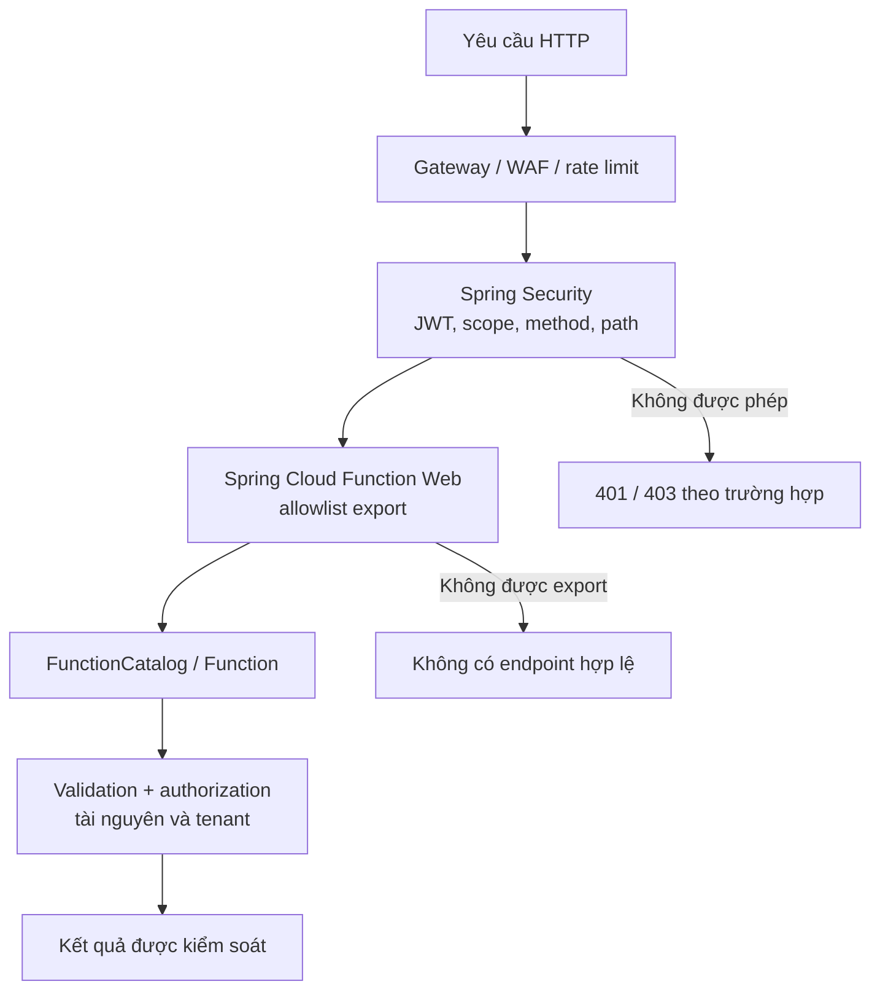

# Chỉ công bố các hàm cần thiết cho từng điểm vào

## 1. Bài toán bảo mật trong Spring Cloud Function

Trong **SPRING_CLOUD_FUNCTION (Spring Cloud Function)**, logic được viết thành các bean `Supplier`, `Function` và `Consumer`, được tra cứu qua `FunctionCatalog`, có thể ghép bằng *composition* và triển khai cùng một logic qua HTTP, luồng sự kiện hoặc môi trường serverless. Khả năng tái sử dụng này rất hữu ích, nhưng cũng tạo ra một câu hỏi bảo mật: **hàm nào được phép gọi từ điểm vào nào?**

Một ứng dụng có thể chứa ba chức năng:

- `publicUppercase`: chuẩn hóa chuỗi do người dùng gửi.
- `publicPreview`: tạo bản xem trước cho khách hàng.
- `internalRebuild`: thao tác bảo trì chỉ được kích hoạt bởi quy trình nội bộ có quyền cao.

Nếu ứng dụng dùng `spring-cloud-function-web` và để mọi bean đủ điều kiện được xuất bản thành HTTP endpoint, một chức năng vốn được thiết kế cho nội bộ có nguy cơ có **đường gọi qua mạng** ngoài dự kiến. Việc tên hàm có chữ `internal` hoặc logic nằm trong một package tên `admin` **không phải hàng rào truy cập**.

Nguyên tắc cốt lõi:

> **Mỗi điểm vào chỉ nên công bố những hàm thật sự cần, và mọi lời gọi đã được công bố vẫn phải chịu xác thực, phân quyền và kiểm tra dữ liệu phù hợp.**

Đây là nguyên tắc *least privilege* (đặc quyền tối thiểu) áp dụng cho bề mặt gọi hàm, không chỉ cho tài khoản hoặc hệ thống mạng.

### Mục tiêu học tập

Sau bài này, bạn có thể:

1. Phân biệt bean Java, `FunctionCatalog`, adapter và điểm vào bên ngoài.
2. Chỉ rõ các endpoint được xuất bản trong Spring Cloud Function Web bằng `spring.cloud.function.definition` và danh sách phân tách bằng `;`.
3. Sử dụng `spring.cloud.function.ineligible-definitions` cho các bean không nên đăng ký vào catalog; hiểu giới hạn của nó.
4. Áp dụng Spring Security ở đường HTTP và ràng buộc quyền truy cập theo từng hàm.
5. Tránh rủi ro từ dynamic routing, composition, single-function fallback và header do caller điều khiển.
6. Chọn riêng function definition, trigger và quyền hạ tầng cho Spring Cloud Stream và serverless.
7. Viết kiểm thử âm tính để chứng minh hàm nội bộ **không** gọi được qua điểm vào công khai.

## 2. Bốn lớp thường bị nhầm là một



| Lớp | Trách nhiệm | Điều **không** được suy ra |
|---|---|---|
| Bean Spring | Định nghĩa logic `Function`, `Consumer`, `Supplier` | `@Bean` không có nghĩa mọi client đều được phép gọi |
| `FunctionCatalog` | Khám phá, tra cứu, bọc lời gọi, conversion, composition | Được tra cứu trong catalog không đồng nghĩa được phép công bố qua Internet |
| Adapter | Nối logic với HTTP, broker, Lambda hoặc môi trường khác | Việc một adapter có sẵn không phải bằng chứng endpoint đã được bảo vệ |
| Điểm vào/transport | URL, method, topic/subscription, event trigger | Một tên đường dẫn khó đoán không thay thế phân quyền |
| Lớp bảo mật | Xác thực, ủy quyền, chính sách mạng, IAM/ACL, giới hạn lưu lượng | Một hàm nằm trong allowlist vẫn có thể bị lạm dụng nếu không có kiểm soát quyền |

**“Không công bố” và “không có trong catalog” khác nhau.** Một bean có thể vẫn được ứng dụng nội bộ sử dụng dù không được Web adapter công bố. Ngược lại, đưa bean ra khỏi catalog giúp giảm khả năng adapter hoặc `FunctionCatalog.lookup(...)` tra cứu nó, nhưng không phải là phương án cấp quyền cho đối tượng vẫn có thể gọi trực tiếp bean Java hoặc service nội bộ.

## 3. Lập bảng điểm vào trước khi cấu hình

Để tránh áp dụng một property cho mọi loại triển khai, hãy tạo ma trận cho ứng dụng:

| Chức năng | HTTP công khai | HTTP quản trị | Broker `orders.in` | Serverless trigger | Ghi chú |
|---|---:|---:|---:|---:|---|
| `publicUppercase` | Có, nếu API thật sự cần | Không cần | Không | Không | Xác thực và quota theo API |
| `publicPreview` | Có | Không cần | Không | Không | Không thao tác thay đổi trạng thái |
| `processOrderEvent` | Không | Không | Có | Có thể ở **deployment khác** | Chỉ nhận từ nguồn sự kiện được cấp quyền |
| `internalRebuild` | Không | Chỉ qua API quản trị riêng, nếu bắt buộc | Không | Chỉ trigger quản trị riêng, nếu cần | Quyền cao, audit và tách mạng |

Ma trận cần được xét cho **mỗi deployment/profile**, không chỉ cho toàn bộ repository. Một JAR có nhiều bean không có nghĩa tất cả môi trường chạy JAR đó phải mở mọi đường vào.

Ví dụ, triển khai Web chỉ cần `publicUppercase` và `publicPreview`, còn triển khai Stream chỉ cần `processOrderEvent`. Hãy dùng cấu hình riêng theo môi trường hoặc tách ứng dụng nếu khác biệt quyền hạn lớn.

## 4. Ví dụ: nhiều bean, chỉ một nhóm được phép qua HTTP

Tạo ứng dụng Spring Boot nhỏ với ba bean. Ví dụ Java 17+:

```java
package com.example.securefunctions;

import java.util.Locale;
import java.util.function.Function;

import org.springframework.boot.SpringApplication;
import org.springframework.boot.autoconfigure.SpringBootApplication;
import org.springframework.context.annotation.Bean;

@SpringBootApplication
public class SecureFunctionApplication {

    public static void main(String[] args) {
        SpringApplication.run(SecureFunctionApplication.class, args);
    }

    @Bean
    public Function<String, String> publicUppercase() {
        return value -> value.toUpperCase(Locale.ROOT);
    }

    @Bean
    public Function<String, String> publicPreview() {
        return value -> "[PREVIEW] " + value;
    }

    // Hàm minh họa tác vụ nội bộ; không được công bố thành HTTP endpoint.
    @Bean
    public Function<String, String> internalRebuild() {
        return value -> "INTERNAL:" + value;
    }
}
```

Ba bean cùng có kiểu `Function<String, String>`, nên đây là tình huống có nhiều ứng viên trong `FunctionCatalog`. Trong ứng dụng thật, **các tác vụ quản trị nhạy cảm tốt nhất nên là service riêng** thay vì bean `Function` nằm chung catalog công khai; ở đây ta cố ý dùng `internalRebuild` làm bean hàm để chứng minh cách giảm khả năng bị công bố.

Giả sử ứng dụng có Spring Cloud Function Web trên classpath. Web adapter có thể xuất các bean hàm thành HTTP endpoints theo tên hàm; nếu không có quy tắc giới hạn, người phát triển không nên mặc định rằng chỉ một URL đã được mở.

## 5. Giới hạn Web export bằng `spring.cloud.function.definition`

Trong Spring Cloud Function Web, tài liệu chính thức mô tả **Function Filtering rules**: khi có nhiều function trong catalog, dùng `spring.cloud.function.definition` với danh sách phân tách bằng **dấu chấm phẩy (`;`)** để chỉ công bố một tập hàm/composition cụ thể.

```properties
spring.cloud.function.web.path=/functions
spring.cloud.function.definition=publicUppercase;publicPreview
```

Ý nghĩa:

- `publicUppercase` và `publicPreview` là **hai** điểm vào được cho phép xuất bản.
- `internalRebuild` không nằm trong danh sách; Web adapter không nên xuất bản nó thành endpoint theo cấu hình lọc này.
- Khi dùng danh sách cách nhau bằng `;` theo quy tắc Web adapter, **không có ánh xạ tự động cho root path**.
- `spring.cloud.function.web.path=/functions` đặt prefix đường HTTP của Web adapter; đổi prefix **không phải biện pháp bảo mật**.

Đường gọi minh họa:

```bash
curl -i -X POST http://localhost:8080/functions/publicUppercase \
  -H "Content-Type: text/plain" \
  -d "hello"
```

Khi có cấu hình và cơ chế xác thực hợp lệ, kết quả logic sẽ là `HELLO`. **Không nên dùng lệnh này để suy ra endpoint đã an toàn**, vì lọc xuất bản chỉ là một lớp trong chiến lược bảo mật.

### 5.1. Phân biệt dấu `;` và dấu `|`

| Cấu hình | Ý nghĩa đối với Web adapter | Lưu ý bảo mật |
|---|---|---|
| `publicUppercase;publicPreview` | Danh sách hai hàm được xuất bản | Phù hợp ví dụ allowlist nhiều hàm |
| `publicUppercase\|publicPreview` | Một **composition** nối hai hàm; có thể ánh xạ ở root theo quy tắc Web | **Không** phải danh sách hai endpoint |
| `publicUppercase\|publicPreview;publicPreview` | Allowlist một composition và một hàm riêng | Composition cũng là một đường gọi cần xem xét quyền |
| `publicUppercase` | Chọn một definition, có thể ánh xạ ở root | **Không nên suy ra** các đường gọi khác đã bị khóa chỉ từ property này |

Dấu `;` trong bảng là **phân cách các definition**; dấu `|` nối **các bước của một function composition**. Với HTTP, dấu `,` cũng có thể được dùng để biểu diễn composition trong URL, tùy cơ chế Web adapter.

Đặc biệt, việc đặt:

```properties
spring.cloud.function.definition=publicUppercase
```

**không tương đương** một chính sách kiểm soát truy cập chỉ cho phép đúng `/publicUppercase` trong mọi trường hợp. Tài liệu phân biệt việc chọn composition/root mapping với **Function Filtering rules**; cần kiểm tra chính xác endpoint được xuất bản và áp dụng quy tắc bảo mật tại URL.

### 5.2. Cấu hình bổ sung cho việc loại ứng viên khỏi catalog

Trong `application.properties` của ví dụ:

```properties
spring.cloud.function.web.path=/functions
spring.cloud.function.definition=publicUppercase;publicPreview
spring.cloud.function.ineligible-definitions=internalRebuild
spring.cloud.function.single-function-fallback-enabled=false
```

Hai dòng sau có mục đích riêng:

- `spring.cloud.function.ineligible-definitions=internalRebuild` yêu cầu framework không đăng ký bean tên `internalRebuild` làm ứng viên trong `FunctionCatalog`. Bean Java vẫn có thể tồn tại và được inject/call bên trong ứng dụng. Đây là cơ chế **lọc catalog**, không phải Spring Security.
- `spring.cloud.function.single-function-fallback-enabled=false` tắt hành vi fallback: với một ứng viên hàm duy nhất, catalog mặc định có thể tra cứu thành công qua tên trống hoặc tên không khớp. Khi tránh bất kỳ tên tùy ý nào cũng tra cứu được hàm duy nhất, nên cân nhắc tắt fallback.

Thực tế cần cấu hình này tùy phiên bản Spring Cloud Function và cách ứng dụng đăng ký bean. Hai property giúp giảm sai sót khám phá hàm, **không ngăn một người có quyền trong process gọi trực tiếp service/bean**, và không thay thế network security.

## 6. Bảo vệ URL bằng Spring Security, không chỉ bằng danh sách hàm

Một hàm được xuất bản hợp lệ vẫn có thể cần xác thực, kiểm tra vai trò và giới hạn tần suất. Trong ứng dụng stateless dùng JWT bearer token, có thể tạo một `SecurityFilterChain` riêng cho prefix `/functions/**` và **từ chối mặc định** mọi HTTP path/method không thuộc hợp đồng.

Ví dụ Spring Security 6 / Spring Boot 3 (giả định đã có dependency Web, Security và OAuth2 Resource Server):

```java
package com.example.securefunctions;

import org.springframework.context.annotation.Bean;
import org.springframework.context.annotation.Configuration;
import org.springframework.core.annotation.Order;
import org.springframework.http.HttpMethod;
import org.springframework.security.config.Customizer;
import org.springframework.security.config.annotation.web.builders.HttpSecurity;
import org.springframework.security.web.SecurityFilterChain;

@Configuration
public class SecurityConfiguration {

    @Bean
    @Order(1)
    SecurityFilterChain functionApi(HttpSecurity http) throws Exception {
        http.securityMatcher("/functions/**")
            // Chỉ phù hợp với API stateless xác thực bằng bearer token,
            // không dựa vào cookie trình duyệt.
            .csrf(csrf -> csrf.disable())
            .authorizeHttpRequests(auth -> auth
                .requestMatchers(
                    HttpMethod.POST, "/functions/publicUppercase")
                    .hasAuthority("SCOPE_functions.uppercase")
                .requestMatchers(
                    HttpMethod.POST, "/functions/publicPreview")
                    .hasAuthority("SCOPE_functions.preview")
                .anyRequest().denyAll()
            )
            .oauth2ResourceServer(oauth -> oauth.jwt(Customizer.withDefaults()));

        return http.build();
    }

    @Bean
    @Order(2)
    SecurityFilterChain denyOtherRequests(HttpSecurity http)
            throws Exception {
        // Trong ví dụ một ứng dụng chỉ chứa các HTTP endpoints trên:
        // mọi URL khác đều bị từ chối.
        http.authorizeHttpRequests(auth -> auth
                .anyRequest().denyAll());
        return http.build();
    }
}
```

Giải thích:

1. **`POST /functions/publicUppercase`** cần token có authority `SCOPE_functions.uppercase`.
2. **`POST /functions/publicPreview`** cần authority `SCOPE_functions.preview`.
3. Đường dẫn `/functions/internalRebuild`, `/functions/functionRouter`, URL composition ngoài allowlist hoặc HTTP method không khai báo đều bị `denyAll()` từ chain dành cho functions.
4. Chain thứ hai **từ chối các URL còn lại** trong ứng dụng minh họa; ứng dụng thật có thể cần chính sách riêng cho health checks, actuator hoặc API quản trị, nhưng phải ghi rõ từng ngoại lệ.
5. `oauth2ResourceServer(...jwt...)` yêu cầu ứng dụng cấu hình một nhà phát hành/khóa xác minh JWT và kiểm tra token hợp lệ. Ví dụ này **không** tạo sẵn identity provider hoặc cấp quyền cho người dùng.

**Không bật/tắt CSRF tùy tiện.** Ở ví dụ, CSRF chỉ bị tắt cho API stateless sử dụng bearer token và **không sử dụng cookie để xác thực**. Nếu endpoint có phiên đăng nhập/cookie trình duyệt, cần bảo vệ CSRF thích hợp thay vì sao chép cấu hình này.

Ngoài URL, các chức năng xử lý dữ liệu người dùng cần kiểm tra input, phân quyền tài nguyên ở tầng nghiệp vụ, giới hạn kích thước request và rate limit tại gateway/reverse proxy. Scope cho phép gọi hàm **không tự cho phép truy cập dữ liệu của mọi tenant**.

## 7. Dynamic routing và header do caller kiểm soát

Spring Cloud Function hỗ trợ `functionRouter`, routing qua property và một số routing header như:

```text
spring.cloud.function.definition
spring.cloud.function.routing-expression
```

Các header mang chỉ dẫn routing là điểm cần đặc biệt thận trọng vì client có thể yêu cầu gọi một function hoặc composition khác. Với Web adapter, tài liệu Spring Cloud Function cho biết HTTP headers có thể được chuyển thành `MessageHeaders`; vì vậy **không nên cho phép client tùy ý quyết định function definition được chạy**.

Ví dụ một yêu cầu đáng ngờ trong hệ thống có router công khai:

```http
POST /functions/functionRouter HTTP/1.1
Content-Type: text/plain
spring.cloud.function.definition: internalRebuild

some-input
```

Đây là **tình huống rủi ro để phân tích**, không phải một endpoint nên tồn tại trong triển khai. Nếu ứng dụng cần dynamic routing thực sự:

- Chỉ router được thiết kế và cấp quyền rõ ràng mới được công bố.
- Không chấp nhận function name hoặc composition tự do từ bên gửi không đáng tin.
- Dùng **allowlist đích** được quản lý ở server, phân quyền từng đích và chỉ ánh xạ lựa chọn nghiệp vụ hợp lệ.
- Lọc/loại các routing headers từ client ở gateway/adapter nếu API không cần chúng.
- Không để một token dùng cho chức năng ít quyền có thể route đến tác vụ quản trị có quyền cao.

### Rủi ro SpEL trong routing

`spring.cloud.function.routing-expression` sử dụng Spring Expression Language. Tài liệu Spring Cloud Function giải thích biểu thức lấy từ **Message header** được đánh giá trong `SimpleEvaluationContext` hạn chế hơn, còn biểu thức từ application/system property có thể dùng `StandardEvaluationContext` linh hoạt hơn.

Điều đó **không có nghĩa** client được phép chọn bất kỳ target function nào trong catalog. Hạn chế khả năng thực thi biểu thức và **kiểm soát quyền gọi một hàm** là hai câu hỏi bảo mật khác nhau.

Hãy bảo vệ nguồn cấu hình property, environment variables và các endpoint quản trị có thể lộ/đổi cấu hình (ví dụ những endpoint Actuator do ứng dụng mở). Spring Cloud Function không tự công bố toàn bộ các endpoint quản trị đó, nhưng tổ hợp dependency và cấu hình của ứng dụng có thể tạo đường truy cập ngoài ý muốn.

## 8. Composition cũng là một bề mặt xuất bản

`FunctionCatalog` hỗ trợ tạo hàm ghép như:

```properties
spring.cloud.function.definition=publicUppercase|publicPreview
```

Với Web adapter, một composition có thể được gọi bằng đường dẫn tương ứng nếu nó được xuất bản. Do đó:

1. **Xem composition như một hàm mới** khi lập danh sách endpoint: đầu vào, đầu ra và tác dụng phụ của toàn chuỗi.
2. Không cho phép một hàm ít quyền trở thành điểm dẫn tới bước quản trị có quyền cao.
3. Nếu công bố composition, phải có allowlist **chính definition tổng hợp đó**, không chỉ nhìn từng bean đơn lẻ.
4. Không chấp nhận các đường dẫn tự ghép tên hàm nếu hợp đồng HTTP chỉ cho phép hai chức năng riêng.
5. Kiểm thử cả URL dùng dấu phẩy hoặc dấu pipe đã mã hóa khi framework cho phép composition theo URL.

Ví dụ cấu hình có **một composition và một hàm đơn**:

```properties
spring.cloud.function.definition=publicUppercase|publicPreview;publicPreview
```

Dấu `|` tạo một function ghép, còn `;` tách những function definitions được phép xuất bản. Nếu cần công bố composition trong API thật, hãy thêm đường dẫn tương ứng vào chính sách `SecurityFilterChain`; nếu không cần, đừng đưa nó vào allowlist.

## 9. Khi nào nên tách tác vụ nội bộ khỏi `FunctionCatalog`?

`spring.cloud.function.ineligible-definitions` phù hợp khi ứng dụng có bean phù hợp giao diện `Function` nhưng **không muốn đăng ký vào catalog**. Ví dụ:

```properties
spring.cloud.function.ineligible-definitions=internalRebuild
```

Một thiết kế còn an toàn hơn cho thao tác quản trị là **không khai báo nó dưới dạng bean `Function` có thể khám phá được**. Thay vào đó, dùng service thông thường:

```java
package com.example.securefunctions;

import org.springframework.stereotype.Service;

@Service
public class InternalMaintenanceService {

    public String rebuildIndex(String jobId) {
        // Minh họa: triển khai tác vụ bảo trì sau khi caller đã được cấp quyền.
        return "Rebuilt for job " + jobId;
    }
}
```

Service này không tự trở thành ứng viên `Supplier`/`Function`/`Consumer` chỉ vì nó có một phương thức Java trả `String`. Nếu cần một adapter quản trị để gọi service, xây endpoint/trigger **riêng** có xác thực mạnh, phân quyền và audit rõ ràng.

Lưu ý quan trọng: cách tổ chức code giảm nguy cơ **vô tình công bố**. Nó không thay thế bảo mật runtime, vì bất kỳ code nào bên trong process đã được thực thi với quyền đủ cao vẫn có thể gọi service; ngoài ra, lỗ hổng ở một endpoint công khai có thể dẫn đến truy cập dữ liệu ngoài mong muốn. Thiết kế quyền của toàn hệ thống vẫn phải tuân thủ least privilege.

## 10. Spring Cloud Stream: chọn đúng hàm và đúng binding

Điểm vào của một ứng dụng Spring Cloud Stream **không phải URL HTTP**. Nó là subscription/topic/queue được binder kết nối tới hàm đã chọn. Vì vậy, cần giới hạn **function definition và destination** theo triển khai Stream.

Ví dụ một deployment *riêng* chỉ phục vụ sự kiện đơn hàng:

```java
package com.example.stream;

import java.util.function.Function;
import org.springframework.context.annotation.Bean;
import org.springframework.context.annotation.Configuration;

@Configuration
public class StreamFunctions {

    @Bean
    public Function<String, String> processOrderEvent() {
        return event -> "processed:" + event;
    }
}
```

```yaml
# application-stream.yml — cấu hình cho deployment xử lý event.
spring:
  cloud:
    function:
      definition: processOrderEvent
    stream:
      bindings:
        processOrderEvent-in-0:
          destination: orders.requests
        processOrderEvent-out-0:
          destination: orders.responses
```

Điểm cần kiểm tra:

- `spring.cloud.function.definition=processOrderEvent` chọn hàm để binder sử dụng. Không dựa vào tính năng tự phát hiện một bean duy nhất để định nghĩa đường vào quan trọng.
- `processOrderEvent-in-0` và `processOrderEvent-out-0` là tên binding được tạo theo quy tắc chức năng đơn trong ví dụ; chúng liên kết với destination thực tế.
- Cấu hình broker cần **credentials/ACL** chỉ cho phép đọc `orders.requests` và ghi `orders.responses`. Chỉ chọn function definition không ngăn credential có quyền đọc topic khác.
- Không đóng gói Web adapter trong deployment Stream nếu ứng dụng không cần HTTP endpoint của Spring Cloud Function. Một dependency/auto-configuration thừa có thể làm tăng bề mặt tấn công.
- Không cho dữ liệu từ message header không đáng tin lựa chọn tùy ý các function names, destinations hoặc quyền quản trị.

Trong những triển khai nhiều hàm, có thể khai báo danh sách definitions cho Stream theo quy tắc framework, nhưng phải lập ma trận cho từng binding. Cấu hình Stream không tự là **Web HTTP allowlist** nếu cùng ứng dụng đồng thời bật các adapter; cần kiểm thử toàn bộ điểm vào thực tế.

## 11. Serverless: một trigger, một quyền, một function được chọn

Trong AWS Lambda hoặc môi trường serverless tương tự, cùng bean Spring Cloud Function có thể được gọi thông qua adapter của nền tảng. Với adapter AWS sử dụng `FunctionInvoker`, khi có nhiều function bean, có thể chỉ định function definition bằng cấu hình hoặc biến môi trường tương ứng.

Ví dụ theo nguyên tắc:

```properties
# Cấu hình của deployment Lambda dành cho luồng sự kiện đơn hàng.
spring.cloud.function.definition=processOrderEvent
```

Không nên để event payload do client gửi tự quyết định gọi `internalRebuild` hoặc một bean có đặc quyền khác. Cần:

1. Định nghĩa **event trigger** rõ ràng: API Gateway route, EventBridge rule, queue hay topic.
2. Chỉ định **function definition** cần dùng cho deployment và kiểm tra hành vi chọn hàm khi catalog có nhiều ứng viên.
3. Cấp **IAM role tối thiểu** cho runtime và nguồn phát; hạn chế ai có quyền invoke, publish event hoặc cập nhật cấu hình/trigger.
4. Xác minh nguồn event, định dạng payload và metadata trước khi thực hiện thao tác nhạy cảm.
5. Tách deployment/role cho tác vụ quản trị và tác vụ công khai; không dùng chung role quá rộng chỉ vì chúng cùng repository.

Trong các serverless runtime, quyền vào trigger và quyền mà function sử dụng là hai hướng khác nhau. Ví dụ: một API công khai không được phép tự kích hoạt mọi function quản trị; ngược lại, một Lambda chỉ xử lý event đơn hàng không cần quyền quản trị toàn bộ cơ sở dữ liệu.

## 12. Lọc hàm, xác thực và quyền nghiệp vụ là ba hàng rào độc lập

Sơ đồ bảo vệ đề xuất cho HTTP:



| Hàng rào | Chặn vấn đề gì? | Không chặn được điều gì? |
|---|---|---|
| Web function allowlist | Tình huống một bean khác vô tình được xuất bản thành URL | Client vẫn có thể gọi hàm đã được allow |
| `ineligible-definitions` | Bean không mong muốn bị đăng ký làm ứng viên catalog | Không tạo authn/authz cho bean còn lại |
| Spring Security / gateway | Caller không xác thực, sai scope, sai path hoặc method | Một caller có scope có thể vẫn yêu cầu tài nguyên không thuộc quyền |
| Kiểm tra nghiệp vụ | Vượt quyền tenant/object, dữ liệu không hợp lệ, thao tác cấm | Không giảm URL surface nếu adapter vẫn công bố quá nhiều |
| Broker ACL / cloud IAM | Nguồn không có quyền publish/consume/invoke | Payload từ một principal có quyền vẫn có thể sai/độc hại |
| Phân tách process/deployment | Cô lập tài nguyên và quyền runtime theo nhiệm vụ | Không thay kiểm thử, cập nhật dependency hoặc cấu hình đúng |

**Phương án tốt là phòng thủ theo chiều sâu**: hạn chế số hàm xuất bản, giới hạn caller, giới hạn hành động và giới hạn quyền hạ tầng cho từng điểm vào.

## 13. Kiểm thử HTTP allowlist và authorization

Chỉ thử đường thành công như `POST /functions/publicUppercase` là chưa đủ. Bộ kiểm thử phải chứng minh **đường không được phép không thực thi hàm nhạy cảm**.

### 13.1. Test Spring MVC + Spring Security

Ví dụ JUnit 5 / MockMvc dưới đây giả định Spring Boot Test, Spring Security Test, Spring Cloud Function Web và class `SecureFunctionApplication` cùng `SecurityConfiguration` ở trên có mặt trong ứng dụng. Token giả lập `jwt()` cung cấp authority cho request theo cách kiểm thử; production vẫn cần issuer và xác minh chữ ký JWT:

```java
package com.example.securefunctions;

import static org.springframework.security.test.web.servlet.request
        .SecurityMockMvcRequestPostProcessors.jwt;
import static org.junit.jupiter.api.Assertions.assertNull;
import static org.springframework.test.web.servlet.request
        .MockMvcRequestBuilders.post;
import static org.springframework.test.web.servlet.result
        .MockMvcResultMatchers.*;

import org.junit.jupiter.api.Test;
import org.springframework.beans.factory.annotation.Autowired;
import org.springframework.boot.test.autoconfigure.web.servlet.AutoConfigureMockMvc;
import org.springframework.boot.test.context.SpringBootTest;
import org.springframework.boot.test.mock.mockito.MockBean;
import org.springframework.cloud.function.context.FunctionCatalog;
import org.springframework.http.MediaType;
import org.springframework.security.core.authority.SimpleGrantedAuthority;
import org.springframework.security.oauth2.jwt.JwtDecoder;
import org.springframework.test.web.servlet.MockMvc;

@SpringBootTest(
    classes = SecureFunctionApplication.class,
    properties = {
        "spring.cloud.function.web.path=/functions",
        "spring.cloud.function.definition=publicUppercase;publicPreview",
        "spring.cloud.function.ineligible-definitions=internalRebuild",
        "spring.cloud.function.single-function-fallback-enabled=false"
    }
)
@AutoConfigureMockMvc
class FunctionExposureSecurityTest {

    @Autowired
    MockMvc mvc;

    @Autowired
    FunctionCatalog catalog;

    // Tạo bean decoder giả cho Spring context của test; jwt() kiểm tra
    // đường phân quyền chứ không kiểm tra chữ ký JWT thật.
    @MockBean
    JwtDecoder jwtDecoder;

    @Test
    void untrustedCallerCannotInvokeFunction() throws Exception {
        mvc.perform(post("/functions/publicUppercase")
                .contentType(MediaType.TEXT_PLAIN)
                .content("hello"))
            .andExpect(status().isUnauthorized());
    }

    @Test
    void correctScopeCanInvokeOnlyItsFunction() throws Exception {
        mvc.perform(post("/functions/publicUppercase")
                .with(jwt().authorities(
                    new SimpleGrantedAuthority("SCOPE_functions.uppercase")))
                .contentType(MediaType.TEXT_PLAIN)
                .content("hello"))
            .andExpect(status().isOk())
            .andExpect(content().string("HELLO"));
    }

    @Test
    void wrongScopeIsForbidden() throws Exception {
        mvc.perform(post("/functions/publicPreview")
                .with(jwt().authorities(
                    new SimpleGrantedAuthority("SCOPE_functions.uppercase")))
                .contentType(MediaType.TEXT_PLAIN)
                .content("hello"))
            .andExpect(status().isForbidden());
    }

    @Test
    void internalEndpointIsForbidden() throws Exception {
        mvc.perform(post("/functions/internalRebuild")
                .with(jwt().authorities(
                    new SimpleGrantedAuthority("SCOPE_functions.uppercase")))
                .contentType(MediaType.TEXT_PLAIN)
                .content("rebuild"))
            .andExpect(status().isForbidden());
    }

    @Test
    void dynamicRouterPathIsForbidden() throws Exception {
        mvc.perform(post("/functions/functionRouter")
                .with(jwt().authorities(
                    new SimpleGrantedAuthority("SCOPE_functions.uppercase")))
                .contentType(MediaType.TEXT_PLAIN)
                .content("internalRebuild"))
            .andExpect(status().isForbidden());
    }

    @Test
    void internalBeanIsIneligibleForCatalogLookup() {
        assertNull(catalog.lookup("internalRebuild"));
    }
}
```

**Ý nghĩa kiểm thử:** test `403` xác nhận *SecurityFilterChain* từ chối URL, **chứ một mình nó chưa chứng minh Web adapter không đăng ký endpoint**. `@MockBean JwtDecoder` chỉ phục vụ khởi tạo ngữ cảnh kiểm thử Spring Boot 3 khi chưa có nhà phát hành token thật; `jwt()` kiểm tra phân quyền bằng token giả lập, **không** kiểm tra chữ ký hoặc cấu hình nhà phát hành JWT production. Để kiểm chứng **Function Filtering rules** độc lập với Spring Security, dùng một integration test/profile được phép kiểm tra route table của adapter hoặc thực hiện HTTP test trong môi trường kiểm soát với chính sách auth tạm thời cho phép test, xác nhận endpoint không export trả kết quả “không có route” như kỳ vọng.

Không thay đổi chính sách production thành allow-all để chạy kiểm thử. Tách test profile, không đem cấu hình mở rộng quyền sang bản build triển khai thật.

### 13.2. Kiểm tra `FunctionCatalog` không có hàm nội bộ

Với property `spring.cloud.function.ineligible-definitions=internalRebuild` và tắt single-function fallback, phương thức `internalBeanIsIneligibleForCatalogLookup()` trong `FunctionExposureSecurityTest` dùng `FunctionCatalog.lookup("internalRebuild")` để xác minh hàm bị loại khỏi catalog. Khác với test `403`, phép kiểm tra này đo **khả năng tra cứu qua catalog**, không phải chỉ kết quả của filter ở đường HTTP. Nếu cần test riêng, khai báo một Spring context cùng các properties tương ứng.

### 13.3. Danh sách test âm tính ở từng bề mặt

| Ca kiểm thử | Kết quả cần khẳng định |
|---|---|
| `POST /functions/publicUppercase` không token | `401 Unauthorized` nếu API yêu cầu JWT |
| Token thiếu scope cần thiết | `403 Forbidden` |
| `GET` thay `POST` với function chỉ công bố bằng POST trong security policy | Không được thực thi hàm |
| `/functions/internalRebuild` | Không truy cập được cả qua export filter lẫn authorization |
| `/functions/functionRouter` | Không truy cập được nếu router không được công bố |
| URL composition `publicUppercase,internalRebuild` hoặc biến thể encode | Không thực thi bước nội bộ |
| HTTP header `spring.cloud.function.definition: internalRebuild` | Không chuyển hướng lời gọi tới hàm ngoài allowlist |
| Catalog `lookup("internalRebuild")` | `null` khi bean đã bị đánh dấu ineligible |
| Root `/` hoặc `/functions/` | Không lén ánh xạ hàm do fallback/root mapping ngoài ý muốn |
| Stream event gửi từ principal không có ACL | Broker/adapter từ chối theo chính sách |
| Serverless invoke từ principal không có quyền | Runtime/IAM từ chối theo chính sách |

Đừng chỉ khẳng định dựa trên status code. Nếu cần bảo đảm không có side effect, dùng spy hoặc state kiểm tra để xác nhận function nội bộ **không thực sự được thực thi**.

## 14. Quan sát và kiểm toán lời gọi

Khi giới hạn hàm được công bố, vẫn nên ghi lại **sự kiện bảo mật**:

- Function definition nào được client yêu cầu; nó có thuộc allowlist của điểm vào không?
- Phương thức HTTP, route hoặc destination nào nhận yêu cầu?
- Caller đã được xác thực theo cơ chế nào, scope/role nào được cấp và quyết định `allow/deny` ra sao?
- Một request bị chặn vì thiếu quyền, endpoint không tồn tại hay input không hợp lệ?
- Có yêu cầu đáng ngờ tới `functionRouter`, URL composition hoặc bean nội bộ không?

Không ghi JWT bearer token, header `Authorization`, cookie, toàn bộ message payload hoặc dữ liệu nhạy cảm chỉ để điều tra. Sử dụng correlation ID đã được kiểm tra và trace ID do observability quản lý để liên kết log; lưu lượng cao cần giới hạn log và cảnh báo phù hợp.

Các chỉ số có thể theo dõi gồm số `401/403`, số request tới endpoint không công bố, số truy cập router bị chặn và thay đổi route/binding sau mỗi deployment. Không nên coi một số `404` lớn tự động là tấn công; cần kiểm tra ngữ cảnh và dữ liệu log có kiểm soát.

## 15. Sai lầm phổ biến và hướng khắc phục

| Sai lầm | Vì sao nguy hiểm | Hướng xử lý |
|---|---|---|
| “Bean tên `internalRebuild` nên không ai gọi được” | Tên không phải ranh giới bảo mật | Không export; loại khỏi catalog nếu phù hợp; giới hạn trigger/route |
| Chỉ đặt `spring.cloud.function.definition=publicUppercase` và mặc định mọi hàm khác đã bị khóa | Có khác biệt giữa root mapping và Web filtering | Dùng allowlist Web theo tài liệu, kiểm tra toàn bộ route |
| Dùng `|` thay `;` khi muốn hai endpoint | `|` là composition, có thể tạo đường gọi ngoài dự kiến | Hiểu cú pháp và kiểm thử URL thực tế |
| Chuyển `spring.cloud.function.web.path` thành một chuỗi khó đoán rồi coi an toàn | Đường dẫn có thể bị khám phá | Xác thực, phân quyền và network controls |
| Chỉ dùng `ineligible-definitions` mà không áp dụng Spring Security | Các hàm khác trong catalog vẫn có thể được gọi | Tách lọc catalog khỏi authorization |
| Công bố `functionRouter` mà cho client chọn mọi function | Có thể điều hướng tới tác vụ không nên công bố | Router chỉ nhận lựa chọn từ allowlist do server quản lý |
| Tin `spring.cloud.function.routing-expression` từ nguồn ngoài | Biểu thức và function selection đều có rủi ro | Bảo vệ routing headers và nguồn cấu hình |
| Cùng JAR vừa mở Web vừa gắn broker không cần thiết | Tăng số điểm vào và quyền hạ tầng | Tách deployment/profile, bỏ adapter không dùng |
| Một JWT scope cho mọi function | Caller mức thấp có thể gọi tác vụ mức cao | Scope/role theo chức năng và resource-level auth |
| Chỉ kiểm thử HTTP 200 của hàm công khai | Không phát hiện đường gọi ngầm qua root/router/composition | Có negative tests cho hàm không công bố |
| Đặt logic phân quyền chỉ trong gateway | Lời gọi từ broker/serverless có thể bỏ qua gateway HTTP | Xác thực nguồn và authorization ở đúng mỗi điểm vào |
| Coi `403` là bằng chứng function chưa được đăng ký HTTP | Status chỉ chứng minh Security Filter đang chặn | Kiểm tra Web allowlist/route table độc lập |

## 16. Bài tập thực hành

Xây một ứng dụng Spring Cloud Function gồm:

- `previewOrder`: `Function<OrderRequest, OrderPreview>`, được phép công bố HTTP cho tài khoản khách hàng đã đăng nhập.
- `submitOrder`: `Function<OrderRequest, OrderReceipt>`, chỉ dành cho scope `orders.submit`.
- `reconcileLedger`: tác vụ nội bộ, không được xuất bản qua HTTP công khai.
- `handleOrderEvent`: xử lý thông điệp từ broker trong một deployment riêng.

Yêu cầu:

1. Lập ma trận điểm vào và quyền cần thiết của bốn chức năng. Quyết định chức năng nào phải là bean `Function`, chức năng nào nên là service thông thường.
2. Trong cấu hình Web, dùng dấu `;` để chỉ xuất bản `previewOrder` và `submitOrder`. Tắt single-function fallback nếu không muốn lookup tên bất kỳ. Cân nhắc `ineligible-definitions` cho tác vụ nội bộ.
3. Dùng Spring Security bảo vệ `POST /functions/previewOrder` và `POST /functions/submitOrder` bằng hai scope khác nhau, mặc định `denyAll` với các path/method ngoài hợp đồng.
4. Viết test không token, sai scope, URL `/functions/reconcileLedger`, `/functions/functionRouter` và một URL composition cố chèn hàm nội bộ.
5. Viết cấu hình Stream chỉ chọn `handleOrderEvent` và gắn đúng topic/queue; mô tả broker ACL cho account của deployment.
6. Mô tả một deployment serverless chỉ có trigger và role cần thiết. Giải thích vì sao không nên cấp quyền quản trị database cho một Lambda chỉ đọc event.
7. Xem xét điều gì xảy ra nếu client gửi các HTTP headers `spring.cloud.function.definition` hoặc `spring.cloud.function.routing-expression`. Đề xuất kiểm tra/loại header và chính sách router.
8. Đưa checklist kiểm tra endpoint export vào pipeline triển khai. Một bản phát hành thêm bean `Function` mới có thể làm thay đổi bề mặt truy cập thế nào nếu chưa có allowlist?

## 17. Checklist trước khi đưa vào production

| Câu hỏi kiểm tra | Trạng thái cần đạt |
|---|---|
| Đã liệt kê tất cả `Supplier`, `Function`, `Consumer` và composition có thể được adapter chọn? | Có |
| HTTP Web adapter chỉ export những definition cần thiết? | Có; dùng allowlist phù hợp và đã test |
| Không dùng root mapping/single-function fallback ngoài dự kiến? | Đã kiểm tra |
| Không mở dynamic router tùy ý cho client chưa được kiểm soát? | Đã chặn hoặc allowlist đích |
| Có authentication, authorization, method/path deny-by-default? | Có |
| Các chức năng quản trị được tách khỏi catalog/endpoint công khai khi có thể? | Có |
| Stream binder chỉ gắn binding/destination cần thiết và dùng ACL tối thiểu? | Có |
| Serverless trigger, invoke permission và IAM role theo least privilege? | Có |
| Đã kiểm tra composition, encoded paths và header routing? | Có |
| Có negative tests chứng minh hàm nội bộ không thực thi từ điểm vào bên ngoài? | Có |
| Actuator, quản trị cấu hình, logs và secrets được bảo vệ? | Có |
| Kiểm tra lại sau khi thêm bean hoặc thay đổi adapter/dependency? | Có |

## 18. Tổng kết

**Chỉ công bố các hàm cần thiết** nghĩa là biến mỗi HTTP route, broker binding và serverless trigger thành một **hợp đồng gọi được kiểm soát**, không đơn thuần là đặt tên bean hay cấu hình một default function.

Với **Spring Cloud Function Web**, tài liệu hỗ trợ `spring.cloud.function.definition=foo;bar` để lọc các function definitions được xuất bản; `|` dùng cho composition chứ không phải danh sách hai endpoint. `spring.cloud.function.ineligible-definitions` giảm các ứng viên trong `FunctionCatalog`, còn `spring.cloud.function.single-function-fallback-enabled=false` tránh tra cứu một hàm duy nhất theo tên tùy ý. Các cấu hình này **không thay thế** Spring Security, authorization trong nghiệp vụ, broker ACL, IAM và kiểm thử âm tính.

Giữ `FunctionCatalog` như nơi tập hợp logic tái sử dụng, nhưng thiết kế **từng adapter và từng deployment** theo nguyên tắc ít đặc quyền nhất. Khi cần tính năng đặc quyền, ưu tiên service/trigger quản trị riêng thay vì công bố qua các đường HTTP hoặc routing chung.

**Tham khảo chính thức:**

- [Spring Cloud Function – Standalone Web Applications](https://docs.spring.io/spring-cloud-function/reference/spring-cloud-function/standalone-web-applications.html) — Web export, Function Filtering rules, composition và HTTP.
- [Spring Cloud Function – Programming model](https://docs.spring.io/spring-cloud-function/reference/spring-cloud-function/programming-model.html) — `FunctionCatalog`, ineligible definitions, single-function fallback và routing.
- [Spring Cloud Stream – Producing and Consuming Messages](https://docs.spring.io/spring-cloud-stream/reference/spring-cloud-stream/producing-and-consuming-messages.html) — function definition và binding.
