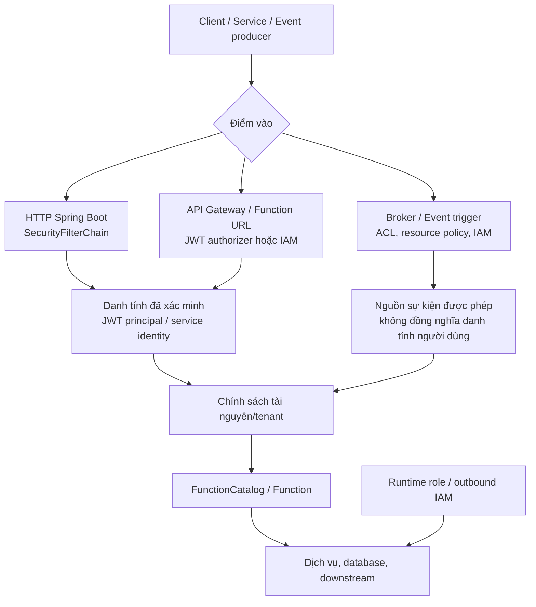
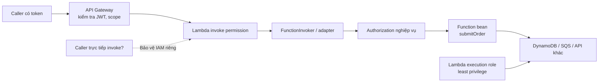

# Xác thực và phân quyền ở HTTP hoặc nền tảng serverless

## 1. Vì sao Spring Cloud Function cần ranh giới bảo mật riêng?

Trong **SPRING_CLOUD_FUNCTION (Spring Cloud Function)**, nghiệp vụ được viết thành các bean `Supplier`, `Function` hoặc `Consumer`, được đăng ký và tra cứu qua `FunctionCatalog`, có thể ghép bằng *composition* và tái sử dụng giữa HTTP, sự kiện hoặc môi trường serverless. Chính sự độc lập giao thức này tạo ra một nguyên tắc bảo mật quan trọng:

> **`FunctionCatalog` cung cấp cơ chế gọi hàm, không tự xác thực ai gọi hoặc cho phép người đó thao tác trên tài nguyên nào.**

Hãy xét chức năng `submitOrder` nhận yêu cầu đặt hàng. Cùng một logic có thể được gọi:

- Từ `POST /api/functions/submitOrder` trong ứng dụng Spring Boot Web.
- Qua Spring Cloud Function Web khi bean được công bố thành HTTP endpoint.
- Bằng API Gateway → AWS Lambda chạy `FunctionInvoker`.
- Từ SQS, EventBridge hoặc một broker sự kiện.
- Từ code nội bộ gọi trực tiếp bean hoặc `FunctionCatalog.lookup("submitOrder")`.

**Một lớp kiểm tra JWT ở HTTP chỉ bảo vệ đường HTTP mà nó thực sự bao phủ.** Nếu cùng bean còn có một đường nhận sự kiện hoặc một Lambda được phép invoke trực tiếp, đường đó cần chính sách bảo mật của riêng mình.

Mục tiêu của bài là thiết kế **xác thực (authentication)** và **phân quyền (authorization)** cho từng điểm vào, không biến logic nghiệp vụ thành nơi tự giải mã JWT, ký request hoặc kiểm soát IAM.

### Kết quả học tập

Sau bài học, bạn có thể:

1. Phân biệt xác thực, phân quyền ở endpoint, phân quyền tài nguyên và quyền thực thi của serverless runtime.
2. Bảo vệ HTTP endpoint bằng Spring Security OAuth2 Resource Server và JWT, với chính sách **deny-by-default**.
3. Áp dụng kiểm tra **quyền sở hữu đơn hàng/tenant** trước khi gọi một `Function`.
4. Nhận biết đường bypass nếu cùng hàm được Spring Cloud Function Web, dynamic router, FunctionCatalog hoặc một adapter khác công bố ngoài dự kiến.
5. Phân biệt API Gateway JWT authorizer, Lambda Function URL `AWS_IAM`, IAM invoke permission và execution role.
6. Không tin thông tin định danh do client tự khai trong `MessageHeaders` hoặc event envelope.
7. Viết kiểm thử các tình huống `401`, `403`, sai scope, sai chủ sở hữu, đường gọi ngoài allowlist và điểm vào serverless khác.

## 2. Mô hình đe dọa: “ai gọi?” khác “được làm gì?”



| Câu hỏi | Kiểm soát phù hợp | Thất bại thường gặp |
|---|---|---|
| Caller là ai? | JWT signature, issuer/audience, session hợp lệ, mTLS, IAM/SigV4 | Tin header `X-User-ID` tự khai |
| Caller có quyền gọi chức năng này không? | JWT scope/role, policy HTTP route, API Gateway authorizer, IAM invoke permission | Chỉ cần token bất kỳ là được |
| Caller có quyền với **đơn hàng này** không? | Authorization theo owner, tenant, quan hệ tài nguyên | Có scope `orders.submit` là thao tác được mọi `customerId` |
| Điểm vào có được phép gọi đúng function không? | Web export allowlist, handler/definition, trigger binding | Một router hoặc endpoint khác gọi được bean nội bộ |
| Function có quyền gọi downstream nào? | IAM execution role, DB credential, outbound service scopes | Cho mọi Lambda role `*` |
| Dữ liệu event có đáng tin không? | Broker ACL, policy nguồn, xác thực webhook, schema và business validation | Coi `event.userId` là danh tính đã xác minh |

**Authentication** chứng minh caller theo một cơ chế tin cậy. **Authorization** quyết định caller được làm gì, với loại hành động và tài nguyên cụ thể. **Input validation** kiểm tra hình dạng/giá trị dữ liệu; nó **không** thay thế hai kiểm soát trên.

Một bearer token JWT có chữ ký hợp lệ nhưng dành cho một API khác vẫn có thể không được phép dùng ở API này. Một JWT đã hợp lệ cho API nhưng thiếu scope hoặc cố đặt hàng thay người khác cũng phải bị từ chối.

## 3. Chọn kiến trúc điểm vào trước khi viết mã

Không có một cấu hình “bảo mật Spring Cloud Function” duy nhất bao trùm mọi adapter. Hãy lập ma trận:

| Deployment/điểm vào | Caller | Xác thực | Phân quyền chức năng | Phân quyền dữ liệu |
|---|---|---|---|---|
| HTTP Spring MVC/controller | Browser/mobile/backend | Spring Security JWT Resource Server hoặc session/mTLS theo thiết kế | HTTP method + path + scope | Controller/service tra cứu quyền sở hữu/tenant |
| Spring Cloud Function Web | HTTP client | Spring Security bao phủ **mọi URL được công bố** | Function allowlist + security matchers | Bean/service được gọi vẫn cần policy |
| API Gateway HTTP API → Lambda | HTTP client | API Gateway JWT authorizer hoặc IAM tùy loại route | Route scopes/authorizer + Lambda invoke policy | Handler/service kiểm tra quyền trên tài nguyên |
| Lambda Function URL | Client đã được phép invoke | `AWS_IAM` qua SigV4 hoặc cơ chế app bổ sung nếu để public | Resource-based policy + IAM | Handler/service kiểm tra quyền nghiệp vụ |
| SQS/EventBridge → Lambda | Broker/rule/service producer | IAM/resource policy ở nguồn, queue/event bus | Quyền publish và invoke trigger | Nguồn event **không tự chứng minh user identity** |

Nguyên tắc vận hành là **mỗi deployment có danh sách function và trigger được phép**, không đơn thuần đóng gói tất cả bean rồi tin rằng một nơi đã xác thực thì các nơi khác cũng an toàn.

## 4. Ví dụ nghiệp vụ dùng chung: hai hàm với mức quyền khác nhau

Ta xây ví dụ Java 17+ trên Spring Boot 3 và Spring Cloud Function. Hai hàm dùng chung `OrderRequest`:

- `previewOrder` tạo bản xem trước, chỉ cần scope `orders.preview`.
- `submitOrder` tạo kết quả xác nhận, cần scope `orders.submit`.

Hai hàm **không biết HTTP, JWT, API Gateway hoặc Lambda**. Phần xác thực và phân quyền sẽ ở một adapter trước khi áp dụng bean.

```java
package com.example.secureorders;

import java.util.UUID;
import java.util.function.Function;

import org.springframework.context.annotation.Bean;
import org.springframework.context.annotation.Configuration;

@Configuration
public class OrderFunctions {

    public record OrderRequest(
            String customerId, String sku, int quantity) {}

    public record OrderPreview(
            String sku, int quantity, long estimatedTotal) {}

    public record OrderReceipt(
            String receiptId, String status) {}

    private static void validate(OrderRequest request) {
        if (request == null
                || request.customerId() == null
                || request.customerId().isBlank()
                || request.sku() == null
                || request.sku().isBlank()
                || request.quantity() < 1
                || request.quantity() > 100) {
            throw new IllegalArgumentException(
                    "Invalid order request");
        }
    }

    @Bean
    public Function<OrderRequest, OrderPreview> previewOrder() {
        return request -> {
            validate(request);
            return new OrderPreview(
                    request.sku(),
                    request.quantity(),
                    request.quantity() * 1_000L
            );
        };
    }

    @Bean
    public Function<OrderRequest, OrderReceipt> submitOrder() {
        return request -> {
            validate(request);
            // Minh họa đơn giản: production cần lưu đơn, transaction,
            // idempotency và chính sách xử lý retry trước khi trả receipt.
            return new OrderReceipt(
                    UUID.randomUUID().toString(), "SUBMITTED");
        };
    }
}
```

Chữ ký `Function<OrderRequest, OrderReceipt>` giúp logic `submitOrder` dễ tái sử dụng. **Nhưng chính bean không phân quyền người gọi**, nên không được công bố nó qua một đường gọi bypass lớp xác thực mà không có kiểm tra tương ứng.

Trong một hệ thống thực tế, mọi đường gọi vào cùng tác vụ nhạy cảm có thể được thiết kế qua một **application service** chung thực hiện authorization, idempotency và transaction. Ví dụ tách lớp HTTP chỉ để minh họa cách bảo vệ endpoint, **không có nghĩa mọi invocation khác được mặc nhiên an toàn**.

## 5. HTTP: xác thực JWT bằng Spring Security Resource Server

Với API stateless dùng bearer access token, Spring Security OAuth2 Resource Server có thể kiểm tra JWT do identity provider phát hành. Cấu hình tối thiểu cần:

- Dependency Spring Security, OAuth2 Resource Server và JOSE theo Spring Boot/Spring Security version.
- Địa chỉ **issuer** đáng tin và cách lấy khóa ký công khai (thường qua OIDC/JWK).
- Validation **signature, issuer, thời gian hiệu lực** và **audience** dành cho API này.
- Ánh xạ claims về authorities/scopes dùng trong chính sách HTTP.
- Quy tắc deny-by-default cho đường dẫn và phương thức không thuộc API.

Ví dụ `application.yml` (địa chỉ minh họa `.invalid`, cần thay bằng IdP thật):

```yaml
spring:
  security:
    oauth2:
      resourceserver:
        jwt:
          issuer-uri: https://idp.example.invalid/realms/orders
          audiences: orders-api
```

Theo tài liệu Spring Security hiện hành, `issuer-uri` hỗ trợ kiểm tra claim `iss`; Spring Boot có property `audiences` để kiểm tra claim `aud`. Đừng mặc định rằng chỉ đặt `issuer-uri` là đủ để chấp nhận token cho **đúng API**. Nếu hệ thống có nhiều issuer, thuật toán/khóa đặc thù hoặc token không đúng cấu trúc mặc định, cần cấu hình validator/decoder phù hợp.

**Access token và ID token không có cùng mục đích.** API nên chấp nhận token theo hợp đồng resource server của mình, không tự coi ID token đăng nhập người dùng là access token hợp lệ cho mọi resource.

### 5.1. Cấu hình `SecurityFilterChain` theo hàm

```java
package com.example.secureorders;

import org.springframework.context.annotation.Bean;
import org.springframework.context.annotation.Configuration;
import org.springframework.http.HttpMethod;
import org.springframework.security.config.Customizer;
import org.springframework.security.config.annotation.web.builders.HttpSecurity;
import org.springframework.security.config.http.SessionCreationPolicy;
import org.springframework.security.web.SecurityFilterChain;

@Configuration
public class ApiSecurityConfiguration {

    @Bean
    SecurityFilterChain apiSecurity(HttpSecurity http) throws Exception {
        return http
            // Chỉ dành cho API stateless dùng bearer token,
            // không dựa vào cookie/phiên đăng nhập trình duyệt.
            .csrf(csrf -> csrf.disable())
            .sessionManagement(session -> session
                .sessionCreationPolicy(SessionCreationPolicy.STATELESS))
            .authorizeHttpRequests(auth -> auth
                .requestMatchers(
                    HttpMethod.POST, "/api/functions/previewOrder")
                    .hasAuthority("SCOPE_orders.preview")
                .requestMatchers(
                    HttpMethod.POST, "/api/functions/submitOrder")
                    .hasAuthority("SCOPE_orders.submit")
                .anyRequest().denyAll()
            )
            .oauth2ResourceServer(oauth ->
                oauth.jwt(Customizer.withDefaults()))
            .build();
    }
}
```

Chính sách trên nói rằng:

1. Chỉ `POST /api/functions/previewOrder` với authority `SCOPE_orders.preview` mới được đi tiếp.
2. Chỉ `POST /api/functions/submitOrder` với `SCOPE_orders.submit` mới được đi tiếp.
3. Phương thức/URL khác, kể cả một URL router hoặc function ẩn, bị từ chối bởi `anyRequest().denyAll()`.
4. Token vắng mặt ở đường bắt buộc xác thực thường cho kết quả `401 Unauthorized`; token đã xác thực nhưng thiếu quyền thường là `403 Forbidden`.
5. Trong cấu hình mặc định, Spring Security thường ánh xạ scopes từ JWT claim `scope` hoặc `scp` thành authorities tiền tố `SCOPE_`. Với claim hoặc format của IdP khác, phải định nghĩa `JwtAuthenticationConverter` tương ứng, không đoán từ tên role.

**Lưu ý CSRF:** `csrf.disable()` chỉ được dùng ở đây vì API minh họa không dựa vào cookie/session của trình duyệt để xác thực. Nếu ứng dụng dùng cookie session, cần bảo vệ CSRF thay vì copy cấu hình này. CORS không phải cơ chế xác thực; cấu hình CORS cho browser không ngăn công cụ HTTP khác gọi API.

Nếu ứng dụng có endpoint Actuator, health hoặc admin hợp lệ, cần thiết kế `SecurityFilterChain` riêng với chính sách rõ; ví dụ trên cố ý từ chối mọi URL không được khai báo.

## 6. Phân quyền tài nguyên: JWT hợp lệ vẫn chưa đủ

Scope `orders.submit` chỉ chứng minh caller được phép **thử thực hiện loại hành động** này. Nó không khẳng định caller là chủ của `customerId` trong request.

Một ví dụ nguy hiểm:

```http
POST /api/functions/submitOrder HTTP/1.1
Authorization: Bearer <access-token-cua-user-A>
Content-Type: application/json

{"customerId":"user-B","sku":"BOOK","quantity":1}
```

Nếu chỉ kiểm tra JWT có scope `orders.submit` rồi gọi bean, caller A có thể yêu cầu hành động trên tài khoản B. Đây là **Broken Object Level Authorization (BOLA/IDOR)** ở tầng nghiệp vụ.

Thêm một chính sách kiểm tra chủ thể đã xác minh:

```java
package com.example.secureorders;

import org.springframework.security.access.AccessDeniedException;
import org.springframework.security.oauth2.jwt.Jwt;
import org.springframework.stereotype.Service;

@Service
public class OrderAccessPolicy {

    public void requireOwner(Jwt principal, String customerId) {
        if (principal == null
                || customerId == null
                || !customerId.equals(principal.getSubject())) {
            throw new AccessDeniedException(
                    "Not allowed to access this customer");
        }
    }
}
```

Ví dụ này **chủ ý đơn giản hóa** bằng cách giả định `customerId` bằng JWT `sub`. Trong sản phẩm thực tế, `sub` thường là định danh tài khoản của IdP, không nhất thiết là ID khách hàng trong database. Hãy thay phép so sánh này bằng **ánh xạ đã được xác minh** và policy repository/tenant, đồng thời hỗ trợ service account hoặc ủy quyền thay mặt khi quy trình đòi hỏi.

Không được lấy `principal` từ một trường `userId` hoặc `role` tự khai trong JSON body hay `X-User-ID` do client gửi. Chính sách phải nhận danh tính từ **Spring Security context đã được xác thực**.

## 7. Controller HTTP mỏng gọi lại các bean `Function`

Khi ứng dụng muốn toàn quyền kiểm soát đường HTTP và quyền truy cập, một lựa chọn là dùng **Spring MVC controller** để xác thực/phân quyền rồi gọi bean nghiệp vụ. Ví dụ sau giả định **chỉ có MVC endpoint**, không đồng thời mở Web adapter tự động cho cùng các bean.

```java
package com.example.secureorders;

import java.util.function.Function;

import org.springframework.beans.factory.annotation.Qualifier;
import org.springframework.http.MediaType;
import org.springframework.security.core.annotation.AuthenticationPrincipal;
import org.springframework.security.oauth2.jwt.Jwt;
import org.springframework.web.bind.annotation.PostMapping;
import org.springframework.web.bind.annotation.RequestBody;
import org.springframework.web.bind.annotation.RestController;

import com.example.secureorders.OrderFunctions.OrderRequest;
import com.example.secureorders.OrderFunctions.OrderPreview;
import com.example.secureorders.OrderFunctions.OrderReceipt;

@RestController
public class OrderHttpController {

    private final Function<OrderRequest, OrderPreview> previewOrder;
    private final Function<OrderRequest, OrderReceipt> submitOrder;
    private final OrderAccessPolicy accessPolicy;

    public OrderHttpController(
            @Qualifier("previewOrder")
            Function<OrderRequest, OrderPreview> previewOrder,
            @Qualifier("submitOrder")
            Function<OrderRequest, OrderReceipt> submitOrder,
            OrderAccessPolicy accessPolicy) {
        this.previewOrder = previewOrder;
        this.submitOrder = submitOrder;
        this.accessPolicy = accessPolicy;
    }

    @PostMapping(
        path = "/api/functions/previewOrder",
        consumes = MediaType.APPLICATION_JSON_VALUE,
        produces = MediaType.APPLICATION_JSON_VALUE)
    public OrderPreview preview(
            @RequestBody OrderRequest request,
            @AuthenticationPrincipal Jwt authenticatedJwt) {

        // Trước khi thực thi hàm, kiểm tra quyền với tài nguyên.
        accessPolicy.requireOwner(authenticatedJwt, request.customerId());
        return previewOrder.apply(request);
    }

    @PostMapping(
        path = "/api/functions/submitOrder",
        consumes = MediaType.APPLICATION_JSON_VALUE,
        produces = MediaType.APPLICATION_JSON_VALUE)
    public OrderReceipt submit(
            @RequestBody OrderRequest request,
            @AuthenticationPrincipal Jwt authenticatedJwt) {

        accessPolicy.requireOwner(authenticatedJwt, request.customerId());
        return submitOrder.apply(request);
    }
}
```

Chú ý từng lớp:

- **Spring Security** giải mã/xác minh JWT và yêu cầu scope theo endpoint **trước khi controller chạy**.
- **OrderAccessPolicy** kiểm tra quyền đối với `customerId` sau khi danh tính đã được xác minh.
- **Function bean** xử lý logic của payload, không nhận `Authorization` hay raw JWT như dữ liệu nghiệp vụ.
- **Controller** là điểm vào HTTP duy nhất được mô tả ở ví dụ; muốn bảo đảm điều đó, đừng vô tình đưa thêm adapter Web hoặc router công bố cùng bean ngoài controller.

Ví dụ gửi request qua API:

```bash
curl -i -X POST http://localhost:8080/api/functions/previewOrder \
  -H "Authorization: Bearer <valid-access-token>" \
  -H "Content-Type: application/json" \
  -d '{"customerId":"user-A","sku":"BOOK","quantity":2}'
```

Kết quả `200` chỉ xảy ra khi token có issuer/audience phù hợp, còn hiệu lực, scope `orders.preview` và `sub` khớp `customerId` theo policy minh họa. Nếu thiếu token/scope hoặc không có quyền tài nguyên, yêu cầu phải bị từ chối; **một request JSON hợp lệ không đủ để cấp quyền**.

## 8. Spring Cloud Function Web: tránh đường bypass controller

Nếu dùng `spring-cloud-function-web`, Web adapter có khả năng tạo HTTP endpoint từ các function definitions trong `FunctionCatalog`. Điều này **khác** với controller ở mục 7: chỉ bảo vệ `/api/functions/**` không đảm bảo các URL do Web adapter tạo ở prefix khác cũng bị kiểm soát theo cùng chính sách.

Ba lựa chọn thiết kế:

| Cách triển khai | Cách bảo vệ |
|---|---|
| MVC controller + các bean Function, **không có** Web adapter tự xuất bản | Chính sách HTTP áp dụng cho controller; kiểm tra app không có endpoint ngoài dự kiến |
| Dùng Spring Cloud Function Web trực tiếp | Allowlist definition, xác định Web path, bảo vệ toàn bộ URL/method bằng Spring Security |
| Có cả MVC và SCF Web vì yêu cầu đặc thù | Lập danh sách **tất cả** route của hai adapter, bảo vệ từng đường và kiểm thử không có bypass |

Ví dụ property dành **riêng cho deployment dùng Web adapter**:

```properties
spring.cloud.function.web.path=/functions
spring.cloud.function.definition=previewOrder;submitOrder
spring.cloud.function.single-function-fallback-enabled=false
```

Trong Spring Cloud Function Web, `;` là cách phân cách danh sách definitions khi lọc những hàm được xuất bản; `|` biểu thị **composition**, không phải hai endpoint độc lập. Đổi prefix từ `/functions` thành đường dẫn bí mật **không phải bảo mật**.

Đừng cho HTTP header `spring.cloud.function.definition` hoặc `spring.cloud.function.routing-expression` do client gửi quyết định tự do bean/chuỗi hàm được gọi. Đặc biệt, **`functionRouter`** và composition tạo các đường gọi linh hoạt cần allowlist chặt chẽ nếu có thể truy cập từ bên ngoài.

Thận trọng với việc đặt `@PreAuthorize` trên **phương thức `@Bean` trả về một lambda `Function`**: annotation trên factory method không mặc nhiên biến mọi lần gọi `Function.apply(...)` thành phép kiểm tra quyền. Muốn bảo vệ tất cả đường vào, đặt authorization trong **service nghiệp vụ được gọi qua proxy bảo mật** hoặc tại từng adapter, rồi kiểm thử đường gọi thực tế.

## 9. Nguyên tắc HTTP bổ sung: token, CSRF, CORS, lỗi và lạm dụng

### 9.1. Bảo vệ access token và trust boundary

- **Không tự đọc `Authorization` rồi `Base64.decode` payload JWT để tin claim.** Resource Server phải kiểm tra chữ ký, algorithm/key, issuer, audience, thời gian và các ràng buộc thích hợp.
- Không tin `X-User-ID`, `X-Tenant-ID`, `X-Roles` hoặc một `MessageHeaders` có tên giống claim bảo mật chỉ vì client gửi chúng.
- Chỉ forward access token khi downstream có hợp đồng và cơ chế ủy quyền rõ; tránh copy bearer token vào `MessageHeaders` rồi phát ra Kafka/SQS hoặc log.
- Mỗi API cần quy định token cho user hay service-to-service. Với `client_credentials`, `sub` có thể là client thay vì customer ID; policy chủ sở hữu ở mục 6 phải được điều chỉnh, không nới bỏ tùy tiện.
- Dùng HTTPS/TLS; với nội bộ có thể cần mTLS hoặc service mesh identity. TLS bảo vệ kênh truyền, nhưng tự nó không thay thế authorization cấp nghiệp vụ.

### 9.2. Đừng nhầm CORS và authorization

`Access-Control-Allow-Origin` điều khiển hành vi của browser, không ngăn `curl` hoặc backend tự gọi API. Chỉ cho phép origin cần thiết, nhưng vẫn phải kiểm tra token và quyền. Không dùng cấu hình CORS rộng làm biện pháp “sửa lỗi 401/403”.

### 9.3. CSRF tùy mô hình xác thực

Nếu API dùng **cookie/session** được browser tự gửi, phải áp dụng biện pháp CSRF phù hợp. Ví dụ `SecurityFilterChain` ở mục 5 tắt CSRF vì chỉ dùng **bearer token stateless** và không dựa vào cookie. Khi kiến trúc thay đổi, phải xem lại quyết định này.

### 9.4. Lỗi HTTP và chính sách che giấu dữ liệu

| Kết quả | Nguyên nhân phổ biến | Ghi chú |
|---|---|---|
| `401 Unauthorized` | Chưa xác thực hoặc token thiếu/hết hạn/không hợp lệ | Không tiết lộ chi tiết token, khóa, tài khoản |
| `403 Forbidden` | Đã xác thực nhưng thiếu scope hoặc không sở hữu tài nguyên | Có thể dùng `404` để tránh lộ sự tồn tại tài nguyên nếu hợp đồng yêu cầu |
| `400 Bad Request` | Dữ liệu request sai cú pháp/schema | Cần handler rõ ràng cho validation; không quy mọi lỗi thành 500 |
| `429 Too Many Requests` | Vượt rate limit tại gateway/API | Tránh lạm dụng và chi phí bùng nổ |
| `5xx` | Lỗi ứng dụng/hạ tầng | Không trả stack trace hoặc secret cho caller |

Nếu `Function.apply(...)` ném `IllegalArgumentException`, Spring MVC không tự đảm bảo trả `400` trong mọi cấu hình. Nên có validation và `@ControllerAdvice` hoặc error mapping phù hợp để phân biệt lỗi client với lỗi hệ thống.

## 10. Kiểm thử HTTP: đúng scope, đúng owner và chặn đường vòng

Để kiểm thử, giả sử ứng dụng Spring Boot chứa các class ở mục 4–7 và có Spring Security Test. Có thể đặt một `@SpringBootApplication` tối thiểu:

```java
package com.example.secureorders;

import org.springframework.boot.SpringApplication;
import org.springframework.boot.autoconfigure.SpringBootApplication;

@SpringBootApplication
public class SecureOrderApplication {
    public static void main(String[] args) {
        SpringApplication.run(SecureOrderApplication.class, args);
    }
}
```

Lớp test JUnit 5/MockMvc:

```java
package com.example.secureorders;

import static org.springframework.security.test.web.servlet.request
        .SecurityMockMvcRequestPostProcessors.jwt;
import static org.springframework.test.web.servlet.request
        .MockMvcRequestBuilders.post;
import static org.springframework.test.web.servlet.result
        .MockMvcResultMatchers.*;

import org.junit.jupiter.api.Test;
import org.springframework.beans.factory.annotation.Autowired;
import org.springframework.boot.test.autoconfigure.web.servlet.AutoConfigureMockMvc;
import org.springframework.boot.test.context.SpringBootTest;
import org.springframework.boot.test.mock.mockito.MockBean;
import org.springframework.http.MediaType;
import org.springframework.security.core.authority.SimpleGrantedAuthority;
import org.springframework.security.oauth2.jwt.JwtDecoder;
import org.springframework.test.web.servlet.MockMvc;

@SpringBootTest(
    classes = SecureOrderApplication.class,
    properties = {
        "spring.security.oauth2.resourceserver.jwt.issuer-uri="
                + "https://idp.example.invalid/realms/orders",
        "spring.security.oauth2.resourceserver.jwt.audiences=orders-api"
    }
)
@AutoConfigureMockMvc
class OrderHttpSecurityTest {

    @Autowired
    MockMvc mvc;

    // Dùng JWT giả để thử authorization; không xác minh chữ ký JWT thật.
    @MockBean
    JwtDecoder jwtDecoder;

    private static final String BODY =
            "{\"customerId\":\"user-A\",\"sku\":\"BOOK\",\"quantity\":2}";

    @Test
    void anonymousRequestIsRejected() throws Exception {
        mvc.perform(post("/api/functions/previewOrder")
                .contentType(MediaType.APPLICATION_JSON)
                .content(BODY))
            .andExpect(status().isUnauthorized());
    }

    @Test
    void previewScopeAllowsOnlyOwnOrder() throws Exception {
        mvc.perform(post("/api/functions/previewOrder")
                .with(jwt().jwt(j -> j.subject("user-A"))
                    .authorities(new SimpleGrantedAuthority(
                        "SCOPE_orders.preview")))
                .contentType(MediaType.APPLICATION_JSON)
                .content(BODY))
            .andExpect(status().isOk())
            .andExpect(jsonPath("$.estimatedTotal").value(2000));
    }

    @Test
    void previewScopeCannotSubmit() throws Exception {
        mvc.perform(post("/api/functions/submitOrder")
                .with(jwt().jwt(j -> j.subject("user-A"))
                    .authorities(new SimpleGrantedAuthority(
                        "SCOPE_orders.preview")))
                .contentType(MediaType.APPLICATION_JSON)
                .content(BODY))
            .andExpect(status().isForbidden());
    }

    @Test
    void submitScopeCannotActForAnotherCustomer() throws Exception {
        mvc.perform(post("/api/functions/submitOrder")
                .with(jwt().jwt(j -> j.subject("user-B"))
                    .authorities(new SimpleGrantedAuthority(
                        "SCOPE_orders.submit")))
                .contentType(MediaType.APPLICATION_JSON)
                .content(BODY))
            .andExpect(status().isForbidden());
    }

    @Test
    void undocumentedFunctionRouteIsRejected() throws Exception {
        mvc.perform(post("/functions/submitOrder")
                .with(jwt().jwt(j -> j.subject("user-A"))
                    .authorities(new SimpleGrantedAuthority(
                        "SCOPE_orders.submit")))
                .contentType(MediaType.APPLICATION_JSON)
                .content(BODY))
            .andExpect(status().isForbidden());
    }
}
```

`jwt()` của Spring Security Test tạo Authentication giả trong MockMvc, phù hợp để kiểm tra **quy tắc phân quyền**. `@MockBean JwtDecoder` giúp context kiểm thử không cần liên hệ IdP; với Spring Boot mới hơn có thể sử dụng cơ chế mock bean thay thế theo phiên bản. **Bộ test này không chứng minh kiểm tra signature, issuer/audience hoặc TLS ở môi trường thật**: cần kiểm thử tích hợp JWT decoder/IdP và gateway riêng.

Test `403` cho `/functions/submitOrder` chỉ chứng minh Spring Security chặn đường lạ trong cấu hình này. Nếu mục tiêu còn là đảm bảo không có endpoint tự động do Spring Cloud Function Web, phải kiểm tra **route table và dependency** độc lập, không chỉ dựa vào một mã HTTP.

## 11. Serverless: bốn lớp quyền thường bị gộp nhầm

Ở AWS Lambda hoặc nền tảng serverless khác, một request đến function có thể đi qua gateway, Function URL, queue, event bus hoặc API gọi function trực tiếp. Trong mọi trường hợp, cần phân biệt:

| Kiểm soát | Đối tượng được kiểm tra | Ví dụ ở AWS |
|---|---|---|
| **Xác thực người gọi HTTP** | Người dùng hoặc ứng dụng gửi request | API Gateway JWT authorizer, Lambda authorizer, IAM/SigV4 |
| **Quyền kích hoạt function** | Dịch vụ hoặc principal có thể invoke Lambda | Lambda resource-based policy, identity-based IAM |
| **Quyền của runtime** | Những tài nguyên mà code bên trong Lambda có thể truy cập | Lambda execution role cho S3, DynamoDB, SQS, Secrets Manager |
| **Quyền với tài nguyên nghiệp vụ** | Caller/tenant có được thao tác trên đơn hàng này không? | Application authorization service truy vấn ownership và tenant |

**Quyền invoke Lambda và execution role của Lambda là hai thứ khác nhau.** Người được quyền gửi request đến Lambda không tự nhận các IAM permissions của execution role; nhưng nếu Lambda thực thi một hành động thay mặt người đó mà không kiểm tra quyền nghiệp vụ, kẻ gọi có thể lợi dụng quyền rộng của runtime. Đây là rủi ro *confused deputy*.



Nếu API Gateway bảo vệ một HTTP route nhưng Lambda còn được invoke trực tiếp qua AWS API với quyền quá rộng, một caller khác có thể **bỏ qua JWT authorizer của API Gateway**. Vì vậy bảo mật phải bao phủ **cả route và quyền gọi function bên dưới**.

## 12. AWS API Gateway → Lambda: xác thực JWT tại gateway

Với **API Gateway HTTP API**, JWT authorizer có thể xác minh JWT trước khi request đến Lambda. Các thiết lập quan trọng gồm:

1. **Issuer**: định danh identity provider đáng tin.
2. **Audience**: API/client mà token được phát hành cho theo cấu hình authorizer.
3. **Identity source**: nơi lấy token, thông thường header `Authorization`.
4. **Route**: ví dụ `POST /orders` phải gắn authorizer; không chỉ cấu hình authorizer nhưng quên liên kết route.
5. **Authorization scopes**: chỉ yêu cầu `orders.submit` ở route submit, `orders.preview` ở route preview.

Ma trận minh họa:

| HTTP route | Authorization type | Scope | Lambda/function definition |
|---|---|---|---|
| `POST /orders/preview` | `JWT` | `orders.preview` | `previewOrder` ở deployment thích hợp |
| `POST /orders` | `JWT` | `orders.submit` | `submitOrder` ở deployment thích hợp |
| `POST /admin/reconcile` | Không công bố trong API công khai | — | Deployment/trigger quản trị riêng |

Ví dụ **phác thảo cấu hình**, không phải template IaC hoàn chỉnh:

```yaml
httpApi:
  jwtAuthorizer:
    issuer: https://idp.example.invalid/realms/orders
    audiences:
      - orders-api
    identitySource: "$request.header.Authorization"
  routes:
    - method: POST
      path: /orders
      authorizationType: JWT
      authorizationScopes:
        - orders.submit
      target: SubmitOrderLambda
```

Đây là sơ đồ cấu hình để diễn đạt hợp đồng. Khi dùng CloudFormation, AWS SAM, CDK hoặc Terraform, các tên trường/cú pháp và cách gắn authorizer phụ thuộc công cụ; cần kiểm tra IaC thực tế và triển khai thử trên môi trường kiểm soát.

**JWT authorizer không tự làm object-level authorization.** Token có scope `orders.submit` không chứng minh caller có quyền với `customerId` trong body; ứng dụng vẫn phải kiểm tra quyền sở hữu/tenant. Không dựa vào client tự khai `X-User-ID` hoặc `role` để thay thế claims đã được xác thực.

### 12.1. Claims ở request context: chỉ đáng tin sau đúng điểm vào

Với một HTTP API route đã dùng JWT authorizer, API Gateway có thể đưa thông tin token đã kiểm tra vào `requestContext.authorizer.jwt.claims` của event gửi tới Lambda. Handler/adapter có thể xây một đối tượng “actor đã xác thực” từ ngữ cảnh đó để gọi **authorization service**.

```text
API Gateway HTTP route có JWT authorizer
        |
        v
requestContext.authorizer.jwt.claims
  sub = "user-A"
  iss = "https://idp.example.invalid/realms/orders"
  scope = "orders.submit"
        |
        v
Adapter chỉ chấp nhận context từ nguồn gọi đã xác minh
        |
        v
OrderAccessPolicy / application service
        |
        v
Function submitOrder nhận payload nghiệp vụ
```

**Đây không phải bằng chứng xác thực độc lập.** Event JSON có thể bị một caller **tự dựng** nếu hắn có quyền gọi Lambda trực tiếp hoặc đưa event vào một đường nhận không được bảo vệ. Vì vậy, handler chỉ nên tin authorizer context khi **nguồn event thực sự được bảo đảm là API Gateway route đã xác thực**, và các đường invoke khác bị IAM/resource policy giới hạn đúng cách.

Không lấy `sub` từ `event.body.userId`, `event.headers['X-User-ID']`, hay một `MessageHeaders["userId"]` được chuyển từ dữ liệu bên ngoài rồi coi là principal.

### 12.2. API Gateway JWT vs Lambda authorizer vs IAM

| Cơ chế | Phù hợp khi | Lưu ý |
|---|---|---|
| HTTP API JWT authorizer | Token JWT từ IdP theo issuer/audience/scopes | Hợp đồng route phải khai báo scopes; downstream vẫn kiểm tra quyền tài nguyên |
| Lambda authorizer | Cần quy tắc token/identity riêng mà JWT authorizer không đáp ứng | Authorizer cũng là code phải được bảo vệ, cache/policy phải được thiết kế đúng |
| `AWS_IAM` ở API Gateway | Service-to-service hoặc principal AWS ký SigV4 | Không tự biến IAM principal thành end-user trong database |
| Public route không có authorizer | Endpoint thật sự công khai như health/landing theo thiết kế | Tuyệt đối không dùng cho hành động nhạy cảm mà chưa có lớp bảo vệ khác |

Với API Gateway REST API, các loại authorizer và cấu trúc cấu hình có thể khác HTTP API; không sao chép nguyên cấu hình JWT authorizer của HTTP API sang REST API rồi cho rằng đã được bảo vệ.

Một lưu ý thực tế: API Gateway JWT authorizer xác minh claims nhưng việc token thuộc loại access token hay ID token còn liên quan hợp đồng IdP và scopes. Để giảm rủi ro chấp nhận sai loại token, hãy sử dụng **authorization scopes rõ ràng** và kiểm thử loại token được phát hành cho API, không chỉ kiểm tra chữ ký.

## 13. Lambda Function URL: `AWS_IAM` khác hẳn `NONE`

AWS Lambda Function URL cung cấp HTTPS endpoint trực tiếp cho function mà không cần API Gateway. Hai chế độ authentication chính:

| `AuthType` | Điều kiện gọi | Rủi ro/ý nghĩa |
|---|---|---|
| `AWS_IAM` | Request được ký SigV4 và caller được IAM/resource policy cho phép | Phù hợp các dịch vụ/client có AWS credentials được quản lý |
| `NONE` | Lambda Function URL **không thực hiện IAM authentication**; nếu resource policy cho phép public thì ai biết URL cũng có thể gọi | Không phù hợp làm hàng rào bảo vệ API nhạy cảm chỉ nhờ URL khó đoán |

Ví dụ **đoạn CloudFormation** (giả định tài nguyên `OrderFunction` đã được khai báo ở nơi khác):

```yaml
OrderFunctionUrl:
  Type: AWS::Lambda::Url
  Properties:
    TargetFunctionArn: !GetAtt OrderFunction.Arn
    AuthType: AWS_IAM
```

Chỉ đặt `AWS_IAM` chưa đủ: principal cần đúng IAM permissions, và resource-based policy/các điều kiện invoke phải phù hợp với mô hình truy cập. Theo tài liệu AWS Lambda hiện hành, **Function URL mới từ tháng 10/2025** yêu cầu cả `lambda:InvokeFunctionUrl` và `lambda:InvokeFunction` theo quyền liên quan. Khi viết policy, cần đối chiếu quy định hiện tại, nguồn cross-account và điều kiện `lambda:InvokedViaFunctionUrl` khi phù hợp.

Nếu dùng `NONE` vì có một lớp gateway/authorizer phía trước, vẫn phải ngăn **đường vào trực tiếp** tới Function URL bằng cách tiếp cận phòng thủ phù hợp. Đơn thuần tin rằng “client thường chỉ biết URL của gateway” là không đủ: URL có thể bị phát hiện hoặc lộ. Khi yêu cầu quyền theo user, thường nên ưu tiên một API Gateway có authorizer rõ ràng thay vì một Function URL public rồi tự suy đoán danh tính.

**CORS của Function URL không phải authentication**. Việc giới hạn origin trình duyệt không cản được một HTTP client trực tiếp.

## 14. Quyền invoke Lambda khác quyền của execution role

Để bảo vệ đường API Gateway → Lambda, thông thường cần một **resource-based permission** cho phép dịch vụ API Gateway invoke đúng function, giới hạn bằng nguồn thích hợp (ví dụ API/stage/route ARN trong `SourceArn` khi mô hình cho phép).

Không nên dùng policy cho phép mọi principal tùy ý gọi function hoặc cho phép một API Gateway khác ở account khác invoke mà không xét ngữ cảnh. Tương tự, các quyền truy cập Lambda bằng `lambda:InvokeFunction` qua AWS SDK/IAM API cần được kiểm soát, vì chúng có thể không đi qua JWT authorizer của HTTP route.

Về chiều **ra**, Lambda execution role cần đúng tác vụ:

| Nhu cầu của `submitOrder` | Quyền runtime thích hợp | Quyền không cần |
|---|---|---|
| Ghi một bảng đơn hàng cụ thể | Quyền ghi DynamoDB cho bảng/resource phù hợp | `dynamodb:*` trên mọi bảng |
| Gửi kết quả tới một queue cụ thể | `sqs:SendMessage` trên queue đã xác định | `sqs:*` trên mọi queue |
| Đọc một secret cần thiết | `secretsmanager:GetSecretValue` trên secret phù hợp | Truy cập mọi secret trong account |
| Ghi log và telemetry | Quyền logs/observability vừa đủ | Quyền IAM admin hoặc quản trị tài nguyên khác |

Ngoài action, nên xét **ARN tài nguyên**, condition, KMS permissions, cross-account policy, network egress và secret rotation theo từng deployment. Đừng dùng cùng execution role quá rộng cho `previewOrder` và `submitOrder` nếu hai tác vụ có rủi ro và nhu cầu khác nhau.

**Điểm dễ nhầm:** một HTTP caller có scope `orders.submit` có thể dùng một function được cấp quyền ghi database. Scope này chỉ cho biết caller được **thử yêu cầu nghiệp vụ**; function vẫn phải kiểm tra đơn hàng, ownership và chống request replay/idempotency trước khi ghi.

## 15. Khi điểm vào là sự kiện: broker ACL không phải xác thực end-user

Một Lambda xử lý SQS hoặc EventBridge không nhận HTTP request với JWT của user theo cùng cách một route API Gateway làm. Thay vào đó, nguồn event được kiểm soát qua IAM, queue/bus policy, event source mapping và quyền của producer/consumer.

Ví dụ luồng:

```text
Ứng dụng có quyền publish event
      |
  SQS SendMessage / EventBridge PutEvents
      |
Queue hoặc event bus với resource policy
      |
Event source mapping / rule + IAM
      |
Lambda xử lý event
      |
Function<OrderEvent, OrderResult>
```

Từ việc “event đến từ queue đáng tin” **không tự suy ra** rằng `event.customerId`, `event.isAdmin` hoặc `event.roles` là danh tính được xác thực của user. Producer có thể bị lỗi, quyền publisher bị lạm dụng hoặc event được phát lại. Phải phân biệt:

1. **Producer identity:** hệ thống nào có quyền gửi event?
2. **Event integrity:** payload/envelope có bị sửa, giả mạo hoặc tạo ngoài quy trình không?
3. **End-user delegation:** nếu event đại diện cho yêu cầu của người dùng, bằng chứng ủy quyền nào được kiểm tra và duy trì qua ranh giới này?
4. **Business authorization:** consumer có được phép xử lý tài nguyên cụ thể đó không?

Các cách thiết kế phù hợp tùy hệ thống là event chứa **business command đã được service tin cậy chấp thuận**, consumer kiểm tra trạng thái/quyền trong nguồn dữ liệu đáng tin, hoặc dùng một token/chứng cứ ủy quyền có chữ ký và thời hạn rõ ràng khi phải chuyển danh tính qua ranh giới tin cậy. Không gửi nguyên JWT người dùng qua queue mặc định vì rủi ro lộ token, hết hạn trong hàng đợi, phát lại và lan truyền phạm vi truy cập.

Với Spring Cloud Stream, cần thêm ACL của Kafka/RabbitMQ binder và bảo vệ header mapping; với serverless, kiểm soát `Lambda::EventSourceMapping`, subscription, EventBridge rule, queue permissions và quyền invoke. **Một Spring `Message<T>` với header `tenantId` không trở thành đáng tin chỉ vì nó đã được Spring Cloud Function chuyển đổi.**

## 16. `FunctionCatalog` và Spring Cloud Function adapter trong Lambda

Spring Cloud Function cho phép dùng adapter như `FunctionInvoker` trong AWS Lambda để chọn/gọi bean của ứng dụng. Với deployment có nhiều function, cần chỉ rõ **function definition** và hạn chế các trigger có thể gọi:

```properties
# Ví dụ riêng cho deployment xử lý đơn hàng.
spring.cloud.function.definition=submitOrder
```

Nếu deployment API Gateway có JWT authorizer nhưng cùng artifact còn chứa `internalRebuild` hoặc `previewOrder`, việc chỉ chọn `submitOrder` không thay thế:

- **IAM resource policy** giới hạn nguồn invoke.
- **Loại các endpoint khác** do Web adapter hoặc runtime vô tình công bố.
- **Business authorization** sau khi danh tính được xác minh tại điểm vào.
- **Quyền runtime tối thiểu** của function.

**Không cho event payload/header tự chọn function definition hoặc SpEL routing đến bean tùy ý.** Cấu hình dynamic router của Spring Cloud Function chỉ nên mở cho nguồn được kiểm soát và đích nằm trong allowlist, nhất là khi một bean có quyền mạnh hơn.

### 16.1. Mô hình chuyển danh tính đã xác thực thành ngữ cảnh ứng dụng

Một kiến trúc có thể tách:

```text
Verified API Gateway JWT / verified Spring Security Authentication
                  |
        Trusted adapter (HTTP / handler)
                  |
    AuthenticatedActor(subject, scopes)
                  |
          OrderAccessPolicy
                  |
       Function<OrderRequest, OrderReceipt>
```

Lớp `AuthenticatedActor` ở đây là **kiểu dữ liệu nội bộ** chỉ được tạo từ một điểm vào đã kiểm chứng danh tính. **Không deserialize thẳng từ body bên ngoài** thành kiểu đó rồi coi nó được xác thực. Nếu một Lambda có nhiều trigger, mỗi loại trigger phải có bộ chuyển đổi/kiểm tra nguồn riêng; đừng tái sử dụng logic “tin requestContext của API Gateway” cho dữ liệu từ SQS.

Để làm quyền nghiệp vụ nhất quán giữa HTTP và serverless, có thể xây một `OrderApplicationService.submit(actor, request)` thực hiện `OrderAccessPolicy` và transaction, rồi để các adapter khác nhau gọi service với actor được xác minh. Một bean `Function<OrderRequest, OrderReceipt>` thuần nghiệp vụ vẫn có thể được tái sử dụng nhưng phải nằm **sau** lớp này và không có đường gọi bên ngoài vượt ranh giới bảo mật.

## 17. Nền tảng khác: cùng nguyên tắc, cơ chế khác nhau

Các đám mây khác có hình thức bảo vệ HTTP/serverless riêng. Không áp đặt tên property AWS cho tất cả:

| Nền tảng/kiểu triển khai | Cơ chế thường gặp | Cảnh báo |
|---|---|---|
| **Azure Functions** | Function authorization levels/keys, Microsoft Entra ID hoặc App Service Authentication theo kiến trúc | **Function key là shared secret**, không phải quyền theo từng end-user/tài nguyên |
| **Google Cloud Run functions/Cloud Run** | IAM invoker, OIDC identity token và policy theo service | Service được phép invoke vẫn phải thực hiện authorization nghiệp vụ |
| **AWS Lambda + API Gateway** | JWT/Lambda authorizer hoặc IAM, cộng resource policy của Lambda | Đừng quên đường direct invoke hoặc Function URL |
| **Serverless sau reverse proxy riêng** | Gateway xác thực, service-to-service mTLS/identity, policy downstream | Header principal do proxy gắn chỉ đáng tin khi không thể bypass proxy |

Ví dụ một reverse proxy xác thực JWT rồi gắn `X-Authenticated-User` vào request tới backend **chỉ có ý nghĩa nếu** kết nối proxy → backend được kiểm soát, client không thể kết nối trực tiếp và proxy xóa/ghi đè các header do client tự khai. Nếu không, một attacker có thể tự đặt header giống proxy.

Điều chung giữa các nền tảng: **xác thực ở gateway không tự động bảo vệ mọi điểm vào phụ của function**, và quyền runtime không phải quyền của người dùng.

## 18. Tracing, logging, secrets và chống lạm dụng

Nên ghi lại các thông tin bảo mật vừa đủ để điều tra:

- Điểm vào được sử dụng (HTTP route, Function URL, queue/event trigger), function definition được chọn và quyết định `allow/deny`.
- Mã liên kết `correlationId` đã kiểm tra, trace ID do observability quản lý và loại caller đã được xác thực (không cần ghi raw token).
- Thiếu scope, truy cập sai tenant, nguồn event không đáng tin hoặc hành động bị từ chối.
- Những thay đổi ở route/authorizer, Lambda policy, API Gateway stage, security configuration và execution role sau mỗi release.

Không log `Authorization`, raw JWT, API key, Function key, session cookie, secret hoặc payload có dữ liệu nhạy cảm. `traceparent`, tracing baggage và `MessageHeaders` cũng cần chính sách tránh chứa hoặc lan truyền PII/token.

Các kiểm soát bổ sung:

| Rủi ro | Kiểm soát |
|---|---|
| Brute force/abuse API | Gateway throttling, WAF/rate limit, request-size limit |
| Bùng nổ chi phí serverless | Concurrency limits, quota, budget alerts, event batch/backoff |
| Retry tạo đơn trùng | Idempotency key, transaction và deduplication theo hợp đồng |
| Token bị lộ | TLS, secrets management, short-lived tokens, rotation và không ghi log |
| JWT key rotation | JWKS/decoder thích ứng theo IdP, monitoring lỗi xác thực |
| Khác biệt đồng hồ | Xác định clock skew chấp nhận được theo thư viện/IdP, kiểm tra `exp`/`nbf` |
| Caller không có scope phù hợp | Enforce tại gateway/Spring Security và service authorization |
| Sai function definition/triggger | IaC review, allowlist, negative integration tests |

## 19. Kế hoạch kiểm thử bảo mật xuyên các điểm vào

Một chương trình kiểm thử tốt phải chứng minh cả đường **được phép** lẫn đường **bị từ chối**:

| Ca kiểm thử | HTTP Spring Security | API Gateway/Lambda | Điều cần xác nhận |
|---|---|---|---|
| Không có thông tin xác thực | Không token | Route không authorizer context/token | `401` hoặc từ chối trước invocation |
| Token sai issuer/audience | JWT decoder từ chối | JWT authorizer từ chối | Không chạy nghiệp vụ |
| Token hợp lệ, thiếu scope | `403` ở filter | Route scope bị từ chối | Không gọi `submitOrder` |
| Đủ scope, sai owner/tenant | `OrderAccessPolicy` từ chối | Lambda service policy từ chối | Không tạo đơn cho người khác |
| Gửi `X-User-ID` giả mạo | Không ảnh hưởng principal | Không thay thế JWT claims | Không nâng quyền |
| Truy cập endpoint ẩn hoặc router | `denyAll` + export allowlist | Trigger/function definition chặn | Không gọi hàm quản trị |
| Gọi Lambda trực tiếp | Không áp dụng | IAM resource policy chặn principal không được phép | Không bypass API Gateway |
| Function URL public sai ý định | Không áp dụng | Kiểm tra `AuthType` và resource policy | Không có `NONE` public ngoài dự kiến |
| Event từ publisher không được cấp quyền | Không áp dụng | Queue/event bus policy/ACL từ chối | Không xử lý event giả |
| Event hợp lệ nhưng payload sai | Bean/validation từ chối | Consumer validation từ chối | Không dùng metadata sai làm quyền |
| Runtime role vượt đặc quyền | Không áp dụng | IAM policy test/IAM Access Analyzer | Không đọc/ghi resource ngoài nhu cầu |

### 19.1. Hai loại test không thay thế cho nhau

**MockMvc + `jwt()`** kiểm tra logic authorization trong Spring Security và controller nhưng **không** kiểm tra chữ ký token thật. Cần thêm integration tests với JWT decoder, JWKS/issuer đã cấu hình hoặc IdP test có thể phát hành token đúng/sai.

**Lambda unit test** kiểm tra handler/bean nhưng **không** chứng minh API Gateway authorizer đã gắn vào mọi route, resource policy không mở direct invocation hoặc execution role đủ giới hạn. Những việc này cần test IaC, phân tích IAM/resource policy và thử invoke dưới các principal được kiểm soát.

Đối với một hàm có tác dụng phụ như tạo đơn, ngoài HTTP status hoặc error response, test nên kiểm tra **side effect không xảy ra** khi caller không có quyền.

## 20. Những sai lầm thường gặp

| Sai lầm | Hậu quả | Cách khắc phục |
|---|---|---|
| “Có JWT hợp lệ là được phép làm mọi việc” | Sai scope hoặc vượt quyền đối tượng | Xác minh scope/role và ownership/tenant |
| Chỉ đặt issuer, bỏ qua audience | Có thể nhận token phát hành cho resource khác | Cấu hình audience validation |
| Tin `X-User-ID` do client gửi | Giả mạo danh tính | Lấy principal từ Security context hoặc authorizer đã xác minh |
| Bảo vệ controller nhưng vẫn để SCF Web tự export bean | Đường HTTP khác có thể bypass policy | Bỏ adapter thừa hoặc áp dụng allowlist/filter cho mọi route |
| Nghĩ `@PreAuthorize` trên `@Bean` bảo vệ mọi `Function.apply` | Lời gọi lambda không được kiểm tra theo kỳ vọng | Đặt policy ở service/adapter thực sự được gọi và test |
| API Gateway có authorizer nhưng Lambda được invoke trực tiếp | Bypass JWT route | Giới hạn Lambda resource policy/IAM invoke |
| Dùng Function URL `NONE` như endpoint bí mật | HTTP client có URL có thể gọi khi policy cho phép | Dùng `AWS_IAM` hoặc kiến trúc auth phù hợp |
| Coi execution role là quyền của HTTP caller | Function bị lợi dụng để truy cập downstream | Object authorization và least-privilege role |
| Dùng SQS metadata `userId` làm principal | Producer có thể tự khai hoặc replay | Kiểm soát publisher và chứng cứ ủy quyền riêng |
| Dùng CORS để “chống truy cập trái phép” | Non-browser client vẫn gọi được | Authn/authz/rate limiting |
| Tắt CSRF trên API dùng cookie | Tăng nguy cơ request thay mặt người dùng | Bật CSRF phù hợp hoặc đổi mô hình auth |
| Chỉ kiểm thử `200` happy path | Không phát hiện thiếu scope, sai owner, bypass | Negative tests và kiểm tra side effects |
| Log raw token để điều tra | Lộ credentials | Log thông tin đã lọc và correlation ID |

## 21. Bài thực hành

Thiết kế một hệ thống Spring Cloud Function có ba bean:

- `previewPayment`: `Function<PaymentRequest, PaymentPreview>`.
- `submitPayment`: `Function<PaymentRequest, PaymentReceipt>`.
- `internalReconcile`: tác vụ quản trị không được công bố ra HTTP công khai.

Thực hiện:

1. Tạo `SecurityFilterChain` chỉ cho phép `POST /api/payments/preview` với scope `payments.preview` và `POST /api/payments` với `payments.submit`; mọi URL khác mặc định bị từ chối.
2. Thiết kế `PaymentAccessPolicy` để caller chỉ xử lý `customerId`/tenant mà họ có quyền. Không tin ID do client tự đưa lên nếu chưa so sánh với danh tính đã được xác minh.
3. Viết unit tests cho `Function` và MockMvc tests cho trường hợp không token, thiếu scope, sai owner, đúng owner, URL không tồn tại và header `X-User-ID` giả mạo.
4. Nếu sử dụng Spring Cloud Function Web, thử công bố bean mà không có allowlist rồi kiểm tra danh sách route; sau đó hạn chế chỉ những functions cần thiết và bảo vệ chúng bằng HTTP security.
5. Thiết kế API Gateway HTTP API cho `POST /payments` dùng JWT authorizer với issuer, audience và scope `payments.submit`. Kiểm tra route thật sự gắn authorizer.
6. Giới hạn Lambda resource-based invoke permission để một caller không thể bypass API Gateway bằng AWS SDK. Nếu dùng Function URL, so sánh `AWS_IAM` với `NONE` và kiểm tra policy.
7. Cấp execution role chỉ được ghi một bảng thanh toán và gửi một queue kết quả; giải thích vì sao role này không nên có quyền quản trị IAM hoặc mọi bucket.
8. Thêm một luồng SQS event xử lý thanh toán bất đồng bộ. Xác định danh tính publisher và chiến lược authorization nghiệp vụ mà không tin `event.userId` như principal.
9. Kiểm thử replay/deduplication và kiểm tra rằng yêu cầu không hợp lệ **không gây side effect**, kể cả khi gửi qua trigger khác.

## 22. Checklist triển khai production

| Câu hỏi cần trả lời | Tiêu chí đạt |
|---|---|
| Mỗi điểm vào HTTP/broker/serverless đã được liệt kê? | Có; cả đường invoke trực tiếp và Function URL |
| Các hàm được export và composition đã được hạn chế? | Chỉ những hàm cần thiết |
| HTTP token được kiểm tra issuer, audience, chữ ký và thời gian? | Có; cấu hình và test cho IdP thật |
| Scopes/roles được kiểm tra theo từng HTTP method và route? | Có; mặc định deny |
| Chính sách tenant/ownership chạy trước tác dụng phụ? | Có; không tin header/body tự khai |
| API Gateway route nào cũng gắn đúng authorizer? | Có; kiểm tra IaC và deployment |
| Lambda direct invoke và Function URL được giới hạn? | Có; IAM/resource policy được review |
| Execution role chỉ có quyền downstream cần thiết? | Có; xác minh resource ARN/conditions |
| Event producer/consumer được quản lý bằng ACL/resource policy? | Có; event input vẫn được validation |
| Không chuyển token/raw claims tùy tiện vào MessageHeaders? | Có; trust boundary rõ ràng |
| CORS và CSRF được cấu hình theo đúng mô hình client? | Có; không coi CORS là authorization |
| Có negative tests cho 401/403, bypass, wrong tenant và side effects? | Có |
| Secrets, logs, tracing và alerting không làm lộ token/PII? | Có |

## 23. Tổng kết và tài liệu tham khảo

**Xác thực và phân quyền của Spring Cloud Function phải được đặt đúng ở mỗi điểm vào**: HTTP có thể dùng Spring Security OAuth2 Resource Server, JWT và chính sách theo route/scope; serverless có thể dùng API Gateway authorizer, IAM/SigV4, Lambda invoke permissions và resource policies. Trong cả hai trường hợp, caller đã được xác thực vẫn phải được kiểm tra **quyền nghiệp vụ với tài nguyên cụ thể** trước khi gọi một `Function` có tác dụng phụ.

Giữ logic `Supplier`/`Function`/`Consumer` tái sử dụng qua `FunctionCatalog` và composition, nhưng **không coi một bean Java, một header `userId` hay quyền chạy Lambda là bằng chứng caller được phép làm mọi thứ**. HTTP route, broker trigger và serverless invoke là những ranh giới riêng: cần allowlist, least privilege, validation, monitoring và kiểm thử âm tính cho từng ranh giới.

Tài liệu chính thức tham khảo:

- [Spring Security — OAuth2 Resource Server JWT](https://docs.spring.io/spring-security/reference/servlet/oauth2/resource-server/jwt.html) — JWT validation, issuer, audience và Spring Security.
- [Spring Cloud Function — Programming model](https://docs.spring.io/spring-cloud-function/reference/spring-cloud-function/programming-model.html) — `FunctionCatalog`, composition và function definition.
- [Spring Cloud Function — Standalone Web Applications](https://docs.spring.io/spring-cloud-function/reference/spring-cloud-function/standalone-web-applications.html) — Web export và filtering.
- [AWS API Gateway — JWT authorizers for HTTP APIs](https://docs.aws.amazon.com/apigateway/latest/developerguide/http-api-jwt-authorizer.html) — authorizer, scopes và route.
- [AWS Lambda — Control access to function URLs](https://docs.aws.amazon.com/lambda/latest/dg/urls-auth.html) — `AWS_IAM`, `NONE` và resource-based policies.
- [AWS Lambda — Working with resource-based policies](https://docs.aws.amazon.com/lambda/latest/dg/access-control-resource-based.html) — quyền invoke, principal và resource policy.
