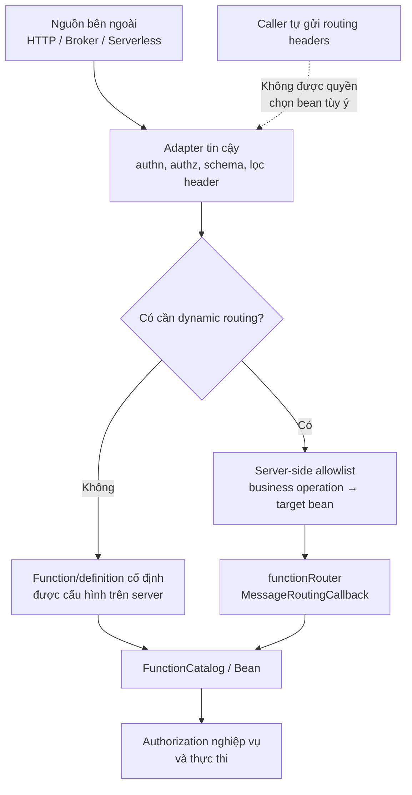

# Kiểm soát header định tuyến do bên ngoài cung cấp

## 1. Bài toán: một header có thể thay đổi hàm được gọi

**SPRING_CLOUD_FUNCTION (Spring Cloud Function)** cho phép viết nghiệp vụ bằng `Supplier`, `Function` và `Consumer`, tra cứu qua `FunctionCatalog`, ghép nhiều hàm bằng *composition* và gọi cùng một logic qua HTTP, broker sự kiện hoặc serverless. Tính linh hoạt đó đi kèm một ranh giới bảo mật quan trọng: **dữ liệu do bên ngoài gửi không được mặc nhiên có quyền quyết định bean nào được thực thi**.

Giả sử ứng dụng có:

- `quoteShipping`: tính giá vận chuyển để hiển thị công khai.
- `quoteTax`: tính thuế dự kiến để hiển thị công khai.
- `internalReconcile`: tác vụ kiểm toán/bảo trì nội bộ, không dành cho người dùng công khai.

Spring Cloud Function đăng ký một router có tên `functionRouter` trong `FunctionCatalog`. Khi router nhận thông điệp, các header như `spring.cloud.function.definition` hoặc `spring.cloud.function.routing-expression` có thể được dùng làm **chỉ dẫn chọn hàm**. Tài liệu Spring Cloud Function còn mô tả rằng Web adapter có thể chuyển các HTTP headers tương ứng thành Spring `MessageHeaders`. Điều này tạo ra tình huống:

```text
HTTP request đến điểm vào định tuyến
  body = "SKU-41"
  headers:
    spring.cloud.function.definition: internalReconcile
                         |
                  Web adapter
                         |
                    Message
                         |
                   functionRouter
                         |
               function được chọn?
```

Nếu điểm vào chấp nhận chỉ dẫn trên mà không kiểm soát, người gửi có thể yêu cầu một chức năng **không nằm trong hợp đồng của endpoint**. Tên hàm `internalReconcile` không phải bí mật; đặt tên khó đoán, kiểm tra kiểu payload hay giới hạn SpEL **không giải quyết được bài toán phân quyền chọn hàm**.

Mục tiêu bài học:

1. Hiểu chính xác vai trò của `functionRouter`, hai header routing và mức ưu tiên của các nguồn cấu hình.
2. Phân biệt header định tuyến **do server quyết định** với header do HTTP client, message producer hoặc sự kiện serverless cung cấp.
3. Thiết kế **allowlist** các đích có thể gọi, không cho client truyền trực tiếp tên bean hoặc chuỗi composition.
4. Hiểu sự khác nhau giữa `SimpleEvaluationContext` và `StandardEvaluationContext` trong SpEL, nhưng không nhầm giới hạn engine với authorization.
5. Áp dụng Spring Security, ACL/IAM, lọc metadata và kiểm thử âm tính cho từng điểm vào.
6. Biết khi nào **không nên sử dụng dynamic routing** và thay bằng lời gọi hàm cố định.

## 2. Ba lớp khác nhau: lựa chọn hàm, công bố endpoint và cấp quyền



| Khái niệm | Câu hỏi nó giải quyết | Điều nó **không** giải quyết |
|---|---|---|
| Function definition | Hàm đơn hoặc chuỗi composition nào cần được gọi? | Caller có quyền gọi hàm đó không? |
| `FunctionCatalog` | Đăng ký và tra cứu `Supplier`/`Function`/`Consumer` như thế nào? | Xác thực caller; kiểm tra owner/tenant |
| `functionRouter` | Chọn function definition dựa vào chỉ dẫn nào? | Chặn một tên bean có đặc quyền nếu chỉ dẫn tùy ý được chấp nhận |
| Web export filtering | Hàm/definition nào có endpoint qua Web adapter? | Mọi đường gọi từ broker, serverless hoặc code nội bộ |
| Authentication/authorization | Caller và quyền của caller là gì? | Bảo đảm metadata từ nguồn không tin cậy không bị chuyển sai nếu adapter được cấu hình kém |
| Allowlist routing | Các tên đích nào được chọn trong một điểm vào? | Kiểm tra quyền với **từng tài nguyên** mà đích sẽ thao tác |

**Kiểm soát đúng** kết hợp nhiều lớp: chỉ xuất bản function cần thiết, xác thực/ủy quyền tại điểm vào, chọn đúng bean trong danh sách cho phép, kiểm tra dữ liệu và quyền nghiệp vụ trước hành động có tác dụng phụ.

## 3. Spring Cloud Function nhận chỉ dẫn routing từ đâu?

Theo tài liệu chính thức, `RoutingFunction` được đăng ký trong catalog dưới tên `functionRouter`. Với lời gọi `Message<?>` cho hàm *imperative*, router có thể dùng một trong các cơ chế:

| Nguồn chỉ dẫn | Ví dụ | Độ tin cậy |
|---|---|---|
| `MessageRoutingCallback` | Java bean quyết định `"quoteShipping"` | Do ứng dụng định nghĩa; có thể an toàn nếu callback thực thi allowlist |
| `MessageHeaders["spring.cloud.function.definition"]` | `"quoteShipping"` hoặc `"a\|b"` | **Không đáng tin** nếu đến từ HTTP/broker/event bên ngoài |
| `MessageHeaders["spring.cloud.function.routing-expression"]` | `"headers['operation']"` | Biểu thức do bên ngoài chọn không nên được chấp nhận tự do |
| Application/system properties | `spring.cloud.function.definition=quoteShipping` | Cấu hình triển khai; cần bảo vệ quyền thay đổi |

Ví dụ một thông điệp:

```java
import org.springframework.messaging.Message;
import org.springframework.messaging.support.MessageBuilder;

Message<String> input = MessageBuilder.withPayload("SKU-41")
        .setHeader("spring.cloud.function.definition", "quoteShipping")
        .build();
```

Nếu `functionRouter` được dùng và không có một chiến lược ưu tiên khác, `spring.cloud.function.definition` có thể là **định danh hàm đích**, không chỉ là một metadata mô tả. Giá trị còn có thể là **composition** như `quoteShipping|anotherFunction`, nên kiểm tra mỗi token theo regex tên hàm chưa đủ để bảo vệ toàn bộ chuỗi.

### 3.1. Thứ tự ưu tiên routing

Tài liệu Spring Cloud Function nêu thứ tự ưu tiên:

1. **`MessageRoutingCallback`**, nếu được đăng ký cho router imperative, có ưu tiên cao nhất.
2. **Routing headers của `Message`**, đối với imperative routing khi không có callback.
3. **Application/system properties**, có thể áp dụng theo mô hình hàm tương ứng.

Do vậy, một application property như `spring.cloud.function.routing-expression=...` **không nên được xem là hàng rào cuối cùng** nếu ứng dụng đồng thời nhận chỉ dẫn từ message headers. Đó là lý do cần lọc header ở adapter hoặc sử dụng callback xác định rõ whitelist.

> Thứ tự trên nói về **cơ chế chọn target function**, không phải thứ tự của `SecurityFilterChain` hoặc quyền IAM. Quyền gọi hàm vẫn phải được xử lý riêng.

### 3.2. Routing imperative khác reactive routing

- Với `Function<Message<I>, Message<O>>` hoặc hàm imperative tương tự, đơn vị xử lý là một thông điệp; routing header có thể áp dụng **theo từng message**.
- Với function reactive nhận `Flux`/`Publisher`, đơn vị xử lý là stream; tài liệu nêu rằng chỉ dẫn routing theo header từng thông điệp **không** áp dụng theo cách đó. Routing cho toàn stream cần thông qua application properties/definition phù hợp.
- Không dùng giả định “header của phần tử đầu tiên quyết định route cho mọi phần tử” nếu framework không có hợp đồng như vậy.

## 4. Phân tích nguồn không đáng tin và rủi ro

| Nguồn bên ngoài | Đường truyền tới router | Sai lầm dễ mắc | Biện pháp |
|---|---|---|---|
| HTTP client | HTTP headers → Web adapter → `MessageHeaders` | Cho client ghi `spring.cloud.function.definition` trực tiếp | Không công bố router nếu không cần; dùng server-side mapping và HTTP authorization |
| Kafka/RabbitMQ producer | Broker record headers → binder → `MessageHeaders` | Tin publisher nào cũng chỉ gửi tên hàm hợp lệ | Broker ACL, lọc header và callback allowlist |
| Webhook/CloudEvent | Event attributes/headers → serverless adapter | Tin event envelope do caller tự dựng là metadata hệ thống | Xác minh nguồn event và ánh xạ trường có kiểm soát |
| Lambda trực tiếp | Payload/event → `FunctionInvoker` | Bảo vệ API Gateway nhưng để đường invoke IAM công khai quá rộng | Resource policy/IAM và definition cố định |
| Internal client | Tạo `Message` rồi gọi `FunctionCatalog.lookup("functionRouter")` | Đồng nhất “gọi từ trong JVM” với được phép thực hiện mọi thao tác | Quyền service-to-service và business authorization |
| Configuration/admin endpoint | Thay `routing-expression` hay `definition` qua property | Cho người dùng không tin cậy điều khiển biểu thức cấp ứng dụng | Bảo vệ config/Actuator/secrets, review thay đổi |

Ba kiểu tác động nên được xét:

**Chọn nhầm function:** một endpoint cho báo giá dẫn tới một bước thay đổi trạng thái hoặc quản trị.

**Ghép chuỗi không được phê duyệt:** một chỉ dẫn composition gồm các tên hàm vốn hợp lệ, nhưng trình tự gọi tạo hành vi không được phép.

**Thao túng biểu thức hoặc dữ liệu đích:** một header SpEL tự do hoặc một header như `operation`/`tenantId` bị giả mạo để chọn tuyến khác. Ngay cả khi biểu thức chỉ đọc dữ liệu, **giá trị trả về vẫn có thể là tên hàm có đặc quyền**.

## 5. Cách an toàn nhất: không dùng router cho endpoint không cần router

Nếu URL chỉ cần gọi `quoteShipping`, không có lý do trao cho client quyền gửi tên function. Một adapter cố định có thể inject đúng bean bằng tên:

```java
package com.example.quotes;

import java.util.Locale;
import java.util.function.Function;

import org.springframework.context.annotation.Bean;
import org.springframework.context.annotation.Configuration;

@Configuration
public class QuoteFunctions {

    @Bean
    public Function<String, String> quoteShipping() {
        return sku -> "SHIP:" + sku.strip().toUpperCase(Locale.ROOT);
    }

    @Bean
    public Function<String, String> quoteTax() {
        return sku -> "TAX:" + sku.strip().toUpperCase(Locale.ROOT);
    }
}
```

Một Spring MVC controller mỏng:

```java
package com.example.quotes;

import java.util.function.Function;

import org.springframework.beans.factory.annotation.Qualifier;
import org.springframework.http.HttpStatus;
import org.springframework.http.MediaType;
import org.springframework.http.ResponseEntity;
import org.springframework.web.bind.annotation.PathVariable;
import org.springframework.web.bind.annotation.PostMapping;
import org.springframework.web.bind.annotation.RequestBody;
import org.springframework.web.bind.annotation.RequestMapping;
import org.springframework.web.bind.annotation.RestController;
import org.springframework.web.server.ResponseStatusException;

@RestController
@RequestMapping("/api/quotes")
public class QuoteHttpController {

    private final Function<String, String> shipping;
    private final Function<String, String> tax;

    public QuoteHttpController(
            @Qualifier("quoteShipping") Function<String, String> shipping,
            @Qualifier("quoteTax") Function<String, String> tax) {
        this.shipping = shipping;
        this.tax = tax;
    }

    @PostMapping(
            path = "/{operation}",
            consumes = MediaType.TEXT_PLAIN_VALUE,
            produces = MediaType.TEXT_PLAIN_VALUE
    )
    public ResponseEntity<String> quote(
            @PathVariable String operation,
            @RequestBody String sku) {

        if (!sku.matches("[A-Za-z0-9-]{1,32}")) {
            throw new ResponseStatusException(
                    HttpStatus.BAD_REQUEST, "Invalid SKU");
        }

        String answer = switch (operation) {
            case "shipping" -> shipping.apply(sku);
            case "tax" -> tax.apply(sku);
            default -> throw new ResponseStatusException(
                    HttpStatus.NOT_FOUND, "Unknown quote operation");
        };
        return ResponseEntity.ok(answer);
    }
}
```

**Vì sao cách này chống header routing injection?**

- Controller chọn bean bằng **hai tham chiếu Java cố định**, không lấy trực tiếp function name hay SpEL từ HTTP request.
- `operation` do URL cung cấp chỉ được ánh xạ qua hai giá trị `shipping`/`tax`. Nó là **business operation**, không phải một tên Spring bean tùy ý.
- Controller không truyền toàn bộ HTTP headers vào một `Message` sẽ được gọi qua `functionRouter`. Vì vậy một header lạ như `spring.cloud.function.definition` không làm thay đổi bean được chọn ở controller này.
- URL như `/api/quotes/internalReconcile` không có nhánh tương ứng.

Đây là **thiết kế minh họa dùng Spring MVC**, không phải khẳng định Spring Cloud Function Web tự động cư xử như controller này. Nếu ứng dụng đồng thời bật `spring-cloud-function-web`, phải kiểm tra các URL do Web adapter công bố, vì chúng có thể tạo một **đường gọi khác** ngoài controller.

**Lưu ý:** allowlist function không thay thế authentication/authorization. Nếu hai thao tác có mức quyền khác nhau, đặt quy tắc Spring Security và kiểm tra quyền nghiệp vụ trước khi gọi bean.

## 6. Khi bắt buộc dynamic routing: dùng `MessageRoutingCallback` để allowlist

Một số hệ thống chỉ có một consumer hoặc serverless entrypoint nhưng cần phân luồng **các thao tác được cho phép**. Khi đó, một `MessageRoutingCallback` do ứng dụng quản lý có thể chuyển một **business operation** (ví dụ `"shipping"`, `"tax"`) thành tên hàm chính xác. Không để client cung cấp trực tiếp chuỗi `"quoteShipping"` hoặc `"quoteShipping|internalReconcile"`.

Ví dụ cho Spring Cloud Function API đời mới, nơi `MessageRoutingCallback.routingResult(Message<?>)` trả về `String`:

```java
package com.example.quotes;

import org.springframework.cloud.function.context.MessageRoutingCallback;
import org.springframework.context.annotation.Bean;
import org.springframework.context.annotation.Configuration;
import org.springframework.messaging.Message;

@Configuration
public class ApprovedRouting {

    // Header businessOperation được adapter đưa vào sau validation.
    // Dù caller có thể tác động đến giá trị này, target luôn bị giới hạn.
    @Bean
    public MessageRoutingCallback approvedRoute() {
        return message -> {
            Object raw = message.getHeaders().get("businessOperation");
            if (!(raw instanceof String operation)) {
                throw new IllegalArgumentException(
                        "businessOperation must be a String");
            }

            return switch (operation) {
                case "shipping" -> "quoteShipping";
                case "tax" -> "quoteTax";
                default -> throw new IllegalArgumentException(
                        "Operation is not allowed");
            };
        };
    }
}
```

Theo thứ tự ưu tiên của Spring Cloud Function, callback được đăng ký là một bean sẽ được `RoutingFunction` ưu tiên hơn header `spring.cloud.function.definition` hoặc `spring.cloud.function.routing-expression` đối với routing imperative. Vì callback **chỉ trả hai literal đã được review**, một giá trị operation lạ không biến thành tên bean hoặc composition mới.

**Khác biệt phiên bản:** tài liệu Spring Cloud Function 4.x hiện mô tả phương thức callback trả về `String`; một số nhánh 3.x mô tả `FunctionRoutingResult` hoặc tên phương thức khác. **Không copy nguyên snippet sang phiên bản khác khi chưa kiểm tra interface trong dependency thực tế.** Ý tưởng allowlist và quyền truy cập không thay đổi, nhưng chữ ký Java phải theo đúng version.

### 6.1. Đặt callback ở đúng deployment

`MessageRoutingCallback` là một **chiến lược routing của ứng dụng**, không phải policy riêng của một HTTP request. Nếu trong Spring context có nhiều điểm vào dùng chung router, callback này có thể được chọn cho những lời gọi đó. Do vậy:

1. Đặt callback trong deployment chỉ có những route phù hợp với cùng mức quyền.
2. Nếu một route có đặc quyền cao, cần xác thực/ủy quyền trước khi gọi router và/hoặc tách deployment.
3. Nếu các điểm vào cần allowlist khác nhau, cân nhắc dùng controller/adapter cố định hoặc router riêng theo thiết kế có kiểm thử.
4. Không tạo callback chỉ đơn giản `return (String) headers.get("spring.cloud.function.definition")`: cách đó **không phải allowlist**, chỉ đưa ra một đường gián tiếp để tin cùng input chưa được xác minh.

### 6.2. Kiểm thử callback với header giả mạo

```java
package com.example.quotes;

import static org.junit.jupiter.api.Assertions.assertEquals;
import static org.junit.jupiter.api.Assertions.assertThrows;

import org.junit.jupiter.api.Test;
import org.springframework.cloud.function.context.MessageRoutingCallback;
import org.springframework.messaging.Message;
import org.springframework.messaging.support.MessageBuilder;

class ApprovedRoutingTest {

    private final MessageRoutingCallback callback =
            new ApprovedRouting().approvedRoute();

    @Test
    void ignoresExternalFunctionNameAndUsesServerAllowlist() {
        Message<String> request = MessageBuilder.withPayload("SKU-41")
                .setHeader("businessOperation", "shipping")
                .setHeader("spring.cloud.function.definition",
                        "internalReconcile")
                .setHeader("spring.cloud.function.routing-expression",
                        "'internalReconcile'")
                .build();

        assertEquals("quoteShipping", callback.routingResult(request));
    }

    @Test
    void rejectsUnknownBusinessOperation() {
        Message<String> request = MessageBuilder.withPayload("SKU-41")
                .setHeader("businessOperation", "internalReconcile")
                .build();

        assertThrows(IllegalArgumentException.class,
                () -> callback.routingResult(request));
    }

    @Test
    void rejectsNonStringOperation() {
        Message<String> request = MessageBuilder.withPayload("SKU-41")
                .setHeader("businessOperation", 42)
                .build();

        assertThrows(IllegalArgumentException.class,
                () -> callback.routingResult(request));
    }
}
```

Đây là **unit tests của chính sách chọn đích**. Chúng không chứng minh toàn bộ Web adapter, binder hoặc `FunctionCatalog` đã ưu tiên callback như mong muốn; điều đó cần thêm integration test trên dependency và definition thật của ứng dụng.

## 7. Lọc và tái tạo headers ở ranh giới HTTP

Đừng làm việc sau trên request do client gửi:

```java
// Không nên: chuyển nguyên mọi header vào Message sẽ dùng để routing.
// MessageBuilder.withPayload(payload)
//     .copyHeaders(requestHeaders.toSingleValueMap())
//     .build();
```

Một lựa chọn rõ ràng hơn là **tái tạo `Message` từ dữ liệu cho phép**:

```java
package com.example.quotes;

import java.util.List;
import java.util.UUID;

import org.springframework.http.HttpHeaders;
import org.springframework.http.HttpStatus;
import org.springframework.messaging.Message;
import org.springframework.messaging.support.MessageBuilder;
import org.springframework.web.server.ResponseStatusException;

public final class InboundMessageFactory {

    private InboundMessageFactory() {}

    public static Message<String> fromHttp(
            String payload,
            String approvedOperation,
            HttpHeaders requestHeaders) {

        if (!"shipping".equals(approvedOperation)
                && !"tax".equals(approvedOperation)) {
            throw new ResponseStatusException(
                    HttpStatus.NOT_FOUND, "Unsupported operation");
        }

        String correlationId = readCorrelationId(requestHeaders);

        // Chỉ hai header thuộc hợp đồng được chuyển tiếp.
        // Không copy spring.cloud.function.definition/routing-expression.
        return MessageBuilder.withPayload(payload)
                .setHeader("businessOperation", approvedOperation)
                .setHeader("correlationId", correlationId)
                .build();
    }

    private static String readCorrelationId(HttpHeaders headers) {
        List<String> values = headers.get("X-Correlation-ID");
        if (values == null || values.isEmpty()) {
            return UUID.randomUUID().toString();
        }
        if (values.size() != 1
                || !values.get(0).matches("[A-Za-z0-9._-]{1,64}")) {
            throw new ResponseStatusException(
                    HttpStatus.BAD_REQUEST, "Invalid correlation ID");
        }
        return values.get(0);
    }
}
```

Hàm trên **không cố gắng xóa từng header nguy hiểm trong một map lớn**, mà xây `Message` mới chỉ chứa `businessOperation` và `correlationId`. Tư duy này là **allowlist metadata**:

- Header hệ thống có tên giống `spring.cloud.function.definition` hoặc `spring.cloud.function.routing-expression` bị bỏ lại tại biên.
- `businessOperation` do adapter chọn sau khi kiểm tra nghiệp vụ; downstream callback vẫn chỉ cho phép hai tên hàm.
- `correlationId` được kiểm tra định dạng, không phải thông tin cấp quyền.
- Các header khác như `Authorization`, cookie, `replyChannel`, broker offset không đi vào routing message.

Đây là code của **adapter tự viết**; không có bằng chứng rằng Web adapter mặc định tự động áp dụng cùng chính sách lọc. Nếu dùng Spring Cloud Function Web thuần, phải cấu hình và kiểm thử routing/export theo khả năng và phiên bản thực tế.

### Đặc điểm của HTTP header

Tên HTTP header không phân biệt chữ hoa/thường; trong khi đó tên khóa trong `MessageHeaders` là chuỗi Java. Kiểm tra cả cách binder/web adapter ánh xạ tên, kiểu giá trị, nhiều header trùng nhau và giới hạn kích thước. Không dựa vào một biến thể khác kiểu hoa/thường để “lách” hoặc “bảo vệ” chính sách.

## 8. SpEL: hạn chế cú pháp không đồng nghĩa được quyền chọn target

Spring Cloud Function sử dụng hai loại evaluation context theo nguồn chỉ dẫn:

| Nguồn biểu thức | Context theo tài liệu | Ý nghĩa |
|---|---|---|
| `MessageHeaders["spring.cloud.function.routing-expression"]` | `SimpleEvaluationContext` | Hạn chế tính năng SpEL, tập trung đọc dữ liệu từ `Message` |
| `spring.cloud.function.routing-expression` ở application/system property | `StandardEvaluationContext` | Có phạm vi SpEL đầy đủ hơn, dành cho cấu hình được kiểm soát |

`SimpleEvaluationContext` giới hạn các khả năng như tham chiếu kiểu Java, khởi tạo đối tượng và tham chiếu Spring bean so với `StandardEvaluationContext`; tuy nhiên, nó **không** ngăn một biểu thức hợp lệ trả về tên hàm có đặc quyền hoặc một composition mà caller không được phép gọi.

Ví dụ biểu thức **cố định do server quản lý** có thể chọn một trong hai hàm theo header nghiệp vụ:

```properties
spring.cloud.function.routing-expression=headers['businessOperation'] == 'shipping' ? 'quoteShipping' : 'quoteTax'
```

Nhưng biểu thức trên minh họa cú pháp chứ **chưa đủ an toàn**: mọi giá trị khác `shipping` đều vào `quoteTax`, kể cả khi caller gửi dữ liệu lỗi. Với một yêu cầu nghiêm ngặt cần **từ chối giá trị lạ**, callback Java ở mục 6 hoặc bước validation riêng minh bạch hơn.

Một sai lầm cần tránh:

```properties
# Nguy hiểm nếu client điều khiển trực tiếp businessOperation:
spring.cloud.function.routing-expression=headers['businessOperation']
```

Nếu `businessOperation` chứa trực tiếp `internalReconcile` hoặc `quoteShipping|internalReconcile`, biểu thức sẽ trả **tên hàm từ dữ liệu bên ngoài** mà không thực thi whitelist. Có thể hạn chế những hàm xuất hiện trong catalog, nhưng **lọc catalog không thay thế authorization**.

Đối với `StandardEvaluationContext`, quyền sửa application properties/environment variables phải được xem như quyền sửa **cấu hình có đặc quyền**. Không mở endpoint cấu hình, Spring Boot Actuator, API quản trị hoặc cơ chế cập nhật runtime cho caller không được phép. Bảo vệ việc sửa routing property là quan trọng ngang với bảo vệ source code.

## 9. Giới hạn hàm được xuất bản và hàm có thể tra cứu

Spring Cloud Function Web hỗ trợ **Function Filtering rules** qua danh sách definition phân tách bằng dấu chấm phẩy:

```properties
spring.cloud.function.definition=quoteShipping;quoteTax
spring.cloud.function.single-function-fallback-enabled=false
```

Theo tài liệu Web adapter:

- `quoteShipping;quoteTax` liệt kê **hai** definition được xuất bản.
- `quoteShipping|quoteTax` là một **composition**, không phải hai endpoint.
- Khi lọc bằng danh sách như trên, các function không được liệt kê (bao gồm composition khác) không được Web adapter xuất bản theo quy tắc đó.
- `single-function-fallback-enabled=false` ngăn catalog tra cứu một function duy nhất qua tên tùy ý trong trường hợp fallback mặc định.

Nếu một bean không cần được đăng ký trong `FunctionCatalog`:

```properties
spring.cloud.function.ineligible-definitions=internalReconcile
```

Thuộc tính này loại tên bean khỏi danh sách ứng viên catalog; không phải Spring Security và không cản mã nội bộ đã có tham chiếu tới bean/service. **An toàn hơn nữa:** giữ tác vụ có đặc quyền trong service/deployment riêng thay vì một `Function` có thể bị router khám phá.

**Hai hình thức triển khai phải được tách bạch:**

1. **HTTP công khai không cần router:** chỉ công bố `quoteShipping`/`quoteTax`, không mở `functionRouter` và không nhận tên hàm từ client.
2. **Entrypoint định tuyến có kiểm soát:** chỉ dùng khi thật sự cần, đăng ký callback allowlist, kiểm tra quyền tại adapter, giảm tối đa ứng viên catalog và kiểm thử routing thật.

Không cho rằng “chỉ lọc Web export” thì `functionRouter`, serverless adapter hay broker chắc chắn không còn đường gọi tới function nội bộ. Mỗi adapter có cơ chế lựa chọn và trigger riêng.

## 10. Bảo vệ đường HTTP bằng Spring Security

Allowlist routing là một lớp; caller vẫn cần được xác thực và chỉ được gọi những thao tác thuộc phạm vi quyền của mình. Với HTTP API stateless xác thực JWT bearer token, có thể cấu hình Spring Security 6:

```java
package com.example.quotes;

import org.springframework.context.annotation.Bean;
import org.springframework.context.annotation.Configuration;
import org.springframework.http.HttpMethod;
import org.springframework.security.config.Customizer;
import org.springframework.security.config.annotation.web.builders.HttpSecurity;
import org.springframework.security.web.SecurityFilterChain;

@Configuration
public class QuoteSecurity {

    @Bean
    SecurityFilterChain security(HttpSecurity http) throws Exception {
        return http
                // Chỉ khi API dùng bearer token stateless, không cookie auth.
                .csrf(csrf -> csrf.disable())
                .authorizeHttpRequests(auth -> auth
                    .requestMatchers(
                        HttpMethod.POST, "/api/quotes/shipping")
                        .hasAuthority("SCOPE_quotes.read")
                    .requestMatchers(
                        HttpMethod.POST, "/api/quotes/tax")
                        .hasAuthority("SCOPE_quotes.read")
                    .anyRequest().denyAll()
                )
                .oauth2ResourceServer(oauth ->
                    oauth.jwt(Customizer.withDefaults()))
                .build();
    }
}
```

Tại production, cần cấu hình JWT decoder để kiểm tra chữ ký, issuer, audience, hạn sử dụng và các chính sách phù hợp. Không chấp nhận chỉ một access token “trông giống JWT” bằng cách giải mã Base64 rồi tin claim.

Những lưu ý:

- Nếu một function thực hiện thanh toán hoặc quản trị, **không** đưa vào allowlist `SCOPE_quotes.read`. Cần quyền riêng và kiểm tra resource-level authorization.
- `denyAll` cho URL ngoài hợp đồng sẽ chặn đường HTTP lạ như `/functionRouter` hoặc endpoint khác do cấu hình thay đổi, nếu mọi route thực sự đi qua filter này.
- CORS không thay thế authentication. CSRF không nên bị tắt trên ứng dụng dùng cookie/session mà chưa có biện pháp thay thế.
- Với Web adapter, phải bảo vệ **tất cả** URL mà adapter thực sự công bố; filter chỉ cho `/api/quotes/**` không tự bảo vệ prefix khác.

## 11. Broker và Spring Cloud Stream: route-to là quyền của producer?

Spring Cloud Stream có cơ chế **event routing** dùng `RoutingFunction`. Một cấu hình điển hình của môi trường **cố ý cần router** là:

```properties
spring.cloud.stream.function.routing.enabled=true
spring.cloud.stream.bindings.functionRouter-in-0.destination=quotes.in
```

Trong ví dụ này, binder có thể đưa bản tin từ `quotes.in` tới input binding `functionRouter-in-0`. Khi metadata broker được ánh xạ vào Spring `MessageHeaders`, các routing headers có thể trở thành chỉ dẫn target.

```text
Publisher được phép ghi quotes.in
  |
  | payload + record headers
  v
Kafka / RabbitMQ
  |
  v
Binder -> functionRouter-in-0
  |
  v
MessageRoutingCallback
  "shipping" -> quoteShipping
  "tax"      -> quoteTax
  khác       -> từ chối
```

**Bảo mật của broker không kết thúc ở ACL publish.** Một service được cấp quyền gửi vào `quotes.in` có thể phát payload hoặc headers lỗi, bị chiếm quyền hoặc bị sử dụng sai. Nếu hàm nhận `MessageHeaders["spring.cloud.function.definition"]` trực tiếp và target không bị allowlist, một publisher có thể tác động tới hàm được gọi.

Chính sách đề xuất:

1. Giới hạn principal có quyền gửi event tới `quotes.in`, đọc output và thao tác binding.
2. Chọn **một nhóm function cùng mức quyền** cho input binding này; không chứa tác vụ quản trị.
3. Kiểm tra schema, kích thước bản tin và header business operation trước/đồng thời với routing.
4. Dùng callback allowlist hoặc một bước Java rõ ràng thay vì tin raw target header.
5. Định nghĩa chính sách retry, dead-letter và metrics khi routing bị từ chối; không coi việc “không tìm thấy hàm” là thành công.
6. Kiểm thử qua binder/test binder thật để xác minh header mapping và hành vi lỗi thay vì chỉ unit test callback.

Tài liệu Spring Cloud Stream phân biệt **routing TO function** với **routing FROM function** tới destination đầu ra. Bài này tập trung kiểm soát target function, nhưng quy tắc bảo mật tương tự áp dụng cho metadata chọn destination: caller không được tự ghi tên topic/queue bất kỳ nếu điều đó vượt quyền publish của service.

### Header hệ thống và header của ứng dụng

| Nhóm | Ví dụ | Chính sách |
|---|---|---|
| Routing control | `spring.cloud.function.definition`, `spring.cloud.function.routing-expression` | Không nhận tự do từ producer không tin cậy |
| Business metadata | `businessOperation`, `correlationId`, `eventType` | Kiểm tra kiểu, độ dài, tập giá trị và nguồn |
| Security context | Token, `tenantId`, role | Không coi là principal chỉ vì xuất hiện trên record |
| Broker metadata | Offset, partition, delivery tag, receipt handle | Do binder/broker quản lý, không chuyển thành routing instruction |
| Trace context | `traceparent`, `tracestate` | Do instrumentation phù hợp extract/inject, không trộn với tên target function |

## 12. Serverless: tránh để event điều khiển chức năng nhạy cảm

Trong một triển khai AWS Lambda dùng Spring Cloud Function `FunctionInvoker`, có thể chỉ định function definition bằng cấu hình triển khai. Tài liệu AWS adapter cũng mô tả tình huống nhiều function cần dynamic routing. Điều này thuận tiện cho một function vật lý xử lý nhiều event types, nhưng **event payload không nên quyết định target arbitrary**.

Ví dụ triển khai một Lambda **chỉ xử lý báo giá vận chuyển**:

```yaml
# Minh họa một phần cấu hình AWS SAM; không phải template hoàn chỉnh.
Properties:
  Handler: org.springframework.cloud.function.adapter.aws.FunctionInvoker
  Runtime: java21
  Environment:
    Variables:
      spring_cloud_function_definition: quoteShipping
```

`spring_cloud_function_definition` là biến môi trường do người triển khai quản lý. Không để client gửi trực tiếp `spring.cloud.function.definition` qua event và mong nó chỉ chọn hàm công khai nếu adapter đang bật router.

Nếu thật sự cần `functionRouter` cho một Lambda nhận nhiều loại event:

- Kiểm tra **nguồn trigger** bằng API Gateway authorizer, IAM invoke permission, SQS/EventBridge policy tùy điểm vào.
- Ánh xạ `event.type`/business operation qua allowlist nội bộ, **không** dùng event body làm function name tùy ý.
- Dùng Lambda role tối thiểu; tốt hơn tách Lambda có quyền quản trị khỏi Lambda công khai.
- Không tin các trường `event.userId`, `event.isAdmin`, `event.functionName` do caller tự khai làm bằng chứng phân quyền.
- Kiểm thử đường invoke trực tiếp, Function URL, API Gateway và queue trigger riêng. Một authorizer ở API Gateway **không bảo vệ đường Lambda invoke khác**.

Đối với CloudEvents, `type` là một thuộc tính mô tả loại sự kiện, **không mặc nhiên là tên Spring bean**. Nếu muốn định tuyến theo event type, tạo bảng ánh xạ do server kiểm soát như `com.example.quote.shipping → quoteShipping`; sự kiện có `type=com.example.admin.reconcile` phải bị từ chối nếu điểm vào không được phép.

## 13. Nếu route thất bại thì làm gì?

Theo Spring Cloud Function, khi target function không tồn tại trong catalog, `RoutingFunction` có thể ném ngoại lệ. Framework cũng có `DefaultMessageRoutingHandler` để xử lý thông điệp không route được; triển khai mặc định có thể log và để luồng tiếp tục, tức về mặt hiệu ứng thông điệp bị bỏ.

**Không coi hành vi drop mặc định là chính sách bảo mật cho nghiệp vụ quan trọng.** Đối với thanh toán, lệnh cập nhật trạng thái hoặc dữ liệu có yêu cầu audit:

- **Đích không thuộc allowlist:** từ chối rõ ràng trước khi gọi router; không thử một target khác theo tên do client gợi ý.
- **Đích hợp lệ nhưng caller thiếu quyền:** trả `403` hoặc tín hiệu lỗi được hợp đồng quy định; không xử lý nghiệp vụ.
- **Schema/header sai:** trả `400` ở HTTP hoặc đưa vào xử lý lỗi broker theo chính sách; không trả kết quả “OK” giả.
- **Không có target do cấu hình sai:** phát cảnh báo và kiểm tra release; không tự fallback sang chức năng đặc quyền.
- **Retry trên broker:** xác định tác dụng phụ và idempotency; tránh lặp vô hạn hoặc mất bản tin mà không có audit.

Trên HTTP, mã trạng thái thực tế phụ thuộc adapter/exception handler; từ chối trong callback bằng `IllegalArgumentException` **không tự bảo đảm trả `400` trong mọi môi trường**. Cần ánh xạ exception rõ ở API boundary.

## 14. Kiểm thử âm tính qua HTTP: header giả không đổi được đích

Với controller ở mục 5 và SecurityFilterChain ở mục 10, một test Spring Boot + MockMvc có thể xác nhận client không thể dùng routing headers để đổi target.

```java
package com.example.quotes;

import static org.springframework.security.test.web.servlet.request
        .SecurityMockMvcRequestPostProcessors.jwt;
import static org.springframework.test.web.servlet.request
        .MockMvcRequestBuilders.post;
import static org.springframework.test.web.servlet.result
        .MockMvcResultMatchers.*;

import org.junit.jupiter.api.Test;
import org.springframework.beans.factory.annotation.Autowired;
import org.springframework.boot.test.autoconfigure.web.servlet.AutoConfigureMockMvc;
import org.springframework.boot.test.context.SpringBootTest;
import org.springframework.boot.test.mock.mockito.MockBean;
import org.springframework.http.MediaType;
import org.springframework.security.core.authority.SimpleGrantedAuthority;
import org.springframework.security.oauth2.jwt.JwtDecoder;
import org.springframework.test.web.servlet.MockMvc;

@SpringBootTest(classes = QuoteApplication.class)
@AutoConfigureMockMvc
class QuoteRoutingSecurityTest {

    @Autowired
    MockMvc mvc;

    @MockBean
    JwtDecoder jwtDecoder;

    @Test
    void suppliedRoutingHeadersDoNotChangeSelectedFunction()
            throws Exception {
        mvc.perform(post("/api/quotes/shipping")
                .with(jwt().authorities(new SimpleGrantedAuthority(
                    "SCOPE_quotes.read")))
                .contentType(MediaType.TEXT_PLAIN)
                .header("spring.cloud.function.definition",
                        "internalReconcile")
                .header("spring.cloud.function.routing-expression",
                        "'internalReconcile'")
                .content("SKU-41"))
            .andExpect(status().isOk())
            .andExpect(content().string("SHIP:SKU-41"));
    }

    @Test
    void unknownOperationIsNotExposed() throws Exception {
        mvc.perform(post("/api/quotes/internalReconcile")
                .with(jwt().authorities(new SimpleGrantedAuthority(
                    "SCOPE_quotes.read")))
                .contentType(MediaType.TEXT_PLAIN)
                .content("SKU-41"))
            .andExpect(status().isForbidden());
    }

    @Test
    void unauthenticatedCallCannotUseAllowedRoute()
            throws Exception {
        mvc.perform(post("/api/quotes/shipping")
                .contentType(MediaType.TEXT_PLAIN)
                .content("SKU-41"))
            .andExpect(status().isUnauthorized());
    }
}
```

Ví dụ giả định có application bootstrap sau và cùng package được Spring component-scan:

```java
package com.example.quotes;

import org.springframework.boot.SpringApplication;
import org.springframework.boot.autoconfigure.SpringBootApplication;

@SpringBootApplication
public class QuoteApplication {
    public static void main(String[] args) {
        SpringApplication.run(QuoteApplication.class, args);
    }
}
```

`jwt()` và `@MockBean JwtDecoder` chỉ phục vụ **kiểm thử logic authorization tại HTTP**, không kiểm tra chữ ký, issuer, audience hoặc khóa JWT thật. Nếu ứng dụng dùng Spring Boot phiên bản mới hơn, cách khai báo mock bean có thể khác; cần kiểm tra dependency và test context.

**Giới hạn của test trên:** nó xác nhận **controller cố định** không bị hai HTTP headers đổi target và security chặn path ngoài hợp đồng. Nó **không** chứng minh Spring Cloud Function Web adapter không công bố một endpoint riêng, cũng không chứng minh `functionRouter` ưu tiên callback. Phải có test tích hợp cho **chính adapter/definition** sử dụng trong production.

## 15. Kế hoạch test cho router thực tế

Khi deployment có `functionRouter`, cần kiểm thử ít nhất:

| Tình huống | Kỳ vọng |
|---|---|
| `businessOperation=shipping` | Chỉ chọn `quoteShipping` |
| `businessOperation=tax` | Chỉ chọn `quoteTax` |
| `businessOperation=internalReconcile` | Bị từ chối, không gọi bean nội bộ |
| Thiếu hoặc sai kiểu `businessOperation` | Từ chối có kiểm soát |
| Có `businessOperation=shipping` kèm `spring.cloud.function.definition=internalReconcile` | Callback vẫn chọn `quoteShipping` |
| Có routing expression do client gửi | Không cho expression thay đổi allowlist |
| Giá trị đích là composition `quoteShipping\|internalReconcile` | Không được thực thi |
| Header tên khác chữ hoa/thường hoặc nhiều giá trị | Adapter chuẩn hóa/loại theo hợp đồng |
| Message từ producer không có ACL | Broker chặn trước khi function chạy |
| Caller có quyền endpoint nhưng sai tenant/resource | Business authorization từ chối |
| Đích không tồn tại do lỗi cấu hình | Ghi nhận lỗi, không âm thầm chọn đích đặc quyền |
| Reactive function nhận per-message headers | Không giả định router chọn riêng từng phần tử |

### Kiểm tra bằng `FunctionCatalog`

Một integration test trên Spring context có `QuoteFunctions`, `ApprovedRouting` và Spring Cloud Function auto-configuration có thể gọi `catalog.lookup("functionRouter")` với `Message` chứa `businessOperation` và các routing headers giả mạo, sau đó kiểm tra target thực tế. Về ý tưởng:

```java
// Spring context đã đăng ký QuoteFunctions và ApprovedRouting.
Function<Message<String>, ?> router = catalog.lookup("functionRouter");

Message<String> input = MessageBuilder.withPayload("SKU-41")
        .setHeader("businessOperation", "shipping")
        .setHeader("spring.cloud.function.definition", "internalReconcile")
        .build();

Object result = router.apply(input);
// Chuẩn hóa kết quả theo wrapper/converter của phiên bản đang chạy
// rồi xác minh chỉ hành vi quoteShipping được thực thi.
```

Kiểm thử này nên quan sát **side effect hoặc spy** nếu có một bean nhạy cảm: chỉ nhìn một payload giống chuỗi `SHIP:SKU-41` có thể chưa chứng minh bean khác không chạy. Không có lệnh build/test nào đã được chạy trong bài học này; snippet mô tả điểm quan sát, không khẳng định kiểu output của mọi wrapper đều giống nhau.

## 16. Những lỗi thiết kế thường gặp

| Nhầm lẫn | Vì sao nguy hiểm | Cách làm đúng |
|---|---|---|
| “`SimpleEvaluationContext` chặn mọi nguy hiểm” | Vẫn có thể trả tên bean có đặc quyền | Kiểm tra **target allowlist** và quyền gọi |
| “Đã đặt routing-expression trong `application.yml` nên header sẽ không được ưu tiên” | Message headers có thể ưu tiên hơn property ở imperative router | Lọc headers hoặc dùng callback allowlist |
| Callback trả nguyên `headers.definition` | Chỉ chuyển đường đi của dữ liệu không tin cậy | Map operation → literal target trong code |
| Kiểm tra tên bean bằng regex `[A-Za-z]+` | Tên hợp lệ vẫn có thể là function nhạy cảm | So khớp danh sách đích cụ thể |
| Chỉ kiểm tra tên đầu tiên trước dấu `\|` | Composition có thể gọi bước ngoài allowlist | Không cho composition tự do; chỉ chấp nhận definition đã review |
| Đổi tên `functionRouter` hoặc đổi URL khó đoán | Không phải ranh giới cấp quyền | Tắt export, định nghĩa allowlist và authn/authz |
| Công bố mọi function vì chúng “chỉ là @Bean” | Adapter có thể tạo đường gọi ngoài dự kiến | Web filtering, ineligible definitions, tách deployment |
| Chỉ bảo vệ HTTP | Broker hoặc Lambda direct invoke có thể đi đường khác | IAM, ACL, resource policy theo từng trigger |
| Copy tất cả HTTP/broker headers vào `Message` | Routing, token và metadata hệ thống lọt vào logic | Tái tạo message với danh sách header cho phép |
| Gửi `tenantId` trong header rồi coi là principal | Client/producer có thể giả mạo | Lấy danh tính từ nguồn đã xác thực và kiểm tra quyền tài nguyên |
| Dùng default router handler để drop mọi lỗi | Có thể mất message nghiệp vụ hoặc che giấu tấn công | Lỗi có cấu trúc, audit, retry/DLQ theo thiết kế |
| Kiểm tra chỉ happy path | Không phát hiện đổi target hoặc bypass | Negative tests với header giả, composition và sai scope |

## 17. Bài thực hành

Một hệ thống Spring Cloud Function có ba bean:

- `calculateShipping`: báo giá vận chuyển.
- `calculateTax`: báo giá thuế.
- `reconcileLedger`: tác vụ quản trị với quyền cao.

Yêu cầu:

1. Lập ma trận các điểm vào HTTP, Spring Cloud Stream và serverless; chỉ rõ thao tác nào **không được** công bố ở từng điểm vào.
2. Xây một HTTP controller chỉ cho phép hai operation `shipping` và `tax`, dùng bean injection hoặc tên definition cố định. Không nhận tên Spring bean từ URL/header như một chuỗi tự do.
3. Tạo một `MessageRoutingCallback` chỉ ánh xạ `shipping → calculateShipping` và `tax → calculateTax`. Với operation khác, callback phải từ chối.
4. Gửi `Message` chứa `spring.cloud.function.definition=reconcileLedger` nhưng `businessOperation=shipping`. Chứng minh callback vẫn trả target an toàn.
5. Thử `businessOperation=calculateShipping|reconcileLedger`, header sai kiểu, thiếu header và nhiều biến thể tên HTTP header. Xác định điều gì bị từ chối tại adapter và điều gì bị từ chối tại callback.
6. Tạo chính sách Spring Security để caller thiếu JWT/scope không gọi được HTTP endpoint, kể cả khi operation nằm trong allowlist.
7. Với Spring Cloud Stream, bật router chỉ trong một deployment riêng, giới hạn publisher ACL trên topic đầu vào và kiểm tra routing qua binder.
8. Với AWS Lambda, cấu hình definition cố định cho một deployment; nếu dùng router, phải áp dụng IAM invoke policy và allowlist riêng.
9. Viết test rằng `reconcileLedger` **không có side effect** sau mọi yêu cầu ngoài allowlist; không chỉ kiểm tra response body.
10. Xem xét khi nào nên chuyển `reconcileLedger` thành service hoặc Lambda riêng hoàn toàn, thay vì giữ nó trong cùng `FunctionCatalog`.

### Câu hỏi tự kiểm tra

1. Vì sao regex kiểm tra tên function không tương đương allowlist?
2. Một routing expression đặt trong application property có thắng routing header khi router imperative không có callback không?
3. Khác biệt giữa “SpEL không thực thi mã Java tùy ý” và “caller không được chọn bean có đặc quyền” là gì?
4. Vì sao `businessOperation` phải là khái niệm nghiệp vụ tách khỏi tên `FunctionCatalog`?
5. Nếu Web export đã bị hạn chế, có còn cần kiểm tra broker header routing và Lambda invoke permission không?

## 18. Checklist production

| Kiểm tra | Tiêu chí đạt |
|---|---|
| Đã lập danh sách function definitions/compositions có thể được gọi? | Có, theo từng deployment |
| HTTP Web adapter chỉ công bố những endpoint cần thiết? | Có, có test route table |
| `functionRouter` chỉ xuất hiện khi có nhu cầu thật? | Có, hoặc bị tắt/không export |
| Routing headers từ client/broker được loại hoặc chuẩn hóa? | Có, không copy nguyên |
| Target function được quyết định bằng allowlist server-side? | Có, không phải raw function name |
| Mức ưu tiên callback/header/property được kiểm thử trên version đang dùng? | Có |
| Không cho caller tự ghép composition ngoài hợp đồng? | Có |
| Spring Security/authorization theo route và tài nguyên đã bật? | Có, deny-by-default |
| Broker publisher ACL và serverless IAM/trigger đã kiểm tra? | Có |
| Tác vụ quản trị đã tách quyền hoặc deployment? | Có |
| Có test âm tính cho giả mạo header và side effects? | Có |
| Cấu hình, Actuator, logs, secrets, trace context được bảo vệ? | Có |
| Retry, DLQ và handler cho unroutable message không che giấu lỗi? | Có |

## 19. Tổng kết và nguồn tham khảo

**Header định tuyến do bên ngoài cung cấp phải được xem như dữ liệu không đáng tin, không phải quyền điều khiển `FunctionCatalog`.** Trong Spring Cloud Function, `spring.cloud.function.definition` có thể chứa tên function hoặc composition; `spring.cloud.function.routing-expression` có thể đánh giá SpEL. Router imperative còn có thứ tự ưu tiên `MessageRoutingCallback` → message headers → application properties, nên một property cố định không mặc nhiên vô hiệu hóa routing headers của client.

Giải pháp ưu tiên là **không dùng dynamic router khi không cần**; nếu cần, hãy chuyển business operation qua bảng ánh xạ cố định, giới hạn target bằng callback/adapter do server quản lý, tách function đặc quyền, rồi áp dụng xác thực, phân quyền nghiệp vụ, ACL/IAM và kiểm thử âm tính. `SimpleEvaluationContext` là một lớp hạn chế SpEL, **không phải cơ chế authorization**. Cùng một nguyên tắc áp dụng cho HTTP, broker và serverless.

**Tài liệu tham khảo chính thức:**

- [Spring Cloud Function – Programming model: Function Routing and Filtering](https://docs.spring.io/spring-cloud-function/reference/spring-cloud-function/programming-model.html) — `functionRouter`, routing headers, `MessageRoutingCallback`, SpEL và thứ tự ưu tiên.
- [Spring Cloud Function – Standalone Web Applications](https://docs.spring.io/spring-cloud-function/reference/spring-cloud-function/standalone-web-applications.html) — danh sách export bằng `;` và composition.
- [Spring Cloud Stream – Event Routing](https://docs.spring.io/spring-cloud-stream/reference/spring-cloud-stream/event-routing.html) — `functionRouter-in-0`, router qua broker và message headers.
- [Spring Framework – Understanding EvaluationContext](https://docs.spring.io/spring-framework/reference/core/expressions/evaluation.html) — khác biệt `SimpleEvaluationContext` và `StandardEvaluationContext`.
- [Spring Cloud Function – AWS Lambda adapter](https://docs.spring.io/spring-cloud-function/reference/adapters/aws-intro.html) — function definition và routing trong serverless.
