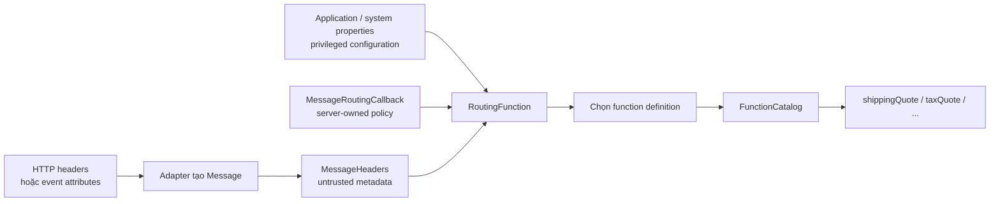

# Giới hạn SpEL và phân biệt nguồn biểu thức tin cậy

## 1. Bối cảnh: biểu thức là cấu hình hay dữ liệu do người gọi điều khiển?

Trong **SPRING_CLOUD_FUNCTION (Spring Cloud Function)**, nghiệp vụ được viết bằng `Supplier`, `Function` và `Consumer`, được đăng ký trong `FunctionCatalog`, ghép bằng *composition* và có thể được triển khai qua HTTP, broker sự kiện hoặc serverless. Một số tính năng cho phép dùng **Spring Expression Language (SpEL)** để đọc thông điệp, chọn function hoặc bổ sung header. SpEL thuận tiện nhưng tạo ra một ranh giới bảo mật không thể bỏ qua.

Giả sử ứng dụng có:

- `shippingQuote`: hàm báo giá vận chuyển được phép dùng từ API công khai.
- `taxQuote`: hàm báo giá thuế được phép dùng từ API công khai.
- `rebuildLedger`: thao tác bảo trì nhạy cảm, **không được gọi từ API công khai**.

Khi dùng `functionRouter`, Spring Cloud Function có thể nhận **biểu thức định tuyến** từ property hoặc từ header của `Message`:

```properties
# Cấu hình do đội triển khai quản lý:
spring.cloud.function.routing-expression=headers['operation']
```

```java
Message<String> message = MessageBuilder.withPayload("SKU-42")
        .setHeader("spring.cloud.function.routing-expression",
                "headers['operation']")
        .setHeader("operation", "shippingQuote")
        .build();
```

Hai chuỗi `headers['operation']` trông giống nhau nhưng có **nguồn sở hữu khác nhau**. Biểu thức trong `application.properties` được quản lý ở cấp cấu hình triển khai; biểu thức trong `MessageHeaders` có thể đến từ một HTTP client, một producer Kafka hoặc một event envelope. Khi client có thể tạo **chuỗi biểu thức**, đó không chỉ còn là bài toán kiểm tra một trường dữ liệu.

> **Nguyên tắc chính:** đừng để đối tượng không đáng tin cung cấp trực tiếp SpEL hoặc function definition rồi xem khả năng giới hạn ngôn ngữ như một cơ chế phân quyền. Nguồn biểu thức, các đối tượng biểu thức có thể truy cập, và hàm đích mà biểu thức trả về đều phải được kiểm soát.

### Mục tiêu học tập

Sau bài này, bạn có thể:

1. Xác định những nơi SpEL xuất hiện trong Spring Cloud Function và phân biệt **expression source** với **expression input data**.
2. Giải thích `SimpleEvaluationContext` so với `StandardEvaluationContext` và giới hạn thật sự của mỗi loại.
3. Biết rằng trong **function routing**, header expression dùng context bị hạn chế, còn expression từ application/system property dùng context đầy đủ hơn.
4. Phân biệt việc hạn chế ngôn ngữ biểu thức với kiểm tra **danh sách hàm được phép gọi**.
5. Thiết kế adapter chọn hàm bằng allowlist và tách biểu thức tin cậy khỏi dữ liệu HTTP/broker/serverless.
6. Kiểm thử sự khác nhau giữa hai context, nguồn cấu hình, routing headers giả mạo và quyền của caller.
7. Bảo vệ cấu hình deployment, đối tượng root, method/property accessors, conversion và cơ chế caching/compilation của SpEL.

## 2. Đường đi từ HTTP hoặc sự kiện tới `functionRouter`



Spring Cloud Function có `RoutingFunction` được đăng ký trong catalog với tên `functionRouter`. Đối với **imperative function** xử lý từng `Message`, tài liệu chính thức nêu thứ tự ưu tiên của chỉ dẫn định tuyến:

1. `MessageRoutingCallback`: chiến lược do ứng dụng đăng ký, ưu tiên cao nhất.
2. `Message` headers, nếu không có callback áp dụng.
3. Application/system properties.

Hai header đặc biệt:

| Header | Vai trò | Nguy cơ nếu client tự cung cấp |
|---|---|---|
| `spring.cloud.function.definition` | Chỉ định tên function hoặc một chuỗi composition | Chọn function có quyền cao hoặc ghép chuỗi trái phép |
| `spring.cloud.function.routing-expression` | Cung cấp SpEL tính tên function/definition | Biểu thức do nguồn ngoài điều khiển, kể cả khi evaluation bị hạn chế |

Ví dụ bên gửi yêu cầu chọn đích bằng header:

```http
POST /functions/functionRouter HTTP/1.1
Content-Type: text/plain
spring.cloud.function.definition: rebuildLedger

SKU-42
```

Đây là **kịch bản để phân tích rủi ro**, không phải endpoint nên công bố. Thậm chí nếu một ứng dụng chặn mọi cú pháp SpEL phức tạp, header `spring.cloud.function.definition` **không phải SpEL**; chỉ riêng tên definition đã có thể ảnh hưởng hàm được chọn nếu router và catalog chấp nhận nó.

### Routing của hàm reactive

Routing theo header **cho từng message** chỉ áp dụng theo mô hình imperative được tài liệu mô tả. Với hàm reactive nhận `Flux`/`Publisher`, đơn vị xử lý là **toàn bộ stream**, do đó chỉ dẫn routing được cung cấp ở cấp application properties/definition, không phải header riêng của từng phần tử. Không dựa vào đầu vào reactive để giả định một `routing-expression` do message gửi sẽ có cùng hành vi như hàm imperative.

## 3. Ba khái niệm phải tách riêng

| Khái niệm | Ví dụ | Câu hỏi bảo mật |
|---|---|---|
| **Nguồn biểu thức** (*expression source*) | Cấu hình deployment hoặc message header chứa cả chuỗi `headers['operation']` | Ai **có quyền viết hoặc thay đổi chuỗi SpEL**? |
| **Dữ liệu đầu vào biểu thức** (*expression data*) | Header `operation=shipping` được biểu thức cố định đọc | Dữ liệu có đúng schema, kiểu, giới hạn và được xác minh nguồn không? |
| **Kết quả biểu thức** (*expression result*) | Chuỗi `shippingQuote` dùng làm function definition | Caller có được phép chọn function/composition đó không? |

Tình huống tốt hơn:

```text
Expression do server giữ:     "headers['operation']"
Message data từ caller:       operation = "shipping"
Server-side mapping:          "shipping" -> "shippingQuote"
                              "tax"      -> "taxQuote"
Mọi giá trị khác:             REJECT
```

**Đừng nhầm một biểu thức cố định với một kết quả đã được phép.** Cấu hình `headers['operation']` tuy không do client viết vẫn **trả nguyên dữ liệu client**. Nếu giá trị là `rebuildLedger`, router có thể nhận đúng tên bean đó. Một biểu thức hợp lệ và được quản lý bởi admin có thể vẫn dẫn tới **vulnerability về authorization** khi cách sử dụng kết quả không được kiểm soát.

Ngược lại, nếu expression được lấy trực tiếp từ client nhưng nó thường chỉ trả `shippingQuote`, đó vẫn là thiết kế có rủi ro vì bên gửi có quyền đổi biểu thức trong request tiếp theo.

## 4. `EvaluationContext` quyết định biểu thức có thể làm gì

SpEL không tự xác định giới hạn quyền. Nó đánh giá biểu thức dựa trên:

- **Root object**, ví dụ một Spring `Message<?>` có `payload` và `headers`.
- **PropertyAccessors**: cách truy cập thuộc tính, map hoặc getters.
- **MethodResolvers**: cách tìm/call phương thức.
- **TypeLocator**, constructor resolver và khả năng truy cập kiểu Java.
- **BeanResolver**: khả năng tham chiếu bean từ ứng dụng.
- **Variables/functions**, conversion và các extension khác được cấu hình.

Hai implementation phổ biến của `EvaluationContext`:

| Đặc điểm | `SimpleEvaluationContext` | `StandardEvaluationContext` |
|---|---|---|
| Mục tiêu | Các trường hợp cần tập con SpEL bị hạn chế | Đầy đủ khả năng SpEL và tùy biến |
| Tham chiếu kiểu Java `T(...)` | Không hỗ trợ theo thiết kế | Có thể hỗ trợ |
| Dùng constructor `new ...` | Không hỗ trợ theo thiết kế | Có thể hỗ trợ |
| Tham chiếu Spring bean `@bean` | Không hỗ trợ theo thiết kế | Có thể cấu hình bean resolver |
| Property/method access | Phụ thuộc builder và accessor được cấu hình | Hệ thống resolver/accessor linh hoạt |
| Read-only data binding | Có lựa chọn `forReadOnlyDataBinding()` | Không mặc định biến mọi đối tượng thành an toàn |
| An toàn với biểu thức không đáng tin? | **Không được bảo đảm tuyệt đối** | **Không được dùng** để đánh giá expression không đáng tin |

Spring Framework nhấn mạnh rằng ngay cả `SimpleEvaluationContext` cũng chỉ **giới hạn tính năng trên cơ sở best-effort**. Nếu biểu thức có thể truy cập một object nguy hiểm qua root, property accessor, method resolver, variable hoặc function, việc cấm `T(...)` chưa bảo đảm rằng mọi phép đọc và gọi đều vô hại.

Một getter trông như thao tác đọc, nhưng có thể có **side effect**. Ví dụ, Java có những phương thức không nhận tham số và trả về một giá trị nhưng lại thay đổi trạng thái đối tượng. Khi một object như vậy trở thành root hoặc property của context, một biểu thức truy cập thuộc tính vẫn có thể gây tác động. Tên getter “đọc dữ liệu” **không đủ để chứng minh an toàn**.

> Theo tài liệu [Spring Framework — Evaluation, Security Considerations](https://docs.spring.io/spring-framework/reference/core/expressions/evaluation.html), expression không đáng tin nên tránh được đánh giá; riêng `StandardEvaluationContext` tuyệt đối không được dùng để chạy expression từ nguồn không đáng tin. `SimpleEvaluationContext` không phải sandbox có bảo đảm bảo mật cho mọi root object.

## 5. Trong Spring Cloud Function: nguồn routing expression chọn context nào?

Tài liệu **Spring Cloud Function – Function Routing and Filtering** quy định cụ thể:

| Nơi đặt `spring.cloud.function.routing-expression` | Context được dùng | Nhận xét |
|---|---|---|
| `MessageHeaders` của thông điệp đầu vào | `SimpleEvaluationContext` | Hạn chế một số tính năng ngôn ngữ do đầu vào có thể đến từ HTTP client |
| Application properties / system properties / environment configuration | `StandardEvaluationContext` | Cho phép SpEL linh hoạt hơn vì được giả định là cấu hình do người triển khai quản lý |

Đây là **quy tắc cụ thể cho routing expressions**. Không tự suy ra mọi SpEL ở Spring Cloud Function hoặc các thư viện khác đều dùng đúng cùng cặp context. Ví dụ, `input-header-mapping-expression` và `output-header-mapping-expression` là tính năng **header enrichment** với ranh giới và implementation riêng; phải kiểm chứng hành vi thực tế theo phiên bản thay vì mặc định chúng dùng chính sách routing này.

### 5.1. Biểu thức đặt trong header

```java
import org.springframework.messaging.Message;
import org.springframework.messaging.support.MessageBuilder;

Message<String> input = MessageBuilder.withPayload("SKU-42")
        .setHeader("operation", "shipping")
        .setHeader("spring.cloud.function.routing-expression",
                "headers['operation']")
        .build();
```

Với `functionRouter` ở chế độ imperative, biểu thức đọc dữ liệu của `Message`. Kết quả là `"shipping"`. Nếu **tên function trong catalog không phải `shipping`** mà là `shippingQuote`, còn cần một bước ánh xạ. Quan trọng hơn, nếu caller có thể đặt `operation` trực tiếp thành tên bean nhạy cảm, context dù bị hạn chế cũng không chặn được **kết quả route không mong muốn**.

### 5.2. Biểu thức đặt trong application properties

```properties
spring.cloud.function.routing-expression=headers['operation']
```

Đội triển khai quản lý expression này, nên theo tài liệu Spring Cloud Function nó được đánh giá bằng `StandardEvaluationContext` khi đi qua nhánh application/system property. **“Đến từ application properties” không có nghĩa luôn an toàn**: property có thể bị ghi đè bởi môi trường, lệnh khởi động, cấu hình triển khai, Config Server hoặc một giao diện quản trị nếu những nguồn đó không được bảo vệ.

Vì biểu thức có đặc quyền rộng hơn, chỉ người phát triển/đội vận hành đáng tin mới được phép thay đổi. Không để dữ liệu từ HTTP request được chuyển vào property này qua cơ chế substitution, dynamic config hay một endpoint cấu hình riêng không có kiểm soát.

### 5.3. Ví dụ về context hạn chế, không phải ví dụ tấn công

So sánh hai expression **lành tính**:

```text
Expression:     "payload"
Root object:    Message<String>("SKU-42")
Simple context: có thể đọc payload nếu property accessor hỗ trợ
Standard:       có thể đọc payload

Expression:     "T(java.lang.Math).abs(-7)"
Simple context: không hỗ trợ tham chiếu Java type T(...)
Standard:       có thể tính kết quả 7
```

Việc `SimpleEvaluationContext` từ chối `T(...)` là một **giới hạn cú pháp/tính năng**, không phải giấy phép để tiếp nhận biểu thức tùy ý từ Internet. Cần kiểm soát function target và quyền caller **ngay cả khi mọi biểu thức đều thuộc tập cú pháp hợp lệ**.

## 6. Kiểm chứng sự khác biệt bằng JUnit 5

Ví dụ sau không cần Web adapter hay broker. Nó dùng Spring Expression Language trực tiếp để minh họa những đặc tính cơ bản của hai context.

```java
package com.example.security;

import static org.junit.jupiter.api.Assertions.assertEquals;
import static org.junit.jupiter.api.Assertions.assertThrows;

import org.junit.jupiter.api.Test;
import org.springframework.expression.Expression;
import org.springframework.expression.spel.SpelEvaluationException;
import org.springframework.expression.spel.standard.SpelExpressionParser;
import org.springframework.expression.spel.support.SimpleEvaluationContext;
import org.springframework.expression.spel.support.StandardEvaluationContext;
import org.springframework.messaging.Message;
import org.springframework.messaging.support.MessageBuilder;

class SpelContextDifferenceTest {

    private final SpelExpressionParser parser = new SpelExpressionParser();

    @Test
    void readOnlySimpleContextCanReadMessagePayload() {
        Message<String> input = MessageBuilder
                .withPayload("SKU-42").build();
        Expression expression = parser.parseExpression("payload");

        Object output = expression.getValue(
                SimpleEvaluationContext.forReadOnlyDataBinding().build(),
                input);
        assertEquals("SKU-42", output);
    }

    @Test
    void simpleContextRejectsJavaTypeReference() {
        Expression expression =
                parser.parseExpression("T(java.lang.Math).abs(-7)");

        assertThrows(SpelEvaluationException.class,
                () -> expression.getValue(
                        SimpleEvaluationContext
                                .forReadOnlyDataBinding().build()));
    }

    @Test
    void standardContextAllowsBenignTypeReference() {
        Expression expression =
                parser.parseExpression("T(java.lang.Math).abs(-7)");

        Integer output = expression.getValue(
                new StandardEvaluationContext(), Integer.class);
        assertEquals(7, output);
    }
}
```

**Giới hạn của test:** nó minh họa Spring SpEL thuần, **không chứng minh một Spring Cloud Function router đã áp dụng context nào trong runtime**. Để kiểm tra chính xác chính sách của ứng dụng, phải viết integration test qua `FunctionCatalog.lookup("functionRouter")` hoặc adapter thực tế, đồng thời quan sát function nào đã được chạy.

Không dùng kết quả `T(java.lang.Math).abs(-7)` để suy luận khả năng chạy code tùy ý trong mọi context. Test chỉ chỉ ra sự khác biệt về **tham chiếu Java type** trên hai implementation.

## 7. Ranh giới tin cậy còn quan trọng hơn nơi đặt property

Một biểu thức được coi là **trusted** khi người cung cấp nó là developer hoặc administrator chịu trách nhiệm xây dựng/vận hành ứng dụng. Độ tin cậy phải dựa trên **quyền kiểm soát thực tế**, không chỉ dựa vào vị trí lưu chuỗi.

| Nguồn | Có thể là trusted? | Điều phải kiểm tra |
|---|---|---|
| `application.yml` nằm trong artifact đã review | Có | Pipeline build/deploy, quyền sửa repository, review change |
| Environment variables được cấp trong deployment | Có, nếu được kiểm soát | Quyền sửa pod/task config, secrets, CI/CD, rollback |
| System properties / CLI arguments | Có, nếu launch config được bảo vệ | Quyền sửa command line, container image, script khởi chạy |
| Config Server / remote configuration | Có điều kiện | ACL, mTLS/authn, quyền commit/publish, audit, refresh |
| Actuator hoặc admin endpoint có thể ghi cấu hình | Chỉ khi đã bảo vệ đúng | Không công bố chức năng cập nhật cho caller chưa được phép |
| HTTP request header/body | Không | Client có thể thay toàn bộ giá trị |
| Broker record headers | Không mặc định | Producer ACL không đảm bảo mọi giá trị đều hợp lệ/tin cậy |
| Webhook/CloudEvent từ bên thứ ba | Không mặc định | Xác minh chữ ký/nguồn, schema, quyền nguồn |
| Database row do user chỉnh sửa | Không | Dữ liệu lưu bền không biến thành cấu hình đáng tin |

**Trusted expression** không làm **untrusted data** trở thành trusted. Ví dụ một biểu thức từ configuration chỉ đọc `headers['operation']`, nhưng giá trị `operation` vẫn cần tập giá trị cho phép, kiểu, độ dài, nguồn và quyền người gọi.

Ngược lại, một expression được người phát triển viết nhưng có thể bị override bằng remote property do đối tượng không được phép kiểm soát là **expression không còn được bảo vệ đúng ranh giới tin cậy**. Phải review toàn bộ chuỗi cung cấp cấu hình.

### Quyền thay đổi cấu hình là quyền có đặc quyền

Spring Cloud Function **không tự công bố** một endpoint cho caller sửa arbitrary application properties. Nhưng các thư viện, sản phẩm hoặc mã quản trị riêng có thể đưa ra cơ chế đọc/đổi cấu hình. Vì `StandardEvaluationContext` có tập tính năng phong phú, việc sửa `spring.cloud.function.routing-expression` có thể có tác động lớn hơn thay một cấu hình cosmetic.

Nên:

- Chặn quyền sửa property/secret/ConfigMap của các principal không được quản trị.
- Bảo vệ Actuator và mọi endpoint custom; không bật cơ chế ghi cấu hình chỉ để thuận tiện.
- Phê duyệt và audit thay đổi routing definition/expression.
- Kiểm soát cách giá trị environment được inject vào app; không lấy trực tiếp input client để ghi đè biến cấu hình.
- Tách cấu hình của deployment công khai và deployment quản trị có quyền cao.

## 8. Root object an toàn: đừng đưa object có khả năng làm việc nguy hiểm vào SpEL

`EvaluationContext` không chỉ quyết định cú pháp mà còn quyết định **những object được biểu thức chạm tới**. Một context “read-only” có thể từ chối phép gán thuộc tính nhưng vẫn thực hiện **getter có side effect**.

Ví dụ các đối tượng không nên expose làm root/property cho expression từ nguồn không tin cậy:

- Một service object có các phương thức đọc/ghi database hoặc gọi API bên ngoài.
- Một bean quản trị có method cập nhật cấu hình, xóa dữ liệu hoặc chạy tác vụ bảo trì.
- Một object tùy biến có getter lười (*lazy*) thực hiện mutation, gửi message hoặc truy vấn có chi phí cao.
- Một đối tượng cho phép truy cập file system, network, execution context hoặc secrets.
- Một DTO lồng các object service có thể đi qua property accessor.

Từ góc độ bảo mật, **“chỉ cho đọc thuộc tính” không đồng nghĩa “chỉ cho chạy logic không có tác dụng phụ”**. Hãy cung cấp một DTO dữ liệu đơn giản, bất biến và có trường đã được lọc nếu buộc phải đánh giá biểu thức. Đặt giới hạn kích thước và độ sâu của dữ liệu, không để expression duyệt đồ thị object lớn không cần thiết.

Một lựa chọn minh bạch hơn cho routing:

```java
public record RouteHint(String operation, String correlationId) {}
```

Ngay cả với `RouteHint`, vẫn không nên cho client viết expression tùy ý; hãy chọn biểu thức hoặc mapping **cố định từ code**, rồi chỉ lấy `operation` làm dữ liệu được kiểm tra.

## 9. Phân biệt SpEL routing và header enrichment

SpEL còn xuất hiện ở tính năng bổ sung header của Spring Cloud Function, ví dụ:

```properties
spring.cloud.function.configuration.shippingQuote.input-header-mapping-expression.ingress='api'
spring.cloud.function.configuration.shippingQuote.output-header-mapping-expression.resultStage='quoted'
```

Hai biểu thức này là **cấu hình enrichment** (trước/sau lời gọi hàm), không phải routing expression dùng để chọn tên function. Cần phân biệt:

| Tính năng | Điều SpEL tính ra | Rủi ro cần kiểm soát |
|---|---|---|
| `spring.cloud.function.routing-expression` | Tên function/definition mà router sẽ gọi | Chọn nhầm hàm có đặc quyền, composition bị lạm dụng |
| `input-header-mapping-expression` | Giá trị một header **đầu vào** | Giả mạo/ghi đè metadata ảnh hưởng tới nghiệp vụ, phân quyền |
| `output-header-mapping-expression` | Giá trị một header **đầu ra** | Lộ dữ liệu/metadata nhạy cảm ra HTTP/broker |
| `spring.cloud.function.definition` | Tên function/definition được chọn **không qua SpEL** | Bypass kiểm tra SpEL nếu chỉ bảo vệ routing-expression |

Spring Cloud Function mô tả rằng khi expression enrichment thất bại, framework có thể ghi `WARN` và **tiếp tục chạy hàm**. Vì vậy không dùng enrichment làm cơ chế validation fail-closed cho `tenantId`, role, scope hoặc hàm đích. Nếu một header bắt buộc cho bảo mật, bean/adapter phải kiểm tra trước khi có hành động.

**Không mở rộng máy móc** khẳng định “header routing dùng Simple” thành “mọi expression từ MessageHeaders hoặc mọi header enrichment đều dùng Simple”. Hãy đối chiếu tính năng cụ thể và phiên bản SCF đang dùng.

## 10. Lựa chọn triển khai an toàn nhất: hàm cố định thay vì expression do client gửi

Nếu một endpoint chỉ cần báo giá vận chuyển thì **không cần functionRouter**. Có thể để Spring MVC adapter inject đúng bean:

```java
package com.example.shipping;

import java.util.Locale;
import java.util.function.Function;

import org.springframework.context.annotation.Bean;
import org.springframework.context.annotation.Configuration;

@Configuration
public class QuoteFunctions {

    @Bean
    public Function<String, String> shippingQuote() {
        return value -> "SHIPPING:" + value.toUpperCase(Locale.ROOT);
    }

    @Bean
    public Function<String, String> taxQuote() {
        return value -> "TAX:" + value.toUpperCase(Locale.ROOT);
    }
}
```

```java
package com.example.shipping;

import java.util.function.Function;

import org.springframework.beans.factory.annotation.Qualifier;
import org.springframework.http.MediaType;
import org.springframework.web.bind.annotation.PostMapping;
import org.springframework.web.bind.annotation.RequestBody;
import org.springframework.web.bind.annotation.RestController;

@RestController
public class ShippingController {
    private final Function<String, String> shipping;

    public ShippingController(
            @Qualifier("shippingQuote") Function<String, String> shipping) {
        this.shipping = shipping;
    }

    @PostMapping(
            path = "/api/shipping/quote",
            consumes = MediaType.TEXT_PLAIN_VALUE,
            produces = MediaType.TEXT_PLAIN_VALUE)
    public String quote(@RequestBody String sku) {
        if (!sku.matches("[A-Za-z0-9-]{1,32}")) {
            throw new IllegalArgumentException("Invalid SKU");
        }
        return shipping.apply(sku);
    }
}
```

Trong ví dụ này, một HTTP header `spring.cloud.function.routing-expression` từ caller **không ảnh hưởng** bean mà controller inject. Tuy nhiên, ứng dụng vẫn phải bảo vệ endpoint bằng Spring Security, kiểm soát quyền nghiệp vụ và giới hạn HTTP input. Nếu cùng ứng dụng còn `spring-cloud-function-web`, hãy kiểm tra những endpoint Web adapter tự công bố; đừng chỉ bảo vệ controller rồi để adapter mở một đường vòng khác.

## 11. Nếu cần routing: ánh xạ business operation sang function allowlist

Khi một điểm vào cần xử lý nhiều loại sự kiện, hãy để caller gửi **mã thao tác nghiệp vụ** đơn giản; ứng dụng xác định target bằng **bảng ánh xạ do server quản lý**. Theo API hiện hành được tài liệu Spring Cloud Function mô tả, `MessageRoutingCallback.routingResult(Message<?>)` trả về tên definition dưới dạng `String`.

```java
package com.example.shipping;

import org.springframework.cloud.function.context.MessageRoutingCallback;
import org.springframework.context.annotation.Bean;
import org.springframework.context.annotation.Configuration;
import org.springframework.messaging.Message;

@Configuration
public class SafeRouteConfiguration {

    @Bean
    MessageRoutingCallback routeByApprovedOperation() {
        return new MessageRoutingCallback() {
            @Override
            public String routingResult(Message<?> message) {
                Object raw = message.getHeaders().get("businessOperation");
                if (!(raw instanceof String operation)) {
                    throw new IllegalArgumentException("Missing operation");
                }
                return switch (operation) {
                    case "shipping" -> "shippingQuote";
                    case "tax" -> "taxQuote";
                    default -> throw new IllegalArgumentException(
                            "Unsupported operation");
                };
            }
        };
    }
}
```

Điểm bảo mật:

- Callback do **server** đăng ký và được `RoutingFunction` ưu tiên trước message headers đối với routing imperative.
- Callback **không đọc** `spring.cloud.function.routing-expression` hoặc `spring.cloud.function.definition` do người ngoài gửi.
- Callback **không trả nguyên `operation`** mà ánh xạ hai giá trị cụ thể sang hai tên bean được review.
- Callback không tạo composition từ các chuỗi người dùng nhập.
- Dữ liệu có kiểu sai, thiếu hoặc không nằm trong tập hợp bị **từ chối**, không có nhánh mặc định sang một hàm khác.

Nếu hai function đích cần **quyền khác nhau**, callback allowlist chưa đủ: adapter phải xác thực caller và kiểm tra authorization theo mỗi operation trước khi gọi router. Nếu một tác vụ quản trị cần quyền đặc biệt, tốt nhất đặt nó trong deployment/service khác thay vì chung router công khai.

**Lưu ý phiên bản:** tài liệu hiện hành minh họa `routingResult(Message<?>)` là một **phương thức `default` trên interface**, vì vậy đoạn code dùng **anonymous class và `@Override`**, không dùng lambda như với một functional interface. Các nhánh Spring Cloud Function cũ có thể khác chữ ký hoặc kiểu kết quả; hãy kiểm tra API thật trong version dependency.

## 12. Unit test: biểu thức bên ngoài không vượt qua allowlist

Với `SafeRouteConfiguration` ở trên, cần kiểm tra callback không tin các header định tuyến mà client tự cung cấp:

```java
package com.example.shipping;

import static org.junit.jupiter.api.Assertions.assertEquals;
import static org.junit.jupiter.api.Assertions.assertThrows;

import org.junit.jupiter.api.Test;
import org.springframework.cloud.function.context.MessageRoutingCallback;
import org.springframework.messaging.Message;
import org.springframework.messaging.support.MessageBuilder;

class SafeRouteConfigurationTest {

    private final MessageRoutingCallback route =
            new SafeRouteConfiguration().routeByApprovedOperation();

    @Test
    void ignoresUntrustedDefinitionAndExpressionHeaders() {
        Message<String> request = MessageBuilder.withPayload("SKU-42")
                .setHeader("businessOperation", "shipping")
                .setHeader("spring.cloud.function.definition",
                        "rebuildLedger")
                .setHeader("spring.cloud.function.routing-expression",
                        "'rebuildLedger'")
                .build();

        assertEquals("shippingQuote", route.routingResult(request));
    }

    @Test
    void rejectsUnknownTargetEvenIfItLooksLikeBeanName() {
        Message<String> request = MessageBuilder.withPayload("SKU-42")
                .setHeader("businessOperation", "rebuildLedger")
                .build();

        assertThrows(IllegalArgumentException.class,
                () -> route.routingResult(request));
    }

    @Test
    void rejectsCompositionAsAnOperation() {
        Message<String> request = MessageBuilder.withPayload("SKU-42")
                .setHeader("businessOperation",
                        "shippingQuote|rebuildLedger")
                .build();

        assertThrows(IllegalArgumentException.class,
                () -> route.routingResult(request));
    }

    @Test
    void rejectsNonStringOperation() {
        Message<String> request = MessageBuilder.withPayload("SKU-42")
                .setHeader("businessOperation", 123)
                .build();

        assertThrows(IllegalArgumentException.class,
                () -> route.routingResult(request));
    }

    @Test
    void recognizesOnlyApprovedTaxOperation() {
        Message<String> request = MessageBuilder.withPayload("SKU-42")
                .setHeader("businessOperation", "tax")
                .build();

        assertEquals("taxQuote", route.routingResult(request));
    }
}
```

Những bài test này chứng minh **chính sách do callback thực thi**; chúng không chứng minh adapter đã đăng ký callback đúng hoặc callback được ưu tiên trong một luồng thực tế. Cần một integration test với Spring context, `FunctionCatalog.lookup("functionRouter")`, và quan sát **function nào được gọi**. Với function có side effect, nên dùng spy hoặc kiểm tra state để bảo đảm tác vụ nhạy cảm không được chạy; chỉ kiểm tra nội dung phản hồi là chưa đủ.

Nếu app chạy cùng nhiều router hoặc có cấu hình lookup đặc biệt, test phải mô phỏng chính deployment đó. Không thể lấy kết quả unit test của callback trong một module rồi mặc định mọi trigger HTTP, broker và serverless đều dùng đúng callback.

## 13. Tránh chuyển thẳng HTTP headers thành metadata điều khiển

Với Web adapter, một số HTTP headers có thể đi vào `MessageHeaders`. Lỗi phổ biến trong adapter tự viết cũng tương tự: copy mọi HTTP header vào message rồi đưa message tới router.

**Cách không nên làm:**

```java
// Anti-pattern: mọi dữ liệu HTTP header được cho vào Message.
// Không dùng cách này ở entrypoint có dynamic routing.
//
// MessageBuilder.withPayload(requestBody)
//         .copyHeaders(requestHeaders.toSingleValueMap())
//         .build();
```

Với một API tự xây, nên tạo `Message` từ **danh sách trường cho phép**:

```java
package com.example.shipping;

import java.util.List;
import java.util.UUID;

import org.springframework.http.HttpHeaders;
import org.springframework.http.HttpStatus;
import org.springframework.messaging.Message;
import org.springframework.messaging.support.MessageBuilder;
import org.springframework.web.server.ResponseStatusException;

public final class InboundQuoteMessages {

    private InboundQuoteMessages() {}

    public static Message<String> fromHttp(
            String sku, String operation, HttpHeaders headers) {

        if (sku == null
                || !sku.matches("[A-Za-z0-9-]{1,32}")) {
            throw new ResponseStatusException(
                    HttpStatus.BAD_REQUEST, "Invalid SKU");
        }

        if (!"shipping".equals(operation)
                && !"tax".equals(operation)) {
            throw new ResponseStatusException(
                    HttpStatus.NOT_FOUND, "Unknown operation");
        }

        String correlationId = correlationId(headers);
        return MessageBuilder.withPayload(sku)
                .setHeader("businessOperation", operation)
                .setHeader("correlationId", correlationId)
                .build();
    }

    private static String correlationId(HttpHeaders headers) {
        List<String> values = headers.get("X-Correlation-ID");
        if (values == null || values.isEmpty()) {
            return UUID.randomUUID().toString();
        }

        if (values.size() != 1
                || !values.get(0).matches("[A-Za-z0-9._-]{1,64}")) {
            throw new ResponseStatusException(
                    HttpStatus.BAD_REQUEST, "Invalid correlation ID");
        }
        return values.get(0);
    }
}
```

Điểm then chốt: builder **không copy** `spring.cloud.function.definition`, `spring.cloud.function.routing-expression`, `Authorization`, cookie hay bất kỳ header tùy ý nào khác. Nó chỉ đưa vào metadata đã được quy định: `businessOperation` và `correlationId`. Bản thân `correlationId` **không phải chứng cứ phân quyền**.

HTTP header có thể có nhiều giá trị và tên HTTP không phân biệt hoa/thường, trong khi khóa trong `MessageHeaders` là chuỗi Java. Adapter cần chuẩn hóa kiểu, danh sách khóa và cách xử lý nhiều giá trị; **không dùng phân biệt hoa/thường như một biện pháp bảo mật**.

Nếu sử dụng **Spring Cloud Function Web trực tiếp** thay vì controller/adapter tự viết, code `InboundQuoteMessages` không được áp dụng tự động. Hãy kiểm tra cơ chế Web export/routing thực tế, chặn router không cần thiết và dùng authorization ở đúng URL.

## 14. Bảo vệ FunctionCatalog và giới hạn hàm được công bố

Với ứng dụng Web chỉ cần hai chức năng báo giá, có thể dùng cơ chế lọc danh sách definition theo tài liệu Spring Cloud Function Web:

```properties
# Ví dụ dành riêng cho deployment sử dụng Web adapter.
spring.cloud.function.web.path=/functions
spring.cloud.function.definition=shippingQuote;taxQuote
spring.cloud.function.single-function-fallback-enabled=false
```

Quy tắc:

| Cấu hình | Ý nghĩa cần nhớ |
|---|---|
| `shippingQuote;taxQuote` | Danh sách hai definition được Web adapter xuất bản |
| `shippingQuote\|taxQuote` | **Một** chuỗi composition, không phải hai endpoint |
| `single-function-fallback-enabled=false` | Tránh tra cứu function duy nhất bằng tên không khớp do fallback |
| `web.path=/functions` | Đổi URL prefix, **không** tạo authentication/authorization |

Nếu `rebuildLedger` không cần thuộc catalog:

```properties
spring.cloud.function.ineligible-definitions=rebuildLedger
```

Property này loại bean khỏi danh sách ứng viên catalog theo cơ chế Spring Cloud Function; nó **không** ngăn mã Java khác đang giữ tham chiếu đến bean trực tiếp gọi nó, không tự bảo vệ database và không thay thế Spring Security. Trong hệ thống thật, chức năng quản trị nhạy cảm nên được tách thành service/deployment với quyền riêng.

**Hai kiến trúc không nên trộn lẫn:**

- **Web export cố định:** dùng `definition=shippingQuote;taxQuote`, không công bố `functionRouter` cho client.
- **Đầu vào thật sự cần dynamic routing:** chỉ công bố router theo thiết kế, dùng callback allowlist và authorization ở adapter; không giả định Web filtering tự động là policy cho mọi function mà router có thể lookup.

Một router có thể tra cứu function trong catalog theo logic riêng. Vì vậy, chỉ giới hạn **URL** chưa đủ nếu callback hoặc routing headers vẫn cho phép chọn bean không thuộc hợp đồng.

## 15. Spring Security: phân quyền không nằm trong `EvaluationContext`

Giả sử `shippingQuote` và `taxQuote` đều yêu cầu JWT scope `quotes.read`. Một Spring MVC deployment có thể dùng policy:

```java
package com.example.shipping;

import org.springframework.context.annotation.Bean;
import org.springframework.context.annotation.Configuration;
import org.springframework.http.HttpMethod;
import org.springframework.security.config.Customizer;
import org.springframework.security.config.annotation.web.builders.HttpSecurity;
import org.springframework.security.web.SecurityFilterChain;

@Configuration
public class QuoteSecurity {

    @Bean
    SecurityFilterChain api(HttpSecurity http) throws Exception {
        return http
            // Chỉ phù hợp API stateless xác thực bằng bearer token,
            // không dựa vào cookie xác thực trình duyệt.
            .csrf(csrf -> csrf.disable())
            .authorizeHttpRequests(auth -> auth
                .requestMatchers(
                    HttpMethod.POST, "/api/shipping/quote")
                    .hasAuthority("SCOPE_quotes.read")
                .anyRequest().denyAll()
            )
            .oauth2ResourceServer(oauth ->
                oauth.jwt(Customizer.withDefaults()))
            .build();
    }
}
```

Ở production còn phải cấu hình JWT decoder kiểm tra chữ ký, issuer, audience, hạn dùng và các ràng buộc thích hợp; scope không có nghĩa caller có quyền với **mọi** khách hàng hay tenant. Nếu thao tác ảnh hưởng tài nguyên có chủ sở hữu, business authorization phải thực hiện trước side effect.

Nếu sử dụng cookie/session thay vì API stateless bearer token, **không sao chép máy móc** `csrf.disable()`. CORS không phải authentication; nó điều khiển browser, không ngăn caller dùng HTTP client khác.

**Phân quyền không phụ thuộc biểu thức có bị giới hạn cú pháp hay không.** Một caller thiếu scope `quotes.read` không được phép gọi `shippingQuote` cho dù expression chỉ là literal `'shippingQuote'` hoàn toàn lành tính.

## 16. Spring Cloud Stream: producer có quyền publish không có quyền chọn mọi bean

Với Spring Cloud Stream, một ứng dụng có thể bật **event routing** qua `RoutingFunction`:

```properties
spring.cloud.stream.function.routing.enabled=true
spring.cloud.stream.bindings.functionRouter-in-0.destination=quotes.requests
```

Đây là cấu hình **để minh họa deployment cố ý sử dụng router**, không phải cấu hình khuyến nghị cho mọi ứng dụng. Một producer có quyền ghi `quotes.requests` có thể đưa thêm record headers. Khi binder ánh xạ các headers đó vào `MessageHeaders`, cần xử lý chúng như dữ liệu từ **nguồn ngoài**.

Luồng mong muốn:

```text
Producer với broker ACL phù hợp
     |
     v
quotes.requests (payload + application headers)
     |
     v
Stream binder / message conversion
     |
     v
Trusted adapter / callback
  - kiểm tra schema, size, businessOperation
  - không dùng routing-expression từ record làm policy
  - map operation vào shippingQuote/taxQuote
     |
     v
FunctionCatalog target đã được phê duyệt
```

Những điểm bảo mật:

- Broker ACL giới hạn ai được **publish/consume**, không bảo đảm nội dung của publisher luôn hợp lệ.
- Không truyền token, role, `tenantId` từ event headers vào chức năng nhạy cảm mà bỏ qua xác thực/authorization nguồn.
- Một stream nhập từ nhiều producer có quyền khác nhau nên không dùng chung router chọn target có mức đặc quyền chênh lệch lớn.
- Khi function routing thất bại, xác định retry/DLQ/audit; không âm thầm coi bản tin bị drop là đã xử lý thành công.
- Nếu dùng reactive function, không kỳ vọng routing header riêng từng record có cùng semantics với imperative function.

Đặc biệt, cần phân biệt **routing tới function** với **routing output tới broker destination**. Metadata chọn topic/queue đầu ra cũng cần ràng buộc, nhưng không tự là `spring.cloud.function.routing-expression`. Không để một producer tự do chọn destination mà runtime có quyền ghi.

## 17. Serverless: cấu hình function definition và event envelope

Với AWS Lambda hoặc môi trường serverless, `FunctionInvoker` có thể chọn Spring Cloud Function definition theo cấu hình deployment. Một deployment chỉ phục vụ báo giá nên **chọn definition cố định**:

```properties
spring.cloud.function.definition=shippingQuote
```

Nếu thật sự cần router để xử lý nhiều event types, hãy phân biệt:

| Nguồn | Có thể ảnh hưởng target không? | Hướng kiểm soát |
|---|---|---|
| Environment/config triển khai | Có, vì do người vận hành định nghĩa | Review và giới hạn quyền sửa IAM/CI/CD |
| API Gateway request headers | Có thể nếu adapter truyền routing metadata | JWT/IAM authorization, lọc headers, callback allowlist |
| Lambda Function URL body | Có thể nếu handler parse thành routing metadata | Bảo vệ quyền invoke, không tin raw definition |
| SQS/EventBridge event attributes | Có thể khi chuyển thành `MessageHeaders` | Producer ACL/policy, schema và server-side mapping |
| CloudEvents `type` | Có thể dùng làm business signal | Map loại event vào target cố định, không coi `type` là bean name |

Không được suy ra rằng API Gateway authorizer bảo vệ **mọi** đường gọi Lambda: resource-based policy, direct invoke IAM permission, Function URL và các event trigger có thể tạo những đường vào khác. Lambda execution role xác định quyền **đối với downstream resources**, không phải quyền caller được chọn tên bean bất kỳ.

Đối với CloudEvents, `type=com.example.quote.shipping` có thể được ánh xạ **bởi server** thành `shippingQuote`, nhưng không nên đưa thẳng tên từ event hoặc `type` vào `FunctionCatalog.lookup(...)` khi không có whitelist. Những event từ nguồn không đáng tin vẫn phải được kiểm tra schema, nguồn và authorization phù hợp.

## 18. Khi expression không đánh giá được hoặc target không tồn tại

Lỗi và hậu quả không giống nhau:

| Trường hợp | Đặc tính | Cần xử lý |
|---|---|---|
| Routing expression lỗi cú pháp/đánh giá | Có thể ném lỗi khi router cố chọn target | Trả lỗi theo hợp đồng HTTP/broker, không fallback sang bean có quyền cao |
| Expression hợp lệ nhưng trả `rebuildLedger` | **Vấn đề authorization**, không phải lỗi cú pháp | Callback/adapter phải chặn target ngoài allowlist |
| Target không nằm trong catalog | Router có thể ném lỗi “route-to function not available” | Giám sát, từ chối hoặc xử lý unroutable có cấu trúc |
| `DefaultMessageRoutingHandler` được đăng ký | Mặc định có thể log và cho luồng tiếp tục, thực tế bỏ message không route được | Không để mất lệnh nghiệp vụ quan trọng không có audit |
| Input/output header enrichment SpEL lỗi | Tài liệu SCF mô tả có thể ghi WARN rồi vẫn tiếp tục gọi hàm | Validate metadata bắt buộc trong bean/adapter |
| Function bean tự ném exception | Lỗi của nghiệp vụ/implementation | Handler/retry/DLQ theo adapter và chính sách ứng dụng |

Không nên gộp tất cả vào thông điệp “SpEL fail nên function không chạy”. **Lỗi enrichment** có thể không chặn hàm, **lỗi routing** có thể chặn việc chọn target, còn **kết quả định tuyến trái quyền** có thể không tạo exception nào nếu người phát triển chưa thêm authorization.

Nếu function có side effect (thu tiền, gửi mail, cập nhật sổ cái), điều kiện **được phép** phải được xác nhận **trước** khi gọi, không đợi gặp một exception hoặc log WARN rồi mới xử lý.

## 19. Các lưu ý SpEL nâng cao trong Spring Framework

### 19.1. Getter có side effect

Một property accessor có thể gọi phương thức Java theo quy ước getter. “Read-only binding” nghĩa là **không cho phép phép gán** vào property theo accessors được cấu hình; nó **không chứng minh getter không thay đổi trạng thái**. Tránh để expression từ nguồn ngoài có khả năng truy cập đối tượng chứa API quản trị, hệ thống file, network, queue hoặc services khác.

Ngay cả expression đọc dữ liệu cũng có thể gây **chi phí tính toán** nếu dữ liệu lớn hoặc getters phức tạp. Hãy giới hạn kích thước HTTP headers, record attributes, payload và độ sâu đồ thị đối tượng; dùng DTO đơn giản đã xác minh.

### 19.2. Type conversion

Spring Framework hỗ trợ conversion trong SpEL. Tài liệu hiện hành mô tả `SimpleEvaluationContext` mặc định dùng conversion service bị giới hạn, tránh một số phép conversion phản chiếu (reflective) gọi constructor/method. Tuy nhiên, developer có thể đăng ký custom converter hoặc thay đổi cấu hình theo cách **mở rộng khả năng**. Việc tự bổ sung converter để expression từ nguồn ngoài “chạy được” cần security review riêng.

Đừng cho phép conversion tự động biến header có kiểu lạ thành target function hoặc principal mà không qua schema validation. Ví dụ một header `operation` được broker gửi dưới dạng byte array không mặc nhiên tương đương `String` được callback chấp nhận.

### 19.3. Caching expression qua context có mức tin cậy khác nhau

Spring Framework có thể cache kết quả tìm `PropertyAccessor`/`MethodExecutor` trong AST của `Expression` đã parse. Theo tài liệu chính thức, **không được tái sử dụng cùng một đối tượng `Expression` đã parse qua các context có quyền/tính năng khác nhau**, ví dụ đánh giá trước với `StandardEvaluationContext` rồi dùng lại với `SimpleEvaluationContext` và hy vọng giới hạn của simple sẽ luôn được áp dụng.

Nếu một ứng dụng **tự viết bộ đánh giá SpEL** và cần hai mức quyền, hãy parse thành **hai `Expression` objects riêng** và có chính sách nguồn/root riêng. Điều này đặc biệt quan trọng khi người phát triển cố tự xây “sandbox SpEL” thay vì dùng hàm định tuyến do framework kiểm soát.

### 19.4. Compiled SpEL

Trong Spring Framework hiện hành, **compiled SpEL** có thể có đặc điểm an toàn khác interpreted mode; tài liệu khuyến cáo **không bật compilation cho expression từ nguồn không tin cậy**. Không tự cấu hình `spring.expression.compiler.mode` để tăng tốc các expression mà người dùng được phép nhập. Nếu ứng dụng tự viết engine đánh giá SpEL, bảo mật phải được review trước mọi tối ưu compilation.

**Phạm vi áp dụng:** các khuyến nghị caching, conversion và compilation này dành cho **mã ứng dụng tự parse/evaluate SpEL** hoặc cấu hình có tác động tới engine. Không có nghĩa `Spring Cloud Function` nhất thiết đang biên dịch expression hoặc dùng chung cache giữa hai context trong mọi phiên bản.

## 20. Ma trận kiểm thử bảo mật theo nguồn biểu thức

| Test | Nguồn | Kết quả mong muốn |
|---|---|---|
| Biểu thức `payload` trên `SimpleEvaluationContext` | Unit SpEL | Truy cập được dữ liệu theo accessor cấu hình |
| Tham chiếu Java type bằng `T(...)` ở `SimpleEvaluationContext` | Unit SpEL | Bị hạn chế |
| Biểu thức lành tính dùng `T(java.lang.Math)` ở `StandardEvaluationContext` | Unit SpEL | Chạy được, minh họa tập tính năng rộng |
| Client gửi `spring.cloud.function.definition=rebuildLedger` | HTTP/broker | Không gọi function nhạy cảm |
| Client gửi `routing-expression` có kết quả là target ngoài allowlist | HTTP/broker | Không gọi function nhạy cảm |
| Client gửi composition ngoài hợp đồng | HTTP/broker | Bị từ chối, không thực thi bước sau |
| `businessOperation=shipping` với header routing giả | Callback/catalog | Chỉ gọi `shippingQuote` |
| `businessOperation=unknown` | Callback/catalog | Từ chối rõ ràng |
| Header operation sai kiểu hoặc kích thước | HTTP/broker adapter | Từ chối/chuẩn hóa trước routing |
| Người gọi không có JWT scope | HTTP security | `401`/`403` theo tình huống |
| Actor có scope nhưng không sở hữu tài nguyên | Business policy | Không có side effect |
| Cấu hình expression bị thay bởi principal không có quyền | CI/CD/admin | Hành động cập nhật bị chặn và audit |
| Event từ producer không có ACL | Broker/serverless | Không được đưa vào consumer |
| Lambda trực tiếp bị invoke ngoài API Gateway | IAM/resource policy | Từ chối principal không được phép |
| Router không tìm thấy function | Integration routing | Lỗi/handler phù hợp; không fallback trái quyền |

### Phân tách loại test

- **Unit SpEL:** chứng minh đặc điểm language/context. Không đại diện cho quyền thực tế của adapter.
- **Unit callback:** chứng minh mapping từ business operation sang target đúng whitelist.
- **Catalog integration test:** chứng minh `functionRouter` sử dụng callback/property/header theo thứ tự thật của phiên bản SCF và không gọi bean khác.
- **HTTP integration test:** chứng minh security filter, Web export và mọi đường gọi được bảo vệ.
- **Broker/serverless integration test:** chứng minh message header mapping, ACL/IAM, retry/DLQ và event routing.
- **Deployment tests:** chứng minh config/Actuator/CI/CD/secrets không bị sửa từ nguồn chưa được phép.

Không nên chỉ test đường `200 OK`. Test âm tính phải xác minh **tác vụ nhạy cảm không thực thi**. Đối với function cập nhật database, so sánh trạng thái và kiểm tra audit log/idempotency sau các request bị từ chối.

## 21. Những nhầm lẫn thường gặp

| Nhầm lẫn | Rủi ro | Cách sửa |
|---|---|---|
| “`SimpleEvaluationContext` là sandbox tuyệt đối” | Root object/getter/accessor vẫn có thể nguy hiểm | Tránh expression không đáng tin; giới hạn dữ liệu và reachable objects |
| “`StandardEvaluationContext` an toàn vì expression đặt ở property” | Remote config hoặc admin endpoint có thể bị lạm dụng | Bảo vệ thực tế quyền thay đổi cấu hình |
| “Biểu thức từ config không do client viết nên kết quả đáng tin” | Expression có thể trả nguyên `headers.operation` | Áp dụng target allowlist độc lập |
| “Chặn SpEL là chặn được mọi routing injection” | `spring.cloud.function.definition` không cần SpEL | Kiểm soát cả definition và composition |
| “Tên function chỉ chứa chữ nên hợp lệ” | Tên hợp lệ vẫn có thể là bean đặc quyền | Danh sách đích cụ thể, không chỉ regex |
| “Đã khai báo property thì HTTP header không thể thay route” | Message header có ưu tiên cao hơn property ở imperative router khi không có callback | Lọc header, callback allowlist và integration test |
| “Read-only context không có side effect” | Getter hoặc conversion có thể thực hiện thao tác | Expose DTO đơn giản và kiểm tra accessors |
| “Một `Expression` đã parse dùng chung mọi security context được” | Cache accessor có thể không phản ánh ranh giới mới | Parse riêng theo mức tin cậy |
| “Bật compiled SpEL luôn tương đương interpreted” | Khác biệt ở safety guards | Không compile expression không đáng tin |
| “`ineligible-definitions` là authorization” | Các bean còn lại vẫn có thể gọi sai quyền | Spring Security, IAM/ACL và business policy |
| “Đã bảo vệ gateway nên serverless an toàn” | Direct invoke/function URL/queue có thể bypass | Resource policy, trigger/role kiểm soát |
| “Lỗi input-header enrichment ngăn hàm chạy” | Enrichment có thể chỉ ghi WARN | Validate metadata bắt buộc trong bean/adapter |
| “Chỉ kiểm tra output của router là đủ” | Một function nhạy cảm có thể đã tạo side effect | Spy và kiểm tra trạng thái downstream |

## 22. Bài thực hành: thiết kế một điểm vào routing có kiểm soát

Xây một ứng dụng Spring Cloud Function có ba bean `shippingQuote`, `taxQuote` và `rebuildLedger`. Tạo một điểm vào nhận yêu cầu xem báo giá, và một deployment nội bộ riêng nếu cần thực hiện bảo trì.

1. Tạo `Function<String, String>` cho hai chức năng báo giá. Giữ `rebuildLedger` dưới dạng service riêng hoặc không cho đăng ký vào catalog công khai.
2. Tạo unit test đánh giá `payload` với `SimpleEvaluationContext` và một biểu thức dùng `T(java.lang.Math)` với `StandardEvaluationContext`; giải thích tại sao test này **không** cấp quyền chạy expression từ Internet.
3. Viết `MessageRoutingCallback` chỉ trả `shippingQuote` khi `businessOperation=shipping`, `taxQuote` khi `businessOperation=tax` và từ chối các giá trị khác.
4. Gửi `Message` có `businessOperation=shipping` nhưng thêm `spring.cloud.function.definition=rebuildLedger` và `spring.cloud.function.routing-expression` do client cung cấp. Xác minh callback vẫn chọn đúng allowlist.
5. Thử gửi `businessOperation=shippingQuote|rebuildLedger`, dữ liệu sai kiểu, payload quá lớn, nhiều giá trị header. Thiết kế chính sách từ chối ở adapter và callback.
6. So sánh Web export `shippingQuote;taxQuote` với composition `shippingQuote|taxQuote`. Xác định URL nào được phép công bố và khóa mọi đường tới `functionRouter` nếu deployment không cần router.
7. Dùng Spring Security để yêu cầu đúng JWT scope trước khi báo giá; chứng minh một caller thiếu scope không làm chạy bean, dù target nằm trong allowlist.
8. Nếu dùng Stream, tạo broker input binding riêng, giới hạn publisher ACL và kiểm tra record headers không thể chọn function ngoài whitelist.
9. Nếu dùng serverless, chọn function definition bằng cấu hình deployment, giới hạn direct invoke/trigger IAM và không coi event header là danh tính người dùng đã được xác minh.
10. Kiểm tra quyền sửa ConfigMap, application properties, environment variables và endpoint quản trị. Đảm bảo caller ngoài không thể thay `spring.cloud.function.routing-expression`.
11. Viết test tác vụ `rebuildLedger` **không có side effect** sau mọi nỗ lực định tuyến ngoài hợp đồng.

### Câu hỏi tự kiểm tra

1. `SimpleEvaluationContext` hạn chế ba tính năng SpEL nào so với `StandardEvaluationContext`? Vì sao vậy chưa đủ để tiếp nhận expression không đáng tin?
2. Biểu thức `headers['operation']` nằm trong application property do admin viết nhưng trả ra `rebuildLedger` từ dữ liệu client. Vấn đề chính nằm ở nguồn biểu thức hay ở kết quả?
3. Nếu client gửi `spring.cloud.function.definition` thay vì `routing-expression`, giới hạn SpEL có giúp ngăn chọn nhầm bean không?
4. Vì sao `MessageRoutingCallback` mapping hai literal tốt hơn callback trả nguyên một header làm function definition?
5. Khi nào cần parse lại một `Expression` thay vì dùng chung object đã được đánh giá trong context đặc quyền khác?
6. Nếu cùng một JAR chạy Web và serverless, điều gì có thể khiến chính sách bảo vệ HTTP không áp dụng được ở đường invoke khác?

## 23. Checklist production

| Kiểm tra | Kết quả cần đạt |
|---|---|
| Đã biết mọi nơi chấp nhận expression và tên function? | Có, theo adapter và version |
| Không nhận raw SpEL từ HTTP/event client khi không thật sự cần? | Có |
| Không dùng `StandardEvaluationContext` cho expression từ nguồn không tin cậy? | Có |
| `SimpleEvaluationContext` có root/accessors an toàn? | Đã review, không mặc định an toàn |
| Dữ liệu được đọc trong expression có schema/type/size giới hạn? | Có |
| Target function và composition nằm trong allowlist do server quản lý? | Có |
| Callback đứng trước headers và properties đúng như kỳ vọng ở runtime? | Đã integration test |
| HTTP Web export chỉ mở những functions cần thiết? | Có, có negative tests |
| Spring Security/ACL/IAM và business authorization áp dụng ở từng điểm vào? | Có |
| Không để caller sửa routing properties, Actuator/remote config? | Có audit và access control |
| Không reuse parsed expression giữa các context khác mức tin cậy? | Có chính sách phân tách |
| Không compile biểu thức từ nguồn không tin cậy? | Có |
| Lỗi routing/enrichment được xử lý đúng với nghiệp vụ? | Có test fail-closed nơi cần |
| Không log token hoặc expression/data nhạy cảm? | Có filter và retention policy |
| Có test side effects không xảy ra khi routing bị từ chối? | Có |

## 24. Tổng kết và tài liệu tham khảo

**Giới hạn SpEL và độ tin cậy của nguồn biểu thức là hai trục khác nhau.** Spring Cloud Function đánh giá routing expression nhận từ `MessageHeaders` bằng `SimpleEvaluationContext` bị hạn chế, trong khi routing expression từ application/system property dùng `StandardEvaluationContext` với khả năng rộng hơn. Nhưng **không context nào tự quyết định caller có quyền gọi một function**. Ngay cả biểu thức cố định ở configuration cũng có thể trả về tên hàm sai nếu dữ liệu mà nó đọc không được kiểm tra.

Với Spring Cloud Function triển khai qua HTTP, sự kiện hoặc serverless, phương án ưu tiên là **không nhận expression từ người gọi**: chọn hàm cố định khi có thể; nếu cần dynamic routing, map một mã thao tác nghiệp vụ đã kiểm tra sang **tên function cụ thể trong allowlist** bằng adapter hoặc `MessageRoutingCallback`. Đồng thời kiểm soát những object mà SpEL có thể truy cập, bảo vệ quyền sửa cấu hình, phân quyền caller theo từng điểm vào và kiểm thử các tình huống giả mạo cùng side effects.

**Tài liệu chính thức:**

- [Spring Cloud Function — Programming model, Function Routing and Filtering](https://docs.spring.io/spring-cloud-function/reference/spring-cloud-function/programming-model.html): `functionRouter`, `spring.cloud.function.definition`, `routing-expression`, context theo nguồn và thứ tự ưu tiên.
- [Spring Framework — EvaluationContext và Security Considerations](https://docs.spring.io/spring-framework/reference/core/expressions/evaluation.html): `SimpleEvaluationContext`, `StandardEvaluationContext`, reachable objects, accessors, conversion, expression cache và compiled SpEL.
- [Spring Cloud Function — Standalone Web Applications](https://docs.spring.io/spring-cloud-function/reference/spring-cloud-function/standalone-web-applications.html): Web function export và filtering.
- [Spring Cloud Stream — Event Routing](https://docs.spring.io/spring-cloud-stream/reference/spring-cloud-stream/event-routing.html): dynamic routing qua message broker.
