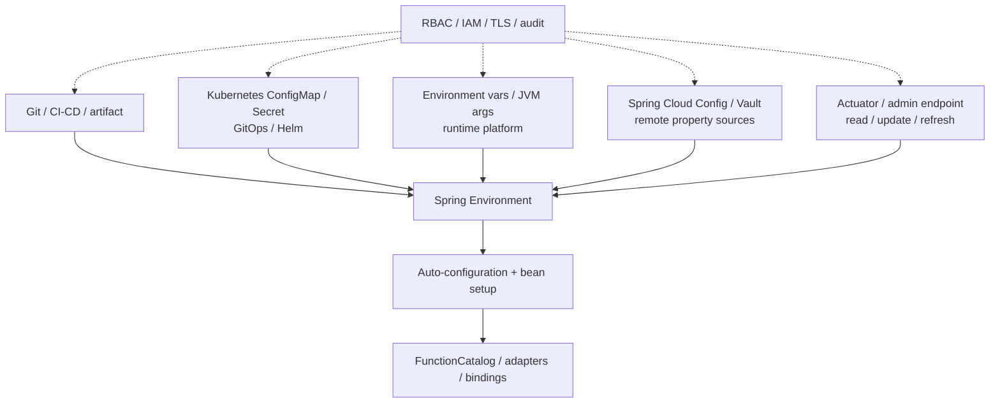
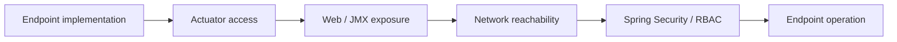
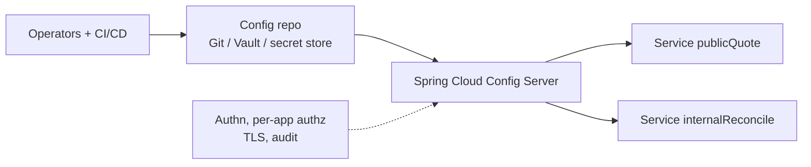

# Bảo vệ thuộc tính cấu hình và các endpoint quản trị

## 1. Vì sao cấu hình là một ranh giới bảo mật?

Trong **SPRING_CLOUD_FUNCTION (Spring Cloud Function)**, nghiệp vụ được viết thành `Supplier`, `Function` và `Consumer`, tra cứu qua `FunctionCatalog`, có thể kết hợp bằng *composition* và triển khai lại qua HTTP, sự kiện hoặc serverless. Sự linh hoạt đó đồng nghĩa **cấu hình** có thể thay đổi hàm được gọi, metadata được xử lý và điểm vào được công bố.

Giả sử ứng dụng có ba bean: `publicQuote` để báo giá công khai, `processOrderEvent` chỉ dùng cho broker đã cấp quyền và `internalReconcile` có khả năng đối soát dữ liệu nhạy cảm. Đội vận hành chủ động khai báo:

```properties
spring.cloud.function.definition=publicQuote
spring.cloud.function.web.path=/functions
```

Nếu một caller không đáng tin thay đổi `spring.cloud.function.definition` hoặc `spring.cloud.function.routing-expression` thông qua một đường quản trị không bảo vệ, họ có thể tác động tới lựa chọn target function. Nếu ứng dụng còn công bố `/actuator/env`, `/actuator/configprops`, `/actuator/loggers` hoặc endpoints làm mới cấu hình, việc rò rỉ và thay đổi runtime cũng có thể xuất hiện ngoài ý định.

> **Quy tắc cốt lõi:** bảo vệ cả **người được xem cấu hình**, **người được sửa cấu hình**, **đường cấu hình được nạp** và **cách thay đổi được áp dụng/kiểm toán**. Một property nằm trong `application.yml` hoặc một URL có tên “admin” không tự tạo hàng rào bảo mật.

Sau bài học, bạn sẽ biết nhận diện các thuộc tính Spring Cloud Function nhạy cảm, cấu hình Actuator theo nguyên tắc ít đặc quyền, bảo vệ HTTP/JMX, giới hạn Spring Cloud Config/Bus, quản lý quyền trên deployment và kiểm thử các đường quản trị có thể bị lạm dụng.

## 2. Những nhóm thuộc tính ảnh hưởng tới quyền gọi hàm

| Nhóm | Ví dụ property | Tác động cần xem xét |
|---|---|---|
| Chọn bean/composition | `spring.cloud.function.definition` | Quyết định hàm hoặc chuỗi hàm mà adapter có thể chọn |
| Routing động | `spring.cloud.function.routing-expression` | Biểu thức SpEL tính function definition đích |
| Ứng viên catalog | `spring.cloud.function.ineligible-definitions` | Ảnh hưởng bean nào đủ điều kiện xuất hiện trong catalog |
| Lookup fallback | `spring.cloud.function.single-function-fallback-enabled` | Ảnh hưởng lookup một bean duy nhất bằng tên không khớp |
| HTTP export | `spring.cloud.function.web.path` | Đổi tiền tố URL; **không** xác thực caller |
| Header enrichment | `spring.cloud.function.configuration.<function>.input-header-mapping-expression.<key>` | Tính metadata đầu vào trước hàm, có thể tác động xử lý nghiệp vụ |
| Output enrichment | `spring.cloud.function.configuration.<function>.output-header-mapping-expression.<key>` | Tính metadata đầu ra, có thể rò rỉ qua adapter |
| Header propagation | `spring.cloud.function.configuration.<function>.copy-input-headers` | Khi áp dụng, ảnh hưởng việc giữ metadata đầu vào |
| Stream binding | `spring.cloud.stream.bindings.<binding>.destination` | Liên kết logic với destination broker |
| Stream routing | `spring.cloud.stream.function.routing.enabled` | Có thể mở đường event routing tới hàm |

**Không phải mọi property có thể đổi trực tiếp khi ứng dụng đang chạy.** Một số giá trị được đọc khi context khởi tạo hoặc binding được tạo; refresh có thể chỉ tác động tới những bean được hỗ trợ. Do đó không nên mô tả một endpoint cập nhật Environment như công tắc bảo đảm đổi function ngay lập tức. Thay đổi cấu hình phải đi kèm cơ chế khởi động lại/refresh, đánh giá tác động và kiểm thử theo phiên bản thực tế.

### Routing expression: nguồn cấu hình quyết định mức đặc quyền SpEL

Tài liệu chính thức Spring Cloud Function nêu:

| Nguồn routing expression | Context | Ý nghĩa bảo mật |
|---|---|---|
| Header `spring.cloud.function.routing-expression` trong `Message` | `SimpleEvaluationContext` | Hạn chế các khả năng SpEL do header có thể đến từ HTTP/broker |
| Application/system property `spring.cloud.function.routing-expression` | `StandardEvaluationContext` | Mạnh hơn, giả định nguồn cấu hình do người triển khai đáng tin quản lý |

Spring Cloud Function **không tự tạo endpoint HTTP để khách sửa application/system properties**. Nguy cơ xuất hiện nếu Actuator, Spring Cloud, sản phẩm bên thứ ba hoặc một endpoint custom cho phép đọc/sửa chúng. Vì `StandardEvaluationContext` có khả năng biểu thức rộng hơn, người có quyền ghi property định tuyến phải được coi là người có **quyền thay đổi hành vi ứng dụng**.

Đồng thời, đối với router imperative, thứ tự ưu tiên là `MessageRoutingCallback` → message headers → application properties. Chỉ bảo vệ file cấu hình chưa đủ nếu một router công khai vẫn tin `spring.cloud.function.definition` do client gửi. Cần bảo vệ **cả config plane lẫn message plane**.

## 3. Bản đồ nguồn và đường đi của cấu hình



Spring Boot có nhiều **property sources** với thứ tự ưu tiên khác nhau. Giá trị từ command line, biến môi trường và cấu hình ngoài có thể ghi đè giá trị trong file `application.yml`, tùy thứ tự ưu tiên của phiên bản và launcher. Vì vậy:

- Không kết luận deployment an toàn chỉ vì file YAML trong repository đã được review.
- Kiểm tra **effective configuration** của mỗi môi trường qua quy trình bảo mật, không in secrets ra log.
- Giới hạn quyền sửa pipeline, image, command line, Helm values, ConfigMap/Secret và server cấu hình.
- Dùng change review, deployment approval, audit và rollback. Hạn chế thao tác thủ công không được lưu vết.
- Không biến HTTP header, request body hoặc message attribute thành property source có đặc quyền.

Ví dụ trong artifact:

```yaml
spring:
  cloud:
    function:
      definition: publicQuote
```

Nếu deployment cho phép ghi đè bằng:

```text
SPRING_CLOUD_FUNCTION_DEFINITION=internalReconcile
```

thì mục tiêu review ban đầu đã có thể bị phá vỡ. Đây là **tình huống cần chặn**, không phải cấu hình khuyến nghị. Spring Boot hỗ trợ relaxed binding trong nhiều trường hợp; việc bind và ưu tiên cuối cùng phải được xác minh trên phiên bản, command line và môi trường thực tế.

## 4. Actuator có bốn lớp kiểm soát khác nhau

Một endpoint quản trị đi qua nhiều lớp:

1. **Implementation tồn tại:** có dependency cung cấp `env`, `beans`, `health`, `loggers` hay endpoint custom không?
2. **Endpoint access:** trong các phiên bản Spring Boot hiện hành, `management.endpoint.<id>.access` và `management.endpoints.access.*` có thể giới hạn `none`, `read-only` hoặc `unrestricted`.
3. **Exposure:** `management.endpoints.web.exposure.include` hoặc cấu hình JMX quyết định endpoint có được công bố qua transport đó không.
4. **Network và authentication/authorization:** caller có tới được port, vượt qua Spring Security, role/scope, CSRF và các chính sách khác hay không?



**Phân biệt trạng thái:**

- `/actuator/env` không được expose có thể trả `404`; bị filter chặn có thể trả `401/403`. Không cần expose để “thử bảo mật”.
- `management.endpoints.web.exposure.include=health` không tự tạo chính sách quyền cho mọi custom controller ngoài Actuator.
- `GET /actuator/env` dùng để xem khác với `POST /actuator/env` được Spring Cloud hỗ trợ trong một số cấu hình: POST có thể tác động runtime.
- Tắt HTTP exposure **không mặc nhiên tắt JMX**, một port quản trị khác hoặc endpoint custom.
- Đổi `management.endpoints.web.base-path` chỉ đổi URL, không biến endpoint thành private.

Theo tài liệu Spring Boot 3.5/4.x, **mặc định chỉ `health` được expose qua HTTP**. Tuy nhiên dependency và cấu hình ứng dụng có thể thay đổi tập endpoint thực tế, vì thế luôn kiểm tra bản triển khai.

## 5. Các endpoint cần đánh giá rủi ro

| Endpoint | Có thể tiết lộ hoặc thay đổi gì? | Gợi ý chính sách |
|---|---|---|
| `health` | Trạng thái ứng dụng, thông tin thành phần khi bật details | Chỉ trạng thái tối thiểu cho probe; giới hạn chi tiết |
| `info` | Thông tin build, version và metadata ứng dụng | Chỉ thông tin đã review |
| `env` | Tên, nguồn và giá trị properties (có sanitization) | Không expose công khai |
| `configprops` | Properties đã bind vào `@ConfigurationProperties` | Không expose công khai |
| `beans` | Tên bean và quan hệ phụ thuộc | Có thể lộ tên hàm nội bộ |
| `mappings` | URL mappings, endpoints Web | Có thể lộ bề mặt API nội bộ |
| `conditions` | Kết quả auto-configuration, dependency | Hạn chế |
| `loggers` | Xem/đổi logging level khi endpoint hỗ trợ | Quyền quản trị và audit |
| `heapdump` / `threaddump` | Dữ liệu runtime, stack/heap và nội dung nhạy cảm | Không expose rộng |
| `httpexchanges` | Thông tin request/response được ghi | Retention và quyền truy cập riêng |
| `shutdown` | Dừng ứng dụng nếu tính năng được bật | Không công bố tùy tiện |
| `refresh` | Reload/refresh scope khi Spring Cloud hỗ trợ | Chỉ qua kênh quản trị |
| `busrefresh` / `busenv` | Phát tán refresh hoặc thay đổi config qua nhiều instance | Quyền rất hạn chế, có audit |
| Custom `@Endpoint` hoặc controller quản trị | Tùy code | Review như API có đặc quyền |

**Không phải tất cả endpoint trên đều được tạo mặc định.** `refresh`, `busenv` và một số chức năng quản trị phụ thuộc Spring Cloud hoặc custom dependencies; Spring Cloud Function không tự công bố tất cả những endpoint này.

## 6. Cấu hình Actuator tối thiểu

Ví dụ cho một Spring Boot 3.5 deployment chỉ cần HTTP health và info, **không cần cập nhật config qua HTTP**:

```yaml
# application-prod.yml (minh họa)
management:
  endpoints:
    web:
      exposure:
        include: "health,info"
    jmx:
      exposure:
        include: "health"
  endpoint:
    health:
      show-details: never
    env:
      show-values: never
    configprops:
      show-values: never
spring:
  cloud:
    function:
      definition: publicQuote
```

Ý nghĩa:

- Web chỉ expose `health` và `info` trong nhóm Actuator được cấu hình.
- JMX exposure được xét **riêng**; nếu không dùng JMX, có thể giới hạn hơn.
- `show-details=never` tránh trả nội dung health check chi tiết cho người không cần.
- `env`/`configprops` vẫn được cấu hình sanitize nếu một profile khác vô tình expose, nhưng phương án tốt nhất vẫn là **không expose** chúng.
- `definition=publicQuote` là lựa chọn hàm, không phải Spring Security authorization.

Nếu không cần HTTP Actuator:

```properties
management.endpoints.web.exposure.exclude=*
```

Spring Boot còn hỗ trợ `management.server.port=-1` để tắt HTTP management server. Cấu hình Web này không tự kiểm soát JMX, Custom REST controllers hoặc Spring Cloud Config Server riêng.

### Cấu hình cần tránh

```yaml
# Anti-pattern: expose mọi endpoint mà không có lý do bảo mật.
management:
  endpoints:
    web:
      exposure:
        include: "*"
```

Trong YAML, dấu `*` phải nằm trong dấu nháy nếu là giá trị string. **Không dùng expose tất cả chỉ để debug production**; thay vào đó, công bố từng endpoint cần thiết, theo đúng quyền và mạng quản trị.

## 7. Che giá trị cấu hình không đồng nghĩa xóa mọi rủi ro

Spring Boot hỗ trợ sanitization cho `env`, `configprops` và một số endpoint liên quan. Các giá trị cần sanitize thường được thay bằng `******`. `show-values` có ba mức:

| Giá trị | Ý nghĩa | Khuyến nghị |
|---|---|---|
| `never` | Luôn sanitize giá trị theo cơ chế endpoint | Dùng cho production |
| `when-authorized` | Chỉ hiển thị giá trị cho người được endpoint coi là authorized | Chỉ khi đã review quyền admin và mạng |
| `always` | Hiển thị giá trị cho người có thể truy cập, trừ khi custom sanitizer chặn | Tránh dùng |

Ví dụ cấu hình chỉ mang tính giải thích, **không nên bật nếu không có nhu cầu thật**:

```properties
management.endpoint.env.show-values=when-authorized
management.endpoint.env.roles=CONFIG_ADMIN
```

Với HTTP, Spring Boot xét authentication và endpoint roles khi `when-authorized` được bật. Nếu không cấu hình roles, theo tài liệu, **bất kỳ authenticated user** nào có thể đủ điều kiện xem giá trị. Kiểm tra cụ thể cách roles tương ứng với Spring Security authorities, ví dụ `ROLE_CONFIG_ADMIN`.

Ngay cả khi giá trị bị che, tên key, tên property source, file cấu hình hoặc lớp bean vẫn có thể cho biết cấu trúc ứng dụng. `beans`, `mappings`, logs, error responses, heap dump và endpoint tự viết cũng không nhất thiết tuân theo cùng một cơ chế sanitization. Đừng dùng `show-values=always` để sửa lỗi rồi để nguyên trên production.

## 8. Management port và network isolation

Spring Boot cho phép tách cổng ứng dụng và cổng Actuator:

```properties
server.port=8080
management.server.port=8081
management.server.address=127.0.0.1
management.endpoints.web.exposure.include=health,info
```

Theo tài liệu Boot, `management.server.address` chỉ có thể khác địa chỉ ứng dụng khi **management port khác main port**. Ở cấu hình trên, Actuator bind loopback ở host/container đang chạy ứng dụng; nó không tự xuất hiện ở một máy vận hành khác.

Những điểm phải kiểm tra:

- Trong container hoặc Kubernetes, `127.0.0.1` là **loopback của network namespace**, có thể không truy cập được từ readiness probe, monitoring agent hoặc pod khác nếu không thiết kế phù hợp.
- Cổng riêng vẫn có thể công khai nếu bind trên `0.0.0.0` và được Service, ingress, firewall hoặc security group mở.
- Khi management context chạy trên một port riêng, test Spring Security phải thực hiện trên **đúng port/context**; một MockMvc test của main context không tự chứng minh chính sách bảo vệ management context.
- Nếu sử dụng TLS/mTLS, xác định cả cổng người dùng và management, không chỉ proxy ở trước main port.
- Một management URL khó đoán không phải ranh giới authorization; vẫn cần IAM, mạng riêng hoặc Spring Security tùy mô hình.

Hệ thống có thể công bố `/actuator/health/liveness` và `/actuator/health/readiness` cho Kubernetes probes, nhưng nên giới hạn thông tin và quyền truy cập. Khi management port tách riêng, probe chạy thành công ở port quản trị **không nhất thiết chứng minh main application port còn nhận request được**; hãy xét health groups và cơ chế probe theo tài liệu Boot.

## 9. Spring Security: custom chain có thể làm Actuator mất auto-security

Theo tài liệu Spring Boot, khi Spring Security có trên classpath **và không có `SecurityFilterChain` tùy chỉnh**, Boot cung cấp cấu hình bảo vệ Actuator (ngoại trừ `health`). Nhưng **chỉ cần ứng dụng tự định nghĩa một `SecurityFilterChain`**, auto-configuration bảo vệ Actuator sẽ back off và để ứng dụng chịu trách nhiệm toàn bộ.

Đây là một cấu hình thiếu sót:

```java
// Anti-pattern: chỉ định chính sách cho API, bỏ qua mọi HTTP route khác.
@Bean
SecurityFilterChain apiOnly(HttpSecurity http) throws Exception {
    http.securityMatcher("/functions/**")
        .authorizeHttpRequests(auth ->
                auth.anyRequest().authenticated());
    return http.build();
}
```

Nếu một endpoint Actuator được expose ở `/actuator/**`, nó không khớp `/functions/**`. Khi không có security filter chain phù hợp với nó, endpoint có thể nằm ngoài hàng rào mà developer tưởng đã có.

### 9.1. Ví dụ hai `SecurityFilterChain` — Spring Boot 3.5 / Spring Security 6

Giả sử đây là một **servlet/MVC application** có Spring Boot Actuator, OAuth2 Resource Server và JWT decoder được cấu hình xác minh chữ ký, issuer, audience và hạn sử dụng. Cấu hình sau cho phép `health` tối thiểu, giới hạn `info` cho operator và từ chối mọi endpoint khác:

```java
package com.example.secureconfig;

import org.springframework.boot.actuate.autoconfigure.security.servlet.EndpointRequest;
import org.springframework.context.annotation.Bean;
import org.springframework.context.annotation.Configuration;
import org.springframework.core.annotation.Order;
import org.springframework.http.HttpMethod;
import org.springframework.security.config.Customizer;
import org.springframework.security.config.annotation.web.builders.HttpSecurity;
import org.springframework.security.config.http.SessionCreationPolicy;
import org.springframework.security.web.SecurityFilterChain;

@Configuration(proxyBeanMethods = false)
public class AppSecurityConfiguration {

    @Bean
    @Order(1)
    SecurityFilterChain actuator(HttpSecurity http) throws Exception {
        return http
            .securityMatcher(EndpointRequest.toAnyEndpoint())
            .authorizeHttpRequests(auth -> auth
                .requestMatchers(EndpointRequest.to("health"))
                    .permitAll()
                .requestMatchers(EndpointRequest.to("info"))
                    .hasAuthority("SCOPE_ops.read")
                .anyRequest().denyAll())
            .oauth2ResourceServer(oauth ->
                oauth.jwt(Customizer.withDefaults()))
            .build();
    }

    @Bean
    @Order(2)
    SecurityFilterChain application(HttpSecurity http) throws Exception {
        return http
            .sessionManagement(session -> session
                .sessionCreationPolicy(SessionCreationPolicy.STATELESS))
            // Chỉ cho API stateless dùng bearer token, không có cookie auth.
            .csrf(csrf -> csrf.disable())
            .authorizeHttpRequests(auth -> auth
                .requestMatchers(HttpMethod.POST, "/api/quotes")
                    .hasAuthority("SCOPE_quotes.read")
                .anyRequest().denyAll())
            .oauth2ResourceServer(oauth ->
                oauth.jwt(Customizer.withDefaults()))
            .build();
    }
}
```

Quy tắc:

1. `GET /actuator/health` được phép để hạ tầng kiểm tra liveness tối thiểu, với `show-details=never`.
2. `GET /actuator/info` cần `SCOPE_ops.read`. Người chỉ có `SCOPE_quotes.read` không được xem metadata quản trị.
3. Endpoints Actuator khác (nếu sau này expose ngoài ý muốn) được chain đầu `denyAll` theo endpoint matcher.
4. Mọi route không nằm trong chính sách `POST /api/quotes` hoặc endpoint Actuator đã cho phép đều bị chain thứ hai từ chối.
5. `@Order` phân biệt chain ưu tiên; một chain chỉ match Actuator **không thay thế** chain bảo vệ phần còn lại.

`EndpointRequest.toAnyEndpoint()` dùng metadata endpoint Actuator thay vì chỉ hard-code `/actuator/**`; hữu ích khi base-path thay đổi. Ví dụ **dành cho Spring Boot 3.5**: ở Spring Boot 4 package import `EndpointRequest` khác và cần kiểm tra API. Với WebFlux, sử dụng `SecurityWebFilterChain` chứ không sao chép servlet chains.

### 9.2. Vì sao chỉ thay đổi port hoặc đổi path chưa đủ?

`management.endpoints.web.base-path=/manage` đổi URL thành `/manage/{id}` trong phạm vi web context tương ứng, không tự tạo authentication. Một reverse proxy hoặc ingress có thể vẫn forward đường này ra công khai. `EndpointRequest`, kiểm thử route thực tế và network isolation giúp giảm lỗi do hard-code prefix.

Nếu management chạy **port khác**, Spring Boot có thể tạo management application context riêng. Cần kiểm tra security configuration trong context đó, cách đăng ký `SecurityFilterChain` và traffic routing của hạ tầng; không dựa chỉ vào kết quả unit test bean bảo mật trong main context.

### 9.3. CSRF, HTTP methods và machine clients

Ví dụ chỉ tắt CSRF cho API **bearer-token stateless**, vì không sử dụng cookie/session trình duyệt để xác thực. Chain Actuator giữ CSRF mặc định; những endpoints yêu cầu `POST`/`PUT`/`DELETE` có thể trả `403` nếu không có CSRF token.

**CSRF không phải authorization.** Không mở `POST /actuator/env` rồi tắt CSRF chỉ vì một script vận hành cần gọi. Nếu có nhu cầu đặc biệt, thiết kế machine identity/mTLS hoặc JWT scopes riêng, hạn chế mạng, kiểm soát nội dung property, audit, rate limiting và rollback.

## 10. Ví dụ ứng dụng để kiểm thử bảo mật HTTP

Một ứng dụng Spring Boot nhỏ có một bean function và một controller rõ ràng. Để tránh đường gọi ngoài ý muốn, ví dụ controller **không yêu cầu Web adapter tự công bố cùng bean**.

```java
package com.example.secureconfig;

import java.util.Locale;
import java.util.function.Function;

import org.springframework.boot.SpringApplication;
import org.springframework.boot.autoconfigure.SpringBootApplication;
import org.springframework.context.annotation.Bean;
import org.springframework.http.MediaType;
import org.springframework.web.bind.annotation.PostMapping;
import org.springframework.web.bind.annotation.RequestBody;
import org.springframework.web.bind.annotation.RestController;

@SpringBootApplication
public class SecureConfigApplication {
    public static void main(String[] args) {
        SpringApplication.run(SecureConfigApplication.class, args);
    }

    @Bean
    public Function<String, String> publicQuote() {
        return input -> "QUOTE:" + input.strip().toUpperCase(Locale.ROOT);
    }
}

@RestController
class QuoteController {

    private final Function<String, String> publicQuote;

    QuoteController(Function<String, String> publicQuote) {
        this.publicQuote = publicQuote;
    }

    @PostMapping(
        path = "/api/quotes",
        consumes = MediaType.TEXT_PLAIN_VALUE,
        produces = MediaType.TEXT_PLAIN_VALUE)
    public String quote(@RequestBody String sku) {
        if (!sku.matches("[A-Za-z0-9-]{1,32}")) {
            throw new IllegalArgumentException("Invalid SKU");
        }
        return publicQuote.apply(sku);
    }
}
```

Controller chọn **bean cố định** và không lấy tên function từ request headers. Để chạy ví dụ thực tế, application phải có `spring-boot-starter-web`, `spring-boot-starter-actuator`, Spring Security, OAuth2 Resource Server, JWT/JOSE và Spring Cloud Function context phù hợp với dependency BOM. Không thêm `spring-cloud-function-web` nếu không cần tự xuất bản function thành URL thứ hai.

## 11. Kiểm thử Actuator exposure và authorization bằng MockMvc

Bộ test sau dùng Spring Boot Test, Spring Security Test và MockMvc. Nó kiểm tra `health` được cho phép, `info` cần scope riêng, **property exposure chỉ khai báo health/info**, và API quote cần scope khác. Việc property đã được bind đúng **không thay thế** kiểm tra route table/HTTP thực tế của deployment.

```java
package com.example.secureconfig;

import static org.junit.jupiter.api.Assertions.assertEquals;
import static org.springframework.security.test.web.servlet.request
        .SecurityMockMvcRequestPostProcessors.jwt;
import static org.springframework.test.web.servlet.request
        .MockMvcRequestBuilders.get;
import static org.springframework.test.web.servlet.request
        .MockMvcRequestBuilders.post;
import static org.springframework.test.web.servlet.result
        .MockMvcResultMatchers.*;

import org.junit.jupiter.api.Test;
import org.springframework.beans.factory.annotation.Autowired;
import org.springframework.boot.test.autoconfigure.web.servlet.AutoConfigureMockMvc;
import org.springframework.boot.test.context.SpringBootTest;
import org.springframework.boot.test.mock.mockito.MockBean;
import org.springframework.core.env.Environment;
import org.springframework.http.MediaType;
import org.springframework.security.core.authority.SimpleGrantedAuthority;
import org.springframework.security.oauth2.jwt.JwtDecoder;
import org.springframework.test.web.servlet.MockMvc;

@SpringBootTest(
    classes = SecureConfigApplication.class,
    properties = {
        "management.endpoints.web.exposure.include=health,info",
        "management.endpoint.health.show-details=never",
        "management.endpoint.env.show-values=never"
    }
)
@AutoConfigureMockMvc
class ConfigurationEndpointSecurityTest {

    @Autowired
    MockMvc mvc;

    @Autowired
    Environment environment;

    // Chỉ tạo security context cho test; không xác minh chữ ký thật.
    @MockBean
    JwtDecoder jwtDecoder;

    @Test
    void healthIsPublicButDoesNotExposeDetails() throws Exception {
        mvc.perform(get("/actuator/health"))
            .andExpect(status().isOk())
            .andExpect(jsonPath("$.status").exists())
            .andExpect(jsonPath("$.components").doesNotExist());
    }

    @Test
    void infoRequiresOperatorScope() throws Exception {
        mvc.perform(get("/actuator/info"))
            .andExpect(status().isUnauthorized());

        mvc.perform(get("/actuator/info")
                .with(jwt().authorities(
                    new SimpleGrantedAuthority("SCOPE_quotes.read"))))
            .andExpect(status().isForbidden());

        mvc.perform(get("/actuator/info")
                .with(jwt().authorities(
                    new SimpleGrantedAuthority("SCOPE_ops.read"))))
            .andExpect(status().isOk());
    }

    @Test
    void webExposurePropertyContainsOnlyHealthAndInfo() {
        assertEquals("health,info",
                environment.getProperty(
                    "management.endpoints.web.exposure.include"));
    }

    @Test
    void ordinaryCallerCannotUseAdminPath() throws Exception {
        mvc.perform(post("/actuator/env")
                .with(jwt().authorities(
                    new SimpleGrantedAuthority("SCOPE_quotes.read")))
                .contentType(MediaType.APPLICATION_JSON)
                .content("{\"name\":\"spring.cloud.function.definition\","
                        + "\"value\":\"internalReconcile\"}"))
            .andExpect(status().is4xxClientError());
    }

    @Test
    void apiAndAdminScopesAreSeparate() throws Exception {
        mvc.perform(post("/api/quotes")
                .with(jwt().authorities(
                    new SimpleGrantedAuthority("SCOPE_quotes.read")))
                .contentType(MediaType.TEXT_PLAIN)
                .content("SKU-42"))
            .andExpect(status().isOk())
            .andExpect(content().string("QUOTE:SKU-42"));

        mvc.perform(post("/api/quotes")
                .with(jwt().authorities(
                    new SimpleGrantedAuthority("SCOPE_ops.read")))
                .contentType(MediaType.TEXT_PLAIN)
                .content("SKU-42"))
            .andExpect(status().isForbidden());
    }
}
```

**Giới hạn của test:**

- `jwt()` từ Spring Security Test tạo authentication giả và `@MockBean JwtDecoder` giúp context khởi động; đây không phải kiểm thử chữ ký token, issuer, audience hoặc JWKS. Cần integration test với cấu hình JWT decoder thật.
- Phép so sánh property kiểm tra **cấu hình allowlist được bind** trong test context; nó **không chứng minh URL `/actuator/env` không có mapping** nếu một custom controller hoặc endpoint bên thứ ba tạo ra đường khác. Phải kiểm tra route table/HTTP trên deployment thật, kể cả management port/context riêng.
- `status().is4xxClientError()` xác nhận người gọi không nhận thành công từ `POST /actuator/env`, nhưng **không đủ chứng minh mọi đường cập nhật cấu hình đã bị loại bỏ**. Vì vậy test còn kiểm tra exposure, và deployment test cần kiểm tra các nguồn config khác.
- Spring Boot mới hơn có thể dùng `@MockitoBean` thay `@MockBean` và có package khác; ví dụ chọn Boot 3.5 để dễ đối chiếu.
- Với một function có side effect, phải kiểm tra trạng thái downstream không thay đổi sau request bị từ chối, không chỉ mã `403`.

## 12. POST `/actuator/env`, `refresh` và `busenv`: phân biệt từng cơ chế

Các endpoint này đến từ các thành phần Spring Cloud khi được thêm vào ứng dụng, **không tự có chỉ vì dependency Spring Cloud Function**.

| Cơ chế | Mục đích | Rủi ro nếu mở ngoài ý định |
|---|---|---|
| Spring Cloud Commons `POST /actuator/env` | Trong cấu hình được hỗ trợ, cập nhật `Environment` và rebind một số properties | Caller ghi giá trị config vào runtime |
| `POST /actuator/refresh` | Làm mới bootstrap context/`RefreshScope` khi được hỗ trợ | Thay đổi hành vi, mất ổn định nếu config từ xa bị sửa |
| Spring Cloud Bus `POST /actuator/busrefresh` | Phát tán refresh tới nhiều instance | Một caller có thể tác động cả cụm |
| Spring Cloud Bus `POST /actuator/busenv` | Phát tán thay đổi environment qua bus | Một request có thể sửa config trên nhiều instance |
| `/actuator/loggers` | Đọc hoặc đổi log level khi endpoint hoạt động | Logging DEBUG/TRACE có thể làm lộ dữ liệu hoặc tăng chi phí |

Tài liệu Spring Cloud Commons nêu rằng để bật POST vào `/actuator/env` cần cấu hình:

```properties
# Minh họa một công tắc có rủi ro — KHÔNG bật ở production chỉ để thử.
management.endpoint.env.post.enabled=true
```

Trên một số nhánh Spring Cloud Commons mới, cần giới hạn key được ghi bằng `management.endpoint.env.post.valid-keys-regex`. **Cú pháp, điều kiện bật và cơ chế runtime phải kiểm tra theo phiên bản**; ngay cả một regex allowlist cũng không thay authentication, authorization hay audit. Chính sách thông thường là **không bật** thao tác này.

### Tại sao refresh không bảo đảm mọi hàm được đổi tức thì?

`RefreshScope` có cơ chế tái tạo các beans thuộc scope khi cache bị invalidated; một số `@ConfigurationProperties` được rebind. Nhưng những bean singleton, catalog wrappers, converters và Stream bindings đã được khởi tạo có thể không tự cập nhật theo đúng kỳ vọng.

Do đó:

- Không dựa vào `POST /actuator/refresh` như một cách nóng để đổi `spring.cloud.function.definition` mà chưa có test.
- Đừng xây nghiệp vụ cần atomic switch function chỉ bằng ghi property rồi refresh.
- Chuyển đổi cấu hình quan trọng nên qua deployment/restart có kiểm soát, hoặc cơ chế quản lý state riêng đã được thiết kế và kiểm thử.
- Đối với Spring AOT/native image, Spring Cloud Commons có giới hạn refresh riêng; kiểm tra tài liệu đúng phiên bản.

**Một endpoint refresh có quyền tác động runtime dù không cho nhập một expression trực tiếp.** Nếu nguồn Config Server phía sau bị sửa, người kích hoạt refresh có thể làm ứng dụng nhận cấu hình mới. Quyền **publish config** và quyền **trigger refresh** đều cần bảo vệ.

## 13. Spring Cloud Config Server và quản trị tập trung

Spring Cloud Config Server cung cấp cấu hình từ xa, có thể được nhiều service truy cập. Một hệ thống chỉ kiểm tra người dùng “đăng nhập được vào Config Server” nhưng không ràng buộc **service nào được đọc config của service nào** có thể làm lộ secret hoặc định tuyến của ứng dụng khác.



Các chính sách:

1. **TLS/mTLS hoặc identity-based authentication** giữa Config Client và Config Server; không truyền Basic credentials/config qua HTTP plaintext.
2. **Per-application authorization:** một client chỉ được đọc properties của application/profile/label được cho phép; không chỉ dựa vào application name trong path.
3. Quyền sửa config repository giới hạn ở người/phần mềm deploy đã được phê duyệt; branch protection, commit signing hoặc change approval theo chính sách tổ chức.
4. Secret mã hóa khi lưu; key decryption được quản lý ở nơi tin cậy, có rotation, audit và backup.
5. Nếu Config Server mở `/encrypt`, `/decrypt` hoặc custom management endpoints, bảo vệ chúng như dịch vụ mật mã có đặc quyền; tránh public exposure.
6. Kiểm soát Spring Cloud Bus và quyền publish message: không để một producer bất kỳ phát sự kiện cấu hình tới mọi service.
7. Nếu thay đổi property nhạy cảm (routing, function definition, broker destination, IAM credentials), yêu cầu deployment approval và kiểm tra effective config sau thay đổi.

### Mã hóa at rest không thay thế quyền xem cấu hình

Spring Cloud Config hỗ trợ lưu giá trị theo quy ước `{cipher}...` để mã hóa cấu hình khi lưu. Khi server giải mã để gửi tới client, **một client đã được phép đọc giá trị đó vẫn nhận được dữ liệu nhạy cảm**. Vì vậy encryption at rest chỉ là một lớp; phải bảo vệ route/config read, TLS và quyền ứng dụng.

Đừng ghi mật khẩu Config Server trực tiếp trong Git, JVM arguments hoặc log. Có thể cấp credentials qua runtime secret store, environment injection được quản lý, hoặc cơ chế workload identity; mỗi hình thức đều phải xét quyền đọc và tuổi thọ secret.

## 14. Kubernetes, container, GitOps và secret lifecycle

Khi Spring Cloud Function chạy trong container, các properties có thể được cung cấp qua `ConfigMap`, `Secret`, environment variables, command-line flags hoặc volume mounts.

| Nguồn | Lợi ích | Nguy cơ chính | Kiểm soát |
|---|---|---|---|
| Git/Helm values | Có version, review, rollback | Ghi nhầm secret hoặc cho thay routing ngoài kiểm soát | Branch protection, review, secret scanning |
| Kubernetes `ConfigMap` | Tách cấu hình theo môi trường | RBAC quá rộng cho phép đổi `definition` hoặc binder destination | Namespace scoping, RBAC, GitOps |
| Kubernetes `Secret` | Kênh quản lý dữ liệu nhạy cảm | Base64 chỉ là encoding, không phải encryption; quyền đọc rộng | RBAC, at-rest encryption theo nền tảng, external secrets |
| Environment variables | Dễ inject cho workload | Có thể lộ qua diagnostics, process environment, logs, admin tools | Giới hạn quyền xem pod/task, không dump env |
| Mounted secret files | Có thể tránh một số đường lộ environment | File permissions, lưu bản sao, quyền trên host/container | POSIX permissions, read-only mounts, rotation |
| Container image | Immutable artifact | Đóng gói secret hoặc debug config vào image | Không nhúng secret, image signing, SBOM |
| GitOps/CI deploy identity | Tự động, có audit | Account deploy được quyền sửa mọi namespace | Least privilege, approvals, policy-as-code |

**Quyền sửa `ConfigMap` chứa `spring.cloud.function.routing-expression` có thể tác động lớn tới hành vi ứng dụng**, đặc biệt khi routing property được đánh giá qua `StandardEvaluationContext`. Không coi quyền ghi cấu hình tương đương quyền sửa một nhãn giao diện.

### Cấu hình mẫu tách non-secret và secret

```yaml
# Phần ConfigMap minh họa — không chứa mật khẩu.
apiVersion: v1
kind: ConfigMap
metadata:
  name: quote-function-config
data:
  SPRING_CLOUD_FUNCTION_DEFINITION: "publicQuote"
  MANAGEMENT_ENDPOINTS_WEB_EXPOSURE_INCLUDE: "health,info"
```

```yaml
# Phần Pod envFrom minh họa; không phải manifest Deployment hoàn chỉnh.
containers:
  - name: quote-service
    image: example.invalid/quotes:1.0.0
    envFrom:
      - configMapRef:
          name: quote-function-config
      - secretRef:
          name: quote-function-runtime-secrets
```

Trong production, áp dụng policy cho namespace, service account, network policy và tài khoản CI; không để pod công khai được quyền đọc mọi Kubernetes Secrets. Chú ý tên biến môi trường và relaxed binding cần được kiểm chứng, nhất là với tên property chứa dấu chấm, dấu gạch hoặc các segment phức tạp.

**Rotation:** thay một Secret trong storage không bảo đảm mọi process hoặc bean sử dụng giá trị mới ngay. Cần xác định mỗi loại credential được cập nhật bằng restart, rebind, dynamic credential provider hay cơ chế khác; kiểm thử không gây gián đoạn hoặc lan truyền cấu hình giữa các tenant.

## 15. Serverless: environment, IAM và đường quản trị ngoài HTTP app

Ở môi trường AWS Lambda hoặc tương tự, các thuộc tính Spring Cloud Function có thể được inject qua **function configuration/environment variables**:

```text
spring.cloud.function.definition = processOrderEvent
          |
          v
AWS Lambda deployment configuration
          |
          v
FunctionInvoker / Spring Cloud Function context
```

Không chỉ bảo vệ API Gateway: một principal có quyền **UpdateFunctionConfiguration** hoặc sửa phiên bản/alias/trigger có thể thay đổi environment hoặc nguồn sự kiện. Những quyền này thuộc **control plane của cloud**, không đi qua `SecurityFilterChain` của Spring Boot.

Điểm cần phân biệt:

- **Quyền invoke**: principal được phép gọi Lambda qua API Gateway integration, AWS SDK, Function URL hoặc event trigger nào?
- **Quyền cập nhật cấu hình**: principal được phép sửa function environment, role, layer, runtime, alias hoặc trigger?
- **Execution role**: code bên trong Lambda được quyền truy cập DynamoDB, SQS, KMS, Secrets Manager và tài nguyên nào?
- **Quyền đọc giá trị cấu hình/secret**: operator, CI, runtime, diagnostics có được xem thông tin nhạy cảm?

Một Lambda chỉ xử lý `processOrderEvent` không nên được cấp quyền cập nhật chính nó hoặc cấu hình của các Lambda quản trị. Tương tự, không cho một API client gửi event body có `functionName=internalReconcile` và nhờ runtime dùng nó làm `FunctionCatalog.lookup(...)` target.

**KMS encryption** hỗ trợ bảo vệ environment variables/secret ở trạng thái lưu; vẫn cần IAM để giới hạn ai được đọc/decrypt, quyền deploy/update và người có thể gây log/dump dữ liệu. Không in toàn bộ environment khi gặp lỗi startup.

Tư duy tương tự áp dụng cho Cloud Run, Azure Functions hoặc nền tảng khác: quyền sửa service settings, configuration revisions, identity, trigger và secret references phải tách khỏi quyền gọi API nghiệp vụ.

## 16. Kiểm toán thay đổi cấu hình và xử lý sự cố

Đối với một ứng dụng có `FunctionCatalog`, thay đổi property nhạy cảm nên có **change record**:

| Trường theo dõi | Ví dụ nội dung |
|---|---|
| Cấu hình thay đổi | `spring.cloud.function.definition`, routing policy, broker destination |
| Người/hệ thống thực hiện | Commit signer, CI identity, cloud principal |
| Môi trường và instance | Prod/staging, service và deployment revision |
| Change ID hoặc pull request | Link tới thay đổi đã review |
| Kết quả kiểm tra | Test allowlist, Actuator exposure, IAM/ACL, integration test |
| Thời gian và rollout | Thời điểm phát hành, canary/blue-green, rollback |
| Ảnh hưởng | Tập function/endpoint/binding khác trước hay không |

Không đưa **giá trị secret**, raw JWT, password hay khóa mã hóa vào audit record chỉ để “theo dõi đầy đủ”. Với secret rotation, chỉ ghi secret reference/version identifier không nhạy cảm nếu hợp đồng cho phép.

### Nếu phát hiện `/actuator/env` hoặc `/actuator/loggers` bị expose ngoài ý định

1. **Hạn chế đường vào ngay** qua ingress/firewall/security groups hoặc cập nhật exposure policy đã được duyệt; không phụ thuộc duy nhất vào đổi URL.
2. Xác định endpoint có chỉ đọc hay có thao tác thay đổi, ai có thể tới, các requests và khoảng thời gian ảnh hưởng.
3. Xem xét secret, token hoặc internal endpoints có thể đã bị lộ; rotation/revocation nếu có chỉ dấu truy cập trái phép.
4. So sánh effective configuration với bản đã review, kiểm tra function definition, routing expression, bindings và logging level.
5. Khôi phục từ deployment/config revision đáng tin; không giả định refresh sẽ đưa mọi bean về trạng thái cũ.
6. Giám sát sau remediation và thêm test để ngăn lỗi xuất hiện lại.

Với Spring Cloud Bus, một request thay đổi config có thể tác động nhiều instance; phạm vi điều tra phải bao gồm những ứng dụng nhận sự kiện, không chỉ instance đầu tiên.

## 17. Những lỗi thiết kế thường gặp

| Sai lầm | Vì sao nguy hiểm | Cách làm đúng |
|---|---|---|
| “SCF không mở endpoint sửa config nên không có vấn đề” | Actuator, Cloud, custom admin hoặc cloud API có thể mở đường khác | Kiểm kê dependency, cổng, resource policy và custom endpoints |
| “Chỉ cần `spring.cloud.function.definition=publicQuote`” | Một override env/property có thể đổi behavior | Bảo vệ mọi nguồn config và kiểm tra effective definition |
| Dùng `management.endpoints.web.exposure.include=*` | Tăng bề mặt đọc/sửa runtime | Expose đúng allowlist tối thiểu |
| Chỉ đổi `/actuator` sang `/manage` | Security by obscurity | Network + authorization + endpoint policy |
| Có custom API `SecurityFilterChain` nên tin Actuator tự được bảo vệ | Boot auto Actuator security back off khi có custom chain | Chain Actuator riêng + fallback denyAll |
| Dùng `show-values=always` | Lộ giá trị properties | Giữ `never` hoặc ngoại lệ quản trị thật sự cần thiết |
| Bật `POST /actuator/env` và tắt CSRF cho tiện | Có đường sửa runtime config | Không bật; nếu cần, quyền cực hẹp, audit và key allowlist |
| Bật `busenv` trên mạng có nhiều client | Có thể thay môi trường nhiều instance | Cô lập bus và endpoint, xác thực, phân quyền |
| Chỉ mã hóa secret at rest | Client có quyền đọc/giải mã vẫn có thể lấy plaintext | Per-app authz, TLS, KMS policy, secrets lifecycle |
| Cho mọi operator đọc mọi Config Server path | Rò rỉ properties/secret giữa services | Authorization theo application/profile/label |
| Tin rằng refresh đổi function ngay tức thì | Các singleton/bindings có thể không được xây lại | Deployment/restart có kiểm soát, integration test |
| Dùng cùng một IAM role cho dev và prod | Quyền sửa/đọc production quá rộng | Separate identities, environments, approvals |
| Lưu raw secret trong log hoặc config diff | Tạo thêm bản sao nhạy cảm | Redaction, key/version reference, access controls |
| Chỉ test HTTP 200 của business function | Không kiểm tra đường cấu hình và quản trị | Negative tests cho env/configprops/loggers/refresh |

## 18. Bài tập thực hành

Hãy thiết kế một dịch vụ Spring Cloud Function có ba bean `publicQuote`, `processOrderEvent` và `internalReconcile`. Triển khai Web và Stream **thành hai deployment khác nhau** dù cùng dùng mã nghiệp vụ.

1. Trong Web deployment, chọn đúng definition `publicQuote` và lập danh sách HTTP routes hiện có, bao gồm endpoints do Web adapter hoặc custom controller công bố.
2. Chỉ expose `health` và `info` qua Actuator HTTP; health chỉ trả trạng thái tối thiểu; JMX exposure xét riêng.
3. Viết Spring Security chains để `health` public tối thiểu, `info` chỉ cho scope `ops.read`, API quote chỉ cho scope `quotes.read` và mọi route khác deny-by-default.
4. Viết MockMvc tests cho thiếu JWT, sai scope, truy cập `/actuator/env`, `/actuator/configprops`, `/actuator/loggers`, `/actuator/refresh` và `/actuator/busenv`. Phân biệt test exposure với test authorization.
5. Tạo một ConfigMap cho definition và một Secret cho credential. Xác định Kubernetes RBAC cần thiết cho CI, runtime và operators; chứng minh operator chỉ đọc không thể sửa ConfigMap.
6. Dùng Spring Cloud Config Server trong môi trường thử nghiệm và thiết kế policy chỉ cho Web service đọc config của chính nó, không đọc config/secret của dịch vụ đối soát.
7. Giả lập thay đổi routing property trong một pull request và yêu cầu test chứng minh không có đường gọi `internalReconcile` từ HTTP client.
8. Với Stream deployment, chỉ định `processOrderEvent` và broker destination đúng; thiết kế ACL giới hạn producer/consumer.
9. Với serverless deployment, giới hạn principal được quyền UpdateFunctionConfiguration và execution role; không cho function public sửa environment của chức năng quản trị.
10. Viết kế hoạch rollback và incident response nếu phát hiện `management.endpoints.web.exposure.include=*` được đưa vào production nhầm.

### Câu hỏi tự kiểm tra

1. Vì sao `spring.cloud.function.routing-expression` lấy từ application property cần quyền thay đổi cấu hình chặt chẽ hơn một chuỗi giao diện thông thường?
2. `management.endpoints.web.exposure.include=health`, `SecurityFilterChain` và `management.server.address` giải quyết ba vấn đề khác nhau như thế nào?
3. Có custom `SecurityFilterChain` chỉ match `/api/**` thì Boot còn tự bảo vệ mọi Actuator endpoint không?
4. `env.show-values=never` có bảo đảm người ngoài không biết tên properties hoặc tên bean không?
5. Vì sao quyền `POST /actuator/refresh` có thể nguy hiểm dù người gọi không trực tiếp gửi expression mới?
6. Tại sao Spring Cloud Config Server cần authorization theo **ứng dụng** chứ không chỉ authentication chung?
7. Quyền sửa Lambda environment và quyền gọi Lambda khác nhau ra sao?

## 19. Checklist trước khi triển khai

| Câu hỏi | Kết quả kỳ vọng |
|---|---|
| Các thuộc tính SCF ảnh hưởng definition/routing/enrichment đã được kiểm kê? | Có |
| Mọi nguồn property overrides và quyền sửa đã được xác định? | Có |
| Có code review/approval/audit cho config nhạy cảm? | Có |
| Actuator Web/JMX chỉ expose endpoint cần thiết? | Có |
| `env`, `configprops`, `beans`, `mappings` không public? | Có |
| `show-values`, health details và logs được hạn chế? | Có |
| Custom SecurityFilterChain vẫn bảo vệ Actuator? | Có, có test |
| Management port/network bị giới hạn? | Có |
| Không bật `env POST`, `refresh`, `busenv` ngoài nhu cầu được kiểm soát? | Có |
| Config Server có TLS, per-app access control, secret management? | Có |
| Kubernetes/CI/CD/cloud IAM theo least privilege? | Có |
| Không để caller tự ghi routing headers hoặc runtime config? | Có |
| Không cho runtime public có quyền sửa service quản trị? | Có |
| Có negative tests về endpoint exposure, authorization và side effect? | Có |
| Có giám sát config drift, rollback và phản ứng sự cố? | Có |

## 20. Tổng kết và tài liệu tham khảo

**Cấu hình và endpoints quản trị là control plane của Spring Cloud Function.** `spring.cloud.function.definition`, `routing-expression`, catalog filtering, enrichment và Stream bindings quyết định logic nào chạy trong môi trường nào. Quyền thay đổi các properties này phải được bảo vệ tương đương một thay đổi logic ứng dụng có đặc quyền.

Spring Cloud Function **không tự mở endpoints sửa environment**, nhưng Spring Boot Actuator, Spring Cloud Commons/Bus, Config Server, cloud control plane và mã quản trị riêng có thể cung cấp những đường đọc hoặc sửa. Cần phân biệt **access, exposure, network reachability và authorization**, đồng thời kiểm thử đúng cổng, profile và nguồn property của deployment.

Áp dụng **least privilege** từ CI/CD, Git, Kubernetes RBAC, Config Server, Cloud Bus, IAM tới Spring Security; giữ Actuator allowlist nhỏ, không bật `show-values=always`, không dùng refresh hoặc hot configuration như một bước thay đổi quyền không được kiểm soát. Quan trọng nhất, kiểm thử cả **đường bị từ chối** và **hậu quả thật trên function/binding**, không chỉ kiểm tra một HTTP status code.

**Tài liệu chính thức:**

- [Spring Cloud Function — Programming model](https://docs.spring.io/spring-cloud-function/reference/spring-cloud-function/programming-model.html) — routing, SpEL theo nguồn, definition và header enrichment.
- [Spring Boot 3.5 — Actuator Endpoints](https://docs.spring.io/spring-boot/3.5/reference/actuator/endpoints.html) — exposure, security, `EndpointRequest` và sanitization.
- [Spring Boot — Monitoring and Management Over HTTP](https://docs.spring.io/spring-boot/reference/actuator/monitoring.html) — management port, address, base path và network.
- [Spring Cloud Commons — Application Context Services](https://docs.spring.io/spring-cloud-commons/reference/spring-cloud-commons/application-context-services.html) — `env POST`, `refresh` và giới hạn.
- [Spring Cloud Bus — Bus Endpoints](https://docs.spring.io/spring-cloud-bus/reference/spring-cloud-bus/bus-endpoints.html) — `busrefresh`, `busenv` và `busshutdown`.
- [Spring Cloud Config — Security](https://docs.spring.io/spring-cloud-config/reference/server/security.html) — cấu hình bảo vệ Config Server và phân quyền từng ứng dụng.
- [Spring Cloud Config — Encryption and Decryption](https://docs.spring.io/spring-cloud-config/reference/server/encryption-and-decryption.html) — bảo vệ properties khi lưu và các endpoints mật mã.
