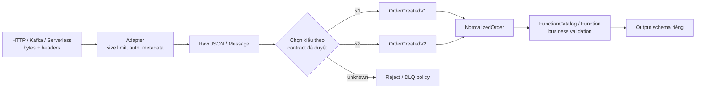

# Giới hạn loại dữ liệu được phép giải tuần tự hóa theo phiên bản

## 1. Vì sao deserialization là một ranh giới bảo mật?

Trong **SPRING_CLOUD_FUNCTION (Spring Cloud Function)**, các bean `Supplier`, `Function` và `Consumer` giúp tái sử dụng logic nghiệp vụ độc lập giao thức. `FunctionCatalog` có thể bọc lời gọi để chuyển đổi thông điệp và hỗ trợ *composition*; cùng một hàm có thể tiếp nhận JSON qua HTTP, bản tin qua Kafka/RabbitMQ hoặc event của môi trường serverless. Chính vì thế, việc biến **byte/String JSON từ bên ngoài** thành **đối tượng Java** là một điểm cần kiểm soát chặt chẽ.

Giả sử hệ thống xử lý hai phiên bản sự kiện tạo đơn:

```json
{
  "eventType": "order.created",
  "schemaVersion": 1,
  "data": {
    "orderId": "ORD-42",
    "customerId": "C-8",
    "totalMinor": 150000
  }
}
```

```json
{
  "eventType": "order.created",
  "schemaVersion": 2,
  "data": {
    "orderId": "ORD-42",
    "accountId": "C-8",
    "amountMinor": 150000,
    "currency": "VND"
  }
}
```

Nếu phía nhận cho phép người gửi tự định nghĩa **tên class Java** bằng HTTP header, Kafka type header hoặc trường JSON như `@class`, dữ liệu không đáng tin có thể điều khiển việc tạo object. Điều đó khác với việc phía nhận **chủ động chọn một DTO đã được cho phép** theo `(eventType, schemaVersion)`.

**Quy tắc chính:** không để dữ liệu ngoài tự do chọn class để deserialization. Hạn chế **tập Java types**, xác minh **loại sự kiện + phiên bản hợp đồng**, và kiểm tra **các trường nghiệp vụ** trước khi gọi bean có tác dụng phụ.

### Mục tiêu học tập

Sau bài học, bạn sẽ:

1. Phân biệt *serialization*, *deserialization*, conversion, schema migration và Java polymorphic type resolution.
2. Hiểu chức năng `JsonMessageConverter` cùng `MessageConverter`/`ConversionService` trong `FunctionCatalog`.
3. Sử dụng đúng **`META-INF/deserializable.types`** của Spring Cloud Function khi một header `Content-Type` chứa tham số `type`.
4. Xây whitelist **theo phiên bản dữ liệu** thay vì tin raw class name hoặc mở toàn bộ package.
5. Phân biệt cơ chế Spring Cloud Function với `__TypeId__` và `trusted.packages` của Spring Kafka.
6. Triển khai Java decoder đọc envelope thô, chọn DTO v1/v2 qua `switch` cố định và từ chối phiên bản lạ.
7. Viết các kiểm thử bảo mật cho HTTP, broker, serverless và quá trình nâng cấp thư viện.

## 2. Một sự kiện có nhiều “phiên bản” khác nhau

Thuật ngữ *version* dễ bị dùng lẫn lộn:

| Thứ được gắn phiên bản | Ví dụ | Vai trò |
|---|---|---|
| **Schema của payload** | `order.created` v1 / v2 | Quyết định trường và ý nghĩa của dữ liệu |
| **Class Java/DTO** | `OrderCreatedV1`, `OrderCreatedV2` | Những kiểu ứng dụng chủ động tạo sau parsing |
| **Event envelope** | CloudEvents `specversion=1.0` | Phiên bản chuẩn envelope, **không phải schema payload** |
| **Spring Cloud Function** | Dòng SCF 4.x hoặc 5.x | Quyết định implementation/API của converter |
| **Spring Boot/Jackson** | Boot 3 + Jackson 2; Boot 4 ưu tiên Jackson 3 | Quyết định package, API và cấu hình JSON |
| **Spring Kafka** | 3.x, 4.x | Tên serializer/deserializer, type-header handling |

Trong bài, “**theo phiên bản**” có nghĩa **mỗi phiên bản payload chỉ được ánh xạ sang những DTO được phê duyệt**; đồng thời cần pin/test các cơ chế deserialization theo **phiên bản thư viện triển khai**. Một whitelist Java class **không tự trở thành whitelist cho từng schema version**, vì nó thường là danh sách ở cấp application/classpath.

Ví dụ chính sách:

| Event type | Schema version đầu vào | Java target được phép | Hành động |
|---|---:|---|---|
| `order.created` | `1` | `OrderCreatedV1` | Chuẩn hóa sang mô hình hiện tại |
| `order.created` | `2` | `OrderCreatedV2` | Chuẩn hóa sang mô hình hiện tại |
| `order.created` | `3` | **Chưa có** | Từ chối có cấu trúc; không parse thử như v2 |
| `payment.refunded` | `1` | **Không thuộc consumer này** | Từ chối hoặc route tới consumer được cấp quyền |
| Event mang `javaClass=com.example.AdminCommand` | Bất kỳ | **Không chấp nhận chỉ dẫn class** | Bỏ/khước từ metadata không thuộc hợp đồng |

**Không dùng** `schemaVersion=2` như một tín hiệu phân quyền. Một producer có thể giả mạo version hợp lệ; còn quyền gọi hàm và quyền với tài nguyên cần được xử lý độc lập.

## 3. Đường đi từ raw bytes tới `Function`



Có hai đường chuyển đổi cần phân biệt:

1. **Chuyển đổi tự động bởi framework**: adapter tạo `Message<?>`, `FunctionCatalog` dựa vào chữ ký hàm và `contentType` để tìm converter thích hợp.
2. **Giải mã có kiểm soát trong adapter/decoder của ứng dụng**: nhận raw JSON (`String` hoặc `byte[]`), đọc envelope, kiểm tra `eventType/schemaVersion`, rồi **chọn class cụ thể bằng code**.

Đường 1 có thể đơn giản hơn khi mỗi điểm vào chỉ nhận đúng một schema với chữ ký rõ ràng như `Function<OrderCreatedV1, OrderAck>`. Đường 2 hợp lý khi **một điểm vào phải hỗ trợ v1 lẫn v2**, hoặc khi cần tránh mọi quyết định kiểu dựa vào header từ bên ngoài.

Điểm chặn nên được đặt **trước việc tạo object có thể chạy logic tùy biến hoặc side effect**. Việc đưa raw JSON vào một `Function<Object,Object>` rồi hy vọng kiểm tra class sau đó có thể là quá muộn nếu converter đã tạo object theo metadata không đáng tin.

## 4. Conversion của Spring Cloud Function hoạt động ra sao?

Spring Cloud Function hỗ trợ hai cơ chế chuyển đổi thường gặp:

- `MessageConverter`: chuyển từ một Spring `Message` có payload như `byte[]`/`String` sang kiểu bean cần.
- `ConversionService`: chuyển đổi đối tượng trong các tình huống không có `Message`.

Ví dụ:

```java
@Bean
public Function<OrderCreatedV1, OrderAck> handleV1() {
    return event -> new OrderAck(event.orderId(), "ACCEPTED");
}
```

Đối với một input HTTP JSON hoặc message broker thô, wrapper trong `FunctionCatalog` có thể sử dụng **chữ ký `OrderCreatedV1`** kết hợp `contentType=application/json` để chuyển payload. Việc chọn converter dựa trên **cả kiểu đầu vào cần thiết và content type**; `Content-Type` đơn lẻ không bảo đảm framework sẽ tạo bất kỳ class nào được client chỉ định.

Theo tài liệu chính thức, `JsonMessageConverter` còn hỗ trợ tham số `type` trong media type khi target không rõ (ví dụ `Function<?,?>` hoặc `Function<Object,Object>`):

```http
Content-Type: application/json;type=com.example.orders.contract.OrderCreatedV1
```

**Đây là điểm nhạy cảm:** nếu một caller có thể tự nhập tên class như `type=java.lang.SomeClass`, tên class đó không được quyền tự trở thành Java target. Spring Cloud Function cung cấp một cơ chế **whitelist classes cho tham số `type`**, trình bày ở mục tiếp theo.

### Content type khác schema version

| Metadata | Ví dụ | Nó trả lời câu hỏi |
|---|---|---|
| `Content-Type` | `application/json` | Dữ liệu đang được mã hóa theo format nào? |
| MIME `type` parameter | `type=com.example.orders.contract.OrderCreatedV1` | Java class nào được đề xuất làm target trong cơ chế SCF hỗ trợ? |
| `eventType` | `order.created` | Đây là loại sự kiện nghiệp vụ nào? |
| `schemaVersion` | `2` | Dữ liệu tuân theo schema revision nào? |
| Kafka type header | `__TypeId__` | Loại Java được serializer/binder đính kèm, **không phải schema version** |

Không coi `Content-Type: application/json` là bảo đảm dữ liệu phù hợp schema. Cũng không coi một header `type` có tên trong whitelist là bằng chứng caller được phép gọi function hoặc dữ liệu có giá trị hợp lệ.

## 5. Cơ chế quan trọng của SCF: `META-INF/deserializable.types`

Tài liệu **Spring Cloud Function – Programming model / Provided MessageConverters** quy định: để dùng tham số `type` trong MIME type làm **target class** cho `JsonMessageConverter`, ứng dụng **phải khai báo các class được cho phép** trong resource:

```text
src/main/resources/META-INF/deserializable.types
```

Ví dụ **nội dung tệp resource** (đây là snippet trong bài học, không phải file được tạo tự động):

```text
com.example.orders.contract.OrderCreatedV1
com.example.orders.contract.OrderCreatedV2
```

Đặc điểm:

- File phải có tên chính xác `META-INF/deserializable.types` và nằm trên **runtime classpath** (thường được đóng gói vào JAR).
- Mỗi dòng có thể là **tên class Java đầy đủ**; tài liệu cũng chấp nhận nhiều tên trên một dòng phân cách bằng dấu phẩy. Dạng một class mỗi dòng dễ review hơn.
- Nếu class là nested class trong Java, tên JVM có thể dùng dấu `$`; tốt nhất dùng DTO top-level để file ít gây nhầm lẫn.
- Chỉ kê **DTO thật sự cần cho việc chọn kiểu động**. Không sao chép nguyên danh sách ví dụ trong tài liệu gồm các Java utility classes, không thêm package nội bộ quá rộng để “cho chạy hết”.
- Whitelist này là **kiểm soát ở cấp type resolution của SCF JsonMessageConverter**, không phải tất cả serializer/deserializer trong JVM và **không** xác minh `schemaVersion`.
- Nếu chỉ dùng chữ ký hàm đã xác định kiểu và không truyền tham số `type` từ bên ngoài, có thể **không cần** cơ chế dynamic-type này; giảm bề mặt hơn là mở rộng whitelist cho mọi DTO.

Trong ứng dụng Spring Cloud Function dùng tham số `type` hợp lệ:

```http
POST /functions/handleDynamic HTTP/1.1
Content-Type: application/json;type=com.example.orders.contract.OrderCreatedV1

{"orderId":"ORD-42","customerId":"C-8","totalMinor":150000}
```

Đây là **minh họa cơ chế chọn class**, không phải một endpoint có sẵn trong ví dụ ứng dụng ở các mục sau. Muốn chạy, phải có `handleDynamic` được định nghĩa và Web adapter công bố URL phù hợp.

Với một class **không có trong resource**, converter không được tùy tiện tải class do caller chỉ định. Tuy nhiên **mã lỗi HTTP, tên exception và thời điểm conversion** phụ thuộc adapter, converter và phiên bản framework; test nên xác nhận request bị chặn và **không có side effect**, thay vì phụ thuộc nguyên văn một stack trace.

### 5.1. Vì sao không liệt kê tất cả classes?

Nếu tệp `deserializable.types` gồm cả classes quản trị hoặc classes có cơ chế polymorphic nguy hiểm, việc mở rộng whitelist có thể vô hiệu hóa mục tiêu giới hạn. Cần **kiểm kê tác dụng của việc tạo/deserialize class**, các properties/getters/setters/converters của nó, và phiên bản dependency.

Không chỉ tin package prefix như `com.example.*` trong một policy do ứng dụng tự tạo. Một package có thể vừa chứa DTO công khai vừa chứa classes nội bộ. Tốt nhất cho phép **đúng các concrete DTO types** theo hợp đồng.

### 5.2. Hạn chế chính xác của file whitelist

File này **không tự áp dụng** cho:

- Jackson polymorphic `@JsonTypeInfo` hoặc global default typing do ứng dụng tự bật.
- Spring Kafka `JsonDeserializer`/`JacksonJsonDeserializer` sử dụng Kafka type headers.
- Java native `ObjectInputStream`.
- Custom `MessageConverter`/deserializer do bên thứ ba cung cấp.
- Reflection hoặc `Class.forName` do code nghiệp vụ gọi sau khi nhận dữ liệu.

Mỗi cơ chế có chính sách riêng; không thể bảo vệ toàn bộ hệ thống bằng một file `META-INF/deserializable.types` duy nhất.

## 6. Whitelist SCF không phải policy “mỗi version một class”

Whitelist `deserializable.types` thường nằm ở **cấp classpath của deployment**. Nếu tệp chứa cả `OrderCreatedV1` và `OrderCreatedV2`, điều đó chỉ cho phép dynamic deserialization vào **hai Java classes** theo cơ chế trên. Nó **không tự ràng buộc** `schemaVersion=1` phải đi cùng `OrderCreatedV1`.

Hãy thiết kế **hai lớp kiểm soát độc lập**:

| Lớp | Câu hỏi | Chính sách |
|---|---|---|
| **Class allowlist của converter** | Framework được phép tạo class nào từ type hint? | Chỉ những concrete DTO được review |
| **Version-to-type mapping của ứng dụng** | Với `(eventType, schemaVersion)` này, class nào là duy nhất đúng? | Bảng ánh xạ cố định trong code/schema registry được kiểm soát |
| **Validation của payload** | Các trường của DTO có đúng schema và quy tắc nghiệp vụ không? | Kiểm tra kiểu, required fields, ranges, ownership |
| **Authorization** | Caller có quyền gửi loại event và tác động đơn hàng này không? | JWT/IAM/broker ACL + policy tài nguyên |

Ví dụ **không được**:

```java
// Phản ví dụ: eventType/schemaVersion không phải Java FQCN.
// String className = request.headers().get("javaType");
// Class<?> dynamicType = Class.forName(className);
// Object payload = mapper.readValue(json, dynamicType);
```

Thay vào đó, dùng:

```java
// Minh họa nguyên tắc:
return switch (schemaVersion) {
    case 1 -> mapper.treeToValue(data, OrderCreatedV1.class);
    case 2 -> mapper.treeToValue(data, OrderCreatedV2.class);
    default -> throw new IllegalArgumentException(
            "Unsupported order.created schema version");
};
```

Ở phần sau, ví dụ hoàn chỉnh còn kiểm tra `eventType`, trường bắt buộc và output contract để tránh chỉ dựa vào `switch`.

## 7. Chính sách dữ liệu cho hai phiên bản sự kiện đơn hàng

Giả sử tổ chức chấp nhận **chỉ**:

| Thuộc tính | v1 | v2 |
|---|---|---|
| `eventType` | `order.created` | `order.created` |
| `schemaVersion` | `1` | `2` |
| `orderId` | Bắt buộc | Bắt buộc |
| ID chủ sở hữu | `customerId` | `accountId` |
| Số tiền | `totalMinor` | `amountMinor` |
| `currency` | Theo hợp đồng v1: cố định `VND` | Bắt buộc, chỉ nhận `VND` trong ví dụ |

Sự khác biệt giữa v1/v2 là **schema contract**, không phải quyền người dùng. Khi chuyển v1 thành mô hình nội bộ:

```text
OrderCreatedV1
  (orderId, customerId, totalMinor)
       |
       v
NormalizedOrder
  (orderId, ownerId, amountMinor, currency="VND", sourceVersion=1)
```

Với v2:

```text
OrderCreatedV2
  (orderId, accountId, amountMinor, currency)
       |
       v
NormalizedOrder
  (orderId, ownerId, amountMinor, currency, sourceVersion=2)
```

**Không sử dụng class name của v2 trong JSON hoặc header để tự chứng minh đây là dữ liệu v2.** Số phiên bản và tên event được parse từ envelope theo hợp đồng; chúng phải được kiểm tra trước khi chọn class. Dữ liệu chứa thêm field không được phép cũng phải có policy rõ ràng (reject trong ví dụ).

Một điểm quan trọng: nếu producer cung cấp `schemaVersion=1` nhưng đưa các trường của v2 (ví dụ `accountId` thay `customerId`), consumer **không** tự đoán v2 vì nhìn thấy tên trường. Cần từ chối dữ liệu mâu thuẫn hoặc có migration có kiểm soát.

## 8. Định nghĩa DTO v1/v2 và mô hình nội bộ

Ví dụ dưới đây sử dụng **Java 17, Spring Boot 3.x và Jackson 2** với package `com.fasterxml.jackson.*`. Đây là lựa chọn có chủ đích để giữ code mẫu rõ ràng; **Spring Boot 4 ưu tiên Jackson 3** với package/API khác, sẽ được lưu ý ở mục nâng cấp phiên bản.

Tạo những Java records **top-level** trong `com.example.orders.contract`. Mỗi đoạn là nội dung của một file Java riêng:

```java
// OrderCreatedV1.java
package com.example.orders.contract;

public record OrderCreatedV1(
        String orderId,
        String customerId,
        long totalMinor
) {}
```

```java
// OrderCreatedV2.java
package com.example.orders.contract;

public record OrderCreatedV2(
        String orderId,
        String accountId,
        long amountMinor,
        String currency
) {}
```

```java
// NormalizedOrder.java
package com.example.orders.contract;

public record NormalizedOrder(
        String orderId,
        String ownerId,
        long amountMinor,
        String currency,
        int sourceVersion
) {}
```

```java
// OrderAccepted.java
package com.example.orders.contract;

public record OrderAccepted(
        String orderId,
        String status
) {}
```

Các DTO không chứa trường `className`, `javaType` hay `@class`. Bản thân Java record không tạo cơ chế xác thực hay ngăn mọi JSON attack; việc chọn class phải đến từ code và Jackson configuration, còn các giá trị cần được validate.

### Khác nhau giữa “DTO được phép” và “payload hợp lệ”

Cho phép tạo `OrderCreatedV1` không có nghĩa giá trị `totalMinor=-100` hoặc `orderId=""` hợp lệ. Tương tự, field `customerId` là dữ liệu nghiệp vụ chưa đáng tin: không suy ra người gửi có quyền sở hữu tài khoản này chỉ vì JSON đã được chuyển thành record.

Trong ứng dụng thật, validation tại adapter và application service cần kết hợp xác thực caller, tenant ownership, kiểm tra idempotency và giới hạn truy cập dữ liệu. Ví dụ dưới đây tập trung vào **type selection và schema**, không tuyên bố thay thế các lớp bảo mật đó.

## 9. Decoder Java: chỉ chọn DTO sau khi kiểm tra version

Một **decoder chuyên dụng** nhận JSON thô, đọc ba trường envelope `eventType`, `schemaVersion`, `data` và **chỉ** gọi `treeToValue` với hai class đã xác định trong source code. Với input không hợp lệ, decoder từ chối trước khi bean nghiệp vụ chạy.

```java
package com.example.orders;

import com.example.orders.contract.NormalizedOrder;
import com.example.orders.contract.OrderCreatedV1;
import com.example.orders.contract.OrderCreatedV2;
import com.fasterxml.jackson.core.JsonParser;
import com.fasterxml.jackson.core.JsonProcessingException;
import com.fasterxml.jackson.databind.DeserializationFeature;
import com.fasterxml.jackson.databind.JsonNode;
import com.fasterxml.jackson.databind.ObjectMapper;

public final class VersionedOrderDecoder {

    // Jackson 2 (Spring Boot 3.x) — mapper riêng cho biên không tin cậy.
    // Không bật global default typing hoặc deserialize từ class name.
    private final ObjectMapper mapper = new ObjectMapper()
            .enable(DeserializationFeature.FAIL_ON_UNKNOWN_PROPERTIES)
            .enable(DeserializationFeature.FAIL_ON_NULL_FOR_PRIMITIVES)
            .enable(DeserializationFeature.FAIL_ON_TRAILING_TOKENS)
            .enable(JsonParser.Feature.STRICT_DUPLICATE_DETECTION);

    public NormalizedOrder decode(String rawJson) {
        if (rawJson == null || rawJson.isBlank()) {
            throw new IllegalArgumentException("Missing event JSON");
        }

        try {
            JsonNode root = mapper.readTree(rawJson);
            if (root == null || !root.isObject()
                    || root.size() != 3
                    || !root.has("eventType")
                    || !root.has("schemaVersion")
                    || !root.has("data")) {
                throw new IllegalArgumentException(
                        "Unexpected event envelope");
            }

            JsonNode eventType = root.get("eventType");
            JsonNode version = root.get("schemaVersion");
            JsonNode data = root.get("data");

            if (!eventType.isTextual()
                    || !"order.created".equals(eventType.textValue())) {
                throw new IllegalArgumentException(
                        "Event type is not accepted");
            }
            if (!version.isIntegralNumber()
                    || !version.canConvertToInt()
                    || !data.isObject()) {
                throw new IllegalArgumentException(
                        "Invalid schema version or data shape");
            }

            return switch (version.intValue()) {
                case 1 -> decodeV1(data);
                case 2 -> decodeV2(data);
                default -> throw new IllegalArgumentException(
                        "Unsupported order.created schema version");
            };

        } catch (JsonProcessingException ex) {
            // Không lộ nguyên JSON, class names hoặc stack trace ra response.
            throw new IllegalArgumentException(
                    "Malformed or incompatible event JSON", ex);
        }
    }

    private NormalizedOrder decodeV1(JsonNode data)
            throws JsonProcessingException {
        OrderCreatedV1 v1 =
                mapper.treeToValue(data, OrderCreatedV1.class);

        requireIdentifier(v1.orderId(), "orderId");
        requireIdentifier(v1.customerId(), "customerId");
        requirePositive(v1.totalMinor());

        return new NormalizedOrder(
                v1.orderId(), v1.customerId(),
                v1.totalMinor(), "VND", 1);
    }

    private NormalizedOrder decodeV2(JsonNode data)
            throws JsonProcessingException {
        OrderCreatedV2 v2 =
                mapper.treeToValue(data, OrderCreatedV2.class);

        requireIdentifier(v2.orderId(), "orderId");
        requireIdentifier(v2.accountId(), "accountId");
        requirePositive(v2.amountMinor());
        if (!"VND".equals(v2.currency())) {
            throw new IllegalArgumentException(
                    "Unsupported currency");
        }

        return new NormalizedOrder(
                v2.orderId(), v2.accountId(),
                v2.amountMinor(), v2.currency(), 2);
    }

    private static void requireIdentifier(String value, String field) {
        if (value == null
                || !value.matches("[A-Za-z0-9._-]{1,64}")) {
            throw new IllegalArgumentException(
                    "Missing or invalid " + field);
        }
    }

    private static void requirePositive(long value) {
        if (value <= 0 || value > 1_000_000_000L) {
            throw new IllegalArgumentException(
                    "Amount outside accepted range");
        }
    }
}
```

Điểm bảo mật có chủ đích:

1. Không có `Class.forName(...)`, `ObjectMapper.readValue(..., Object.class)` với typing mở, hay việc lấy tên Java class từ message header.
2. `eventType` phải bằng literal `order.created`; các loại event khác bị từ chối **trước khi chọn DTO**.
3. `schemaVersion` phải là **số nguyên trong phạm vi `int`**; không chấp nhận chuỗi `"1"`, `1.5` hay giá trị quá lớn chỉ vì có thể ép kiểu.
4. Envelope đúng ba khóa `eventType`, `schemaVersion`, `data`; các thuộc tính bất thường như `javaClass` ngoài hợp đồng bị loại.
5. `FAIL_ON_UNKNOWN_PROPERTIES` khiến các field lạ trong DTO bị từ chối; vì thế `data.@class` hay `data.admin` không bị bỏ qua âm thầm.
6. `FAIL_ON_NULL_FOR_PRIMITIVES` không cho `null` biến thành `0L` lặng lẽ; validation cũng kiểm tra amount.
7. `STRICT_DUPLICATE_DETECTION` ngăn cùng một JSON key xuất hiện nhiều lần theo cách dễ gây bất nhất ở tầng parser.
8. `FAIL_ON_TRAILING_TOKENS` từ chối nội dung bất ngờ sau JSON root hợp lệ, thay vì âm thầm bỏ qua.
9. Error response cần che chi tiết implementation; logs có thể lưu error category và correlation ID, **không log raw payload**.

**Giới hạn của snippet:** đây không phải parser chống mọi DoS chỉ nhờ các cài đặt trên. Adapter cần đặt **giới hạn byte của request**, và Jackson parser cần **giới hạn nesting/string/number length** theo thư viện đang dùng. Trên Jackson 2.15+ có `StreamReadConstraints`, trong khi Jackson 3/Boot 4 có APIs tương ứng nhưng khác package. Không thay thế việc giới hạn input size ở gateway bằng một lần kiểm tra độ dài `String` sau khi toàn bộ body đã được đọc.

### Vì sao dùng `ObjectMapper` riêng?

Một mapper có thể được custom toàn ứng dụng bởi modules, custom deserializers hoặc **polymorphic default typing**. Ví dụ tạo mapper riêng với cấu hình rõ ràng và DTO records đơn giản, tránh ngầm kế thừa policy không phù hợp từ một bean global đã được mở rộng. Trong production vẫn nên dùng mapper được quản lý có **type policy được review**, hỗ trợ modules thực sự cần, không tự tạo mapper mới trong từng request; mapper trong ví dụ là một field tái sử dụng.

Một lần nữa, `Jackson ObjectMapper` ở đây là **Jackson 2**. Không sao chép import `com.fasterxml.jackson.*` sang ứng dụng Spring Boot 4 dùng Jackson 3 mặc định mà chưa chuyển API.

## 10. Bean Spring Cloud Function dùng decoder và phát output schema riêng

Sau khi decoder trả về `NormalizedOrder`, bean chỉ xử lý mô hình đã chuẩn hóa. Ví dụ `Function<Message<String>, Message<OrderAccepted>>` cho phép nhận raw JSON như `String` và giữ một số metadata đã được adapter kiểm tra:

```java
package com.example.orders;

import java.util.function.Function;

import org.springframework.context.annotation.Bean;
import org.springframework.context.annotation.Configuration;
import org.springframework.messaging.Message;
import org.springframework.messaging.MessageHeaders;
import org.springframework.messaging.support.MessageBuilder;
import org.springframework.util.MimeTypeUtils;

import com.example.orders.contract.NormalizedOrder;
import com.example.orders.contract.OrderAccepted;

@Configuration
public class OrderEventFunctions {

    @Bean
    public VersionedOrderDecoder versionedOrderDecoder() {
        return new VersionedOrderDecoder();
    }

    @Bean
    public Function<Message<String>, Message<OrderAccepted>>
            acceptOrderEvent(VersionedOrderDecoder decoder) {
        return input -> {
            String correlationId = input.getHeaders()
                    .get("correlationId", String.class);
            if (correlationId == null
                    || !correlationId.matches("[A-Za-z0-9._-]{1,64}")) {
                throw new IllegalArgumentException(
                        "Invalid correlationId");
            }

            NormalizedOrder order =
                    decoder.decode(input.getPayload());

            // Đây chỉ là logic minh họa không có side effect.
            // Đơn thật phải kiểm tra quyền của actor với ownerId.
            OrderAccepted accepted =
                    new OrderAccepted(order.orderId(), "ACCEPTED");

            return MessageBuilder.withPayload(accepted)
                    .setHeader("correlationId", correlationId)
                    .setHeader("schemaName", "order.accepted")
                    .setHeader("schemaVersion", "1")
                    .setHeader(
                            MessageHeaders.CONTENT_TYPE,
                            MimeTypeUtils.APPLICATION_JSON)
                    .build();
        };
    }
}
```

Hai quyết định đáng chú ý:

- **Input** có thể là schema `order.created` v1 hoặc v2; **output** là `order.accepted` v1. Hàm **không copy** input `schemaVersion` sang output.
- Hàm **không copy** các header do caller tự khai như `javaType`, `__TypeId__`, `spring.cloud.function.definition`, `Authorization` hay `tenantId` sang message kết quả.

Trong hệ thống thật, `ownerId` phải được kiểm tra với danh tính đã xác thực/ủy quyền của người gửi. **Một payload hợp lệ và một `correlationId` hợp lệ không chứng minh caller có quyền tạo đơn cho owner đó.**

### Gọi trực tiếp để kiểm tra hợp đồng

```java
import java.util.function.Function;

import org.springframework.messaging.Message;
import org.springframework.messaging.support.MessageBuilder;

import com.example.orders.OrderEventFunctions;
import com.example.orders.VersionedOrderDecoder;
import com.example.orders.contract.OrderAccepted;

String rawV1 = """
    {"eventType":"order.created","schemaVersion":1,
     "data":{"orderId":"ORD-42","customerId":"C-8","totalMinor":150000}}
    """;

Function<Message<String>, Message<OrderAccepted>> fn =
        new OrderEventFunctions().acceptOrderEvent(
                new VersionedOrderDecoder());

Message<OrderAccepted> out = fn.apply(
        MessageBuilder.withPayload(rawV1)
                .setHeader("correlationId", "req-42")
                .build());

System.out.println(out.getPayload().orderId()); // ORD-42
System.out.println(out.getHeaders().get("schemaName")); // order.accepted
System.out.println(out.getHeaders().get("schemaVersion")); // 1
```

Gọi bean trực tiếp **không thử cơ chế chuyển đổi của `FunctionCatalog`**. Cần thêm test catalog và adapter để xác minh wrapper, serializer và type-header handling trong deployment thực tế.

## 11. HTTP adapter: kiểm soát body trước khi parse

Một Spring MVC adapter có thể chỉ chấp nhận JSON body thô và giao việc chọn DTO cho decoder đã review, thay vì nhận tham số class từ client:

```java
package com.example.orders;

import java.nio.charset.StandardCharsets;
import java.util.function.Function;

import org.springframework.beans.factory.annotation.Qualifier;
import org.springframework.http.HttpStatus;
import org.springframework.http.MediaType;
import org.springframework.http.ResponseEntity;
import org.springframework.messaging.Message;
import org.springframework.messaging.support.MessageBuilder;
import org.springframework.web.bind.annotation.PostMapping;
import org.springframework.web.bind.annotation.RequestBody;
import org.springframework.web.bind.annotation.RequestHeader;
import org.springframework.web.bind.annotation.RestController;
import org.springframework.web.server.ResponseStatusException;

import com.example.orders.contract.OrderAccepted;

@RestController
public class OrderHttpController {

    private final Function<Message<String>, Message<OrderAccepted>>
            acceptOrderEvent;

    public OrderHttpController(
            @Qualifier("acceptOrderEvent")
            Function<Message<String>, Message<OrderAccepted>> fn) {
        this.acceptOrderEvent = fn;
    }

    @PostMapping(
            path = "/api/order-events",
            consumes = MediaType.APPLICATION_JSON_VALUE,
            produces = MediaType.APPLICATION_JSON_VALUE)
    public ResponseEntity<OrderAccepted> receive(
            @RequestBody String rawJson,
            @RequestHeader("X-Correlation-ID") String correlationId) {

        // Lớp kiểm tra bổ sung: giới hạn body ở HTTP server/gateway trước.
        if (rawJson.getBytes(StandardCharsets.UTF_8).length > 64 * 1024) {
            throw new ResponseStatusException(
                    HttpStatus.PAYLOAD_TOO_LARGE, "Event too large");
        }
        if (!correlationId.matches("[A-Za-z0-9._-]{1,64}")) {
            throw new ResponseStatusException(
                    HttpStatus.BAD_REQUEST, "Invalid correlation ID");
        }

        // Chỉ tạo metadata đã được kiểm tra. Không copy tất cả HTTP headers.
        Message<String> inbound = MessageBuilder
                .withPayload(rawJson)
                .setHeader("correlationId", correlationId)
                .build();

        try {
            Message<OrderAccepted> output =
                    acceptOrderEvent.apply(inbound);
            return ResponseEntity.ok()
                    .header("X-Correlation-ID",
                            output.getHeaders()
                                    .get("correlationId", String.class))
                    .body(output.getPayload());
        } catch (IllegalArgumentException ex) {
            // Không gửi exception details, class name, raw JSON ra mạng.
            throw new ResponseStatusException(
                    HttpStatus.BAD_REQUEST, "Unsupported order event");
        }
    }
}
```

Ví dụ này dùng **controller tự xây**, không phải cam kết status code của Spring Cloud Function Web adapter. Nếu bật `spring-cloud-function-web` trong cùng ứng dụng, cần kiểm tra những URL do adapter tự công bố để tránh đường bypass sang một function generic nhận type hint.

### Các ràng buộc ở HTTP

1. Controller chỉ xử lý body theo hợp đồng `application/json`. Nếu client thêm `type=com.example.AdminCommand` vào `Content-Type`, **controller này không dùng tham số đó để tạo Java class**; decoder vẫn chọn v1/v2 theo envelope.
2. Controller **không sao chép toàn bộ request headers** sang Spring `MessageHeaders`, chỉ thêm `correlationId` sau khi kiểm tra.
3. Mã lỗi cho header `X-Correlation-ID` thiếu có thể do Spring MVC tự trả `400`; lỗi schema cũng được ánh xạ thành `400` có thông báo không tiết lộ chi tiết.
4. Spring Security/JWT/mTLS và **quyền của caller với chủ đơn hàng** phải được kiểm tra trước side effects. Code mẫu chỉ minh họa type/schema boundary.
5. Giới hạn byte ở **gateway/servlet container** trước khi toàn bộ body được nạp vào bộ nhớ. Phép `getBytes(...)` là kiểm tra bổ sung, không phải lớp chống DoS đầu tiên.
6. Có chính sách cho Unicode/UTF-8 hợp lệ, độ sâu JSON, số phần tử, số lượng request và kích thước object. Thêm kiểm tra schema sau khi tạo DTO.

Lời gọi minh họa:

```bash
curl -i -X POST http://localhost:8080/api/order-events \
  -H "Content-Type: application/json" \
  -H "X-Correlation-ID: req-42" \
  -d '{"eventType":"order.created","schemaVersion":1,"data":{"orderId":"ORD-42","customerId":"C-8","totalMinor":150000}}'
```

Khi đã có Spring Security và policy nghiệp vụ phù hợp, một request hợp lệ có thể nhận `OrderAccepted` JSON. Với `schemaVersion=99`, `eventType` lạ, field ngoài contract hoặc sai kiểu, decoder từ chối thay vì đoán một Java class khác.

## 12. Spring Kafka: `__TypeId__` và trusted packages là cơ chế riêng

Spring Kafka có JSON serializers/deserializers **riêng**. Khi serializer được cấu hình ghi thông tin kiểu Java vào record headers, consumer có thể nhận header như `__TypeId__`. Cơ chế này **không tự sử dụng** `META-INF/deserializable.types` của Spring Cloud Function.

| Cơ chế | Spring Cloud Function | Spring Kafka |
|---|---|---|
| Thông tin chọn class động | `Content-Type` tham số `type` | Type headers như `__TypeId__` hoặc type mappings |
| Giới hạn class | `META-INF/deserializable.types` cho SCF `JsonMessageConverter` dynamic target | `trusted.packages`, explicit target type, type mappings |
| Điều kiện ứng dụng vẫn phải kiểm tra | Event type/schema version, quyền caller | Event type/schema version, quyền producer/caller |
| Kích hoạt ở đâu? | Conversion qua `FunctionCatalog` / SCF adapter | Kafka deserializer trước Spring `MessageConverter` tùy cấu hình |

Trong **Spring Kafka 3.x**, class thường gặp là:

```text
org.springframework.kafka.support.serializer.JsonDeserializer
org.springframework.kafka.support.serializer.JsonSerializer
```

Trong tài liệu **Spring Kafka 4.x**, API dùng tên:

```text
org.springframework.kafka.support.serializer.JacksonJsonDeserializer
org.springframework.kafka.support.serializer.JacksonJsonSerializer
```

Điều này là một ví dụ cụ thể cho lý do phải kiểm tra **phiên bản thư viện** khi sao chép cấu hình deserialization.

### 12.1. Tại sao `trusted.packages=*` là rủi ro?

Trong Spring Kafka JSON deserializer, `TRUSTED_PACKAGES` định nghĩa những package được phép dùng cho việc giải mã type information. Theo tài liệu, giá trị mặc định chỉ gồm `java.util` và `java.lang`; dấu `*` có nghĩa tin mọi package.

```properties
# Không nên dùng với message headers từ nguồn không đáng tin:
spring.kafka.consumer.properties.spring.json.trusted.packages=*
```

Đừng mở `*` chỉ để khắc phục exception “class not in trusted packages” trong môi trường thử nghiệm. Điều đó chuyển từ “chỉ một số class được tin” sang “mọi package”, có thể cho phép các loại object không thuộc hợp đồng xuất hiện.

Một giải pháp hạn chế hơn trong môi trường **chỉ dùng một DTO cố định** là chỉ định class cần deserialize và **không lấy class từ type header**. Với Spring Kafka 3.x:

```java
import org.springframework.kafka.support.serializer.JsonDeserializer;
import com.example.orders.contract.OrderCreatedV1;

JsonDeserializer<OrderCreatedV1> deserializer =
        new JsonDeserializer<>(OrderCreatedV1.class, false);
// false: ignore incoming type headers, use the explicit target class.
```

Ở Spring Kafka 4.x, dùng API tương ứng `JacksonJsonDeserializer<OrderCreatedV1>` và kiểm tra constructor/fluent configuration đúng phiên bản. **Đây là chiến lược một class**, không giải quyết nhu cầu một binding phải nhận v1/v2 ở cùng một kênh.

### 12.2. Consumer nhận cả v1/v2: chọn JSON raw, rồi parse theo version

Với topic chứa nhiều phiên bản payload, một thiết kế minh bạch là để Kafka consumer nhận **`String` hoặc `byte[]`**, sau đó chuyển JSON thô tới `VersionedOrderDecoder`. Nếu sử dụng **Spring Kafka** thông thường:

```properties
# Ví dụ Spring Kafka consumer trực tiếp; không phải cấu hình binder.
spring.kafka.consumer.value-deserializer=org.apache.kafka.common.serialization.StringDeserializer
```

Khi nhận chuỗi thô, `__TypeId__` từ producer **không được dùng để quyết định class** bởi đoạn decoder ứng dụng; target chỉ do `eventType + schemaVersion` và nhánh code cố định quyết định. Cần bảo đảm các code path khác không tự gọi JSON deserializer với header typing.

Nếu dùng **Spring Cloud Stream Kafka binder**, quá trình nhận bytes và message conversion còn phụ thuộc `use-native-decoding`, content type binding và serializer/deserializer được cấu hình. **Không sao chép `spring.kafka.consumer.value-deserializer` rồi cho rằng nó có cùng hiệu lực với mọi Stream binder.** Hãy kiểm tra tài liệu binder và test đường thực tế từ record bytes tới bean.

### 12.3. Có thể dùng Kafka type mappings nhưng vẫn cần hợp đồng phiên bản

Spring Kafka hỗ trợ ánh xạ token sang class trong cấu hình JSON type mappings. Ví dụ **minh họa ý tưởng**:

```text
orderV1 : com.example.orders.contract.OrderCreatedV1
orderV2 : com.example.orders.contract.OrderCreatedV2
```

Nhờ mapping, không nhất thiết gửi nguyên FQCN trong record header. Tuy nhiên, chỉ thay tên class bằng token **không ngăn producer chọn token bất kỳ**. Ứng dụng vẫn phải ràng buộc token với `eventType/schemaVersion` và quyền publisher. Nếu cần fail-closed cho schema version, giải pháp decoder có mapping cố định và raw envelope thường dễ kiểm toán hơn.

## 13. Jackson polymorphic typing: một ranh giới hoàn toàn khác

Một JSON payload có thể chứa type discriminator do Jackson polymorphic deserialization hiểu, ví dụ:

```json
{
  "@class": "com.example.internal.SomeClass",
  "orderId": "ORD-42"
}
```

Điều này **không đồng nghĩa** Spring Cloud Function hoặc Jackson mặc định luôn đọc `@class`; nó trở thành chỉ dẫn kiểu chỉ khi ứng dụng cấu hình cơ chế phù hợp như global default typing hoặc `@JsonTypeInfo` kiểu class. Rủi ro xuất hiện khi **dữ liệu không đáng tin được quyền chọn class từ classpath**, có thể tương tác với những “gadget classes” có hành vi nguy hiểm.

### Thiết kế nên tránh

```java
// Phản ví dụ; không kích hoạt default typing mở cho JSON không tin cậy.
// ObjectMapper mapper = new ObjectMapper();
// mapper.enableDefaultTyping(); // API cũ, rủi ro và không nên sử dụng.
// Object x = mapper.readValue(untrustedJson, Object.class);
```

Hoặc cấu hình polymorphism dựa vào `JsonTypeInfo.Id.CLASS` trên một base class quá rộng, làm đầu vào có thể mang tên Java class. Đây là bài toán khác với file whitelist `META-INF/deserializable.types` của SCF.

Hướng ưu tiên:

- Không bật **global default typing** cho JSON từ HTTP/broker/serverless không đáng tin.
- Tránh `@JsonTypeInfo(use = JsonTypeInfo.Id.CLASS)` trên base class rộng; nếu thực sự phải có polymorphism, dùng tập subtype **cố định, cụ thể** với type names được review và thêm validator phù hợp.
- Ưu tiên DTO record có field rõ ràng, hoặc parser envelope + `switch` theo version như ví dụ.
- Không dùng blacklist gadget classes làm hàng rào duy nhất; cập nhật Jackson, Spring và toàn bộ dependencies theo chính sách bảo mật.
- Một Java class được phép tạo **không đồng nghĩa** mọi dữ liệu trong class đó hợp lệ hoặc actor được ủy quyền.

**Phân biệt nguồn metadata:** `Content-Type: application/json;type=...` trong SCF, Kafka `__TypeId__` và JSON `@class` có thể kích hoạt **ba đường phân giải kiểu khác nhau**. Mỗi đường cần được đánh giá và kiểm thử độc lập.

## 14. Spring Cloud Stream: content type không phải class allowlist

Spring Cloud Stream có thể chuyển input message từ `byte[]`/`String` thành kiểu của bean thông qua `MessageConverter`. Content-type có thể được đặt qua message header hoặc binding configuration, với các mức ưu tiên do binder và phiên bản quy định.

Ví dụ cấu hình binding cho một deployment chỉ nhận JSON:

```yaml
spring:
  cloud:
    function:
      definition: acceptOrderEvent
    stream:
      bindings:
        acceptOrderEvent-in-0:
          destination: orders.created
          content-type: text/plain
```

Ở ví dụ này, bean `acceptOrderEvent` nhận `Message<String>` (JSON text), nên binding khai báo `text/plain` để hướng bước conversion về `String`; **JSON body bên trong chuỗi** được `VersionedOrderDecoder` phân tích. Điều này phụ thuộc serializer và binder input cụ thể; nên kiểm chứng bằng integration test trên broker thực.

Nếu record vẫn có `contentType=application/json;type=...` từ producer, metadata đầu vào có thể được ưu tiên hơn content type binding trong một số đường conversion. Vì vậy **không chỉ dựa vào binding `content-type` để chặn type hint của producer**: cần quy tắc lọc header/type resolution, chọn deserializer có chính sách an toàn và kiểm thử thực tế.

### Custom MessageConverter cũng phải tuân thủ policy

Spring Cloud Function cho phép đăng ký `MessageConverter` tùy chỉnh; theo tài liệu, custom converter có thể được thêm trước các converter có sẵn trong thứ tự ưu tiên. Nếu một converter tự viết dùng reflection để tạo class dựa trên header, **whitelist của JsonMessageConverter mặc định không bảo vệ nó**.

Khi review custom converter:

1. `supports(...)` có giới hạn vào đúng kiểu được cho phép không?
2. `fromMessage(...)` có chấp nhận class name hoặc script từ metadata bên ngoài không?
3. Có kiểm tra `eventType/schemaVersion` trước khi tạo object không?
4. Có vô tình bỏ qua `MessageHeaders.CONTENT_TYPE` hoặc giả định header luôn đúng không?
5. Có giới hạn kích thước, độ sâu, collection length và thời gian parsing không?
6. Có test sai type hint, unknown version, type mismatch và serialization output không?

### Định tuyến sự kiện không thay thế deserialization policy

`spring.cloud.function.definition` hoặc `functionRouter` có thể chọn bean theo message header, nhưng đó là **quyền chọn function**, không phải schema validation. Một caller không được quyền chọn bean quản trị chỉ vì đã gửi JSON hợp lệ. Ngược lại, việc endpoint chỉ route đến đúng function không đảm bảo payload Java type đã được phân giải an toàn.

## 15. Serverless và CloudEvents: envelope type khác Java class

Trong AWS Lambda, API Gateway, SQS, EventBridge hoặc CloudEvents, sự kiện thường đến dưới dạng JSON envelope. Adapter có thể chuyển payload thành `Message<?>` hoặc DTO theo handler. Hãy giữ **Java type resolution do server quyết định**, không truyền trường event do client tự khai thẳng vào `Class.forName`.

Ví dụ CloudEvent dạng structured content:

```json
{
  "specversion": "1.0",
  "id": "evt-101",
  "source": "/checkout",
  "type": "com.example.order.created",
  "dataschema": "https://schemas.example.test/order-created/v2",
  "data": {
    "orderId": "ORD-42",
    "accountId": "C-8",
    "amountMinor": 150000,
    "currency": "VND"
  }
}
```

Ở đây:

- `specversion=1.0` là phiên bản **CloudEvents envelope**.
- `type=com.example.order.created` là loại sự kiện, **không phải tên bean hoặc tên Java class**.
- `dataschema` là URI mô tả schema, có thể chứa phiên bản v2 theo quy ước.
- `data` là payload cần giải mã thành DTO đã được policy chấp thuận.

Nếu dùng CloudEvents thay vì envelope `eventType/schemaVersion/data` của ví dụ Java, hãy tạo một **adapter riêng** ánh xạ `type + dataschema/schema registry ID` sang phiên bản nội bộ đã cho phép, rồi đưa `data` vào decoder phù hợp. **Không đưa trực tiếp một URI hoặc tên type từ event vào Java reflection/class loading**. Việc nguồn event có quyền gọi Lambda vẫn không thay thế schema validation hoặc kiểm tra authorization đối với chủ đơn hàng.

Đừng để một Lambda public có classpath và IAM role chứa nhiều chức năng quản trị chỉ vì cùng deployment cũng xử lý v1/v2. Tách runtime/trigger và quyền execution khi mức đặc quyền khác nhau.

## 16. Unit test decoder: phiên bản lạ, subtype giả và dữ liệu mâu thuẫn

Trước khi test HTTP/broker, hãy kiểm chứng **bảng ánh xạ contract → DTO** bằng JUnit 5:

```java
package com.example.orders;

import static org.junit.jupiter.api.Assertions.assertEquals;
import static org.junit.jupiter.api.Assertions.assertThrows;

import org.junit.jupiter.api.Test;

class VersionedOrderDecoderTest {

    private final VersionedOrderDecoder decoder =
            new VersionedOrderDecoder();

    @Test
    void acceptsV1AndNormalizesLegacyFields() {
        String json = """
            {"eventType":"order.created","schemaVersion":1,
             "data":{"orderId":"ORD-42","customerId":"C-8",
                     "totalMinor":150000}}
            """;

        var order = decoder.decode(json);
        assertEquals("ORD-42", order.orderId());
        assertEquals("C-8", order.ownerId());
        assertEquals(150000L, order.amountMinor());
        assertEquals("VND", order.currency());
        assertEquals(1, order.sourceVersion());
    }

    @Test
    void acceptsV2AndNormalizesCurrentFields() {
        String json = """
            {"eventType":"order.created","schemaVersion":2,
             "data":{"orderId":"ORD-43","accountId":"C-9",
                     "amountMinor":230000,"currency":"VND"}}
            """;

        var order = decoder.decode(json);
        assertEquals("ORD-43", order.orderId());
        assertEquals("C-9", order.ownerId());
        assertEquals(2, order.sourceVersion());
    }

    @Test
    void rejectsUnknownVersionInsteadOfGuessing() {
        String json = """
            {"eventType":"order.created","schemaVersion":99,
             "data":{"orderId":"ORD-44"}}
            """;

        assertThrows(IllegalArgumentException.class,
                () -> decoder.decode(json));
    }

    @Test
    void rejectsV2BodyClaimingToBeV1() {
        String json = """
            {"eventType":"order.created","schemaVersion":1,
             "data":{"orderId":"ORD-45","accountId":"C-9",
                     "amountMinor":100,"currency":"VND"}}
            """;

        assertThrows(IllegalArgumentException.class,
                () -> decoder.decode(json));
    }

    @Test
    void rejectsClassHintInsideData() {
        String json = """
            {"eventType":"order.created","schemaVersion":1,
             "data":{"orderId":"ORD-46","customerId":"C-8",
                     "totalMinor":100,
                     "@class":"com.example.internal.AdminCommand"}}
            """;

        assertThrows(IllegalArgumentException.class,
                () -> decoder.decode(json));
    }

    @Test
    void rejectsStringVersionAndUnknownEventType() {
        String stringVersion = """
            {"eventType":"order.created","schemaVersion":"1",
             "data":{"orderId":"ORD-47",
                     "customerId":"C-8","totalMinor":100}}
            """;
        String wrongEventType = """
            {"eventType":"payment.refunded","schemaVersion":1,
             "data":{"orderId":"ORD-47",
                     "customerId":"C-8","totalMinor":100}}
            """;

        assertThrows(IllegalArgumentException.class,
                () -> decoder.decode(stringVersion));
        assertThrows(IllegalArgumentException.class,
                () -> decoder.decode(wrongEventType));
    }

    @Test
    void rejectsDuplicateJsonFields() {
        String json = """
            {"eventType":"order.created","schemaVersion":1,
             "schemaVersion":2,
             "data":{"orderId":"ORD-48",
                     "customerId":"C-8","totalMinor":100}}
            """;

        assertThrows(IllegalArgumentException.class,
                () -> decoder.decode(json));
    }

    @Test
    void rejectsMissingOrInvalidBusinessFields() {
        String json = """
            {"eventType":"order.created","schemaVersion":1,
             "data":{"orderId":"ORD-49","customerId":"",
                     "totalMinor":-1}}
            """;

        assertThrows(IllegalArgumentException.class,
                () -> decoder.decode(json));
    }
}
```

Các test cố ý **không** kiểm tra việc ném chính xác một loại Jackson exception cụ thể: ranh giới public contract của decoder là **từ chối bằng `IllegalArgumentException`** khi input không phù hợp. Parser có thể thay đổi exception nội bộ giữa các bản Jackson, nhưng policy ứng dụng vẫn phải giữ.

Một bài test bổ sung nên đưa vào CI là **fuzz testing có giới hạn tài nguyên** với JSON rất sâu, chuỗi quá dài, số cực lớn và mảng chứa nhiều phần tử. Việc parser không tự kích hoạt side effect chỉ là một phần; ứng dụng còn cần chống CPU/memory exhaustion.

## 17. Kiểm tra chính file whitelist ở build và deployment

Nếu ứng dụng sử dụng SCF dynamic MIME type parameter, `META-INF/deserializable.types` phải có **đúng các class đã phê duyệt**, không được bỏ sót khi đóng gói JAR hoặc fat JAR.

Một kiểm thử JUnit 5 có thể kiểm tra resource trên classpath:

```java
package com.example.orders;

import static org.junit.jupiter.api.Assertions.assertEquals;
import static org.junit.jupiter.api.Assertions.assertNotNull;

import java.io.BufferedReader;
import java.io.InputStreamReader;
import java.nio.charset.StandardCharsets;
import java.util.Set;
import java.util.stream.Collectors;

import org.junit.jupiter.api.Test;

class ScfTypeWhitelistResourceTest {

    @Test
    void onlyApprovedDtoClassesAreListed() throws Exception {
        var resource = getClass().getClassLoader()
                .getResourceAsStream("META-INF/deserializable.types");

        assertNotNull(resource, "SCF whitelist must be packaged");

        Set<String> classes;
        try (var reader = new BufferedReader(
                new InputStreamReader(resource, StandardCharsets.UTF_8))) {
            classes = reader.lines()
                    .map(String::trim)
                    .filter(line -> !line.isEmpty())
                    .collect(Collectors.toSet());
        }

        assertEquals(Set.of(
                "com.example.orders.contract.OrderCreatedV1",
                "com.example.orders.contract.OrderCreatedV2"
        ), classes);
    }
}
```

Test này giả định tệp resource **đã được ứng dụng tạo tại `src/main/resources/META-INF/deserializable.types`** theo mục 5. Trong phạm vi bài học, code block chỉ là tài liệu hướng dẫn, không tự tạo file trong dự án mẫu.

**Điều chưa được kiểm tra bởi test resource:** converter thật có dùng whitelist đó không, có thư viện khác chứa thêm resource cùng đường dẫn không, có custom converter override không, và client có thể ép class từ một cơ chế khác không. Để kiểm tra, cần integration test trên artifact đóng gói và toàn bộ đường truyền message.

### Test động qua SCF `JsonMessageConverter`

Trên deployment thực sự sử dụng MIME `type`, xây test với các trường hợp:

| Đầu vào | Kỳ vọng |
|---|---|
| `application/json;type=com.example.orders.contract.OrderCreatedV1` | Chỉ được tạo V1 nếu payload và function target tương thích |
| `application/json;type=com.example.orders.contract.OrderCreatedV2` | Chỉ được tạo V2 nếu đúng contract và điểm vào hỗ trợ |
| `application/json;type=com.example.internal.AdminCommand` | Bị chặn: class không có trong whitelist |
| `application/json;type=java.lang.Runtime` | Bị chặn: không có trong whitelist |
| `application/json;type=com.example.orders.contract.OrderCreatedV1` với body v2 | Bị từ chối bởi schema/validation khi áp dụng policy |
| Header `type` không tồn tại | Chuyển đổi theo chữ ký hàm hoặc policy đã quy định, **không tự chọn class bất kỳ** |

Đừng chỉ so sánh body phản hồi; nếu target có side effect, phải xác minh không ghi database/gửi sự kiện khi type hoặc version không được phép. Tên exception/mã HTTP phụ thuộc adapter; **trạng thái “không thực thi logic ngoài allowlist” mới là bất biến bảo mật**.

## 18. Integration test qua `FunctionCatalog`

Một integration test nên dùng đúng đường gọi có wrapper thay vì chỉ `new OrderEventFunctions().acceptOrderEvent(...).apply(...)`. Mẫu Spring Boot Test sau khởi tạo những bean của ví dụ và kiểm tra rằng header giả mạo không trở thành output metadata:

```java
package com.example.orders;

import static org.junit.jupiter.api.Assertions.assertEquals;
import static org.junit.jupiter.api.Assertions.assertNull;
import static org.junit.jupiter.api.Assertions.assertThrows;

import java.util.function.Function;

import org.junit.jupiter.api.Test;
import org.springframework.beans.factory.annotation.Autowired;
import org.springframework.boot.SpringBootConfiguration;
import org.springframework.boot.autoconfigure.EnableAutoConfiguration;
import org.springframework.boot.test.context.SpringBootTest;
import org.springframework.cloud.function.context.FunctionCatalog;
import org.springframework.context.annotation.Import;
import org.springframework.messaging.Message;
import org.springframework.messaging.support.MessageBuilder;
import org.springframework.util.MimeTypeUtils;

@SpringBootTest(
        classes = OrderCatalogContractTest.TestApp.class,
        properties = {
                "spring.cloud.function.definition=acceptOrderEvent"
        }
)
class OrderCatalogContractTest {

    @SpringBootConfiguration
    @EnableAutoConfiguration
    @Import(OrderEventFunctions.class)
    static class TestApp {}

    @Autowired
    FunctionCatalog catalog;

    @Test
    void processV1WithExplicitDefinitionAndSafeMetadata() {
        Function<Message<String>, Message<?>> fn =
                catalog.lookup("acceptOrderEvent");

        String json = """
            {"eventType":"order.created","schemaVersion":1,
             "data":{"orderId":"ORD-42","customerId":"C-8",
                     "totalMinor":150000}}
            """;

        Message<String> input = MessageBuilder.withPayload(json)
                .setHeader("correlationId", "req-42")
                .setHeader("contentType", MimeTypeUtils.TEXT_PLAIN)
                .setHeader("javaType",
                        "com.example.internal.AdminCommand")
                .build();

        Message<?> output = fn.apply(input);
        assertEquals("req-42",
                output.getHeaders().get("correlationId"));
        assertEquals("order.accepted",
                output.getHeaders().get("schemaName"));
        assertEquals("1",
                output.getHeaders().get("schemaVersion"));
        assertNull(output.getHeaders().get("javaType"));
    }

    @Test
    void invalidEventVersionDoesNotPassTheDecoder() {
        Function<Message<String>, Message<?>> fn =
                catalog.lookup("acceptOrderEvent");

        Message<String> input = MessageBuilder.withPayload(
                "{\"eventType\":\"order.created\","
              + "\"schemaVersion\":99,\"data\":{}}")
                .setHeader("correlationId", "req-43")
                .setHeader("contentType", MimeTypeUtils.TEXT_PLAIN)
                .build();

        assertThrows(IllegalArgumentException.class,
                () -> fn.apply(input));
    }
}
```

Mẫu test này giả định classpath có Spring Cloud Function context và Spring Boot Test phù hợp. **Chưa chạy build** nên test là ví dụ tham khảo: nếu một phiên bản wrapper chuyển kiểu output payload hoặc bọc exception khác, điều chỉnh assertion theo **hành vi đã đo được**, không bỏ điều kiện security. Với content-type `text/plain`, input được giữ là raw `String` để decoder nhận đúng dữ liệu; adapter HTTP của ví dụ vẫn nhận JSON ở mức HTTP bên ngoài.

Test trên **không** thử `META-INF/deserializable.types` vì bean nhận `Message<String>`, không yêu cầu dynamic MIME type resolution. Đó là **hai chiến lược thiết kế khác nhau** và phải có test riêng nếu ứng dụng hỗ trợ cả hai.

## 19. Kiểm thử HTTP, broker và serverless theo ranh giới

| Đường vào | Test bắt buộc | Điều chưa được chứng minh chỉ bằng unit test |
|---|---|---|
| HTTP controller | `Content-Type` sai, MIME `type` giả mạo, JSON v1/v2, version 99, quá kích thước, JWT/scope sai | Route Web adapter khác, policy proxy, parser ở servlet container |
| SCF Web adapter | `META-INF/deserializable.types`, dynamic `type` ngoài danh sách, bean/composition không được export | HTTP method/path và lỗi conversion của mọi phiên bản chưa test |
| Spring Kafka | `__TypeId__` ngoài danh sách, `trusted.packages` không dùng `*`, version mismatch, producer ACL | Consumer có dùng native decoding hoặc type headers ra sao |
| Spring Cloud Stream | `contentType` header override, binder conversion, native decoding, retry/DLQ | Đúng đường chuyển đổi trong Kafka/Rabbit binder production |
| AWS Lambda/serverless | Event envelope type lạ, schema version không hỗ trợ, direct invoke và IAM | API Gateway authorizer, Function URL, event source policy |
| Composition | v1/v2 chuyển thành DTO nội bộ, output header/schema mới | Một bước downstream có vô tình parse lại metadata do caller gửi hay không |

Khi một decoder từ chối record trong queue, cần thiết kế **retry, dead-letter và acknowledgment** theo binder/runtime:

- **Lỗi không thể sửa bằng retry** (schema version không hỗ trợ, type lạ, class không cho phép) nên được định tuyến vào hàng kiểm tra/quarantine hoặc DLQ có kiểm soát thay vì retry vô hạn.
- **Lỗi tạm thời** (downstream unavailable) có thể retry theo backoff và idempotency.
- Lỗi deserializer xảy ra **trước khi bean chạy** có cơ chế xử lý khác lỗi `Function.apply(...)`; cấu hình error handler theo Kafka/Stream version.
- Không log nguyên event payload, token, `Authorization` hoặc các type header chứa dữ liệu nhạy cảm. Ghi loại lỗi, event ID, schema version và correlation ID đã kiểm tra.
- Quy trình vận hành cần khả năng replay một event sau khi hỗ trợ schema mới, nhưng replay phải dùng **bản dữ liệu đáng tin và kiểm tra quyền nguồn**.

## 20. Nâng cấp Spring Cloud Function / Boot / Kafka có thể đổi bề mặt type resolution

Vì các adapter và converter thay đổi theo thư viện, cần **pin BOM/dependency versions** rồi test trên artifact thật.

| Thành phần | Ví dụ lựa chọn | Điều phải kiểm tra khi nâng cấp |
|---|---|---|
| Spring Cloud Function | Dòng 4.2/4.3 so với 5.0/5.1 | `JsonMessageConverter`, resource `deserializable.types`, type parameter và wrapper behavior |
| Spring Boot | 3.x so với 4.x | Jackson 2 so với Jackson 3 mặc định, package/API và auto-configuration |
| Spring Kafka | 3.x so với 4.x | `JsonDeserializer` so với `JacksonJsonDeserializer`, header typing, trusted packages |
| Spring Cloud Stream | Theo BOM tương ứng | Native decoding, converter precedence, content-type header/binding |
| JSON serializer | Jackson, Gson, converter custom | Polymorphic typing, custom type resolvers, unknown fields |
| Serverless adapter | FunctionInvoker/binder/runtime version | Envelope mapping, class type hints, error handling |

**Không suy ra “chỉ nâng cấp Spring Cloud Function từ 4.x lên 5.x thì mọi rule cũ vẫn an toàn”**. Ngược lại, cũng không khẳng định thay đổi version mặc định làm lộ CVE. Cần kiểm tra:

1. File resource có còn được đóng gói và đọc bởi converter phù hợp?
2. Các type parameters/headers do caller kiểm soát có còn được chặn theo policy?
3. Custom converter có bị thay đổi thứ tự ưu tiên hoặc classpath discovery không?
4. Jackson default typing/polymorphic annotations/custom modules có thay đổi không?
5. DTO v1/v2 có được phép, các version không hỗ trợ vẫn bị từ chối?
6. Broker/native decoding có đang dùng class hoặc headers khác với test trước đây?
7. Chữ ký hàm qua `FunctionCatalog` có đúng type conversion và output schema hay không?

**Lưu ý phiên bản code:** các đoạn `com.fasterxml.jackson.*` và `JsonDeserializer` trong bài mang ngữ cảnh Boot 3/Jackson 2/Kafka 3. Trên Boot 4, Jackson 3 là mặc định; trên Kafka 4 tên class JSON serializer/deserializer được đổi. Tài liệu Spring Cloud Function tham chiếu ở cuối bài còn mô tả `META-INF/deserializable.types` cho dynamic MIME type. Hãy đối chiếu chính phiên bản dự án, không trộn snippets của hai dòng dependency.

## 21. Những sai lầm phổ biến

| Sai lầm | Rủi ro | Cách xử lý |
|---|---|---|
| Tin raw `Content-Type;type=FQCN` | Client có thể đề xuất class ngoài hợp đồng | SCF `deserializable.types` hoặc bỏ dynamic typing |
| Cho mọi DTO vào `deserializable.types` | Whitelist mất ý nghĩa | Chỉ concrete DTO cần thiết, code review |
| Nghĩ class whitelist đồng nghĩa version whitelist | `schemaVersion=1` vẫn có thể đi với body v2 | Mapping cố định `(eventType,version) → DTO` |
| Dùng `Function<Object,Object>` với typing tùy ý | Target type khó kiểm soát | Dùng chữ ký rõ hoặc raw JSON + decoder |
| Dùng `Class.forName(headerValue)` | Caller điều khiển class loading | `switch` theo contract do server quản lý |
| Bật Jackson global default typing cho input công khai | Polymorphic deserialization rộng | Tránh, dùng DTO concrete và chính sách subtype hẹp |
| Coi `@class` là field bình thường trong mọi serializer | Có thể trở thành type discriminator khi cấu hình polymorphic | Kiểm tra mapper/annotations và strict unknown-fields |
| Đặt Kafka `trusted.packages=*` cho tiện | Cho phép mọi package trong cơ chế type resolution | Hạn chế package/class hoặc bỏ type headers |
| Tin Kafka `__TypeId__` là schemaVersion | Sai tầng abstraction | Đọc version từ event contract đã định nghĩa |
| Chỉ đặt Stream binding `content-type` | Header input hoặc native decoding có thể dùng cơ chế khác | Kiểm thử binder thật và chặn type hint |
| Dùng CloudEvents `specversion=1.0` làm payload version | Parse sai schema | Dùng `dataschema`/schema registry theo contract |
| Upcast v1→v2 bằng cách đoán field | Dữ liệu mâu thuẫn hoặc mất ý nghĩa | Migration tường minh, test compatibility |
| Đọc body vô giới hạn rồi kiểm tra size | CPU/memory DoS có thể xảy ra trước check | Limit tại gateway/container/parser |
| Log toàn bộ JSON khi parse thất bại | Rò rỉ thông tin nhạy cảm | Log event ID và lỗi đã lọc |
| Chỉ test decoder trực tiếp | Không chứng minh converter/adapter đang an toàn | Test `FunctionCatalog`, HTTP, binder, serverless |
| Dùng cùng output version với input bất kể output type | Gửi sai contract downstream | Xuất schema version của **output** |

## 22. Bài tập thực hành

Thiết kế một xử lý sự kiện `payment.received` có ba revision nhưng consumer hiện **chỉ hỗ trợ v1 và v2**:

1. Định nghĩa `PaymentReceivedV1` với `paymentId`, `totalMinor`; `PaymentReceivedV2` thêm `currency` và đổi `totalMinor` thành `amountMinor`. Chỉ cho phép currency `VND`.
2. Tạo `META-INF/deserializable.types` với **đúng hai class** nếu demo sử dụng tham số MIME `type` của SCF. Viết test kiểm tra nội dung resource trong JAR.
3. Viết một decoder nhận JSON envelope thô, kiểm tra `eventType=payment.received`, `schemaVersion` và chọn class theo `switch` literal; không dùng `Class.forName`.
4. Từ chối `schemaVersion=3`, thiếu amount, amount âm, version không phải số, event type lạ, trường `@class` và các field ngoài contract.
5. Đăng ký `Function<Message<String>, Message<PaymentReceipt>>` và gọi trực tiếp bằng JUnit; sau đó gọi qua `FunctionCatalog` để xác minh wrapper.
6. Tạo một HTTP adapter có giới hạn byte, loại headers động và bảo vệ bằng JWT scope `payments.write`; kiểm tra owner/tenant trước khi ghi database.
7. Kiểm thử `Content-Type: application/json;type=com.example.internal.AdminCommand` trên deployment có SCF Web và khẳng định không có bean nội bộ nào được thực thi.
8. Với Kafka, so sánh nhận JSON raw bằng `StringDeserializer` và nhận DTO cố định bằng Kafka JSON deserializer. Nêu rõ vì sao `trusted.packages=*` không được bật.
9. Với CloudEvents, phân biệt `specversion`, `type` và `dataschema`; chỉ map schema đã duyệt thành Java DTO.
10. Nâng cấp sandbox từ một dòng Spring Boot/Spring Kafka sang dòng mới và chạy lại test MIME type whitelist, type header, JSON parser, schema mismatch và negative side effects.

### Câu hỏi tự kiểm tra

1. `META-INF/deserializable.types` giới hạn cơ chế nào trong Spring Cloud Function? Nó có tự bảo vệ Kafka `JsonDeserializer` hay Jackson default typing không?
2. Vì sao một class đã ở trong whitelist vẫn phải kiểm tra `schemaVersion` và quyền sở hữu tài nguyên?
3. Giữa `Content-Type: application/json;type=...` và Kafka `__TypeId__` có điểm khác nhau nào?
4. Một record `order.created` v1 chứa field `accountId` của v2. Nên parse như v2 hay từ chối? Vì sao?
5. Vì sao `FunctionCatalog.lookup("acceptOrderEvent")` và gọi trực tiếp bean cần hai loại test khác nhau?
6. Khi nâng cấp Spring Kafka 3 lên 4 và Boot 3 lên 4, cần kiểm tra những loại API/serializer nào?

## 23. Checklist trước khi đưa vào production

| Hạng mục | Tiêu chí đạt |
|---|---|
| Đã liệt kê mọi deserializer ở HTTP, broker và serverless? | Có, cả custom converters |
| Có SCF dynamic MIME `type`? | Nếu có, `deserializable.types` chỉ gồm concrete DTO cho phép |
| Chữ ký `Function` có thể ràng buộc kiểu rõ thay vì `Object`? | Ưu tiên kiểu cụ thể |
| Có bảng ánh xạ `eventType + schemaVersion → DTO`? | Có, được review theo release |
| Version không hỗ trợ bị từ chối rõ ràng? | Có, không fallback đoán kiểu |
| Jackson global default typing có bị vô hiệu với nguồn không tin cậy? | Có |
| JSON unknown fields/duplicate keys và null/range được kiểm tra? | Có |
| Có giới hạn bytes, depth, length, rate? | Có, tại biên trước parser |
| Kafka type headers và `trusted.packages` được kiểm toán? | Có, không wildcard theo thói quen |
| Binder native decoding/conversion đã kiểm thử trên broker? | Có |
| HTTP/Web adapter không có endpoint bypass type policy? | Có |
| CloudEvents/FunctionInvoker không lấy class từ event tự khai? | Có |
| Có authorization trước side effects? | Có, theo principal/tenant |
| Có unit/catalog/HTTP/broker/serverless negative tests? | Có |
| Output đặt schema của payload mới, không copy version cũ? | Có |
| Phát hiện dependency upgrade và test lại serializer/converter? | Có |
| Logs, DLQ, tracing không làm lộ raw dữ liệu nhạy cảm? | Có |

## 24. Tổng kết và tài liệu tham khảo

**Giới hạn loại dữ liệu được phép giải tuần tự hóa phải theo cả hai tầng:**

- Ở **tầng framework**, Spring Cloud Function có whitelist `META-INF/deserializable.types` cho tình huống `JsonMessageConverter` dùng tham số `type` từ MIME type; Kafka, Jackson polymorphic typing và custom converters có chính sách riêng. Không mở class loading bằng raw FQCN từ HTTP/broker.
- Ở **tầng hợp đồng nghiệp vụ**, từng cặp `(eventType, schemaVersion)` phải được ánh xạ tới một DTO **cụ thể**, kiểm tra field và chuẩn hóa về mô hình nội bộ. Unknown version/unknown type bị từ chối; **class hợp lệ không thay thế authorization**.

Trong Spring Cloud Function, cùng một `Function` có thể dùng qua HTTP, Stream và serverless, nhưng mỗi adapter cần bảo vệ **đường tạo Java object trước khi bean xử lý**. Hãy tránh dynamic type khi không cần, pin/test phiên bản Spring Cloud Function–Spring Boot–Jackson–Kafka, kiểm thử cả đường `FunctionCatalog` và deserializer thực, rồi xử lý lỗi/side effects theo hợp đồng.

**Tài liệu chính thức và nguồn đối chiếu:**

- [Spring Cloud Function — Programming model / Provided MessageConverters](https://docs.spring.io/spring-cloud-function/reference/spring-cloud-function/programming-model.html) — whitelist `META-INF/deserializable.types`, MIME `type`, conversion.
- [Spring Cloud Function 4.3 — Programming model](https://docs.spring.io/spring-cloud-function/reference/4.3/spring-cloud-function/programming-model.html) — đối chiếu dòng 4.x.
- [Spring Cloud Stream — Content Type Negotiation](https://docs.spring.io/spring-cloud-stream/reference/spring-cloud-stream/content-type.html) — converter và content type trong bindings.
- [Spring Kafka — Serialization, Deserialization, and Message Conversion](https://docs.spring.io/spring-kafka/reference/kafka/serdes.html) — JSON type headers, `trusted.packages`, type mappings, Kafka 4.x.
- [Spring Kafka 3.x — Serialization, Deserialization, and Message Conversion](https://docs.spring.io/spring-kafka/reference/3.3-SNAPSHOT/kafka/serdes.html) — đối chiếu API `JsonDeserializer`.
- [Spring Boot 4 — JSON](https://docs.spring.io/spring-boot/4.0/reference/features/json.html) — Jackson 3 mặc định và migration từ Jackson 2.
- [FasterXML Jackson — Polymorphic Deserialization](https://github.com/FasterXML/jackson-docs/wiki/JacksonPolymorphicDeserialization) — nguy cơ global default typing và dữ liệu không tin cậy.
