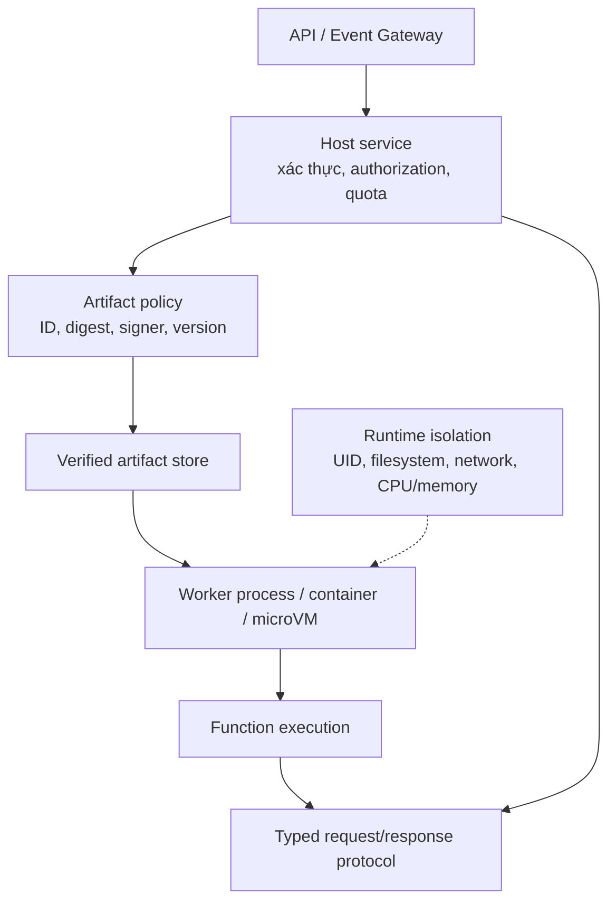
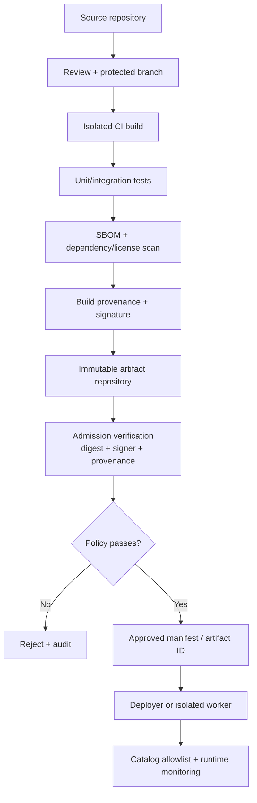

# Không nạp JAR hoặc artifact không tin cậy bằng deployer

## 1. Vì sao deployer là một ranh giới bảo mật?

**SPRING_CLOUD_FUNCTION (Spring Cloud Function)** cho phép xây dựng nghiệp vụ tái sử dụng bằng `Supplier`, `Function` và `Consumer`, tra cứu qua `FunctionCatalog`, kết hợp bằng *composition* và triển khai cùng logic qua HTTP, sự kiện hoặc serverless. Ngoài cách đóng gói ứng dụng cố định, Spring Cloud Function còn có thư viện **deployer** để nạp một JAR (hoặc archive đã giải nén, tập JAR) trong một class loader riêng và đưa các function của artifact đó vào catalog của ứng dụng chủ.

Khả năng này hữu ích khi một nền tảng muốn nạp function theo gói. Nhưng nó cũng tạo ra ranh giới rất nhạy cảm:

```text
Ứng dụng chủ (deployer)
       |
       | spring.cloud.function.location
       v
Artifact JAR / archive
       |
       v
Class loader riêng
       |
       v
Spring context / function bean
       |
       v
FunctionCatalog của ứng dụng chủ
```

Nếu artifact được tải từ một URL do người dùng kiểm soát, một tọa độ Maven không được phê duyệt hoặc một kho lưu trữ bị xâm nhập, mã Java trong artifact có thể được thực thi trong **cùng tiến trình JVM** với ứng dụng chủ. Một function độc hại có thể đọc dữ liệu mà tiến trình được phép đọc, truy cập network, dùng credentials của runtime, tạo thread, tiêu thụ CPU/bộ nhớ hoặc làm dừng tiến trình.

Điểm phải hiểu chính xác: **class loader riêng giúp cô lập namespace lớp và tránh xung đột phiên bản dependency; nó không phải sandbox bảo mật cho mã Java không tin cậy**. Spring Cloud Function Deployer không biến một JAR bất kỳ thành plugin an toàn chỉ bằng cách nạp nó trong class loader riêng.

### Mục tiêu học tập

Sau bài này, bạn có thể:

1. Mô tả cách `spring-cloud-function-deployer` dùng `spring.cloud.function.location` để nạp JAR và đăng ký function vào `FunctionCatalog`.
2. Phân biệt **class-loader isolation**, **process isolation** và **security sandbox**.
3. Nhận diện rủi ro khi location, Maven coordinates, class name hoặc function definition đến từ HTTP request hay tenant không đáng tin.
4. Thiết kế allowlist artifact, phiên bản bất biến, digest, chữ ký và build provenance trước khi deployer được phép nạp JAR.
5. Quản lý credentials của Maven repository và tránh SSRF/path abuse khi giải quyết artifact.
6. Hiểu giới hạn của Java Security Manager và vì sao không thể dựa vào nó để sandbox plugin trên JDK mới.
7. Chọn khi nào dùng deployer trong cùng JVM, khi nào chạy function trong process/container/VM riêng.
8. Viết kiểm thử từ chối artifact, function class, signer, digest hoặc nguồn tải không được phép.

## 2. Spring Cloud Function Deployer hoạt động như thế nào?

Tài liệu chính thức **Deploying a Packaged Function** mô tả thư viện `spring-cloud-function-deployer`. Khi thêm thư viện này vào classpath của ứng dụng chủ, deployer đọc cấu hình để biết artifact function nằm ở đâu.

Thuộc tính trung tâm:

| Thuộc tính | Ý nghĩa |
|---|---|
| `spring.cloud.function.location` | URL hoặc resource location của archive chứa function; có thể dùng prefix `maven:` để resolve artifact theo tọa độ Maven |
| `spring.cloud.function.function-class` | Tên lớp function cho packaging kiểu JAR đơn giản, không phải Spring Boot application |
| `spring.cloud.function.definition` | Function definition được chọn khi artifact là Spring Boot application có function bean do Spring quản lý |

Ví dụ tài liệu cho một artifact JAR đơn giản:

```text
--spring.cloud.function.location=/opt/functions/uppercase.jar
--spring.cloud.function.function-class=com.example.functions.UppercaseFunction
```

Ví dụ artifact được resolve từ Maven repository:

```text
--spring.cloud.function.location=maven://com.example.functions:uppercase:1.4.2
--spring.cloud.function.function-class=com.example.functions.UppercaseFunction
```

Với một **Spring Boot application JAR** chứa function bean:

```text
--spring.cloud.function.location=/opt/functions/order-functions-2.3.1.jar
--spring.cloud.function.definition=processOrder
```

Sau khi target JAR khởi động thành công, function có thể được đăng ký vào `FunctionCatalog` của ứng dụng chính và được gọi từ code ứng dụng chủ. Tài liệu cũng nêu rằng artifact được chạy bằng **isolated class loader theo mặc định**. Với Spring Boot JAR, deployer bootstrap ứng dụng Spring bên trong archive và dùng `MANIFEST.MF` để tìm start class.

### 2.1. Deployer có thể nạp những kiểu packaging nào?

| Kiểu artifact | Cách chọn function | Ghi chú |
|---|---|---|
| Simple JAR | `location` + `function-class` | Lớp Java triển khai `Function`/`Supplier`/`Consumer` |
| Spring Boot JAR | `location` + `function-class` | JAR có dependency Spring Boot, function class được chỉ định |
| Spring Boot application JAR | `location` + `definition` | Function là Spring-managed bean trong application context của artifact |
| Archive đã giải nén / nhiều JAR | `location` theo hỗ trợ của deployer | Cần kiểm soát toàn bộ tập file và dependency |
| Maven artifact | `maven://groupId:artifactId:version` | Resolve qua Maven repository configuration |

Một số phiên bản còn hỗ trợ component scanning trong package `functions`. Điều này tiện cho discovery, nhưng cũng có nghĩa **thêm class vào artifact có thể thêm function được catalog khám phá**. Không để người dùng tự cung cấp artifact rồi mặc định mọi function được tìm thấy đều có thể công bố.

### 2.2. Ví dụ nạp một function đã được phê duyệt

Đoạn code minh họa một **Spring Boot application JAR đã được duyệt**. Artifact có bean `uppercase`; deployer được cấu hình bằng `location` và `definition`:

```java
package com.example.platform;

import java.util.function.Function;

import org.springframework.boot.SpringApplication;
import org.springframework.boot.autoconfigure.SpringBootApplication;
import org.springframework.cloud.function.context.FunctionCatalog;
import org.springframework.context.ConfigurableApplicationContext;

@SpringBootApplication
public class FunctionHostApplication {

    public static void main(String[] args) {
        // Trong production, location và definition phải đến từ
        // cấu hình deployment đã được kiểm tra, không từ request.
        ConfigurableApplicationContext context =
                SpringApplication.run(
                        FunctionHostApplication.class,
                        "--spring.cloud.function.location="
                                + "/opt/approved-functions/uppercase-1.4.2-exec.jar",
                        "--spring.cloud.function.definition=uppercase");

        FunctionCatalog catalog =
                context.getBean(FunctionCatalog.class);

        Function<String, String> uppercase =
                catalog.lookup("uppercase");

        if (uppercase == null) {
            throw new IllegalStateException(
                    "Approved function was not registered");
        }

        System.out.println(uppercase.apply("hello"));
    }
}
```

Đây là ví dụ minh họa **chỉ dùng một artifact đã được phê duyệt trước**. Nó dùng `definition=uppercase` vì artifact là Spring Boot application JAR có bean tên `uppercase`. Với simple JAR, dùng `function-class` theo class triển khai function. Cần xác nhận tên lookup trong integration test.

Tài liệu deployer mô tả cơ chế **resolve, bootstrap và đăng ký function**; các thuộc tính `location`/`function-class`/`definition` không tự tạo chính sách xác minh signer, digest hoặc provenance. Hãy thực hiện admission/verification ở lớp nền tảng **trước** khi cấu hình artifact cho deployer.

**Không viết API kiểu `POST /deploy?location=...` rồi đưa thẳng giá trị đó vào `spring.cloud.function.location`.** Khi người dùng có thể chọn JAR, họ thực chất đang được trao quyền yêu cầu host nạp và chạy mã Java.

## 3. Class loader riêng không phải sandbox

Tài liệu Spring Cloud Function mô tả artifact được chạy trong **isolated class loader** để tránh xung đột phiên bản Spring Boot/dependencies giữa ứng dụng chủ và ứng dụng function. Đây là một lợi ích về **tương thích classpath**, không phải một ranh giới thực thi an toàn.

| Cơ chế | Cô lập điều gì? | Có ngăn JAR độc hại truy cập tài nguyên host không? |
|---|---|---|
| Class loader riêng | Không gian tên class và một phần dependency/resource resolution | **Không** |
| Spring ApplicationContext riêng | Bean registry, lifecycle và cấu hình Spring của context đó | **Không** |
| Java module / package boundary | Quy tắc truy cập module/package theo cấu hình | Không tạo OS sandbox |
| JVM process riêng | Heap, thread và lỗi tiến trình được tách | Tốt hơn, nhưng cần OS identity/permissions |
| Container/VM riêng | Process, filesystem/network/resource boundary theo cấu hình nền tảng | Có thể tạo cô lập mạnh hơn nếu hardening đúng |

Một class loader riêng không làm mất các quyền mà JVM process đang có. Mã trong JAR vẫn có thể gọi API Java được phép bởi process:

- `System.getenv()` và `System.getProperty(...)` để đọc môi trường và system properties.
- File I/O đối với đường dẫn mà user của process có quyền truy cập.
- Network socket/HTTP client tới những host mà network policy cho phép.
- JDBC hoặc client library dùng credentials có trong environment, secret mount hoặc Spring beans được chia sẻ.
- Tạo thread, executor, scheduler, mở file/connection và tiêu thụ CPU/bộ nhớ.
- Gây exception, deadlock, thread exhaustion, memory pressure hoặc làm dừng JVM bằng API có sẵn.

Ngay cả khi Spring context của artifact riêng, code vẫn chạy trong cùng JVM và có thể dùng các Java APIs của tiến trình. Nếu ứng dụng chủ expose function qua HTTP hoặc broker, function được nạp có thể được gọi như một phần của **bề mặt API host**.

### 3.1. Ví dụ rủi ro do quyền của process

Giả sử host được cấp:

```text
DATABASE_URL=jdbc:postgresql://orders-db.internal/orders
DATABASE_PASSWORD=<secret runtime>
PAYMENT_API_TOKEN=<secret runtime>
AWS_ROLE=orders-runtime-role
```

Một function hợp lệ có thể cần một phần quyền này. Nhưng một JAR không đáng tin cũng chạy với cùng process identity, nên có thể tìm cách đọc hoặc sử dụng các quyền đó. **Việc JAR không nhìn thấy bean `DataSource` trong Spring context không có nghĩa nó không thể mở kết nối JDBC hoặc đọc environment variable.**

Nguyên tắc:

> **Không nạp mã không tin cậy vào JVM đang giữ secrets hoặc quyền hạ tầng quan trọng.** Nếu cần chạy mã do bên thứ ba/người dùng tải lên, tách nó sang process/runtime riêng với identity, filesystem, network và resource limits tối thiểu.

### 3.2. Không dựa vào Java Security Manager để cách ly plugin

Security Manager từng cung cấp mô hình kiểm tra permission trong Java, nhưng không còn là phương án sandbox hiện đại. JDK 17 đã deprecate Security Manager để loại bỏ; **từ JDK 24, Security Manager bị vô hiệu hóa vĩnh viễn**: không thể bật lúc khởi động hoặc cài đặt Security Manager tùy chỉnh khi runtime.

Vì vậy, đừng đề xuất:

```bash
java -Djava.security.manager -jar function-host.jar
```

như một biện pháp cách ly JAR. Trên JDK 24+, lệnh này sẽ làm JVM báo lỗi và thoát. Cũng không tự viết `ClassLoader` hoặc `SecureClassLoader` rồi cho rằng tên class loader có chữ “Secure” đồng nghĩa với security sandbox.

## 4. Rủi ro khi `spring.cloud.function.location` bị điều khiển

`spring.cloud.function.location` là đầu vào quyết định **artifact nào được tải**. Tài liệu deployer cho phép URL/resource location và prefix `maven:`. Nếu một API, tenant configuration hoặc admin tool nhận location từ người dùng mà không kiểm tra, các rủi ro gồm:

| Rủi ro | Tình huống | Tác động |
|---|---|---|
| Arbitrary code execution | Caller trỏ tới JAR do họ tạo | Mã Java chạy với quyền process host |
| SSRF | Caller đưa URL tới dịch vụ nội bộ mà host truy cập được | Host có thể gửi request tới metadata service hoặc hệ thống nội bộ, tùy resolver/URL handler |
| Local resource access | Caller điều khiển resource location tới tài nguyên local mà process đọc được | Đọc nhầm artifact/config hoặc gây nạp tài nguyên ngoài ý định |
| Dependency confusion | Artifact cùng tọa độ bị resolve từ repository không đáng tin hoặc thứ tự repository không phù hợp | Nạp gói giả mạo |
| Version substitution | Dùng `LATEST`, `SNAPSHOT` hoặc version mutable | Cùng cấu hình nhưng lần chạy sau có thể nhận bytes khác |
| Repository credential abuse | Resolver có credential rộng và artifact được yêu cầu từ nguồn không đáng tin | Rò rỉ hoặc lạm dụng quyền đọc repository |
| Resource exhaustion | JAR quá lớn, nhiều dependency, startup loop hoặc tạo thread | Cạn CPU, memory, disk hoặc connection |
| Function exposure | Artifact chứa nhiều function, component scanning khám phá thêm bean | Mở rộng catalog/API ngoài hợp đồng |
| Artifact replacement / TOCTOU | Verify một file rồi deployer tải lại URL mutable | Bytes được chạy khác bytes đã xác minh |

### 4.1. Không đưa location vào request hoặc message

Các cách làm **không an toàn**:

```java
// Anti-pattern: client quyết định JAR sẽ được nạp.
String location = request.getParameter("location");
environment.getPropertySources().addFirst(
        new MapPropertySource(
                "user-deployment",
                Map.of("spring.cloud.function.location", location)));
```

```java
// Anti-pattern: event header chọn Maven artifact.
String artifact = message.getHeaders()
        .get("function-artifact", String.class);
```

```java
// Anti-pattern: client quyết định class/definition trong JAR.
String functionClass = request.getParameter("functionClass");
String definition = request.getParameter("definition");
```

Không sử dụng request header, body, query parameter, CloudEvent `type`, Kafka `__TypeId__` hoặc một tenant metadata field làm nguồn trực tiếp cho:

- `spring.cloud.function.location`
- `spring.cloud.function.function-class`
- `spring.cloud.function.definition`
- Maven repository URL, username/password hoặc resolver settings
- Class loader parent, resource roots hoặc đường dẫn plugin

Nếu sản phẩm có tính năng chọn function theo tenant, tenant chỉ được chọn **một mã deployment đã được hệ thống phê duyệt**. Server ánh xạ mã đó sang artifact digest, signer, version và function name cố định; không để tenant tự gửi URL, tọa độ Maven hay tên Java class.

## 5. Thiết kế allowlist artifact trước khi gọi deployer

Hãy coi deployer là **bước thực thi sau cùng** trong một pipeline kiểm tra. Trước khi đưa artifact vào `spring.cloud.function.location`, nền tảng cần xác định:

1. Artifact đến từ repository/registry nào?
2. Tọa độ `groupId:artifactId:version` có nằm trong allowlist không?
3. Phiên bản có bất biến không? Có cấm `SNAPSHOT`, `LATEST` hoặc version range không?
4. SHA-256 của đúng bytes chuẩn bị nạp có khớp với digest đã phê duyệt không?
5. Chữ ký có hợp lệ và signer identity có thuộc tổ chức/workflow được tin cậy không?
6. Build provenance có chứng minh artifact được tạo từ repository/commit/workflow mong đợi không?
7. SBOM có liệt kê dependency và policy có chấp nhận license/CVE/nguồn dependency không?
8. Artifact được phép công bố những function names nào?
9. Runtime có đủ cô lập và quyền tối thiểu cho code đó không?

### 5.1. Ví dụ catalog artifact được phê duyệt

Một nền tảng có thể quản lý manifest **ngoài request path**:

```yaml
# Ví dụ manifest quản trị; không phải property file của deployer.
approvedFunctions:
  - id: shipping-quote-v1
    location: maven://com.acme.functions:shipping-quote:1.4.2
    sha256: "aaaaaaaaaaaaaaaaaaaaaaaaaaaaaaaaaaaaaaaaaaaaaaaaaaaaaaaaaaaaaaaa"
    signer: "release-bot@acme.example"
    functionDefinition: "shippingQuote"
    runtimeProfile: "quote-sandbox"
    enabled: true

  - id: order-normalizer-v2
    location: maven://com.acme.functions:order-normalizer:2.3.1
    sha256: "bbbbbbbbbbbbbbbbbbbbbbbbbbbbbbbbbbbbbbbbbbbbbbbbbbbbbbbbbbbbbbbb"
    signer: "release-bot@acme.example"
    functionDefinition: "normalizeOrder"
    runtimeProfile: "orders-sandbox"
    enabled: true
```

Digest và signer trong ví dụ là **giá trị minh họa**, không phải hash thật. Manifest nên được quản lý bởi GitOps/CI với review, chữ ký hoặc hệ thống quản trị có audit. Không để API public ghi trực tiếp vào manifest.

Từ phía người dùng, chỉ nhận:

```json
{
  "functionId": "shipping-quote-v1"
}
```

Server tìm `functionId` trong manifest đã phê duyệt, xác minh trạng thái `enabled` và quyền của tenant, rồi dùng metadata artifact đã được quản lý. Nếu không có ID hoặc ID bị tắt, từ chối; không fallback sang một URL do client cung cấp.

### 5.2. Allowlist function name cũng cần thiết

Artifact có thể chứa nhiều function:

```properties
spring.cloud.function.function-class=com.acme.functions.ShippingQuote;com.acme.functions.InternalAdmin
```

Ngay cả khi artifact được ký và hash đúng, không có nghĩa mọi function trong đó đều được phép công bố. Với Spring Boot JAR, `spring.cloud.function.definition` chọn definition; với simple JAR, `function-class` xác định class. Hãy kiểm tra:

- Function name có thuộc danh sách được phê duyệt không?
- Có composition chứa function khác không?
- Có component scanning tự phát hiện bean ngoài ý định không?
- Có `functionRouter` hoặc endpoint generic cho phép caller lookup function tùy ý không?
- Có trùng tên với function đã có trong host catalog không?

Chỉ công bố function được phê duyệt ở adapter; không để một artifact hợp lệ tự động làm tăng bề mặt API.

## 6. Xác minh artifact: digest, chữ ký, provenance và SBOM

Trước khi deployer nạp một JAR, cần biết **đúng bytes nào** đang được chấp nhận và **ai chịu trách nhiệm tạo ra chúng**. Các cơ chế sau bổ sung cho nhau, không thay thế nhau:

| Cơ chế | Câu hỏi được trả lời | Điều không chứng minh |
|---|---|---|
| SHA-256 digest | Bytes có trùng artifact đã ghi nhận không? | Không chứng minh ai tạo artifact nếu digest đến từ cùng nguồn không tin cậy |
| Chữ ký số | Artifact có được ký bởi private key/identity được tin cậy không? | Không chứng minh code không có lỗi hoặc signer không bị xâm nhập |
| Build provenance / attestation | Artifact được tạo từ source, workflow và build platform nào? | Không tự chứng minh mọi dependency đều an toàn |
| SBOM | Artifact gồm những package/dependency nào? | Không phải chứng nhận an toàn; chỉ là inventory để đối chiếu policy |
| Vulnerability/license policy | Dependency có nằm trong ngưỡng chấp nhận không? | Scanner không phát hiện được mọi lỗ hổng hoặc hành vi độc hại |
| Reproducible build | Có thể tái tạo bytes từ source/toolchain đã khai báo không? | Không bảo đảm source ban đầu đáng tin |

### 6.1. Tính digest của đúng file chuẩn bị nạp

Ví dụ trong pipeline Linux:

```bash
sha256sum shipping-quote-1.4.2.jar
```

Trong PowerShell:

```powershell
Get-FileHash .\shipping-quote-1.4.2.jar -Algorithm SHA256
```

Digest phải được đối chiếu với giá trị lấy từ **manifest/release record đáng tin**. Nếu người tải artifact cũng có thể thay đổi file chứa digest, phép so sánh không xác minh được nguồn gốc.

### 6.2. Xác minh chữ ký artifact

Ví dụ với Sigstore Cosign và bundle chữ ký cho một file JAR:

```bash
cosign verify-blob shipping-quote-1.4.2.jar \
  --bundle shipping-quote-1.4.2.jar.sigstore.json \
  --certificate-identity=release-bot@acme.example \
  --certificate-oidc-issuer=https://accounts.example.com
```

Các giá trị identity/issuer chỉ là ví dụ. Production phải khớp **chính xác** danh tính CI/CD được tổ chức tin cậy, issuer OIDC, repository/workflow và policy của tổ chức. Không dùng regex rộng kiểu “mọi identity từ issuer này” nếu không có lý do.

Với chữ ký JAR theo hệ sinh thái Java, có thể dùng `jarsigner -verify` để kiểm tra chữ ký và certificate; tuy nhiên vẫn cần xác minh **certificate chain, signer identity, timestamp, trust anchors và policy ký**. Chữ ký hợp lệ từ một signer bất kỳ không có nghĩa signer đó được phép phát hành function cho hệ thống.

### 6.3. Provenance và SBOM

Một quy trình phát hành nên tạo:

- **SBOM** ở định dạng được tổ chức chấp nhận (ví dụ CycloneDX hoặc SPDX), liệt kê dependency trực tiếp và bắc cầu.
- **Build provenance** gắn artifact digest với source repository, commit, build workflow, builder identity và các tham số build.
- **Attestation** được ký để pipeline/runtime policy có thể xác minh.
- Báo cáo quét dependency, license và policy exception đã được phê duyệt.

SLSA provenance mô tả cách artifact được tạo và hỗ trợ consumer xác minh artifact có được build theo kỳ vọng hay không. Sigstore/Cosign có thể xác minh chữ ký và attestation. **SBOM/provenance là bằng chứng và dữ liệu kiểm tra, không phải giấy bảo đảm code an toàn.**

### 6.4. Không để xảy ra TOCTOU giữa verify và load

Một lỗi dễ mắc:

```text
1. Tải https://repo.example/functions/current.jar
2. Kiểm tra SHA-256 và chữ ký của file A
3. Gọi deployer với cùng URL "current.jar"
4. Repository thay file bằng file B
5. Deployer nạp file B, dù pipeline đã verify file A
```

Giải pháp:

1. Tải artifact một lần vào **staging directory** chỉ pipeline ghi được.
2. Xác minh digest/chữ ký/provenance trên chính file staging.
3. Đưa file đã xác minh vào **immutable, content-addressed artifact store** hoặc thư mục read-only theo digest.
4. Cấu hình deployer nạp **đúng bản local đã xác minh** (ví dụ resource location dưới một root cố định), không tải lại URL mutable.
5. Không cho tiến trình runtime sửa hoặc thay file sau khi kiểm tra.

Nếu bắt buộc nạp qua remote Maven repository, repository phải bảo đảm release version bất biến, quyền ghi tách biệt và digest/signature được kiểm tra trên đúng artifact mà resolver trả về. Không chỉ xác minh một bản tải riêng rồi tin lần resolve tiếp theo sẽ giống hệt.

## 7. Quản lý Maven repository và credentials

Spring Cloud Function Deployer hỗ trợ `maven:` location. Tài liệu nêu Maven resource như local/remote repositories, user/password và các thuộc tính khác được resolve qua `MavenProperties` mặc định; ứng dụng có thể cung cấp bean `MavenProperties` để tùy chỉnh.

Điều đó có nghĩa deployer có thể hoạt động với **credentials của resolver**. Cần kiểm soát:

- Chỉ cho phép repository nội bộ đã được phê duyệt hoặc mirror quản trị; không cho request tự chọn URL repository.
- Tài khoản runtime chỉ có quyền **đọc** đúng repository/path cần thiết; không dùng credential deploy/publish.
- Tách credentials theo môi trường và theo ứng dụng; không dùng một token có quyền đọc toàn bộ kho artifact.
- Lưu password/token trong secret store, không hard-code trong source, command line hiển thị rộng hoặc log.
- Cấm version động (`LATEST`, `SNAPSHOT`, version range) đối với artifact production; pin release version và digest.
- Tắt hoặc kiểm soát repository fallback tới nguồn public nếu hệ thống yêu cầu chỉ dùng artifact đã mirror.
- Giới hạn kích thước tải, timeout, redirect, số dependency và disk cache; xóa cache theo retention policy.
- Không đưa `MavenProperties` hoặc resolver settings cho tenant/user cấu hình.

Ví dụ cấu hình location bất biến:

```properties
spring.cloud.function.location=maven://com.acme.functions:shipping-quote:1.4.2
spring.cloud.function.function-class=com.acme.functions.ShippingQuoteFunction
```

Đây là **một phần của deployment configuration**, không phải endpoint cho người dùng sửa. Nếu dùng Spring Boot application JAR, property chọn function thường là `spring.cloud.function.definition` thay cho `function-class`.

### 7.1. Nếu nhận URL hoặc resource location

Khi chính sách cho phép URL/resource, hãy kiểm tra trước khi resolver hoặc class loader sử dụng:

1. **Scheme allowlist:** chỉ cho phép scheme cần thiết, ví dụ một artifact store nội bộ HTTPS hoặc local immutable path. Từ chối scheme không nằm trong hợp đồng.
2. **Host allowlist:** hostname phải nằm trong danh sách repository/artifact store được phê duyệt.
3. **Redirect policy:** không cho redirect sang host hoặc scheme khác nếu chưa kiểm tra lại.
4. **Network egress:** chặn truy cập metadata endpoint, loopback, link-local và mạng nội bộ không cần thiết ở tầng network; kiểm tra DNS rebinding và địa chỉ sau resolve.
5. **Path confinement:** local path phải nằm dưới root artifact đã định; chuẩn hóa path, xử lý symlink và không cho `..` thoát khỏi root.
6. **TLS:** xác minh certificate chain/hostname; không tắt hostname verification để khắc phục lỗi repository.
7. **Size/time limits:** giới hạn bytes, số lần redirect, connect/read timeout và tổng thời gian resolve.

Đây là biện pháp bảo vệ **nguồn artifact**, không thay thế chữ ký/digest. HTTPS bảo vệ kênh truyền nhưng không chứng minh repository hoặc artifact đã được phê duyệt.

## 8. Không dùng class loader để thay thế process isolation

Nếu JAR được tạo bởi team nội bộ có code review, pipeline ký và artifact store được kiểm soát, deployer có thể phù hợp để nạp function trong cùng process **theo mô hình tin cậy của tổ chức**. Nếu JAR đến từ khách hàng, tenant, marketplace hoặc bên thứ ba mà host không hoàn toàn tin cậy, hãy tách process.



Trong kiến trúc này, ứng dụng chủ giữ **control plane**: xác thực caller, quyết định artifact ID được phép, xác minh chữ ký và điều phối request. Worker chạy mã function trong **data plane** tách biệt, giao tiếp bằng DTO/JSON/protobuf hoặc protocol đã định nghĩa; không chia sẻ trực tiếp Java object graph hay bean có đặc quyền.

### 8.1. Checklist container/worker tối thiểu

| Lớp | Chính sách |
|---|---|
| Identity | Chạy non-root, service account riêng cho từng nhóm function |
| Filesystem | Root filesystem read-only; chỉ mount thư mục tạm cần thiết; không mount host paths/secret không cần |
| Network | Egress allowlist tới đúng dependency; chặn metadata service, control plane và database không liên quan |
| Linux capabilities | Drop capabilities không cần; không chạy privileged |
| Kernel controls | Dùng seccomp/AppArmor/SELinux profile phù hợp với nền tảng |
| Resources | CPU, memory, process/thread, file descriptor và thời gian thực thi có quota |
| Secrets | Cấp secret tối thiểu cho worker; không truyền host credentials dùng chung |
| Runtime | JVM/container image được vá, ký và xác minh; giới hạn debug/JMX/management endpoints |
| Lifecycle | Timeout, health check, terminate/recycle worker, audit deployment và rollback |
| Control plane | Worker không có quyền sửa artifact registry, deployer host hoặc policy |

Ví dụ một phần Kubernetes Pod security context:

```yaml
spec:
  securityContext:
    runAsNonRoot: true
    runAsUser: 10001
    seccompProfile:
      type: RuntimeDefault
  containers:
    - name: function-worker
      image: registry.acme.example/functions/worker@sha256:cccccccccccccccccccccccccccccccccccccccccccccccccccccccccccccccc
      securityContext:
        allowPrivilegeEscalation: false
        readOnlyRootFilesystem: true
        capabilities:
          drop:
            - ALL
      resources:
        limits:
          cpu: "1"
          memory: "512Mi"
```

Đây là ví dụ minh họa, không phải manifest hoàn chỉnh. Cần thêm NetworkPolicy, volume mounts, service account, image pull policy, probes và chính sách ingress/egress phù hợp. Container chia sẻ kernel với host; với mã cực kỳ thù địch hoặc yêu cầu tenant isolation mạnh, cân nhắc **microVM hoặc dịch vụ sandbox chuyên dụng**.

### 8.2. Giao tiếp qua hợp đồng dữ liệu

Không truyền một Java object có tham chiếu tới bean, connection hoặc class loader giữa host và worker. Định nghĩa một protocol rõ:

```json
{
  "requestId": "req-204",
  "functionId": "shipping-quote-v1",
  "schemaVersion": 1,
  "payload": {
    "sku": "SKU-42",
    "quantity": 2
  }
}
```

Host xác định `functionId` và schema được phép trước khi gửi; worker chỉ nhận dữ liệu cần thiết. Response có version riêng, size limit, timeout và mã lỗi đã chuẩn hóa. **Không để worker trả class name hoặc URL để host tự động nạp thêm artifact khác.**

## 9. Quy trình phát hành và nạp artifact an toàn

Một pipeline có thể chia thành các bước:



Các nguyên tắc:

1. **Source review:** chỉ build từ repository/branch/commit đã được bảo vệ.
2. **Isolated build:** không dùng CI runner chứa credentials production rộng; hạn chế network và quyền publish.
3. **Dependency control:** dùng BOM/lock hoặc policy version, repository mirror, scan transitive dependencies.
4. **Tests:** unit, integration, contract và security tests; kiểm tra function names được đăng ký.
5. **SBOM:** lưu cùng artifact và gắn với digest.
6. **Provenance/signature:** ký artifact và attestation bằng identity của release workflow.
7. **Promotion:** promote đúng bytes đã xác minh giữa staging và production; không build lại bằng source “cùng version” trong bước promote.
8. **Admission:** kiểm tra allowlist, digest, signer, provenance và trạng thái thu hồi trước khi nạp.
9. **Deployment:** chỉ cho deployer hoặc worker nhận artifact đã được promote.
10. **Monitoring/rollback:** ghi artifact ID/digest/function definition đang chạy; có thể quay về một artifact đã được phê duyệt trước.

### 9.1. Phân biệt checksum, signature và provenance

Ví dụ:

```text
Checksum:
  "Các bytes có giống digest đã duyệt không?"

Signature:
  "Identity nào ký digest này, và identity đó có được tin cậy không?"

Provenance:
  "Digest này được tạo từ source, builder, workflow và tham số nào?"

SBOM:
  "Artifact này chứa những dependency/package nào?"
```

Một artifact có checksum đúng vẫn có thể là artifact độc hại nếu digest được phê duyệt sai. Một chữ ký hợp lệ vẫn có thể đến từ workflow bị chiếm quyền. Provenance và SBOM giúp tăng khả năng điều tra, nhưng cần policy chấp nhận signer, builder, source và dependencies.

## 10. Bảo vệ catalog và adapter sau khi nạp

Nạp artifact hợp lệ chỉ là bước đầu. Sau đó, function được đăng ký trong `FunctionCatalog` của host; nếu host có adapter HTTP, Stream hoặc serverless, function có thể trở thành một đường gọi mới.

| Rủi ro sau khi nạp | Biện pháp |
|---|---|
| Artifact đăng ký function name không dự kiến | Kiểm tra catalog sau startup với danh sách function names đã duyệt |
| Tên trùng function nội bộ | Namespace function theo artifact/tenant; reject collision |
| Caller lookup function tùy ý | Không expose endpoint generic gọi mọi tên catalog |
| Composition gọi thêm function có quyền cao | Allowlist từng definition/composition, không nhận chuỗi tùy ý |
| Function router chọn function từ header | Chỉ cho phép router khi cần; callback allowlist và kiểm thử |
| Function có thể truy cập bean/secret host | Không nạp artifact không tin cậy cùng process; tách worker |
| Artifact thay đổi nhưng catalog vẫn giữ function cũ | Dùng deployment immutable/restart; không giả định class loader unload an toàn |

**Không đưa `FunctionCatalog` thành API quản trị public.** Caller chỉ được gọi các function được công bố cho đúng principal/tenant. Việc artifact đã được ký không tự cấp quyền cho mọi người gọi tất cả function của artifact.

### 10.1. Không dựa vào unload class loader để thu hồi quyền

Một class loader chỉ có thể được thu hồi khi không còn tham chiếu giữ các class/objects/resources liên quan; thread, static references, executor, ThreadLocal hoặc bean singleton có thể giữ tham chiếu lâu hơn dự kiến. Đóng một resource hoặc xóa catalog entry **không đồng nghĩa mọi code và thread của artifact đã biến mất**.

Đối với artifact chạy trong cùng JVM, không coi hot unload là cơ chế thu hồi bảo mật. Nếu cần loại bỏ hoàn toàn mã đã chạy, cách đáng tin hơn là dừng và thay thế **process/worker riêng** theo lifecycle được kiểm soát.

## 11. Java classpath và Spring Boot launcher cũng là nguồn nạp mã

Deployer không phải con đường duy nhất làm JAR xuất hiện trong classpath. Spring Boot executable JAR có cấu trúc nested libraries:

```text
application.jar
  META-INF/MANIFEST.MF
  BOOT-INF/classes/
  BOOT-INF/lib/dependency-1.jar
  BOOT-INF/lib/dependency-2.jar
```

Spring Boot `JarLauncher` nạp các JAR từ `BOOT-INF/lib/`; `WarLauncher` dùng `WEB-INF/lib/` và `WEB-INF/lib-provided/`. `PropertiesLauncher` có thể thêm location ngoài thông qua `LOADER_PATH` hoặc `loader.path` trong `loader.properties`.

Vì vậy:

- Không cho người dùng ghi vào thư mục chứa application JAR hoặc `BOOT-INF/lib`.
- Không để environment variable `LOADER_PATH` bị điều khiển từ HTTP request/tenant configuration.
- Không mount một thư mục plugin có thể ghi từ nguồn không đáng tin vào classpath của host.
- Review `MANIFEST.MF`, launcher type, nested dependencies và nội dung JAR trong pipeline.
- Dùng container image immutable và không thay đổi file classpath sau khi image đã được ký/phê duyệt.

Đây là **một cơ chế khác với Spring Cloud Function Deployer**. Việc bảo vệ property `spring.cloud.function.location` không tự bảo vệ classpath của Spring Boot launcher.

## 12. Xây lớp admission policy trước deployer

Không để code xử lý request gọi thẳng deployer. Tạo một lớp policy ở control plane để:

1. Xác thực caller và kiểm tra quyền deploy/use function.
2. Nhận `functionId` hoặc deployment ID, không nhận arbitrary URL.
3. Tra manifest đã được phê duyệt.
4. Xác minh artifact vẫn `enabled`, version chưa bị revoke và caller được phép dùng.
5. Kiểm tra digest/signature/provenance trên artifact bytes sẽ nạp.
6. Kiểm tra function name thuộc allowlist.
7. Chọn runtime profile phù hợp (in-process chỉ cho artifact được tin cậy; worker riêng cho code có mức tin cậy thấp hơn).
8. Ghi audit event trước và sau khi nạp.

### 12.1. Ví dụ policy thuần Java

Đoạn dưới chỉ minh họa **quyết định allowlist**, không phải API của Spring Cloud Function Deployer:

```java
package com.example.platform.security;

import java.util.Map;
import java.util.Set;

public final class ArtifactAdmissionPolicy {

    public record ApprovedArtifact(
            String id,
            String location,
            String sha256,
            String signerIdentity,
            Set<String> functions) {}

    private final Map<String, ApprovedArtifact> approved;

    public ArtifactAdmissionPolicy(
            Map<String, ApprovedArtifact> approved) {
        this.approved = Map.copyOf(approved);
    }

    public ApprovedArtifact requireApproved(
            String artifactId,
            String requestedFunction,
            boolean callerMayUseFunction) {

        if (!callerMayUseFunction) {
            throw new SecurityException("Not allowed to use function");
        }

        ApprovedArtifact artifact = approved.get(artifactId);
        if (artifact == null) {
            throw new SecurityException("Artifact is not approved");
        }

        if (!artifact.functions().contains(requestedFunction)) {
            throw new SecurityException("Function is not approved");
        }

        if (artifact.sha256() == null
                || !artifact.sha256().matches("[a-fA-F0-9]{64}")) {
            throw new SecurityException("Invalid artifact digest policy");
        }

        if (artifact.signerIdentity() == null
                || artifact.signerIdentity().isBlank()) {
            throw new SecurityException("Missing trusted signer identity");
        }

        return artifact;
    }
}
```

**Điều policy này chưa làm:** nó không tải file, không tính hash, không kiểm tra chữ ký và không gọi deployer. Những bước đó phải được thực hiện bởi các thành phần có hợp đồng rõ, ví dụ artifact resolver/verification service đã được kiểm tra. Trường `callerMayUseFunction` trong ví dụ đại diện kết quả authorization đã xác minh; không được lấy boolean này từ request body.

### 12.2. Pseudocode orchestration

```java
// Pseudocode: không phải API cụ thể của FunctionDeployer.
ApprovedArtifact approved = admissionPolicy.requireApproved(
        request.functionId(),
        request.operation(),
        authorization.mayInvoke(principal, request.functionId()));

VerifiedArtifact verified = artifactVerifier.fetchAndVerify(
        approved.location(),
        approved.sha256(),
        approved.signerIdentity());

// In-process deployer chỉ dùng nếu artifact thuộc trust tier phù hợp.
// Nếu không, gửi verified artifact tới worker process/container riêng.
functionRuntime.loadVerified(
        verified.immutableLocalLocation(),
        request.operation());
```

Tên `VerifiedArtifact`, `artifactVerifier` và `functionRuntime` là các abstraction của ứng dụng, không phải class có sẵn trong Spring Cloud Function. Mục đích là làm rõ **thứ tự bắt buộc**: authorize → resolve → verify → stage immutable → load. Không gọi deployer trước khi kiểm tra hoàn tất.

## 13. Kiểm thử bảo mật

Nên chia kiểm thử thành nhiều lớp:

| Lớp test | Nội dung | Kết quả cần đạt |
|---|---|---|
| Unit policy | Artifact ID không tồn tại, function name ngoài allowlist, caller thiếu quyền | Từ chối trước khi gọi resolver/deployer |
| Resolver test | Scheme/host/path không được phép, redirect, file quá lớn, timeout | Không truy cập nguồn ngoài policy |
| Integrity test | Digest sai, signature sai, signer lạ, provenance không hợp lệ | Không promote artifact |
| TOCTOU test | Artifact ở URL thay đổi giữa verify và load | Runtime vẫn nạp đúng file immutable đã xác minh hoặc từ chối |
| Deployer integration | Nạp một JAR test đã ký/phê duyệt, lookup function mong đợi | Chỉ function đã duyệt được đăng ký/công bố |
| Catalog test | Function name trùng, function thừa, composition/router | Không lộ function ngoài hợp đồng |
| Isolation test | Worker thử đọc file/secret hoặc gọi network ngoài allowlist | OS/network policy chặn |
| Resource test | Function chạy lâu, tạo nhiều thread, tiêu thụ memory | Timeout/quota/recycle worker hoạt động |
| Audit test | Load, reject, disable, revoke, rollback | Có event audit không chứa secret |

### 13.1. Ví dụ unit test cho admission policy

```java
package com.example.platform.security;

import static org.junit.jupiter.api.Assertions.assertEquals;
import static org.junit.jupiter.api.Assertions.assertThrows;

import java.util.Map;
import java.util.Set;

import org.junit.jupiter.api.Test;

class ArtifactAdmissionPolicyTest {

    private static final String DIGEST = "a".repeat(64);

    private final ArtifactAdmissionPolicy policy =
            new ArtifactAdmissionPolicy(Map.of(
                "shipping-v1",
                new ArtifactAdmissionPolicy.ApprovedArtifact(
                    "shipping-v1",
                    "file:/opt/verified/sha256/" + DIGEST + "/function.jar",
                    DIGEST,
                    "release-bot@acme.example",
                    Set.of("shippingQuote")
                )
            ));

    @Test
    void allowsOnlyKnownArtifactAndFunction() {
        var approved = policy.requireApproved(
                "shipping-v1", "shippingQuote", true);
        assertEquals("shipping-v1", approved.id());
    }

    @Test
    void rejectsUnknownArtifact() {
        assertThrows(SecurityException.class,
                () -> policy.requireApproved(
                        "user-upload.jar", "shippingQuote", true));
    }

    @Test
    void rejectsFunctionOutsideArtifactAllowlist() {
        assertThrows(SecurityException.class,
                () -> policy.requireApproved(
                        "shipping-v1", "internalReconcile", true));
    }

    @Test
    void rejectsCallerWithoutPermission() {
        assertThrows(SecurityException.class,
                () -> policy.requireApproved(
                        "shipping-v1", "shippingQuote", false));
    }
}
```

Test trên chỉ xác minh policy thuần Java. **Nó không kiểm tra chữ ký, digest thực, network, class loader hoặc runtime isolation**. Mỗi thành phần phải có test riêng và integration test cho pipeline nạp artifact.

### 13.2. Kiểm thử một artifact có hành vi nguy hiểm

Không chạy một JAR tùy ý trong JVM test runner dùng chung. Nếu cần kiểm tra isolation, dùng một **worker test environment disposable** với quyền tối thiểu, ví dụ:

- Một test artifact chỉ thử đọc một file sentinel không được mount vào worker.
- Một test artifact thử kết nối tới một host nằm ngoài egress allowlist.
- Một test artifact cố tạo nhiều thread hoặc giữ request quá timeout.
- Một test artifact cố ghi vào root filesystem read-only.

Kết quả mong muốn là **worker bị chặn bởi OS/network/resource boundary**, host và các worker khác không bị ảnh hưởng. Chạy những test này trong VM/container test riêng có cleanup; không dùng credentials hoặc dữ liệu production.

## 14. Quan sát, thu hồi và rollback

Mỗi lần nạp artifact cần lưu metadata đủ để điều tra:

- Artifact ID, group/artifact/version hoặc immutable location.
- SHA-256 digest và signer identity đã xác minh.
- Provenance reference, SBOM reference, policy version và quyết định admission.
- Function definitions được đăng ký, runtime profile và worker/process ID.
- Ai yêu cầu deployment, ai phê duyệt, tenant/service nào được dùng.
- Thời gian nạp, trạng thái startup, health, lỗi và kết quả rollback.

Không ghi password Maven, token repository, raw environment, secret, request payload nhạy cảm hoặc nội dung file JAR vào log. Có thể ghi **digest, artifact ID và version** để truy vết.

### Thu hồi artifact

Khi artifact hoặc signer bị phát hiện có vấn đề:

1. Đánh dấu artifact ID/version/digest là **revoked** trong admission policy.
2. Ngăn các request mới nạp hoặc gọi artifact đó.
3. Xác định deployment/worker đang chạy digest bị thu hồi.
4. Với worker riêng: dừng/recycle process hoặc container, thu hồi identity/credentials và kiểm tra side effects.
5. Với deployer in-process: không chỉ xóa catalog entry rồi cho rằng mã đã dừng; đánh giá process có cần restart/redeploy hay không.
6. Quay về artifact trước đó đã được phê duyệt, không tự tải một version khác cùng tên.
7. Kiểm tra logs, network egress, file/database changes và secrets có thể đã bị truy cập.
8. Cập nhật policy, dependency rules và negative tests để ngăn lặp lại.

**Rollback phải trỏ tới digest đã được xác minh trước**, không chỉ version string. Một version có thể bị repository thay thế nếu không có immutability.

## 15. Những sai lầm thường gặp

| Sai lầm | Vì sao nguy hiểm | Hướng xử lý |
|---|---|---|
| “Deployer dùng isolated class loader nên JAR không truy cập host” | Class loader không phải OS sandbox | Chỉ nạp code tin cậy cùng JVM; code ít tin cậy chạy process riêng |
| Cho client gửi `spring.cloud.function.location` | Arbitrary code loading, SSRF hoặc local resource abuse | Client chỉ gửi artifact ID đã allowlist |
| Chỉ kiểm tra Maven coordinates | Version/repository có thể bị thay thế | Pin version + digest + signature/provenance |
| Dùng `SNAPSHOT` hoặc `LATEST` trong production | Cùng config có thể resolve bytes khác | Release version bất biến và digest |
| Verify URL rồi để deployer tải URL lần nữa | TOCTOU, bytes nạp có thể khác bytes verify | Verify file staging rồi nạp cùng file immutable |
| Dùng repository credentials rộng | Artifact loader có thể đọc nhiều project/repo | Read-only, scope hẹp, secret store |
| Chỉ kiểm tra JAR signature | Signer có thể không được phép hoặc build workflow bị xâm nhập | Verify identity, provenance và policy |
| Coi SBOM là chứng nhận an toàn | SBOM chỉ liệt kê components | Kết hợp vulnerability/license/source review |
| Cho phép mọi function trong JAR được expose | Artifact có thể chứa function nội bộ/đặc quyền | Function allowlist và adapter policy |
| Chỉ xóa function khỏi catalog để thu hồi | Thread/object/classloader vẫn có thể sống | Dừng/restart process hoặc recycle worker |
| Dùng Java Security Manager trên JDK mới | JDK 24 đã vô hiệu hóa Security Manager | OS/container/VM isolation |
| Chạy worker bằng root hoặc có Docker socket | Code có thể vượt ranh giới container | Non-root, drop capabilities, không mount socket |
| Cấp worker mọi secret của host | Artifact có thể sử dụng credentials đó | Identity riêng, secrets tối thiểu |
| Dùng cùng JVM cho plugin tenant không tin cậy | Mọi plugin chia sẻ process privileges | Worker riêng cho từng trust tier/tenant |
| Chỉ test function output | Không kiểm tra loader, artifact integrity hoặc side effects | Test admission, resolver, catalog, isolation và rollback |

## 16. Bài tập thực hành

Thiết kế một nền tảng cho phép team nội bộ phát hành function `shippingQuote` và `normalizeOrder`. Một tenant có thể chọn function để xử lý request nhưng không được tải JAR tùy ý.

1. Thêm `spring-cloud-function-deployer` vào ứng dụng host thử nghiệm; cấu hình một JAR Spring Boot đã được build và chỉ định `spring.cloud.function.location` cùng `spring.cloud.function.definition`.
2. Tạo một artifact catalog có ID, Maven coordinates bất biến, SHA-256, signer identity, provenance reference và function allowlist.
3. Viết admission policy chỉ nhận artifact ID; từ chối URL, Maven coordinates hoặc Java class name do client gửi.
4. Thêm bước CI tạo SBOM, signature và build provenance. Kiểm tra digest/signature trước khi artifact được promote.
5. Lưu artifact đã xác minh vào thư mục content-addressed read-only; bảo đảm deployer nạp đúng bytes đã verify.
6. Viết test từ chối artifact có digest sai, signer lạ, version `SNAPSHOT`, function name không được phép hoặc artifact đã bị revoke.
7. Kiểm tra `FunctionCatalog` sau startup; bảo đảm không có function nội bộ hoặc composition ngoài allowlist được công bố qua HTTP.
8. Mô phỏng một function chạy lâu hoặc tạo thread; quan sát ảnh hưởng trong cùng JVM, rồi chuyển sang worker container có CPU/memory/time quota.
9. Cấp worker service account riêng, non-root, filesystem read-only và network egress chỉ tới dịch vụ cần thiết.
10. Thực hiện thu hồi artifact đang chạy. So sánh khả năng dừng worker riêng với việc chỉ xóa function khỏi catalog trong JVM host.
11. Viết quy trình rollback tới digest trước đó đã phê duyệt và kiểm tra audit trail không ghi secret.

### Câu hỏi tự kiểm tra

1. Deployer dùng class loader riêng để giải quyết vấn đề nào? Vì sao nó không ngăn plugin đọc environment hoặc mở network connection?
2. `spring.cloud.function.location` có thể nhận những dạng location nào theo tài liệu? Vì sao không cho client tự đặt giá trị?
3. Tại sao digest phải được tính trên đúng bytes mà deployer nạp?
4. Chữ ký artifact và build provenance khác nhau thế nào?
5. Nếu artifact được ký bởi release bot nhưng chứa dependency độc hại, chữ ký đã đủ để chấp nhận chưa?
6. Tại sao `maven://group:artifact:SNAPSHOT` không phù hợp với deployment cần tái lập?
7. Vì sao Java Security Manager không còn là giải pháp sandbox trên JDK 24+?
8. Khi nào nên chọn deployer in-process và khi nào nên chọn worker process/container/microVM?
9. Xóa function khỏi `FunctionCatalog` có bảo đảm thread và code của class loader đã dừng không?
10. Nếu worker bị xâm nhập, những giới hạn nào giúp giảm ảnh hưởng tới host và tenant khác?

## 17. Checklist trước khi production

| Hạng mục | Tiêu chí đạt |
|---|---|
| Deployer chỉ nhận artifact location từ nguồn cấu hình tin cậy? | Có; không từ request/event |
| Có artifact ID allowlist và function name allowlist? | Có |
| Maven coordinates pin release version bất biến? | Có; cấm SNAPSHOT/LATEST/range |
| Repository/host/scheme được allowlist? | Có |
| Resolver credentials read-only và scope hẹp? | Có |
| Artifact được xác minh SHA-256 trên đúng bytes nạp? | Có |
| Signature kiểm tra đúng signer identity/issuer? | Có |
| Provenance/SBOM/dependency/license policy được kiểm tra? | Có |
| Artifact được stage vào immutable/read-only store? | Có; tránh TOCTOU |
| JAR chạy cùng JVM có thuộc trust tier được phê duyệt? | Có; nếu không, tách process |
| Worker có non-root, filesystem/network/resource isolation? | Có |
| Worker không có host secrets hoặc control-plane credentials? | Có |
| FunctionCatalog/router/HTTP adapter chỉ expose definition cần thiết? | Có |
| Có negative tests cho artifact giả, signer lạ, digest sai và function thừa? | Có |
| Có test isolation, timeout, CPU/memory và egress? | Có |
| Có audit, revoke, rollback theo digest? | Có |
| Không dựa vào Security Manager hoặc class loader như sandbox? | Có |

## 18. Tổng kết và tài liệu tham khảo

**Spring Cloud Function Deployer là cơ chế nạp và tích hợp function package, không phải hệ thống kiểm duyệt hay sandbox cho JAR không tin cậy.** `spring.cloud.function.location` có thể trỏ tới URL/resource hoặc Maven artifact; deployer có thể chạy archive trong isolated class loader và đăng ký function vào `FunctionCatalog` của host. Cô lập class loader giúp tránh xung đột classpath, nhưng code vẫn chạy trong cùng JVM và có thể sử dụng quyền của process.

Chỉ dùng deployer in-process cho artifact đã được **phê duyệt nguồn, pin version, xác minh digest/chữ ký/provenance, kiểm tra dependency và giới hạn function names**. Xác minh đúng bytes trước khi nạp, stage immutable để tránh TOCTOU, quản lý Maven credentials chặt chẽ và không nhận arbitrary location từ caller. Nếu code đến từ tenant hoặc nguồn không thể tin cậy hoàn toàn, chạy trong **process/container/VM riêng** với identity, filesystem, network và resource limits tối thiểu.

**Tài liệu chính thức:**

- [Spring Cloud Function — Deploying a Packaged Function](https://docs.spring.io/spring-cloud-function/reference/spring-cloud-function/deploying-a-packaged.html) — `spring-cloud-function-deployer`, `spring.cloud.function.location`, Maven URI, function-class/definition và isolated class loader.
- [Spring Boot — Launching Executable JARs](https://docs.spring.io/spring-boot/specification/executable-jar/launching.html) — launcher và class loader.
- [Spring Boot — Nested JARs](https://docs.spring.io/spring-boot/specification/executable-jar/nested-jars.html) — `BOOT-INF/lib`, `PropertiesLauncher` và classpath.
- [Oracle JDK 24 — The Security Manager Is Permanently Disabled](https://docs.oracle.com/en/java/javase/24/security/security-manager-is-permanently-disabled.html) — giới hạn Security Manager trên JDK 24+.
- [Sigstore Cosign — Verifying Signatures](https://docs.sigstore.dev/cosign/verifying/verify/) — xác minh signature và signer identity.
- [SLSA — Build Provenance](https://slsa.dev/spec/v1.1/build-provenance) — nguồn gốc và cách tạo artifact.
