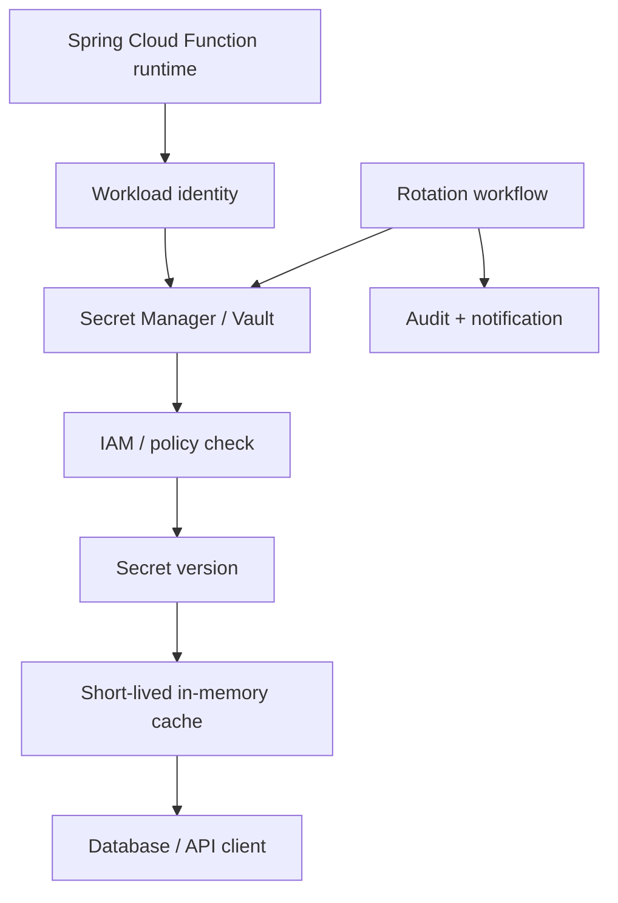
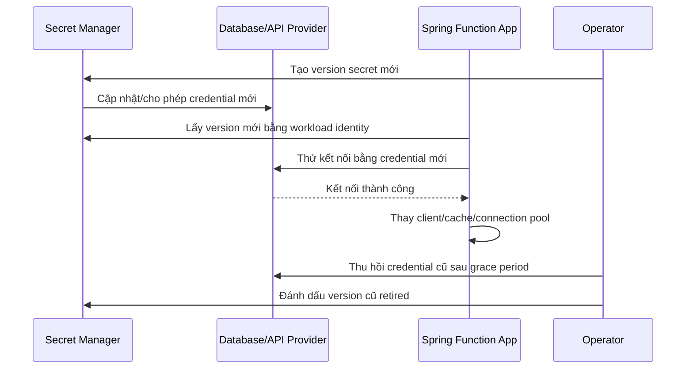

# Bảo vệ thông tin bí mật trong biến môi trường và kho cấu hình

## 1. Vì sao secret là một phần của ranh giới bảo mật?

**SPRING_CLOUD_FUNCTION (Spring Cloud Function)** cho phép tái sử dụng nghiệp vụ bằng `Supplier`, `Function` và `Consumer`, tra cứu qua `FunctionCatalog`, kết hợp bằng *composition* và triển khai cùng một hàm qua HTTP, broker sự kiện hoặc serverless. Trong quá trình xử lý, function thường cần credentials để truy cập database, payment provider, object storage, message broker hoặc một API nội bộ.

Ví dụ một function xử lý đơn hàng:

```text
HTTP / Kafka / Serverless
        |
        v
FunctionCatalog
        |
        v
processOrder
        |
        +--> PostgreSQL (username + password)
        |
        +--> Payment API (API key / OAuth client secret)
        |
        +--> Message broker (client credentials)
```

Các thông tin như password, API key, private key, refresh token, signing key, database credential và certificate private key là **secret**. Nếu đặt chúng trong source code, file cấu hình được commit, command line, log hoặc message header, một người không có quyền gọi function vẫn có thể lấy được quyền truy cập tài nguyên phía sau.

**Biến môi trường không tự là một kho bí mật.** Chúng là một cách đưa cấu hình vào process. Secret được truyền bằng environment vẫn có thể lộ qua quyền xem process, diagnostics, crash dump, shell history, container metadata hoặc endpoint quản trị. Tương tự, một giá trị được mã hóa trong Git không còn plaintext ở trạng thái lưu nhưng có thể được giải mã thành plaintext khi Config Server gửi cho ứng dụng.

### Mục tiêu học tập

Sau bài này, bạn có thể:

1. Phân biệt configuration thông thường và secret; xác định vòng đời của một secret từ tạo, lưu, cấp quyền, sử dụng, rotation tới revoke.
2. Giải thích vì sao không commit password/API key vào `application.yml` hoặc truyền chúng qua command-line arguments.
3. Chọn cách cấp secret cho Spring Boot/Spring Cloud Function bằng environment variables, mounted files, `configtree:` hoặc secret manager.
4. Sử dụng `@ConfigurationProperties` và constructor injection để cấp credential cho function/service mà không ghi secret ra log.
5. Phân biệt mã hóa at rest, bảo vệ khi truyền và quyền truy cập lúc runtime.
6. Bảo vệ Kubernetes Secrets, Spring Cloud Config, Actuator, CI/CD và cloud identity.
7. Thiết kế rotation không làm hỏng connection pool, client cache hoặc các function đang chạy.
8. Viết kiểm thử phát hiện secret bị đưa vào source, logs, message headers hoặc API response.

## 2. Configuration và secret khác nhau ở đâu?

| Dữ liệu | Ví dụ | Có phải secret? | Lưu ý |
|---|---|---|---|
| Tên function | `spring.cloud.function.definition=processOrder` | Thường không | Vẫn có thể là cấu hình nhạy cảm nếu thay đổi làm lộ function nội bộ |
| HTTP port | `server.port=8080` | Không | Có thể công bố theo thiết kế |
| Feature flag | `orders.validation.enabled=true` | Không mặc định | Có thể ảnh hưởng nghiệp vụ |
| Database hostname | `db.internal.example` | Có thể nhạy cảm | Thường không phải credential, nhưng lộ topology |
| Database username | `orders_app` | Tùy chính sách | Không phải lúc nào cũng bí mật, nhưng nên hạn chế |
| Database password | `...` | **Có** | Không commit hoặc log |
| API key / OAuth client secret | `...` | **Có** | Có quyền truy cập dịch vụ bên ngoài |
| Private signing key | `...` | **Có, mức cao** | Phải kiểm soát quyền ký và rotation |
| TLS certificate public | `certificate.pem` | Không nhất thiết | Public certificate khác private key |
| TLS private key | `private-key.pem` | **Có** | Không được công bố |
| JWT access token | `Authorization: Bearer ...` | **Có** | Có thời hạn nhưng vẫn có thể bị replay |
| Correlation ID | `req-42` | Thường không | Không được dùng thay authentication |

Secret thường có **quyền năng**: ai giữ password database có thể truy cập dữ liệu; ai giữ private key có thể ký; ai giữ cloud credential có thể gọi API theo IAM policy. Vì vậy, bảo vệ secret không chỉ là “mã hóa một chuỗi” mà là **giới hạn principal nào được đọc, dùng, đổi và thu hồi nó**.

### Không nhầm các loại bảo vệ

| Lớp | Mục tiêu | Ví dụ |
|---|---|---|
| Encryption at rest | Bảo vệ dữ liệu lưu trữ nếu storage/backup bị truy cập trái phép | KMS, encryption trong etcd, mã hóa repository |
| Encryption in transit | Bảo vệ khi truyền qua mạng | TLS/mTLS tới Config Server hoặc Secret Manager |
| Access control | Chỉ principal được phép mới đọc secret | IAM, Kubernetes RBAC, Vault policy |
| Runtime isolation | Giảm nơi secret có thể xuất hiện | Process riêng, container, file mount riêng |
| Secret hygiene | Tránh tạo bản sao không cần thiết | Không log, không commit, không đưa vào headers |
| Rotation/revocation | Giảm thời gian secret bị lộ có thể được dùng | Thay credential, thu hồi token, cập nhật client |

Mã hóa at rest **không** ngăn một ứng dụng đã được cấp quyền đọc secret lấy plaintext. TLS **không** ngăn log của ứng dụng ghi lại token. RBAC **không** ngăn một process được phép đọc secret sử dụng nó sai mục đích. Các lớp này bổ sung cho nhau.

## 3. Những vị trí không nên lưu secret

### 3.1. Không hard-code trong source hoặc file cấu hình được commit

Không làm:

```yaml
# Không đưa secret thật vào application.yml.
spring:
  datasource:
    url: jdbc:postgresql://db.internal/orders
    username: orders_app
    password: "real-database-password"
payment:
  api-key: "real-provider-api-key"
```

File có thể đi qua Git history, fork, pull request, build cache, source archive và backup. **Xóa secret khỏi file ở commit mới không xóa nó khỏi lịch sử**. Nếu secret đã commit, phải coi là đã lộ: revoke/rotate trước, sau đó xử lý lịch sử repository theo quy trình tổ chức.

Không dùng các cách “che mắt”:

- Base64 không phải encryption.
- Đổi tên property từ `password` thành `credentialValue` không làm nó bí mật hơn.
- Chia chuỗi secret thành nhiều phần trong source vẫn để lại đủ dữ liệu cho người đọc code.
- Mã hóa bằng key được commit cạnh ciphertext không tạo ra ranh giới bảo vệ.
- Đưa secret vào file `.env` không được Git ignore hoặc đưa vào image build vẫn là hard-code ở dạng khác.

### 3.2. Không truyền secret qua command line

Tránh:

```bash
java -jar orders-service.jar \
  --spring.datasource.password=real-password \
  --payment.api-key=real-api-key
```

Command-line arguments có thể xuất hiện trong process inspection, process supervisor, shell history, audit logs, script và hệ thống giám sát. Mức độ lộ phụ thuộc OS, container runtime và quyền người xem; đừng dùng command line như secret manager.

### 3.3. Không ghi secret vào logs, exception hoặc tracing

Các ví dụ nguy hiểm:

```java
// Không log toàn bộ cấu hình hoặc object chứa credential.
log.info("Database config: {}", databaseProperties);

// Không log authorization header.
log.debug("Incoming headers: {}", message.getHeaders());

// Không đưa token vào message lỗi.
throw new IllegalStateException(
        "Payment failed for API key " + apiKey);
```

Một số vị trí thường vô tình ghi secret:

- Log startup khi in toàn bộ `Environment`, `@ConfigurationProperties` hoặc request headers.
- HTTP client wire logging, debug logging của JDBC driver và SDK.
- Stack trace hoặc exception message chứa URL có embedded username/password.
- Distributed tracing baggage/tags, span attributes và telemetry exporter.
- Metrics label có token, account identifier hoặc secret-derived value.
- Audit event, dead-letter queue, retry payload và support bundle.
- Heap dump, thread dump, crash dump hoặc diagnostic archive.

**Không ghi raw request/response** khi body/header có credential hoặc dữ liệu cá nhân. Dùng correlation ID đã kiểm tra, tên secret reference, loại lỗi và mã trạng thái thay cho giá trị bí mật.

## 4. Biến môi trường: tiện để cấu hình, không phải nơi lưu bí mật hoàn hảo

Spring Boot hỗ trợ externalized configuration từ properties, YAML, environment variables, system properties và command-line arguments. Các property sources có thứ tự ưu tiên; một nguồn có thể ghi đè giá trị ở nguồn khác. Điều đó giúp deploy cùng một artifact ở nhiều môi trường, nhưng cũng có nghĩa một biến môi trường có thể thay đổi credential hoặc function behavior mà không cần sửa JAR.

Ví dụ biến môi trường:

```text
SPRING_DATASOURCE_URL=jdbc:postgresql://orders-db.internal/orders
SPRING_DATASOURCE_USERNAME=orders_app
SPRING_DATASOURCE_PASSWORD=<injected-at-runtime>
PAYMENT_APIKEY=<injected-at-runtime>
```

### Ưu điểm

- Không cần ghi credential vào source hoặc application JAR.
- Có thể được cấp bởi container orchestrator hoặc runtime platform.
- Tách cấu hình khỏi artifact; cùng image có thể chạy dev, staging và production.
- Dễ tích hợp với secret injection của cloud/container.

### Hạn chế

- Process và các child processes có thể kế thừa environment.
- Người có đủ quyền trên host/container/runtime có thể xem environment hoặc diagnostics.
- Một số hệ thống quản lý process ghi command/environment vào metadata, support bundle hoặc crash dump.
- Environment thường là snapshot khi process khởi động; đổi secret ở nguồn cấp phát **không bảo đảm** giá trị trong JVM đang chạy tự đổi.
- Trong Java, giá trị thường được bind thành `String` bất biến; không thể bảo đảm xóa sạch mọi bản sao khỏi heap bằng cách gán biến về `null`.
- Nếu nhiều container trong cùng Pod được cấu hình dùng chung secret qua environment, mọi container đó đều có thể đọc giá trị.

**Khi nào dùng?** Environment variables phù hợp với cấu hình runtime và một số credential trong môi trường đã kiểm soát. Với secret có yêu cầu bảo mật cao, ưu tiên secret manager/workload identity hoặc mounted secret file với quyền file chặt chẽ, tùy nền tảng.

### 4.1. Spring Boot relaxed binding

Spring Boot có thể ánh xạ biến môi trường sang property. Ví dụ:

| Environment variable | Property |
|---|---|
| `SPRING_DATASOURCE_URL` | `spring.datasource.url` |
| `SPRING_DATASOURCE_USERNAME` | `spring.datasource.username` |
| `SPRING_DATASOURCE_PASSWORD` | `spring.datasource.password` |
| `PAYMENT_APIKEY` | `payment.api-key` |

Ví dụ `application.yml` chỉ giữ cấu hình không bí mật:

```yaml
spring:
  datasource:
    url: "${SPRING_DATASOURCE_URL}"
    username: "${SPRING_DATASOURCE_USERNAME}"
    password: "${SPRING_DATASOURCE_PASSWORD}"
```

Ở đây, biến phải được runtime cấp trước khi ứng dụng khởi động. Đừng đặt giá trị mặc định là một password mẫu có thể bị dùng nhầm ở production. Với property bắt buộc, để thiếu secret làm ứng dụng **khởi động thất bại có kiểm soát** thường an toàn hơn âm thầm dùng credential rỗng hoặc credential phát triển.

Trong Spring Boot, có thể dùng placeholder mặc định cho **cấu hình không nhạy cảm**; không nên dùng password mặc định trong file:

```yaml
orders:
  timeout: "${ORDERS_TIMEOUT:3s}"
```

Nếu secret được cấp qua environment, hãy giới hạn ai có quyền đọc cấu hình Pod/task, process diagnostics và logs. Không in toàn bộ `System.getenv()` để debug.

## 5. Mounted secret files và Spring Boot `configtree:`

Nhiều nền tảng có thể mount secret thành file trong container. Spring Boot hỗ trợ **configuration trees** qua prefix `configtree:`: tên thư mục/file trở thành property name, nội dung file là property value. Cách này tránh một số nhược điểm của environment variables và có thể giới hạn quyền đọc bằng filesystem permissions.

Ví dụ thư mục được mount:

```text
/run/secrets/
  orders/
    datasource/
      username
      password
    payment/
      api-key
```

Các property được tạo:

| File | Property |
|---|---|
| `/run/secrets/orders/datasource/username` | `orders.datasource.username` |
| `/run/secrets/orders/datasource/password` | `orders.datasource.password` |
| `/run/secrets/orders/payment/api-key` | `orders.payment.api-key` |

Trong `application.yml`:

```yaml
spring:
  config:
    import: "configtree:/run/secrets/"
```

Nếu thư mục secret là bắt buộc, không dùng prefix `optional:`; ứng dụng sẽ không âm thầm chạy với credential thiếu. Chỉ dùng:

```yaml
spring:
  config:
    import: "optional:configtree:/run/secrets/"
```

khi môi trường thực sự cho phép thư mục không tồn tại (ví dụ profile local không cần secret đó). Đối với production, quyết định optional/required phải được kiểm tra rõ.

### 5.1. Bind secret vào object có cấu trúc

Ví dụ Java record:

```java
package com.example.orders.config;

import org.springframework.boot.context.properties.ConfigurationProperties;
import org.springframework.validation.annotation.Validated;
import jakarta.validation.constraints.NotBlank;

@Validated
@ConfigurationProperties(prefix = "orders.datasource")
public record OrdersDatabaseCredentials(
        @NotBlank String username,
        @NotBlank String password
) {}
```

Đăng ký configuration properties:

```java
package com.example.orders.config;

import org.springframework.boot.context.properties.ConfigurationPropertiesScan;
import org.springframework.context.annotation.Configuration;

@Configuration(proxyBeanMethods = false)
@ConfigurationPropertiesScan
public class OrdersConfiguration {}
```

Tiêm vào component cần dùng:

```java
package com.example.orders.persistence;

import com.example.orders.config.OrdersDatabaseCredentials;
import org.springframework.stereotype.Component;

@Component
public class OrdersDataSourceFactory {

    private final OrdersDatabaseCredentials credentials;

    public OrdersDataSourceFactory(
            OrdersDatabaseCredentials credentials) {
        this.credentials = credentials;
    }

    public void initialize() {
        // Truyền credential vào DataSource/client builder.
        // Không log credentials hoặc object chứa credentials.
    }
}
```

Để validation chạy, thêm `spring-boot-starter-validation` vào ứng dụng. Đây là ví dụ cấu trúc binding; production cần tạo và quản lý `DataSource`/connection pool đúng lifecycle, đóng tài nguyên và xử lý rotation. **Không log toàn bộ record chứa secret**: record mặc định có thể đưa các field vào `toString()`. Nếu object phải đi qua logging framework, hãy cung cấp cách hiển thị đã redact hoặc không log object đó.

### 5.2. Giới hạn của config tree

- `configtree:` đọc các file khi Spring Boot nạp config data. Nó không tự theo dõi file thay đổi và cập nhật mọi bean đang chạy.
- Một mounted secret được nền tảng cập nhật không có nghĩa connection pool, SDK client hoặc `@ConfigurationProperties` immutable record đã được tạo lại.
- Quyền file/volume mount phải giới hạn đúng container và user cần đọc.
- Nếu file bị mount qua symlink, volume hoặc sidecar, kiểm tra nguồn mount và quyền thay thế file.
- Không mount toàn bộ thư mục secret của namespace vào mọi container.
- File secret vẫn có thể bị đọc qua debug endpoint, heap dump, process compromise hoặc log nếu ứng dụng tự làm lộ.

**Config tree là cơ chế đưa file thành property, không phải secret manager.** Nó không tự cấp IAM, rotate credential hay thu hồi một bản sao đã được đọc vào JVM.

## 6. Kubernetes Secrets: Base64 không phải mã hóa

Kubernetes `Secret` là object dành cho dữ liệu nhạy cảm như password, token và SSH key. Nhưng có một hiểu lầm phổ biến: giá trị trong trường `data` được **Base64 encode**, không phải mã hóa bảo mật. Nếu manifest chứa Base64 được commit vào Git, người đọc có thể decode ngay.

```yaml
# Chỉ minh họa cấu trúc; không thay secret thật vào file được commit.
apiVersion: v1
kind: Secret
metadata:
  name: orders-runtime
  namespace: orders
type: Opaque
stringData:
  orders.datasource.username: orders_app
  orders.datasource.password: <provision-outside-git>
```

```yaml
apiVersion: v1
kind: Deployment
metadata:
  name: orders-service
  namespace: orders
spec:
  template:
    spec:
      containers:
        - name: orders-service
          image: registry.example/orders-service:1.0.0
          volumeMounts:
            - name: runtime-secrets
              mountPath: /run/secrets
              readOnly: true
      securityContext:
        fsGroup: 10001
      volumes:
        - name: runtime-secrets
          secret:
            secretName: orders-runtime
            defaultMode: 0440
```

Các manifest trên minh họa cấu trúc. Trong production, secret value phải được tạo bởi secret manager/CI có quyền phù hợp hoặc external secrets integration; **không commit giá trị thật trong `stringData`**.

### 6.1. Những kiểm soát cần có ở cluster

1. **Encryption at rest cho Secrets trong etcd:** theo tài liệu Kubernetes, Secret objects được lưu không mã hóa mặc định nếu cluster chưa cấu hình encryption provider. Bật encryption at rest và quản lý key/KMS đúng quy trình.
2. **RBAC least privilege:** giới hạn `get`, `list` và `watch`. `list`/`watch` có thể làm lộ nội dung Secret giống như quyền đọc; không cấp rộng cho service account.
3. **Namespace separation:** tách workload/tenant có mức tin cậy khác nhau; namespace không phải ranh giới duy nhất nhưng giúp tổ chức quyền.
4. **Restrict pod creation:** người có quyền tạo Pod/Deployment trong namespace có thể mount Secret mà workload được phép tham chiếu; quyền tạo workload có thể gián tiếp trao quyền đọc Secret.
5. **Mount đúng container:** trong Pod nhiều container, chỉ container cần secret mới được mount volume hoặc nhận environment tương ứng.
6. **Tránh privileged workloads:** container privileged có thể truy cập nhiều tài nguyên trên node, kể cả secret được dùng bởi workload khác tùy cấu hình.
7. **External secret provider:** cân nhắc Secrets Store CSI Driver hoặc tích hợp external secret manager để tránh lưu lâu dài toàn bộ secret trong Kubernetes API.
8. **Audit:** theo dõi quyền đọc/list/watch Secret, thay đổi Secret, tạo Pod mới và thay đổi service account.

### 6.2. Mount file hay environment variable?

| Cách cấp | Đặc điểm | Rotation |
|---|---|---|
| `secretKeyRef` vào environment | Dễ dùng, nhưng process nhận snapshot lúc tạo container | Thường cần restart/rollout Pod để process nhận giá trị mới |
| Secret volume mount | Secret xuất hiện thành file; Kubernetes cập nhật volume theo cơ chế eventual consistency | File có thể cập nhật sau một khoảng trễ; ứng dụng vẫn phải đọc lại/reload |
| Secret volume dùng `subPath` | Mount một file vào path cụ thể | Không nhận cập nhật Secret tự động qua projected volume |
| External secret CSI/provider | Có thể lấy từ kho ngoài và mount vào Pod | Phụ thuộc provider, rotation poll/sync và ứng dụng reload |

Kubernetes docs mô tả Secret volume được cập nhật theo cơ chế eventual consistency; container dùng `subPath` không nhận cập nhật tự động. **Đừng giả định secret vừa đổi ở API server thì mọi JVM đã dùng credential mới.**

### 6.3. Nối Kubernetes volume với Spring Boot config tree

Khi Secret volume được mount vào `/run/secrets/` như ví dụ, Spring Boot có thể import:

```yaml
spring:
  config:
    import: "configtree:/run/secrets/"
```

Nếu tên file trong Secret là `orders.datasource.password`, config tree có thể expose property tương ứng. Nếu cấu trúc thư mục có các segment, chúng cũng tạo thành property path. Hãy kiểm tra tên key, cách mount và property binding trong integration test.

`configtree:` có thể bind giá trị vào `String` hoặc `byte[]` tùy kiểu đích. Với private key/certificate dạng binary, cân nhắc đọc bytes thay vì ép thành text; vẫn phải giới hạn file permissions và không log nội dung.

Không cần cấp cho ứng dụng quyền gọi Kubernetes API chỉ để đọc secret nếu secret đã được mount qua volume. Điều này giúp tránh trao thêm quyền `get/list secrets` cho service account. Nếu ứng dụng tự gọi Kubernetes API, giới hạn quyền tới đúng namespace/resource/key và bảo vệ token của service account.

## 7. Secret Manager và workload identity

Với hệ thống cloud, phương án tốt thường là **không lưu long-lived credential trong cấu hình của ứng dụng**. Thay vào đó, runtime nhận identity ngắn hạn từ nền tảng, dùng identity đó để đọc secret được phép, cache có giới hạn nếu cần, rồi cập nhật client khi secret được rotate.



| Nền tảng | Dịch vụ quản lý secret | Cơ chế identity thường dùng |
|---|---|---|
| AWS | AWS Secrets Manager / Systems Manager Parameter Store SecureString | IAM role for workload, ECS task role, EKS IRSA/Pod Identity |
| Azure | Azure Key Vault | Managed Identity / workload identity |
| Google Cloud | Secret Manager | Workload Identity Federation / service account identity |
| Multi-cloud/on-prem | HashiCorp Vault | Kubernetes auth, cloud auth, AppRole được giới hạn hoặc workload identity |

Không cấp access key tĩnh có quyền quản trị cho mọi function. Tách policy theo service/tenant, secret path và môi trường; function chỉ được lấy secret mà nghiệp vụ của nó thực sự cần.

### 7.1. Ví dụ AWS Secrets Manager

AWS Secrets Manager hỗ trợ lưu secret được mã hóa bằng AWS KMS, phân quyền đọc qua IAM, caching và rotation. Best practices của AWS khuyến nghị lưu credentials trong Secrets Manager, giới hạn quyền truy cập, rotate secret, theo dõi hoạt động và sử dụng private network khi phù hợp.

Một IAM policy của runtime nên chỉ cho phép đọc đúng secret ARN:

```json
{
  "Effect": "Allow",
  "Action": ["secretsmanager:GetSecretValue"],
  "Resource": "arn:aws:secretsmanager:ap-southeast-1:111122223333:secret:orders/db-*"
}
```

Đây là policy minh họa; ARN, account, region và KMS permissions cần khớp triển khai. Nếu secret dùng customer-managed KMS key, runtime còn cần quyền decrypt theo key policy/IAM phù hợp. **Không cấp `secretsmanager:ListSecrets` hoặc `GetSecretValue` trên `*` chỉ để thuận tiện.**

### 7.2. Cache secret có đánh đổi

Gọi secret manager cho mỗi message có thể tăng latency, chi phí và phụ thuộc network. Cache giảm số lần gọi nhưng tạo một khoảng thời gian mà process vẫn giữ giá trị cũ sau rotation.

Thiết kế cache cần quyết định TTL, cách refresh, grace period khi secret manager unavailable, thời điểm fail closed, và cách đồng bộ cache giữa các instance. Không cache vô thời hạn một credential đã bị thu hồi. Cũng không xóa cache ngay lập tức nếu downstream cần giai đoạn overlap để đổi user/key.

## 8. Spring Cloud Config: `{cipher}` bảo vệ dữ liệu lúc lưu, không thay secret manager

Spring Cloud Config hỗ trợ mã hóa/giải mã property values. Một giá trị trong remote config có thể mang prefix `{cipher}`:

```yaml
spring:
  datasource:
    username: orders_app
    password: "{cipher}ENCRYPTED_VALUE_FROM_SECURE_WORKFLOW"
```

Giá trị mã hóa giúp secret không ở plaintext trong Git repository hoặc remote config store. Nhưng tài liệu Spring Cloud Config mô tả rằng Config Server **giải mã trước khi gửi cấu hình cho client** qua HTTP. Do đó:

- Encryption at rest bảo vệ bản lưu, không che plaintext khỏi client được phép đọc config.
- Config Server giữ hoặc truy cập key decryption; phải bảo vệ key và quyền gọi server.
- Endpoint `/encrypt` và `/decrypt` có thể được cung cấp; cần bảo vệ bằng authentication, authorization, network restriction và audit.
- Một client được phép đọc property có thể nhận plaintext sau giải mã.
- Nếu ciphertext không giải mã được, Config Server xử lý property theo cơ chế lỗi/đánh dấu invalid; không để ứng dụng âm thầm dùng ciphertext làm password.

### 8.1. Không commit encryption key cùng ciphertext

Không làm:

```yaml
# Anti-pattern: key giải mã được commit cạnh ciphertext.
encrypt:
  key: "same-key-stored-in-git"
```

Key phải được cấp từ một nguồn được bảo vệ (KMS/HSM/secret manager hoặc key pair được quản lý). Tách quyền developer, CI/CD, Config Server, Config Client và operator; mỗi principal chỉ nhận quyền cần cho vai trò. Nếu dùng key đối xứng, mọi nơi có key đều có khả năng giải mã. Không để private key trong Git hoặc image.

### 8.2. Spring Cloud Config không phải nguồn secret duy nhất

Config Server phù hợp với cấu hình tập trung và có thể lưu encrypted values. Với credentials cần rotation thường xuyên, dynamic database users, token ngắn hạn hoặc policy theo workload identity, secret manager chuyên dụng thường phù hợp hơn. Có thể dùng Config Server cho non-secret configuration và tham chiếu tới secret path/version trong Secret Manager:

```yaml
orders:
  datasource:
    secret-id: "prod/orders/database"
  payment:
    secret-id: "prod/orders/payment-provider"
```

Các giá trị `secret-id` là định danh, không phải credential. Runtime lấy secret bằng identity riêng. Nếu định danh secret cũng được xem là thông tin nhạy cảm theo chính sách tổ chức, vẫn cần hạn chế truy cập và không công bố tùy tiện.

## 9. Sử dụng secret an toàn trong Spring Cloud Function

Function nên nhận **business data** trong payload và lấy credentials từ dependency được inject. Không gửi API key/password trong payload hoặc headers để function sử dụng.

### 9.1. Ví dụ cấu hình credentials

```java
package com.example.orders.config;

import org.springframework.boot.context.properties.ConfigurationProperties;
import org.springframework.validation.annotation.Validated;
import jakarta.validation.constraints.NotBlank;

@Validated
@ConfigurationProperties(prefix = "payment.provider")
public record PaymentProviderProperties(
        @NotBlank String baseUrl,
        @NotBlank String apiKey
) {}
```

Đăng ký:

```java
package com.example.orders.config;

import org.springframework.boot.context.properties.ConfigurationPropertiesScan;
import org.springframework.context.annotation.Configuration;

@Configuration(proxyBeanMethods = false)
@ConfigurationPropertiesScan
public class PaymentConfiguration {}
```

Tiêm vào client:

```java
package com.example.orders.payment;

import com.example.orders.config.PaymentProviderProperties;
import org.springframework.stereotype.Component;

@Component
public class PaymentGateway {

    private final PaymentProviderProperties properties;

    public PaymentGateway(PaymentProviderProperties properties) {
        this.properties = properties;
    }

    public PaymentResult charge(PaymentCommand command) {
        // Dùng properties.apiKey() trong Authorization header của
        // outbound HTTP request tới đúng provider.
        // Không log properties hoặc request headers.
        return callProvider(command, properties.apiKey());
    }

    private PaymentResult callProvider(
            PaymentCommand command, String apiKey) {
        // Thay bằng HTTP client thật; không lưu apiKey vào message.
        return new PaymentResult(command.paymentId(), "ACCEPTED");
    }
}
```

Các kiểu dữ liệu nghiệp vụ được dùng trong ví dụ:

```java
package com.example.orders.payment;

public record PaymentCommand(String paymentId, long amountMinor) {}
public record PaymentResult(String paymentId, String status) {}
```

Function gọi client:

```java
package com.example.orders.functions;

import java.util.function.Function;
import com.example.orders.payment.PaymentCommand;
import com.example.orders.payment.PaymentGateway;
import com.example.orders.payment.PaymentResult;
import org.springframework.context.annotation.Bean;
import org.springframework.context.annotation.Configuration;

@Configuration
public class PaymentFunctions {

    @Bean
    Function<PaymentCommand, PaymentResult> processPayment(
            PaymentGateway gateway) {
        return gateway::charge;
    }
}
```

`PaymentCommand` chứa payment ID và dữ liệu nghiệp vụ cần thiết; **không** chứa `apiKey`. Function có thể được gọi qua HTTP hoặc broker, nhưng credential được lấy từ cấu hình/secret provider do runtime kiểm soát.

### 9.2. Không đưa secret vào Spring Message headers

Không làm:

```java
// Không truyền credential qua message.
Message<PaymentCommand> message = MessageBuilder
        .withPayload(command)
        .setHeader("Authorization", "Bearer " + apiToken)
        .setHeader("payment-api-key", apiKey)
        .build();
```

Message headers có thể được copy qua composition, serialize thành Kafka/Rabbit headers hoặc HTTP headers, ghi log, đưa vào tracing hoặc trả về adapter. Chỉ truyền **correlation ID, event type, content type và metadata đã được kiểm tra**. Không dùng `tenantId` từ message header làm principal; không tin token do producer tự đặt nếu chưa được xác minh.

### 9.3. Composition không nên làm rò secret

Giả sử:

```text
validateOrder | processPayment | publishReceipt
```

Secret chỉ cần ở `PaymentGateway`/`processPayment`. Không đưa credential vào payload đầu ra của function rồi chuyển qua composition. Mỗi bước chỉ nhận dữ liệu nghiệp vụ tối thiểu và output DTO không chứa token/password. Tránh trả nguyên object client/config hoặc exception của HTTP SDK ra downstream.

Nếu function được nạp bằng deployer hoặc chạy trong worker riêng, cấp secret theo **runtime identity** của worker. Không truyền secret host trong request giữa host và worker trừ khi protocol bảo mật yêu cầu và có thiết kế cấp credential ngắn hạn cụ thể.

## 10. Bảo vệ Actuator, logs và diagnostics

Spring Boot Actuator có thể cung cấp `env`, `configprops`, `beans`, `loggers`, `heapdump` hoặc endpoint custom tùy dependency/cấu hình. Những endpoint này có thể lộ property names, property sources, bean metadata, logging state hoặc dữ liệu runtime.

Chính sách production:

```yaml
management:
  endpoints:
    web:
      exposure:
        include: "health,info"
  endpoint:
    health:
      show-details: never
    env:
      show-values: never
    configprops:
      show-values: never
```

Chỉ expose endpoint cần thiết. Cấu hình `show-values=never` là lớp giảm rò rỉ, nhưng **không thay thế việc không expose `env`/`configprops`** khi không cần. Custom `SecurityFilterChain` phải bảo vệ cả Actuator; không cho rằng Spring Boot luôn tự bảo vệ endpoint sau khi ứng dụng đã tự định nghĩa chain.

### Checklist logs và telemetry

- Không log toàn bộ `Environment` hoặc `System.getenv()`.
- Không log `@ConfigurationProperties` object có chứa password/token.
- Không bật wire logging cho HTTP client/JDBC ở production nếu chưa redaction.
- Redact `Authorization`, `Cookie`, `Set-Cookie`, API key headers và secret query parameters.
- Không đặt secret trong trace baggage, span tag hoặc metric label.
- Giới hạn quyền truy cập log/trace, thời gian retention và khả năng export ra bên thứ ba.
- Tắt hoặc bảo vệ heap dump, debug endpoint, JMX và remote management.
- Error message gửi caller chỉ nêu lỗi tổng quát và correlation ID; chi tiết nội bộ được ghi ở kênh đã kiểm soát.

**Redaction không phải biện pháp duy nhất.** Nếu hệ thống không cần ghi request header, tốt hơn là không log header đó thay vì ghi rồi cố che bằng regex.

## 11. Rotation: thay secret mà không làm hỏng function đang chạy

Secret có thể bị lộ hoặc cần đổi theo lịch. Rotation không chỉ là cập nhật giá trị trong kho; ứng dụng còn phải nhận giá trị mới, cập nhật client và ngừng dùng credential cũ.

### 11.1. Quy trình rotation tổng quát



Các bước:

1. Tạo credential mới với **quyền tối thiểu** tương đương credential cần thay.
2. Nếu hệ thống hỗ trợ, cho phép credential cũ và mới cùng tồn tại trong một khoảng overlap.
3. Cập nhật secret store và thông báo/reload ứng dụng theo cơ chế được thiết kế.
4. Mở connection/API call mới để xác minh credential mới hoạt động.
5. Thay client hoặc connection pool; đóng connection cũ đúng lifecycle.
6. Theo dõi lỗi authentication, latency, retry và request thất bại.
7. Sau khi toàn bộ instance dùng credential mới, revoke credential cũ.
8. Xóa bản sao không cần thiết và ghi audit record không chứa giá trị secret.

Không revoke credential cũ ngay khi vừa cập nhật secret store nếu các instance chưa nhận version mới. Ngược lại, không giữ overlap vô thời hạn.

### 11.2. Rotation và connection pool

Database password thường được đọc khi tạo `DataSource` hoặc mở connection. Nếu password thay đổi trong Secret Manager, các connection đã mở có thể vẫn hoạt động trong một thời gian, còn connection mới có thể thất bại nếu pool vẫn dùng password cũ.

Phải xác định pool có hỗ trợ thay credentials hay cần tạo `DataSource` mới; khi nào đóng pool cũ; có transaction dài hay message đang giữ connection không; cache TTL và pool refresh có đồng bộ không; user database mới có đúng quyền hay không.

Với payment API, client có thể giữ token trong interceptor hoặc connection configuration. Cần cập nhật client và xử lý request in-flight. Không tạo HTTP client mới cho mỗi request chỉ để tránh rotation; thiết kế client lifecycle có kiểm soát.

### 11.3. Kubernetes rotation có độ trễ

Kubernetes Secret volume được cập nhật theo cơ chế eventual consistency. Environment variable trong container không tự thay đổi khi Secret object được cập nhật; thường cần rollout/restart Pod để process nhận giá trị mới. Volume mount dùng `subPath` không nhận cập nhật tự động. Ngay cả khi file đã đổi, Spring Boot config tree và bean đã bind có thể vẫn giữ giá trị cũ.

Một cách đơn giản là **restart/rollout có kiểm soát** sau khi cập nhật Secret; cách khác là ứng dụng chủ động đọc lại mounted file/secret manager và thay client. Chọn một cơ chế, test nó và có rollback.

### 11.4. Không log giá trị secret để xác minh rotation

Để xác nhận version mới, dùng secret version ID, timestamp, key identifier hoặc một metadata fingerprint được thiết kế an toàn. Không log plaintext hoặc hash không cần thiết của password/token: với secret có entropy thấp, hash có thể hỗ trợ dò đoán.

## 12. Xử lý sự cố khi secret bị lộ

Nếu password/token/private key xuất hiện trong Git, log, message hoặc support bundle:

1. **Revoke/rotate trước** theo mức ảnh hưởng; đừng chỉ xóa dòng log hoặc commit.
2. Xác định secret nào, principal nào và hệ thống downstream nào có thể bị truy cập.
3. Kiểm tra access logs, IAM audit, database audit, provider usage và network telemetry trong khoảng thời gian liên quan.
4. Thu hồi session/token hoặc credential phụ thuộc; cân nhắc đổi certificate/key pair nếu private key bị lộ.
5. Tìm bản sao trong Git history, CI artifacts, build cache, logs, trace stores, DLQ và backups.
6. Hạn chế truy cập các bản sao phục vụ điều tra; tuân thủ retention/legal hold, không tự xóa bằng chứng khi cần điều tra.
7. Cấp secret mới qua secret manager và cập nhật các runtime liên quan.
8. Thêm secret scanning, log redaction và test ngăn tái diễn.

**Nếu secret đã commit, hãy coi nó bị lộ ngay cả khi repository private.** Có thể có clone, fork, CI artifact hoặc backup mà bạn không kiểm soát.

## 13. Kiểm thử: bảo đảm secret không rò rỉ

Kiểm thử không nên dùng secret production. Dùng marker giả như `TEST_ONLY_SECRET_9f3a` và xác minh marker không xuất hiện trong log, response hoặc message headers.

### 13.1. Kiểm tra cấu hình bắt buộc

Một unit test có thể xác nhận ứng dụng không có fallback password:

```java
package com.example.orders;

import static org.junit.jupiter.api.Assertions.assertTrue;

import com.example.orders.config.OrdersDatabaseCredentials;
import org.springframework.boot.autoconfigure.AutoConfigurations;
import org.springframework.boot.autoconfigure.validation.ValidationAutoConfiguration;
import org.springframework.boot.context.properties.EnableConfigurationProperties;
import org.springframework.boot.test.context.runner.ApplicationContextRunner;
import org.springframework.context.annotation.Configuration;
import org.junit.jupiter.api.Test;

class SecretConfigurationTest {

    @Test
    void missingRequiredPasswordMustNotSilentlyUseDefault() {
        new ApplicationContextRunner()
                .withConfiguration(AutoConfigurations.of(
                        ValidationAutoConfiguration.class))
                .withUserConfiguration(TestConfiguration.class)
                .withPropertyValues(
                        "orders.datasource.username=orders_app")
                .run(context ->
                        assertTrue(context.getStartupFailure() != null));
    }

    @Configuration(proxyBeanMethods = false)
    @EnableConfigurationProperties(OrdersDatabaseCredentials.class)
    static class TestConfiguration {}
}
```

Test trên minh họa mục tiêu, nhưng record constructor binding và validation thực tế phụ thuộc cách khai báo `@ConfigurationProperties` và dependency Spring Boot. Trong ứng dụng hoàn chỉnh, nên dùng `@Validated` với constraints như `@NotBlank` và test bằng `ApplicationContextRunner`/`@SpringBootTest` để xác nhận **context fail khi secret bắt buộc thiếu**.

### 13.2. Kiểm tra secret không xuất hiện trong output

Một ví dụ test cho function:

```java
package com.example.orders;

import static org.junit.jupiter.api.Assertions.assertFalse;
import static org.junit.jupiter.api.Assertions.assertNotNull;

import com.example.orders.config.PaymentProviderProperties;
import com.example.orders.payment.PaymentCommand;
import com.example.orders.payment.PaymentGateway;
import com.example.orders.payment.PaymentResult;
import com.fasterxml.jackson.databind.ObjectMapper;
import org.junit.jupiter.api.Test;
import org.springframework.messaging.support.MessageBuilder;

class SecretHeaderPolicyTest {

    @Test
    void outboundMessageDoesNotContainCredentials() throws Exception {
        String fakeSecret = "TEST_ONLY_SECRET_9f3a";
        PaymentGateway gateway = new PaymentGateway(
                new PaymentProviderProperties(
                        "https://payments.example.test", fakeSecret));
        PaymentResult result = gateway.charge(
                new PaymentCommand("pay-42", 150000));

        var output = MessageBuilder
                .withPayload(result)
                .setHeader("correlationId", "req-42")
                .build();
        String serializedBody =
                new ObjectMapper().writeValueAsString(output.getPayload());

        assertNotNull(output.getHeaders().get("correlationId"));
        assertFalse(output.getHeaders().containsKey("Authorization"));
        assertFalse(output.getHeaders().containsKey("payment-api-key"));
        assertFalse(serializedBody.contains(fakeSecret));
    }
}
```

Test này chỉ minh họa output contract; trong hệ thống thật, test thêm serializer và adapter để kiểm tra headers thực sự được gửi tới Kafka/HTTP. Kiểm tra log có thể dùng appender test (ví dụ Logback ListAppender) để xác nhận marker giả không xuất hiện trong log records.

### 13.3. Test rotation

Kiểm tra:

- Secret version cũ bị từ chối sau thời điểm revoke.
- Ứng dụng lấy version mới bằng workload identity.
- Connection pool/client được thay hoặc refresh đúng lifecycle.
- Request đang chạy không bị mất dữ liệu hoặc retry gây duplicate side effect.
- Cache TTL không vượt quá grace period đã thống nhất.
- Khi Secret Manager tạm lỗi, ứng dụng chỉ dùng cached value trong khoảng cho phép rồi fail closed.
- Không có log chứa giá trị cũ hoặc mới.

## 14. Những sai lầm phổ biến

| Sai lầm | Vì sao nguy hiểm | Cách làm đúng |
|---|---|---|
| Commit password trong `application.yml` | Lộ qua Git history, clone và CI | Inject từ secret store |
| Nghĩ environment variables là secret manager | Có thể lộ qua process/diagnostics và thường không tự rotate | Dùng workload identity hoặc secret file/store khi phù hợp |
| Truyền password qua command line | Có thể lộ qua process metadata và shell history | Dùng runtime injection hoặc file/secret provider |
| Dùng Base64 cho Kubernetes Secret | Base64 không mã hóa | Encryption at rest + RBAC + secret provider |
| Cho mọi Pod đọc mọi Secret trong namespace | Lộ chéo giữa workloads | Mount đúng secret/container, tách namespace, least privilege |
| Cho service account `list secrets` | Có thể đọc hàng loạt nội dung Secret | Chỉ cấp quyền tối thiểu, tránh list/watch |
| Lưu key mã hóa cạnh ciphertext | Người đọc repo có cả hai thành phần | Quản lý key độc lập bằng KMS/secret store |
| Nghĩ cipher giữ plaintext khỏi Config Client | Config Server giải mã trước khi trả cho client được phép | Bảo vệ Config Server/client identity và secret access |
| Mở `/encrypt`, `/decrypt` hoặc Actuator rộng | Tăng bề mặt đọc/mã hóa/giải mã cấu hình | Authn/authz, network restriction, audit |
| Đưa API key vào Message header | Có thể bị copy, serialize, log hoặc trace | Inject credential tại runtime client |
| Log toàn bộ config/header để debug | Secret có thể đi vào logs/telemetry | Log metadata đã lọc |
| Đổi secret store nhưng không cập nhật client | JVM/pool/cache vẫn giữ giá trị cũ | Rotation workflow + refresh/restart có kiểm thử |
| Revoke credential cũ quá sớm | Instance chưa cập nhật sẽ lỗi | Overlap/grace period và rollout |
| Cache secret vô thời hạn | Dùng credential đã revoke | TTL, refresh và expiry policy |
| Tin rằng gán biến Java về null xóa sạch secret | String và bản sao có thể còn trong heap | Giảm bản sao/lifetime, process isolation, rotation |

## 15. Bài tập thực hành

Một ứng dụng Spring Cloud Function có `processOrder` gọi PostgreSQL và Payment API, sau đó phát sự kiện `order.paid` qua Kafka.

1. Tạo `OrdersDatabaseCredentials` và `PaymentProviderProperties` bằng `@ConfigurationProperties`; không chứa giá trị thật trong source.
2. Chạy local bằng biến môi trường giả và test rằng ứng dụng fail khi thiếu password/API key bắt buộc.
3. Chuyển credential sang file mount `/run/secrets/` và import bằng `configtree:`; xác minh tên file ánh xạ đúng property.
4. Tạo Kubernetes Secret trong namespace riêng, mount chỉ vào container ứng dụng, dùng read-only volume; không commit giá trị secret.
5. Thiết kế RBAC sao cho developer không thể `list` toàn bộ Secrets production và CI chỉ cập nhật đúng secret/deployment cần thiết.
6. Bật encryption at rest cho Kubernetes Secrets và xác định KMS key rotation/backup policy.
7. Thay API key tĩnh bằng workload identity + Secret Manager; giới hạn IAM policy tới đúng secret.
8. Thiết kế rotation database credential với overlap hai user, cập nhật pool và revoke user cũ sau khi mọi instance đã chuyển.
9. Tạo một function test dùng `TEST_ONLY_SECRET_9f3a` và xác nhận marker không xuất hiện trong output headers, logs hoặc exception.
10. Thử bật debug/wire logging trong môi trường test để xác định client library có log Authorization header không; cấu hình redaction hoặc tắt logging đó.
11. Kiểm tra `/actuator/env` và `/actuator/configprops` không công khai secret; nếu cần management endpoint, giới hạn network và role.
12. Viết runbook khi secret bị lộ: revoke, audit, rotate, rollout, xác minh và xử lý các bản sao trong Git/CI/logs.

### Câu hỏi tự kiểm tra

1. Vì sao environment variable không có cùng mức bảo vệ như một secret manager?
2. Spring Boot `configtree:` ánh xạ tên thư mục/file thành property như thế nào?
3. Nếu Kubernetes Secret volume được cập nhật, vì sao JVM vẫn có thể sử dụng password cũ?
4. Vì sao `subPath` không nhận cập nhật Secret volume tự động?
5. `{cipher}` trong Spring Cloud Config bảo vệ secret ở giai đoạn nào? Config Client nhận giá trị gì?
6. Vì sao không đặt API key trong Spring `MessageHeaders` dù message chỉ chạy nội bộ?
7. Rotation database password ảnh hưởng connection pool như thế nào?
8. Nếu một secret đã commit vào Git private, vì sao vẫn cần revoke/rotate?

## 16. Checklist production

| Hạng mục | Tiêu chí đạt |
|---|---|
| Secret không nằm trong source, image, Git history hoặc manifest công khai? | Có |
| Không truyền secret qua command line, query string hoặc message headers? | Có |
| Nguồn cấp secret được chọn rõ theo môi trường? | Có |
| Environment/config tree được bảo vệ bằng process/file permissions? | Có |
| Kubernetes Secrets được encrypt at rest trong etcd? | Có |
| RBAC giới hạn get/list/watch và quyền tạo workload? | Có |
| Chỉ container cần thiết được mount secret? | Có |
| Config Server, `/encrypt` và `/decrypt` được bảo vệ? | Có |
| Actuator không lộ env/configprops/logs/heap dumps? | Có |
| Logs/traces/errors không chứa token/password/private key? | Có test |
| Workload identity/IAM least privilege được dùng khi có thể? | Có |
| Secret cache có TTL và expiry policy? | Có |
| Rotation có overlap, rollout, client refresh và revoke? | Có |
| Có audit việc đọc, thay đổi, rotation và revoke? | Có |
| Có runbook và test khi secret bị lộ? | Có |

## 17. Tổng kết và tài liệu tham khảo

**Bảo vệ secret là bảo vệ toàn bộ vòng đời của quyền truy cập.** Environment variables chỉ là một nguồn cấu hình; mounted files và Spring Boot `configtree:` có thể giảm việc đưa secret vào process environment, còn Secret Manager/workload identity giúp quản lý quyền đọc, version và rotation tập trung. Kubernetes Secrets cần encryption at rest, RBAC least privilege và giới hạn container được mount; Base64 không phải encryption. Spring Cloud Config `{cipher}` giúp bảo vệ dữ liệu lúc lưu, nhưng Config Server giải mã trước khi gửi tới client được phép, vì vậy quyền đọc và các endpoint mã hóa/giải mã phải được bảo vệ.

Trong Spring Cloud Function, function nên nhận dữ liệu nghiệp vụ qua payload và lấy credentials từ client/service được inject bằng runtime configuration hoặc secret provider. Không đưa password/API key vào `MessageHeaders`, logs, tracing hay output. Rotation phải cập nhật cả secret store, client cache, connection pool và mọi instance đang chạy; chỉ thay giá trị ở kho chưa bảo đảm JVM đã dùng credential mới.

**Tài liệu chính thức:**

- [Spring Cloud Function — Programming Model](https://docs.spring.io/spring-cloud-function/reference/spring-cloud-function/programming-model.html) — `FunctionCatalog`, composition và message handling.
- [Spring Boot — Externalized Configuration](https://docs.spring.io/spring-boot/reference/features/external-config.html) — property sources, environment variables, `configtree:` và configuration trees.
- [Kubernetes — Good Practices for Secrets](https://kubernetes.io/docs/concepts/security/secrets-good-practices/) — RBAC, base64, mount scope và bảo vệ secret sau khi đọc.
- [Kubernetes — Encrypting Confidential Data at Rest](https://kubernetes.io/docs/tasks/administer-cluster/encrypt-data/) — encryption provider, etcd và key rotation.
- [Kubernetes — Secrets](https://kubernetes.io/docs/concepts/configuration/secret/) — environment, volume mount, propagation delay và `subPath`.
- [Spring Cloud Config — Encryption and Decryption](https://docs.spring.io/spring-cloud-config/reference/server/encryption-and-decryption.html) — `{cipher}`, `/encrypt` và `/decrypt`.
- [Spring Cloud Config — Security](https://docs.spring.io/spring-cloud-config/reference/server/security.html) — xác thực và bảo vệ Config Server.
- [AWS Secrets Manager — Best Practices](https://docs.aws.amazon.com/secretsmanager/latest/userguide/best-practices.html) — encryption, access control, caching và rotation.
- [AWS Secrets Manager — Rotation Schedules](https://docs.aws.amazon.com/secretsmanager/latest/userguide/rotate-secrets_schedule.html) — lịch và cửa sổ rotation.
