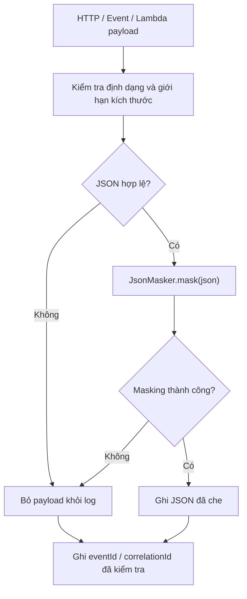

# Che dữ liệu JSON bằng JsonMasker và META-INF/mask.keys

## 1. Vì sao cần che dữ liệu trước khi ghi log?

**SPRING_CLOUD_FUNCTION (Spring Cloud Function)** cho phép đóng gói logic nghiệp vụ bằng `Supplier`, `Function` và `Consumer`, tra cứu qua `FunctionCatalog`, kết hợp các hàm bằng *composition* và triển khai cùng một function qua HTTP, messaging hoặc môi trường serverless. Cùng một function có thể chạy trong nhiều adapter, vì vậy dữ liệu đi qua hệ thống cũng có thể xuất hiện ở nhiều nơi: log ứng dụng, log của nền tảng serverless, trace, dead-letter queue hoặc công cụ giám sát.

Một event đặt hàng có thể chứa dữ liệu nghiệp vụ và thông tin nhạy cảm:

```json
{
  "eventId": "evt-2026-0042",
  "orderId": "ORD-42",
  "customer": {
    "email": "lan@example.test",
    "phone": "+84901234567"
  },
  "payment": {
    "cardNumber": "4111111111111111",
    "cvv": "123"
  },
  "credentials": {
    "access_token": "eyJhbGciOi...",
    "apiKey": "provider-secret"
  }
}
```

Nếu log toàn bộ payload để điều tra lỗi, email, số điện thoại, số thẻ, CVV và token có thể bị lưu trong hệ thống log với quyền truy cập rộng hơn database nghiệp vụ. Một bản log có thể được export sang dịch vụ bên thứ ba, giữ lâu hơn dữ liệu gốc hoặc được nhiều nhóm hỗ trợ truy cập.

**Data masking** thay giá trị của các trường được chọn bằng một biểu diễn đã che trước khi ghi log. Spring Cloud Function cung cấp `JsonMasker` từ phiên bản **4.1** để hỗ trợ trường hợp này. `JsonMasker` có thể dùng trong bất kỳ module nào, không chỉ AWS Lambda; cơ chế hiện được tài liệu mô tả dành cho dữ liệu có cấu trúc như JSON. Các tên key cần che được khai báo trong resource `META-INF/mask.keys`.

### Mục tiêu học tập

Sau bài này, bạn có thể:

1. Giải thích vai trò và giới hạn của `JsonMasker` trong Spring Cloud Function.
2. Tạo resource `src/main/resources/META-INF/mask.keys` với nhiều key phân tách bằng dấu phẩy hoặc xuống dòng.
3. Dùng `JsonMasker.INSTANCE()` để tạo chuỗi JSON an toàn hơn trước khi log.
4. Áp dụng cùng cách che dữ liệu trong function xử lý HTTP, event/message và AWS Lambda.
5. Phân biệt che JSON body với che HTTP headers, Spring `MessageHeaders`, exception và các log khác.
6. Thiết kế hành vi fail-safe khi JSON không hợp lệ hoặc quá trình masking thất bại.
7. Kiểm thử nội dung đã che và xác minh resource được đóng gói trong artifact.
8. Xây dựng danh mục dữ liệu nhạy cảm và kiểm tra masking khi schema thay đổi.

## 2. JsonMasker làm gì?

Tài liệu Spring Cloud Function giới thiệu `JsonMasker` nhằm hỗ trợ che thông tin nhạy cảm trong các packet/payload có thể xuất hiện trong log, ban đầu tập trung vào AWS Lambda. API được tài liệu minh họa:

```java
private static final JsonMasker MASKER = JsonMasker.INSTANCE();

String masked = MASKER.mask(
        new String(payload, StandardCharsets.UTF_8));

logger.info("Received: {}", masked);
```

Ý nghĩa của các thành phần:

| Thành phần | Vai trò |
|---|---|
| `META-INF/mask.keys` | Danh sách tên JSON key cần che, được đóng gói trên classpath |
| `JsonMasker.INSTANCE()` | Lấy instance dùng để thực hiện masking |
| `mask(json)` | Nhận chuỗi JSON và trả về chuỗi JSON đã che những key được cấu hình |
| `logger.info(...)` | Ghi kết quả đã che thay vì ghi raw payload |

Ví dụ tài liệu chính thức dùng resource:

```text
eventSourceARN
asdf1, SS
```

Các key có thể phân tách bằng **dấu phẩy**, **dòng mới** hoặc kết hợp cả hai. Trong ví dụ trên có ba key: `eventSourceARN`, `asdf1` và `SS`.

### 2.1. JsonMasker không tự động chặn mọi log

Điểm quan trọng nhất khi sử dụng là `JsonMasker` không phải một bộ lọc log toàn cục. Tài liệu minh họa việc gọi `masker.mask(...)` rõ ràng trước câu lệnh log. Vì vậy:

- Log payload qua `JsonMasker` thì các key đã khai báo mới được xử lý.
- Log trực tiếp object, raw JSON hoặc byte array ở một câu lệnh khác vẫn có thể lộ dữ liệu.
- Log HTTP header, Spring `MessageHeaders`, exception, trace attribute hoặc SQL parameter không tự được che chỉ nhờ `mask.keys`.
- Một function khác, adapter khác hoặc thư viện log khác cũng không tự động dùng masker.

Hãy coi `JsonMasker` là một **công cụ che JSON tại điểm sử dụng**, không phải chính sách bảo vệ dữ liệu đã được áp dụng toàn hệ thống. Cần tìm tất cả vị trí có thể log payload và thống nhất helper/logging policy.

### 2.2. JsonMasker không thay thế mã hóa hoặc kiểm soát truy cập

Masking giúp giảm khả năng đọc được giá trị gốc từ log. Nó không mã hóa payload để lưu hoặc truyền, xác thực người gọi function, xóa dữ liệu nhạy cảm khỏi request gốc/database/broker, thu hồi token đã lộ hoặc che key chưa được khai báo.

Nếu một credential đã bị ghi log ở dạng plaintext, phải xử lý như một sự cố lộ secret: revoke/rotate và kiểm tra nơi lưu log. Không xem việc bổ sung key vào `mask.keys` là biện pháp khắc phục cho bản log cũ.

## 3. Tạo META-INF/mask.keys

Tạo file đúng đường dẫn:

```text
src/
  main/
    resources/
      META-INF/
        mask.keys
```

Ví dụ nội dung:

```text
password
apiKey, authorization
access_token
refresh_token
cardNumber
cvv
email, phone
```

File trên yêu cầu masker che giá trị của các JSON key đã liệt kê. Mỗi key là tên trường trong JSON; không viết dạng `password=...` hoặc đưa giá trị bí mật vào file này.

### 3.1. Chọn key theo schema nghiệp vụ

| Nhóm dữ liệu | Key thường gặp |
|---|---|
| Xác thực | `password`, `token`, `access_token`, `refresh_token`, `authorization` |
| API credentials | `apiKey`, `clientSecret`, `secret` |
| Thanh toán | `cardNumber`, `pan`, `cvv`, `iban` |
| Cá nhân | `email`, `phone`, `mobile`, `ssn`, `nationalId` |
| Địa chỉ | `address`, `postalCode` |
| Dữ liệu định danh | `dateOfBirth`, `passportNumber` |

Danh sách này chỉ là điểm bắt đầu. Tên key trong hệ thống thực tế có thể khác, ví dụ `accessToken`, `access_token`, `tokenValue` hoặc `authorizationHeader`. Phải đối chiếu schema event, DTO và payload của từng provider để thêm tên đúng.

### 3.2. Cách phân tách key

Hai cách dưới đây tương đương về mục đích:

```text
# Mỗi key một dòng
password
access_token
refresh_token
cardNumber
```

```text
# Nhiều key trên một dòng, phân tách bằng dấu phẩy
password, access_token, refresh_token, cardNumber
```

Có thể kết hợp:

```text
password, access_token
refresh_token, cardNumber
email
```

Nên dùng một key trên một dòng trong file lớn để dễ review và giảm lỗi khi thêm/xóa. Không đưa comment, wildcard hoặc JSONPath vào resource trừ khi tài liệu của đúng phiên bản đang dùng xác nhận cú pháp đó; tài liệu hiện mô tả tên key được phân tách bằng comma/newline.

### 3.3. Key matching cần được kiểm thử

Tài liệu mô tả việc khai báo các key và che giá trị của các key đó, nhưng không cam kết đầy đủ các chi tiết như phân biệt chữ hoa/chữ thường, khớp key ở mọi cấp lồng nhau, hỗ trợ wildcard/regex/JSONPath, xử lý key trùng lặp/array/object hoặc placeholder cụ thể.

Vì vậy, **không suy đoán các tính năng này từ tên `mask.keys`**. Chọn tên key nhất quán, rồi viết test với đúng payload thật của ứng dụng và đúng phiên bản Spring Cloud Function. Nếu yêu cầu che theo đường dẫn cụ thể hoặc theo pattern phức tạp, cần một lớp masking bổ sung đã được kiểm thử.

## 4. Sử dụng JsonMasker trong Java

Spring Cloud Function minh họa việc lấy instance qua `JsonMasker.INSTANCE()` rồi gọi `mask(String)`. Ví dụ sau tập trung vào chuỗi JSON được tạo từ payload bytes:

```java
import java.nio.charset.StandardCharsets;

import org.slf4j.Logger;
import org.slf4j.LoggerFactory;

public final class SafePayloadLogger {

    private static final Logger log =
            LoggerFactory.getLogger(SafePayloadLogger.class);

    private static final int MAX_LOG_PAYLOAD_BYTES = 64 * 1024;

    // JsonMasker được cung cấp bởi Spring Cloud Function.
    // Dùng import tương ứng với phiên bản dependency của ứng dụng.
    private static final JsonMasker MASKER = JsonMasker.INSTANCE();

    private SafePayloadLogger() {}

    public static void logJson(byte[] payload) {
        if (payload == null || payload.length == 0) {
            log.warn("Event payload omitted because it is empty");
            return;
        }
        if (payload.length > MAX_LOG_PAYLOAD_BYTES) {
            log.warn("Event payload omitted because it exceeds the log size limit");
            return;
        }

        String json = new String(payload, StandardCharsets.UTF_8);

        try {
            String maskedJson = MASKER.mask(json);
            log.info("Received event: {}", maskedJson);
        }
        catch (RuntimeException ex) {
            // Không ghi raw JSON khi masking thất bại.
            // Không đính kèm exception nếu message/cause có thể chứa payload.
            log.warn("Received event; JSON payload omitted because masking failed");
        }
    }
}
```

Đây là helper minh họa. Ví dụ giả định caller đã xác định payload là JSON theo content type/contract và đã giới hạn kích thước trước khi đưa vào logger. Import chính xác của `JsonMasker` nên được IDE resolve từ Spring Cloud Function artifact đang dùng; tài liệu chính thức minh họa tên class và cách gọi `INSTANCE()` nhưng không đặt import trong snippet. Không tự tạo một class khác cùng tên trong package ứng dụng.

### 4.1. Vì sao dùng placeholder logging?

Nên viết:

```java
log.info("Received event: {}", maskedJson);
```

thay vì nối chuỗi:

```java
log.info("Received event: " + maskedJson);
```

Placeholder giúp logging framework chỉ format thông điệp khi log level được bật. Tuy nhiên, điều này **không thay thế masking**: đối số truyền vào logger vẫn phải là chuỗi đã che.

### 4.2. Giữ raw payload cho xử lý nghiệp vụ, chỉ che bản log

Masking thường chỉ dành cho log. Không ghi đè dữ liệu nghiệp vụ đang cần xử lý nếu hệ thống phải giữ nguyên giá trị hợp lệ để xác thực, thanh toán hoặc lưu trữ.

```java
public OrderResult process(byte[] payload) {
    String rawJson = new String(payload, StandardCharsets.UTF_8);

    // Chỉ dùng bản đã che cho log.
    SafePayloadLogger.logJson(payload);

    // Business processing tiếp tục dùng dữ liệu gốc theo contract.
    OrderEvent event = objectMapper.readValue(
            rawJson, OrderEvent.class);
    return orderService.process(event);
}
```

Không trả `maskedJson` vào message downstream nếu consumer cần giá trị thật. Ngược lại, nếu dữ liệu được chia sẻ với analytics/support hoặc môi trường không được phép thấy plaintext, cần tạo một DTO/export riêng đã loại bỏ dữ liệu nhạy cảm; không chỉ dựa vào việc log đã được che.

## 5. Áp dụng trong Spring Cloud Function

Một function có thể được gọi qua nhiều adapter. Đặt masking ở lớp logging/helper dùng chung giúp giảm việc mỗi function tự viết logic che khác nhau.

```java
package com.example.orders;

import java.util.function.Function;

import org.springframework.context.annotation.Bean;
import org.springframework.context.annotation.Configuration;

@Configuration
public class OrderFunctions {

    private final OrderService orderService;

    public OrderFunctions(OrderService orderService) {
        this.orderService = orderService;
    }

    @Bean
    public Function<byte[], OrderResult> processOrder() {
        return payload -> {
            SafePayloadLogger.logJson(payload);
            OrderEvent event = orderService.decode(payload);
            return orderService.process(event);
        };
    }
}
```

Ví dụ dùng `byte[]` để thể hiện rõ ranh giới giữa raw JSON và chuỗi đã che. Trong ứng dụng thực tế, function có thể nhận DTO; khi đó serialize DTO bằng mapper đang dùng trong ứng dụng, sau đó đưa chuỗi JSON vào `JsonMasker` trước khi log.

Nếu function nhận `Message<?>`, không log nguyên message:

```java
// Không nên:
log.info("Incoming message: {}", message);

// Nên:
SafePayloadLogger.logJson(payloadBytes); // bytes đã được xác định là JSON
log.debug("Received event with correlationId={}",
        validatedCorrelationId);
```

`MessageHeaders` có thể chứa authorization, token, routing metadata hoặc dữ liệu nhạy cảm khác. `JsonMasker` xử lý JSON payload; nó không tự lọc map header. Chỉ log những header đã được allowlist và kiểm tra.

### 5.1. Với function composition

Giả sử một pipeline:

```text
decodeOrder | validateOrder | processPayment | publishReceipt
```

Có thể đặt một bước logging/observability riêng ở đầu pipeline, nhưng bước đó phải dùng bản JSON đã che. Không copy raw payload vào header để “truyền cho logger” vì header có thể được giữ lại hoặc serialize qua adapter.

Nếu một function enrichment trả `Message` mới, hãy kiểm tra rõ header nào được giữ lại. Không giả định masking body đồng thời đã che header, hoặc ngược lại.

### 5.2. Không để raw payload lọt qua nhánh lỗi

Một lỗi thường gặp:

```java
try {
    log.info("Payload: {}", MASKER.mask(rawJson));
}
catch (Exception ex) {
    // Sai: fallback lại ghi dữ liệu chưa che.
    log.warn("Could not mask payload: {}", rawJson);
}
```

Hành vi đúng là bỏ nội dung payload khỏi log khi masking thất bại:

```java
try {
    log.info("Payload: {}", MASKER.mask(rawJson));
}
catch (RuntimeException ex) {
    log.warn("Payload omitted because masking failed");
}
```

Không đính kèm exception object nếu parser exception hoặc cause có thể chứa một phần JSON đầu vào. Có thể ghi error category đã chuẩn hóa, correlation ID và event ID đã kiểm tra để điều tra.

## 6. Áp dụng cho AWS Lambda và các adapter khác

Spring Cloud Function giới thiệu `JsonMasker` ban đầu để hỗ trợ tình huống payload AWS Lambda có thể xuất hiện trong log của nền tảng. Tuy vậy, tài liệu mô tả `JsonMasker` là công cụ generic, có thể dùng trong bất kỳ module nào.

Ví dụ Lambda handler nhận event bytes:

```java
public final class OrderLambdaHandler {

    public OrderResult handle(byte[] payload) {
        String json = new String(payload, StandardCharsets.UTF_8);
        SafePayloadLogger.logJson(payload);
        return processBusinessEvent(json);
    }
}
```

Đây là minh họa cách gọi thủ công. **Không hiểu nhầm rằng chỉ thêm resource `META-INF/mask.keys` là Lambda runtime tự động che mọi dòng log hoặc toàn bộ event.** Mọi câu lệnh ghi payload phải gọi masker hoặc đi qua helper đã được kiểm tra.

| Execution context | Vị trí áp dụng |
|---|---|
| Spring Cloud Function Web / HTTP | Trước log request body; lọc riêng HTTP headers |
| Spring Cloud Stream / Kafka / Rabbit | Trước log payload; lọc riêng message headers |
| AWS Lambda | Trước log event bytes/JSON trong handler hoặc helper |
| Function composition | Tại điểm logging đã thống nhất; không copy raw data sang header |
| Serverless adapter khác | Dùng cùng helper nếu payload là JSON; kiểm tra log do nền tảng tự phát sinh |

Nếu adapter hoặc cloud platform tự ghi raw payload trước khi code function được gọi, helper trong function không thể quay lại sửa log đã phát sinh. Cần kiểm tra cấu hình logging của adapter/runtime và tắt hoặc cấu hình lại các log raw không cần thiết.

## 7. JSON masking có những giới hạn nào?

`JsonMasker` được tài liệu mô tả cho **structured data such as JSON**. Không coi nó là công cụ che mọi loại nội dung.

| Dữ liệu | Dùng JsonMasker trực tiếp? | Cách xử lý |
|---|---|---|
| Chuỗi JSON hợp lệ | Có | Gọi `mask(json)` trước khi log |
| `byte[]` chứa UTF-8 JSON | Có, sau khi decode đúng charset | Chuyển thành String rồi mask |
| Java DTO | Không trực tiếp theo API được minh họa | Serialize thành JSON rồi mask |
| HTTP headers | Không | Allowlist/redact header riêng |
| Spring `MessageHeaders` | Không | Chỉ log header được phép |
| Plain text | Không phải phạm vi được tài liệu cam kết | Bỏ nội dung hoặc dùng cơ chế redaction riêng |
| XML, CSV, form-data, binary | Không | Dùng parser/masking strategy phù hợp định dạng |
| Exception / stack trace | Không | Chuẩn hóa error message, không đưa payload vào exception |
| Trace baggage / metric labels | Không | Chính sách lọc riêng cho telemetry |

### 7.1. Tên key không phải JSON path

Resource `META-INF/mask.keys` chứa tên key, ví dụ `email` hoặc `access_token`. Không tự suy ra rằng các cú pháp như:

```text
customer.email
payment.*
credentials[0].token
```

được hỗ trợ như JSONPath hoặc wildcard. Tài liệu chính thức chỉ cam kết danh sách key được phân tách bằng comma/newline. Nếu cần mask theo đường dẫn hoặc theo ngữ cảnh (ví dụ chỉ che `email` bên trong `customer` nhưng giữ `email` công khai ở nơi khác), cần kiểm thử tính năng thực tế của phiên bản hoặc dùng một giải pháp masking bổ sung.

### 7.2. Kiểm tra key lồng nhau và array

Payload thật thường có object lồng nhau và array:

```json
{
  "orderId": "ORD-42",
  "customers": [
    {
      "email": "one@example.test"
    },
    {
      "email": "two@example.test"
    }
  ]
}
```

Không chỉ kiểm thử JSON phẳng. Hãy thêm integration test cho:

- Key nằm ở object lồng nhau.
- Key nằm trong từng phần tử của array.
- Cùng tên key xuất hiện ở nhiều nhánh.
- Key có cách viết khác nhau như `accessToken` và `access_token`.
- Giá trị là string, number, boolean, null hoặc object/array.
- JSON có key trùng lặp hoặc cấu trúc không hợp lệ.

Tài liệu không mô tả toàn bộ quy tắc cho các trường hợp này. Kết quả test trên phiên bản dependency đang dùng là cơ sở để quyết định có thể dựa vào `JsonMasker` hay cần một lớp bổ sung.

### 7.3. Masking không đồng nghĩa với anonymization

Một số giá trị sau khi che vẫn có thể cho phép nhận diện gián tiếp:

- Giữ nguyên email domain, bốn số cuối thẻ hoặc một phần số điện thoại.
- Giữ nguyên order ID/customer ID có thể đối chiếu với dữ liệu khác.
- Giữ timestamp chính xác và địa chỉ hiếm có thể làm lộ danh tính.
- Một trường khác trong cùng payload có thể liên kết với người dùng.

Nếu log dùng cho analytics, chia sẻ bên ngoài hoặc lưu trữ dài hạn, hãy đánh giá cả khả năng tái nhận diện và dữ liệu liên kết. Với dữ liệu không cần thiết, **loại bỏ trường khỏi log** thường an toàn hơn che một phần giá trị.

## 8. Đóng gói và kiểm tra resource

`META-INF/mask.keys` phải có trên classpath runtime. Đặt file trong `src/main/resources/META-INF/mask.keys` để Maven/Gradle đóng gói vào artifact theo cấu trúc resource chuẩn.

Trước khi deploy:

1. Kiểm tra file có đúng tên và đúng đường dẫn, gồm cả chữ hoa/chữ thường.
2. Kiểm tra resource xuất hiện trong JAR/fat JAR được build.
3. Kiểm tra nội dung resource có đủ các key của schema đang triển khai.
4. Chạy test masking trên đúng artifact/dependency version.
5. Khi thêm key mới, review thay đổi như một thay đổi bảo mật và chạy lại negative tests.

Vì ví dụ API dùng `JsonMasker.INSTANCE()`, hãy coi danh sách key là cấu hình classpath được nạp cùng ứng dụng; không giả định sửa file ở ngoài container sẽ tự cập nhật instance đang chạy. Khi thay đổi resource, đóng gói và triển khai artifact mới, rồi xác minh lại.

### 8.1. Kiểm tra resource trên classpath bằng JUnit

```java
import static org.junit.jupiter.api.Assertions.assertNotNull;
import static org.junit.jupiter.api.Assertions.assertTrue;

import java.io.InputStream;
import java.nio.charset.StandardCharsets;

import org.junit.jupiter.api.Test;

class MaskKeysResourceTest {

    @Test
    void maskKeysMustBePackaged() throws Exception {
        try (InputStream input = getClass().getClassLoader()
                .getResourceAsStream("META-INF/mask.keys")) {

            assertNotNull(input,
                    "META-INF/mask.keys must be on the runtime classpath");

            String content = new String(
                    input.readAllBytes(), StandardCharsets.UTF_8);

            assertTrue(content.contains("password"));
            assertTrue(content.contains("access_token"));
        }
    }
}
```

Test này xác minh resource có mặt và có một số key bắt buộc. Trong dự án lớn, nên so sánh với danh sách key kỳ vọng hoặc kiểm tra tất cả key nhạy cảm theo contract để tránh một lần merge vô tình xóa entry.

## 9. Kiểm thử kết quả masking

Không nên kiểm tra một placeholder cụ thể nếu tài liệu của phiên bản không cam kết chuỗi thay thế. Hãy kiểm tra hai điều:

1. Giá trị nhạy cảm ban đầu không còn trong chuỗi được log.
2. Dữ liệu không nhạy cảm cần cho điều tra vẫn còn.

Ví dụ:

```java
import static org.junit.jupiter.api.Assertions.assertFalse;
import static org.junit.jupiter.api.Assertions.assertTrue;

import com.fasterxml.jackson.databind.JsonNode;
import com.fasterxml.jackson.databind.ObjectMapper;
import org.junit.jupiter.api.Test;

class JsonMaskerTest {

    private final ObjectMapper objectMapper = new ObjectMapper();
    private final JsonMasker masker = JsonMasker.INSTANCE();

    @Test
    void masksConfiguredTopLevelKeysAndKeepsUsefulFields()
            throws Exception {

        String rawJson = """
            {
              "orderId": "ORD-42",
              "password": "secret-password-value",
              "access_token": "secret-access-token"
            }
            """;

        String maskedJson = masker.mask(rawJson);

        assertFalse(maskedJson.contains("secret-password-value"));
        assertFalse(maskedJson.contains("secret-access-token"));

        JsonNode result = objectMapper.readTree(maskedJson);
        assertTrue(result.path("orderId").asText().equals("ORD-42"));
    }
}
```

Test giả định `password` và `access_token` đã được khai báo trong `META-INF/mask.keys`. Không kiểm tra chính xác mask placeholder; kiểm tra nội dung bí mật không còn là mục tiêu quan trọng hơn.

Đoạn test dùng package Jackson 2 `com.fasterxml.jackson.databind` để đọc lại JSON. Nếu ứng dụng dùng Spring Boot 4/Jackson 3, hãy dùng package Jackson 3 tương ứng hoặc parser đã được ứng dụng cấu hình.

### 9.1. Kiểm tra log thực tế, không chỉ chuỗi trả về

Một unit test của `JsonMasker` không chứng minh ứng dụng không còn câu lệnh log raw payload. Cần thêm test ở helper hoặc logging boundary:

- Tạo payload có marker nhạy cảm giả, ví dụ `MASK_TEST_SECRET_42`.
- Gọi đúng function/helper được production sử dụng.
- Thu log bằng appender test.
- Xác minh marker không xuất hiện trong log message hoặc throwable/cause.
- Xác minh event ID/correlation ID đã allowlist vẫn có thể dùng để điều tra.
- Khi masking lỗi hoặc resource thiếu, log chỉ có thông báo cố định và không chứa payload.

Không dùng credential production trong test. Dùng dữ liệu giả có marker dễ tìm để tránh vô tình tạo thêm một bản secret thật trong test report.

### 9.2. Kiểm tra schema thay đổi

Khi producer thêm trường mới như `bankAccount` hoặc đổi `apiKey` thành `providerCredential`, masking cũ có thể không nhận diện key mới. Vì vậy:

- Review diff schema/event contract và diff `mask.keys` cùng nhau.
- Thêm test cho từng trường nhạy cảm mới.
- Có kiểm thử contract cho event version cũ và mới.
- Theo dõi log ở staging với dữ liệu giả có marker.
- Không bật log raw để “tìm xem có trường mới nào cần che”.

Nếu schema được nhiều producer chia sẻ, nhóm sở hữu contract nên công bố danh sách trường nhạy cảm và yêu cầu consumer cập nhật policy trước khi phát hành.

## 10. Quy trình logging an toàn

Một luồng logging nên có thứ tự rõ ràng:



Các nguyên tắc:

1. Xác định payload có phải JSON và dùng đúng charset (thường là UTF-8 theo contract).
2. Áp dụng giới hạn kích thước trước khi parse/mask để tránh payload quá lớn làm cạn bộ nhớ hoặc CPU.
3. Chỉ ghi chuỗi trả về từ `masker.mask`.
4. Nếu parse/masking thất bại, không fallback sang raw payload.
5. Chỉ thêm metadata đã được allowlist và xác thực, chẳng hạn event ID hoặc correlation ID.
6. Không ghi raw body vào exception, retry log hoặc dead-letter diagnostic.
7. Kiểm tra logging ở gateway, adapter, SDK và nền tảng serverless để tránh một đường log khác ghi cùng payload.

Masking không thay thế việc giới hạn quyền truy cập log, retention, encryption at rest và audit. Một chuỗi đã che vẫn có thể chứa thông tin nhạy cảm còn sót lại hoặc metadata có thể tái nhận diện.

## 11. Tích hợp masking vào quy trình vận hành

Để masking có hiệu lực ổn định, cần coi `mask.keys` là một phần của chính sách logging và quy trình thay đổi schema, không phải một file cấu hình phụ có thể quên cập nhật.

### 11.1. Phân công trách nhiệm

| Vai trò | Trách nhiệm |
|---|---|
| Chủ sở hữu event/schema | Đánh dấu trường nhạy cảm trong contract và thông báo khi đổi tên/thêm field |
| Nhóm phát triển function | Gọi helper masking ở mọi điểm log payload, không log raw message |
| Nhóm nền tảng/observability | Kiểm tra log của adapter, Lambda/runtime, gateway và telemetry |
| Reviewer | Kiểm tra thay đổi `mask.keys` đi cùng schema và test |
| Vận hành | Theo dõi log leakage, xử lý sự cố và rotation nếu credential bị lộ |

### 11.2. Cập nhật key khi schema thay đổi

Ví dụ producer đổi schema:

```json
{
  "payment": {
    "apiKey": "old-name-secret"
  },
  "providerCredential": "new-name-secret"
}
```

Nếu `mask.keys` chỉ có `apiKey`, field `providerCredential` có thể bị log nguyên giá trị. Khi đổi tên field:

1. Thêm tên key mới vào resource trước hoặc cùng release với producer.
2. Giữ tên key cũ trong giai đoạn hỗ trợ event version cũ.
3. Thêm test cho cả payload version cũ và mới.
4. Triển khai consumer có policy masking trước khi producer phát event mới.
5. Chỉ xóa key cũ khi không còn payload/log path cần hỗ trợ.

Không dựa vào việc tên field “có vẻ bí mật” hoặc chứa từ `secret` để tự được che; khai báo key tường minh và kiểm thử.

### 11.3. Quản lý resource giữa nhiều module

Trong ứng dụng nhiều module hoặc nhiều JAR, cần xác định module nào sở hữu resource `META-INF/mask.keys`. Nếu nhiều dependency cùng đóng gói resource có cùng đường dẫn, cách class loader tìm/đọc resource có thể phụ thuộc cách đóng gói và cách triển khai; tài liệu JsonMasker không mô tả quy tắc hợp nhất các file trùng tên.

Khuyến nghị:

- Đặt danh sách key chính ở module ứng dụng/runtime chịu trách nhiệm logging.
- Tránh để từng library phụ thuộc tự mang một policy khác mà không được review.
- Kiểm tra resource cuối cùng trong executable/fat JAR hoặc image đã build.
- Nếu cần hợp nhất danh sách từ nhiều module, tạo một bước build rõ ràng để sinh một resource kết quả.
- Có test kiểm tra các key bắt buộc sau khi đóng gói artifact.

### 11.4. Quan sát việc masking mà không lộ dữ liệu

Có thể ghi metadata để biết masking đã chạy:

```text
eventId=evt-2026-0042
payloadFormat=json
maskingStatus=applied
maskingPolicyVersion=2026-11
```

Không ghi raw JSON, giá trị gốc, hash của password hoặc token để “xác nhận đã che”. Nếu cần xác định policy version, dùng một version identifier không nhạy cảm được quản lý trong release.

## 12. Những sai lầm phổ biến

| Sai lầm | Rủi ro | Cách xử lý |
|---|---|---|
| Nghĩ chỉ cần thêm `META-INF/mask.keys` là mọi log tự được che | JsonMasker phải được gọi ở điểm ghi payload | Dùng helper logging và tìm toàn bộ log raw |
| Ghi raw payload trong catch khi masking lỗi | Nhánh lỗi làm lộ chính dữ liệu cần bảo vệ | Fail closed: bỏ payload khỏi log |
| Chỉ mask HTTP body | Header, message metadata, exception và trace vẫn có thể lộ | Chính sách riêng cho từng kênh dữ liệu |
| Cho rằng mọi key có chữ `token` đều tự động được nhận diện | Masking dựa trên key được cấu hình | Liệt kê tên key thực tế trong resource |
| Dùng wildcard/JSONPath mà chưa xác minh | Có thể không khớp như mong đợi | Chỉ dùng cú pháp đã được tài liệu/test xác nhận |
| Chỉ test JSON phẳng | Key lồng nhau/array có thể chưa được che như kỳ vọng | Test payload đúng schema thực |
| Kiểm tra đúng chuỗi placeholder cố định | Placeholder có thể khác theo phiên bản | Assert giá trị gốc không còn và JSON vẫn dùng được |
| Chỉ kiểm tra unit test của masker | Code khác vẫn có thể log raw payload | Test log thực tế qua helper/adapter |
| Quên cập nhật key khi schema đổi tên | Trường mới có thể bị log plaintext | Review schema và mask.keys cùng nhau |
| Cho rằng Lambda tự mask payload | Runtime không tự dùng resource cho mọi log | Gọi masker trước log và kiểm tra log do nền tảng tạo |
| Dùng JsonMasker cho XML/plain text | Ngoài phạm vi JSON được tài liệu mô tả | Dùng cơ chế phù hợp định dạng |
| Xem masking là mã hóa/anonymization | Giá trị có thể còn suy ra được hoặc bị lộ ở nơi khác | Kết hợp data minimization, access control, encryption |
| Chia sẻ resource khác nhau giữa nhiều JAR mà không test | Resource trùng tên có thể không được hợp nhất như dự kiến | Một resource chính và test artifact cuối |
| Log cả DTO trước khi serialize/mask | `toString()` có thể chứa field nhạy cảm | Serialize và mask trước khi log |

## 13. Bài tập thực hành

Một function `processPayment` nhận event JSON qua HTTP hoặc Kafka, xử lý giao dịch và trả kết quả. Payload chứa email, số điện thoại, số thẻ, CVV, access token và order ID.

1. Tạo `src/main/resources/META-INF/mask.keys` với các key nhạy cảm đúng theo schema event.
2. Viết helper dùng `JsonMasker.INSTANCE()` và `mask(String)` để tạo JSON dành riêng cho log.
3. Bảo đảm helper không ghi raw payload nếu JSON không hợp lệ hoặc masking thất bại.
4. Giữ raw payload cho business processing nhưng chỉ log chuỗi đã che.
5. Gọi helper từ function Spring Cloud Function và từ một handler AWS Lambda thử nghiệm.
6. Kiểm tra riêng HTTP headers, Spring `MessageHeaders`, exception và trace; xác định dữ liệu nào cần allowlist/redact riêng.
7. Viết JUnit test cho các key phẳng như `password` và `access_token`; xác minh giá trị gốc không xuất hiện.
8. Viết test với JSON lồng nhau và array để xác nhận hành vi của đúng phiên bản thư viện.
9. Viết test xác minh resource `META-INF/mask.keys` được đóng gói trong JAR cuối cùng.
10. Thay đổi schema bằng cách đổi `apiKey` thành `providerCredential`; cập nhật resource và test trước khi phát hành producer.
11. Thu log trong integration test và xác nhận marker giả không xuất hiện trong message, throwable hoặc output của adapter.
12. Tạo runbook khi phát hiện token đã bị ghi log: revoke/rotate, xác định log stores, kiểm tra truy cập và cập nhật policy.

### Câu hỏi tự kiểm tra

1. Từ phiên bản nào Spring Cloud Function giới thiệu `JsonMasker`?
2. Resource `META-INF/mask.keys` phải nằm ở đâu để được đọc từ classpath?
3. Có thể phân tách key bằng những ký tự nào?
4. Vì sao thêm file mask.keys không đồng nghĩa mọi câu lệnh log tự động được bảo vệ?
5. Vì sao cần che payload trước khi ghi log nhưng vẫn có thể giữ raw payload cho xử lý nghiệp vụ?
6. Vì sao không nên log raw JSON trong nhánh catch khi masking thất bại?
7. `JsonMasker` có tự che HTTP headers hoặc Spring `MessageHeaders` không?
8. Vì sao cần test key lồng nhau, array và tên key có cách viết khác nhau?
9. Nếu producer đổi tên field nhạy cảm, consumer cần cập nhật điều gì trước khi nhận schema mới?
10. Vì sao masking không thay thế encryption, access control và data minimization?

## 14. Checklist trước khi production

| Hạng mục | Tiêu chí đạt |
|---|---|
| Phiên bản Spring Cloud Function hỗ trợ JsonMasker? | Có, từ 4.1 trở lên |
| Resource `META-INF/mask.keys` nằm đúng classpath? | Có |
| Danh sách key được đối chiếu với event/DTO schema? | Có |
| Có key cho token, password, API key, PII và payment data cần thiết? | Có |
| Function/helper gọi `masker.mask` trước khi log? | Có |
| Không có câu lệnh log raw payload hoặc DTO chứa secret? | Có kiểm tra |
| Khi masking lỗi, payload bị bỏ khỏi log? | Có |
| HTTP headers và MessageHeaders được xử lý riêng? | Có |
| Nested object, arrays, key casing đã được test? | Có |
| Resource đã được xác minh trong artifact cuối? | Có |
| Test log thực tế không chứa marker nhạy cảm? | Có |
| Schema change đi kèm cập nhật mask.keys và test? | Có |
| Log access, retention, encryption và audit đã được cấu hình? | Có |
| Có runbook xử lý secret/PII bị ghi log? | Có |

## 15. Tổng kết và tài liệu tham khảo

**`JsonMasker` là công cụ che giá trị của các key trong JSON trước khi ứng dụng ghi log.** Spring Cloud Function giới thiệu công cụ này từ phiên bản 4.1; key được khai báo trong resource `META-INF/mask.keys`, phân tách bằng dấu phẩy hoặc xuống dòng. Mã ứng dụng lấy instance bằng `JsonMasker.INSTANCE()` và gọi `mask(String)` trên chuỗi JSON.

Điều quan trọng là masking phải được gọi rõ ràng ở mọi điểm ghi payload. File `mask.keys` không tự động lọc mọi log, header, exception hoặc trace; khi masking thất bại, không fallback sang raw payload. Hãy kiểm thử resource trên artifact cuối, payload lồng nhau/array, schema evolution và log thực tế. Kết hợp masking với data minimization, quyền truy cập log, retention, encryption và quy trình revoke/rotate khi phát hiện secret bị lộ.

**Tài liệu chính thức:**

- [Spring Cloud Function — Programming Model](https://docs.spring.io/spring-cloud-function/reference/spring-cloud-function/programming-model.html) — mục Data Masking, `JsonMasker`, `META-INF/mask.keys` và ví dụ `INSTANCE().mask(...)`.
- [Spring Cloud Function 4.3 — Programming Model](https://docs.spring.io/spring-cloud-function/reference/4.3/spring-cloud-function/programming-model.html) — đối chiếu tài liệu dòng 4.x có giới thiệu JsonMasker từ 4.1.
- [Spring Cloud Function 5.0 — Programming Model](https://docs.spring.io/spring-cloud-function/reference/5.0/spring-cloud-function/programming-model.html) — đối chiếu tài liệu dòng 5.x.
