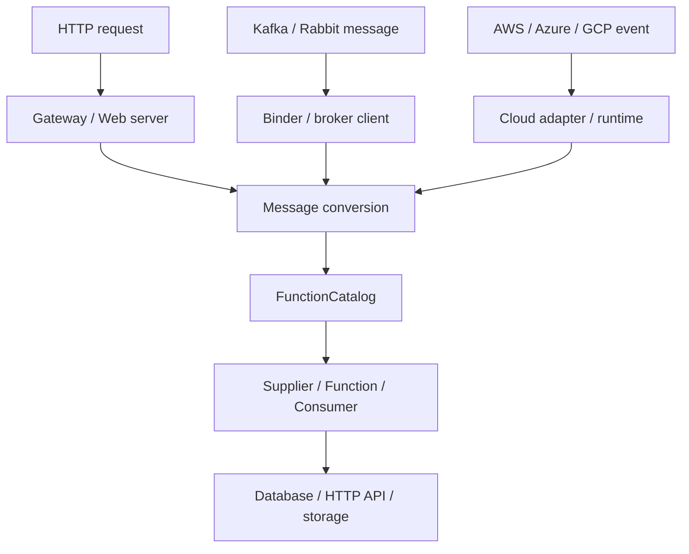
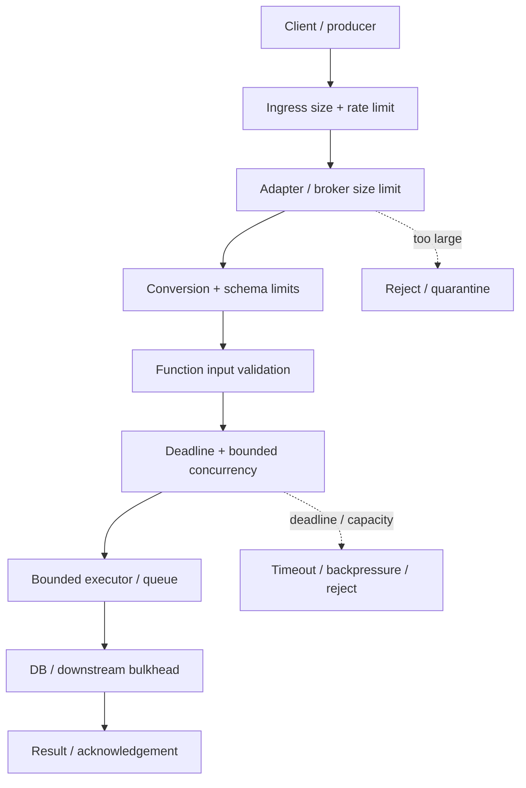

# Giới hạn kích thước dữ liệu, thời gian xử lý và mức đồng thời

## 1. Vì sao một function cần ngân sách tài nguyên rõ ràng?

Một dịch vụ Spring Cloud Function nhận sự kiện đơn hàng, chuyển JSON thành DTO, gọi cơ sở dữ liệu và phát kết quả sang broker. Khi tải bình thường, mọi thứ chạy ổn. Nhưng một client gửi payload lớn gấp hàng trăm lần bình thường, một message chứa hàng triệu phần tử, một downstream API phản hồi rất chậm hoặc một đợt traffic tăng đột ngột có thể làm ứng dụng cạn heap, giữ thread quá lâu, tăng consumer lag và kéo theo lỗi ở các dịch vụ khác.

Các sự cố thường bắt đầu từ một trong ba nguyên nhân:

- **Dữ liệu quá lớn:** body HTTP, message, batch, file hoặc dữ liệu sau giải nén vượt quá khả năng xử lý.
- **Thời gian xử lý quá dài:** function chờ database, HTTP client, lock, thuật toán CPU hoặc stream không kết thúc.
- **Mức đồng thời quá cao:** nhiều invocation cùng giữ bộ nhớ, thread, connection pool, CPU hoặc tài nguyên downstream.

Ba giới hạn này liên hệ trực tiếp với nhau. Một message lớn làm mỗi invocation tiêu thụ nhiều heap hơn; nhiều invocation cùng chạy làm tổng heap tăng; khi downstream chậm, invocation tồn tại lâu hơn và mức đồng thời thực tế tiếp tục tăng.

Bài thuộc chương **Bảo mật** của module **SPRING_CLOUD_FUNCTION**. Module phát triển logic nghiệp vụ tái sử dụng bằng `Supplier`, `Function` và `Consumer`, sử dụng `FunctionCatalog`, composition và message conversion để chạy cùng một hàm qua HTTP, sự kiện hoặc serverless. Vì vậy, giới hạn phải được thiết kế xuyên suốt từ adapter, converter, broker, function cho tới runtime và dịch vụ downstream.

Sau bài này, bạn có thể đặt giới hạn dữ liệu ở đúng tầng, thiết kế deadline cho toàn luồng, tính mức đồng thời từ năng lực thực tế, giới hạn hàng đợi và connection pool, kiểm thử tình huống quá tải và theo dõi dấu hiệu cạn tài nguyên.

## 2. Spring Cloud Function không đặt một giới hạn chung cho mọi adapter

Spring Cloud Function chuẩn hóa các bean `Supplier`, `Function` và `Consumer` qua `FunctionCatalog`. Catalog hỗ trợ các chữ ký hàm và cơ chế như conversion/composition, nhưng không tự đặt một giới hạn payload, deadline hay concurrency áp dụng cho mọi môi trường.

Cùng một function có thể được gọi qua nhiều đường:



Mỗi tầng có thể có giới hạn riêng:

| Tầng | Giới hạn cần xem |
| --- | --- |
| API gateway/load balancer | Request body, header, connection, timeout, rate |
| HTTP server | Kết nối, thread, form/multipart, codec buffering |
| Cloud adapter/runtime | Invocation payload, timeout, memory, concurrency |
| Broker | Message/batch size, queue length, fetch, retention |
| Spring Cloud Stream binder | Consumer concurrency, batch, retry, backoff |
| Message converter | Bộ nhớ dùng khi aggregate/deserialize |
| Business function | Số phần tử, độ sâu, thời gian CPU, thuật toán |
| Executor/connection pool | Thread, queue, DB/API connections |
| Downstream service | Quota, rate limit, timeout, số kết nối |

Một cấu hình có tên `max-size` ở một tầng không có nghĩa mọi đường vào đã được bảo vệ. Ví dụ, giới hạn multipart không tự giới hạn JSON body; `max.poll.records` giới hạn số record mỗi poll, không giới hạn byte của một record; timeout HTTP không tự dừng một tác vụ đã tiếp tục chạy ở background.

**Nguyên tắc:** giới hạn tại nơi dữ liệu hoặc công việc đi vào, rồi kiểm tra lại ở nơi tiêu thụ tài nguyên đắt tiền. Đừng chỉ dựa vào một lớp bảo vệ ở cuối pipeline.

## 3. Nhận diện các kiểu cạn tài nguyên và lạm dụng

| Tình huống | Tác động chính | Ví dụ |
| --- | --- | --- |
| Oversized payload | Heap/direct memory, network, GC | JSON 50 MB được parse thành object graph lớn |
| Decompression bomb | CPU, disk và bộ nhớ sau giải nén | File nén nhỏ bung thành nhiều GB |
| Deep/nested JSON | CPU và stack/parser | JSON lồng nhau hàng nghìn cấp |
| Huge collection | Object count và GC | Mảng có hàng triệu phần tử |
| Slow request | Connection/thread bị giữ lâu | Client gửi body rất chậm |
| Slow downstream | Invocation sống lâu, concurrency tăng | Database query chờ lock |
| Infinite stream | Subscription và tài nguyên không kết thúc | Flux không có điều kiện dừng |
| Unbounded queue | Bộ nhớ tăng theo backlog | Thread pool nhận task nhanh hơn khả năng xử lý |
| Retry storm | Tăng tải đúng lúc hệ thống đang lỗi | Message retry liên tục khi DB mất kết nối |
| High fan-out | Khuếch đại số request | Một event gọi 30 API downstream |
| Batch quá lớn | Heap và thời gian xử lý mỗi poll | Một batch chứa hàng nghìn record lớn |
| Tenant monopolization | Một khách hàng chiếm hết capacity | Một API key gửi phần lớn request |

Không phải mọi trường hợp đều là tấn công có chủ ý. Lỗi producer, vòng lặp không giới hạn, retry sai cấu hình hoặc một batch bất thường cũng có thể gây cùng hậu quả.

## 4. Tính ngân sách bộ nhớ và concurrency trước khi cấu hình

Một phép tính đơn giản giúp nhận diện giới hạn không hợp lý:

```text
M_peak ≈ M_base + C × M_request + M_queue + M_shared
```

Trong đó:

- `M_base`: heap, cache, Spring context và dữ liệu nền.
- `C`: số invocation đồng thời trong một instance.
- `M_request`: working set của một invocation, bao gồm payload đã parse, DTO, buffer và object tạm.
- `M_queue`: bộ nhớ giữ task/message đang chờ.
- `M_shared`: connection pool, cache, buffer dùng chung và overhead khác.

`M_request` thường lớn hơn kích thước JSON trên wire. Parser có thể tạo nhiều object; chuỗi, collection, map, buffer và bản sao dữ liệu đều tiêu thụ bộ nhớ. Hệ số khuếch đại phụ thuộc cấu trúc payload, JVM, serializer và code. Hãy đo bằng heap profile hoặc load test, không dùng một hệ số cố định cho mọi ứng dụng.

### 4.1. Ví dụ tính giới hạn trong một instance

Giả sử một instance có:

- Heap thực dùng cho ứng dụng: 1.024 MB.
- Baseline và cache: 420 MB.
- Phần dự phòng cho GC, buffer và biến động: 250 MB.
- Working set đo được của một request lớn: 24 MB.

Phần còn lại dành cho request là:

```text
M_available = 1024 - 420 - 250 = 354 MB
C_memory = floor(354 / 24) = 14
```

Đây chưa phải concurrency cuối cùng. CPU, database pool, HTTP API quota hoặc latency SLO có thể buộc giới hạn thấp hơn. Không đặt concurrency bằng đúng giá trị lý thuyết mà không có headroom.

### 4.2. Dùng Little's Law để ước lượng invocation đang hoạt động

Với tải ổn định:

```text
L = λ × W
```

- `L`: số request trung bình đang ở trong hệ thống.
- `λ`: tốc độ request đến, tính bằng request/giây.
- `W`: thời gian trung bình một request ở trong hệ thống, tính bằng giây.

Nếu service nhận 40 request/giây và thời gian xử lý trung bình là 0,25 giây:

```text
L = 40 × 0.25 = 10
```

Trung bình có khoảng 10 request đang xử lý. Khi downstream chậm khiến thời gian tăng lên 2 giây, số request đang hoạt động ở cùng tốc độ đến tăng lên 80. Nếu không giới hạn concurrency, memory, thread và connection pool có thể cạn trước khi autoscaling bắt kịp.

Đây là ước lượng cho tải ổn định, không phải bảo đảm cho burst hoặc tail latency. Hãy dùng thêm p95/p99, burst profile và headroom.

## 5. Sơ đồ các lớp giới hạn



Các lớp này bảo vệ những tài nguyên khác nhau. Nếu request bị gateway từ chối trước khi vào JVM, ứng dụng không cần deserialize nó. Nếu message đã được broker giao vào consumer, cần kiểm tra size/batch ở broker và binder. Nếu function gọi downstream, cần bulkhead/timeout tại client đó.

## 6. Giới hạn HTTP request: phân biệt body, header, form và multipart

Spring Boot có nhiều property cho embedded server, nhưng không phải property nào cũng giới hạn toàn bộ HTTP body.

| Property | Phạm vi | Không nên hiểu nhầm |
| --- | --- | --- |
| `server.max-http-request-header-size` | Header request | Không giới hạn body |
| `server.tomcat.max-http-form-post-size` | Form content trong POST | Không phải giới hạn tổng quát cho mọi JSON body |
| `server.tomcat.max-swallow-size` | Lượng body Tomcat swallow sau khi request bị từ chối/đóng | Không phải hard cap toàn bộ body |
| `spring.servlet.multipart.max-file-size` | Kích thước một file multipart | Không giới hạn JSON request |
| `spring.servlet.multipart.max-request-size` | Tổng multipart request | Chỉ dành cho multipart |
| `spring.http.codecs.max-in-memory-size` | Số byte được buffer khi WebFlux cần aggregate input stream | Không phải hard cap cho mọi stream body |

### 6.1. Spring MVC/Servlet: giới hạn multipart

Ví dụ cấu hình:

```yaml
spring:
  servlet:
    multipart:
      enabled: true
      max-file-size: 5MB
      max-request-size: 6MB
      file-size-threshold: 0B

server:
  tomcat:
    max-http-form-post-size: 2MB
    max-part-count: 10
    max-part-header-size: 1KB
```

Đây là ví dụ cho endpoint nhận multipart. Các property của Tomcat về form/part chỉ áp dụng theo phạm vi được tài liệu server mô tả. Nếu endpoint nhận raw JSON hoặc octet stream, hãy đặt giới hạn ở gateway/ingress và tầng đọc body tương ứng.

### 6.2. WebFlux: giới hạn codec aggregation và multipart

```yaml
spring:
  http:
    codecs:
      max-in-memory-size: 1MB
  webflux:
    multipart:
      max-in-memory-size: 256KB
      max-parts: 10
      max-headers-size: 10KB
      max-disk-usage-per-part: 5MB
```

`spring.http.codecs.max-in-memory-size` áp dụng cho auto-configured WebFlux server và WebClient khi input stream cần được aggregate; nếu không cấu hình, từng codec có giới hạn mặc định riêng, nhiều codec ở mức 256 KB. Với multipart, giới hạn memory per part khác giới hạn disk usage per part và tổng request.

**Đừng tăng max-in-memory-size chỉ để làm hết lỗi `DataBufferLimitException`.** Hãy xác định vì sao endpoint cần aggregate dữ liệu lớn. Nếu payload vốn là stream, xử lý theo luồng và giới hạn tổng byte bằng một cơ chế streaming rõ ràng.

### 6.3. Body có thể không có Content-Length

Header `Content-Length` hữu ích để từ chối sớm request quá lớn, nhưng client có thể gửi chunked body hoặc stream không có độ dài biết trước. Không dùng header này làm bằng chứng duy nhất.

Ở tầng đọc body, cần đếm byte thực tế và dừng khi vượt ngưỡng. Nếu có compression, đặt giới hạn cả kích thước wire và kích thước sau giải nén. Giới hạn header/body tại proxy vẫn cần thiết để tránh ứng dụng phải đọc dữ liệu không hợp lệ.

### 6.4. Tránh parse xong mới kiểm tra kích thước

Nếu ứng dụng deserialize toàn bộ JSON thành một object graph rồi mới đếm số phần tử, phần lớn chi phí đã phát sinh. Hãy kiểm tra byte trước khi parse, giới hạn cấu trúc parser khi phù hợp, và kiểm tra số phần tử/độ sâu ngay trong quá trình đọc hoặc validate.

Với file lớn, cân nhắc upload trực tiếp tới object storage bằng URL có thời hạn; function chỉ nhận object key, metadata và quyền truy cập tối thiểu. Tránh đưa file hàng trăm MB qua một HTTP body rồi buffer toàn bộ trong JVM.

## 7. Giới hạn cấu trúc payload, không chỉ số byte

Một JSON nhỏ vẫn có thể tốn nhiều CPU hoặc bộ nhớ khi parse. Ví dụ:

```json
{
  "orders": [
    {"id": "1", "items": ["..."]},
    {"id": "2", "items": ["..."]}
  ]
}
```

Đặt giới hạn theo miền nghiệp vụ:

| Thuộc tính | Ví dụ giới hạn | Lý do |
| --- | --- | --- |
| Tổng byte | 1 MB | Ngăn body lớn |
| Số phần tử trong array | 500 | Giới hạn vòng lặp và object |
| Độ sâu nesting | 32 cấp | Tránh parser/logic đệ quy quá sâu |
| Độ dài string | 4.096 ký tự | Giảm memory và xử lý bất thường |
| Số trường | Theo schema | Tránh payload có quá nhiều field |
| Số file multipart | 10 | Giới hạn file handle và disk |
| Kích thước sau giải nén | Theo use case | Ngăn decompression bomb |
| Số lệnh/operation trong batch | 100 | Giới hạn fan-out |
| Số lần gọi downstream | Theo workflow | Ngăn amplification |

Các con số trong bảng chỉ là ví dụ. Chọn theo contract và đo trên workload thực tế.

### 7.1. Validate input ngay tại ranh giới function

Ví dụ function nhận một DTO:

```java
public record BulkOrderRequest(
        List<OrderCommand> orders) {}

@Bean
Function<BulkOrderRequest, List<OrderResult>> processOrders(
        OrderService service) {

    return request -> {
        if (request == null || request.orders() == null) {
            throw new IllegalArgumentException("orders is required");
        }
        if (request.orders().isEmpty() || request.orders().size() > 100) {
            throw new IllegalArgumentException(
                    "orders must contain between 1 and 100 items");
        }

        return request.orders().stream()
                .map(service::process)
                .toList();
    };
}
```

Đây là validation nghiệp vụ ở function boundary. Nó không thay giới hạn byte ở ingress: DTO chỉ được tạo sau khi body đã được đọc và chuyển đổi. Nếu mỗi item chứa nhiều field hoặc chuỗi lớn, cần giới hạn thêm các field đó.

### 7.2. Kiểm soát độ phức tạp thuật toán

Một payload có số phần tử vừa phải vẫn có thể gây CPU exhaustion nếu xử lý có độ phức tạp cao. Ví dụ lồng hai vòng lặp trên 20.000 phần tử có thể tạo hàng trăm triệu phép so sánh.

- Ưu tiên thuật toán có độ phức tạp dự đoán được.
- Đặt giới hạn cho số item, độ sâu và số bước xử lý.
- Tránh regex có thể backtracking quá mức với input không tin cậy.
- Đặt timeout cho truy vấn và xử lý tìm kiếm.
- Không cho client điều khiển kích thước truy vấn hoặc số lần fan-out không giới hạn.

## 8. Message size và batch size trong Spring Cloud Stream

Một function được bind qua Spring Cloud Stream nhận message qua binder. Giới hạn có thể nằm ở producer, broker, topic, consumer fetch, batch hoặc conversion.

Với Kafka, cần phân biệt:

| Kafka setting | Tác dụng |
| --- | --- |
| `max.request.size` | Giới hạn request batch mà producer gửi |
| `message.max.bytes` | Giới hạn record batch broker chấp nhận |
| `max.message.bytes` | Topic-level override của giới hạn record batch |
| `max.partition.fetch.bytes` | Byte tối đa broker trả cho mỗi partition trong fetch |
| `fetch.max.bytes` | Giới hạn tổng fetch response |
| `max.poll.records` | Số record tối đa trả về trong một lần poll |
| `fetch.min.bytes` / `fetch.max.wait.ms` | Ảnh hưởng gom dữ liệu và thời gian chờ fetch |

Các fetch byte limit của Kafka có những ngoại lệ để consumer vẫn có thể tiến triển khi record batch đầu tiên lớn hơn giới hạn. Không xem chúng như một hard cap tuyệt đối cho mọi trường hợp. Broker và topic mới là nơi quyết định batch lớn nhất được chấp nhận; producer và consumer phải tương thích với kích thước đó.

### 8.1. Cấu hình Kafka consumer và batch

Ví dụ:

```yaml
spring:
  cloud:
    function:
      definition: classifyOrder
    stream:
      bindings:
        classifyOrder-in-0:
          destination: orders.created
          group: order-classifiers
          consumer:
            concurrency: 2
            batch-mode: true
            maxAttempts: 1
    kafka:
      binder:
        consumerProperties:
          max.poll.records: 25
```

`max.poll.records` giới hạn số record được trả về mỗi poll; `batch-mode` khiến binder chuyển các record nhận được thành một `List<?>` cho function. Số record không đồng nghĩa với số byte: 25 record nhỏ khác 25 record lớn.

Trong Kafka binder, retry bên trong binder không được hỗ trợ theo cách thông thường khi bật batch mode; `maxAttempts` bị ghi đè thành 1. Cần thiết kế batch error handler, manual ack/nack hoặc xử lý từng record phù hợp. Khi bật DLQ cho batch, hãy kiểm tra chính xác binder version và hành vi record trong poll được chuyển vào DLQ.

### 8.2. Cấu hình giới hạn producer Kafka

Ví dụ property Kafka producer được chuyển qua binder:

```yaml
spring:
  cloud:
    stream:
      kafka:
        bindings:
          classifyOrder-out-0:
            producer:
              configuration:
                max.request.size: 1048576
                compression.type: zstd
```

Tên property và đường dẫn binding cần khớp binder/version đang dùng. Ngoài producer, cần cấu hình broker/topic và consumer fetch tương thích. Tăng một giới hạn đơn lẻ có thể khiến producer gửi được nhưng consumer không xử lý nổi, hoặc broker từ chối message.

### 8.3. Batch là một bộ khuếch đại tài nguyên

Nếu một poll có `N` record và working set trung bình của mỗi record là `M`, bộ nhớ cho batch có thể xấp xỉ `N × M`, chưa kể buffer, object list và output. Một batch có 100 record, mỗi record tạo working set 2 MB có thể cần hàng trăm MB trong một thời điểm.

Giảm batch size giúp giảm peak memory và thời gian xử lý một poll, nhưng có thể giảm throughput. Đo cả memory, poll duration, consumer lag và số lần rebalance.
## 9. Giới hạn thời gian: một request có nhiều timeout khác nhau

Một luồng HTTP hoặc event-driven thường đi qua nhiều timeout:

1. Client connect timeout.
2. Gateway/load balancer idle hoặc request timeout.
3. HTTP server request timeout.
4. Adapter/runtime invocation timeout.
5. Thời gian chờ trong queue.
6. Function execution deadline.
7. Database query timeout.
8. Downstream HTTP connect/read/response timeout.
9. Broker poll/ack/visibility timeout.
10. Shutdown/grace period khi instance bị scale-in.

Nếu mỗi tầng tự đặt timeout mà không thống nhất, có thể xảy ra tình huống client đã timeout nhưng function vẫn tiếp tục chạy; gateway trả 504 trong khi database transaction vẫn commit; broker redeliver khi function cũ chưa dừng.

### 9.1. Thiết kế một deadline tổng

Giả sử request có ngân sách 5 giây:

| Công đoạn | Ngân sách minh họa |
| --- | ---: |
| Queue wait và dispatch | 300 ms |
| Validation/conversion | 200 ms |
| Business logic | 1.000 ms |
| Database | 1.000 ms |
| Downstream API | 1.500 ms |
| Serialize/response margin | 500 ms |
| Tổng | 4.500 ms |

Phần 500 ms còn lại là headroom. Đây là ví dụ; ngân sách thực phải dựa trên SLO và latency distribution.

Mỗi downstream call nên nhận timeout nhỏ hơn thời gian còn lại. Không bắt đầu một thao tác mới nếu deadline đã hết. Nếu workflow gồm nhiều bước, truyền deadline hoặc remaining budget theo metadata tin cậy do hệ thống tạo; không để client tự đặt deadline tùy ý để vượt giới hạn server.

### 9.2. Timeout không đồng nghĩa công việc đã dừng

Khi client nhận 504 hoặc function phát timeout, code có thể vẫn đang chạy:

- Blocking JDBC/HTTP call có thể không phản hồi interrupt ngay.
- Future timeout có thể hoàn thành future bằng exception nhưng task nền vẫn tiếp tục.
- Reactive cancellation gửi tín hiệu hủy upstream, nhưng side effect đã commit không thể tự hoàn tác.
- Cloud runtime đóng kết nối không nhất thiết giết process/container ngay lập tức.

Vì vậy, cần timeout ở từng dependency và cancellation có thể thực thi, đồng thời thiết kế idempotency/compensation cho side effect.

## 10. Timeout trong imperative và reactive function

### 10.1. Imperative function

Một `Function<T,R>` đồng bộ thường chạy trên thread của adapter hoặc message listener. Đặt timeout cho từng thao tác blocking:

- HTTP client connect timeout và response/read timeout.
- JDBC query timeout/transaction timeout.
- Lock acquisition timeout.
- Filesystem/network operation timeout.
- Deadline tổng trước khi bắt đầu bước tiếp theo.

Không bọc mọi function bằng một executor không giới hạn rồi chỉ timeout ở caller. Task có thể tiếp tục chạy và chiếm thread/connection sau khi caller đã bỏ cuộc.

### 10.2. Reactive function

Ví dụ:

```java
@Bean
Function<Mono<OrderCommand>, Mono<OrderResult>> processOrder(
        ReactiveOrderService service) {

    return input -> input
            .flatMap(service::process)
            .timeout(Duration.ofSeconds(2));
}
```

`timeout` tạo lỗi nếu publisher không phát tín hiệu trong thời hạn và hủy upstream theo cơ chế Reactive Streams. Tuy nhiên:

- Không gọi blocking JDBC hoặc `Thread.sleep` trên event-loop.
- Nếu buộc phải dùng thư viện blocking, cô lập nó trên executor/scheduler có giới hạn.
- Cancellation không rollback database hoặc API call đã thực hiện.
- Retry sau timeout có thể chạy lại side effect; cần idempotency.
- Với stream dài hạn, timeout cho toàn stream khác timeout cho từng phần tử hoặc khoảng idle giữa các phần tử.

### 10.3. Timeout stream và idle timeout là hai ý khác nhau

Một `Flux<T>` có thể sống lâu như một stream sự kiện. Không đặt timeout tổng vài giây cho một stream cần chạy liên tục. Thay vào đó, kiểm soát:

- Idle timeout: thời gian không có event.
- Per-item timeout: thời gian xử lý một event.
- Maximum stream lifetime: thời gian tối đa một subscription được phép sống.
- Cancellation/shutdown: cách dừng stream khi instance ngừng hoạt động.
- Buffer/backpressure: số event được giữ khi downstream chậm.

## 11. Retry làm tăng thời gian xử lý và tải

Retry không miễn phí. Nếu một message có thời gian xử lý mỗi lần là `T`, tối đa `A` lần thử và backoff tổng `B`, thời gian giữ message có thể gần:

```text
T_total ≈ A × T + B
```

Nếu mỗi lần thử mất 2 giây, có 3 attempts và backoff tổng 3 giây, message có thể giữ consumer hơn 9 giây. Nếu nhiều message cùng retry khi database đang lỗi, retry storm làm tăng tải đúng lúc downstream yếu nhất.

- Phân biệt lỗi transient và permanent.
- Giới hạn attempts và tổng thời gian retry.
- Dùng exponential backoff và jitter nếu phù hợp.
- Không retry validation error hoặc payload vượt giới hạn.
- Chuyển poison message sang DLQ/quarantine.
- Đặt timeout của downstream nhỏ hơn deadline còn lại.
- Đảm bảo ack/visibility/lease timeout phù hợp thời gian xử lý và retry.

Với Kafka, batch poll cần hoàn thành trong giới hạn poll interval nếu không consumer có thể bị xem là không tiến triển và rebalance. Với queue/event source khác, cần đối chiếu visibility timeout, ack deadline hoặc lease của provider.

## 12. Mức đồng thời trong Spring Cloud Stream

Spring Cloud Stream có consumer property `concurrency` cho input binding. Tài liệu 5.1 mô tả giá trị mặc định là 1; property được cấu hình theo tên binding.

```yaml
spring:
  cloud:
    function:
      definition: classifyOrder
    stream:
      bindings:
        classifyOrder-in-0:
          destination: orders.created
          group: order-classifiers
          consumer:
            concurrency: 2
            maxAttempts: 2
```

Điều này đặt concurrency của inbound consumer ở tầng binder/container. Nó không tự giới hạn mọi HTTP request hoặc mọi function invocation trong JVM.

### 12.1. Concurrency của Kafka còn phụ thuộc partition

Nếu một Kafka topic có 4 partition và một consumer group có 8 consumer threads, tối đa 4 consumer có thể được gán partition tại một thời điểm; phần còn lại không tăng khả năng đọc song song của group.

Công thức thực tế cần xem:

```text
consumer instances × consumer concurrency per instance
<= useful partition parallelism
```

Đây là quy tắc ước lượng cho một group. Số partition, assignment strategy, processing time và downstream capacity vẫn quyết định throughput thực tế.

### 12.2. Concurrency không chỉ là throughput

Tăng concurrency có thể:

- Tăng số message đang giữ payload trong heap.
- Tăng số database connections đang được yêu cầu.
- Tăng số HTTP requests tới downstream.
- Tăng CPU contention và GC.
- Tăng khả năng race condition nếu function dùng mutable shared state.
- Tăng số side effect đồng thời và độ phức tạp ordering.

Không tăng concurrency chỉ để giảm lag nếu database hoặc downstream đang là bottleneck.

## 13. Giới hạn concurrency bằng bulkhead trong function

Một semaphore có thể giới hạn số thao tác nặng đồng thời trong một JVM:

```java
@Bean
Semaphore orderServiceBulkhead() {
    return new Semaphore(8, true);
}

@Bean
Function<OrderCommand, OrderResult> processOrder(
        OrderService service,
        Semaphore orderServiceBulkhead) {

    return command -> {
        if (!orderServiceBulkhead.tryAcquire()) {
            throw new RejectedExecutionException(
                    "Order processing capacity is full");
        }

        try {
            return service.process(command);
        }
        finally {
            orderServiceBulkhead.release();
        }
    };
}
```

Semaphore ở đây chỉ giới hạn 8 invocation đang đi vào vùng xử lý trong **một instance**. Nếu ứng dụng scale thành 5 instance, tổng có thể lên tới 40. Muốn giới hạn toàn hệ thống, cần thêm quota ở provider, broker, API gateway hoặc cơ chế distributed rate/bulkhead.

Cách xử lý khi hết slot tùy adapter:

- HTTP: trả 429 hoặc 503 theo policy, có thể kèm `Retry-After`.
- Stream: exception có thể kích hoạt retry; cần phân biệt overload với lỗi nghiệp vụ để không tạo retry storm.
- Serverless: điều chỉnh reserved concurrency/instance concurrency hoặc event source mapping.

Không dùng một semaphore không giới hạn thời gian chờ nếu điều đó chỉ biến quá tải thành hàng đợi vô hạn bên trong JVM.

## 14. Hàng đợi phải có giới hạn và chính sách từ chối

Một thread pool có số thread cố định nhưng hàng đợi không giới hạn vẫn có thể hết heap. Trong Java, `Executors.newFixedThreadPool` sử dụng hàng đợi không giới hạn; không nên dùng mặc định đó cho workload nhận dữ liệu không tin cậy.

Ví dụ executor có queue hữu hạn:

```java
@Bean
ThreadPoolTaskExecutor enrichmentExecutor() {
    ThreadPoolTaskExecutor executor = new ThreadPoolTaskExecutor();
    executor.setCorePoolSize(8);
    executor.setMaxPoolSize(16);
    executor.setQueueCapacity(64);
    executor.setThreadNamePrefix("enrichment-");
    executor.setRejectedExecutionHandler(
            new ThreadPoolExecutor.AbortPolicy());
    executor.initialize();
    return executor;
}
```

Khi 16 thread đều bận và queue 64 task đã đầy, task tiếp theo bị từ chối. Ứng dụng cần map sự kiện từ chối thành response/retry policy rõ ràng.

- Queue nhỏ giúp giới hạn memory và queueing latency.
- Queue quá lớn làm request chờ lâu, có thể hết deadline trước khi bắt đầu xử lý.
- Queue capacity tính theo số task chưa phản ánh kích thước task; task giữ payload lớn làm heap tăng nhanh.
- `CallerRunsPolicy` có thể khiến thread gọi bị block để chạy task, làm thay đổi latency và hành vi backpressure.
- Không tạo một thread mới cho mỗi request.

Đặt metric cho queue depth, queue age, rejected task count và thời gian chờ trước khi bắt đầu thực thi.

## 15. Bảo vệ database và downstream bằng connection budget

Giả sử mỗi instance có pool database tối đa 12 connections và có 6 replica. Tổng connection tối đa có thể đạt:

```text
6 × 12 = 72 connections
```

Nếu database chỉ cho phép 60 connections dành cho service này, cấu hình đã vượt ngân sách trước khi tính migration, health check, batch job hoặc ứng dụng khác.

Lập ngân sách:

```text
max application connections
= replica count × pool size per instance
```

Hãy chừa connections cho vận hành và các workload khác. Đồng thời, giới hạn số function invocation được phép giữ connection cùng lúc. Không để 100 request đồng thời chờ một pool chỉ có 8 connection nếu mỗi request giữ heap lớn và timeout dài.

Các giới hạn nên có:

- DB pool maximum size.
- Connection acquisition timeout.
- Query/statement timeout.
- Transaction timeout.
- HTTP client connection pool maximum.
- Per-host/per-service request concurrency.
- Circuit breaker hoặc bulkhead cho downstream quan trọng.
- Rate limit theo tenant/client khi có nguy cơ một khách hàng chiếm hết tài nguyên.

Nếu downstream trả 429/503, không retry tức thì với toàn bộ traffic. Tôn trọng `Retry-After` nếu phù hợp và dùng backoff/jitter.

## 16. Rate limit, concurrency limit và queue limit khác nhau

| Cơ chế | Giới hạn điều gì? | Ví dụ |
| --- | --- | --- |
| Rate limit | Số request trong một khoảng thời gian | 100 request/giây |
| Concurrency limit | Số công việc đang chạy đồng thời | Tối đa 12 invocation |
| Queue limit | Số công việc đang chờ | Tối đa 64 task |
| Payload limit | Dữ liệu mỗi request/message | Tối đa 1 MB |
| Deadline | Thời gian một công việc được phép tồn tại | Tối đa 2 giây |
| Quota theo tenant | Tài nguyên một khách hàng được sử dụng | 20 request đồng thời/tenant |

Rate limit không thay concurrency limit. Nếu request rate chỉ 10/giây nhưng mỗi request mất 30 giây, có thể vẫn có 300 request đang hoạt động. Ngược lại, concurrency thấp mà mỗi request chạy rất nhanh có thể vẫn tạo request rate cao.

Nên kết hợp các cơ chế ở ingress và function boundary, đặc biệt khi endpoint có thể bị gọi từ Internet hoặc nhiều tenant.

## 17. Reactive backpressure không thay thế giới hạn payload

Reactor và Reactive Streams cho phép consumer điều tiết số phần tử được yêu cầu từ publisher. Backpressure giúp hạn chế việc downstream bị đẩy dữ liệu nhanh hơn khả năng tiêu thụ, nhưng nó không tự giới hạn:

- Kích thước byte của một phần tử.
- Số phần tử được buffer bởi operator.
- Dữ liệu đã được aggregate vào bộ nhớ.
- Số subscription đang hoạt động.
- Một publisher không tuân thủ backpressure.
- Số request đồng thời ở ingress.

Ví dụ:

```java
@Bean
Function<Flux<OrderCreated>, Flux<OrderResult>> classifyOrders(
        OrderService service) {

    return orders ->
            orders
                    .limitRate(32)
                    .map(service::classify);
}
```

`limitRate` điều chỉnh lượng demand upstream theo từng đợt. Nó không đặt giới hạn byte cho một `OrderCreated`, không giới hạn tổng số request HTTP và không đảm bảo service downstream có đủ capacity.

### 17.1. Tránh aggregate toàn bộ stream

Các thao tác như `collectList`, `buffer` không giới hạn hoặc `cache` có thể biến một stream lớn thành dữ liệu giữ trong heap. Nếu cần batch, đặt batch size rõ ràng:

```java
orders.buffer(50)
      .concatMap(batch -> service.classifyBatch(batch));
```

Batch 50 phần tử cần được đánh giá theo kích thước mỗi phần tử và thời gian xử lý. Nếu downstream không chịu được tải song song, `concatMap` có thể phù hợp hơn một phép merge concurrency lớn; nếu cần song song, đặt concurrency và prefetch tường minh.

### 17.2. Supplier reactive có thể sống rất lâu

Một `Supplier<Flux<T>>` có thể được gọi để tạo stream dài hạn. Cần có giới hạn về số subscriber, vòng đời subscription, buffer giữa source và consumer, tốc độ phát dữ liệu, cancellation khi app shutdown và tài nguyên giữ trong closure/operator state.

`@PollableBean` là marker cho reactive supplier hữu hạn cần polling trong framework phù hợp; annotation này không tự đặt memory limit, deadline hay polling behavior trong Spring Cloud Function độc lập.

## 18. Giới hạn thời gian và concurrency ở cloud runtime

Spring Cloud Function không xóa các quota của nền tảng. Các số dưới đây là ví dụ được tài liệu provider công bố tại thời điểm biên soạn; quota thực tế phụ thuộc region, plan, tài khoản và loại invocation.

| Nền tảng | Giới hạn tham khảo | Ý nghĩa thiết kế |
| --- | --- | --- |
| AWS Lambda | Timeout function tối đa thông thường 900 giây; payload synchronous 6 MB mỗi request/response, asynchronous 1 MB; concurrency mặc định theo region 1.000 và có thể xin tăng | Chọn payload, timeout và reserved concurrency theo downstream |
| Azure Functions | HTTP response có giới hạn 230 giây do Azure Load Balancer; concurrency và timeout phụ thuộc hosting plan/trigger | Tác vụ HTTP dài nên dùng async pattern và theo dõi trạng thái |
| Google Cloud Run | Concurrency tối đa 1.000 request/instance; timeout mặc định 5 phút, có thể cấu hình tới 60 phút | Điều chỉnh concurrency theo CPU, memory và thread safety |

Không copy các con số này vào cấu hình Spring như thể đó là default của framework. Hãy kiểm tra trang quota/plan đúng môi trường production.

### 18.1. AWS Lambda: reserved concurrency và memory

AWS Lambda cho phép đặt reserved concurrency để giới hạn và dành riêng số execution environments cho function. Điều này hữu ích khi cần bảo vệ database hoặc API downstream. Provisioned concurrency là số environment được khởi tạo trước để giảm cold start; nó không thay thế reserved concurrency như một trần bảo vệ capacity.

```yaml
Resources:
  ClassifyOrder:
    Type: AWS::Serverless::Function
    Properties:
      Handler: org.springframework.cloud.function.adapter.aws.FunctionInvoker
      Runtime: java21
      MemorySize: 1024
      Timeout: 20
      ReservedConcurrentExecutions: 40
      CodeUri: target/orders-function-aws.jar
```

Đây là mẫu AWS SAM minh họa. `ReservedConcurrentExecutions` giới hạn số invocation đồng thời của function. Khi chạm trần, Lambda throttle invocation; event source có thể retry hoặc tích lũy backlog theo semantics của trigger. Cần kiểm tra retry, DLQ và event source mapping cùng lúc.

### 18.2. Azure Functions: concurrency phụ thuộc trigger và hosting plan

Azure Functions hỗ trợ fixed per-instance concurrency và dynamic concurrency cho một số trigger. Trên Flex Consumption, HTTP trigger có default concurrency phụ thuộc memory instance: tài liệu hiện hành nêu 4 cho 512 MB, 16 cho 2.048 MB và 32 cho 4.096 MB. Các giá trị này chỉ áp dụng plan đó và có thể được cấu hình lại.

Không áp dụng `host.json` của một trigger cho mọi trigger. Ví dụ Service Bus có `maxConcurrentCalls`, trong khi Event Hubs, Kafka hoặc Cosmos DB có cách scale/concurrency riêng. Khi giới hạn concurrency để bảo vệ database, cần tính cả số instance mà platform có thể scale ra.

### 18.3. Google Cloud Run: concurrency theo instance

Cloud Run cho phép đặt maximum concurrent requests per instance, tối đa 1.000. Default có thể là 80 khi deploy qua console hoặc 80 nhân số vCPU khi tạo service mới qua CLI/Terraform. Giá trị cấu hình là maximum, không phải cam kết mọi request đều chạy song song ở mức đó.

Khi tăng concurrency, cùng một instance có nhiều request cùng chia sẻ memory, CPU, connection pool và state. Code phải thread-safe. Với function CPU-bound hoặc request dùng gần hết memory, concurrency thấp có thể ổn định hơn; platform có thể scale thêm instance nếu còn quota.
## 19. Cấu hình mẫu kết hợp các lớp bảo vệ

Ví dụ cho một ứng dụng nhận JSON nhỏ qua WebFlux và Kafka:

```yaml
spring:
  cloud:
    function:
      definition: classifyOrder
    stream:
      bindings:
        classifyOrder-in-0:
          destination: orders.created
          group: order-classifiers
          consumer:
            concurrency: 2
            maxAttempts: 2
    http:
      codecs:
        max-in-memory-size: 1MB
    webflux:
      multipart:
        max-parts: 10
        max-in-memory-size: 256KB
        max-disk-usage-per-part: 5MB

  datasource:
    hikari:
      maximum-pool-size: 12
      connection-timeout: 1000

server:
  tomcat:
    max-connections: 200
    threads:
      max: 100
      max-queue-capacity: 100
```

Đây là cấu hình tổng hợp để minh họa. Nếu ứng dụng chạy WebFlux thuần, không cần áp cấu hình Tomcat; nếu chạy MVC/Servlet, cần cấu hình multipart và giới hạn body phù hợp. Hikari pool chỉ có tác dụng khi ứng dụng sử dụng Hikari và datasource tương ứng. Cấu hình Kafka producer/consumer size và fetch riêng theo binder/broker.

**Không copy toàn bộ YAML mà không xác định runtime.** Mỗi property có phạm vi riêng; hãy xác minh metadata/version và test thực tế.

## 20. Quan sát tài nguyên: đo nguyên nhân, không chỉ đo CPU

Một hệ thống có thể bị quá tải dù CPU chưa đạt 100%. Ví dụ request chờ database, heap giữ payload lớn, queue tăng hoặc connection pool bị cạn.

| Metric | Dấu hiệu cần theo dõi |
| --- | --- |
| Request/message size histogram | Payload bất thường, phân bố kích thước thay đổi |
| Rejected/413 count | Giới hạn ingress hoặc function bị kích hoạt |
| Function duration p50/p95/p99 | Thời gian xử lý tăng |
| Active invocations | Mức đồng thời thực tế |
| Queue depth và queue age | Công việc đang chờ tăng |
| Heap/direct memory | Áp lực bộ nhớ và buffer |
| GC pause/frequency | Object allocation quá lớn |
| Thread pool active/queue/rejected | Thread pool bão hòa |
| DB pool active/pending/timeout | Connection starvation |
| Downstream latency/429/503 | API phụ thuộc đang bị throttling |
| Kafka consumer lag | Consumer không theo kịp producer |
| Retry/DLQ count | Lỗi lặp hoặc poison message |
| Timeout/cancel count | Deadline thường xuyên bị vượt |
| Instance count/cold start | Autoscaling và startup overhead |

Không log toàn bộ payload để điều tra kích thước. Ghi byte count, content type, event type, correlation ID và kích thước theo bucket; loại bỏ PII/secret khỏi log.

## 21. Kiểm thử giới hạn và tình huống quá tải

Bộ test cần kiểm tra cả trường hợp ngay dưới, đúng bằng và vượt ngưỡng.

| Test | Cách thực hiện | Kết quả mong đợi |
| --- | --- | --- |
| Body vừa dưới giới hạn | Gửi payload gần max | Xử lý bình thường |
| Body vượt giới hạn | Tăng thêm một byte/record | Reject sớm, không parse toàn bộ |
| Không có Content-Length | Gửi chunked body | Byte counter vẫn chặn |
| Gzip/decompression bomb | Payload nén nhỏ nhưng bung lớn | Dừng khi vượt decompressed limit |
| JSON lồng sâu | Tạo nesting vượt ngưỡng | Reject có kiểm soát |
| Array quá nhiều phần tử | Gửi batch lớn | Validation/batch limit hoạt động |
| Slow client | Gửi body rất chậm | Connection/read timeout hoặc ingress policy |
| Slow downstream | DB/API trì hoãn | Deadline và bulkhead bảo vệ |
| Concurrency saturation | Gửi burst lớn | Queue bounded, reject/throttle rõ |
| Queue full | Submit nhiều task | Rejection policy kích hoạt |
| Retry storm | Làm downstream lỗi tạm thời | Backoff, max attempts và DLQ hoạt động |
| Reactive cancellation | Hủy subscriber | Upstream cleanup đúng |
| Provider timeout | Invocation vượt timeout | Không tạo side effect trùng khi retry |
| Multi-instance load | Tăng replica | Tổng DB/API connections vẫn trong quota |

### 21.1. Test tải và stress khác nhau

- **Load test:** chạy ở tải dự kiến và kiểm tra SLO.
- **Stress test:** tăng tải vượt thiết kế để tìm điểm bão hòa.
- **Spike test:** tăng tải đột ngột để xem queue/autoscaling.
- **Soak test:** giữ tải lâu để phát hiện leak, pool depletion và queue accumulation.
- **Abuse test:** gửi payload cực lớn, cấu trúc xấu, tốc độ chậm hoặc số lượng request bất thường.

Không chỉ đo throughput tối đa. Ghi lại latency p99, memory peak, GC, rejected count, queue age, consumer lag và downstream saturation.

## 22. Quy trình chọn giới hạn cho một function mới

1. Xác định nguồn gọi: HTTP, Stream, Lambda, Azure trigger hay Cloud Run.
2. Ghi kích thước payload bình thường, p95/p99 và trường hợp cực đại hợp lệ.
3. Đặt byte limit, count limit, nesting limit và schema validation.
4. Đo working set của một invocation.
5. Xác định CPU/IO time và deadline nghiệp vụ.
6. Đo capacity của database, API và storage.
7. Tính concurrency tối đa từ memory, CPU và downstream pool.
8. Đặt queue capacity và chính sách reject/backpressure.
9. Kiểm tra provider quota và binder/partition/batch.
10. Viết test ngay dưới/trên giới hạn.
11. Chạy load/stress/spike test.
12. Quan sát canary và điều chỉnh theo metrics.

Hãy ghi giới hạn vào contract/configuration và runbook. Không để các con số quan trọng chỉ tồn tại trong code.

## 23. Những lỗi cấu hình thường gặp

| Triệu chứng | Nguyên nhân có thể | Hướng xử lý |
| --- | --- | --- |
| Tăng `max-in-memory-size` nhưng vẫn OOM | Tổng payload/concurrency lớn hơn heap | Giới hạn body, stream và concurrency |
| `max-http-form-post-size` không chặn JSON | Property chỉ áp dụng form content | Giới hạn raw body tại ingress/reader |
| Đặt `max.poll.records` thấp nhưng một message vẫn quá lớn | Đây là số record, không phải byte limit | Cấu hình broker/topic/producer và payload validation |
| Tăng Stream `concurrency` làm DB timeout | Tổng request vượt pool/downstream capacity | Hạ concurrency hoặc tăng capacity có kiểm soát |
| Thêm timeout nhưng task vẫn chạy | Timeout caller không dừng blocking work | Timeout dependency, cancellation và idempotency |
| Retry khiến tải tăng vọt | Backoff/attempts không giới hạn hoặc lỗi permanent | Phân loại exception, giới hạn retry, DLQ |
| Thread pool có max thread nhưng heap vẫn tăng | Queue không giới hạn | Bounded queue và rejection policy |
| Cloud Run CPU thấp nhưng latency cao | Chờ downstream/connection pool | Theo dõi pool wait và hạ concurrency |
| Kafka consumer rebalance liên tục | Batch xử lý lâu hơn poll interval | Giảm batch/processing time hoặc cấu hình poll phù hợp |
| Lambda throttle | Reserved concurrency hoặc account quota đạt trần | Điều chỉnh quota/concurrency theo downstream |
| Azure HTTP trả 502 sau thời gian dài | Load balancer timeout 230 giây | Dùng async pattern và status endpoint |
| Reactive stream giữ memory | Aggregate/cache/buffer không giới hạn | Giới hạn prefetch/batch và tránh collect toàn bộ |
| Một tenant làm nghẽn service | Không có quota/fairness | Per-tenant rate/concurrency limits |
| Hàng đợi tăng mãi | Arrival rate lớn hơn service rate | Backpressure, scale hoặc reject sớm |

## 24. Checklist bảo vệ tài nguyên trước production

### Dữ liệu
- [ ] Có giới hạn byte ở ingress/gateway.
- [ ] Có giới hạn body thực tế kể cả khi không có Content-Length.
- [ ] Có giới hạn dữ liệu sau giải nén.
- [ ] Có giới hạn array, nesting, string, multipart và batch.
- [ ] Có giới hạn response size nếu function trả dữ liệu lớn.
- [ ] Không aggregate stream lớn vào memory nếu có thể xử lý theo luồng.

### Thời gian
- [ ] Có deadline tổng cho request/workflow.
- [ ] Mỗi HTTP client và DB query có timeout.
- [ ] Timeout server/provider/broker được đối chiếu.
- [ ] Retry có max attempts, backoff và phân loại lỗi.
- [ ] Cancellation và side effect sau timeout đã được kiểm thử.
- [ ] Message visibility/ack/poll interval phù hợp thời gian xử lý.

### Concurrency
- [ ] Consumer concurrency được cấu hình theo binding.
- [ ] Kafka partition và consumer group được tính đến.
- [ ] Thread pool có queue hữu hạn.
- [ ] Có bulkhead cho downstream quan trọng.
- [ ] DB/HTTP connection pool không vượt quota toàn hệ thống.
- [ ] Có rate limit/fairness nếu nhiều tenant.
- [ ] Autoscaling có maximum instance/concurrency phù hợp.

### Vận hành
- [ ] Có metric payload size, duration, active invocation, queue age.
- [ ] Có metric heap/direct memory, GC, thread và connection pool.
- [ ] Có alert cho consumer lag, retry, DLQ và timeout.
- [ ] Có test oversized, slow, burst, stress và soak.
- [ ] Có runbook khi overload và cách phục hồi backlog.
- [ ] Không log payload/secret/PII chỉ để đo kích thước.

## 25. Bài tập thực hành

### Bài tập 1: Tính concurrency theo memory

Một instance có 2 GB memory, baseline và cache dùng 700 MB, cần giữ 300 MB headroom. Một invocation nặng dùng working set 40 MB. Hãy tính giới hạn concurrency theo memory và nêu các yếu tố khiến giá trị thực tế phải thấp hơn.

### Bài tập 2: Tính số invocation đang chạy

Service nhận trung bình 60 request/giây. Thời gian xử lý trung bình tăng từ 200 ms lên 1,5 giây khi DB chậm. Dùng Little's Law để ước lượng số invocation đang hoạt động trong hai trường hợp. Vì sao concurrency limit cần thiết?

### Bài tập 3: Phân biệt HTTP properties

Một ứng dụng cấu hình `server.tomcat.max-http-form-post-size=2MB`, nhưng JSON request 10 MB vẫn được nhận. Giải thích phạm vi property và đề xuất các lớp giới hạn body phù hợp.

### Bài tập 4: Kafka record và batch

Một consumer bật batch mode với `max.poll.records=100`. Mỗi record có payload trung bình 500 KB. Hãy ước lượng kích thước payload thô của batch, sau đó giải thích vì sao memory thực tế có thể lớn hơn. Nêu thêm những giới hạn Kafka cần kiểm tra.

### Bài tập 5: Timeout và side effect

Function gọi payment API mất 4 giây. Client timeout sau 2 giây và gửi lại request. Lần đầu vẫn capture payment sau khi client ngắt kết nối. Thiết kế deadline, idempotency key và response contract để tránh charge hai lần.

### Bài tập 6: Bounded executor

Một service dùng thread pool 20 threads nhưng queue không giới hạn. Khi downstream chậm, heap tăng. Hãy thiết kế core/max threads, queue capacity và rejection policy; giải thích cách phản hồi overload cho HTTP và Stream.

### Bài tập 7: Semaphore theo instance

Một function dùng semaphore 8 slots và ứng dụng scale lên 10 instances. Tổng số invocation có thể vào vùng xử lý là bao nhiêu? Nếu database chỉ chịu được 40 concurrent operations, cần bổ sung giới hạn nào?

### Bài tập 8: Reactive backpressure

Một `Function<Flux<Order>,Flux<Result>>` sử dụng `collectList` trước khi gọi function tiếp theo. Topic có thể phát hàng triệu order. Hãy thay thiết kế bằng batch hữu hạn, đặt concurrency và mô tả test memory/backpressure.

### Bài tập 9: So sánh provider limits

Một function triển khai trên AWS Lambda, Azure Functions và Cloud Run. Hãy liệt kê những quota payload, timeout và concurrency cần kiểm tra riêng cho mỗi nền tảng. Vì sao không dùng một giá trị Spring Cloud Function chung?

### Bài tập 10: Kiểm thử quá tải

Thiết kế test cho payload vượt ngưỡng, client gửi chậm, downstream timeout, queue full và retry storm. Mỗi test cần metric/response/error path nào để được xem là đạt?

### Câu hỏi tự đánh giá

1. Spring Cloud Function có một property chung giới hạn payload cho mọi adapter không?
2. Kích thước payload trên wire có bằng working set trong heap không?
3. Vì sao Content-Length không đủ để giới hạn body?
4. `max-http-form-post-size` khác `spring.servlet.multipart.max-request-size` thế nào?
5. `spring.http.codecs.max-in-memory-size` áp dụng cho trường hợp nào?
6. `max.poll.records` giới hạn số record hay số byte?
7. Vì sao batch size ảnh hưởng cả memory và thời gian poll?
8. Deadline tổng khác timeout của một HTTP client thế nào?
9. Timeout caller có bảo đảm task nền dừng không?
10. Reactive cancellation có rollback side effect đã commit không?
11. Concurrency của Stream consumer mặc định là bao nhiêu trong tài liệu hiện hành?
12. Vì sao Kafka partition giới hạn parallelism trong một consumer group?
13. Little's Law giúp ước lượng điều gì?
14. Vì sao thread pool có queue không giới hạn vẫn có thể OOM?
15. Semaphore trong một JVM có giới hạn tổng concurrency toàn cluster không?
16. Khi nào cần rate limit theo tenant?
17. Backpressure có tự giới hạn byte của một message không?
18. Reserved concurrency và provisioned concurrency của Lambda khác nhau thế nào?
19. Vì sao Azure HTTP trigger cần async pattern cho tác vụ dài?
20. Những metric nào cho thấy hệ thống sắp cạn tài nguyên?

## 26. Tổng kết

Giới hạn kích thước dữ liệu, thời gian xử lý và mức đồng thời là một phần của thiết kế an toàn cho mọi function:

- **Kích thước dữ liệu:** giới hạn byte ở ingress, cấu trúc payload, dữ liệu sau giải nén, message/batch và output.
- **Thời gian xử lý:** đặt deadline tổng, timeout từng dependency, retry/backoff và quy tắc cancellation.
- **Mức đồng thời:** tính từ memory, CPU, partition, thread pool, queue, database pool và quota downstream.
- **Reactive:** dùng backpressure và buffer hữu hạn, nhưng vẫn giới hạn kích thước từng phần tử và số subscription.
- **Cloud runtime:** kiểm tra quota theo provider, plan, region và loại invocation; không coi đó là default của Spring Cloud Function.
- **Quan sát và kiểm thử:** đo payload, duration, active invocations, queue age, heap, GC, connection pool, retry và DLQ; kiểm thử cả tải bình thường lẫn quá tải.

Quy trình phù hợp là **đo workload → xác định ngân sách → đặt giới hạn ở từng ranh giới → cấu hình concurrency/timeout → thử nghiệm payload và tải cực đại → quan sát canary → điều chỉnh theo SLO**.

Spring Cloud Function giúp cùng một logic nghiệp vụ chạy qua HTTP, sự kiện và serverless. Mỗi môi trường vẫn có cách nhận dữ liệu, timeout, retry và scale khác nhau. Một function an toàn cần biết rõ **nó được phép nhận bao nhiêu dữ liệu, chạy trong bao lâu, và có bao nhiêu invocation được phép cùng lúc**.

### Tài liệu tham khảo

- [Spring Cloud Function 5.1.0 — Programming Model và FunctionCatalog](https://docs.spring.io/spring-cloud-function/reference/spring-cloud-function/programming-model.html)
- [Spring Cloud Stream 5.1.0 — Binding Properties, Consumer Concurrency và Retry](https://docs.spring.io/spring-cloud-stream/reference/spring-cloud-stream/binding-properties.html)
- [Spring Cloud Stream — Kafka Binder Configuration Options](https://docs.spring.io/spring-cloud-stream/reference/kafka/kafka-binder/config-options.html)
- [Spring Cloud Stream — Consuming Kafka Batches](https://docs.spring.io/spring-cloud-stream/reference/5.1/kafka/kafka-binder/consume-batches.html)
- [Spring Boot 4.2.0 — Common Application Properties](https://docs.spring.io/spring-boot/appendix/application-properties/)
- [Spring Framework — WebFlux HTTP Message Codecs](https://docs.spring.io/spring-framework/reference/web/webflux/config.html)
- [Apache Kafka 4.1 — Consumer Configuration](https://kafka.apache.org/41/configuration/consumer-configs/)
- [Apache Kafka 4.1 — Broker Configuration](https://kafka.apache.org/41/configuration/broker-configs/)
- [AWS Lambda — Quotas and Limits](https://docs.aws.amazon.com/lambda/latest/dg/gettingstarted-limits.html)
- [AWS Lambda — Reserved Concurrency](https://docs.aws.amazon.com/lambda/latest/dg/configuration-concurrency.html)
- [Azure Functions — Concurrency](https://learn.microsoft.com/en-us/azure/azure-functions/functions-concurrency)
- [Azure Functions — Scale and Hosting](https://learn.microsoft.com/en-us/azure/azure-functions/functions-scale)
- [Azure Functions — HTTP Trigger Limits](https://learn.microsoft.com/en-us/azure/azure-functions/functions-bindings-http-webhook-trigger)
- [Google Cloud Run — Maximum Concurrent Requests](https://docs.cloud.google.com/run/docs/about-concurrency)
- [Google Cloud Run — Request Timeout](https://docs.cloud.google.com/run/docs/configuring/request-timeout)
