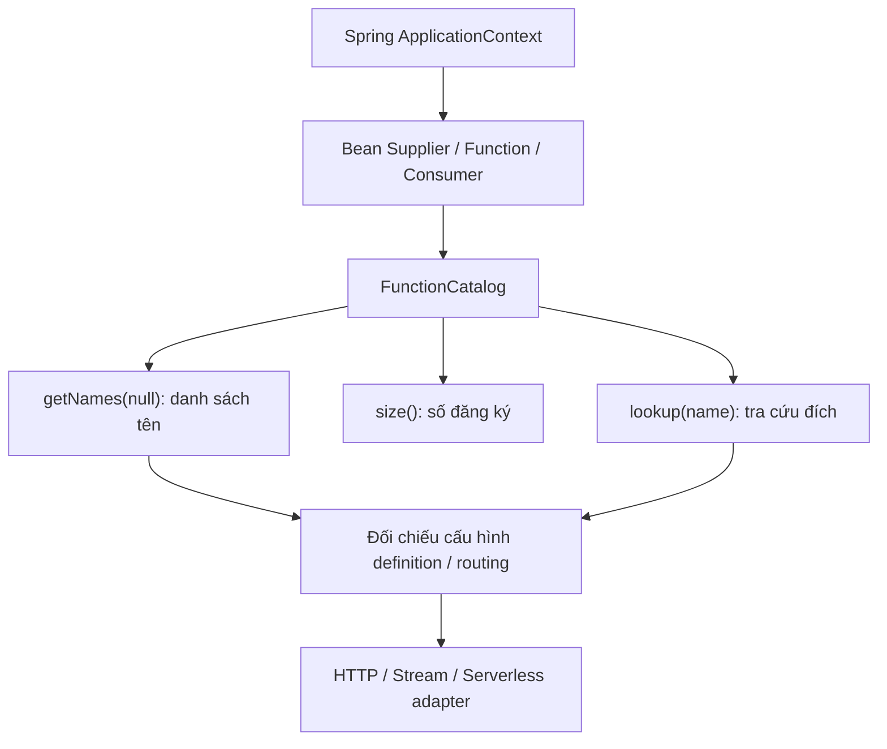
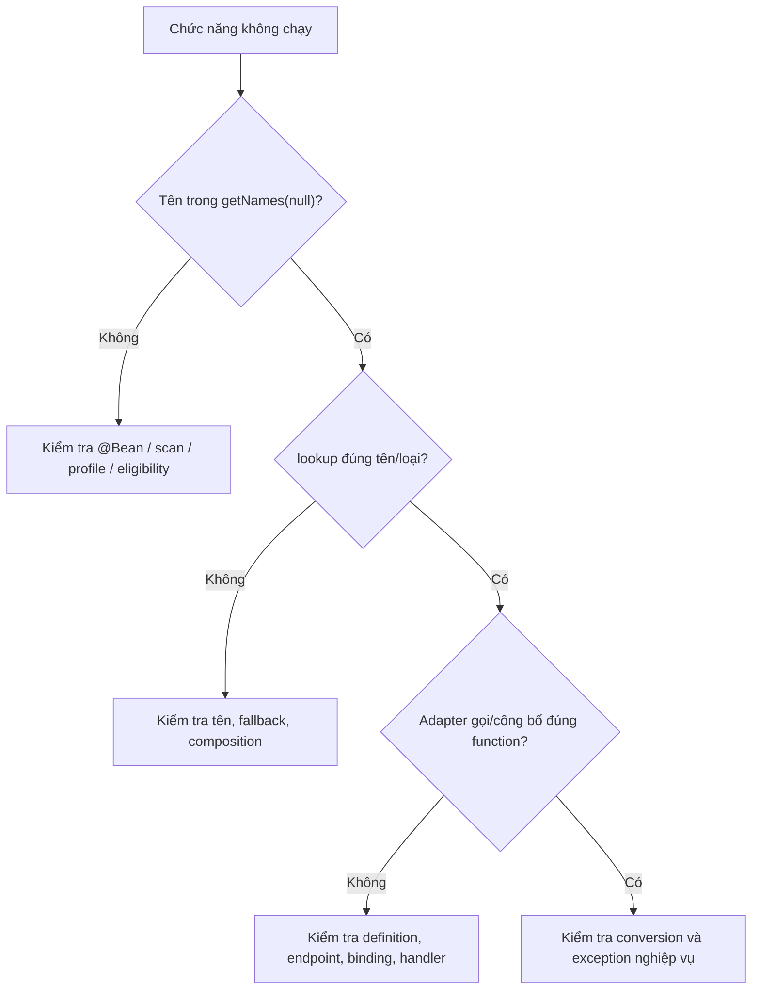

# Liệt kê hàm bằng `FunctionCatalog` để chẩn đoán cấu hình

## Mục tiêu học tập

Sau bài này, bạn có thể:

1. Giải thích `FunctionCatalog` quản lý các hàm `Supplier`, `Function` và `Consumer` như thế nào trong ứng dụng Spring Cloud Function.
2. Dùng `FunctionCatalog.getNames(null)` và `FunctionCatalog.size()` để quan sát danh mục function trong `ApplicationContext`.
3. Dùng `lookup(...)` để xác minh một function đích có thể được tìm thấy và hoạt động, thay vì chỉ dựa vào tên bean hoặc số lượng hàm.
4. Bật và đọc endpoint Actuator `/actuator/functions` khi cần quan sát danh mục từ bên ngoài ứng dụng.
5. Phân biệt ba vấn đề: **bean được tạo**, **function có trong catalog**, và **function được adapter HTTP/Stream/serverless sử dụng hoặc công bố**.
6. Chẩn đoán các lỗi do tên bean, component scan, profile, `spring.cloud.function.definition`, composition, `ineligible-definitions` và cấu hình adapter.
7. Xây dựng các kiểm tra khởi động và kiểm thử an toàn, tránh làm lộ tên function nội bộ hoặc gây tác dụng phụ khi chẩn đoán.

## 1. Vì sao cần quan sát `FunctionCatalog`?

**Spring Cloud Function** cho phép xây dựng logic nghiệp vụ tái sử dụng bằng những giao diện Java quen thuộc:

- `Supplier<T>`: tạo dữ liệu khi được gọi.
- `Function<T, R>`: nhận đầu vào, trả về kết quả.
- `Consumer<T>`: nhận dữ liệu và thực hiện tác dụng phụ, không trả về kết quả nghiệp vụ.

Framework thu thập những bean chức năng phù hợp vào `FunctionCatalog`. Khi được tra cứu qua catalog, chúng có thể được thích nghi để hỗ trợ chuyển đổi kiểu, composition và tích hợp với HTTP, sự kiện hoặc serverless.

Một vấn đề vận hành thường gặp:

> Ứng dụng Spring Boot đã khởi động thành công, nhưng adapter báo không tìm thấy function `normalizeOrder`, hoặc `functionRouter` không định tuyến được tới `uppercase`.

Thay vì ngay lập tức sửa URL, broker binding hoặc code nghiệp vụ, trước tiên cần biết **catalog thực tế có những tên nào** tại thời điểm ứng dụng chạy.



Việc liệt kê là **công cụ chẩn đoán cấu hình**: nó giúp phân biệt function không tồn tại, function tồn tại nhưng gọi sai tên, và function có trong catalog nhưng adapter chưa chọn hoặc chưa công bố.

## 2. Ba lớp cần phân biệt trước khi chẩn đoán

| Lớp | Câu hỏi | Ví dụ |
| --- | --- | --- |
| **Spring bean** | `ApplicationContext` đã tạo bean nghiệp vụ chưa? | Có bean `uppercase` của kiểu `Function<String, String>` |
| **FunctionCatalog** | Catalog có biết tên/định nghĩa để tra cứu không? | `getNames(null)` có `uppercase`; `lookup("uppercase")` tìm được |
| **Adapter** | HTTP, Stream hoặc serverless đang gọi/công bố definition nào? | `spring.cloud.function.definition=uppercase` hoặc `functionRouter` |

Các lớp này liên quan nhưng **không đồng nhất**.

Một bean Spring có thể tồn tại nhưng không được đăng ký làm function do cấu hình lọc. Một function trong catalog có thể chưa được xuất qua HTTP. Và một endpoint HTTP trả 404 không đủ để kết luận `FunctionCatalog` thiếu function.

Đặc biệt, property `spring.cloud.function.definition` thường **chọn function để adapter dùng**, chứ không phải lệnh xóa tất cả function khác khỏi catalog. Nếu thay giá trị property nhưng `getNames(null)` vẫn liệt kê nhiều tên, điều đó có thể hoàn toàn bình thường.

## 3. Những API cần biết của `FunctionCatalog`

Spring Cloud Function hỗ trợ quan sát bằng mã Java:

```java
import java.util.Set;
import org.springframework.cloud.function.context.FunctionCatalog;

FunctionCatalog catalog = applicationContext.getBean(FunctionCatalog.class);

int registered = catalog.size();
Set<String> names = catalog.getNames(null);
```

| API | Dùng để làm gì? | Cần hiểu đúng |
| --- | --- | --- |
| `catalog.getNames(null)` | Liệt kê tên các function, supplier và consumer được catalog nhận diện | Là một tập tên; **không bảo đảm** thứ tự hiển thị |
| `catalog.size()` | Lấy quy mô đăng ký của catalog | Không nhất thiết bằng số tên `getNames(null).size()` trong mọi thiết kế/phiên bản |
| `catalog.lookup("uppercase")` | Tra cứu definition theo tên | Kết quả có thể được framework bọc/thích nghi; phải kiểm tra fallback |
| `catalog.lookup(Function.class, "uppercase")` | Tra cứu với kỳ vọng loại `Function` | Hữu ích khi muốn xác nhận đúng loại chức năng |
| `catalog.lookup("uppercase|reverse")` | Yêu cầu tra cứu composition | Composition có thể được tạo theo yêu cầu; không nhất thiết xuất hiện như tên bean độc lập trong danh sách ban đầu |

Tài liệu chính thức minh họa trực tiếp `size()` và `getNames(null)` trong phần *Function visualization and control*. Đối số `null` nghĩa là lấy tên trên các loại `Function`, `Supplier` và `Consumer`, thay vì yêu cầu một loại cụ thể.

### Vì sao `size()` có thể khác số tên?

Một đăng ký chức năng có thể có nhiều tên/alias, ứng dụng có thể có function do framework cung cấp (chẳng hạn `functionRouter`), và một số registry triển khai cơ chế khám phá/lazy registration. Vì vậy:

```text
catalog.size()            = số đăng ký theo cách registry đếm
catalog.getNames(null)     = tập tên được registry liệt kê
```

Không nên viết cảnh báo vận hành đơn giản là `size() != getNames(null).size()` rồi kết luận catalog hỏng. Cần kiểm tra **những tên thực sự được mong đợi**, khả năng lookup của chúng và cấu hình adapter tương ứng.

## 4. Ứng dụng mẫu với ba kiểu functional bean

Xây dựng ứng dụng Spring Boot có một `Supplier`, một `Function` và một `Consumer`. Ở mức tối thiểu, sử dụng Spring Cloud Function context/starter được quản lý tương thích với phiên bản Spring Boot của dự án. Với ví dụ HTTP ở các mục sau, có thể thêm `spring-cloud-starter-function-web`.

```xml
<dependency>
    <groupId>org.springframework.cloud</groupId>
    <artifactId>spring-cloud-starter-function-web</artifactId>
</dependency>
```

Mã Java:

```java
package com.example.catalogobservability;

import java.util.Locale;
import java.util.function.Consumer;
import java.util.function.Function;
import java.util.function.Supplier;

import org.slf4j.Logger;
import org.slf4j.LoggerFactory;
import org.springframework.boot.SpringApplication;
import org.springframework.boot.autoconfigure.SpringBootApplication;
import org.springframework.context.annotation.Bean;

@SpringBootApplication
public class CatalogObservabilityApplication {

    private static final Logger log =
            LoggerFactory.getLogger(CatalogObservabilityApplication.class);

    public static void main(String[] args) {
        SpringApplication.run(CatalogObservabilityApplication.class, args);
    }

    @Bean
    public Supplier<String> greeting() {
        return () -> "hello";
    }

    @Bean
    public Function<String, String> uppercase() {
        return value -> value.toUpperCase(Locale.ROOT);
    }

    @Bean
    public Consumer<String> textSink() {
        return text -> log.info("textSink nhận văn bản dài {} ký tự",
                text.length());
    }
}
```

Các bean được định nghĩa bằng tên phương thức `@Bean`:

| Tên bean | Giao diện Java | Ý nghĩa |
| --- | --- | --- |
| `greeting` | `Supplier<String>` | Nguồn dữ liệu |
| `uppercase` | `Function<String, String>` | Chuyển đổi dữ liệu |
| `textSink` | `Consumer<String>` | Tác dụng phụ, không trả kết quả |

Tùy những thành phần Spring Cloud Function đã bật, danh sách `getNames(null)` còn có thể chứa `functionRouter` hoặc chức năng do framework tự cung cấp. Đừng đóng đinh assertion rằng catalog **chỉ có ba tên**.

## 5. Liệt kê catalog ngay khi ứng dụng khởi động

Một cách kiểm tra đơn giản là dùng `ApplicationRunner` trong một profile chẩn đoán:

```java
package com.example.catalogobservability;

import java.util.ArrayList;
import java.util.Collections;
import java.util.List;

import org.slf4j.Logger;
import org.slf4j.LoggerFactory;
import org.springframework.boot.ApplicationRunner;
import org.springframework.cloud.function.context.FunctionCatalog;
import org.springframework.context.annotation.Bean;
import org.springframework.context.annotation.Configuration;
import org.springframework.context.annotation.Profile;

@Configuration
public class CatalogDiagnosticsConfiguration {

    private static final Logger log =
            LoggerFactory.getLogger(CatalogDiagnosticsConfiguration.class);

    @Bean
    @Profile("catalog-diagnostics")
    public ApplicationRunner logAvailableFunctions(FunctionCatalog catalog) {
        return args -> {
            List<String> names = new ArrayList<>(catalog.getNames(null));
            Collections.sort(names);

            log.info("FunctionCatalog.size() = {}", catalog.size());
            log.info("FunctionCatalog names = {}", names);
        };
    }
}
```

Chạy với profile `catalog-diagnostics` để kích hoạt log:

```bash
# Ví dụ truyền profile khi chạy Spring Boot
java -jar app.jar --spring.profiles.active=catalog-diagnostics
```

Log minh họa (không phải output cố định cho mọi phiên bản):

```text
FunctionCatalog.size() = 4
FunctionCatalog names = [functionRouter, greeting, textSink, uppercase]
```

Các số/tên thực tế có thể khác theo cấu hình, adapter và phiên bản. `Collections.sort(...)` chỉ giúp log dễ đối chiếu giữa các lần chạy; `Set` do `getNames(null)` trả về không bảo đảm thứ tự.

**Tại sao chỉ bật theo profile?** Tên function có thể làm lộ các khả năng nội bộ của dịch vụ. Với môi trường production, nên giới hạn mức log, quyền đọc log và số lượng thông tin xuất ra. Chỉ log **tên đã phê duyệt cho chẩn đoán**, không log toàn bộ payload, bearer token hay dữ liệu nhạy cảm.

### Không gọi tất cả function để “liệt kê”

`getNames(null)` và `size()` dùng để quan sát metadata. Đừng viết vòng lặp `lookup(name).apply(...)` nhằm thử từng function trong production:

- `Consumer` có thể ghi database, gửi message hoặc gọi dịch vụ khác.
- `Supplier` có thể kích hoạt tác vụ lấy dữ liệu.
- `Function` có thể có side effect dù chữ ký là chuyển đổi.
- Những function khác nhau cần input và content type khác nhau.

**Liệt kê tên không đồng nghĩa thực thi hàm.** Hãy dùng test riêng, input kiểm soát và môi trường thích hợp khi cần kiểm tra hành vi.

## 6. Dùng `lookup(...)` để xác nhận function tồn tại

`getNames(null)` trả lời câu hỏi “catalog thấy tên nào?”. Nhưng một chẩn đoán hoàn chỉnh còn cần xác nhận **definition mong đợi có thể lookup được**.

```java
import java.util.function.Function;
import org.springframework.cloud.function.context.FunctionCatalog;

// catalog đã được inject qua constructor hoặc trường.
Function<String, String> uppercase =
        catalog.lookup(Function.class, "uppercase");

if (uppercase == null) {
    throw new IllegalStateException(
            "Function uppercase không có trong FunctionCatalog");
}

String result = uppercase.apply("hello"); // HELLO
```

Với ứng dụng ví dụ, `uppercase` là một bean `Function<String, String>`, nên tên và kiểu được xác định rõ. Trong ví dụ test an toàn, ta có thể gọi với input `hello` đã biết; với hệ thống thật, không nên thử bằng dữ liệu production một cách tự động.

### Tra cứu qua catalog khác lấy bean trực tiếp

```java
// Đường A: Spring bean gốc
Function<?, ?> bean = applicationContext.getBean(
        "uppercase", Function.class);

// Đường B: FunctionCatalog
Function<?, ?> catalogFunction =
        catalog.lookup(Function.class, "uppercase");
```

Đường A truy cập bean Java gốc. Đường B là lookup của Spring Cloud Function, có thể trả về một **wrapper** chứa khả năng chuyển đổi kiểu, composition và thích nghi với các môi trường tích hợp. Hai đối tượng không nhất thiết cùng identity hoặc cùng hành vi ở tầng message conversion.

Nếu `applicationContext.containsBean("uppercase")` là `true` nhưng `catalog.lookup(...)` không có kết quả, cần kiểm tra eligibility, tên đăng ký, kiểu functional bean, cách cấu hình context và những cơ chế lọc liên quan.

### Chẩn đoán tên sai và single-function fallback

Spring Cloud Function có cơ chế **single-function fallback**: nếu chỉ có một function phù hợp, việc tra cứu với một tên không đúng vẫn có thể trả về function duy nhất đó. Vì thế:

```java
Function<?, ?> wrong = catalog.lookup(Function.class, "upprcase");
```

**Không thể kết luận tên `upprcase` hợp lệ chỉ vì kết quả khác `null`** trong mọi cấu hình. Để kiểm thử chặt chẽ, có thể tắt cơ chế fallback:

```yaml
spring:
  cloud:
    function:
      single-function-fallback-enabled: false
```

Và luôn đối chiếu tên chính xác với tập `getNames(null)`. Tài liệu Spring Cloud Function khuyến nghị khai báo `spring.cloud.function.definition` rõ ràng khi tích hợp với Spring Cloud Stream và các adapter khác để tránh tính mơ hồ.

## 7. Kiểm thử danh mục bằng JUnit

Với `spring-boot-starter-test`, ta có thể viết kiểm thử tích hợp ở mức Spring context:

```java
import static org.junit.jupiter.api.Assertions.assertEquals;
import static org.junit.jupiter.api.Assertions.assertNotNull;
import static org.junit.jupiter.api.Assertions.assertTrue;

import java.util.Set;
import java.util.function.Function;

import org.junit.jupiter.api.Test;
import org.springframework.beans.factory.annotation.Autowired;
import org.springframework.boot.test.context.SpringBootTest;
import org.springframework.cloud.function.context.FunctionCatalog;

@SpringBootTest(
        classes = CatalogObservabilityApplication.class,
        properties = "spring.cloud.function.single-function-fallback-enabled=false")
class FunctionCatalogDiagnosticsTest {

    @Autowired
    FunctionCatalog catalog;

    @Test
    void expectedFunctionsAreDiscoverable() {
        Set<String> names = catalog.getNames(null);

        assertTrue(names.contains("greeting"));
        assertTrue(names.contains("uppercase"));
        assertTrue(names.contains("textSink"));
    }

    @Test
    void canLookupAndExecuteKnownPureFunction() {
        Function<String, String> uppercase =
                catalog.lookup(Function.class, "uppercase");

        assertNotNull(uppercase);
        assertEquals("HELLO", uppercase.apply("hello"));
    }
}
```

Đây là **kiểm thử cấu hình + một hàm thuần**, không có HTTP request và không kích hoạt `textSink`. Nếu dự án dùng cách khai báo *functional bean definitions* thay cho `@Bean` truyền thống, cách khởi tạo context/test có thể khác; hãy chọn các test annotation phù hợp với mô hình bootstrap của dự án.

Một kiểm thử chặt chẽ nên xác nhận **các tên bắt buộc có mặt**, thay vì `assertEquals(3, catalog.size())`. Số đăng ký có thể thay đổi khi framework thêm `functionRouter`, alias hoặc chức năng bổ sung, trong khi yêu cầu nghiệp vụ vẫn được đáp ứng.

### So sánh hai bộ cấu hình

Nếu lỗi chỉ xuất hiện trong production, có thể dùng cùng test với các profile/cấu hình khác nhau để trả lời:

| Cấu hình | Câu hỏi kiểm thử |
| --- | --- |
| `dev` | Bean nào có thể được đăng ký thêm ở môi trường phát triển? |
| `prod` | Bean có `@Profile("dev")` còn hiện diện không? |
| Có `ineligible-definitions` | Function nào không còn là đích lookup hợp lệ? |
| Có `spring.cloud.function.definition` | Adapter chọn đúng function/binding chưa? |
| Có composition `uppercase|textSink` | Định nghĩa ghép có lookup được và tương thích kiểu không? |

Đối với composition, bản thân chuỗi `uppercase|textSink` **không nhất thiết là một bean độc lập** được liệt kê trước khi lookup. Hãy xác minh từng thành phần, sau đó thử tra cứu composition bằng tên đầy đủ trong một test thích hợp.

## 8. Quan sát từ bên ngoài qua Actuator `/actuator/functions`

Spring Cloud Function cung cấp endpoint Actuator giúp xem chức năng có trong catalog mà không cần viết `ApplicationRunner` riêng.

Để sử dụng qua HTTP, ứng dụng cần:

1. Web stack tương thích (`spring-boot-starter-web` hoặc `spring-boot-starter-webflux`; khi dùng Function Web, chọn dependency tích hợp phù hợp).
2. Dependency `spring-boot-starter-actuator`.
3. Cấu hình cho phép truy cập endpoint `functions` qua web.

Ví dụ dependency Actuator:

```xml
<dependency>
    <groupId>org.springframework.boot</groupId>
    <artifactId>spring-boot-starter-actuator</artifactId>
</dependency>
```

Cấu hình tối thiểu ở môi trường quan sát được kiểm soát:

```yaml
management:
  endpoints:
    web:
      exposure:
        include: health,info,functions
```

Sau khi bật, truy cập:

```bash
curl -i http://localhost:8080/actuator/functions
```

Phản hồi có thể cung cấp metadata như tên, loại `FUNCTION`/`SUPPLIER`/`CONSUMER`, kiểu input và kiểu output. Ví dụ minh họa **hình dạng**, không phải kết quả cố định của ứng dụng:

```json
{
  "uppercase": {
    "type": "FUNCTION",
    "input-type": "string",
    "output-type": "string"
  },
  "greeting": {
    "type": "SUPPLIER",
    "output-type": "string"
  },
  "textSink": {
    "type": "CONSUMER",
    "input-type": "string"
  }
}
```

Danh sách thực tế còn phụ thuộc phiên bản, loại bean, khả năng suy luận kiểu và chức năng framework được đăng ký. Endpoint có thể hiện `functionRouter`; các type string ở JSON có thể khác ví dụ.

### Cẩn trọng với bảo mật

Endpoint `/actuator/functions` có thể để lộ tên các khả năng nội bộ và kiểu dữ liệu xử lý. **Không công bố công khai chỉ để debug**. Nên:

- Giới hạn quyền truy cập endpoint quản trị bằng Spring Security hoặc biện pháp tương đương.
- Chỉ mở trên mạng quản trị, đặt management port/base path phù hợp nếu kiến trúc yêu cầu.
- Không bật `management.endpoints.web.exposure.include=*` một cách tùy tiện.
- Đảm bảo logging, audit và quyền truy cập của đội vận hành phù hợp.

Nếu truy cập trả **404**, trước tiên kiểm tra dependency và exposure configuration. Nếu trả **401/403**, đó có thể là chính sách bảo mật đang hoạt động, **không phải lỗi catalog rỗng**. Nếu ứng dụng dùng `management.server.port` hoặc `management.endpoints.web.base-path`, URL cũng thay đổi.

## 9. Đối chiếu danh mục với `spring.cloud.function.definition`

Property quan trọng khi chẩn đoán:

```yaml
spring:
  cloud:
    function:
      definition: uppercase
```

Trong nhiều adapter, nó chọn **definition đầu vào** mà adapter cần dùng. Khi chạy cùng ứng dụng mẫu, `catalog.getNames(null)` có thể vẫn liệt kê `greeting` và `textSink` dù adapter chỉ chọn `uppercase`.

Đối chiếu theo ba câu hỏi:

1. Tên trong `spring.cloud.function.definition` có khớp chính xác tên có trong catalog không?
2. Nếu là composition, từng thành phần có tồn tại và kiểu input/output có tương thích không?
3. Adapter đang **đưa definition này ra đâu** — HTTP endpoint, Stream binding hay serverless handler?

Ví dụ Stream:

```yaml
spring:
  cloud:
    function:
      definition: uppercase
    stream:
      bindings:
        uppercase-in-0:
          destination: input-text
        uppercase-out-0:
          destination: output-text
```

Trong trường hợp này:

- `FunctionCatalog` cho biết `uppercase` có thể tra cứu.
- `spring.cloud.function.definition=uppercase` cho biết Stream adapter **chọn** function đó.
- `uppercase-in-0` và `uppercase-out-0` là **binding names** do Spring Cloud Stream áp dụng cho function đã chọn.
- Broker/binder dependency và kết nối vẫn phải được cấu hình riêng.

Nếu `uppercase` xuất hiện trong catalog nhưng input binding không nhận dữ liệu, lỗi có thể ở destination, binder, consumer group, connection, serializer hoặc cấu hình Stream — **không nhất thiết ở catalog**.

### Trường hợp `functionRouter`

Với định tuyến:

```yaml
spring:
  cloud:
    function:
      definition: functionRouter
      routing-expression: "headers['operation'] == 'reverse' ? 'reverse' : 'uppercase'"
```

Cần chẩn đoán **hai lần tra cứu có mục tiêu khác nhau**:

- **Điểm vào:** adapter có tìm thấy `functionRouter` không?
- **Đích:** khi route đánh giá ra `reverse` hoặc `uppercase`, catalog có function tương ứng không?

Việc `functionRouter` hiện trong `getNames(null)` chưa chứng minh những function đích mà biểu thức trả về đều hợp lệ. Ngược lại, function đích có trong catalog chưa chứng minh adapter đã chuyển request đến router.

## 10. Các nguyên nhân khiến danh mục khác mong đợi

### 10.1. Bean chưa được đăng ký

Hàm được viết trong Java nhưng thiếu `@Bean`, `@Configuration` không được scan, hoặc class nằm ngoài phạm vi component scan. `ApplicationContext` không tạo bean thì catalog cũng không thể nhìn thấy bean theo cách đăng ký đó.

```java
// Không phải bean nếu phương thức không được Spring quản lý:
public Function<String, String> lowercase() {
    return String::toLowerCase;
}
```

Sửa bằng cách khai báo `@Bean` trong configuration được scan hoặc đăng ký theo cơ chế functional definitions của dự án.

### 10.2. Tên bean và tên definition không khớp

```java
@Bean("normalizeText")
public Function<String, String> uppercase() {
    return String::toUpperCase;
}
```

Trong trường hợp này **tên bean là `normalizeText`**, không phải `uppercase` từ tên phương thức. `catalog.getNames(null)` giúp thấy tên được đăng ký; `catalog.lookup("uppercase")` không nên được dùng để suy đoán rằng method name luôn là definition.

### 10.3. Profile hoặc conditional configuration

```java
@Bean
@Profile("dev")
public Function<String, String> debugTransform() {
    return value -> "[DEBUG] " + value;
}
```

Khi không bật profile `dev`, bean này vắng mặt. Tương tự, `@ConditionalOnProperty` hoặc điều kiện auto-configuration có thể làm một functional bean không được tạo.

### 10.4. Function bị đánh dấu không đủ điều kiện

```properties
spring.cloud.function.ineligible-definitions=debugTransform
```

Property này dành cho bean **không nên là ứng viên đăng ký function trong catalog**. Nó không xóa bean khỏi Spring `ApplicationContext`. Khi chẩn đoán, nên so sánh cấu hình eligibility và khả năng `lookup` thực tế, **không chỉ** suy diễn từ một phép đếm hoặc từ việc thấy tên trong một danh sách. Hành vi liệt kê/lookup có thể chịu ảnh hưởng triển khai registry và single-function fallback.

### 10.5. Composition và lazy registration

Một definition như `uppercase|textSink` là phép ghép hai hàm. Catalog có thể tạo wrapper composition khi được yêu cầu lookup, chứ không nhất thiết đăng ký một Spring bean có chính tên đó ngay lúc ứng dụng khởi động.

Vì vậy, **không thấy chuỗi composition trong `getNames(null)` không tự động là lỗi**. Hãy kiểm tra các thành phần và thử lookup composition cụ thể trong test, sau đó kiểm tra tương thích kiểu.

### 10.6. Vấn đề về adapter, không phải catalog

Catalog có `uppercase`, nhưng:

- HTTP `POST /uppercase` trả 404 vì adapter không công bố endpoint này.
- Spring Cloud Stream không tạo binding vì `spring.cloud.function.definition` chọn hàm khác.
- Serverless handler trỏ sai tên function hoặc khởi động bằng profile khác.

Các lỗi trên cần kiểm tra **cấu hình adapter** bên cạnh catalog. Không sửa tên bean một cách mù quáng khi catalog đã tra cứu được chính xác definition.

## 11. Bảng chẩn đoán nhanh

| Triệu chứng | Kiểm tra trước tiên | Nguyên nhân thường gặp |
| --- | --- | --- |
| `getNames(null)` không có `uppercase` | Bean có tồn tại trong `ApplicationContext`? | Chưa scan, thiếu `@Bean`, sai profile hoặc tên bean |
| `getNames(null)` có tên nhưng `lookup` không như mong đợi | Kiểu yêu cầu, eligibility và fallback | Lookup sai loại, function bị lọc hoặc fallback đặc biệt |
| `size()` khác `getNames(null).size()` | Tập tên và đăng ký/alias | Hai API đo khác nhau; không đủ bằng chứng lỗi |
| `lookup("typo")` vẫn trả function | Số function hợp lệ và property fallback | Single-function fallback đang bật |
| `/actuator/functions` trả 404 | Dependency và web exposure | Chưa thêm Actuator, chưa expose endpoint, sai base path |
| `/actuator/functions` trả 401/403 | Authentication/authorization | Chính sách bảo mật đang chặn truy cập |
| Catalog có `uppercase` nhưng HTTP 404 | Function export/mapping | Adapter không xuất endpoint hoặc URL sai |
| Catalog có `uppercase` nhưng Stream không nhận event | Definition, binding và binder | Sai destination, binding, group, kết nối broker |
| Router có trong catalog nhưng route không chạy | Header, SpEL và đích được trả về | Đích sai tên hoặc adapter không gọi router |
| Tên composition không thấy trong danh sách | `lookup` từng thành phần và composition | Composition tạo theo yêu cầu thay vì là bean độc lập |
| Một function chỉ xuất hiện ở `dev` | Profiles/conditionals | Bean bị vô hiệu trong `prod` |

Để tránh giải quyết nhầm tầng, hãy phân loại sự cố theo thứ tự **đăng ký bean → FunctionCatalog → cấu hình definition → adapter → chuyển đổi message/payload → thực thi nghiệp vụ**.

## 12. Một quy trình chẩn đoán có thể lặp lại

Khi gặp lỗi “function not found” hoặc không thấy endpoint dự kiến:

1. **Xác nhận môi trường chạy:** phiên bản ứng dụng, Spring profile, property sources và module được nạp. Một bản deploy khác profile có thể tạo danh sách function khác.
2. **Lấy danh sách:** dùng `getNames(null)` trong một đoạn mã chẩn đoán an toàn hoặc Actuator `/actuator/functions` có phân quyền.
3. **Đối chiếu kỳ vọng:** kiểm tra chính xác tên `uppercase`, `greeting`, `textSink` và các function thực sự cần cho tình huống đang lỗi. Không so sánh cứng tổng số tên.
4. **Xác minh lookup có mục tiêu:** tra cứu function cần thiết đúng loại và tên. Trong test, tắt single-function fallback để tránh tên sai được chấp nhận ngoài ý muốn.
5. **Đọc effective `spring.cloud.function.definition`:** xác định một definition hay composition mà adapter định gọi; chú ý property có thể đến từ YAML, profile, environment hoặc command line.
6. **Kiểm tra adapter:** HTTP mappings, Stream binding/destination hoặc serverless handler. Một function có trong catalog chưa đủ để adapter đưa nó ra ngoài.
7. **Kiểm tra message và lỗi thực thi:** nếu function đã được lookup thành công, xem conversion, content type, exception, routing header và pipeline nghiệp vụ.
8. **Chốt bằng test hồi quy:** thêm assertion về tên/function quan trọng và test adapter tương ứng để lỗi không tái diễn.

Sơ đồ quyết định:



**Giới hạn của sơ đồ:** `getNames(null)` là quan sát ban đầu; tùy cách registry được triển khai, phép liệt kê không thay thế hoàn toàn phép kiểm tra eligibility và lookup thực tế. Luôn dùng thêm bằng chứng thích hợp trước khi kết luận.

## 13. Quan sát catalog trong sản phẩm thực tế

Nên phân biệt ba mức công cụ:

| Công cụ | Khi nên dùng | Điều cần chú ý |
| --- | --- | --- |
| `ApplicationRunner` theo profile | Chẩn đoán startup của một deployment | Không log quá nhiều tên nội bộ |
| `FunctionCatalog` trong test | Kiểm tra function bắt buộc có mặt và lookup đúng | Chỉ gọi hàm an toàn với input kiểm soát |
| Actuator `/actuator/functions` | Kiểm tra trạng thái danh mục đang chạy từ bên ngoài | Kiểm soát quyền truy cập endpoint quản trị |

Đối với hệ thống nhiều instance, không nên mặc định các pod/instance chạy cùng phiên bản và profile chỉ vì cùng một service name. Nếu cần chẩn đoán sự khác biệt, so sánh metadata phiên bản triển khai, môi trường và tập function **được phép công bố** của từng instance; tránh lộ mọi tên hàm trong metric label hoặc public API.

`FunctionCatalog` giúp quan sát **các chức năng có thể tìm thấy**, nhưng không cung cấp đầy đủ thông tin về số request, độ trễ, tỷ lệ lỗi hay trace của từng invocation. Những nhu cầu đó nên dùng Micrometer, Spring Boot Actuator metrics, tracing và logging có correlation ID, tùy nền tảng vận hành.

## 14. Bài tập thực hành

1. Tạo ba bean `greeting`, `uppercase`, `textSink`. Dùng `FunctionCatalog.getNames(null)` liệt kê tên và `size()` lấy số lượng đăng ký. Giải thích vì sao không nên giả định số lượng bằng đúng ba.
2. Thêm `@Bean("normalizeText")` cho phương thức Java tên `uppercase`. Dự đoán tên xuất hiện trong catalog và viết test xác nhận.
3. Đưa một bean `debugTransform` vào `@Profile("dev")`. So sánh tập tên khi chạy `dev` và `prod`.
4. Sử dụng `spring.cloud.function.ineligible-definitions=debugTransform`. Phân biệt việc bean còn nằm trong Spring context với khả năng được lookup qua catalog.
5. Viết test `catalog.lookup(Function.class, "uppercase")` và xác minh `HELLO` từ input `hello`. Không thực thi `textSink` chỉ để đếm catalog.
6. Tạo một context chỉ có một function đủ điều kiện, thử lookup một tên sai trước/sau khi đặt `spring.cloud.function.single-function-fallback-enabled=false`. Giải thích kết quả.
7. Bật `/actuator/functions` trong môi trường phát triển có kiểm soát. So sánh danh sách và type metadata với `getNames(null)`; nêu biện pháp bảo vệ khi triển khai production.
8. Đặt `spring.cloud.function.definition=uppercase` nhưng catalog vẫn có `greeting` và `textSink`. Giải thích vì sao property này không đồng nghĩa loại hai bean kia.
9. Tạo composition `uppercase|textSink`. Kiểm tra tên từng thành phần và khả năng lookup composition; giải thích tại sao chuỗi composition không nhất thiết nằm trong danh sách tên ban đầu.
10. Giả lập một lỗi HTTP 404 với endpoint `/uppercase` trong khi catalog lookup thành công. Lập bảng kiểm adapter mapping, function export và security thay vì đổi tên bean.
11. Với Stream, đặt `definition=uppercase` và binding đầu vào/đầu ra; giải thích vì sao có function trong catalog vẫn chưa đủ để nhận sự kiện từ broker.
12. Thiết kế một startup diagnostic an toàn chỉ xác nhận các tên quan trọng có mặt và báo lỗi có kiểm soát nếu thiếu, không công bố toàn bộ catalog ra public log.

## Ghi nhớ

- `FunctionCatalog` là nơi Spring Cloud Function tổ chức các `Supplier`, `Function`, `Consumer` để tra cứu, chuyển đổi dữ liệu và composition.
- **`getNames(null)` liệt kê tên**, **`size()` cho biết quy mô đăng ký**, còn **`lookup(...)` xác minh khả năng tra cứu một definition cụ thể**.
- **Spring bean**, **ứng viên/đăng ký trong FunctionCatalog** và **function được adapter công bố** là ba lớp khác nhau; không suy kết luận từ một lớp sang lớp khác.
- Tên bean, component scan, profile, ineligible definitions, composition và single-function fallback đều ảnh hưởng chẩn đoán.
- Actuator **`/actuator/functions`** giúp quan sát từ ngoài nhưng phải được bật rõ ràng và bảo vệ như endpoint quản trị.
- Khi catalog đã có function cần thiết, chuyển sang kiểm tra **`spring.cloud.function.definition` và cấu hình adapter**, thay vì sửa business function hoặc tên bean ngay.

### Tài liệu tham khảo chính thức

- [Spring Cloud Function — Functional Bean Definitions, Function visualization and control](https://docs.spring.io/spring-cloud-function/reference/functional.html)
- [Spring Cloud Function — Programming Model và FunctionCatalog](https://docs.spring.io/spring-cloud-function/reference/spring-cloud-function/programming-model.html)
- [Spring Cloud Function — Standalone Web Applications](https://docs.spring.io/spring-cloud-function/reference/spring-cloud-function/standalone-web-applications.html)
- [Spring Boot — Actuator Endpoints](https://docs.spring.io/spring-boot/reference/actuator/endpoints.html)
- [Spring Cloud Stream — Function Composition và Bindings](https://docs.spring.io/spring-cloud-stream/reference/spring-cloud-stream/overview-user-defined-functions.html)
