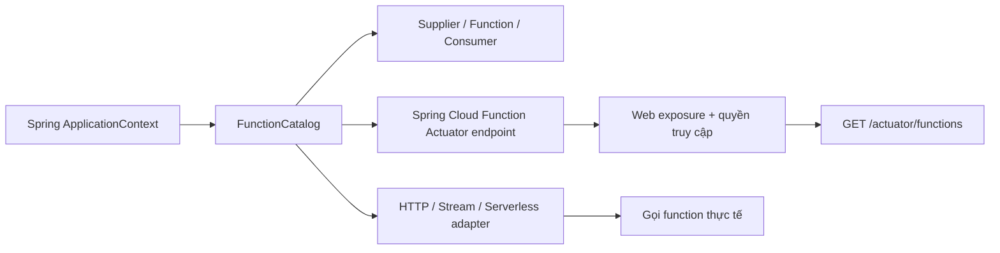
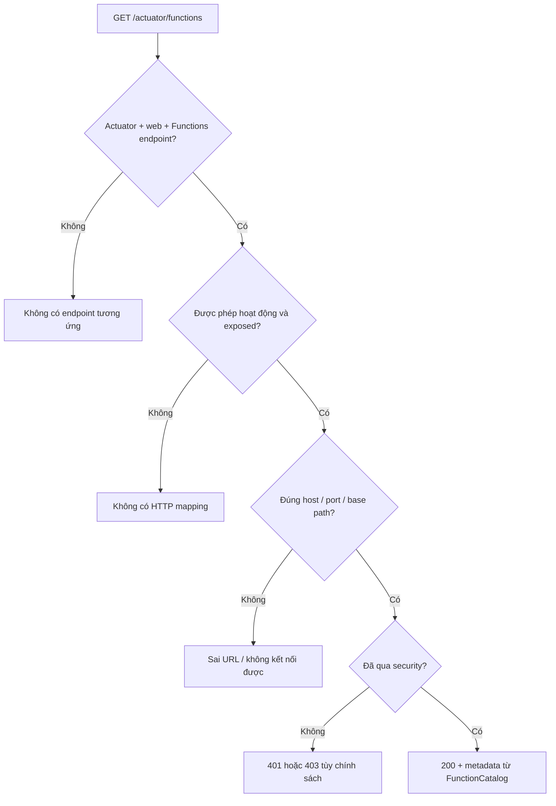

# Actuator `functions` endpoint và điều kiện kích hoạt

## Mục tiêu học tập

Sau bài học, bạn có thể:

1. Giải thích endpoint `/actuator/functions` quan sát những gì trong `FunctionCatalog` của Spring Cloud Function.
2. Liệt kê đúng những điều kiện cần có: Spring Cloud Function, Spring Boot Actuator, web stack, endpoint được phép hoạt động, cấu hình web exposure và quyền truy cập.
3. Viết dependency và `application.yml` để kiểm tra endpoint trên môi trường phát triển hoặc management network.
4. Hiểu các trường `type`, `input-type`, `output-type` trong phản hồi JSON và phân biệt metadata này với việc **thực thi function**.
5. Chẩn đoán các trường hợp endpoint trả `404`, `401/403`, trả dữ liệu khác dự kiến hoặc xuất hiện ở port/base path khác.
6. Đối chiếu kết quả Actuator với `FunctionCatalog.getNames(null)`, `size()` và `lookup(...)` mà không nhầm với các HTTP endpoint nghiệp vụ.
7. Đề xuất cách bảo vệ endpoint chẩn đoán trong production và kiểm thử đường truy cập có chủ đích.

## 1. `/actuator/functions` dùng để làm gì?

**Spring Cloud Function** cho phép triển khai logic nghiệp vụ bằng các bean Java `Supplier<T>`, `Function<T,R>` và `Consumer<T>`. `FunctionCatalog` đăng ký, tra cứu, chuyển đổi kiểu và hỗ trợ composition để cùng một chức năng có thể chạy qua HTTP, hệ thống sự kiện hoặc nền tảng serverless.

Khi ứng dụng chạy nhưng một adapter báo không tìm thấy `uppercase`, hoặc một `functionRouter` không tìm được hàm đích, cần biết **FunctionCatalog thực sự chứa những chức năng nào**. Spring Cloud Function hỗ trợ hai cách quan sát:

- **Programmatic:** gọi `FunctionCatalog.getNames(null)`, `size()`, `lookup(...)` trong Java.
- **Actuator:** khi được kích hoạt và công bố qua web, truy cập **`GET /actuator/functions`** để xem metadata các function trong catalog.

Đây là **endpoint quản trị để đọc metadata**, không phải endpoint dùng để gửi payload xử lý nghiệp vụ. Nó không thay thế route HTTP `/uppercase`, input binding của Spring Cloud Stream hoặc handler serverless.



**Phân biệt quan trọng:** một function có trong JSON Actuator **không đồng nghĩa** function đó có URL HTTP công khai. Danh sách catalog và việc adapter xuất/chọn function là hai lớp riêng.

## 2. Các điều kiện để endpoint truy cập được qua HTTP

Tài liệu chính thức của Spring Cloud Function, mục *Function visualization and control*, yêu cầu thêm **web dependency**, **Actuator dependency** rồi bật **web exposure** cho endpoint `functions`.

Trong triển khai thực tế, cần kiểm tra đầy đủ các tầng:

| Tầng | Điều kiện | Nếu không đáp ứng |
| --- | --- | --- |
| **1. Function infrastructure** | Ứng dụng có Spring Cloud Function và `FunctionCatalog` được đăng ký đúng | Không có nguồn metadata function để endpoint công bố |
| **2. Actuator** | Có `spring-boot-starter-actuator` và endpoint `functions` được auto-configuration cung cấp trong phiên bản tương thích | Thường không có mapping `/actuator/functions` |
| **3. Web stack** | Có web runtime như Spring MVC hoặc WebFlux và ứng dụng thực sự chạy HTTP server | Không có địa chỉ HTTP để gọi endpoint |
| **4. Availability / access** | Endpoint không bị vô hiệu hóa bởi quy tắc access/enablement của phiên bản Spring Boot đang dùng | Endpoint có thể bị loại khỏi danh sách các endpoint khả dụng |
| **5. Web exposure** | `management.endpoints.web.exposure.include` chứa `functions`, và `exclude` không loại `functions` | Dù endpoint tồn tại nội bộ, URL chưa được xuất qua HTTP |
| **6. Định tuyến quản trị** | Đúng management port, context path và `management.endpoints.web.base-path` | Truy cập sai URL có thể trả 404/connection refused |
| **7. Security và network** | Caller được xác thực/phân quyền, mạng cho phép kết nối tới management endpoint | Có thể nhận 401/403 hoặc lỗi kết nối |

Không nên gộp cả bảy trường hợp thành câu “Actuator không hoạt động”. Một ứng dụng **vẫn có thể xử lý nghiệp vụ bình thường** khi endpoint này không được bật hoặc không được xuất qua HTTP.



Sơ đồ là **mô hình chẩn đoán**, không khẳng định mọi cấu hình lỗi đều trả cùng một mã HTTP. Một reverse proxy có thể biến đổi status, URL hoặc response.

## 3. Thêm dependency đúng vai trò

Một ứng dụng Spring Cloud Function đã có catalog nhưng chưa có web runtime/Actuator thì không thể suy ra URL `/actuator/functions` sẽ hiện diện.

### 3.1. Web MVC hoặc WebFlux

Chọn một web stack tương thích với dự án, ví dụ Spring MVC:

```xml
<dependency>
    <groupId>org.springframework.boot</groupId>
    <artifactId>spring-boot-starter-web</artifactId>
</dependency>
```

Hoặc nếu ứng dụng dùng WebFlux:

```xml
<dependency>
    <groupId>org.springframework.boot</groupId>
    <artifactId>spring-boot-starter-webflux</artifactId>
</dependency>
```

Một ứng dụng dùng `spring-cloud-starter-function-web` có thể đã có các thành phần web cần thiết cho Function Web; hãy kiểm tra dependency management thực tế thay vì thêm một web stack trùng lặp chỉ để có Actuator.

### 3.2. Actuator

```xml
<dependency>
    <groupId>org.springframework.boot</groupId>
    <artifactId>spring-boot-starter-actuator</artifactId>
</dependency>
```

Giữ Spring Boot và Spring Cloud Function ở **các phiên bản tương thích**, thông thường bằng BOM hoặc dependency management được dự án lựa chọn. Endpoint `functions` là phần tích hợp do **Spring Cloud Function** cung cấp trên nền Spring Boot Actuator, không phải endpoint mặc định thuộc tập built-in của Spring Boot khi không có Spring Cloud Function.

### 3.3. Không cần gọi function để kích hoạt metadata

Điểm vào như `uppercase` có thể được xuất thành REST API bởi Function Web, nhưng endpoint Actuator chỉ truy vấn **danh mục** và kiểu dữ liệu. Bạn không cần gửi request tới `/uppercase` để `/actuator/functions` được kích hoạt.

## 4. Cấu hình web exposure tối thiểu

Theo mặc định, Spring Boot chỉ công bố một tập rất nhỏ endpoint quản trị (thường là `health`) qua HTTP. `functions` phải được cho phép rõ ràng trong cấu hình exposure.

```yaml
# application.yml — minh họa cho môi trường có kiểm soát
management:
  endpoints:
    web:
      exposure:
        include: "health,info,functions"
```

Tương đương trong `application.properties`:

```properties
management.endpoints.web.exposure.include=health,info,functions
```

Hoặc cung cấp khi chạy Spring Boot:

```bash
java -jar app.jar --management.endpoints.web.exposure.include=health,info,functions
```

Trong ví dụ:

- `health`, `info`, `functions` là **ID của các endpoint Actuator**, phân cách bằng dấu phẩy.
- `functions` là endpoint phục vụ metadata catalog; không phải tên một `Function` nghiệp vụ.
- `include` chỉ điều khiển **exposure**, không tự cấp quyền truy cập và không bảo đảm endpoint tồn tại nếu thiếu dependency.

### `exclude` có ưu tiên hơn `include`

Ví dụ sau không mở `functions` dù nó nằm trong `include`:

```yaml
management:
  endpoints:
    web:
      exposure:
        include: "health,info,functions"
        exclude: "functions"
```

Đây là quy tắc của Spring Boot Actuator: **exclude thắng include**. Khi gặp 404, hãy kiểm tra cả hai property thay vì chỉ xem `include`.

### Đừng dùng `include: "*"` một cách tùy tiện

```yaml
# Không khuyến nghị cho ứng dụng công khai:
management:
  endpoints:
    web:
      exposure:
        include: "*"
```

Dấu `*` phải đặt trong nháy khi viết YAML. Cấu hình này có thể mở nhiều endpoint nhạy cảm khác ngoài `functions`, chẳng hạn `env`, `beans` hoặc endpoint quản trị bổ sung, tùy phiên bản và dependency. Nên liệt kê **đúng các endpoint cần thiết** và giới hạn quyền truy cập.

## 5. Endpoint availability và access không giống web exposure

Spring Boot Actuator phân biệt **endpoint có thể được sử dụng** với **endpoint được công bố qua HTTP**.

- **Availability/access/enablement:** endpoint được phép tồn tại và hoạt động trong hệ thống quản trị hay không.
- **Web exposure:** endpoint đó có được ánh xạ thành một HTTP URL hay không.
- **Security:** ai có thể gửi request hợp lệ đến URL đó.

Tùy phiên bản Spring Boot, hệ thống dùng cơ chế cấu hình enablement cũ (ví dụ `management.endpoint.<id>.enabled` cùng thiết lập toàn cục) hoặc cơ chế **endpoint access** (như `management.endpoint.<id>.access`, `management.endpoints.access.max-permitted`). Hãy kiểm tra tài liệu đúng phiên bản Spring Boot của dự án.

Ví dụ dạng access dành cho phiên bản hỗ trợ:

```properties
# Chỉ áp dụng nếu phiên bản Spring Boot của dự án hỗ trợ property này.
management.endpoint.functions.access=read-only
```

Nếu access bị đặt thành `none`, việc thêm `functions` vào `exposure.include` **không** khiến endpoint truy cập được. Ngược lại, access cho phép đọc nhưng thiếu exposure thì HTTP URL vẫn không xuất hiện.

**Không cần cấu hình cả hệ property đời cũ lẫn đời mới một cách máy móc.** Kiểm tra `conditions`, các property có hiệu lực và tài liệu của đúng release khi endpoint không được đăng ký.

## 6. Ứng dụng mẫu có `Supplier`, `Function` và `Consumer`

Tạo một Spring Boot application:

```java
package com.example.functionsactuator;

import java.util.Locale;
import java.util.function.Consumer;
import java.util.function.Function;
import java.util.function.Supplier;

import org.slf4j.Logger;
import org.slf4j.LoggerFactory;
import org.springframework.boot.SpringApplication;
import org.springframework.boot.autoconfigure.SpringBootApplication;
import org.springframework.context.annotation.Bean;

@SpringBootApplication
public class FunctionsActuatorApplication {

    private static final Logger log =
            LoggerFactory.getLogger(FunctionsActuatorApplication.class);

    public static void main(String[] args) {
        SpringApplication.run(FunctionsActuatorApplication.class, args);
    }

    @Bean
    public Supplier<String> greeting() {
        return () -> "hello";
    }

    @Bean
    public Function<String, String> uppercase() {
        return value -> value.toUpperCase(Locale.ROOT);
    }

    @Bean
    public Consumer<String> textSink() {
        return text -> log.info("Nhận một chuỗi gồm {} ký tự", text.length());
    }
}
```

Đặt cấu hình exposure ở mục 4. Sau khi chạy ứng dụng với dependencies phù hợp và không có chính sách mạng/security ngăn truy cập, thử:

```bash
curl -i http://localhost:8080/actuator/functions
```

Ví dụ phản hồi **minh họa**, được rút gọn từ cấu trúc trong tài liệu Spring Cloud Function:

```json
{
  "greeting": {
    "type": "SUPPLIER",
    "output-type": "string"
  },
  "uppercase": {
    "type": "FUNCTION",
    "input-type": "string",
    "output-type": "string"
  },
  "textSink": {
    "type": "CONSUMER",
    "input-type": "string"
  },
  "functionRouter": {
    "type": "FUNCTION",
    "input-type": "object",
    "output-type": "object"
  }
}
```

**Không kiểm thử bằng cách so khớp toàn bộ JSON trên.** Các khóa được công bố, kiểu khai báo, dấu nháy, các tên framework như `functionRouter` và định dạng type metadata có thể khác theo phiên bản và cấu hình. Điều cần rút ra là endpoint cung cấp **một ánh xạ từ tên đến mô tả chức năng**, không phải kết quả chạy thử của từng hàm.

## 7. Cách đọc các trường trong JSON

| Trường | Ý nghĩa | Ví dụ |
| --- | --- | --- |
| Tên key ở cấp đầu tiên | Tên definition được hiển thị trong catalog | `uppercase`, `greeting` |
| `type` | Phân loại chức năng | `FUNCTION`, `SUPPLIER`, `CONSUMER` |
| `input-type` | Kiểu đầu vào suy luận được | `string`, `object` |
| `output-type` | Kiểu đầu ra suy luận được | `string`, `integer` |

`Supplier` không nhận input theo mô hình thông thường, nên metadata có thể chỉ có output. `Consumer` không trả output nghiệp vụ, nên metadata có thể chỉ hiển thị input.

Một `Function<String, Integer>` có thể hiện `input-type: string` và `output-type: integer`, nhưng dữ liệu trả về từ adapter HTTP/Stream còn chịu ảnh hưởng conversion, serialization và content type. **Type metadata không bảo đảm một request cụ thể sẽ chạy thành công.**

### Endpoint không cho biết những gì?

`GET /actuator/functions` không phải một hệ thống quan sát end-to-end. Nó **không** tự cung cấp:

- Tổng số lần một function được gọi hoặc tỷ lệ lỗi mỗi phút.
- Độ trễ P95/P99, trace ID hoặc lời gọi upstream/downstream.
- Kiểu dữ liệu đã được chuyển đổi thực tế trong từng request.
- Trạng thái broker, input/output binding hoặc retry/DLQ.
- Quyền được phép gọi function của từng người dùng.

Để có metrics, tracing và logs, cần thêm Micrometer/Actuator metrics, hệ thống tracing và logging phù hợp. `functions` endpoint chủ yếu giúp trả lời câu hỏi **“Catalog hiện biết những chức năng nào?”**

## 8. Đối chiếu bằng Java khi HTTP endpoint không sẵn có

Actuator là **tùy chọn**. Nếu ứng dụng chạy trong serverless hoặc xử lý sự kiện mà không có web server, bạn vẫn có thể quan sát catalog bằng Java:

```java
import java.util.ArrayList;
import java.util.Collections;
import java.util.List;

import org.springframework.boot.ApplicationRunner;
import org.springframework.cloud.function.context.FunctionCatalog;
import org.springframework.context.annotation.Bean;
import org.springframework.context.annotation.Configuration;
import org.springframework.context.annotation.Profile;

@Configuration
class FunctionCatalogDiagnostics {

    @Bean
    @Profile("catalog-debug")
    ApplicationRunner reportCatalog(FunctionCatalog catalog) {
        return args -> {
            List<String> names = new ArrayList<>(catalog.getNames(null));
            Collections.sort(names);

            System.out.println("Catalog size: " + catalog.size());
            System.out.println("Catalog names: " + names);
        };
    }
}
```

Khi khởi động với profile `catalog-debug`, đoạn mã liệt kê tên mà không cần HTTP. Trong production, ưu tiên logger và hệ thống giám sát có phân quyền, tránh tự động in toàn bộ tên nội bộ ra nơi người dùng cuối đọc được.

### So sánh hai cách quan sát

| Khía cạnh | `FunctionCatalog` Java API | Actuator `/actuator/functions` |
| --- | --- | --- |
| Cần HTTP server? | Không | Có, nếu muốn GET qua mạng |
| Cần `spring-boot-starter-actuator`? | Không | Có |
| Có thể dùng trong unit/integration test? | Có | Có, với web test và exposure phù hợp |
| Dữ liệu | `getNames(null)`, `size()`, `lookup(...)` | Metadata tên, loại, input/output |
| Rủi ro lộ thông tin | Qua log/debug code nếu xuất ra ngoài | Qua endpoint quản trị nếu cấu hình bảo mật kém |
| Có thực thi function nghiệp vụ? | Chỉ khi code tự gọi `apply`/`get`/`accept` | Không: endpoint chỉ đọc metadata |

Đừng dùng việc `/actuator/functions` trả 404 để suy ra `FunctionCatalog` không tồn tại. Ngược lại, catalog có function nhưng HTTP function adapter chưa công bố nó cũng không có nghĩa endpoint Actuator sai.

## 9. Management port, base path và context path

Mặc định, Actuator Web đặt endpoint dưới `/actuator` trên cổng ứng dụng. Tuy nhiên, hệ thống có thể chạy management server trên cổng riêng:

```yaml
server:
  port: 8080
management:
  server:
    port: 9090
  endpoints:
    web:
      base-path: /manage
      exposure:
        include: "health,functions"
```

Với cấu hình này, URL minh họa là:

```bash
# Không phải localhost:8080/actuator/functions
curl -i http://localhost:9090/manage/functions
```

Trong thực tế, `server.servlet.context-path`, management base path, reverse proxy path rewrite và cấu hình Kubernetes ingress có thể ảnh hưởng URL cuối cùng. Khi management server chạy trên **cổng khác**, quy tắc kết hợp path cũng có thể khác với trường hợp dùng cùng cổng. Hãy kiểm tra effective configuration và HTTP mapping đang được ứng dụng công bố.

Nên tổ chức mạng quản trị riêng để không công bố endpoint `functions` cho toàn bộ Internet. Việc đổi cổng hoặc path chỉ giảm khả năng truy cập tình cờ, **không thay thế xác thực/phân quyền**.

## 10. Bảo vệ endpoint `functions`

Metadata catalog có thể tiết lộ tên function nội bộ như `deleteUser`, `reindexData` hoặc `internalDiagnostics`, cũng như loại dữ liệu mà dịch vụ xử lý. Dù endpoint chỉ đọc, các thông tin này vẫn có thể hữu ích cho người không được phép.

Nguyên tắc bảo vệ:

1. **Không expose tràn lan.** Dùng `management.endpoints.web.exposure.include=health,functions` khi thật sự cần; không bật `*` trên dịch vụ công khai.
2. **Xác thực và phân quyền.** Chỉ cho phép vai trò vận hành phù hợp truy cập các endpoint metadata.
3. **Giới hạn mạng.** Chạy management port trong mạng nội bộ hoặc bảo vệ bằng gateway/firewall/VPN.
4. **Kiểm soát audit.** Ghi nhận truy cập quản trị với metadata phù hợp, không log token hay credential.
5. **Không cho endpoint quản trị sửa biểu thức từ nguồn không tin cậy.** Endpoint `functions` chỉ hiển thị metadata, nhưng các công cụ cấu hình khác có thể có quyền thay đổi `spring.cloud.function.routing-expression`; phải bảo vệ riêng các khả năng đó.

### Có Spring Security thì sao?

Khi Spring Security có trên classpath, Spring Boot thường áp dụng bảo vệ cho Actuator theo auto-configuration nếu ứng dụng **chưa** tự định nghĩa một `SecurityFilterChain`. Nếu bạn khai báo security chain tùy chỉnh, cần tự xác nhận chain đó có bảo vệ đường dẫn quản trị; không được giả định endpoint tự an toàn.

Ví dụ cấu hình minh họa cho Spring Boot 3.x / Spring Security 6:

```java
import org.springframework.boot.actuate.autoconfigure.security.servlet.EndpointRequest;
import org.springframework.context.annotation.Bean;
import org.springframework.context.annotation.Configuration;
import org.springframework.core.annotation.Order;
import org.springframework.security.config.Customizer;
import org.springframework.security.config.annotation.web.builders.HttpSecurity;
import org.springframework.security.web.SecurityFilterChain;

@Configuration
class ManagementSecurityConfiguration {

    @Bean
    @Order(1)
    SecurityFilterChain functionsActuatorSecurity(HttpSecurity http)
            throws Exception {
        return http
                .securityMatcher(EndpointRequest.to("functions"))
                .authorizeHttpRequests(auth -> auth
                        .anyRequest().hasRole("OPS"))
                .httpBasic(Customizer.withDefaults())
                .build();
    }
}
```

Đây chỉ là ví dụ cho **endpoint `functions`** trong ứng dụng Servlet/MVC: cần cấu hình bảo vệ những đường dẫn còn lại và các endpoint Actuator khác bằng những chain phù hợp, cùng hệ thống xác thực thực tế. Nếu dùng WebFlux, security API sẽ khác. HTTP Basic chỉ nên dùng qua kết nối TLS đáng tin cậy.

Một request không được xác thực thường nhận **401**, còn request đã xác thực nhưng thiếu quyền có thể nhận **403**. Cách phản hồi thực tế phụ thuộc authentication entry point, security filters và proxy; đừng thay đổi exposure để “sửa” lỗi 403 khi chính sách phân quyền đang làm đúng nhiệm vụ.

## 11. Kiểm thử endpoint trong Spring Boot

Với ứng dụng Spring MVC, `spring-boot-starter-test` và Actuator, có thể dùng `MockMvc`:

```java
import static org.springframework.test.web.servlet.request.MockMvcRequestBuilders.get;
import static org.springframework.test.web.servlet.result.MockMvcResultMatchers.jsonPath;
import static org.springframework.test.web.servlet.result.MockMvcResultMatchers.status;

import org.junit.jupiter.api.Test;
import org.springframework.beans.factory.annotation.Autowired;
import org.springframework.boot.test.autoconfigure.web.servlet.AutoConfigureMockMvc;
import org.springframework.boot.test.context.SpringBootTest;
import org.springframework.test.web.servlet.MockMvc;

@SpringBootTest(
        classes = FunctionsActuatorApplication.class,
        properties = {
            "management.endpoints.web.exposure.include=health,functions"
        })
@AutoConfigureMockMvc
class FunctionsActuatorEndpointTest {

    @Autowired
    MockMvc mockMvc;

    @Test
    void reportsRegisteredFunction() throws Exception {
        mockMvc.perform(get("/actuator/functions"))
                .andExpect(status().isOk())
                .andExpect(jsonPath("$.uppercase.type").value("FUNCTION"));
    }
}
```

Test giả định không có Spring Security chặn request chưa xác thực và Actuator được đăng ký trong cùng web application context. Nếu dự án có security, cần cấp danh tính có vai trò phù hợp bằng `spring-security-test` hoặc cơ chế được cấu hình; nếu dùng management port riêng, cách kiểm thử HTTP thực tế phải thích nghi với topology đó.

**Vì sao không assert toàn bộ JSON?** Metadata type có thể được framework thể hiện khác nhau theo version, function signature và cách đăng ký bean. Kiểm tra tên và `type` quan trọng là đủ cho một smoke test ở bước đầu.

### Kiểm thử trước/sau khi bật exposure

Một test có thể xác nhận:

| Cấu hình | Kỳ vọng cần kiểm chứng |
| --- | --- |
| Có web + actuator, chỉ expose `health` | `/actuator/functions` không được map qua HTTP |
| Include `health,functions`, không bị chặn | GET trả dữ liệu catalog |
| Include `functions` nhưng exclude `functions` | Endpoint không được expose |
| Có security yêu cầu role `OPS` | Caller thiếu quyền không đọc được metadata |
| Đổi `management.endpoints.web.base-path=/manage` | URL cũ không còn đúng; dùng `/manage/functions` |
| Đổi management port | Gọi đúng cổng quản trị |

Mục tiêu test là xác minh **điều kiện kích hoạt của endpoint**, không phải ép Spring Cloud Function Web công bố tất cả bean nghiệp vụ thành URL.

## 12. Chẩn đoán theo mã lỗi và dấu hiệu

| Dấu hiệu | Nguyên nhân có thể | Bước tiếp theo |
| --- | --- | --- |
| `404` khi gọi `/actuator/functions` | Thiếu Actuator/web, thiếu endpoint phiên bản tương thích hoặc chưa web expose | Kiểm tra dependency, version và `exposure.include` |
| `404` dù đã include `functions` | `exposure.exclude`, endpoint access bị khóa, URL/base path sai | Kiểm tra effective configuration, access và route |
| `401` | Chưa xác thực hoặc thiếu credentials hợp lệ | Dùng danh tính được phép; kiểm tra security chain |
| `403` | Đã xác thực nhưng không được cấp quyền, hoặc chính sách proxy | Kiểm tra vai trò và authorization rules |
| Connection refused / timeout | Sai port, management server không khởi chạy hoặc firewall | Kiểm tra listener, `management.server.port`, mạng |
| `200` nhưng JSON không có function dự kiến | Bean không có trong catalog hoặc tên khác kỳ vọng | Dùng `getNames(null)` và kiểm tra profile/scan |
| JSON chứa `functionRouter` nhưng không có hàm đích | Router và function đích là hai đăng ký khác nhau | Kiểm tra registration, `definition`, catalog lookup |
| `getNames(null)` có function nhưng endpoint HTTP nghiệp vụ 404 | Function chưa được Function Web xuất hoặc web mapping khác | Kiểm tra adapter, `spring.cloud.function.definition`, path |
| Endpoint hoạt động ở dev nhưng không ở prod | Profile/management properties/security/proxy khác | So sánh effective configuration, không suy từ code |
| `/actuator/functions` hoạt động nhưng không có request metrics | Endpoint chỉ chứa metadata catalog | Dùng metrics/traces/logs, không dùng endpoint này làm APM |

### Checklist chẩn đoán nhanh

```text
1. Ứng dụng có FunctionCatalog và function beans hợp lệ?
2. Có dependency Actuator?
3. Có web stack và management server đang lắng nghe?
4. Phiên bản Spring Cloud Function có hỗ trợ functions endpoint?
5. Endpoint có được phép hoạt động (access/enablement)?
6. Web exposure đã include functions? Có exclude không?
7. Đúng management port, base path và proxy path?
8. Security có cho caller hiện tại quyền đọc?
9. JSON trả về có các function kỳ vọng?
10. Nếu function không xuất hiện: kiểm tra tên bean, profile, scan,
    ineligible definitions và FunctionCatalog Java API.
```

**Không nên xử lý một lỗi 404 chỉ bằng cách mở tất cả Actuator endpoints.** Hãy xác định chính xác lớp cấu hình thiếu và thay đổi nhỏ nhất có thể.

## 13. Đặt endpoint vào bối cảnh HTTP, Stream và serverless

### HTTP

Spring Cloud Function Web có thể xuất các function thành endpoint riêng để thực thi, ví dụ `POST /uppercase`. Ngược lại, `GET /actuator/functions` thuộc **management plane**, chỉ giúp kiểm tra metadata catalog.

Hai đường đi không bắt buộc cùng URL, cùng security policy hoặc cùng cổng:

```text
Business request: POST /uppercase        -> chạy Function.apply(...)
Management:       GET  /actuator/functions -> đọc danh mục function
```

### Spring Cloud Stream

Ứng dụng nhận event qua Kafka/RabbitMQ có thể không cần web stack. Khi đó **không có yêu cầu bắt buộc phải bật Actuator HTTP** để các binding Stream vận hành.

Nếu muốn chẩn đoán danh mục từ xa, có thể thêm web + Actuator **có chủ đích và bảo vệ**. Nếu không, sử dụng `FunctionCatalog` Java API trong startup diagnostics hoặc test. Endpoint `functions` không thay thế việc kiểm tra binding như `uppercase-in-0`, `uppercase-out-0`, destination hoặc broker connectivity.

### Serverless

Một function serverless có thể chạy như handler không có HTTP listener quản trị dài hạn. Trong mô hình này, endpoint Actuator có thể **không tồn tại hoặc không có đường truy cập phù hợp**, dù catalog vẫn được khởi tạo và handler vẫn hoạt động.

Hãy chọn chẩn đoán bằng logs/metrics của nền tảng hoặc `FunctionCatalog` Java API thay vì thêm web server chỉ để xuất metadata, trừ khi yêu cầu vận hành và runtime của nền tảng cho phép.

## 14. Các nhầm lẫn thường gặp về `functions` endpoint

**Nhầm 1 — “Ứng dụng có Actuator thì endpoint tự có URL.”** Không đúng. Cần web stack và exposure phù hợp; một số phiên bản còn có điều kiện endpoint access/enablement.

**Nhầm 2 — “Bật exposure nghĩa là public đã được phép xem.”** Exposure tạo đường truy cập, còn Spring Security, proxy và mạng quản trị quyết định ai được xem. Ngược lại, security cấu hình đúng cũng không tự tạo mapping cho endpoint chưa exposed.

**Nhầm 3 — “Có tên trong JSON nghĩa là có REST endpoint nghiệp vụ.”** Không đúng. `FunctionCatalog` có thể đăng ký nhiều function, trong khi HTTP adapter chỉ xuất một tập được cấu hình.

**Nhầm 4 — “Không thấy một composition trong JSON nghĩa là không thể dùng.”** Không hẳn. Composition có thể được tạo khi lookup theo definition như `uppercase|reverse`, không phải lúc nào cũng xuất hiện như một bean có sẵn.

**Nhầm 5 — “Actuator endpoint làm lộ payload đang xử lý.”** `functions` endpoint trả metadata function, không mặc định xuất payload của từng invocation. Tuy nhiên metadata tên và type vẫn cần được bảo vệ.

**Nhầm 6 — “Actuator `functions` có thể chạy function để kiểm thử.”** Không. Đây là endpoint quan sát catalog. Hãy kiểm thử bằng `FunctionCatalog.lookup(...)` trong code/test hoặc gọi đúng adapter nghiệp vụ với input có kiểm soát.

## 15. Bài tập thực hành

1. Tạo ứng dụng mẫu có `greeting`, `uppercase` và `textSink`. Thêm Actuator + web dependency, bật `management.endpoints.web.exposure.include=health,functions`, rồi thử `GET /actuator/functions`.
2. Xóa `functions` khỏi `exposure.include` nhưng không xóa function beans. Giải thích vì sao endpoint quản trị có thể biến mất mà logic nghiệp vụ vẫn chạy.
3. Thêm `management.endpoints.web.exposure.exclude=functions` đồng thời giữ `include=health,functions`. Dự đoán kết quả và giải thích độ ưu tiên.
4. Thay `management.server.port=9090` và `management.endpoints.web.base-path=/manage`. Tìm URL đúng để truy cập endpoint.
5. Bật Spring Security, chỉ cho vai trò vận hành đọc endpoint. Viết test hoặc quy trình xác minh ba trường hợp: chưa xác thực, đã xác thực không đủ quyền, có đủ quyền.
6. Dùng `FunctionCatalog.getNames(null)` và `size()` để đối chiếu metadata endpoint. Nêu những khác biệt hợp lệ do alias/registration/kiểu hiển thị.
7. Đổi tên bean `uppercase` bằng `@Bean("normalizeText")`. Quan sát JSON; xác định vì sao tên phương thức Java và key catalog không nhất thiết trùng nhau.
8. Đặt `spring.cloud.function.definition=uppercase` cho Function Web. Kiểm tra catalog vẫn có `greeting`/`textSink` và giải thích sự khác nhau giữa **catalog registration** và **endpoint export**.
9. Đưa một function phụ trợ vào `spring.cloud.function.ineligible-definitions`. Kiểm tra danh sách catalog và giải thích vì sao điều đó khác việc không expose endpoint HTTP.
10. Trong ứng dụng Spring Cloud Stream không chạy web server, đề xuất cách chẩn đoán function danh sách tại startup mà không cần mở `/actuator/functions`.
11. Xây dựng một bảng kiểm production cho endpoint: dependency, availability, exposure, port/path, security, audit và quyền truy cập log.

## Ghi nhớ

- `GET /actuator/functions` là endpoint **quan sát metadata của `FunctionCatalog`** trong Spring Cloud Function, thường liệt kê tên, loại `FUNCTION`/`SUPPLIER`/`CONSUMER` và thông tin input/output.
- Để truy cập qua HTTP, cần **Function infrastructure + Actuator + web runtime + endpoint khả dụng + web exposure + đúng URL + quyền truy cập**.
- Cấu hình cốt lõi là `management.endpoints.web.exposure.include=functions` (thường nên giữ `health`); `exclude` có thể chặn việc công bố ngay cả khi đã include.
- **Availability/access**, **exposure** và **security** là các tầng khác nhau; 404, 401 và 403 cần được chẩn đoán theo đúng tầng.
- **Catalog registration** không đồng nghĩa HTTP adapter đang công bố function đó thành endpoint nghiệp vụ.
- Endpoint này không thực thi function, không cung cấp metric/trace của từng invocation; dùng `FunctionCatalog`, Actuator metrics và tracing theo đúng nhu cầu.
- Bảo vệ `functions` như endpoint quản trị và chỉ mở khi mục tiêu vận hành thực sự cần.

### Tài liệu tham khảo chính thức

- [Spring Cloud Function — Functional Bean Definitions: Function visualization and control / Actuator](https://docs.spring.io/spring-cloud-function/reference/functional.html)
- [Spring Cloud Function — Programming model và FunctionCatalog](https://docs.spring.io/spring-cloud-function/reference/spring-cloud-function/programming-model.html)
- [Spring Boot — Actuator Endpoints: Availability, Exposure, Security](https://docs.spring.io/spring-boot/reference/actuator/endpoints.html)
- [Spring Boot — Monitoring and Management over HTTP](https://docs.spring.io/spring-boot/reference/actuator/monitoring.html)
- [Spring Cloud Function — Standalone Web Applications](https://docs.spring.io/spring-cloud-function/reference/spring-cloud-function/standalone-web-applications.html)
