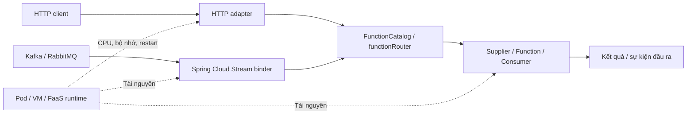
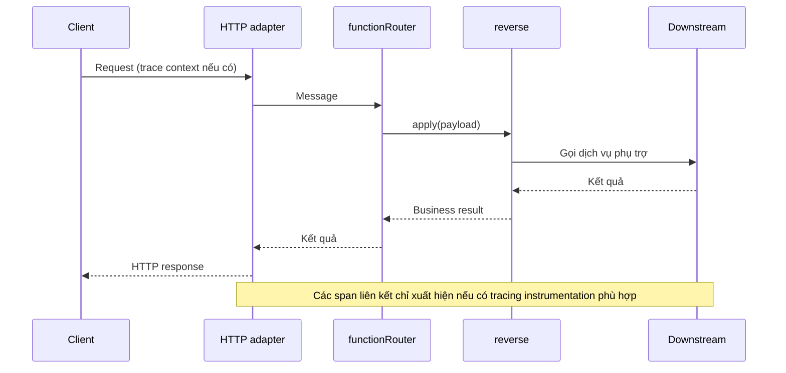
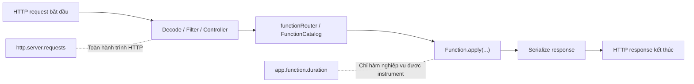

# Phân biệt quan sát từng hàm với quan sát HTTP, binder và nền tảng

## Mục tiêu học tập

Sau bài học, bạn có thể:

1. Phân biệt **quan sát logic của từng `Supplier`, `Function`, `Consumer`** với quan sát **HTTP adapter**, **Spring Cloud Stream binder/broker** và **runtime/nền tảng triển khai**.
2. Giải thích vì sao chỉ thấy HTTP 200, consumer lag bằng 0 hoặc pod đang `Ready` **không đủ** để kết luận nghiệp vụ hoạt động chính xác.
3. Sử dụng `FunctionCatalog`, Spring Boot Actuator, Micrometer metrics, log và distributed tracing để đặt câu hỏi ở đúng tầng.
4. Tự đo số lần gọi, kết quả và thời gian xử lý một `Function<String, String>` bằng `MeterRegistry`, phân biệt metric tự tạo với metric do framework/binder phát sinh.
5. Đọc metric `http.server.requests`, nhận diện các metric đặc thù Kafka binder, consumer lag và chỉ số hạ tầng, đồng thời tránh giả định một metric tồn tại trên mọi phiên bản.
6. Xây dựng correlation từ một lời gọi đầu vào qua `functionRouter`, business function, broker và nền tảng mà không đưa dữ liệu nhạy cảm vào nhãn metric.
7. Chẩn đoán các tình huống HTTP thành công nhưng function lỗi, broker tồn đọng nhưng function nhanh, hoặc function đúng mà nền tảng bị nghẽn tài nguyên.

## 1. Bốn phạm vi quan sát trong Spring Cloud Function

**Spring Cloud Function** khuyến khích đóng gói nghiệp vụ thành các `Supplier<T>`, `Function<T,R>` và `Consumer<T>`, tra cứu qua `FunctionCatalog`, hỗ trợ composition và chuyển đổi message. Các function có thể được gọi từ HTTP, sự kiện qua Spring Cloud Stream hoặc môi trường serverless mà không phải viết lại logic theo giao thức.

Chính đặc điểm **tách logic khỏi giao thức** làm cho việc quan sát cần được tách thành nhiều tầng:

| Phạm vi | Câu hỏi chính | Ví dụ tín hiệu |
| --- | --- | --- |
| **Function / nghiệp vụ** | Hàm nào chạy? Xử lý bao nhiêu dữ liệu? Thành công hay thất bại? | Số lần gọi `uppercase`, số bản ghi hợp lệ, thời gian xử lý hàm, lỗi validation |
| **HTTP adapter** | Client có gửi request đến server? Giao thức phản hồi thế nào? | Số request, status 2xx/4xx/5xx, thời gian HTTP, route/method |
| **Stream binder và broker** | Message có đến/đi từ queue/topic không? Đang tồn đọng bao nhiêu? | Binding state, consumer lag, lỗi publish/consume, retry, DLQ |
| **Runtime / nền tảng** | Ứng dụng có tài nguyên và khả năng phục vụ không? | CPU/RAM, GC, số instance, restart, readiness, FaaS invocation/timeout |



Một function `uppercase` có thể hoạt động tốt khi gọi trực tiếp từ `FunctionCatalog`, nhưng HTTP adapter trả 404 do chưa xuất endpoint. Ngược lại, một HTTP request có thể trả 2xx trong khi application đã **cố ý bỏ qua message** qua một `Consumer` lọc, không tạo ra kết quả nghiệp vụ.

**Nguyên tắc:** cần xác định *tầng nào đang được đo* trước khi dùng một metric làm bằng chứng cho tính đúng đắn của nghiệp vụ.

## 2. Một trường hợp thực tế: cùng một triệu chứng, nhiều nguyên nhân

Giả sử dịch vụ tiếp nhận văn bản, định tuyến đến hai hàm `uppercase` và `reverse`:

```text
POST /functionRouter
  └─ operation: reverse
       └─ functionRouter
            └─ reverse("hello") = "olleh"
```

Ở môi trường HTTP, người dùng báo “response chậm”. Ở môi trường Kafka, đội vận hành báo “topic tồn đọng”. Cả hai có thể cùng chạy code `reverse` nhưng **khác đường vận chuyển**.

| Điều quan sát được | Chưa thể kết luận | Cần xem thêm |
| --- | --- | --- |
| HTTP latency tăng | `reverse` đã trở nên chậm | Function timer, connection pool, queue, web thread, downstream |
| HTTP 200 nhưng body rỗng | Function trả đúng dữ liệu | Nhánh `Consumer`, adapter mapping, policy filtering |
| Kafka consumer lag tăng | Function có bug | Số consumer, partition, broker, tốc độ producer, thời gian hàm |
| Container restart nhiều lần | Function ném exception nghiệp vụ | OOM, health probe, deployment, CPU/memory limit, exit reason |
| `/actuator/functions` có `reverse` | Request đã thực thi `reverse` | Routing decision, input binding/HTTP path, invocation count |
| CPU thấp nhưng throughput thấp | Hệ thống còn dư khả năng xử lý | I/O blocking, backpressure, poll/batch, rate limit, dependency |

Quan sát từ nhiều tầng giúp tránh sửa nhầm một function thuần Java khi vấn đề nằm ở adapter, broker hoặc nền tảng.

## 3. Ba loại tín hiệu: logs, metrics và traces

Ba trụ cột observability không thuộc riêng tầng nào:

- **Metrics:** số liệu tổng hợp theo thời gian, ví dụ `app.function.calls`, `http.server.requests`, broker consumer lag hoặc CPU usage.
- **Logs:** bản ghi sự kiện có ngữ cảnh, ví dụ `function=reverse, outcome=error, reason=invalid_input` kèm correlation ID phù hợp.
- **Traces:** chuỗi các span cho một hành trình xử lý, có thể đi qua HTTP, function, message broker và service khác **nếu** các điểm tích hợp đều được instrument và truyền trace context.



**Micrometer Observation** là một API có thể cung cấp cả metrics và traces tùy `ObservationRegistry` và các handler/exporter đã cấu hình. Tuy nhiên, chỉ thêm Spring Cloud Function không có nghĩa **mọi bean `Function` tự động có metric riêng với đúng tên và nhãn bạn mong muốn**.

### Phân biệt metadata với tín hiệu thực thi

`FunctionCatalog.getNames(null)` hoặc Actuator `/actuator/functions` cho biết **những function có thể tìm thấy**. Chúng không tự cung cấp số lần gọi, độ trễ hoặc tỷ lệ lỗi của từng function. Trái lại, một metric HTTP chỉ chứng minh request đi qua web stack, không chỉ rõ mọi function con đã thực thi.

## 4. Quan sát **từng hàm**: cái gì thuộc trách nhiệm nghiệp vụ?

Một function có thể được gọi từ nhiều môi trường:

```java
Function<String, String> uppercase =
        catalog.lookup(Function.class, "uppercase");
String output = uppercase.apply("hello");
```

Lời gọi này **không cần HTTP request hoặc message broker**. Do vậy, không thể dùng duy nhất `http.server.requests` hoặc Kafka lag để đếm mọi invocation của `uppercase`.

### Chỉ số nên cân nhắc theo mô hình lập trình

| Giao diện | Đơn vị cần xác định | Metric nghiệp vụ minh họa |
| --- | --- | --- |
| `Supplier<T>` | Mỗi lần lấy dữ liệu hoặc mỗi phần tử được tạo | Số lần `get()`, số item xuất ra, lỗi nguồn cung |
| `Function<T,R>` | Một lời gọi hoặc một item được xử lý | Số lần `apply()`, timer xử lý, kết quả success/error |
| `Consumer<T>` | Một lần tiêu thụ và side effect được hoàn tất | Số event xử lý, số event loại bỏ, lỗi ghi DB/publish |
| `Function<Flux<T>,Flux<R>>` | **Cả Publisher** và/hoặc từng phần tử | Số subscription, số phần tử, thời gian pipeline, lỗi Reactor |
| `functionRouter` | Quyết định route của một Message hoặc cả Publisher | Số lần chọn đích, lỗi unknown route, số message qua từng nhánh |

**Đơn vị đo cần được ghi rõ trong tên/description metric.** “Một invocation reactive function” thường là lúc xây dựng pipeline, không nhất thiết tương đương “một event đã hoàn thành”. Nếu cần đếm item, đặt instrument tại nơi item thực sự được xử lý.

Một `Consumer` có thể trả về bình thường nhưng side effect bất đồng bộ chưa hoàn tất. Khi gắn nhãn `success`, phải xác định đang đo **đã nhận lời gọi**, **đã gửi lệnh**, hay **đã commit nghiệp vụ**; ba điều này có ý nghĩa khác nhau.

## 5. Ví dụ Micrometer: đo function bằng `MeterRegistry`

Ví dụ dưới đây tạo một `Function<String,String>` với hai meter **do ứng dụng tự định nghĩa**:

- `app.function.calls`: counter số lần gọi, có tag `function` và `outcome`.
- `app.function.duration`: timer cho thời gian thực thi hàm, cũng phân biệt outcome.

Các tên này **không phải tên metric mặc định được Spring Cloud Function bảo đảm tự phát ra**; chúng là quy ước của ví dụ.

### Dependencies

Với Spring Boot, quản lý phiên bản bằng BOM/dependency management tương thích:

```xml
<!-- Actuator cung cấp cơ sở Micrometer và endpoint metrics -->
<dependency>
    <groupId>org.springframework.boot</groupId>
    <artifactId>spring-boot-starter-actuator</artifactId>
</dependency>

<!-- Chỉ cần khi ứng dụng thực sự được gọi qua Spring Cloud Function Web -->
<dependency>
    <groupId>org.springframework.cloud</groupId>
    <artifactId>spring-cloud-starter-function-web</artifactId>
</dependency>
```

### Một function có instrumentation

```java
package com.example.observability;

import java.util.Locale;
import java.util.function.Function;

import io.micrometer.core.instrument.MeterRegistry;
import io.micrometer.core.instrument.Timer;

import org.springframework.boot.SpringApplication;
import org.springframework.boot.autoconfigure.SpringBootApplication;
import org.springframework.context.annotation.Bean;

@SpringBootApplication
public class FunctionTelemetryApplication {

    public static void main(String[] args) {
        SpringApplication.run(FunctionTelemetryApplication.class, args);
    }

    @Bean
    public Function<String, String> uppercase(MeterRegistry registry) {
        return text -> {
            Timer.Sample sample = Timer.start(registry);
            String outcome = "success";

            try {
                return text.toUpperCase(Locale.ROOT);
            }
            catch (RuntimeException ex) {
                outcome = "error";
                throw ex;
            }
            finally {
                registry.counter(
                        "app.function.calls",
                        "function", "uppercase",
                        "outcome", outcome)
                        .increment();

                sample.stop(Timer.builder("app.function.duration")
                        .description("Thoi gian xu ly mot Function.apply")
                        .tag("function", "uppercase")
                        .tag("outcome", outcome)
                        .register(registry));
            }
        };
    }
}
```

Đoạn ví dụ minh họa cách đo **thời gian của thân `Function.apply`**; nó **không** bao gồm thời gian đợi HTTP, binder nhận message, serializer hoặc broker acknowledgment ở các tầng khác.

Giải thích:

1. `Timer.Sample` bắt đầu khi `apply` được gọi.
2. `outcome` được gắn thành `success` hoặc `error` theo việc hàm trả bình thường hay ném `RuntimeException`.
3. Khối `finally` tăng counter và ghi timer dù gọi thành công hay lỗi.
4. Tag `function=uppercase` có cardinality hữu hạn, không thay đổi theo payload.
5. `MeterRegistry` cung cấp lớp trừu tượng đo metric; một hệ thống export cụ thể cần registry/transport tương ứng.

Ví dụ xử lý chuỗi `hello` có thể tạo một lần gọi `success`, còn truyền `null` trực tiếp trong một unit test Java có thể tạo lỗi. Spring Message thông thường không cho payload `null`, nên đừng coi việc gọi `apply(null)` là ví dụ HTTP hợp lệ.

### Giới hạn của ví dụ

Đoạn trên chủ yếu bắt `RuntimeException`. Trong hệ thống thật, exception, hủy bỏ, timeout và kết quả nghiệp vụ thất bại nhưng **không ném exception** có thể cần các giá trị `outcome` khác. Một `Function` trả thông báo lỗi dưới dạng object có thể hoàn thành bình thường về mặt Java nhưng là thất bại về nghiệp vụ.

Nếu cần instrument từng bean chức năng mà không viết code đo lường lặp lại, có thể cân nhắc wrapper, interceptor hoặc một `Observation` có convention chung. Tuy nhiên phải xác minh wrapper được dùng tại **điểm gọi thật** và không thay đổi input/output generic types hay việc registration của `FunctionCatalog`.

## 6. Kiểm thử metric của một function mà không cần HTTP

Micrometer cung cấp `SimpleMeterRegistry` để kiểm tra trong unit test:

```java
import static org.junit.jupiter.api.Assertions.assertEquals;

import java.util.function.Function;
import io.micrometer.core.instrument.simple.SimpleMeterRegistry;
import org.junit.jupiter.api.Test;

class FunctionTelemetryTest {

    @Test
    void recordsOneSuccessInvocation() {
        try (SimpleMeterRegistry registry = new SimpleMeterRegistry()) {
            Function<String, String> fn =
                    new FunctionTelemetryApplication().uppercase(registry);

            assertEquals("HELLO", fn.apply("hello"));

            assertEquals(1.0,
                    registry.get("app.function.calls")
                            .tag("function", "uppercase")
                            .tag("outcome", "success")
                            .counter().count());

            assertEquals(1L,
                    registry.get("app.function.duration")
                            .tag("function", "uppercase")
                            .tag("outcome", "success")
                            .timer().count());
        }
    }
}
```

Test trên chứng minh **code function tự ghi meter** trong một `MeterRegistry` độc lập. Nó **không** chứng minh `spring-cloud-starter-function-web` đã map URL, `FunctionCatalog` đã route đúng hoặc Kafka binder đã nhận event. Những vấn đề đó cần integration test ở tầng tương ứng.

Nếu dùng `FunctionCatalog` để lấy function trong Spring context, nên kiểm tra rằng bean được đo chính là bean được catalog gọi, không phải một instance Java khác không có instrumentation.

## 7. Xem metrics qua Spring Boot Actuator

Với `spring-boot-starter-actuator` và một web stack đang chạy, có thể mở endpoint `metrics` tại management server:

```yaml
management:
  endpoints:
    web:
      exposure:
        include: "health,info,metrics"
  metrics:
    tags:
      application: function-telemetry-demo
```

Sau khi đã thực sự gọi `uppercase`, có thể thử:

```bash
# Liệt kê meter được đăng ký
curl -i http://localhost:8080/actuator/metrics

# Đọc counter do ứng dụng tự tạo
curl -i http://localhost:8080/actuator/metrics/app.function.calls

# Lọc theo function và outcome
curl -i "http://localhost:8080/actuator/metrics/app.function.calls?tag=function:uppercase&tag=outcome:success"

# Đọc timer do ứng dụng tự tạo
curl -i http://localhost:8080/actuator/metrics/app.function.duration
```

Tên meter tại `/actuator/metrics` phải dùng **tên gốc trong Java**, không phải tên đã được Prometheus chuyển sang snake_case. Nếu bạn chưa gọi function hoặc registry chưa đăng ký meter thì có thể chưa thấy tên metric đó.

### Nếu cần Prometheus

Thêm registry Prometheus phù hợp với phiên bản Micrometer:

```xml
<dependency>
    <groupId>io.micrometer</groupId>
    <artifactId>micrometer-registry-prometheus</artifactId>
</dependency>
```

Và exposure:

```yaml
management:
  endpoints:
    web:
      exposure:
        include: "health,metrics,prometheus"
```

Khi đó endpoint `/actuator/prometheus` có thể xuất các meter của registry dưới định dạng Prometheus. Tên metrics sau chuyển đổi có thể khác tên trong Java, ví dụ dấu chấm thành dấu gạch dưới và timer theo đơn vị thời gian được Prometheus quy ước. Hãy xem **dữ liệu thực xuất ra** trước khi viết truy vấn và cảnh báo; không tự suy tên series chỉ từ tên Java.

Endpoint `metrics` và `prometheus` đều thuộc **management plane**, phải được xác thực/phân quyền và giới hạn mạng phù hợp. Không cần mở cả hai endpoint nếu hệ thống giám sát chỉ yêu cầu một trong hai.

## 8. Quan sát HTTP adapter: request khác invocation function

Spring Boot Actuator thường tự instrument **Spring MVC/WebFlux** nếu cơ sở Micrometer/Observation được cấu hình. Với convention Micrometer mặc định, metric HTTP server thường có tên:

```text
http.server.requests
```

Ví dụ:

```bash
curl -i "http://localhost:8080/actuator/metrics/http.server.requests"
```

Các nhãn như `method`, `uri`, `status`, `outcome` và exception phụ thuộc framework/observation convention, phiên bản, khả năng nhận diện route và cấu hình dự án. Một số dự án dùng OpenTelemetry semantic conventions có thể dùng tên meter khác; khi đó hãy lấy danh sách meter thực tế từ `/actuator/metrics`.

### HTTP metric đo khoảng nào?



HTTP request latency thường bao gồm nhiều phần trước/sau `Function.apply`: network ở server side, body decoding, security filters, conversion, routing, serialization và response. Metric function tự tạo ở mục 5 **chỉ đo đoạn logic được bọc bằng timer**.

### Vì sao hai con số không nhất thiết bằng nhau?

| Tình huống | HTTP metric | Function metric |
| --- | --- | --- |
| Request bị security từ chối trước khi gọi function | Có thể ghi một HTTP 401/403 | Không có invocation nếu function chưa chạy |
| `POST` gọi endpoint không tồn tại | Có HTTP 404 | Không có function được gọi |
| Request qua `functionRouter`, chọn composition hai bước | Một HTTP request | Có thể ghi **hai** function invocation nếu cả hai bean được instrument |
| Client ngắt kết nối khi xử lý | Có thông tin HTTP error/cancel tùy adapter | Function có thể đang chạy hoặc đã dừng |
| Một `Supplier` được scheduler/binder gọi, không có HTTP | Không tăng `http.server.requests` | Metric supplier có thể tăng |
| Một request gọi function nhiều lần trong code | Một HTTP request | Nhiều lần ghi metric function |

Như vậy, không có quy tắc `HTTP request count = function invocation count`. Chỉ so sánh khi đã xác định rõ hành trình xử lý, retry, batching và thành phần được instrument.

## 9. Quan sát Spring Cloud Stream binder và broker

Với Spring Cloud Stream, binder nối logic `Supplier`/`Function`/`Consumer` với broker. Một ứng dụng có thể dùng cùng bean `uppercase` qua Kafka hoặc RabbitMQ mà không nhận HTTP request.

Ví dụ binding:

```yaml
spring:
  cloud:
    function:
      definition: uppercase
    stream:
      bindings:
        uppercase-in-0:
          destination: text-requests
        uppercase-out-0:
          destination: text-results
```

Đây là cấu hình **tên binding/destination**, chưa gồm starter binder, kết nối broker hoặc chính sách retry. Trong mô hình này:

- **Function metric**: `uppercase` thực thi bao nhiêu lần, mất bao lâu, thành công hay lỗi.
- **Binder metric**: message được nhận/gửi, tình trạng binding, lỗi publish/consume, retry hoặc thông tin tùy binder hỗ trợ.
- **Broker metric**: topic/queue backlog, producer rate, consumer lag, partition, broker availability.

### Kafka binder: consumer lag

Tài liệu Spring Cloud Stream Kafka binder mô tả một metric đáng quan sát:

```text
spring.cloud.stream.binder.kafka.offset
```

Metric này phản ánh **độ lệch số record chưa được tiêu thụ** giữa vị trí offset của consumer group và offset mới nhất của topic, theo cách tính của binder. Nó có ngữ cảnh như consumer group và topic, và hữu ích cho vận hành/autoscaling.

**Quan trọng:** đây là metric **đặc thù Kafka binder và phiên bản/cấu hình**, không phải metric chung cho mọi binder RabbitMQ, Pulsar hay mọi phiên bản Spring Cloud Stream. Metric có thể phụ thuộc classpath Micrometer, cấu hình thu thập và quyền truy cập broker.

Ví dụ chẩn đoán:

```text
Consumer lag đang tăng
├── Function duration tăng?
│   ├── Có  -> xem code, I/O, downstream, dữ liệu bất thường
│   └── Không -> xem consumer concurrency, partition, rate đầu vào
└── Binder/broker có lỗi?
    ├── Có  -> xem connection, rebalance, retry, DLQ
    └── Không -> xem phân bố traffic và khả năng xử lý
```

**Lag cao không chứng minh function chậm**, vì producer có thể phát nhanh hơn khả năng song song của số consumer. **Lag bằng 0 cũng không chứng minh mọi message xử lý nghiệp vụ thành công**, bởi message có thể được acknowledgment hoặc đưa vào nhánh bỏ qua tùy chính sách.

### RabbitMQ và binder khác

Với RabbitMQ, cần chú ý ready/unacked messages, consumer count, publish/ack rate, channel/connection và các chỉ số cụ thể của broker. Không sử dụng tên `spring.cloud.stream.binder.kafka.offset` để chẩn đoán Rabbit binder.

Từng binder có lựa chọn metric và observation riêng. Hãy kiểm tra tài liệu **binder + phiên bản** và danh sách meter thực tế thay vì mặc định một bộ metric chung xuất hiện ở mọi ứng dụng Spring Cloud Function.

### Cần phân biệt lỗi nghiệp vụ với lỗi giao nhận

Một `Consumer` có thể ghi dữ liệu vào database rồi ném exception; binder có thể phát lại message, khiến nghiệp vụ xử lý trùng nếu không idempotent. Khi retry xảy ra:

- Counter function có thể ghi **nhiều lần thử**.
- Broker lag/offset có thể phản ánh trạng thái consumption.
- “Số giao dịch duy nhất đã commit” cần metric nghiệp vụ riêng.

Vì vậy, luôn đặt tên rõ: `attempts`, `processed`, `committed`, `discarded` hay `failed`, thay vì chỉ gọi mọi metric là `messages`.

## 10. Quan sát runtime và nền tảng triển khai

Một ứng dụng có metrics nghiệp vụ tốt vẫn có thể gặp sự cố hạ tầng:

| Nền tảng | Tín hiệu cần xem | Điều không thể suy ra |
| --- | --- | --- |
| JVM / Spring Boot | `jvm.memory.*`, `jvm.gc.*`, `process.cpu.usage`, thread, uptime | Không cho biết bản ghi nghiệp vụ nào bị loại |
| Kubernetes | Pod ready, restart/OOMKilled, CPU/memory limit, HPA, network | Pod `Ready` không đồng nghĩa từng function trả đúng |
| VM/container | CPU throttling, memory pressure, disk/network, process exit | CPU thấp không chứng minh binder/broker khỏe |
| AWS Lambda / FaaS | Invocation, duration, concurrency, timeout, cold start, throttling, retry theo nhà cung cấp | Một invocation không nhất thiết bằng một business item nếu event chứa batch |
| Cloud Run / serverless containers | Request/concurrency, instance scaling, latency, memory, errors | Request thành công không khẳng định side effect nghiệp vụ đã commit |

Tên metric và nguồn thu thập cụ thể khác nhau theo cloud provider/runtime. Nên dùng nền tảng giám sát tương ứng kết hợp Actuator/Micrometer khi phù hợp.

### Ví dụ: latency tăng do CPU throttling

Giả sử function timer vẫn ổn khi chạy local, nhưng HTTP P95 tăng trong Kubernetes:

1. Kiểm tra `http.server.requests` để xác nhận request chậm.
2. So sánh `app.function.duration`; nếu function không chậm tương ứng, xem queue, thread, serialization hoặc network.
3. Xem CPU throttling, CPU limit, restart, GC và pool của JVM.
4. Kiểm tra thay đổi replica/traffic và downstream latency.
5. Đối chiếu trace của một request cụ thể nếu tracing có sẵn.

Sửa `Function.apply` chưa chắc hiệu quả nếu độ trễ chủ yếu đến từ tài nguyên hoặc adapter.

## 11. Kết nối các tầng bằng correlation ID và distributed tracing

Muốn chẩn đoán một lỗi xuyên tầng, cần có **khóa tương quan** phù hợp:

- **Trace ID / span ID**: dùng để liên kết các bước trong distributed tracing khi instrumentation và context propagation được bật.
- **Message ID / correlation ID**: định danh message hoặc đơn vị công việc theo hợp đồng ứng dụng; có thể đi qua broker.
- **Business key**: ví dụ ID đơn hàng trong hệ thống nội bộ, chỉ được dùng ở logs/traces có kiểm soát, **không đưa thành nhãn metrics cardinality cao**.

```text
requestId=req-42
  HTTP POST /process
    trace=abc... span=http
       └─ functionRouter -> uppercase
           trace=abc... span=function
               └─ publish -> text-results
                   trace context trong broker headers nếu được instrument
                       └─ downstream consumer
```

**Không mặc định có trace propagation.** Việc đưa `traceparent` hoặc propagation metadata qua HTTP/Kafka/RabbitMQ cần tracing bridge, instrumentation và cấu hình context propagation thích hợp. Một function Java thuần có thể không có active trace dù ứng dụng đang dùng Micrometer metrics.

### Tránh làm metric trở thành dữ liệu vô hạn nhãn

Nhãn metric nên có cardinality thấp và hữu hạn:

| Nhãn phù hợp | Nhãn cần tránh trên meter phổ thông |
| --- | --- |
| `function=uppercase` | `orderId=1234567` |
| `outcome=success/error` | `userId=...` |
| `route=reverse` từ tập route cố định | Toàn bộ `payload` hoặc tên file động |
| `environment=prod/staging` | `traceId`, `requestId` khác nhau theo từng request |

Thông tin cá thể có thể được lưu trong trace/log **với kiểm soát quyền và chính sách bảo mật**, thay vì nhân số lượng time series trong hệ thống metrics. Không ghi token, mật khẩu hay dữ liệu cá nhân nhạy cảm vào logs, tags hoặc exception messages.

## 12. Với reactive function: đo đúng thời điểm thực thi

Một reactive function có dạng:

```java
Function<Flux<String>, Flux<String>>
```

Một lời gọi `apply(flux)` thường chỉ **xây dựng pipeline**. Các phần tử thực sự chạy khi Publisher được subscribe. Vì vậy, đặt timer chỉ quanh `apply(...)` thường **không đo được thời gian xử lý từng phần tử**.

Ví dụ đo thời gian map từng item:

```java
import java.util.Locale;
import java.util.function.Function;

import io.micrometer.core.instrument.MeterRegistry;
import io.micrometer.core.instrument.Timer;
import org.springframework.context.annotation.Bean;
import reactor.core.publisher.Flux;

@Bean
public Function<Flux<String>, Flux<String>> uppercaseStream(
        MeterRegistry registry) {
    Timer elementTimer = Timer.builder("app.function.element.duration")
            .tag("function", "uppercaseStream")
            .register(registry);

    return values -> values.map(value ->
            elementTimer.record(() -> value.toUpperCase(Locale.ROOT)));
}
```

Ở đây `map` thực thi khi Reactor phát phần tử, nên timer đo **phép chuyển đổi từng item**. Tuy nhiên nó không bao gồm thời gian item đợi trong queue, I/O downstream hoặc toàn bộ vòng đời `Flux`.

Nếu muốn đo **thời gian subscription đến completion/cancellation** của một Publisher, cần tạo mẫu timer **theo mỗi subscription**, ví dụ bằng `Flux.defer` kết hợp `doFinally`; phải đặc biệt lưu ý luồng vô hạn có thể không hoàn tất và phép đo “whole stream duration” có thể không hữu ích. Trước khi gắn meter, hãy quyết định đơn vị đo là **subscription, item, batch hay nghiệp vụ đã commit**.

Với `flatMap`, concurrency, reordering và retry, số phần tử được xử lý có thể khác số lời gọi function; lỗi/cancellation cũng thay đổi cách đếm. Các đặc điểm này không thể suy ra chỉ từ `http.server.requests` hoặc `spring.cloud.stream.binder.kafka.offset`.

## 13. Thiết kế dashboard theo tầng và theo mục tiêu vận hành

Một dashboard hữu ích nên có các panel đủ để trả lời câu hỏi **“Sự cố bắt đầu ở tầng nào?”** thay vì trộn tất cả số liệu vào một biểu đồ.

| Panel | Chỉ số gợi ý | Câu hỏi được trả lời |
| --- | --- | --- |
| **Traffic đầu vào** | HTTP RPS/status; broker input rate | Có bao nhiêu request/event đến? |
| **Route và function** | `app.function.calls`, `outcome`, thời gian xử lý, route count | Hàm nào được gọi? Có lỗi nghiệp vụ? |
| **HTTP** | `http.server.requests` P95/P99, 4xx/5xx | Phần giao thức web có chậm/lỗi không? |
| **Binder/broker** | Consumer lag, publish errors, retry, DLQ count | Message có tồn đọng hay thất bại vận chuyển? |
| **Nền tảng** | CPU/RAM, restart, ready instances, scaling | Có vấn đề tài nguyên/triển khai không? |
| **Correlation/traces** | Trace search, exemplar, log correlation | Một hành trình lỗi cụ thể đi qua những thành phần nào? |

### Gợi ý cảnh báo

- **HTTP availability:** tỷ lệ 5xx hoặc request timeout vượt ngưỡng theo SLO của dịch vụ.
- **Function correctness:** tỷ lệ lỗi nghiệp vụ hoặc số message bị loại bỏ bất thường, kể cả khi HTTP 2xx.
- **Kafka consumption:** lag tăng liên tục trong khi input rate cao, hoặc consumer không tiến triển.
- **Runtime health:** pod restart bất thường, OOMKilled, CPU throttling kéo dài, không đủ ready replicas.
- **Dead-letter/retry:** số thông điệp vào DLQ hoặc số lần xử lý lại vượt mức dự kiến.

Không dùng một ngưỡng chung cho mọi function và mọi workload. `Supplier` theo lịch có đặc tính khác với HTTP function ngắn hạn hoặc consumer xử lý batch lớn. Ngưỡng cần dựa trên nhu cầu nghiệp vụ, lưu lượng và SLA/SLO cụ thể.

## 14. Chẩn đoán theo triệu chứng

| Triệu chứng | Quan sát đầu tiên | Cần đối chiếu tiếp |
| --- | --- | --- |
| `POST /uppercase` trả 404 | HTTP mapping và adapter `spring.cloud.function.definition` | `FunctionCatalog.getNames(null)`, Function Web path, security |
| HTTP 200 nhưng không có kết quả nghiệp vụ | HTTP body và function metrics | Router có chọn `Consumer devNull`? Side effect đã commit chưa? |
| HTTP latency cao, function timer thấp | `http.server.requests` | Security/conversion/network/downstream/thread/CPU |
| Function timer cao, HTTP latency cũng cao | `app.function.duration` theo outcome | I/O trong function, downstream, GC, dữ liệu đầu vào |
| Kafka lag tăng, function xử lý nhanh | Binder/broker metrics | Partition, consumer concurrency, rebalance, tốc độ producer |
| Kafka lag thấp nhưng kết quả thiếu | Business counters và logs | Drop/filter, ack trước commit, retry/DLQ, serialization |
| Function lỗi nhiều, pod vẫn `Ready` | Function outcome counter | Lỗi dữ liệu, validation, quyền downstream |
| Pod restart nhưng catalog có đủ function | Platform restart/OOM/exit reason | Memory limit, probes, startup/config |
| Không thấy `app.function.calls` | Có thực thi function chưa? | Instrumentation bean có được gọi, MeterRegistry có export không |
| Không thấy `http.server.requests` | Web stack/observation registry/metric convention | App không nhận HTTP, auto-instrumentation bị vô hiệu, tên meter khác |
| Không thấy Kafka offset lag metric | Có đúng Kafka binder và Micrometer không? | Binder version, consumer group, metrics config và broker permissions |
| Không có trace liên kết từ HTTP sang broker | Tracing bridge và propagation | Instrumentation trên producer/consumer, sampling và headers |

Quy trình tổng quát:

```text
1. Chọn một yêu cầu hoặc event cụ thể và xác định đường vào.
2. Kiểm tra adapter HTTP hoặc binding/broker thực sự nhận dữ liệu chưa.
3. Kiểm tra routing/FunctionCatalog đã chọn đúng hàm chưa.
4. Kiểm tra số lần gọi, outcome và duration của hàm.
5. Kiểm tra conversion, retry, DLQ và side effect nghiệp vụ.
6. Kiểm tra tài nguyên nền tảng và các downstream dependency.
7. Dùng trace/correlation ID nối các mảnh bằng chứng.
```

Điều quan trọng không phải đo **càng nhiều càng tốt**, mà là đo đủ để xác định trách nhiệm của từng tầng khi một triệu chứng xuất hiện.

## 15. Những nhầm lẫn cần tránh

**Nhầm 1 — “Có trong `FunctionCatalog` nghĩa là đã được gọi.”** Sai. Catalog cho biết khả năng lookup; invocation phải được xác minh qua counter, logs hoặc traces ở đường gọi thực tế.

**Nhầm 2 — “HTTP 200 nghĩa là business success.”** Không nhất thiết. Một `Consumer` có thể chấp nhận message rồi không tạo output, hoặc request kết thúc trước khi tác vụ bất đồng bộ hoàn tất.

**Nhầm 3 — “HTTP latency bằng function duration.”** Hai phép đo bao phủ các khoảng khác nhau; còn routing, conversion, serialization, network và queue.

**Nhầm 4 — “Kafka lag bằng 0 là xử lý không lỗi.”** Lag phản ánh tiến độ tiêu thụ offset, không xác nhận kết quả nghiệp vụ cuối cùng.

**Nhầm 5 — “Pod Ready là function khỏe.”** Readiness cho biết điều kiện phục vụ theo probe, không tự kiểm tra từng bean hoặc dữ liệu nghiệp vụ.

**Nhầm 6 — “Có Actuator thì đã có tracing end-to-end.”** Cần tracing bridge, exporter, instrumentation và context propagation thích hợp; sampling cũng ảnh hưởng khả năng tìm trace.

**Nhầm 7 — “Thêm userId vào metric tag giúp debug tốt hơn.”** Cardinality cao có thể gây bùng nổ time series; nên dùng trace/log được kiểm soát cho dữ liệu cá thể.

**Nhầm 8 — “Một lần `Function<Flux, Flux>.apply` là một event.”** Thường chỉ dựng pipeline cho Publisher; cần đo trên tín hiệu Reactor nếu mục tiêu là từng phần tử.

## 16. Bài tập thực hành

1. Viết một `Function<String, String> uppercase`, gọi trực tiếp qua `FunctionCatalog` mà không qua HTTP. Giải thích vì sao `app.function.calls` có thể tăng nhưng `http.server.requests` không tăng.
2. Instrument `uppercase` bằng `MeterRegistry` như mục 5. Viết `SimpleMeterRegistry` unit test cho số lần gọi và timer sau hai lần `apply`.
3. Thêm `spring-boot-starter-actuator`, mở `metrics` trong môi trường phát triển, rồi thử `GET /actuator/metrics/app.function.calls` sau khi đã gửi request hợp lệ.
4. Dùng Function Web gọi một function qua HTTP. So sánh dữ liệu của `http.server.requests` với `app.function.duration`. Liệt kê ít nhất bốn đoạn xử lý có thể làm HTTP latency lớn hơn thời gian của thân hàm.
5. Tạo hai function và một `functionRouter`. Một request qua router chọn composition `uppercase|reverse`. Giải thích vì sao một HTTP request có thể dẫn tới hai lần function invocation.
6. Chuyển `uppercase` sang Spring Cloud Stream Kafka binding. Nêu khi nào function metric tăng, khi nào Kafka lag tăng và vì sao hai metric không nên được coi là cùng một giá trị.
7. Giả sử Kafka lag tăng nhưng duration mỗi function giữ nguyên. Đề xuất cách kiểm tra partition, consumer concurrency, input rate và broker rebalance.
8. Giả sử HTTP 200 nhưng dữ liệu không được ghi xuống database. Thiết kế các metric cho ba trạng thái: message **được nhận**, **đã xử lý** và **đã commit**.
9. Một ứng dụng chạy trên Kubernetes có nhiều OOMKilled nhưng function timer bình thường ở local. Chỉ ra các metric nền tảng, JVM và adapter cần điều tra.
10. Viết một `Function<Flux<String>, Flux<String>>` và đo thời gian xử lý mỗi phần tử trong `map`. Giải thích vì sao timer quanh `apply(flux)` không đo được cùng đơn vị.
11. Vẽ một trace xuyên HTTP → router → function → broker → consumer. Nêu vị trí cần propagation và tại sao không được dùng trace ID làm nhãn metric.
12. Thiết kế dashboard gồm bốn hàng: function, HTTP, binder/broker và runtime. Với mỗi hàng, chọn ít nhất hai tín hiệu và một cảnh báo phù hợp workload.

## Ghi nhớ

- **Quan sát từng hàm** đo logic nghiệp vụ và các lời gọi `Supplier`/`Function`/`Consumer`; **quan sát HTTP** đo giao thức request-response; **binder/broker** đo vận chuyển sự kiện; **platform** đo sức khỏe tài nguyên và triển khai.
- `FunctionCatalog` hoặc `/actuator/functions` **liệt kê khả năng**, không tự cho biết số lần thực thi hay thời gian xử lý.
- Spring Boot có HTTP metrics như `http.server.requests`; Kafka binder có thể phát metric consumer lag như `spring.cloud.stream.binder.kafka.offset`. Những meter này **không thay thế metric riêng cho business function**.
- Dùng Micrometer `MeterRegistry` hoặc `ObservationRegistry` để instrument function tại **ranh giới xử lý thật**, với nhãn cardinality thấp và định nghĩa `success`/commit rõ ràng.
- Với reactive `Flux`, việc gọi `apply` có thể mới tạo Publisher; muốn đo item phải instrument lúc Reactor thực sự xử lý item.
- Để chẩn đoán end-to-end, cần ghép metrics, logs, traces, correlation context và cấu hình adapter/binder/runtime; không suy tính đúng nghiệp vụ từ một tín hiệu đơn lẻ.

### Tài liệu tham khảo chính thức

- [Spring Cloud Function — Programming Model và FunctionCatalog](https://docs.spring.io/spring-cloud-function/reference/spring-cloud-function/programming-model.html)
- [Spring Cloud Function — Functional bean definitions, Function visualization](https://docs.spring.io/spring-cloud-function/reference/functional.html)
- [Spring Boot — Metrics, HTTP Server Requests, Actuator Metrics Endpoint](https://docs.spring.io/spring-boot/reference/actuator/metrics.html)
- [Spring Boot — Observability: Metrics, Traces và Logs](https://docs.spring.io/spring-boot/reference/actuator/observability.html)
- [Spring Cloud Stream — Kafka binder metrics](https://docs.spring.io/spring-cloud-stream/reference/5.0/kafka/kafka-binder/metrics.html)
- [Spring Cloud Stream — Reference](https://docs.spring.io/spring-cloud-stream/reference/)
- [Spring Framework — Observability Support](https://docs.spring.io/spring-framework/reference/integration/observability.html)
