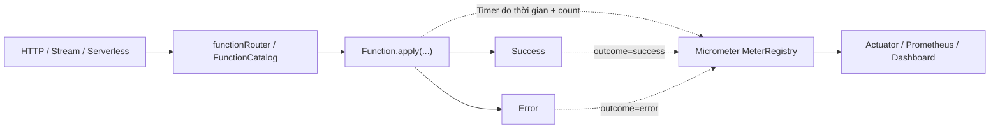

# Đo thời lượng, số lần gọi và tỷ lệ lỗi

## Mục tiêu học tập

Sau bài này, bạn có thể:

1. Xác định **đơn vị đo** cho `Supplier`, `Function`, `Consumer` của Spring Cloud Function: lời gọi, phần tử, message, batch hay giao dịch hoàn tất.
2. Sử dụng Micrometer `Timer` để ghi **thời lượng và số lần thực thi**, `Counter` để đếm các sự kiện nghiệp vụ khác, tránh đếm trùng không cần thiết.
3. Định nghĩa **tỷ lệ lỗi** có mẫu số rõ ràng và tính bằng các khoảng thời gian, không nhầm lỗi function với HTTP 5xx hoặc lỗi broker.
4. Instrument một bean `Function<String, String>` với các nhãn `function` và `outcome`, kiểm thử bằng `SimpleMeterRegistry`.
5. Quan sát meter bằng Spring Boot Actuator và Prometheus, phân biệt COUNT, TOTAL_TIME, trung bình, percentile và histogram.
6. Đo đúng ranh giới với `functionRouter`, composition, HTTP, Spring Cloud Stream, serverless và reactive `Flux`.
7. Thiết kế dashboard, cảnh báo và kiểm tra lỗi khi metric vắng mặt, tăng bất thường hoặc bị sai lệch do retry và nhãn có cardinality cao.

## 1. Vì sao cần đo ba đại lượng cùng nhau?

Spring Cloud Function giúp viết logic nghiệp vụ độc lập giao thức với các bean `Supplier<T>`, `Function<T,R>` và `Consumer<T>`. `FunctionCatalog` đăng ký và tra cứu hàm, hỗ trợ composition, chuyển đổi thông điệp; các adapter có thể gọi cùng logic qua HTTP, sự kiện hoặc serverless.

Một hàm `normalizeText` có thể vẫn xuất hiện trong `FunctionCatalog`, nhưng điều đó **không cho biết**:

- Hàm đã được gọi bao nhiêu lần.
- Mỗi lần gọi mất bao lâu.
- Bao nhiêu lời gọi thành công hoặc lỗi.

Chẩn đoán ba đại lượng này thường là điểm khởi đầu tốt nhất cho observability ở cấp function.

| Đại lượng | Câu hỏi | Ví dụ minh họa |
| --- | --- | --- |
| **Số lần gọi** | Hàm có được thực thi không? Lưu lượng đang tăng hay giảm? | `normalizeText`: 1.200 lần trong 5 phút |
| **Thời lượng** | Thời gian xử lý một lần gọi là bao nhiêu? | Trung bình 12 ms; P95 40 ms |
| **Tỷ lệ lỗi** | Trong số những lần được đo, bao nhiêu lần không đạt tiêu chí thành công? | 42 lỗi trên 1.200 lần = **3,5%** |

Chỉ đo một đại lượng có thể dẫn đến kết luận sai: P95 thấp khi gần như không có traffic chưa chắc dịch vụ khỏe; số lần gọi cao nhưng tỷ lệ lỗi cũng cao có thể là hệ thống đang retry liên tục.



**Mục tiêu là đo đúng ranh giới thực thi.** Metric ở cấp function chỉ được tăng khi function thực sự chạy; nó không tự bao gồm mọi thời gian chờ ở web server, binder hoặc nền tảng cloud.

## 2. Chốt đơn vị đo trước khi chọn metric

Không phải mọi functional bean đều có cùng vòng đời:

| Kiểu hàm | Đơn vị tự nhiên | Dễ nhầm với |
| --- | --- | --- |
| `Supplier<T>` | Một lần gọi `get()` | Số item được tạo, đặc biệt nếu một lần trả danh sách |
| `Function<T,R>` | Một lần gọi `apply(T)` | Số HTTP request hoặc số kết quả nghiệp vụ đã commit |
| `Consumer<T>` | Một lần gọi `accept(T)` | Số side effect đã ghi bền vững |
| `Function<Message<T>,R>` | Một lần xử lý một Spring `Message` | Số record trong payload dạng batch |
| `Function<Flux<T>,Flux<R>>` | Một lần tạo pipeline, một subscription hoặc một phần tử tùy thiết kế | Cả ba đơn vị bị đếm như nhau |
| `RoutingFunction` | Một quyết định điều phối | Số lần thực thi ở từng nhánh hoặc từng bước composition |

Ví dụ một Message chứa 100 đơn hàng, nhưng `Function<List<Order>, List<Receipt>>` được gọi **một lần**. Nếu chỉ dùng invocation counter, giá trị là 1 chứ không phải 100.

Ngược lại, nếu một `functionRouter` gọi composition `validate|enrich|persist` và cả ba function đều có timer riêng, một Message có thể dẫn đến **ba lần ghi timer của function**, trong khi HTTP adapter chỉ nhận **một request**.

Vì thế hãy viết mô tả metric rõ: `function invocations`, `input items`, `business commits`, `message attempts` hoặc `consumer acknowledgments`. Những tên này không thể hoán đổi.

## 3. Micrometer: `Counter` và `Timer` khác nhau như thế nào?

Micrometer là thư viện đo metrics được Spring Boot Actuator tích hợp. `MeterRegistry` quản lý các meter, hỗ trợ xuất sang nhiều backend qua registry tương ứng.

### `Counter`: sự kiện chỉ tăng

```java
import io.micrometer.core.instrument.Counter;

Counter rejected = Counter.builder("app.function.rejected")
        .description("So input bi tu choi vi vi pham validation")
        .tag("function", "normalizeText")
        .register(registry);

rejected.increment();
```

Counter chỉ tăng một lượng không âm, thường dùng cho các sự kiện như `rejected`, `discarded`, `retried`, `committed`. Counter tăng từ lúc JVM chạy và có thể bắt đầu lại từ 0 khi ứng dụng khởi động lại; để phân tích lưu lượng nên quan sát **tốc độ tăng theo một khoảng thời gian** thay vì chỉ nhìn tổng số tuyệt đối.

### `Timer`: thời lượng **và số lần**

```java
import io.micrometer.core.instrument.Timer;

Timer execution = Timer.builder("app.function.execution")
        .description("Thoi gian mot lan Function.apply")
        .tag("function", "normalizeText")
        .tag("outcome", "success")
        .register(registry);

execution.record(() -> doSomeWork());
```

Một `Timer` tối thiểu có **COUNT** (số lần ghi) và **TOTAL_TIME** (tổng thời lượng), có thể có MAX, histogram, percentiles tùy backend và cách cấu hình. Do đó, nếu mọi invocation đều đã được đo bằng Timer, **không cần thêm Counter chỉ để đếm lại chính các invocation đó**.

| Meter | Đo gì? | Mẫu dùng hợp lý |
| --- | --- | --- |
| `Counter` | Số sự kiện | Số đơn hàng bị loại vì validation |
| `Timer` | Số lần + thời lượng của đoạn code | Thời gian mỗi lần `normalizeText.apply` |
| `DistributionSummary` | Phân phối một giá trị không phải thời gian | Kích thước payload (bytes), số item trong batch |
| `Gauge` | Giá trị tại thời điểm quan sát | Số tác vụ đang chờ xử lý |
| `LongTaskTimer` | Thời lượng các tác vụ đang kéo dài | Batch/operation kéo dài hoặc chạy liên tục |

**Ghi nhớ:** `Timer` đã chứa số lần gọi. Một Counter riêng chỉ có ý nghĩa khi nó mô tả **sự kiện khác** (ví dụ số input không hợp lệ) hoặc có ranh giới đo khác được định nghĩa rõ ràng.

## 4. Công thức cho số lần gọi, thời lượng và tỷ lệ lỗi

Giả sử tất cả invocation của một function được ghi vào hai Timer cùng tên, phân biệt bởi tag `outcome=success` và `outcome=error`.

Trong một cửa sổ quan sát `W`:

\[
N_{\mathrm{total}}(W)
= N_{\mathrm{success}}(W) + N_{\mathrm{error}}(W)
\]

\[
\mathrm{ErrorRate}(W)
= \frac{N_{\mathrm{error}}(W)}{N_{\mathrm{total}}(W)} \times 100\%
\]

Nếu 5 phút có 1.158 lần thành công và 42 lần lỗi, thì:

\[
\mathrm{ErrorRate}(5\,\mathrm{phút})
= \frac{42}{1158+42}\times100\% = 3.5\%
\]

**Điều kiện:** mẫu số phải khác 0. Khi không có traffic, tỷ lệ lỗi là **không xác định**, không nên tự động coi bằng 0% rồi kết luận dịch vụ khỏe.

### Một vài đại lượng thời gian

| Đại lượng | Ý nghĩa | Lưu ý |
| --- | --- | --- |
| `count` | Số lần Timer ghi nhận | Chính là số invocation ở ranh giới đã instrument |
| `totalTime` | Tổng thời lượng các lần gọi | Dùng để tính trung bình |
| **Mean** | `totalTime / count` | Dễ bị vài request rất chậm làm lệch |
| **P50** | Một nửa lần gọi có thời gian không vượt quá giá trị P50 | Cần dữ liệu phân phối phù hợp |
| **P95/P99** | 95%/99% lần gọi có thời gian không vượt quá ngưỡng | Cần histogram hoặc cơ chế percentile được cấu hình |
| **Max** | Giá trị lớn nhất quan sát trong cửa sổ thống kê của meter | Không nhất thiết là max từ lúc JVM khởi động |

`Timer` không tự bảo đảm Prometheus có tất cả percentiles/histogram buckets nếu bạn chưa cấu hình công bố các thống kê đó. Phân vị của nhiều instance **không nên lấy trung bình các P95 riêng lẻ**; với Prometheus thường tổng hợp các bucket rồi tính percentile.

### Phải định nghĩa thế nào là lỗi

Một hàm có thể:

- Ném `IllegalArgumentException` vì input sai.
- Ném lỗi do downstream timeout.
- Trả `Result.failure(...)` nhưng **không ném exception**.
- Chấp nhận Message nhưng side effect ghi DB sau đó thất bại trong luồng bất đồng bộ.

Đây là bốn tình huống khác nhau. Ví dụ code bên dưới dùng tiêu chí đơn giản: **hàm ném lỗi thì `outcome=error`**, trả bình thường thì `success`. Trong sản phẩm thật, có thể cần tách `rejected`, `business_failure`, `technical_error` và `cancelled`, cùng tài liệu mô tả mẫu số cho từng SLI.

## 5. Ví dụ Spring Cloud Function có đo ba đại lượng

Ứng dụng dùng `Function<String,String>` và tự instrument bên trong lambda. Cách này làm phép đo gắn với **lần gọi `apply` thực tế**, dù function được kích hoạt qua `FunctionCatalog`, HTTP hay broker.

### 5.1. Dependencies

Quản lý Spring Boot và Spring Cloud Function bằng các phiên bản tương thích qua BOM/dependency management:

```xml
<dependency>
    <groupId>org.springframework.boot</groupId>
    <artifactId>spring-boot-starter-actuator</artifactId>
</dependency>

<!-- Dùng khi cần ví dụ Function Web chạy qua HTTP. -->
<dependency>
    <groupId>org.springframework.cloud</groupId>
    <artifactId>spring-cloud-starter-function-web</artifactId>
</dependency>
```

`spring-boot-starter-actuator` cung cấp tích hợp Micrometer; `MeterRegistry` được Spring Boot tự cấu hình khi các điều kiện tương ứng thỏa mãn. Nếu chỉ dùng Spring Cloud Function context không có Actuator, cần tự cung cấp registry thích hợp.

### 5.2. Đăng ký bean `normalizeText`

```java
package com.example.functionmetrics;

import java.util.Locale;
import java.util.function.Function;

import io.micrometer.core.instrument.Counter;
import io.micrometer.core.instrument.MeterRegistry;
import io.micrometer.core.instrument.Timer;

import org.springframework.boot.SpringApplication;
import org.springframework.boot.autoconfigure.SpringBootApplication;
import org.springframework.context.annotation.Bean;

@SpringBootApplication
public class FunctionMetricsApplication {

    public static void main(String[] args) {
        SpringApplication.run(FunctionMetricsApplication.class, args);
    }

    @Bean
    public Function<String, String> normalizeText(MeterRegistry registry) {
        Timer successTimer = Timer.builder("app.function.execution")
                .description("Mot lan thuc thi Function.apply")
                .tag("function", "normalizeText")
                .tag("outcome", "success")
                .register(registry);

        Timer errorTimer = Timer.builder("app.function.execution")
                .description("Mot lan thuc thi Function.apply")
                .tag("function", "normalizeText")
                .tag("outcome", "error")
                .register(registry);

        Counter rejectedInput = Counter.builder("app.function.rejected")
                .description("Input bi tu choi vi validation")
                .tag("function", "normalizeText")
                .register(registry);

        return input -> {
            Timer.Sample sample = Timer.start(registry);
            boolean success = false;

            try {
                if (input == null || input.isBlank()) {
                    rejectedInput.increment();
                    throw new IllegalArgumentException("Blank input");
                }

                String result = input.trim().toUpperCase(Locale.ROOT);
                success = true;
                return result;
            }
            finally {
                sample.stop(success ? successTimer : errorTimer);
            }
        };
    }
}
```

Đoạn code đăng ký **hai series của cùng một tên Timer**:

- `app.function.execution{function=normalizeText,outcome=success}`.
- `app.function.execution{function=normalizeText,outcome=error}`.

Và một Counter khác về ý nghĩa:

- `app.function.rejected{function=normalizeText}`: số input không đáp ứng validation.

Đặc biệt:

1. Timer được tạo lúc khởi tạo bean nên cả series thành công và lỗi có thể đã xuất hiện với `count=0` trước khi có traffic.
2. Một lần gọi `apply` tạo **đúng một lần `sample.stop`** ở nhánh success hoặc error.
3. `rejectedInput` tăng chỉ khi input bị từ chối; đó là **một loại lỗi con**, không phải một Counter tổng số lần gọi nữa.
4. Lỗi khi xử lý phát sinh trước `success = true` sẽ được ghi vào Timer outcome `error`. Giá trị trả về bình thường được ghi vào `success`.
5. Đo lường này không biết về HTTP status hoặc broker acknowledgment; nó chỉ đo thân function.

**Giới hạn rõ ràng:** khi một lời gọi trả về object biểu diễn business failure nhưng không ném exception, ví dụ `Result.failure(...)`, mẫu trên vẫn ghi `success`. Hãy sửa tiêu chí outcome theo hợp đồng nghiệp vụ nếu cần.

### 5.3. Tại sao không bọc `@Bean` bằng `@Timed` một cách máy móc?

Phương thức `@Bean normalizeText(...)` chỉ **tạo ra object `Function`**. Nếu một annotation chỉ instrument **lời gọi phương thức factory** đó, nó đo quá trình tạo bean, **không phải** mỗi lần adapter gọi lambda `Function.apply`.

Muốn dùng `@Observed`, `@Timed` hoặc proxy/AOP, cần instrument **đúng phương thức/lời gọi thực thi** và bảo đảm đã bật annotation support, có dependency AOP cần thiết, không gây duplicate observations. Với functional bean được trả về từ lambda, instrument trực tiếp trong `apply` hoặc một wrapper có kiểm thử thường dễ hiểu hơn.

## 6. Unit test số lần gọi, outcome và timer

Micrometer cung cấp `SimpleMeterRegistry` để kiểm thử không cần HTTP server, Prometheus hoặc broker.

```java
package com.example.functionmetrics;

import static org.junit.jupiter.api.Assertions.assertEquals;
import static org.junit.jupiter.api.Assertions.assertThrows;
import static org.junit.jupiter.api.Assertions.assertTrue;

import java.util.concurrent.TimeUnit;
import java.util.function.Function;

import io.micrometer.core.instrument.Timer;
import io.micrometer.core.instrument.simple.SimpleMeterRegistry;
import org.junit.jupiter.api.Test;

class FunctionMetricsTest {

    @Test
    void countDurationAndErrorsComeFromOneFunction() {
        try (SimpleMeterRegistry registry = new SimpleMeterRegistry()) {
            Function<String, String> fn =
                    new FunctionMetricsApplication().normalizeText(registry);

            assertEquals("HELLO", fn.apply(" hello "));
            assertEquals("SPRING", fn.apply("spring"));
            assertThrows(IllegalArgumentException.class,
                    () -> fn.apply("   "));

            Timer success = registry.get("app.function.execution")
                    .tag("function", "normalizeText")
                    .tag("outcome", "success")
                    .timer();

            Timer error = registry.get("app.function.execution")
                    .tag("function", "normalizeText")
                    .tag("outcome", "error")
                    .timer();

            assertEquals(2L, success.count());
            assertEquals(1L, error.count());

            assertEquals(1.0,
                    registry.get("app.function.rejected")
                            .tag("function", "normalizeText")
                            .counter().count());

            assertTrue(success.totalTime(TimeUnit.NANOSECONDS) >= 0);
            assertEquals(3L, success.count() + error.count());
        }
    }
}
```

Test kiểm tra **hai thành công, một lỗi, ba lần gọi** và một lần validation reject. Nó không giả định chính xác số nanosecond vì thời gian thực thi phụ thuộc môi trường.

Đây là **unit test của function và instrumentation**, chưa chứng minh `FunctionCatalog` đã đăng ký bean, HTTP endpoint đã xuất, binder đã nhận event hoặc Prometheus đang scrape thành công. Cần integration test riêng khi kiểm tra những tầng đó.

## 7. Quan sát metric qua Spring Boot Actuator

Với Spring Boot Web và Actuator, bật endpoint `metrics` trong môi trường có kiểm soát:

```yaml
management:
  endpoints:
    web:
      exposure:
        include: "health,info,metrics"
  metrics:
    tags:
      application: function-metrics-demo
```

Khi ứng dụng đã gọi `normalizeText`, có thể truy vấn:

```bash
# Xem danh sách tên meter.
curl -i http://localhost:8080/actuator/metrics

# Xem Timer tổng hợp các outcome.
curl -i http://localhost:8080/actuator/metrics/app.function.execution

# Chỉ xem các lần lỗi.
curl -i "http://localhost:8080/actuator/metrics/app.function.execution?tag=function:normalizeText&tag=outcome:error"

# Xem Counter validation.
curl -i http://localhost:8080/actuator/metrics/app.function.rejected
```

JSON của `/actuator/metrics/{meterName}` có thể chứa:

```json
{
  "name": "app.function.execution",
  "measurements": [
    {"statistic": "COUNT", "value": 3.0},
    {"statistic": "TOTAL_TIME", "value": 0.005},
    {"statistic": "MAX", "value": 0.003}
  ],
  "availableTags": [
    {"tag": "outcome", "values": ["success", "error"]}
  ]
}
```

Đây là **JSON minh họa cấu trúc**, không phải số liệu cố định. `COUNT=3` trong ví dụ là tổng hai lần thành công và một lần lỗi. Thời gian, đơn vị, MAX, thứ tự và `availableTags` có thể khác theo backend, registry hoặc filter hiện hành.

Nếu truy vấn có thêm `tag=outcome:error`, chỉ những meter khớp tag được tổng hợp. Actuator không tự tính **error rate theo 5 phút** cho bạn bằng phép chia COUNT hiện tại; phép tính cần số lần tăng trong **cùng một cửa sổ thời gian**.

### Hai điểm dễ bị nhầm

- `GET /actuator/functions`: metadata các function trong `FunctionCatalog`; **không phải** số lần gọi.
- `GET /actuator/metrics/app.function.execution`: thời lượng và số lần ghi metric `app.function.execution`; chỉ có dữ liệu nếu instrumentation tương ứng đã đăng ký.

Khi một meter không xuất hiện, đừng ngay lập tức kết luận function chưa tồn tại. Kiểm tra bean instrumentation, registry, tên meter, điều kiện tạo meter, profile và adapter có gọi đúng function không.

## 8. Xuất Prometheus và tính error rate

Nếu hệ thống dùng Prometheus, thêm registry tương thích với Micrometer đang dùng:

```xml
<dependency>
    <groupId>io.micrometer</groupId>
    <artifactId>micrometer-registry-prometheus</artifactId>
</dependency>
```

Cho phép web exposure:

```yaml
management:
  endpoints:
    web:
      exposure:
        include: "health,metrics,prometheus"
```

Khi đó Prometheus có thể scrape endpoint `/actuator/prometheus` qua mạng quản trị được phép. Tên meter trong code được chuyển theo naming convention của registry; `Timer` có thể xuất các series như:

```text
app_function_execution_seconds_count{function="normalizeText",outcome="success"}
app_function_execution_seconds_count{function="normalizeText",outcome="error"}
app_function_execution_seconds_sum{function="normalizeText",outcome="success"}
app_function_execution_seconds_sum{function="normalizeText",outcome="error"}
```

Đây là **ví dụ về tên series thường gặp** với Prometheus registry; hãy kiểm tra output thực tế trước khi viết dashboard, vì naming convention và tag cấu hình có thể khác theo phiên bản/exporter.

### 8.1. Số lời gọi trên giây

Ví dụ PromQL tính tốc độ lời gọi trong 5 phút:

```promql
sum by (function) (
  rate(app_function_execution_seconds_count[5m])
)
```

Vì `Timer` được tách theo `outcome`, phép `sum by (function)` sẽ cộng cả success và error của function đó. `rate(...[5m])` xử lý dữ liệu counter tăng theo thời gian và thường xử lý reset khi process khởi động lại tốt hơn việc lấy chênh lệch hai điểm bất kỳ.

### 8.2. Tỷ lệ lỗi theo function

```promql
sum by (function) (
  rate(app_function_execution_seconds_count{outcome="error"}[5m])
)
/
sum by (function) (
  rate(app_function_execution_seconds_count{outcome=~"success|error"}[5m])
)
```

Giá trị truy vấn là **tỷ lệ 0 đến 1**, ví dụ `0.035` tương đương `3,5%`. Trong panel Grafana, có thể dùng đơn vị **Percent (0.0–1.0)** để hiển thị phần trăm, hoặc nhân 100 nếu dashboard dùng đơn vị phần trăm 0–100.

Chú ý:

1. Truy vấn giả định nhãn outcome **chỉ có success và error** và cả hai series được đăng ký.
2. Nếu một service có thêm `rejected`, `cancelled`, `timeout`, phải định nghĩa lại tử số/mẫu số thay vì dùng nguyên công thức.
3. Khi tổng lưu lượng bằng 0, phép chia không xác định. Không lấy kết quả thiếu dữ liệu làm bằng chứng tỷ lệ lỗi bằng 0.
4. Nếu gộp các function khác nhau, phải quyết định có muốn một tỷ lệ tổng có **trọng số theo lưu lượng** hay không. Không lấy trung bình cộng các tỷ lệ lỗi của những function có lưu lượng rất khác nhau.

### 8.3. Thời lượng trung bình

```promql
sum by (function) (
  rate(app_function_execution_seconds_sum[5m])
)
/
sum by (function) (
  rate(app_function_execution_seconds_count[5m])
)
```

Đơn vị thường là **giây mỗi lời gọi**. Nếu mẫu số quá nhỏ hoặc bằng 0, kết quả có thể không hữu ích. Trung bình không cho biết những request chậm ở phần đuôi phân phối, nên dashboard thường cần thêm percentile.

### 8.4. P95 có điều kiện

Muốn dùng `histogram_quantile` trên Prometheus cần **histogram buckets thực sự được xuất**. Ví dụ bật trong Spring Boot:

```yaml
management:
  metrics:
    distribution:
      percentiles-histogram:
        app.function.execution: true
```

Khi output có series `app_function_execution_seconds_bucket`, có thể tính:

```promql
histogram_quantile(
  0.95,
  sum by (function, le) (
    rate(app_function_execution_seconds_bucket[5m])
  )
)
```

Không nên viết truy vấn P95 trước khi xác minh tên bucket và cấu hình histogram thực tế. Histogram tăng số time series, đặc biệt khi có nhiều tag và bucket. Chỉ bật ở các meter cần SLO latency và kiểm soát ngân sách quan sát.

## 9. Đo đúng thời gian: function khác HTTP và broker

Cùng một `Function<String,String>` có thể được gọi qua `FunctionCatalog.lookup("normalizeText")`, HTTP adapter hoặc Spring Cloud Stream. Tuy nhiên, các timer khác nhau đo **những khoảng thời gian khác nhau**.

| Phạm vi | Đo khoảng nào? | Metric ví dụ |
| --- | --- | --- |
| **Function body** | Từ lúc vào `Function.apply` đến lúc trả/throw | `app.function.execution` do ta tự tạo |
| **HTTP server** | Xử lý một request qua web stack, bao gồm các lớp trước/sau function | `http.server.requests` trong Spring Boot |
| **Binder/consumer** | Nhận, chuyển đổi, dispatch, ack/retry tùy instrument | Meter riêng của binder/broker |
| **Nền tảng** | Invocation, thời gian chạy, cold start/timeout, tài nguyên | Cloud provider/JVM/Kubernetes metrics |

Ví dụ HTTP:

```text
HTTP receive
  -> security/filter
  -> payload decoding/conversion
  -> FunctionCatalog/functionRouter
  -> normalizeText.apply(...)       [app.function.execution]
  -> response serialization
  -> HTTP response sent             [http.server.requests]
```

Nếu `http.server.requests` P95 là 500 ms còn `app.function.execution` P95 là 10 ms, thời gian còn lại có thể ở hàng đợi, security, conversion, serialization, mạng hoặc downstream nằm ngoài đoạn đo. **Không kết luận ngay code function là nguyên nhân chậm.**

### Khi router hoặc composition xuất hiện

Nếu adapter gọi `functionRouter` và router chọn `normalizeText`, metric của function sẽ ghi một invocation khi bean đã instrument thực sự được gọi. Tuy nhiên:

- Một lỗi **chọn route** xảy ra trước khi vào `normalizeText` sẽ không làm Timer của function tăng.
- Một composition `validate|normalizeText` có thể làm cả Timer của `validate` và `normalizeText` tăng.
- Nếu chỉ đo bean đích, không thấy latency riêng của bước routing và conversion.

Muốn quan sát route, bổ sung instrumentation riêng tại điểm quyết định routing hoặc ở adapter nếu có hook phù hợp; không tái sử dụng metric function để suy số route lỗi trước lookup.

## 10. `Supplier`, `Consumer` và retry: count nào là đúng?

### `Supplier`

Một `Supplier<OrderBatch>` có thể được gọi một lần và trả 200 đơn hàng. Khi đó:

- Invocation count của `Supplier.get()` = 1.
- Số item được sinh ra = 200.

Nếu cần cả hai, dùng Timer cho `get()` và một Counter/DistributionSummary có **định nghĩa riêng** cho số item. Tránh đặt cùng tên `app.function.calls` cho hai đơn vị khác nhau.

### `Consumer`

Một `Consumer<Order>` có thể nhận một đơn hàng, ghi DB rồi trả `void`. Nếu ghi DB thành công mới là tiêu chí nghiệp vụ, Counter `orders.committed` nên tăng **sau khi ghi thành công**, không tăng ngay khi `accept` bắt đầu.

Với tác vụ bất đồng bộ, `accept` trả về có thể **không đồng nghĩa** side effect đã hoàn tất. Cần đo đúng callback/completion của tác vụ thực sự, hoặc dùng mô hình reactive thích hợp.

### Retry và dead-letter

Khi binder retry một Message ba lần trước khi thành công:

```text
Message M1
  attempt 1 -> function error
  attempt 2 -> function error
  attempt 3 -> function success
```

Nếu Timer được đặt bên trong function, bạn đo **3 lần gọi**, với **2 lỗi và 1 thành công**. Đây là tỷ lệ lỗi theo **attempt**, không phải tỷ lệ message cuối cùng thất bại. Nếu cần số message duy nhất đã hoàn tất, phải đo **một trạng thái nghiệp vụ** ở ranh giới commit/ack phù hợp, kèm idempotency/correlation.

Tương tự, đưa vào DLQ có thể là một outcome của đường vận chuyển dù function vẫn ném lỗi. Đừng trộn `function execution errors`, `broker delivery failures` và `business transactions failed` vào cùng mẫu số.

## 11. Reactive `Flux`: đừng đo mỗi lần tạo pipeline

Với reactive function:

```java
Function<Flux<String>, Flux<String>>
```

việc gọi `apply(flux)` thường **chỉ tạo Publisher**; công việc thật xảy ra khi subscribe. Một Timer bao quanh `apply` có thể đo được vài microsecond tạo pipeline mà không đo từng phần tử.

### Đo từng phần tử trong toán tử Reactor

```java
import java.util.Locale;
import java.util.function.Function;

import io.micrometer.core.instrument.MeterRegistry;
import io.micrometer.core.instrument.Timer;
import org.springframework.context.annotation.Bean;
import reactor.core.publisher.Flux;

@Bean
public Function<Flux<String>, Flux<String>> uppercaseStream(
        MeterRegistry registry) {
    Timer elementTimer = Timer.builder("app.function.element.duration")
            .tag("function", "uppercaseStream")
            .register(registry);

    return flux -> flux.map(value ->
            elementTimer.record(() -> value.toUpperCase(Locale.ROOT)));
}
```

Ở đây mỗi phần tử qua `map` sẽ có một phép đo thời gian thực thi phép chuyển đổi. `elementTimer.count()` vì thế gần với **số phần tử qua toán tử**, không phải số subscription hay số message từ broker.

**Lưu ý về lỗi:** `Timer.record(...)` vẫn có thể ghi thời lượng nếu lambda ném lỗi, nhưng Timer trên không có tag `outcome`. Nếu cần tỷ lệ lỗi theo phần tử, phải phân loại outcome tại chính ranh giới element, thay vì suy từ một counter toàn luồng.

### Đo cả subscription

Nếu mục tiêu là đo **thời gian từ lúc subscribe đến khi luồng kết thúc**, có thể đặt `Timer.Sample` trong `Flux.defer`, hoàn tất bằng `doFinally`, và phân biệt `ON_COMPLETE`, `ON_ERROR`, `CANCEL` theo Reactor `SignalType`. Phép đo phải được khởi tạo **cho mỗi subscription**, vì một Publisher có thể có nhiều subscriber.

Với luồng vô hạn, “thời gian hoàn tất một stream” có thể không có nghĩa hoặc chỉ kết thúc khi bị hủy. Khi đó thường phù hợp hơn khi đo **tốc độ phần tử, độ trễ của từng phần tử, số item in-flight và lỗi theo thời gian**.

## 12. Nhãn, cardinality và định nghĩa outcome

Nhãn (tags) cho phép tách metric theo function và kết quả, nhưng mỗi tổ hợp nhãn tạo thêm time series.

| Nhãn nên dùng | Lý do | Nhãn nên tránh |
| --- | --- | --- |
| `function=normalizeText` | Tập tên function hữu hạn | Tên function do client nhập tùy ý |
| `outcome=success/error` | Tập trạng thái nhỏ | Toàn bộ exception message |
| `operation=upper/reverse` khi được allowlist | Danh sách tác vụ ổn định | Payload hoặc request body |
| `environment=prod/staging` | So sánh môi trường | `userId`, `orderId`, `requestId` |
| `error_type=validation/timeout/internal` | Nhóm nguyên nhân hữu hạn | Stack trace hoặc URL động |

Không đưa token, email, dữ liệu cá nhân nhạy cảm hoặc correlation ID vào metric labels. Những thông tin cần điều tra từng request có thể đặt trong **logs/traces có phân quyền và giới hạn lưu trữ**, không phải nhãn time series.

### Phân loại lỗi đủ rõ để cảnh báo

Với API công khai, input thiếu hoặc sai thường nên được xem là `rejected` hoặc lỗi client, **không nhất thiết là sự cố server**. Ví dụ code trong bài gộp validation reject vào `outcome=error` để dễ minh họa công thức; đây là lựa chọn đơn giản, không phải chuẩn bắt buộc.

Nếu sản phẩm cần SLI availability, có thể tách:

```text
success           -> xử lý hoàn tất theo hợp đồng
rejected          -> input không hợp lệ / bị từ chối có chủ đích
technical_error   -> exception do server hoặc downstream
cancelled         -> client hoặc subscriber hủy
```

Sau đó định nghĩa **tỷ lệ lỗi kỹ thuật** bằng `technical_error / eligible_attempts`, không nhất thiết tính `rejected` vào tử số. Hãy dùng một tài liệu chung giải thích cách phân loại, để dashboard và alert không thay đổi ý nghĩa giữa các phiên bản.

## 13. Thiết kế dashboard và cảnh báo

Một dashboard cơ bản theo function nên chứa:

| Panel | Công thức hoặc nguồn | Câu hỏi |
| --- | --- | --- |
| **Throughput** | `rate(timer_count[5m])` | Hàm đang chạy bao nhiêu lần mỗi giây? |
| **Error rate** | `error_count / total_count` trên cùng cửa sổ | Tỷ lệ invocation lỗi có tăng không? |
| **Latency mean** | `rate(timer_sum) / rate(timer_count)` | Trung bình một lần gọi mất bao lâu? |
| **Latency P95/P99** | Histogram buckets hoặc percentile có cấu hình | Đuôi phân phối có chậm bất thường không? |
| **Rejected inputs** | `rate(app.function.rejected[5m])` | Validation reject có đột biến không? |
| **HTTP/binder/platform** | Metrics riêng của adapter và runtime | Sự cố đến từ tầng nào? |

### Ví dụ cảnh báo theo cửa sổ

Giả sử dịch vụ có lưu lượng ổn định và SLO nội bộ, có thể cân nhắc cảnh báo nếu **error rate > 1% trong 5 phút**, đồng thời yêu cầu **đủ số lượng invocation** để tránh nhiễu khi chỉ có một lỗi trên vài request.

Đây là **ví dụ về thiết kế**, không phải ngưỡng phù hợp cho mọi dịch vụ. Những function chạy theo lịch vài lần mỗi ngày cần cửa sổ và tiêu chí riêng. Một service đa vùng cần tính toán đúng trên các instance có cùng semantics, tránh lấy trung bình các tỷ lệ lỗi của từng pod.

Khi function duration tăng, cần so sánh:

- HTTP latency từ `http.server.requests` nếu có web adapter.
- Consumer lag/retry ở binder nếu có broker.
- CPU, GC, memory, throttling và instance count của nền tảng.
- Downstream latency qua trace hoặc client metrics.

**Timer function nhanh không chứng minh hệ thống end-to-end nhanh**, và HTTP response 2xx không chứng minh mọi business side effect đã hoàn tất.

## 14. Bảng chẩn đoán metric sai hoặc thiếu

| Triệu chứng | Nguyên nhân thường gặp | Cách kiểm tra |
| --- | --- | --- |
| Không thấy `app.function.execution` trong Actuator | Bean chưa instrument, registry chưa được cấu hình, chưa chạy function | Kiểm tra `MeterRegistry`, khởi tạo Timer và lời gọi qua catalog |
| Timer `count=0` dù có HTTP request | Request chưa vào function, bị từ chối ở web hoặc route khác | Xem HTTP mapping, `functionRouter`, header và logs |
| `http.server.requests` tăng nhưng function count không tăng | Lỗi xảy ra trước function hoặc HTTP gọi route khác | Kiểm tra security, conversion, endpoint, handler |
| Function count lớn hơn số HTTP request | Gọi ngoài HTTP, composition nhiều bước hoặc retry | Tách theo nguồn gọi và ranh giới invocation |
| Error rate tăng nhưng HTTP 5xx không tăng | Lỗi bị xử lý/bắt trong adapter, retries hoặc lỗi từ broker | Xem outcome thực tế và retry/DLQ |
| HTTP 5xx tăng nhưng function error count không tăng | Lỗi ở middleware, routing, serialization, network | Xem stack trace và thời điểm lỗi |
| Tỷ lệ lỗi bằng 0 khi không có traffic | Dashboard tự ép giá trị thiếu thành 0 | Giữ trạng thái `no data`, kiểm tra denominator |
| P95 không hiện | Histogram/percentile chưa bật hoặc ít dữ liệu | Kiểm tra buckets, registry và cấu hình thống kê |
| `rate` rớt đột ngột sau deploy | Process restart/reset, scrape gap, đổi label | Kiểm tra `up`, restart, instance labels và time range |
| Quá nhiều time series | Nhãn chứa ID/request/payload động hoặc quá nhiều bucket | Hạn chế cardinality, thay nhãn bằng category hữu hạn |
| Reactive timer rất nhỏ nhưng người dùng thấy chậm | Chỉ đo lúc `apply` tạo Publisher | Instrument các tín hiệu Reactor khi thực sự xử lý |
| Một message retry 3 lần nhưng báo 3 giao dịch | Đang đếm attempts thay vì unique commit | Định nghĩa metric nghiệp vụ sau idempotent commit |
| Metric Prometheus không cùng tên với Actuator | Naming convention/đơn vị/backend khác | Đọc output `/actuator/prometheus` thực tế |

### Checklist phân tích có hệ thống

```text
1. Metric đo gì: invocation, item, message, batch hay commit?
2. Instrument nằm ở ranh giới thực thi nào?
3. Counter/Timer có được đăng ký trong MeterRegistry không?
4. Ứng dụng có thực sự gọi đúng bean qua FunctionCatalog?
5. Outcome success/error được xác định bởi tiêu chí nào?
6. Metric có những tag nào, cardinality có giới hạn không?
7. Dashboard có dùng cùng cửa sổ thời gian, đúng denominator không?
8. Timer có histogram nếu cần P95/P99 không?
9. Retry, batching, composition hoặc reactive subscription có làm đếm khác không?
10. HTTP, binder/broker và platform metrics có xác nhận cùng nguyên nhân?
```

## 15. Bài tập thực hành

1. Viết `Function<String,String> normalizeText` và instrument hai Timer `outcome=success/error`. Gọi hàm 4 lần thành công và 1 lần ném exception, tính số lần gọi và tỷ lệ lỗi.
2. Giải thích vì sao `Timer.count()` đủ để đếm invocation khi mọi lời gọi đều đã được đo; thêm một `Counter` chỉ cho sự kiện validation reject và trình bày sự khác biệt.
3. Dùng `SimpleMeterRegistry` viết test xác minh `success.count()=2`, `error.count()=1` và `rejected.count()=1` với input từ mục 6.
4. Bật `/actuator/metrics`; kiểm tra meter xuất hiện trước và sau khi gọi `normalizeText`. Lọc bằng `tag=function:normalizeText&tag=outcome:error`.
5. Thêm Prometheus registry. Xác minh tên series `_count`/`_sum` thực tế, rồi viết PromQL tính throughput, error rate và mean latency trong cửa sổ 5 phút.
6. Bật histogram có chọn lọc và viết truy vấn P95. Giải thích vì sao không tính P95 toàn dịch vụ bằng cách lấy trung bình P95 của các pod.
7. Cấu hình `functionRouter` chọn giữa `normalizeText` và một function khác. Gửi một request chọn route không tồn tại; giải thích vì sao Timer của `normalizeText` không tăng.
8. Dùng Spring Cloud Stream mô phỏng một message được retry ba lần trước khi xử lý thành công. Thiết kế hai metric: `processing_attempts` và `business_commits`, rồi giải thích mẫu số của mỗi tỷ lệ lỗi.
9. Viết `Function<Flux<String>,Flux<String>>` và thử đặt timer quanh `apply(flux)`, sau đó đặt timer trong `map`. So sánh đơn vị và thời điểm tăng count.
10. Thiết kế SLI availability cho dịch vụ có cả lỗi validation và lỗi downstream. Quyết định loại nào thuộc tử số của `technical_error_rate`; biện luận lựa chọn đó.
11. Một deployment có P95 HTTP tăng nhưng Timer function không đổi. Lập trình tự điều tra adapter, serialization, thread/queue, GC, CPU và downstream dependency.
12. Đề xuất bộ nhãn metric cho ứng dụng đa tenant, tránh `userId`, `traceId`, `orderId` và dữ liệu nhạy cảm làm nhãn có cardinality cao.

## Ghi nhớ

- **Chọn đúng đơn vị đo** trước tiên: lời gọi function, phần tử reactive, message attempt và nghiệp vụ commit là các đơn vị khác nhau.
- Micrometer `Timer` ghi cả **số lần** và **thời lượng**; `Counter` phù hợp để đếm sự kiện khác như input bị từ chối hoặc giao dịch hoàn tất.
- **Tỷ lệ lỗi** là số lần lỗi chia cho **tổng số lần đủ điều kiện trong cùng cửa sổ thời gian**; phải định nghĩa `outcome`, mẫu số và cách xử lý cửa sổ không có traffic.
- Instrument ngay trong **đường `Function.apply`/`Consumer.accept` thực sự**, không chỉ trong `@Bean` factory; với `Flux`, đo lúc subscriber hoặc từng phần tử được xử lý.
- Dùng Actuator `/actuator/metrics` để chẩn đoán meter, Prometheus `rate` để tính tốc độ/tỷ lệ theo thời gian, histogram cho P95/P99 khi cần.
- Function metrics **không thay thế** HTTP, binder/broker hoặc runtime metrics. Cần đối chiếu nhiều tầng để giải thích latency/error end-to-end, retry và mất dữ liệu nghiệp vụ.

### Tài liệu tham khảo chính thức

- [Micrometer — Timers](https://docs.micrometer.io/micrometer/reference/concepts/timers.html)
- [Micrometer — Counters](https://docs.micrometer.io/micrometer/reference/concepts/counters.html)
- [Micrometer — Meter Filters và Cardinality](https://docs.micrometer.io/micrometer/reference/concepts/meter-filters.html)
- [Spring Boot — Metrics và Actuator Metrics Endpoint](https://docs.spring.io/spring-boot/reference/actuator/metrics.html)
- [Spring Boot — Observability và Observation Annotations](https://docs.spring.io/spring-boot/reference/actuator/observability.html)
- [Spring Cloud Function — Programming Model và FunctionCatalog](https://docs.spring.io/spring-cloud-function/reference/spring-cloud-function/programming-model.html)
- [Project Reactor — Reference Guide](https://projectreactor.io/docs/core/release/reference/)
