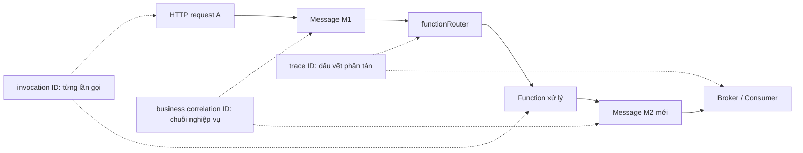

# Liên kết nhật ký theo mã lần gọi và mã thông điệp

## Mục tiêu học tập

Sau bài này, bạn có thể:

1. Phân biệt **mã lần gọi (invocation ID)**, **mã thông điệp (message ID)**, **mã tương quan nghiệp vụ (correlation ID)** và **trace ID/span ID**.
2. Giải thích vì sao `MessageHeaders.ID` không phải một mã bền vững xuyên suốt mọi bước biến đổi message hoặc phát lại qua broker.
3. Gắn ngữ cảnh vào nhật ký của một `Function<Message<T>, R>` bằng SLF4J **MDC (Mapped Diagnostic Context)** và dọn ngữ cảnh đúng phạm vi.
4. Mang mã tương quan từ HTTP vào Spring `Message`, rồi tiếp tục qua `FunctionCatalog`, `functionRouter` và event binder khi cần.
5. Bật Micrometer Tracing để liên kết các dòng log bằng `traceId` và `spanId`, đồng thời hiểu yêu cầu về **context propagation** qua thread và reactive pipeline.
6. Viết kiểm thử kiểm tra mã được bảo toàn qua hai message, mã riêng cho từng lần gọi và việc MDC không bị rò sang lời gọi kế tiếp.
7. Chẩn đoán retry, duplicate delivery, missing headers, async logs thiếu ID và rủi ro bảo mật khi dùng mã do client cung cấp.

## 1. Vì sao một dòng log thường không đủ?

**Spring Cloud Function** khuyến khích đóng gói nghiệp vụ bằng `Supplier`, `Function` và `Consumer`, tra cứu qua `FunctionCatalog`, hỗ trợ composition và chuyển đổi thông điệp. Cùng một function có thể được gọi trực tiếp trong Java, qua HTTP, Spring Cloud Stream hoặc môi trường serverless.

Giả sử dịch vụ có `functionRouter`, một `Function<String, String> uppercase` và một `Consumer<Order> saveOrder`. Trong thời gian cao điểm, hệ thống ghi:

```text
INFO  Received request
INFO  Function selected: saveOrder
ERROR Database timeout
INFO  Message delivered
```

Các dòng log này có thể thuộc **những request và message khác nhau**. Ngay cả khi có timestamp và thread name, hệ thống vẫn khó trả lời:

- Dòng `Database timeout` liên quan đến request nào?
- Một message được retry hai lần hay đó là hai message độc lập?
- Một event được tạo từ request HTTP nào?
- Khi function đã tạo message mới, liệu message mới có cùng ID với message gốc?
- Log trong một luồng Reactor hoặc thread pool còn mang ngữ cảnh của request ban đầu không?

Giải pháp là dùng **nhiều loại định danh với phạm vi được xác định rõ**, rồi gắn chúng vào log tại đúng ranh giới thực thi.



Mục tiêu không phải nhồi tất cả dữ liệu vào mỗi dòng log, mà là chọn một tập trường có thể truy vấn, đủ để ghép các bước xử lý mà không làm lộ dữ liệu nhạy cảm.

## 2. Bốn loại mã — bốn ý nghĩa khác nhau

| Loại mã | Phạm vi | Nguồn điển hình | Thay đổi khi nào? |
| --- | --- | --- | --- |
| **Invocation ID** | Một lần gọi hoặc một lần thử xử lý | Ứng dụng/adapter sinh khi nhận invocation | Đổi ở lần xử lý hoặc retry tiếp theo nếu chính sách đo theo attempt |
| **Message ID** | Một đối tượng `Message` | `MessageHeaders.ID` do Spring Messaging cấp | Có thể đổi khi tạo message mới hoặc qua adapter/broker |
| **Business correlation ID** | Một chuỗi công việc/nghiệp vụ gồm nhiều bước | Ứng dụng sinh hoặc xác thực từ yêu cầu đầu vào | Được **giữ ổn định có chủ đích** khi tạo message tiếp theo |
| **Trace ID / Span ID** | Một distributed trace / một span | Micrometer Tracing và tracer | Trace ID chung trong cùng trace; span ID thay đổi theo span |

Ví dụ:

```text
businessCorrelationId = workflow-72
traceId               = 4f8e...d91a

Message M1: messageId=uuid-a, invocationId=inv-001, spanId=span-1
Message M2: messageId=uuid-b, invocationId=inv-002, spanId=span-2
Retry M2:   messageId=uuid-c (có thể), invocationId=inv-003,
            spanId=span-3, businessCorrelationId vẫn workflow-72
```

Đây là **quy ước thiết kế**: một hệ thống có thể đặt tên trường hoặc mức chi tiết khác, nhưng phải mô tả ý nghĩa của chúng nhất quán trong cả producer và consumer.

### Invocation ID không phải số lần gọi của business workflow

Một business workflow có thể tạo nhiều invocation. Ngược lại, một invocation batch có thể xử lý nhiều business item. Đặc biệt trong serverless, một **platform invocation ID** có thể nhận batch nhiều message; nếu cần nhận diện từng item/attempt, hãy cấp mã **ở cấp xử lý phù hợp**, không mặc nhiên lấy một ID của nền tảng làm ID cho mọi message.

### Message ID không phải ID của bản ghi trong Kafka

UUID từ `MessageHeaders.getId()` là định danh của **Spring Message**, không phải `topic-partition-offset` của Kafka hay broker delivery tag. Broker có thể có metadata riêng để nhận diện vị trí, lần giao lại hoặc record. Một message đi qua deserialize/transform/republish có thể nhận ID mới; không nên dùng Spring message ID làm khóa idempotency xuyên broker trừ khi có hợp đồng bảo toàn cụ thể.

### Trace ID không phải khóa nghiệp vụ

Một trace thường mô tả **một hành trình quan sát**; sampling, async boundary, batch processing hoặc việc tách/gộp message có thể làm dấu vết không trùng một-một với transaction nghiệp vụ. Một correlation ID nghiệp vụ ổn định vẫn hữu ích ngay cả khi tracing bị tắt hoặc không có span được xuất.

## 3. Vòng đời một Message và ý nghĩa của `MessageHeaders.ID`

Spring Messaging có kiểu:

```java
import org.springframework.messaging.Message;
import org.springframework.messaging.MessageHeaders;

Message<?> message = ...;
MessageHeaders headers = message.getHeaders();

Object payload = message.getPayload();
java.util.UUID currentMessageId = headers.getId();
Long createdAt = headers.getTimestamp();
```

Trong trường hợp thông thường, `MessageHeaders.ID` là một UUID được tạo khi xây dựng message. Header này có tính **read-only** theo API của Spring Messaging/Spring Integration: không thiết kế ứng dụng bằng cách cố tự ghi đè `id` và trông đợi framework bảo toàn nó.

Một ví dụ minh họa:

```java
import org.springframework.messaging.Message;
import org.springframework.messaging.support.MessageBuilder;

Message<String> first = MessageBuilder.withPayload("hello")
        .setHeader("businessCorrelationId", "workflow-72")
        .setHeader("invocationId", "inv-001")
        .build();

Message<String> second = MessageBuilder.withPayload("HELLO")
        .setHeader("businessCorrelationId",
                first.getHeaders().get("businessCorrelationId"))
        .setHeader("invocationId", "inv-002")
        .build();

System.out.println(first.getHeaders().getId());
System.out.println(second.getHeaders().getId());
```

Hai message mới thường có hai UUID khác nhau, nhưng **cùng business correlation ID** vì ứng dụng đã sao chép có chủ đích. Từ khóa `businessCorrelationId` là header do ví dụ quy ước, không phải tên bắt buộc của Spring Cloud Function.

Đừng mặc định mọi adapter tự sao chép header tùy chỉnh khi chuyển sang HTTP, Kafka, RabbitMQ hoặc FaaS. Cần kiểm tra serialization, mapping header, trusted headers và giới hạn kích thước của giao thức đang dùng.

### `correlationId` theo Spring Integration và custom header

Spring Integration có `IntegrationMessageHeaderAccessor.CORRELATION_ID` (thường được dùng trong các luồng splitter/aggregator/resequencer). Nó có mục đích **gom các message liên quan** theo hợp đồng Integration.

Bài này dùng `businessCorrelationId` để tránh nhầm:

- ID nhóm message dành cho aggregator của Spring Integration.
- ID theo dõi một giao dịch nghiệp vụ do ứng dụng định nghĩa.
- ID của distributed trace từ Micrometer.

Nếu một ứng dụng quyết định dùng cùng một trường cho nhiều mục đích, phải định nghĩa chính sách rõ ràng và kiểm tra không gây xung đột với các component xử lý message hiện hữu.

## 4. Thiết kế bộ trường log thống nhất

Tối thiểu, mỗi log quan trọng ở tầng function nên có:

| Trường | Ví dụ | Mục đích |
| --- | --- | --- |
| `service` | `text-processor` | Xác định dịch vụ |
| `function` | `uppercase` | Hàm nghiệp vụ đang chạy |
| `invocationId` | `inv-001` | Ghép log của một lần thực thi |
| `messageId` | `5aa1...-uuid` | Nhận diện Spring Message ở bước hiện tại |
| `businessCorrelationId` | `workflow-72` | Ghép các bước nghiệp vụ khác nhau |
| `traceId`, `spanId` | Chuỗi hex do tracer cấp | Tìm log theo distributed trace |
| `outcome` | `success`, `error`, `rejected` | Phân loại kết quả |

Trong hệ thống broker, có thể thêm `destination`, `partition`, `offset` **nếu các giá trị thực sự có sẵn từ binder**. Các giá trị đó không phải metadata cố định hiện diện trên mọi message.

Log minh họa ở dạng có cấu trúc:

```json
{
  "level": "INFO",
  "service": "text-processor",
  "function": "uppercase",
  "invocationId": "inv-001",
  "messageId": "f6b6b90d-15dd-4bc0-9986-5ff10ba5c58c",
  "businessCorrelationId": "workflow-72",
  "traceId": "b3e7c4a69f31d1922c4d95e6a209c817",
  "spanId": "f84d920917ae0be1",
  "outcome": "success",
  "event": "function_completed"
}
```

Đây là **cấu trúc mục tiêu**, không phải JSON mặc định của mọi Spring Boot logger. Để xuất JSON thực tế, cần cấu hình logging formatter/appender phù hợp; nếu hệ thống chỉ ghi text, các trường vẫn có thể được thêm qua MDC hoặc structured log arguments.

## 5. MDC: gắn mã cho log trong một lời gọi đồng bộ

SLF4J **MDC** lưu một map giá trị theo ngữ cảnh thread; pattern của Logback/Log4j2 có thể hiển thị các trường đó trong dòng log.

Đây là cách hữu ích với **imperative `Function`** chạy đồng bộ trong cùng ngữ cảnh thread. Nhưng MDC không phải một bộ lưu trữ toàn cục cho workflow và không được tự động chuyển qua mọi thread hoặc Publisher.

### 5.1. Ứng dụng mẫu Spring Cloud Function

Ví dụ sau đăng ký một bean nhận **Spring `Message<String>`**, để có thể đọc message ID và custom headers. Logger ghi sự kiện bắt đầu, hoàn tất hoặc lỗi:

```java
package com.example.functioncorrelation;

import java.util.Locale;
import java.util.Objects;
import java.util.function.Function;

import org.slf4j.Logger;
import org.slf4j.LoggerFactory;
import org.slf4j.MDC;
import org.springframework.boot.SpringApplication;
import org.springframework.boot.autoconfigure.SpringBootApplication;
import org.springframework.context.annotation.Bean;
import org.springframework.messaging.Message;

@SpringBootApplication
public class CorrelatedFunctionApplication {

    private static final Logger log =
            LoggerFactory.getLogger(CorrelatedFunctionApplication.class);

    public static void main(String[] args) {
        SpringApplication.run(CorrelatedFunctionApplication.class, args);
    }

    @Bean
    public Function<Message<String>, String> uppercase() {
        return message -> {
            String invocationId = Objects.toString(
                    message.getHeaders().get("invocationId"), "unknown");
            String messageId = Objects.toString(
                    message.getHeaders().getId(), "unknown");
            String businessCorrelationId = Objects.toString(
                    message.getHeaders().get("businessCorrelationId"),
                    "unknown");

            try (MDC.MDCCloseable inv =
                         MDC.putCloseable("invocationId", invocationId);
                 MDC.MDCCloseable msg =
                         MDC.putCloseable("messageId", messageId);
                 MDC.MDCCloseable corr =
                         MDC.putCloseable("businessCorrelationId",
                                 businessCorrelationId)) {

                log.info("function_started function=uppercase");

                try {
                    String result =
                            message.getPayload().toUpperCase(Locale.ROOT);
                    log.info("function_completed function=uppercase");
                    return result;
                }
                catch (RuntimeException ex) {
                    log.error("function_failed function=uppercase", ex);
                    throw ex;
                }
            }
        };
    }
}
```

Điểm cần hiểu:

1. Function nhận `Message<String>` nên có thể truy cập `getHeaders().getId()`.
2. `invocationId` và `businessCorrelationId` là **custom headers**, do phía gọi/adapter cần tạo hoặc đưa vào message.
3. `MDC.putCloseable` đặt mã lên MDC cho phần code bên trong khối `try`, rồi **xóa entry** khi ra khỏi phạm vi.
4. Không tự đặt `traceId` hoặc `spanId` bằng giá trị tùy ý; để tracer quản lý chúng khi tracing được bật.
5. Function chỉ xử lý văn bản, nên có thể tái sử dụng qua các adapter mà không import HTTP hoặc Kafka API.

Đây là ví dụ **một tầng MDC không lồng nhau với cùng tên key**. Nếu nhiều function hoặc interceptor cùng ghi đè `invocationId` ở các phạm vi lồng nhau, `MDCCloseable.close()` xóa giá trị chứ không bảo toàn phiên bản cũ. Khi cần nesting, hãy tạo helper **lưu giá trị trước đó rồi khôi phục** trong `finally`, hoặc phân công một tầng sở hữu MDC cho mỗi invocation.

### 5.2. Chỉ định mẫu log có các trường MDC

Trên Spring Boot dùng Logback và hỗ trợ cấu hình correlation pattern, có thể dùng:

```yaml
spring:
  application:
    name: text-processor

logging:
  pattern:
    correlation: "[trace:%X{traceId:-} span:%X{spanId:-} inv:%X{invocationId:-} msg:%X{messageId:-} corr:%X{businessCorrelationId:-}] "
```

Mẫu trên giả định **SLF4J + Logback** và phù hợp với các bản Spring Boot hỗ trợ `logging.pattern.correlation`. Các dấu `%X{...}` đọc MDC theo key, còn khoảng trắng cuối chuỗi tách phần correlation khỏi logger name. Nếu dùng một logging system/structured formatter khác, hãy cấu hình theo khả năng của backend đó.

Khi Micrometer Tracing được bật, Spring Boot thường tự đưa trace/span IDs vào log; việc tùy chỉnh pattern ở đây nhằm **hiển thị thêm ba ID do ứng dụng quản lý**. Nếu thay correlation pattern, cần giữ tham chiếu `traceId`/`spanId` đúng tên MDC đang sử dụng để không làm mất liên kết trace trong log.

**Không mặc định các trường luôn có giá trị**: log startup, log health probe hoặc log của adapter trước lúc xây dựng Spring `Message` có thể không có `messageId`; log ngoài phạm vi function có thể không có `invocationId` từ ví dụ này.

## 6. Tạo và truyền mã khi đi từ HTTP vào `FunctionCatalog`

HTTP header `X-Correlation-Id` thường được client/gateway gửi để gắn các request có liên hệ. Nhưng **header do client cung cấp chưa mặc nhiên đáng tin cậy**: phải giới hạn độ dài, tập ký tự, quyền sử dụng và quy tắc sinh khi thiếu.

Một cách minh họa đầy đủ là dùng REST controller **chủ động chuyển HTTP request thành Spring Message**, rồi gọi function qua catalog. Cách này cho thấy chính xác nơi custom headers được tạo; nó **không phải khẳng định Spring Cloud Function Web tự sinh `invocationId` cho mọi request**.

```java
package com.example.functioncorrelation;

import java.util.UUID;
import java.util.function.Function;
import java.util.regex.Pattern;

import org.springframework.cloud.function.context.FunctionCatalog;
import org.springframework.http.ResponseEntity;
import org.springframework.messaging.Message;
import org.springframework.messaging.support.MessageBuilder;
import org.springframework.web.bind.annotation.PostMapping;
import org.springframework.web.bind.annotation.RequestBody;
import org.springframework.web.bind.annotation.RequestHeader;
import org.springframework.web.bind.annotation.RestController;

@RestController
public class CorrelatedHttpController {

    private static final Pattern SAFE_ID =
            Pattern.compile("[A-Za-z0-9._-]{1,64}");

    private final FunctionCatalog catalog;

    public CorrelatedHttpController(FunctionCatalog catalog) {
        this.catalog = catalog;
    }

    @PostMapping("/demo/uppercase")
    public ResponseEntity<String> handle(
            @RequestBody String input,
            @RequestHeader(name = "X-Correlation-Id",
                    required = false) String incomingCorrelation) {

        String invocationId = UUID.randomUUID().toString();
        String businessCorrelationId =
                validOrNew(incomingCorrelation);

        Message<String> message = MessageBuilder.withPayload(input)
                .setHeader("invocationId", invocationId)
                .setHeader("businessCorrelationId", businessCorrelationId)
                .build();

        Function<Message<String>, ?> function =
                catalog.lookup(Function.class, "uppercase");
        if (function == null) {
            throw new IllegalStateException("uppercase is not registered");
        }

        Object result = function.apply(message);
        Object payload = result instanceof Message<?>
                ? ((Message<?>) result).getPayload()
                : result;

        return ResponseEntity.ok()
                .header("X-Invocation-Id", invocationId)
                .body(String.valueOf(payload));
    }

    private static String validOrNew(String value) {
        return value != null && SAFE_ID.matcher(value).matches()
                ? value
                : UUID.randomUUID().toString();
    }
}
```

Đoạn ví dụ yêu cầu web starter bên cạnh Spring Cloud Function. Controller tạo **invocation ID mới** cho mỗi request được nó xử lý, và giữ một **correlation ID** khi header hợp lệ. Request có header sai format được cấp ID mới; ở hệ thống có hợp đồng API chặt chẽ, cũng có thể **từ chối với 400** thay vì âm thầm thay.

Ví dụ gọi:

```bash
curl -i -X POST http://localhost:8080/demo/uppercase \
  -H "Content-Type: text/plain" \
  -H "X-Correlation-Id: workflow-72" \
  --data-raw "hello"
```

Kết quả nghiệp vụ mong đợi là `HELLO`; response có header `X-Invocation-Id` do server sinh. Log bên trong `uppercase` chứa `invocationId`, `messageId` và `businessCorrelationId`.

**Phân biệt endpoint:** `/demo/uppercase` là controller được ứng dụng tự tạo. Spring Cloud Function Web cũng có cơ chế tự ánh xạ function thành endpoint, nhưng một web adapter như vậy không tự động chạy đoạn code controller này. Nếu chọn Function Web trực tiếp, hãy triển khai việc sinh/chuẩn hóa header tại gateway, filter, message enricher hoặc hook thích hợp và **kiểm thử header cuối cùng vào `Message`**. Tránh vô tình công bố cả controller lẫn endpoint gọi thẳng function mà không có chính sách phân quyền nhất quán.

### Tại sao một request có thể tạo nhiều message ID?

Controller tạo một `Message`; `RoutingFunction`, message converter hoặc function composition có thể tạo các đối tượng message khác ở những giai đoạn sau. Khi đó, hãy log:

- **Message ID hiện tại** tại từng bước cần chẩn đoán.
- **Business correlation ID** được giữ qua các bước.
- **Invocation ID** phù hợp mỗi lần xử lý, theo hợp đồng bạn đã định.

Không cố sao chép `MessageHeaders.ID` vào một header mới rồi gọi đó là message ID “thật” của mọi bước. Nếu cần giữ tham chiếu nguồn, đặt một header riêng như `sourceMessageId` hoặc `originEventId` với ý nghĩa rõ ràng.

## 7. Khi đi qua `functionRouter` hoặc composition

Với imperative message routing, Spring Cloud Function có thể chọn đích bằng:

- `MessageRoutingCallback`.
- `Message` headers như `spring.cloud.function.definition` hoặc `spring.cloud.function.routing-expression`.
- Application property `spring.cloud.function.routing-expression`.

Các nguồn này quyết định **hàm nào được gọi**, không tự đảm bảo mọi log có correlation ID. Ví dụ:

```java
Message<String> message = MessageBuilder.withPayload("hello")
        .setHeader("invocationId", "inv-001")
        .setHeader("businessCorrelationId", "workflow-72")
        .setHeader("spring.cloud.function.definition", "uppercase")
        .build();

Function<Message<String>, ?> router =
        catalog.lookup("functionRouter");

Object result = router.apply(message);
```

Trong cấu hình imperative phù hợp, router có thể chuyển message đến `uppercase`. Mã tương quan nằm trong **headers của message đầu vào** và có thể được đọc ở function nếu adapter/wrapper bảo toàn chúng.

Để theo dõi một route, có thể ghi:

```text
event=routing_selected
  invocationId=inv-001
  businessCorrelationId=workflow-72
  sourceMessageId=<UUID>
  selectedDefinition=uppercase
```

Đây là **log do ứng dụng instrument ở nơi có quyền quan sát quyết định routing**, không phải cam kết `functionRouter` mặc định luôn phát dòng log cùng tên.

### Một invocation, nhiều function

Nếu definition là `validate|uppercase|saveResult`, một request có thể chạy **ba function**. Có thể giữ cùng `invocationId` ở lớp điều phối (để biết cùng một lần xử lý) và log thêm `function`/`stage` ở từng bước. Nếu bạn định nghĩa mỗi lần `Function.apply` riêng là một invocation, hãy tạo **functionInvocationId** mới cho từng bước và giữ `parentInvocationId` hoặc `businessCorrelationId` để nối chúng.

Chọn một mô hình và dùng nhất quán; không đặt cùng tên `invocationId` cho cả request-level lẫn function-level trong những service khác nhau nếu dashboard/truy vấn cần so sánh.

## 8. Phát event: giữ correlation ID, không phụ thuộc Message ID

Một function có thể tạo event đầu ra qua Spring Cloud Stream, trong khi downstream consumer xử lý ở một service khác. Khi tạo message mới:

```java
import org.springframework.messaging.Message;
import org.springframework.messaging.support.MessageBuilder;

Message<String> incoming = ...;

String businessCorrelationId = String.valueOf(
        incoming.getHeaders().get("businessCorrelationId"));

Message<String> outgoing = MessageBuilder.withPayload("processed")
        .setHeader("businessCorrelationId", businessCorrelationId)
        .setHeader("originMessageId",
                String.valueOf(incoming.getHeaders().getId()))
        .build();
```

Điều cần phân biệt:

1. `outgoing.getHeaders().getId()` là ID của **message mới**.
2. `originMessageId` là **custom header tham chiếu nguồn**, không phải cách ghi đè `MessageHeaders.ID`.
3. `businessCorrelationId` được truyền theo hợp đồng nghiệp vụ; ví dụ này cho thấy cách đặt nó **trước khi publish**.
4. Invocation ID của **downstream consumer** nên được tạo mới ở lần nhận/xử lý tương ứng; không sao chép vô điều kiện invocation ID của producer rồi làm mất khả năng phân biệt retry.

Khi một message đi qua Kafka/RabbitMQ hoặc adapter khác, hãy xác minh binder bảo toàn các custom header cần thiết. Metadata broker như topic/partition/offset là **khác** Spring Message ID; chúng có thể hữu ích để truy ngược record cụ thể nhưng không thay thế correlation ID nghiệp vụ.

### Không coi các header custom là bằng chứng xác thực

Producer bên ngoài có thể tự đặt `businessCorrelationId` hoặc `originMessageId`. Chúng dùng để **theo dõi**, không phải kiểm tra quyền hay chứng minh event đã được broker xác nhận. Nếu tính toàn vẹn quan trọng, hãy có xác thực nguồn, chữ ký hoặc cơ chế tin cậy phù hợp.

### Spring Cloud Stream Observability

Spring Cloud Stream tích hợp Micrometer Observation và có cơ chế instrument các function/binder tùy loại binder, cấu hình và phiên bản. Với Kafka binder, một cấu hình liên quan trong các phiên bản hỗ trợ là:

```yaml
spring:
  cloud:
    stream:
      kafka:
        binder:
          enable-observation: true
```

Cấu hình này nhằm kích hoạt observation ở binder tương ứng; **không tự tạo business correlation ID** và không tự bảo đảm tracing xuyên mọi producer/consumer. Cần cả tracer bridge, exporter và context propagation phù hợp để ghép trace end-to-end.

## 9. Micrometer Tracing: `traceId` và `spanId` trong log

Micrometer Tracing cung cấp một cơ chế khác với custom correlation header: **distributed tracing**. Khi Spring Boot có tracing implementation tương thích và observation thích hợp, nó có thể đưa `traceId` và `spanId` vào MDC/log.

Ví dụ (chọn một tracer bridge phù hợp với stack của dự án):

```xml
<dependency>
    <groupId>org.springframework.boot</groupId>
    <artifactId>spring-boot-starter-actuator</artifactId>
</dependency>

<dependency>
    <groupId>io.micrometer</groupId>
    <artifactId>micrometer-tracing-bridge-otel</artifactId>
</dependency>

<dependency>
    <groupId>io.opentelemetry</groupId>
    <artifactId>opentelemetry-exporter-otlp</artifactId>
</dependency>
```

Đây là ví dụ các dependency theo dòng Spring Boot/Micrometer có hỗ trợ OpenTelemetry. Cấu hình endpoint exporter, authentication, sampling và khả năng tracing của adapter còn tùy phiên bản và hạ tầng; không phải chỉ thêm dependency là mọi lời gọi `Function.apply` sẽ trở thành một span riêng.

### Truy vết log theo trace ID

Khi tracing hoạt động:

```text
INFO [trace:b3e7... span:1a22...] HTTP request received
INFO [trace:b3e7... span:2b33...] function=uppercase started
INFO [trace:b3e7... span:2b33...] function=uppercase completed
```

Cùng một `traceId` giúp tìm tất cả log thuộc trace; `spanId` khác nhau cho các bước con. Nhưng nếu sampling làm trace không được xuất đầy đủ, log có ID **không có nghĩa** backend trace luôn giữ span tương ứng. Tương tự, business workflow kéo dài nhiều giờ hoặc tách batch có thể cần một correlation ID độc lập.

### Client/producer được phép gửi `traceparent` nhưng không được cấp quyền nhờ nó

Trace context chuẩn W3C (ví dụ header `traceparent`) mang thông tin để nối trace giữa các dịch vụ. Đây là **metadata observability**, không phải credential. Phải có cơ chế xác thực/ủy quyền độc lập và quy tắc tin cậy phù hợp với ingress/gateway.

Không tự lấy `traceparent` từ payload rồi log nguyên văn như một chuỗi không được kiểm tra. Để tracing library/adapter xử lý context propagation khi có hỗ trợ.

## 10. Ngữ cảnh MDC và ranh giới thread

MDC thường là **ThreadLocal**. Một lần xử lý có thể chuyển thread vì:

- `@Async` hoặc `ThreadPoolTaskExecutor`.
- `CompletableFuture.supplyAsync(...)`.
- Reactor `publishOn` / `subscribeOn`.
- Listener/message binder gọi lại trên thread khác.

Đoạn mã sau **không bảo đảm** cả hai dòng log có cùng MDC:

```java
MDC.put("invocationId", "inv-001");
log.info("before async");

CompletableFuture.runAsync(() ->
        log.info("inside async"));

MDC.remove("invocationId");
```

Không những context có thể mất khi chuyển thread, code còn có thể gây rò MDC nếu exception xảy ra trước `remove`. Hãy dùng scope `try/finally` hoặc `MDC.putCloseable` và cấu hình propagation có chủ đích.

### Spring Boot và `ContextPropagatingTaskDecorator`

Với Spring Framework/Spring Boot hỗ trợ Micrometer Context Propagation, executor có thể được gắn `ContextPropagatingTaskDecorator`:

```java
import org.springframework.context.annotation.Bean;
import org.springframework.context.annotation.Configuration;
import org.springframework.core.task.support.ContextPropagatingTaskDecorator;
import org.springframework.scheduling.concurrent.ThreadPoolTaskExecutor;

@Configuration
class AsyncLoggingConfiguration {

    @Bean
    ThreadPoolTaskExecutor observedExecutor() {
        ThreadPoolTaskExecutor executor = new ThreadPoolTaskExecutor();
        executor.setCorePoolSize(2);
        executor.setMaxPoolSize(4);
        executor.setQueueCapacity(100);
        executor.setThreadNamePrefix("observed-");
        executor.setTaskDecorator(new ContextPropagatingTaskDecorator());
        executor.initialize();
        return executor;
    }
}
```

Decorator này giúp **những context được đăng ký với cơ chế Micrometer Context Propagation** được chuyển qua task. Nó không có nghĩa mọi custom MDC key tự được sao chép trong mọi runtime; với `invocationId` và `businessCorrelationId`, hãy xác nhận có `ThreadLocalAccessor` phù hợp hoặc **truyền các ID dưới dạng dữ liệu/tham số rõ ràng**, rồi đặt MDC lại trong task.

Nếu dùng `CompletableFuture`, phải thực sự gửi task vào **executor đã cấu hình**, không mặc định `supplyAsync` không tham số sẽ sử dụng executor đó.

### Reactor và reactive function

Với `Function<Flux<T>, Flux<R>>`, MDC đặt quanh `apply(flux)` thường chỉ sống trong lúc **xây dựng pipeline**. Các phần tử được xử lý khi subscribe, có thể trên thread khác.

Spring Boot có cấu hình:

```yaml
spring:
  reactor:
    context-propagation: auto
```

Trong các phiên bản hỗ trợ, cấu hình này cho phép **automatic context propagation** cho Reactor. Tuy nhiên, propagation phụ thuộc registry và accessor của các context cần truyền. Nó hỗ trợ quan sát/tracing, nhưng không thay thế việc **mang businessCorrelationId trong dữ liệu hoặc Reactor Context** khi một pipeline cần biết mã nghiệp vụ của từng item.

Đối với `Flux<Message<T>>`, có thể đặt MDC trong một scope ngắn **ngay tại nơi log từng message**, rồi đóng scope trước khi xử lý phần tử tiếp theo. Nếu pipeline có tác vụ bất đồng bộ bên trong, cần tiếp tục truyền ngữ cảnh qua boundary tương ứng; đừng giữ một MDC value toàn luồng rồi giả định nó sẽ đúng cho từng phần tử.

## 11. Retry: một message có thể có nhiều lần gọi

Giả sử một event `OrderPaid` được binder phát lại vì lần đầu ghi database thất bại:

```text
businessCorrelationId = order-flow-77

Attempt 1: invocationId=attempt-001, messageId=uuid-a,
           outcome=error
Attempt 2: invocationId=attempt-002, messageId=uuid-b (có thể),
           outcome=success
```

Ở đây:

- **Correlation ID** vẫn là `order-flow-77`: cùng một workflow.
- **Invocation ID** đổi: có hai lần thử xử lý cần được phân biệt.
- **Message ID** có thể giữ hoặc đổi, tùy adapter có dựng một Spring Message mới và cách binder phát lại.
- **Trace ID** có thể cùng hoặc khác: phụ thuộc tracing context được truyền, retry topology và sampling.

Khi log `message_processed`, hãy xác định **đã nhận attempt**, **đã hoàn tất function** hay **đã commit nghiệp vụ**. Không dùng số dòng log success làm số giao dịch duy nhất đã commit.

### Idempotency key phải được thiết kế riêng

Một `businessCorrelationId` có thể nối nhiều thao tác trong cùng workflow, nên **không mặc định** là khóa idempotency của một bản ghi. Nếu `OrderPaid` có event ID ổn định từ producer, có thể sử dụng nó để chống xử lý trùng theo chính sách được thiết kế; `MessageHeaders.ID` hoặc invocation ID mới tạo khi retry thường không phù hợp với yêu cầu đó.

### Kafka offset và delivery metadata

Nếu binder cung cấp topic, partition và offset, chúng giúp truy ngược một Kafka record cụ thể. Nhưng một workflow có thể tạo nhiều record, và cùng record có thể được đọc lại. Nên log chúng như **transport attributes**, không thay thế `businessCorrelationId` hoặc business event ID.

## 12. Kiểm thử ID và rò rỉ MDC

### 12.1. Hai message khác ID nhưng cùng correlation

Ví dụ JUnit kiểm tra đối tượng Message do ứng dụng chủ động tạo:

```java
import static org.junit.jupiter.api.Assertions.assertEquals;
import static org.junit.jupiter.api.Assertions.assertNotEquals;
import static org.junit.jupiter.api.Assertions.assertNotNull;

import org.junit.jupiter.api.Test;
import org.springframework.messaging.Message;
import org.springframework.messaging.support.MessageBuilder;

class MessageCorrelationTest {

    @Test
    void twoMessagesCanShareWorkflowButHaveDifferentIds() {
        Message<String> first = MessageBuilder.withPayload("hello")
                .setHeader("businessCorrelationId", "workflow-72")
                .setHeader("invocationId", "inv-001")
                .build();

        Message<String> second = MessageBuilder.withPayload("spring")
                .setHeader("businessCorrelationId", "workflow-72")
                .setHeader("invocationId", "inv-002")
                .build();

        assertNotNull(first.getHeaders().getId());
        assertNotNull(second.getHeaders().getId());
        assertNotEquals(first.getHeaders().getId(),
                second.getHeaders().getId());
        assertEquals(first.getHeaders().get("businessCorrelationId"),
                second.getHeaders().get("businessCorrelationId"));
        assertNotEquals(first.getHeaders().get("invocationId"),
                second.getHeaders().get("invocationId"));
    }
}
```

Test xác minh **hợp đồng ứng dụng**: hai message cùng workflow nhưng được cấp invocation ID riêng. UUID từ framework gần như chắc chắn khác nhau, song đây không phải phép chứng minh header sẽ tồn tại/giữ nguyên sau khi đi qua một binder thật.

### 12.2. MDC được dọn sau khi function kết thúc

```java
import static org.junit.jupiter.api.Assertions.assertEquals;
import static org.junit.jupiter.api.Assertions.assertNull;

import java.util.function.Function;
import org.junit.jupiter.api.Test;
import org.slf4j.MDC;
import org.springframework.messaging.Message;
import org.springframework.messaging.support.MessageBuilder;

class MdcCleanupTest {

    @Test
    void scopedMdcIsRemovedAfterInvocation() {
        MDC.clear();
        try {
            Function<Message<String>, String> function =
                    new CorrelatedFunctionApplication().uppercase();

            Message<String> message = MessageBuilder.withPayload("hello")
                    .setHeader("invocationId", "inv-001")
                    .setHeader("businessCorrelationId", "workflow-72")
                    .build();

            assertEquals("HELLO", function.apply(message));
            assertNull(MDC.get("invocationId"));
            assertNull(MDC.get("messageId"));
            assertNull(MDC.get("businessCorrelationId"));
        }
        finally {
            MDC.clear();
        }
    }
}
```

Test dùng một function đơn giản không cần khởi động Spring context. Nó không xác minh log renderer đã in đủ ba trường, và cũng không chứng minh propagation qua thread khác. Muốn kiểm tra nội dung log, có thể dùng **test appender** phù hợp với Logback/Log4j2 để kiểm tra MDC map trên `ILoggingEvent`; muốn kiểm tra propagation, viết integration test qua executor hoặc binder thật.

### 12.3. Bài kiểm thử end-to-end nên có

| Tình huống | Điều cần xác minh |
| --- | --- |
| HTTP có correlation ID hợp lệ | Giữ đúng ID ở message và logs của function |
| HTTP không có correlation ID | Server tạo ID mới theo hợp đồng |
| HTTP có ID quá dài/ký tự lạ | Bị từ chối hoặc cấp ID mới, không đưa nguyên văn vào log |
| Hai request khác nhau nhưng cùng workflow | Invocation IDs khác nhau, correlation ID có thể giống |
| Function phát event mới | New message ID, correlation ID được truyền theo quy định |
| Binder retry | Các attempt được phân biệt; không làm mất business event ID |
| `@Async` / Reactor | Tracing/log context được chuyển hoặc khôi phục đúng ở nơi log |
| Function ném ngoại lệ | Dòng lỗi có ID và MDC được dọn sau `finally` |

## 13. Quy trình truy log cho một sự cố

Giả sử khách hàng báo `workflow-72` không hoàn tất:

1. **Tìm bằng `businessCorrelationId`** để lấy các log trên mọi service và attempt thuộc workflow.
2. **Nhóm theo `invocationId`** để phân biệt mỗi lần gọi, request hoặc retry.
3. **Đối chiếu `messageId` và `originMessageId`** ở từng bước để xác định khi nào có message mới.
4. **Tìm `traceId`** để xem span/timing xuyên HTTP, router, function và downstream nếu tracing đã được thiết lập.
5. **So sánh với binder/broker metadata** như destination/partition/offset và trạng thái retry/DLQ nếu có.
6. **Kiểm tra outcome nghiệp vụ**: một dòng `function_completed` chưa chắc là DB commit; xác nhận bằng business event/metric hoặc dữ liệu bền vững phù hợp.

```text
workflow-72
  ├─ inv-001 | HTTP -> functionRouter -> uppercase | success
  │    └─ msg: uuid-a
  ├─ inv-002 | Kafka consumer -> saveOrder | timeout
  │    └─ msg: uuid-b
  └─ inv-003 | Kafka retry -> saveOrder | committed
       └─ msg: uuid-c (nếu binder tạo lại Message)
```

Mỗi nhánh có thể có **trace/span riêng**. Hành trình nghiệp vụ được liên kết bằng correlation ID, còn các lần thử được phân biệt bằng invocation ID.

## 14. Bảo mật, quyền riêng tư và ngân sách log

| Rủi ro | Ví dụ | Biện pháp |
| --- | --- | --- |
| **Log injection** | Client chèn xuống dòng/ký tự điều khiển vào ID | Validate length/charset, dùng structured encoder |
| **Lộ dữ liệu nhạy cảm** | Dùng email, token hoặc raw payload làm correlation ID | Sinh mã ngẫu nhiên không chứa PII, hạn chế trường ghi log |
| **Truy vấn log không phân quyền** | Mã workflow cho phép suy ra thông tin khách hàng | RBAC, retention, audit, giới hạn quyền trên log backend |
| **Cardinality metrics tăng vọt** | Dùng `invocationId` hoặc `messageId` làm tag Prometheus | Để ID cá thể trong logs/traces, không đặt trong metric labels |
| **Giả mạo nguồn** | Producer tự gửi `businessCorrelationId` trùng người khác | Xác thực nguồn; correlation ID không phải credential |
| **Rò MDC giữa request** | Thread pool tái sử dụng thread sau exception | `try/finally`, `MDCCloseable`, test cleanup |
| **Thiếu propagation** | Log trong async thiếu trace/invocation ID | Cấu hình propagation, truyền ID rõ ràng và integration test |

ID nên có **độ dài giới hạn, định dạng ổn định và entropy phù hợp** nếu được dùng để khó đoán; nhưng **không bao giờ** dựa vào khả năng đoán ID để thực hiện phân quyền.

Một hệ thống có lưu lượng cao nên log những sự kiện có giá trị như `invocation_started`, `routing_selected`, `function_failed`, `event_published`, `business_committed` với mức phù hợp. Nếu log mọi phần tử của một `Flux` lớn, chi phí và lượng dữ liệu nhạy cảm có thể tăng mạnh.

## 15. Bảng chẩn đoán lỗi thường gặp

| Triệu chứng | Nguyên nhân có thể | Kiểm tra/khắc phục |
| --- | --- | --- |
| Mỗi dòng log thiếu `messageId` | Code chỉ log trước khi tạo Spring Message hoặc không đưa header vào scope | Lấy `getHeaders().getId()` ở điểm có Message |
| Hai message mới có ID khác nhau nhưng cùng workflow | Hành vi bình thường | Dùng business correlation ID để nối các bước |
| Request HTTP có `X-Correlation-Id` nhưng function không thấy | HTTP header chưa được map vào Message header tùy chỉnh | Kiểm tra gateway/filter/controller và Message thực tế |
| `traceId` không xuất hiện | Thiếu tracing implementation/observation hoặc không có context | Kiểm tra dependencies, sampling, logging pattern |
| Có trace ID trong HTTP log nhưng thiếu trong consumer | Không propagate trace context qua binder hoặc tracing chưa bật | Kiểm tra observation/binder config và carrier headers |
| Log trong `@Async` không có ID | MDC ThreadLocal không tự chuyển | Dùng TaskDecorator + accessor hoặc truyền ID như tham số |
| Log trong `Flux.map` lẫn ID của item khác | Dùng MDC chung thay vì context cho từng item | Đọc mã từ Message item, đặt MDC có scope đúng |
| Retry hiện thành nhiều sự kiện nghiệp vụ | Đếm invocation thay vì unique commit | Phân biệt attempt, event ID và idempotency |
| Mỗi request log cùng `invocationId` | Sinh ID một lần khi startup hoặc dùng state mutable singleton | Sinh tại mỗi invocation/attempt |
| Log thiếu field sau function exception | Scope không được dọn hoặc log được ghi sau khi scope kết thúc | Log lỗi bên trong scope và dùng `finally` |
| Xem `/actuator/functions` nhưng không có invocation IDs | Endpoint chỉ liệt kê catalog | Instrument function/adapter và logging context |
| Message ID không khớp broker record ID | Hai hệ định danh khác nhau | Log thêm broker metadata và originEventId theo hợp đồng |

**Checklist chẩn đoán ngắn:**

```text
1. Log thuộc function, HTTP adapter, binder hay nền tảng?
2. Một invocation được định nghĩa là request, attempt hay Function.apply?
3. Message hiện tại có MessageHeaders.ID không?
4. Business correlation ID được tạo và truyền từ đâu?
5. Có trace context và tracing bridge phù hợp không?
6. Thread/reactive boundary có làm mất MDC/context không?
7. Khi tạo message mới, các header custom được giữ theo hợp đồng chưa?
8. Retry/batch có làm thay đổi số lượng invocation và message ID không?
9. ID có an toàn để ghi log, có bị client điều khiển tùy ý không?
10. Log tìm được đã chứng minh business commit hay chỉ là nhận/gửi?
```

## 16. Bài tập thực hành

1. Tạo một `Message<String>` bằng `MessageBuilder`, đọc `getHeaders().getId()` và `getTimestamp()`. So sánh hai message được tạo độc lập.
2. Đặt `businessCorrelationId=workflow-72` cho hai message liên quan nhưng gán `invocationId` khác nhau. Viết JUnit assertion cho tính ổn định/tách biệt của từng mã.
3. Tạo `Function<Message<String>,String>` đọc các mã từ header và đưa vào MDC trong một scope. Ghi log `function_started`, `function_completed`, `function_failed`.
4. Dùng test appender của logging backend để kiểm tra MDC trong sự kiện `function_completed` và bảo đảm MDC được dọn sau khi function ném ngoại lệ.
5. Tạo controller HTTP sinh invocation ID cho mỗi request và xác thực `X-Correlation-Id`. Gửi hai request cùng correlation ID; giải thích vì sao chúng có hai invocation ID.
6. Gọi `functionRouter` với Message chứa `spring.cloud.function.definition: uppercase`. Xác định điểm nào có thể ghi `selectedDefinition` và vì sao catalog registration không phải log invocation.
7. Tạo event đầu ra từ một Message bằng `MessageBuilder`, giữ `businessCorrelationId`, thêm `originMessageId`, và giải thích vì sao không nên cố sửa `MessageHeaders.ID`.
8. Mô phỏng Kafka consumer retry hai lần. Thiết kế log theo `businessCorrelationId`, `invocationId`, transport metadata và outcome; phân biệt retry với hai giao dịch mới.
9. Viết một ví dụ `@Async` có và không có context propagation, kiểm tra xem custom MDC key có thực sự đi sang executor không.
10. Xây dựng một `Flux<Message<String>>` có hai phần tử mang hai business correlation ID khác nhau. Giải thích cách tránh MDC của phần tử trước chảy sang phần tử sau.
11. Bật Micrometer Tracing, kiểm tra `traceId`/`spanId` ở HTTP và downstream; nêu lý do một trace có thể không được export do sampling.
12. Thiết kế định dạng log JSON tối thiểu cho hệ thống có HTTP, Stream và serverless. Đề xuất trường nào dành cho logs/traces, trường nào **không** nên đưa vào metric labels.

## Ghi nhớ

- **Invocation ID** phân biệt một lần xử lý; **Message ID** nhận diện một Spring `Message`; **business correlation ID** liên kết các bước của workflow; **trace/span ID** liên kết các hoạt động quan sát phân tán.
- `MessageHeaders.ID` **không phải mã nghiệp vụ bền vững** xuyên mọi biến đổi message, retry hoặc broker; hãy dùng custom correlation/event ID có hợp đồng truyền rõ ràng.
- Với function imperative, MDC giúp gắn IDs lên log trong một scope đồng bộ; phải đóng scope để **không rò MDC giữa các request**.
- Header HTTP custom chỉ đến được function khi adapter/controller **thực sự map nó vào Spring Message**. Các adapter khác nhau không có cùng quy tắc tự động bảo toàn header.
- Micrometer Tracing có thể cấp `traceId`/`spanId` và Spring Boot hiển thị trong log; phải cấu hình context propagation khi đi qua thread, Reactor hoặc message binder.
- Retry, batch và composition làm thay đổi quan hệ một-một giữa request, message và invocation. Đếm/tìm log phải theo đúng đơn vị.
- ID để **quan sát**, không để phân quyền; validate các ID từ nguồn ngoài, không đưa PII vào log và không dùng ID cá thể làm nhãn metrics.

### Tài liệu tham khảo chính thức

- [Spring Cloud Function — Programming Model, FunctionCatalog và Function Routing](https://docs.spring.io/spring-cloud-function/reference/spring-cloud-function/programming-model.html)
- [Spring Framework — Messaging: Message và MessageHeaders](https://docs.spring.io/spring-framework/reference/integration.html)
- [Spring Integration — Message, Header Propagation và Correlation ID](https://docs.spring.io/spring-integration/reference/message.html)
- [Spring Boot — Tracing: Logging Correlation IDs và Propagating Traces](https://docs.spring.io/spring-boot/reference/actuator/tracing.html)
- [Spring Boot — Logging](https://docs.spring.io/spring-boot/reference/features/logging.html)
- [Spring Boot — Observability và Context Propagation](https://docs.spring.io/spring-boot/reference/actuator/observability.html)
- [Spring Cloud Stream — Observability](https://docs.spring.io/spring-cloud-stream/reference/observability.html)
- [Spring Cloud Stream — Kafka Binder Configuration](https://docs.spring.io/spring-cloud-stream/reference/kafka/kafka-binder/config-options.html)
