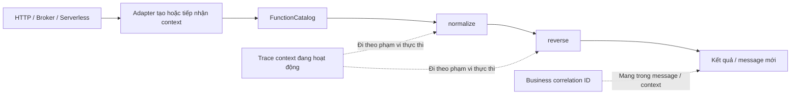
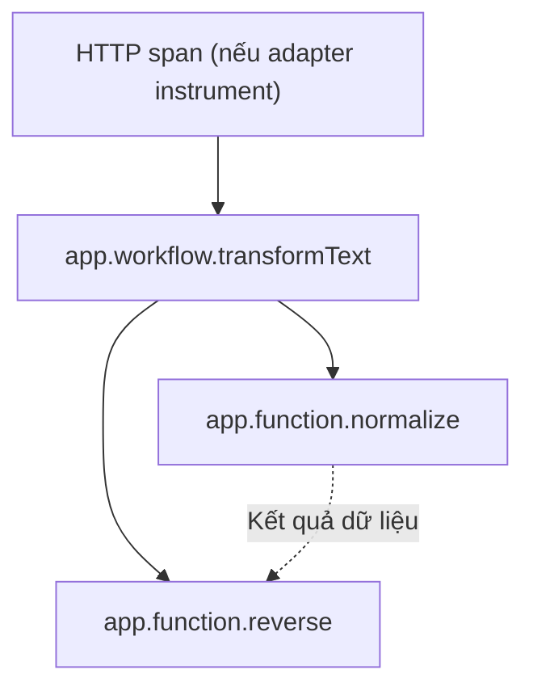
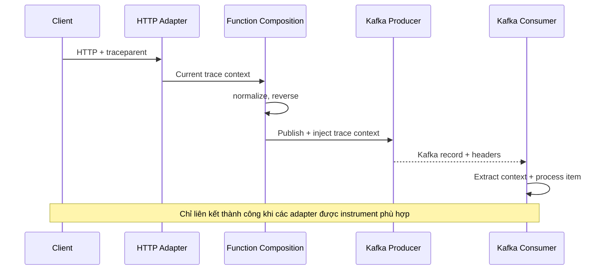

# Truyền ngữ cảnh truy vết qua hàm ghép và chuỗi phản ứng

## Mục tiêu học tập

Sau bài học, bạn có thể:

1. Giải thích **trace context**, `traceId`, `spanId`, parent-child span, `Observation` và vai trò của `ObservationRegistry` trong Spring Boot/Micrometer.
2. Phân biệt **ghép hàm đồng bộ** (`normalize|reverse`) và **ghép hàm phản ứng** (`Function<Flux<T>, Flux<R>>`) xét về thời điểm thực thi và cách truyền ngữ cảnh.
3. Tạo các `Function` tái sử dụng qua `FunctionCatalog`, gắn `Observation` để quan sát từng bước trong composition mà không buộc business function phụ thuộc HTTP hoặc broker.
4. Dùng Reactor `Context`, `contextWrite` và `deferContextual` để truyền dữ liệu tương quan qua `publishOn`, `concatMap` và composition.
5. Phân biệt Reactor Context với **ThreadLocal/MDC**, hiểu cơ chế Micrometer Context Propagation, `spring.reactor.context-propagation=auto` và giới hạn của tính năng này.
6. Quan sát reactive pipeline bằng `tap(Micrometer.observation(registry))`, xác định đơn vị observation: **cả Publisher, subscription, từng phần tử hoặc một đoạn xử lý**.
7. Thiết kế việc tiếp nhận và phát tiếp trace context khi qua HTTP, Spring Cloud Stream, message broker và nền tảng serverless; tránh kết luận rằng function composition tự bảo đảm distributed tracing.
8. Kiểm thử khả năng giữ `businessCorrelationId` qua các bước, nhận diện context loss, duplicate span, rò MDC và thông tin nhạy cảm trong tags/logs.

## 1. Bài toán: cùng một hàm, nhiều bước và nhiều môi trường

Spring Cloud Function đóng gói logic nghiệp vụ bằng `Supplier`, `Function` và `Consumer`. `FunctionCatalog` đăng ký, tra cứu, composition và thích nghi kiểu dữ liệu, giúp cùng một hàm được gọi bằng HTTP, sự kiện hoặc serverless mà không phụ thuộc giao thức.

Giả sử một ứng dụng xử lý văn bản theo hai bước:

- `normalize`: bỏ khoảng trắng và chuyển thành chữ hoa.
- `reverse`: đảo thứ tự ký tự.

Khi định nghĩa `normalize|reverse`, một chuỗi `" hello "` trở thành `"OLLEH"`. Nếu request bị chậm hoặc lỗi, đội vận hành muốn biết:

- Log và span nào thuộc **cùng request**?
- Bước `normalize` hay `reverse` tốn thời gian hơn?
- Hai bước có đang dùng **cùng trace** hay vô tình tạo hai trace không liên quan?
- Khi chuyển sang `Flux` và đổi thread, tại sao `traceId` trong log có thể trống?
- Khi function phát một event mới, trace context đã đi qua broker chưa?

**Function composition** mô tả đường đi của dữ liệu; **context propagation** mô tả cách ngữ cảnh quan sát di chuyển theo đường đi ấy. Đó là hai trách nhiệm khác nhau.



Đừng chỉ dựa vào `/actuator/functions`: endpoint đó liệt kê function có trong catalog, **không** xác nhận function đã chạy, có span hay đã truyền trace qua một adapter khác.

## 2. Các khái niệm phải tách biệt

| Khái niệm | Câu hỏi trả lời | Vòng đời điển hình |
| --- | --- | --- |
| **Trace** | Những hoạt động phân tán nào thuộc một hành trình được quan sát? | Một request, message processing attempt hoặc hành trình được thiết kế |
| **Trace ID** | Các span nào thuộc cùng trace? | Ổn định trong một trace |
| **Span ID** | Bước/thao tác cụ thể nào được quan sát? | Khác nhau giữa các span |
| **Parent span** | Span này được tạo trong ngữ cảnh thao tác nào? | Quan hệ cha-con; phụ thuộc context hiện hành |
| **Observation** | Đơn vị đo có tên, tags, lỗi và thời gian sống | Một lời gọi hàm, một đoạn reactive pipeline, v.v. |
| **MDC** | Giá trị nào được đưa vào log trong ngữ cảnh thread hiện tại? | Thread/scope; cần dọn và truyền khi đổi thread |
| **Reactor Context** | Dữ liệu gắn với **subscriber**, không lệ thuộc thread cụ thể | Theo subscription và cách dùng `contextWrite` |
| **Business correlation ID** | Những message nào cùng một workflow nghiệp vụ? | Được ứng dụng bảo toàn qua nhiều bước hoặc nhiều trace |

Micrometer `Observation` không phải một span theo nghĩa bắt buộc. Khi `ObservationRegistry` được gắn các handler phù hợp, cùng một `Observation` có thể sinh metrics và/hoặc span. **Nếu chưa cấu hình tracing bridge/exporter, việc gọi `Observation.observe(...)` không đủ để bảo đảm có trace được xuất ra hệ thống tracing.**

Ví dụ một hành trình:

```text
traceId = 6d8c...4af1
  spanId = 1001  HTTP request
    spanId = 1002  normalize
    spanId = 1003  reverse
    spanId = 1004  publish to broker

businessCorrelationId = workflow-72
  Message A: Spring Message ID uuid-a
  Message B: Spring Message ID uuid-b
```

Các span minh họa quan hệ logic và **không khẳng định** Spring Cloud Function tự tạo đúng bốn span này. Những span nào xuất hiện phụ thuộc auto-instrumentation, handler, cấu hình và việc ứng dụng tự gắn observation.

### Một trace khác một workflow nghiệp vụ

Một workflow chạy hàng giờ hoặc có retry có thể gồm nhiều trace. Một trace HTTP có thể chứa nhiều bước nghiệp vụ. `MessageHeaders.ID` có thể thay đổi khi tạo Spring Message mới. Vì vậy **không dùng trace ID hoặc Spring Message ID làm khóa nghiệp vụ duy nhất**; giữ business correlation/event ID riêng khi cần liên kết các message và retry.

## 3. Function composition và phạm vi thực thi

Spring Cloud Function hỗ trợ composition khai báo bằng dấu `|`:

```properties
spring.cloud.function.definition=normalize|reverse
```

Về logic, nó tương tự:

```java
Function<String, String> composed =
        normalize.andThen(reverse);
```

Nhưng `FunctionCatalog.lookup("normalize|reverse")` còn cung cấp khả năng composition do Spring Cloud Function quản lý, bao gồm những đặc điểm thích nghi/conversion cần thiết trong framework.

| Tình huống | Điều có thể giữ ngữ cảnh | Nguy cơ |
| --- | --- | --- |
| Hai `Function<String,String>` chạy tuần tự **cùng thread** | `Observation` hiện hành và MDC trong scope | Không có span nếu không được instrument |
| Một bước tạo `CompletableFuture` trên thread khác | Executor có context propagation | Parent/span mất nếu dùng executor không được cấu hình |
| Một bước trả về `Flux` | Reactor Context trên subscriber | ThreadLocal lúc gọi `apply` có thể không hiện diện khi subscribe |
| Một bước tự `subscribe()` | Ngữ cảnh phải chuyển vào subscription mới | Tách khỏi subscription chính, khó bảo đảm completion và lỗi |
| Một bước publish sang broker | Trace context phải được carrier/adapter chuyển | Consumer ở service khác có thể bắt đầu trace rời rạc |

**Kết luận:** `normalize|reverse` chỉ biểu diễn thứ tự thực thi, **không tự tạo span riêng cho từng bước**. Nếu cần đo từng bước, phải bảo đảm chúng được instrument ở đúng thời điểm.

## 4. Chuẩn bị Spring Boot, Actuator và tracing

Ví dụ Java trong bài sử dụng Spring Cloud Function, Spring Boot, Micrometer, Project Reactor. Chọn **BOM/phiên bản Spring Cloud phù hợp với Spring Boot** của dự án; tên dependency/tracing auto-configuration có thể khác giữa các dòng Spring Boot.

Ví dụ Maven cho một ứng dụng có Function Web và Actuator:

```xml
<dependency>
    <groupId>org.springframework.cloud</groupId>
    <artifactId>spring-cloud-starter-function-web</artifactId>
</dependency>

<dependency>
    <groupId>org.springframework.boot</groupId>
    <artifactId>spring-boot-starter-actuator</artifactId>
</dependency>
```

Để truyền/export traces theo OpenTelemetry với các dòng Spring Boot hỗ trợ, có thể dùng:

```xml
<dependency>
    <groupId>io.micrometer</groupId>
    <artifactId>micrometer-tracing-bridge-otel</artifactId>
</dependency>

<dependency>
    <groupId>io.opentelemetry</groupId>
    <artifactId>opentelemetry-exporter-otlp</artifactId>
</dependency>
```

Tùy release, ứng dụng có thể dùng starter tracing tương ứng thay vì tự liệt kê từng thành phần. Tránh đồng thời cấu hình hai tracer bridge khác nhau nếu không có nhu cầu rõ ràng.

Ví dụ YAML cho môi trường thử nghiệm:

```yaml
spring:
  application:
    name: function-observability-demo

management:
  tracing:
    sampling:
      probability: 1.0   # Chỉ dùng để thử; production cần chính sách sampling

logging:
  pattern:
    correlation: "[trace:%X{traceId:-} span:%X{spanId:-}] "
```

Đây là ví dụ logging theo MDC với Logback/Spring Boot có hỗ trợ `logging.pattern.correlation`. Giá trị `sampling.probability=1.0` tạo chi phí cao nếu áp dụng đại trà trong production; tracing backend còn cần endpoint, kết nối và quyền export thích hợp.

**Chưa có tracing bridge/tracer hiện hành?** Tên observation vẫn có thể được ghi nhận vào metrics, nhưng `traceId`/`spanId` không nhất thiết xuất hiện. **Chưa có span HTTP đầu vào?** Một observation ở function có thể bắt đầu một trace mới thay vì là con của request.

## 5. Ví dụ imperative: tạo observation cho từng bước composition

Đây là ví dụ quan trọng nhất khi học function composition. Hai function chỉ phụ thuộc `ObservationRegistry` và API Java; chúng không đọc `HttpServletRequest` hay broker metadata.

```java
package com.example.tracecomposition;

import java.util.Locale;
import java.util.function.Function;

import io.micrometer.observation.Observation;
import io.micrometer.observation.ObservationRegistry;
import org.slf4j.Logger;
import org.slf4j.LoggerFactory;
import org.springframework.boot.SpringApplication;
import org.springframework.boot.autoconfigure.SpringBootApplication;
import org.springframework.context.annotation.Bean;

@SpringBootApplication
public class CompositionTracingApplication {

    private static final Logger log =
            LoggerFactory.getLogger(CompositionTracingApplication.class);

    public static void main(String[] args) {
        SpringApplication.run(CompositionTracingApplication.class, args);
    }

    @Bean
    public Function<String, String> normalize(ObservationRegistry registry) {
        return value -> Observation
                .createNotStarted("app.function.normalize", registry)
                .lowCardinalityKeyValue("function", "normalize")
                .observe(() -> {
                    log.info("stage=normalize started");
                    String output = value.trim().toUpperCase(Locale.ROOT);
                    log.info("stage=normalize completed");
                    return output;
                });
    }

    @Bean
    public Function<String, String> reverse(ObservationRegistry registry) {
        return value -> Observation
                .createNotStarted("app.function.reverse", registry)
                .lowCardinalityKeyValue("function", "reverse")
                .observe(() -> {
                    log.info("stage=reverse started");
                    String output = new StringBuilder(value).reverse()
                            .toString();
                    log.info("stage=reverse completed");
                    return output;
                });
    }
}
```

Nếu gọi `normalize` với `" hello "` rồi gọi `reverse`, kết quả là `"OLLEH"`. `Observation.observe(Supplier<T>)` quản lý phạm vi observation quanh code trong lambda; khi tracing handler được cấu hình và có **parent observation đang hoạt động**, các observation mới có thể trở thành span con.

Lưu ý quan trọng:

1. Mỗi lần `Function.apply` tạo một observation **ở ranh giới xử lý thật**, không chỉ khi khởi tạo `@Bean`.
2. Tag `function=normalize`/`reverse` có **cardinality thấp**, phù hợp để làm chiều phân tích metrics.
3. Log trong scope có thể được tracing integration gắn `traceId`/`spanId`, tùy logger/tracer.
4. Không tự tạo `traceId` mới ở từng stage. Tracer quản lý quan hệ parent-child theo context đang hoạt động.
5. Trong function đồng bộ, scope thường được đóng trước khi bước kế tiếp bắt đầu; hai bước có thể là **span anh em** cùng cha, không nhất thiết `reverse` là con của `normalize`.

### Một workflow làm parent của hai stage

Một caller có thể tạo parent `Observation` bao quanh composition:

```java
import java.util.function.Function;
import io.micrometer.observation.Observation;
import io.micrometer.observation.ObservationRegistry;
import org.springframework.cloud.function.context.FunctionCatalog;

// catalog và registry đã được Spring inject.
Function<String, String> chain =
        catalog.lookup("normalize|reverse");

String result = Observation.createNotStarted(
                "app.workflow.transformText", registry)
        .lowCardinalityKeyValue("workflow", "text-transform")
        .observe(() -> chain.apply(" hello "));

// result: OLLEH
```

Trong cùng thread, khi parent `Observation` có scope hiện hành, các stage tạo observation riêng sẽ có cơ hội kế thừa nó. Nếu caller đã có span HTTP, parent `app.workflow.transformText` có thể là con của span HTTP đó. Trong một unit test không cấu hình tracing handler, ta vẫn gọi code đúng nhưng **không nhất thiết có span được xuất**.



Sơ đồ mô tả một quan hệ quan sát có thể thiết kế: hai stage **là con của cùng workflow span**, nhưng dữ liệu được truyền tuần tự từ `normalize` sang `reverse`. *Đường dữ liệu* và *cây span* không nhất thiết cùng hình dạng.

## 6. Chọn composition ở tầng adapter

Để xuất composition làm function đầu vào, có thể cấu hình:

```yaml
spring:
  cloud:
    function:
      definition: normalize|reverse
```

Với Spring Cloud Function Web và đúng cấu hình endpoint, một request có thể đi qua cả hai bước:

```bash
# URL thực tế tùy web adapter / function được chọn / path cấu hình.
curl -i -X POST http://localhost:8080/ \
  -H "Content-Type: text/plain" \
  --data-raw " hello "
```

Không nên gán trước một URL duy nhất cho mọi phiên bản Function Web hoặc khẳng định một request chắc chắn tạo **đúng hai spans**: web adapter, `FunctionCatalog`, tracing wrapper hoặc gateway có thể tạo thêm observations; một số span có thể bị sampling bỏ qua.

### Routing đến composition

Nếu ứng dụng dùng `functionRouter`, nó có thể chọn definition `normalize|reverse` theo route:

```yaml
spring:
  cloud:
    function:
      definition: functionRouter
      routing-expression: "'normalize|reverse'"
```

Lúc này có hai vấn đề riêng:

- **Routing decision:** router chọn definition nào? Tên đích có trong `FunctionCatalog` không?
- **Trace propagation:** khi function đích chạy, có observation/span cha hiện hành không?

Việc gọi vào router không bảo đảm từng stage được instrument. Nếu lỗi routing xảy ra **trước khi vào `normalize`**, các observations của hai stage không xuất hiện; cần quan sát lỗi tại router/adapter riêng.

## 7. Ranh giới ThreadLocal và MDC trong pipeline phản ứng

Với reactive function, chữ ký phổ biến là:

```java
Function<Flux<String>, Flux<String>>
```

Khi gọi `Function.apply(flux)`, code thường **xây dựng Publisher mới**. Các toán tử `map`, `flatMap`, `concatMap` xử lý phần tử **khi có subscription**, có thể trên thread khác. Do đó, bọc `apply` bằng:

```java
try (Observation.Scope scope = observation.openScope()) {
    return reactiveFunction.apply(flux);
}
```

chỉ mở scope trong thời gian **tạo Publisher**, rồi đóng **trước khi Publisher được subscribe**. Đừng cho rằng đoạn code này tự làm mọi signal trong stream chạy bên trong observation.

### Vì sao MDC không đủ?

SLF4J MDC thường dùng `ThreadLocal`. `publishOn` và `subscribeOn` có thể đổi thread; còn một thread có thể xử lý nhiều subscription khác nhau:

```text
Thread HTTP:
  MDC[traceId] = abc  --> tạo Flux --> trả về

Thread reactor-parallel:
  map("hello")       --> MDC có thể không có abc
```

**Reactor Context** mới là nơi thích hợp để đặt dữ liệu gắn với subscription. Nó khác MDC, không phụ thuộc thread và được truyền qua chuỗi operator theo quy tắc của Reactor.

## 8. Truyền dữ liệu tương quan qua Reactor Context

Đây là ví dụ **không cần tracing bridge**, dùng Reactor Context để thấy cơ chế truyền dữ liệu một cách rõ ràng:

```java
import reactor.core.publisher.Flux;
import reactor.core.publisher.Mono;
import reactor.core.scheduler.Schedulers;
import reactor.util.context.Context;

Flux<String> output = Flux.just("hello", "spring")
        .publishOn(Schedulers.parallel())
        .concatMap(value -> Mono.deferContextual(context -> {
            String id = context.get("businessCorrelationId");
            return Mono.just(id + ":" + value.toUpperCase());
        }))
        .contextWrite(Context.of("businessCorrelationId", "workflow-72"));

// Khi subscribe: workflow-72:HELLO, workflow-72:SPRING
```

`contextWrite` được đặt gần phía subscriber, nhưng ngữ cảnh của nó được các operator **ở phía upstream** truy cập. `Mono.deferContextual` đọc Context khi subscription thực sự xảy ra, kể cả khi đã `publishOn` sang thread khác.

**Đây là business correlation ID**, không phải tự ý lấy một giá trị trong Reactor Context để coi đó là `traceId` do tracer cấp. Tracing context nên do thư viện tracing quản lý và truyền bằng cơ chế context propagation chuẩn.

### Một điểm hay bị hiểu sai: mỗi subscription có ngữ cảnh riêng

```java
Flux<String> source = Flux.just("a", "b")
        .concatMap(value -> Mono.deferContextual(ctx ->
                Mono.just(ctx.<String>get("workflowId") + ":" + value)));

Flux<String> first = source.contextWrite(
        Context.of("workflowId", "flow-A"));
Flux<String> second = source.contextWrite(
        Context.of("workflowId", "flow-B"));
```

Hai subscription khác nhau có thể dùng cùng `source` nhưng mang **workflow ID riêng**. Ngược lại, nếu viết một `static ThreadLocal` và quên dọn, các subscription xử lý chung thread có thể làm ID bị trộn.

## 9. Composition reactive: Context đi qua hai function

Ví dụ sau có hai bean kiểu `Function<Flux<String>, Flux<String>>`. Bean thứ nhất chuẩn hóa, bean thứ hai đảo chuỗi và đọc correlation ID từ Reactor Context ở lúc xử lý.

```java
package com.example.reactivecomposition;

import java.util.Locale;
import java.util.function.Function;

import org.slf4j.Logger;
import org.slf4j.LoggerFactory;
import org.springframework.boot.SpringApplication;
import org.springframework.boot.autoconfigure.SpringBootApplication;
import org.springframework.context.annotation.Bean;
import reactor.core.publisher.Flux;
import reactor.core.publisher.Mono;

@SpringBootApplication
public class ReactiveCompositionApplication {

    private static final Logger log =
            LoggerFactory.getLogger(ReactiveCompositionApplication.class);

    public static void main(String[] args) {
        SpringApplication.run(ReactiveCompositionApplication.class, args);
    }

    @Bean
    public Function<Flux<String>, Flux<String>> normalizeStream() {
        return source -> source
                .map(String::trim)
                .map(value -> value.toUpperCase(Locale.ROOT));
    }

    @Bean
    public Function<Flux<String>, Flux<String>> reverseStream() {
        return source -> source.concatMap(value ->
                Mono.deferContextual(context -> {
                    String workflow = context.getOrDefault(
                            "businessCorrelationId", "unknown");
                    log.info("stage=reverseStream workflow={}", workflow);
                    return Mono.just(new StringBuilder(value)
                            .reverse().toString());
                }));
    }
}
```

Có thể composition:

```properties
spring.cloud.function.definition=normalizeStream|reverseStream
```

Hoặc gọi qua catalog trong Java:

```java
import java.util.function.Function;
import reactor.core.publisher.Flux;
import reactor.util.context.Context;

Function<Flux<String>, Flux<String>> chain =
        catalog.lookup("normalizeStream|reverseStream");

Flux<String> output = chain
        .apply(Flux.just(" hello ", " world "))
        .contextWrite(Context.of(
                "businessCorrelationId", "workflow-72"));

// Sau khi subscribe: OLLEH, DLROW
```

Ở đây, `contextWrite` được đặt trên Publisher **cuối cùng**, nên `deferContextual` bên trong `reverseStream` có thể đọc workflow ID khi subscribe. Dòng `normalizeStream` cũng chạy trong cùng pipeline nhưng không cần biết ID nếu nghiệp vụ không sử dụng nó.

**Lưu ý thứ tự:** `concatMap` bảo toàn thứ tự dữ liệu nếu inner Publisher hoàn tất theo thứ tự; thay bằng `flatMap` có concurrency thì thời điểm hoàn tất có thể khác. Trace context propagation **không tự bảo đảm ordering**.

### Trường hợp mất ngữ cảnh

```java
// Không nên dùng bên trong một reactive function:
return source.map(value -> {
    someMono(value).subscribe();  // Subscription tự tạo.
    return value;
});
```

`subscribe()` bên trong hàm tạo **một subscription tách khỏi pipeline chính**, dẫn đến khó kiểm soát parent span, correlation context, lỗi, cancellation và backpressure. Hãy trả Publisher bằng `flatMap`/`concatMap` và để adapter/subscriber bên ngoài quản lý việc subscribe.

## 10. Micrometer Context Propagation: từ Reactor Context sang ThreadLocal

Reactor Core tích hợp với **Micrometer Context Propagation** qua `io.micrometer:context-propagation`. Trong Reactor 3.5+, có hai chế độ:

| Chế độ | Cách hoạt động | Lưu ý |
| --- | --- | --- |
| **Default/limited** | Phục hồi các `ThreadLocal` đã đăng ký trong những toán tử hỗ trợ như `handle`, `tap` | Không bảo đảm MDC/tracing xuất hiện trong mọi `map` hoặc `doOnNext` |
| **Automatic** | Phục hồi `ThreadLocal` có `ThreadLocalAccessor` tương ứng trên nhiều ranh giới operator | Có overhead; áp dụng cho subscription mới và cần cleanup |

Spring Boot có cấu hình:

```yaml
spring:
  reactor:
    context-propagation: auto
```

Trong phiên bản Spring Boot hỗ trợ, đây là cách bật chế độ automatic context propagation. Ở Reactor thuần, có thể bật từ lúc ứng dụng khởi động:

```java
reactor.core.publisher.Hooks.enableAutomaticContextPropagation();
```

Không cần bật cả hai cách chỉ để đạt cùng mục tiêu. Theo Reactor, hook có hiệu lực đối với **các subscription được tạo sau khi bật**, vì vậy cần cấu hình đủ sớm.

### `contextWrite` không tự đồng nghĩa với MDC

`contextWrite(Context.of("businessCorrelationId", "..."))` làm giá trị có mặt trong **Reactor Context**. Để một thư viện dựa vào `ThreadLocal` đọc được giá trị đó, Micrometer Context Propagation cần biết **key và `ThreadLocalAccessor` tương ứng**.

Trường `businessCorrelationId` do ứng dụng tự nghĩ ra **không tự xuất hiện trong MDC** chỉ vì đã bật `spring.reactor.context-propagation=auto`. Có hai lựa chọn rõ ràng:

1. Truyền ID như dữ liệu trong Message hoặc đọc trực tiếp bằng `deferContextual`, rồi ghi ID vào log có cấu trúc.
2. Đăng ký `ThreadLocalAccessor` hoặc cơ chế chuyển ngữ cảnh được hỗ trợ cho key cụ thể; kiểm tra kỹ vòng đời và cleanup để tránh rò giữa các subscription.

Với trace context do Micrometer Tracing quản lý, tracer/Observation integration thường cung cấp các accessor cần thiết, nhưng phải có dependencies và configuration thích hợp.

### `contextCapture()` được dùng khi nào?

`contextCapture()` chụp các `ThreadLocal` đã được đăng ký với Context Propagation **ở thời điểm subscription**, rồi đưa chúng vào Reactor Context để các operator phía upstream có thể truy cập. Nó hữu ích khi chuyển từ code imperative có current observation sang Publisher.

```java
// Minh họa vị trí; current Observation phải đang tồn tại lúc subscribe.
Flux<String> output = reactivePipeline.contextCapture();
```

Chú ý:

- Nếu subscription diễn ra sau khi scope imperative đã đóng, capture có thể **không lấy được** current observation mong muốn.
- Ở automatic mode, một số toán tử blocking như `block()` có thể tự capture context, nhưng **không nên dựa vào blocking** để giải quyết một kiến trúc reactive.
- `contextCapture` chỉ hoạt động với `ThreadLocalAccessor` đã đăng ký; nó không sao chép tùy ý mọi state Java.
- Nếu đã có Reactor Context từ adapter, cần tránh tự thay thế/xóa nó khi thêm custom context.

## 11. Quan sát reactive theo từng đoạn bằng `Micrometer.observation`

Theo tài liệu Spring Cloud Stream, có một khác biệt lớn:

- **Imperative function** có thể được framework/binder bọc bởi `ObservationFunctionAroundWrapper`, với một observation cho mỗi lần gọi message trong cấu hình hỗ trợ.
- **Reactive function** thường chỉ được gọi khi **thiết lập stream**, sau đó các tín hiệu Publisher do Reactor vận hành. Không nên mong wrapper imperative đo mỗi phần tử.

Để instrument reactive segment, Spring Cloud Stream minh họa toán tử:

```java
.tap(Micrometer.observation(registry))
```

Cần dependency hỗ trợ Reactor Micrometer:

```xml
<dependency>
    <groupId>io.projectreactor</groupId>
    <artifactId>reactor-core-micrometer</artifactId>
</dependency>
```

Ví dụ mỗi item đi vào một `Mono` được quan sát:

```java
import java.util.Locale;
import java.util.function.Function;
import io.micrometer.observation.ObservationRegistry;
import org.springframework.context.annotation.Bean;
import reactor.core.observability.micrometer.Micrometer;
import reactor.core.publisher.Flux;
import reactor.core.publisher.Mono;

@Bean
public Function<Flux<String>, Flux<String>> observedUppercaseStream(
        ObservationRegistry registry) {
    return flux -> flux.concatMap(item ->
            Mono.just(item)
                    .map(value -> value.toUpperCase(Locale.ROOT))
                    .tap(Micrometer.observation(registry)));
}
```

Ở đây đơn vị observation là **một inner `Mono` xử lý một item**. Nếu `tap` được đặt lên toàn bộ outer `Flux`, đơn vị quan sát có thể là **subscription của cả luồng**; nếu đặt vào một đoạn khác, nó đo đoạn đó. Cách đặt toán tử quyết định bạn đang đo item, batch hay stream.

**Lưu ý parent span:** Nếu downstream subscriber đã có observation/trace context phù hợp, một observation của `tap` có thể nối với parent đó. Nhưng đối với reactive function, binder **không mặc nhiên gắn một observation cho mọi phần tử** trong mọi cấu hình; cần kiểm thử cả producer, consumer, tracer bridge và context propagation thực tế.

### Không đo stream vô hạn bằng một span duy nhất nếu không cần

Một `Flux` có thể chạy liên tục nhiều ngày. Nếu chỉ tạo một observation kéo dài đến `onComplete`, span rất dài có thể gây khó vận hành và backend tracing không tối ưu. Đối với luồng liên tục, thường hợp lý hơn khi đo **từng item hoặc batch có ranh giới rõ**, gắn correlation ID có kiểm soát và dùng metric throughput/lag cho toàn luồng.

## 12. `@Async`, executor và context loss ngoài Reactor

Chuyển thread không chỉ xảy ra trong Reactor. Một imperative `Function` có thể gọi `@Async` hoặc `CompletableFuture`:

```java
Observation.createNotStarted("app.work", registry)
        .observe(() -> {
            // Có Observation hiện hành trên thread này.
            service.doAsync(); // Chạy ở thread khác.
        });
```

Current Observation thường được giữ trong ngữ cảnh thread. Nếu executor không truyền context, code trong task có thể không thấy parent span.

Trong các dòng Spring Framework hỗ trợ, sử dụng `ContextPropagatingTaskDecorator`:

```java
import org.springframework.context.annotation.Bean;
import org.springframework.context.annotation.Configuration;
import org.springframework.core.task.support.ContextPropagatingTaskDecorator;

@Configuration
class TaskContextConfiguration {

    @Bean
    ContextPropagatingTaskDecorator contextPropagatingTaskDecorator() {
        return new ContextPropagatingTaskDecorator();
    }
}
```

Khi cấu hình executor tùy chỉnh, phải **gắn decorator đó vào executor thực sự dùng để thực thi task**. Nếu tự gọi `CompletableFuture.supplyAsync(...)` không truyền executor, nó có thể chạy ở common pool thay vì executor đã gắn decorator.

Một số dòng Spring Boot còn cung cấp thuộc tính `spring.task.execution.propagate-context` cho executor auto-configured; hãy xác minh theo **phiên bản Spring Boot và kiểu executor** của dự án, tránh cho rằng cùng property có hiệu lực với mọi custom executor.

### Một lỗi nguy hiểm: dùng scope quá ngắn

Mở scope trước khi nộp task rồi đóng ngay **không tự động** khiến task bất đồng bộ kế thừa scope. Propagation phải **capture context khi nộp task** và **restore trong lúc task chạy**, hoặc truyền ID ngữ cảnh một cách tường minh.

## 13. Truyền trace qua HTTP, broker và serverless

Function composition chỉ hoạt động trong một tiến trình và lời gọi. Khi sang tiến trình khác, cần một **carrier** để truyền trace context.

| Ranh giới | Carrier thường gặp | Điều cần kiểm chứng |
| --- | --- | --- |
| HTTP request/response | W3C `traceparent`, `tracestate` và baggage khi được cấu hình | Client/adapter có inject/extract? Security/gateway có lọc header không? |
| Spring `Message` | Headers do framework/adapter cung cấp | Header mapper có giữ custom metadata hoặc tracing carrier không? |
| Kafka/RabbitMQ | Record/message headers | Producer và consumer có instrumentation cùng propagator không? |
| Serverless invocation | Event metadata hoặc request headers của nền tảng | Adapter có hỗ trợ extract/inject và exporter có chạy trước khi runtime kết thúc không? |
| Java direct call | Current `Observation`/tracing scope | Lời gọi có cùng thread/context hay bị tách sang executor khác? |

Ví dụ đường đi:



Khi client không gửi trace context, phía ingress có thể **bắt đầu trace mới**. Nếu producer không inject hoặc consumer không extract, downstream thường có trace riêng; không nên tự lấy `traceId` từ một custom text header rồi gán thành “current trace” mà bỏ qua API của tracer.

### Business correlation ID vẫn hữu ích

Một workflow có thể bao gồm nhiều trace do retry, delay hoặc batch. Khi tạo message đầu ra, ứng dụng có thể chủ động giữ `businessCorrelationId`:

```java
import org.springframework.messaging.Message;
import org.springframework.messaging.support.MessageBuilder;

Message<String> outgoing = MessageBuilder.withPayload("OLLEH")
        .setHeader("businessCorrelationId", "workflow-72")
        .build();
```

Đây là **metadata nghiệp vụ**, khác với `traceparent` do tracer xử lý. Phải xác minh mapper của binder có truyền header custom qua broker. `MessageHeaders.ID` của message mới không phải correlation ID bền vững.

### Cấu hình Spring Cloud Stream Observation

Với các phiên bản/binder được tài liệu hỗ trợ, một cấu hình Kafka binder liên quan là:

```yaml
spring:
  cloud:
    stream:
      kafka:
        binder:
          enable-observation: true
```

Cấu hình này bật observation ở binder Kafka theo khả năng hỗ trợ của phiên bản; nó **không tự instrument tất cả toán tử Reactor hoặc tự sinh business correlation ID**. Ở reactive Kafka binder, tài liệu còn nêu consumer-side observation cần cấu hình/điểm gắn cụ thể; hãy kiểm tra binder được dùng thay vì áp dụng một kết luận chung cho mọi loại binder.

## 14. Tracing, metrics và logging không giống nhau

| Tín hiệu | Thông tin có thể cung cấp | Điều không thể tự kết luận |
| --- | --- | --- |
| `/actuator/functions` | Các function đăng ký trong catalog | Function nào vừa chạy, trace nào hiện hành |
| `http.server.requests` | Traffic, status và latency HTTP | Một stage trong composition có span cha đúng hay không |
| Custom `Observation` | Thời lượng/tags/error và span nếu handler hỗ trợ | Không tự bảo đảm trace được export hay message được ack |
| Log MDC | `traceId`, `spanId` trong phạm vi log | Không bảo đảm span được collector nhận do sampling/export lỗi |
| `Flux` Reactor Context | Dữ liệu theo subscription | Không tự tạo trace/span hoặc hiện ra trong MDC |
| Broker consumer lag | Khả năng bắt kịp producer | Từng message xử lý thành công nghiệp vụ |
| Business correlation ID | Liên kết workflow qua nhiều message | Không phải cơ chế xác thực/ủy quyền |

Nếu hai stage ghi cùng `traceId` nhưng có `spanId` khác nhau, đó thường là dấu hiệu context được giữ trong **cùng trace**. Tuy nhiên, kiểm chứng parent-child cần xem **parent span ID/trace tree** tại backend; chỉ cùng trace ID không chứng minh span nào là cha của span nào.

### Sampling và export

Một request có thể có trace IDs trong log nhưng không thấy đầy đủ spans ở backend vì sampling, exporter timeout hoặc collector unavailable. Ngược lại, metrics có thể xuất hiện vì Micrometer vẫn ghi observation durations dù tracer không gửi span. Khi chẩn đoán, kiểm tra:

1. Tracer bridge và ObservationHandlers.
2. Sampling policy.
3. Exporter endpoint, authentication và kết nối.
4. Context propagation ở ranh giới cần thiết.
5. Truy vấn trace theo đúng service name, khoảng thời gian và trace ID.

Không sửa business function để “tạo trace” nếu nguyên nhân là exporter hoặc sampler.

## 15. Kiểm thử composition và Reactor Context

Nên tách **kiểm thử dữ liệu**, **kiểm thử propagation** và **kiểm thử trace integration**.

### 15.1. Kiểm thử composition imperative

```java
import static org.junit.jupiter.api.Assertions.assertEquals;
import static org.junit.jupiter.api.Assertions.assertNotNull;

import java.util.function.Function;
import org.junit.jupiter.api.Test;
import org.springframework.beans.factory.annotation.Autowired;
import org.springframework.boot.test.context.SpringBootTest;
import org.springframework.cloud.function.context.FunctionCatalog;

@SpringBootTest(classes = CompositionTracingApplication.class)
class ImperativeCompositionTest {

    @Autowired
    FunctionCatalog catalog;

    @Test
    void composeTwoFunctions() {
        Function<String, String> chain =
                catalog.lookup("normalize|reverse");

        assertNotNull(chain);
        assertEquals("OLLEH", chain.apply(" hello "));
    }
}
```

Test này xác nhận function names/types và thứ tự composition. Nó **chưa xác nhận span parent-child**. Muốn kiểm thử tracing, cần một tracing handler/test exporter thích hợp và assertion trên trace IDs/parent IDs thực sự được ghi, thay vì suy diễn từ kết quả `OLLEH`.

### 15.2. Kiểm thử Reactor Context đi qua đổi thread

```java
import org.junit.jupiter.api.Test;
import reactor.core.publisher.Flux;
import reactor.core.publisher.Mono;
import reactor.core.scheduler.Schedulers;
import reactor.test.StepVerifier;
import reactor.util.context.Context;

class ReactorCorrelationTest {

    @Test
    void keepsSubscriptionContextAcrossPublishOn() {
        Flux<String> output = Flux.just("hello", "spring")
                .publishOn(Schedulers.parallel())
                .concatMap(value -> Mono.deferContextual(ctx ->
                        Mono.just(ctx.<String>get("workflowId")
                                + ":" + value)))
                .contextWrite(Context.of("workflowId", "workflow-72"));

        StepVerifier.create(output)
                .expectNext("workflow-72:hello", "workflow-72:spring")
                .verifyComplete();
    }
}
```

Đây là **bằng chứng về Reactor Context**, không phải bằng chứng rằng tracer đã tạo span. Test không yêu cầu bật `spring.reactor.context-propagation=auto` vì nó đọc Context **tường minh** bằng `deferContextual`.

### 15.3. Kiểm thử ghép hai reactive function

```java
import static org.junit.jupiter.api.Assertions.assertNotNull;

import java.util.function.Function;
import org.junit.jupiter.api.Test;
import org.springframework.beans.factory.annotation.Autowired;
import org.springframework.boot.test.context.SpringBootTest;
import org.springframework.cloud.function.context.FunctionCatalog;
import reactor.core.publisher.Flux;
import reactor.test.StepVerifier;
import reactor.util.context.Context;

@SpringBootTest(classes = ReactiveCompositionApplication.class)
class ReactiveCompositionTest {

    @Autowired
    FunctionCatalog catalog;

    @Test
    void composesReactivePipeline() {
        Function<Flux<String>, Flux<String>> chain =
                catalog.lookup("normalizeStream|reverseStream");
        assertNotNull(chain);

        Flux<String> output =
                chain.apply(Flux.just(" hello ", " world "))
                     .contextWrite(Context.of(
                             "businessCorrelationId", "workflow-72"));

        StepVerifier.create(output)
                .expectNext("OLLEH", "DLROW")
                .verifyComplete();
    }
}
```

Nếu cần chứng minh `businessCorrelationId` đã đi tới `reverseStream`, thay logger bằng một test sink/collector nhận ID đã đọc từ `deferContextual`, hoặc kiểm tra test appender. Test chỉ so khớp output ở trên **chưa đủ** để khẳng định log chứa ID.

### 15.4. Kiểm thử parent-child spans thật

Một integration test tracing nghiêm túc cần:

1. Tạo hoặc tiếp nhận **parent trace context** bằng tracer test implementation.
2. Gọi `normalize|reverse` trong scope parent.
3. Thu spans từ test span handler/exporter (không phụ thuộc collector ngoài).
4. Xác nhận stage spans có cùng trace ID và parent span ID phù hợp với cấu trúc đã thiết kế.
5. Chạy tương tự với `publishOn` và binder adapter nếu đây là đường production.
6. Kiểm tra trường hợp thiếu propagation: spans tách trace hoặc không có parent mong đợi.

Test nào không cấu hình tracing bridge/handlers thì **không thể** chứng minh mối quan hệ span chỉ vì đã tạo `ObservationRegistry`.

## 16. Lỗi thường gặp khi truyền ngữ cảnh

| Triệu chứng | Nguyên nhân có thể | Cách kiểm tra hoặc xử lý |
| --- | --- | --- |
| Hai stage cùng request nhưng khác trace ID | Một stage tự mở root trace hoặc context bị mất | Kiểm tra scope hiện hành, tracer và executor |
| Hai stage cùng trace ID nhưng không theo thứ tự cha-con kỳ vọng | Hai observation có cùng parent hoặc scope kết thúc trước bước sau | Xem cây spans; phân biệt thứ tự dữ liệu với parent-child |
| Log có trace ID nhưng backend không tìm được span | Sampling hoặc exporter/collector lỗi | Kiểm tra sampling, exporter, thời điểm và service |
| Log trong `Flux.map` không có MDC | Default propagation chỉ hỗ trợ một số operator | Dùng Reactor Context; bật auto mode khi phù hợp |
| Bật `spring.reactor.context-propagation=auto` nhưng custom ID không có trong MDC | Chưa đăng ký `ThreadLocalAccessor` hoặc ID chỉ nằm trong Context | Đọc `deferContextual`/truyền ID tường minh |
| `contextCapture` không thấy parent | Capture ở thời điểm scope đã đóng | Capture tại subscription với scope đang hoạt động |
| Traces bị mất khi gọi `CompletableFuture` | Executor không capture/restore context | Cấu hình `ContextPropagatingTaskDecorator` |
| Reactive function chỉ có một span khi startup | Framework nhìn function là điểm nối stream, không per-item | Đặt `tap(Micrometer.observation)` ở segment mong muốn |
| `functionRouter` chọn được đích nhưng không có span stage | Chưa instrument các function đích | Gắn observation vào đúng đường `apply`/Publisher |
| Kafka consumer có trace mới, không nối producer | Header propagation hoặc binder observation thiếu | Kiểm tra inject/extract, carrier, binder version |
| Một `Flux` xử lý nhiều event nhưng cùng business ID sai | Dùng một Context cấp subscription cho nhiều workflow khác nhau | Mang ID theo từng `Message`/item thay vì một giá trị chung |
| Trace volume tăng mạnh khi bật per-item observations | Một span cho mỗi event, throughput quá lớn | Sampling, batching, chọn đơn vị observation hợp lý |
| Pod có metrics nhưng không có traces | Chưa có tracer bridge/exporter hoặc sampling loại bỏ | Kiểm tra ba pipeline: metrics, tracing, logs riêng |

### Quy trình chẩn đoán

```text
1. Function được gọi từ HTTP, binder, serverless hay Java nội bộ?
2. Đầu vào là một Message imperative hay Publisher reactive?
3. Có parent Observation/tracing context tại điểm vào không?
4. Function composition đã instrument từng stage chưa?
5. Có đổi thread qua publishOn, subscribeOn, @Async, executor không?
6. Reactor Context có dữ liệu đúng ở thời điểm subscribe không?
7. Có ThreadLocalAccessor cho context cần dùng trong MDC không?
8. Có subscribe lồng trong function làm tách pipeline không?
9. Adapter producer/consumer có inject và extract trace headers không?
10. Tracer bridge, sampling và exporter có hoạt động không?
```

## 17. Bảo mật và tính kinh tế của tracing

- **Không tin `traceparent` như credential.** Trace context để liên kết quan sát; xác thực và phân quyền thuộc tầng bảo mật ứng dụng.
- **Không lấy dữ liệu tùy ý từ client làm trace ID.** Hãy để tracer/propagator xử lý trace headers theo định dạng chuẩn và chính sách tin cậy.
- **Hạn chế cardinality:** tag `function=normalize` hoặc `outcome=success` phù hợp; `userId`, `orderId`, `messageId`, `traceId` **không nên** là low-cardinality metric labels.
- **High-cardinality tags trong traces cũng cần kiểm soát.** Chỉ thêm metadata cá thể nếu có chính sách dữ liệu, retention, quyền đọc và khử nhạy cảm phù hợp.
- **Không log payload, token hay PII** để ghép trace khi đã có correlation ID/trace ID đủ dùng.
- **Cân nhắc chi phí:** per-item span trên stream lớn có thể rất tốn kém. Chọn sampling, event aggregation và độ chi tiết instrument theo SLO.
- **Dọn MDC/context:** khi dùng ThreadLocal hoặc custom accessor, kiểm tra scope cleanup để không rò dữ liệu giữa request/subscription.
- **Không chặn reactive pipeline** bằng exporter đồng bộ hoặc `block()` chỉ nhằm làm log/tracing đơn giản hơn.

## 18. Bài tập thực hành

1. Tạo bean `normalize` và `reverse`, cấu hình `spring.cloud.function.definition=normalize|reverse`. Gọi input `" hello "` và giải thích kết quả `OLLEH`.
2. Inject `ObservationRegistry` vào hai function. Bọc mỗi lần `apply` bằng `Observation.createNotStarted(...).observe(...)`. Chỉ ra span cha có thể đến từ đâu khi gọi qua HTTP và khi gọi trong unit test.
3. Tạo parent observation `app.workflow.transformText` bao quanh `catalog.lookup("normalize|reverse").apply(...)`. Vẽ cây span kỳ vọng, phân biệt với thứ tự dữ liệu `normalize → reverse`.
4. Bật tracing bridge và log correlation pattern. So sánh `traceId`/`spanId` ở hai stage; giải thích vì sao cần xem parent span ID để chứng minh cấu trúc.
5. Viết một `Flux` dùng `publishOn`, `deferContextual` và `contextWrite`, rồi dùng `StepVerifier` chứng minh `workflowId` được giữ qua đổi thread.
6. Xây dựng `normalizeStream|reverseStream`, gắn `businessCorrelationId` ở Publisher đầu ra. Tạo test sink ghi lại ID đọc trong `reverseStream`.
7. Thử lưu `businessCorrelationId` vào MDC trước `apply(flux)` và đọc trong `map`. Giải thích vì sao kết quả có thể thiếu hoặc sai khi subscribe ở thread khác.
8. Bật `spring.reactor.context-propagation=auto`. Xác minh custom key của bạn có `ThreadLocalAccessor` phù hợp hay chưa; so sánh với việc đọc trực tiếp Reactor Context.
9. Gắn `tap(Micrometer.observation(registry))` vào một inner `Mono` bên trong `concatMap`; so sánh số observations với việc đặt `tap` trên toàn outer `Flux`.
10. Tạo một function có `CompletableFuture` hoặc `@Async`; cấu hình task decorator và kiểm thử context có được capture/restore đúng qua executor không.
11. Phác thảo đường HTTP → function composition → Kafka → consumer. Chỉ rõ vị trí inject/extract trace context và vị trí business correlation ID được truyền.
12. Mô phỏng broker retry cùng một event hai lần. Giải thích vì sao có thể có nhiều spans và invocation IDs nhưng cùng business event ID.
13. Lập checklist xác nhận một span bị thiếu: function có chạy, observation có tạo, parent có hiện hành, Reactor Context có được dùng, sampling và exporter có cho phép xuất hay không.
14. Đề xuất chiến lược tracing cho một `Flux` vô hạn có 100.000 item/giây: chọn đơn vị observation, sampling, metrics thay thế, tags giới hạn và retention.

## Ghi nhớ

- **Function composition** quản lý đường đi dữ liệu giữa các `Function`; **trace context propagation** quản lý mối liên hệ quan sát. Có composition **không đồng nghĩa** tự có trace/span cho mọi stage.
- Với imperative functions cùng thread, một **current Observation** có thể làm parent cho observations của các bước; `ObservationRegistry` phải có tracing handler phù hợp mới tạo/export spans.
- Với reactive functions, `apply(Flux)` thường chỉ xây dựng Publisher; context phải đi theo **subscription** qua Reactor Context và cơ chế propagation.
- `contextWrite`/`deferContextual` truyền dữ liệu gắn với subscriber qua `publishOn`; **ThreadLocal/MDC không tự chuyển** giữa mọi Reactor operator.
- `spring.reactor.context-propagation=auto` hỗ trợ phục hồi các `ThreadLocal` **đã đăng ký accessor**, không tự đưa mọi custom Reactor Context key vào MDC.
- Với Spring Cloud Stream, imperative observation wrapper và reactive manual `tap(Micrometer.observation(...))` có đơn vị đo khác nhau; luôn chọn ranh giới quan sát phù hợp.
- Khi qua HTTP/broker/serverless, cần tracer/propagator và adapter tương ứng để inject/extract trace context; business correlation ID là dữ liệu nghiệp vụ riêng.
- Xác nhận propagation bằng kiểm thử có trace handler/exporter và assertion trên **trace/parent span IDs**, thay vì chỉ nhìn output function hoặc `/actuator/functions`.

### Tài liệu tham khảo chính thức

- [Spring Cloud Function — Programming Model: Function Composition và FunctionCatalog](https://docs.spring.io/spring-cloud-function/reference/spring-cloud-function/programming-model.html)
- [Spring Cloud Stream — Observability: Imperative và Reactive Functions](https://docs.spring.io/spring-cloud-stream/reference/observability.html)
- [Spring Cloud Stream — Reactive Kafka Binder Observability](https://docs.spring.io/spring-cloud-stream/reference/kafka/kafka-reactive-binder/reactive_observability.html)
- [Spring Boot — Observability và Context Propagation](https://docs.spring.io/spring-boot/reference/actuator/observability.html)
- [Spring Boot — Distributed Tracing](https://docs.spring.io/spring-boot/reference/actuator/tracing.html)
- [Project Reactor — Context-Propagation Support](https://projectreactor.io/docs/core/release/reference/advanced-contextPropagation.html)
- [Project Reactor — Adding a Context to a Reactive Sequence](https://projectreactor.io/docs/core/release/reference/advancedFeatures/context.html)
- [Micrometer — Observation Concepts](https://docs.micrometer.io/micrometer/reference/observation/introduction.html)
