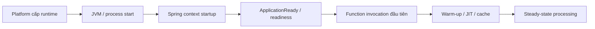

# Phân biệt thời gian khởi động và thời gian xử lý ổn định

## Mục tiêu học tập

Sau bài này, bạn có thể:

1. Phân biệt **thời gian khởi động tiến trình**, **thời gian Spring Application sẵn sàng**, **cold start của nền tảng**, **lần gọi function đầu tiên** và **thời gian xử lý ở trạng thái ổn định**.
2. Giải thích vì sao `ApplicationReadyEvent`, readiness probe và lần gọi đầu tiên của `FunctionCatalog` là các mốc khác nhau.
3. Dùng Spring Boot `ApplicationStartup`, Actuator startup endpoint và các startup metrics để tìm bước khởi động tốn thời gian.
4. Instrument thời lượng và số lần gọi `Supplier`, `Function`, `Consumer` bằng Micrometer, đồng thời phân biệt first invocation với steady-state latency.
5. Đánh giá tác động của class loading, JIT compilation, lazy initialization, connection pool, DNS/TLS, binder và warm-up đến lần xử lý đầu.
6. Thiết kế warm-up an toàn, không làm sai số liệu nghiệp vụ, không trì hoãn readiness ngoài ý muốn và không gây tác dụng phụ.
7. Đọc đúng các tín hiệu HTTP, Spring Cloud Stream, JVM, Kubernetes và serverless khi điều tra cold start hoặc độ trễ tăng.
8. Xây dựng kiểm thử và benchmark phù hợp, tránh dùng unit test hoặc một lần gọi đầu tiên để kết luận hiệu năng ổn định.

## 1. Vì sao phải tách thời gian khởi động và thời gian xử lý?

Spring Cloud Function cho phép xây dựng logic nghiệp vụ bằng các bean `Supplier`, `Function` và `Consumer`, tra cứu qua `FunctionCatalog`, composition và chuyển đổi thông điệp. Cùng một function có thể được gọi từ HTTP, sự kiện hoặc môi trường serverless.

Điều đó tạo ra ít nhất hai nhóm câu hỏi hiệu năng:

- **Ứng dụng mất bao lâu để sẵn sàng nhận công việc?**
- **Sau khi đã sẵn sàng, mỗi lần gọi function xử lý mất bao lâu?**

Một dịch vụ có thể khởi động trong 2 giây nhưng lần gọi đầu mất 1 giây vì phải khởi tạo kết nối hoặc nạp class. Một dịch vụ khác khởi động trong 15 giây nhưng sau đó xử lý ổn định mỗi request chỉ mất 5 ms. Nếu chỉ nhìn một con số latency, ta có thể tối ưu nhầm tầng.

| Đại lượng | Đo điều gì? | Ví dụ |
| --- | --- | --- |
| **Process/JVM startup** | Từ lúc runtime bắt đầu đến khi tiến trình Java chạy | JVM tạo process, nạp class nền tảng |
| **Spring Application startup** | Từ lúc SpringApplication bắt đầu đến khi context khởi tạo | Bean creation, auto-configuration, FunctionCatalog |
| **Application ready time** | Đến khi ứng dụng hoàn tất startup và runners | Đăng ký binding, warm-up bắt buộc, kiểm tra sẵn sàng |
| **Platform cold start** | Chi phí nền tảng cấp runtime/instance mới và khởi tạo ứng dụng | Provision container, tải image, JVM, Spring context |
| **First function invocation** | Thời gian lần đầu đi vào một function cụ thể | Lazy initialization, class loading, cache, JIT |
| **Steady-state processing** | Độ trễ/throughput sau giai đoạn khởi động và warm-up | P50/P95/P99, errors, requests/s |



Các mốc này có thể **chồng lấn hoặc được đo từ những clock khác nhau**. Ví dụ một serverless platform có thể tính cold start từ lúc nhận invocation đến khi handler chạy; Spring Boot chỉ đo thời gian ứng dụng từ khi SpringApplication bắt đầu. Không cộng hoặc so sánh trực tiếp các số nếu chưa xác định điểm bắt đầu/kết thúc.

## 2. Cold start không đồng nghĩa Spring startup

Trong môi trường serverless hoặc scale-to-zero, một request có thể phải khởi tạo instance mới. Cold start thường bao gồm:

1. Nền tảng cấp compute/runtime hoặc container.
2. Tải image, package hoặc mã ứng dụng nếu cần.
3. Khởi chạy JVM/process.
4. Khởi tạo Spring ApplicationContext và auto-configuration.
5. Khởi tạo FunctionCatalog, adapter, client và binding cần thiết.
6. Thực hiện initialization/lazy initialization phát sinh ở lần gọi đầu.
7. Chạy business function và trả kết quả.

**Spring Boot startup time không đo toàn bộ các bước của cloud platform.** Nó cũng không nhất thiết bao gồm phần tải container image hoặc thời gian chờ scheduler.

| Bối cảnh | Phần chi phí có thể lớn | Nơi nên xem |
| --- | --- | --- |
| JVM chạy trong container lâu dài | Spring context, bean creation, classpath scanning | Spring Boot startup steps, logs |
| Kubernetes tạo pod mới | Scheduling, image pull, JVM/Spring startup, readiness | Pod events, startup/readiness probe, container metrics |
| Serverless scale-to-zero | Runtime provisioning, code/package init, Spring context, first invocation | Platform cold-start/init duration và application metrics |
| Event consumer khởi động lại | Context, binder connection, partition assignment, consumer readiness | Spring startup, binder logs, broker consumer state |
| Function dùng downstream client | DNS, TLS handshake, connection pool, cache population | Client metrics, traces, connection metrics |

Một instance mới có thể có Spring Application đã ready nhưng **function chưa từng được gọi**. Ngược lại, một function có thể được gọi lần đầu trước khi hệ thống hoàn tất warm-up hoặc trước khi mọi partition consumer đã được gán.

## 3. Startup, readiness và liveness là ba khái niệm khác nhau

Spring Boot phát các application events theo vòng đời. Hai mốc quan trọng:

- `ApplicationStartedEvent`: context đã được refresh; event xuất hiện trước khi `ApplicationRunner` và `CommandLineRunner` hoàn tất.
- `ApplicationReadyEvent`: runners đã chạy xong; ứng dụng đã đến giai đoạn sẵn sàng phục vụ theo vòng đời Spring Boot.

Spring Boot cũng quản lý trạng thái availability:

- **Liveness:** tiến trình có còn hoạt động và có thể tiếp tục chạy không?
- **Readiness:** ứng dụng có nên nhận traffic/công việc mới không?

| Mốc | Điều nó chứng minh | Điều nó không chứng minh |
| --- | --- | --- |
| JVM process alive | Process còn tồn tại | Spring context đã khởi tạo |
| `ApplicationStartedEvent` | Context đã refresh | Runner/binding/warm-up đã hoàn tất |
| `ApplicationReadyEvent` | Startup và runners đã hoàn tất | Mọi downstream đều khỏe trong mọi thời điểm |
| Readiness `ACCEPTING_TRAFFIC` | Ứng dụng cho phép nhận traffic theo availability state | Function nghiệp vụ sẽ không bao giờ lỗi |
| Liveness `CORRECT` | Process chưa ở trạng thái cần restart | Dependency bên ngoài đang hoạt động |
| Function invocation đầu tiên thành công | Một đường gọi cụ thể đã chạy | Mọi function/route/binding khác đã sẵn sàng |

Không dùng **liveness** để kiểm tra một dịch vụ downstream tạm thời bị lỗi, nếu điều đó làm Kubernetes restart liên tục toàn bộ pod. Không dùng **readiness** thay cho phép đo độ trễ từng function.

### Startup probe trong Kubernetes

Một ứng dụng Spring Boot cần nhiều thời gian để khởi động có thể dùng `startupProbe` để Kubernetes chờ quá trình startup trước khi áp dụng liveness/readiness probes. Cấu hình probe phải phù hợp với endpoint và thời gian khởi động thực tế; tăng timeout không làm code startup nhanh hơn.

## 4. Quan sát startup bằng Spring Boot `ApplicationStartup`

Spring Framework cung cấp abstraction `ApplicationStartup` để ghi nhận các bước trong quá trình bootstrap. Spring Boot có `BufferingApplicationStartup`, giữ lại timeline các `StartupStep` để phân tích.

### 4.1. Bật buffering startup

```java
package com.example.startupmetrics;

import org.springframework.boot.SpringApplication;
import org.springframework.boot.autoconfigure.SpringBootApplication;
import org.springframework.boot.context.metrics.buffering.BufferingApplicationStartup;

@SpringBootApplication
public class FunctionStartupApplication {

    public static void main(String[] args) {
        SpringApplication application =
                new SpringApplication(FunctionStartupApplication.class);

        application.setApplicationStartup(
                new BufferingApplicationStartup(2048));

        application.run(args);
    }
}
```

Trong ví dụ, `FunctionStartupApplication` là class Spring Boot chứa các bean `Supplier`, `Function`, `Consumer`. Buffer size `2048` là giới hạn số startup steps được giữ; chọn dung lượng phù hợp với số bean và chi phí bộ nhớ.

### 4.2. Expose startup endpoint

Thêm Actuator và bật endpoint:

```xml
<dependency>
    <groupId>org.springframework.boot</groupId>
    <artifactId>spring-boot-starter-actuator</artifactId>
</dependency>
```

```yaml
management:
  endpoints:
    web:
      exposure:
        include: "health,info,startup"
```

Sau khi ứng dụng chạy, có thể đọc:

```bash
curl -i http://localhost:8080/actuator/startup
```

Endpoint này hiển thị các startup steps đã được buffer, giúp xem bean/configuration step nào tốn thời gian. Nó **không phải endpoint để đo từng invocation của function** và cũng không cho biết latency của các request sau khi ứng dụng đã ready.

### 4.3. Cách đọc timeline

Ví dụ timeline rút gọn:

```text
spring.boot.application.starting
  -> spring.context.refresh
      -> spring.beans.instantiate
      -> spring.context.config-classes.parse
      -> spring.beans.instantiate (FunctionCatalog-related beans)
  -> spring.boot.application.started
  -> ApplicationRunner
  -> spring.boot.application.ready
```

Tên step thực tế phụ thuộc phiên bản, framework và instrumentation. Không đóng đinh tên một bean cụ thể nếu output của dự án không có step đó. Dùng timeline để tìm **nhóm bước chiếm thời gian**, sau đó điều tra bean/configuration tương ứng.

## 5. Startup metrics của Spring Boot

Khi Micrometer integration phù hợp được bật, Spring Boot cung cấp các metric startup như:

| Metric | Ý nghĩa |
| --- | --- |
| `application.started.time` | Thời gian đến mốc application started sau khi context refresh |
| `application.ready.time` | Thời gian đến mốc application ready, sau khi runners hoàn tất |

Hai metric này giúp tách **context startup** khỏi **thời gian đến ready**. Chúng không phải timer của `Function.apply`.

Có thể kiểm tra meter names qua Actuator:

```yaml
management:
  endpoints:
    web:
      exposure:
        include: "health,metrics,startup"
```

```bash
curl -i http://localhost:8080/actuator/metrics/application.started.time
curl -i http://localhost:8080/actuator/metrics/application.ready.time
```

Tùy phiên bản và registry, cách biểu diễn/đơn vị và tags có thể khác. Hãy xem `/actuator/metrics` để xác nhận meter tồn tại. Những metric này thường mô tả **startup của mỗi process instance**, không phải số liệu latency liên tục cho mỗi request.

### Tự ghi log mốc ready

Nếu cần thêm mốc vận hành riêng, có thể lắng nghe `ApplicationReadyEvent`:

```java
import org.slf4j.Logger;
import org.slf4j.LoggerFactory;
import org.springframework.boot.context.event.ApplicationReadyEvent;
import org.springframework.context.event.EventListener;
import org.springframework.stereotype.Component;

@Component
class ReadyLogListener {

    private static final Logger log =
            LoggerFactory.getLogger(ReadyLogListener.class);

    @EventListener
    void onReady(ApplicationReadyEvent event) {
        log.info("application_ready application={}",
                event.getApplicationContext().getId());
    }
}
```

Log này xác nhận event ready đã xảy ra. Nó **không tự đo duration** nếu không có mốc bắt đầu tương ứng; cũng không thay thế readiness state hoặc probe của nền tảng.

## 6. Đo thời gian function đầu tiên và những lần tiếp theo

Startup metric không trả lời câu hỏi: “Lần đầu gọi `normalizeText` mất bao lâu?”. Để trả lời, instrument **bên trong function**, đúng nơi `apply` được gọi.

Ví dụ tạo Timer theo hai phase:

- `phase=first`: invocation đầu tiên của bean trong process.
- `phase=subsequent`: những invocation sau đó.

Đây là **phân loại theo số thứ tự gọi**, không khẳng định lần thứ hai đã là steady state. JIT, cache, pool hoặc downstream có thể cần nhiều lần gọi mới ổn định.

```java
package com.example.startupmetrics;

import java.util.Locale;
import java.util.concurrent.atomic.AtomicBoolean;
import java.util.function.Function;

import io.micrometer.core.instrument.MeterRegistry;
import io.micrometer.core.instrument.Timer;
import org.springframework.context.annotation.Bean;
import org.springframework.context.annotation.Configuration;

@Configuration
class FunctionTimingConfiguration {

    @Bean
    Function<String, String> normalizeText(MeterRegistry registry) {
        AtomicBoolean firstInvocation = new AtomicBoolean(true);

        Timer firstSuccess = timer(registry, "first", "success");
        Timer firstError = timer(registry, "first", "error");
        Timer laterSuccess = timer(registry, "subsequent", "success");
        Timer laterError = timer(registry, "subsequent", "error");

        return input -> {
            boolean first = firstInvocation.compareAndSet(true, false);
            Timer.Sample sample = Timer.start(registry);

            try {
                String result = input.trim().toUpperCase(Locale.ROOT);
                sample.stop(first ? firstSuccess : laterSuccess);
                return result;
            }
            catch (RuntimeException ex) {
                sample.stop(first ? firstError : laterError);
                throw ex;
            }
        };
    }

    private Timer timer(
            MeterRegistry registry, String phase, String outcome) {
        return Timer.builder("app.function.execution")
                .description("Thoi gian mot lan Function.apply")
                .tag("function", "normalizeText")
                .tag("phase", phase)
                .tag("outcome", outcome)
                .register(registry);
    }
}
```

**Cách hiểu đúng:**

1. `AtomicBoolean` đảm bảo chỉ một invocation thắng cuộc đua và được đánh dấu `first` trong mỗi instance.
2. Timer đầu tiên ghi cả thời lượng và count cho lần đầu, kể cả khi function ném lỗi.
3. Các lần sau được gắn `phase=subsequent`; không nên đặt nhãn `steady` cho mọi lần sau nếu chưa xác định warm-up window.
4. Metric này chỉ bắt đầu khi function được gọi; nó **không bao gồm** platform provisioning hoặc Spring Application startup.
5. Nếu có nhiều replica, mỗi replica có một lần `first` riêng. Khi tổng hợp toàn cluster, phải giữ chiều `instance`/deployment phù hợp hoặc chấp nhận gộp các first invocation.

Trong ứng dụng có nhiều request đồng thời ngay sau startup, chỉ **một request đầu tiên** được gắn `phase=first`; các request còn lại là `subsequent` dù chúng có thể vẫn chịu cold-start contention. Nếu muốn đo toàn bộ khoảng cold-start window, hãy dùng **mốc readiness/platform** hoặc một trạng thái warm-up được thiết kế rõ ràng, không dựa duy nhất vào boolean này.

### Vì sao Timer nằm trong lambda?

Phương thức `@Bean normalizeText(...)` chạy để tạo bean khi Spring context khởi tạo. Nếu đo duration quanh method factory, ta chỉ đo **thời gian tạo object Function**, không phải mỗi lần `Function.apply`. Timer phải nằm ở lambda hoặc một wrapper được catalog/adapter thực sự gọi.

## 7. Phân biệt first invocation với JIT warm-up

JVM có thể biên dịch bytecode sang native code trong quá trình chạy. Một vài invocation đầu tiên có thể chịu chi phí:

- Nạp class và resolve method.
- Khởi tạo static state hoặc lazy bean.
- Tạo serializer/converter hoặc client.
- Thiết lập DNS/TLS/connection pool.
- JIT compilation và tối ưu code theo profile.
- Điền cache hoặc đọc metadata lần đầu.

Do đó:

```text
Invocation 1:  250 ms
Invocation 2:   45 ms
Invocation 3:   18 ms
Invocation 4:    8 ms
Invocation 5:    7 ms
...
```

Số liệu minh họa cho thấy latency giảm dần, nhưng **không chứng minh** nguyên nhân là JIT. Cần profile hoặc kiểm tra các bước initialization/cache/network trước khi kết luận.

**First invocation ≠ cold start hoàn chỉnh.** Nếu container đã khởi động 10 phút nhưng function chưa được gọi, invocation đầu tiên có thể có lazy initialization nhưng không còn là platform cold start.

**Subsequent invocation ≠ steady state ngay lập tức.** JIT, cache, pool, tải hệ thống và dữ liệu có thể tiếp tục thay đổi. Steady state là một khoảng quan sát mà latency/throughput/error rate đủ ổn định theo workload và SLO, không phải tên của lần gọi thứ hai.

## 8. Warm-up: khi nào nên làm và khi nào không?

Warm-up là thực hiện một số công việc có kiểm soát trước hoặc trong giai đoạn phục vụ để giảm chi phí lần gọi đầu:

- Nạp class/serializer.
- Khởi tạo client và connection pool.
- Tạo cache metadata.
- Thực hiện một số phép tính thuần để kích hoạt JIT.
- Kiểm tra kết nối phụ thuộc nếu đó là yêu cầu readiness.

Nhưng warm-up cũng có chi phí: kéo dài startup, tiêu tốn CPU, tạo traffic giả và có thể gây **side effect nghiệp vụ**.

| Loại function | Warm-up có thể phù hợp? | Điều kiện |
| --- | --- | --- |
| `Function<String,String>` thuần, không side effect | Thường có | Input tổng hợp, không làm lộ dữ liệu thật |
| `Function<Order,Receipt>` ghi DB | Không gọi tùy tiện | Phải dùng fixture/transaction rollback hoặc đường warm-up riêng an toàn |
| `Consumer<Event>` publish message | Rủi ro cao | Tránh phát event giả vào topic production |
| `Supplier<Report>` đọc dữ liệu lớn | Cân nhắc | Có thể gây tải DB hoặc tạo cache không mong muốn |
| Function gọi payment/email | Không warm-up bằng nghiệp vụ thật | Dùng health/check endpoint hoặc mock/sandbox |
| Reactive function | Có thể | Subscribe pipeline warm-up đúng cách và hủy/hoàn tất có kiểm soát |

### Warm-up không được ghi nhầm vào business metrics

Nếu gọi function với payload `"warmup"` để nạp JIT, Timer invocation vẫn sẽ tăng. Có thể:

- Dùng một metric riêng `app.function.warmup`.
- Thêm nhãn `source=warmup` nếu chỉ có số nguồn hữu hạn.
- Hoặc warm-up ở tầng thấp hơn (serializer/client) thay vì gọi business function.

Không loại bỏ các sample warm-up khỏi dữ liệu nếu chúng thực sự chiếm tài nguyên production; hãy **phân biệt** để dashboard có thể lọc khi tính SLO người dùng.

### Tránh warm-up đồng thời trên nhiều instance

Khi autoscaler tạo 50 pod cùng lúc, nếu mỗi pod đồng loạt gọi downstream để warm-up, hệ thống có thể tạo **thundering herd**. Hãy giới hạn concurrency, stagger thời điểm, cache connection hợp lý và đo tải warm-up như một hoạt động vận hành.

## 9. Đưa warm-up vào vòng đời Spring Boot và readiness

Nếu warm-up là điều kiện bắt buộc trước khi nhận traffic, phải bảo đảm **readiness chưa chuyển sang ACCEPTING_TRAFFIC cho đến khi warm-up hoàn tất**. Chỉ lắng nghe `ApplicationReadyEvent` rồi chạy tác vụ bất đồng bộ không tự giữ readiness ở trạng thái refusing traffic.

Cách đơn giản nhất là thực hiện warm-up bắt buộc trong một `ApplicationRunner`. Spring Boot chạy runners **sau `ApplicationStartedEvent` và trước `ApplicationReadyEvent`**, nên startup chưa được đánh dấu hoàn tất cho đến khi runner kết thúc:

```java
import org.springframework.boot.ApplicationArguments;
import org.springframework.boot.ApplicationRunner;
import org.springframework.stereotype.Component;

@Component
class RequiredWarmupRunner implements ApplicationRunner {

    @Override
    public void run(ApplicationArguments args) {
        warmUpSafeDependencies();
    }

    private void warmUpSafeDependencies() {
        // Chỉ khởi tạo cache/client hoặc gọi function thuần an toàn.
        // Không phát event nghiệp vụ hay ghi dữ liệu production.
    }
}
```

Đây là cách phù hợp khi warm-up là công việc startup **bắt buộc và có giới hạn thời gian**. Nếu runner ném exception, startup thất bại; hãy định nghĩa rõ timeout và chính sách recovery cho instance không khởi động được.

Nếu warm-up phải chạy bất đồng bộ sau khi context đã sẵn sàng, cần một readiness gate riêng (ví dụ health indicator hoặc `AvailabilityChangeEvent`) và phải kiểm thử thứ tự chuyển trạng thái với Spring Boot/Kubernetes đang dùng. Chỉ lắng nghe `ApplicationReadyEvent` rồi khởi chạy background task **không tự giữ readiness ở trạng thái refusing traffic**.

**Không giữ readiness ở REFUSING_TRAFFIC vô thời hạn** khi warm-up thất bại mà không có cảnh báo/timeout/recovery. Kubernetes có thể giữ pod sống nhưng không gửi traffic, gây thiếu capacity. Liveness cũng không nên bị đánh fail chỉ vì một downstream dependency tạm thời không sẵn sàng.

## 10. Đo ổn định sau warm-up

Sau khi ứng dụng ready và warm-up hoàn tất, hãy đánh giá steady-state bằng **một cửa sổ thời gian đủ đại diện**:

| Chỉ số | Câu hỏi |
| --- | --- |
| Invocation throughput | Có bao nhiêu lần gọi hoặc item mỗi giây? |
| Mean latency | Thời gian trung bình có ổn định? |
| P50/P95/P99 | Đuôi phân phối có tăng bất thường? |
| Error rate | Bao nhiêu invocation thất bại theo định nghĩa outcome? |
| Concurrency/in-flight | Có nhiều công việc đồng thời hơn khả năng phục vụ? |
| Queue/broker lag | Đầu vào có nhanh hơn tốc độ xử lý? |
| CPU/GC/memory | JVM có bị contention hoặc pressure? |
| Downstream latency | DB/HTTP client/broker có chi phối thời gian? |

Ví dụ một bảng đo:

| Phase | Calls | Mean | P95 | Error rate |
| --- | ---: | ---: | ---: | ---: |
| First invocation | 1 | 250 ms | — | 0% |
| Warm-up window | 50 | 18 ms | 40 ms | 0% |
| Steady-state window | 10.000 | 7 ms | 12 ms | 0,02% |

Đây là số liệu minh họa. **Không lấy P95 từ đúng một sample** của first invocation; percentile không có ý nghĩa khi mẫu quá nhỏ.

### Timer và histogram

Timer nên có tags hữu hạn như:

```text
function=normalizeText
phase=first|subsequent
outcome=success|error
source=http|stream|internal|warmup
```

Không đưa `invocationId`, payload, user ID hoặc trace ID vào metric tags. Nếu cần latency distribution, bật histogram có chọn lọc cho các function có SLO latency; histogram trên mọi function/tổ hợp tag sẽ làm tăng số time series.

## 11. So sánh HTTP, binder và nền tảng

Một function có thể được gọi từ nhiều adapter. Mỗi adapter đo một phần khác nhau:

| Phạm vi | Ví dụ metric/tín hiệu | Phần được đo |
| --- | --- | --- |
| **Function body** | `app.function.execution` | Thời gian trong code function đã instrument |
| **HTTP adapter** | `http.server.requests` | Request qua web stack, gồm routing/conversion/serialization theo instrumentation |
| **Spring Cloud Stream** | Binder observations, consumer lag, retry | Nhận/gửi message và trạng thái vận chuyển tùy binder |
| **JVM** | Class loading, GC, CPU, memory, threads | Chi phí runtime Java |
| **Kubernetes** | Scheduling, image pull, startup/readiness probe, restart | Tạo và quản lý pod |
| **Serverless** | Init duration, invocation duration, cold start, concurrency | Chi phí runtime và execution theo nền tảng |

### HTTP: request đầu tiên và request tiếp theo

HTTP server metric thường có thể được quan sát bằng:

```bash
curl -i http://localhost:8080/actuator/metrics/http.server.requests
```

Nhưng `http.server.requests` không tách sẵn mọi lần đầu/lần tiếp theo của một function. Hãy instrument function riêng và đối chiếu với HTTP metric:

```text
HTTP request:
  security -> decode -> route -> function.apply -> encode -> response

Function timer:
                         [function.apply]
```

Nếu HTTP P95 cao mà function timer thấp, điều tra các lớp ngoài function: thread pool, request decoding, serialization, network hoặc proxy.

### Spring Cloud Stream: consumer startup

Một consumer có thể chỉ xử lý event sau khi binder kết nối broker, tạo consumer và được gán partition/queue. Vì vậy:

- `ApplicationReadyEvent` không nhất thiết chứng minh mọi consumer binding đã nhận dữ liệu.
- Consumer lag có thể tăng ngay sau deployment khi consumer chưa active.
- Lần xử lý đầu có thể bao gồm schema/converter/cache initialization.
- Retry có thể khiến cùng một event có nhiều function invocation.

Hãy xem binder state/logs, consumer group/partition assignment và broker metrics bên cạnh function Timer. Không gộp thời gian **đợi broker** vào function body nếu Timer chỉ bắt đầu khi `apply` chạy.

### Serverless: platform cold start

Serverless platform có thể cung cấp metric/log riêng cho **init duration** và **invocation duration**. Ví dụ một Java runtime có thể mất vài giây để khởi tạo Spring context, trong khi thân function xử lý dưới 10 ms.

Không thể lấy `application.ready.time` làm cold-start duration hoàn chỉnh nếu nền tảng còn đo provisioning, package/image download hoặc runtime initialization trước Spring. Hãy dùng **platform cold-start signal** và gắn với trace/invocation ID khi nền tảng hỗ trợ.

## 12. Benchmark: đo steady-state đúng cách

Một lần chạy JUnit hoặc `System.nanoTime()` quanh một lời gọi không đủ để kết luận performance ổn định. Benchmark nên kiểm soát:

1. **Warm-up iterations:** cho JVM và code có thời gian nạp class/JIT trước khi ghi sample.
2. **Measurement iterations:** ghi đủ số lần và thời gian để có phân phối.
3. **Input đại diện:** độ dài payload, schema, nhánh route, cache hit/miss.
4. **Concurrency:** workload tuần tự hay đồng thời phải khớp production.
5. **Environment:** JVM flags, CPU, container limits, network và downstream.
6. **Isolation:** tránh chạy benchmark cùng workload nền không kiểm soát.

### Microbenchmark với JMH

Đối với một function thuần, JMH phù hợp hơn vòng lặp JUnit:

Thêm dependency JMH và cấu hình annotation processor theo hướng dẫn của JMH:

```xml
<dependency>
    <groupId>org.openjdk.jmh</groupId>
    <artifactId>jmh-core</artifactId>
    <version>1.37</version>
</dependency>
```

Trong dự án Maven, cần cấu hình thêm `jmh-generator-annprocess` ở annotation processor path và cách đóng gói/khởi chạy benchmark theo tài liệu JMH. Không nên thêm JMH vào runtime artifact của dịch vụ production chỉ để đo function.

```java
import java.util.Locale;
import java.util.concurrent.TimeUnit;
import java.util.function.Function;

import org.openjdk.jmh.annotations.Benchmark;
import org.openjdk.jmh.annotations.Scope;
import org.openjdk.jmh.annotations.State;
import org.openjdk.jmh.annotations.Setup;
import org.openjdk.jmh.annotations.Warmup;
import org.openjdk.jmh.annotations.Measurement;
import org.openjdk.jmh.annotations.Fork;
import org.openjdk.jmh.annotations.OutputTimeUnit;

@State(Scope.Thread)
@Warmup(iterations = 5)
@Measurement(iterations = 10)
@Fork(2)
@OutputTimeUnit(TimeUnit.NANOSECONDS)
public class NormalizeBenchmark {

    private Function<String, String> function;

    @Setup
    public void setup() {
        function = input -> input.trim().toUpperCase(Locale.ROOT);
    }

    @Benchmark
    public String normalize() {
        return function.apply(" hello spring ");
    }
}
```

JMH tự quản lý warm-up/measurement/fork theo cấu hình benchmark. Ví dụ trên chỉ đo **phép biến đổi chuỗi trong JVM**, không đo Spring Boot startup, FunctionCatalog, HTTP adapter hoặc Kafka binder. Muốn đo end-to-end cần load test ở tầng giao thức/broker.

### Load test sau khi ứng dụng ready

Với HTTP, có thể dùng công cụ load test như k6/Gatling/JMeter; với Stream, tạo producer rate đại diện và quan sát consumer lag/throughput. Hãy ghi lại thời điểm:

- instance bắt đầu tạo,
- readiness chuyển sang nhận traffic,
- request/message đầu tiên,
- hết warm-up window,
- bắt đầu steady-state measurement.

Không gộp cold-start samples vào P95 steady state nếu mục tiêu là đánh giá năng lực xử lý của instance đã warm. Nhưng cũng **không loại bỏ cold start khỏi SLO người dùng** nếu người dùng thực sự phải chờ cold start trong production.

## 13. Các chiến lược tối ưu khác nhau

| Vấn đề đo được | Hướng tối ưu phù hợp | Không nên làm trước khi có bằng chứng |
| --- | --- | --- |
| Spring context startup chậm | Tìm startup steps, giảm auto-config/scan không cần, xem bean initialization | Tối ưu từng dòng code của function |
| Readiness đến muộn vì runner | Rút ngắn runner, chuyển công việc không bắt buộc sang background có kiểm soát | Tăng timeout probe mà không tìm nguyên nhân |
| First invocation chậm | Profile class loading/lazy init, chuẩn bị client/cache, warm-up an toàn | Chạy giao dịch giả lên production |
| JIT warm-up dài | Benchmark JVM, xem tiered compilation/profile và workload | Kết luận từ hai request đầu |
| HTTP latency cao nhưng function nhanh | Kiểm tra filter, conversion, serialization, network và thread pool | Viết lại business function |
| Consumer xử lý chậm | Tách function time khỏi broker wait, kiểm tra batch/concurrency/downstream | Chỉ tăng consumer count mà không xem partition |
| Serverless cold start cao | Tối ưu package/runtime/context, giảm initialization; xem provisioned capacity nếu phù hợp | Chỉ nhìn Spring ready time |
| Steady-state P95 cao | Profile code, I/O, GC, contention, connection pool | Chỉ tối ưu average latency |
| Warm-up tạo tải đột biến | Stagger, giới hạn concurrency, bỏ warm-up side effects | Cho mọi instance warm-up đồng thời |

## 14. Chẩn đoán các lỗi thường gặp

| Triệu chứng | Nguyên nhân có thể | Cách kiểm tra |
| --- | --- | --- |
| `application.started.time` thấp nhưng pod chưa Ready | Readiness/runner/probe hoặc dependency gate | So sánh `application.ready.time`, events và probe |
| `application.ready.time` cao hơn `started.time` nhiều | Runner hoặc bước trước ready kéo dài | Xem startup logs, runners, binding initialization |
| Startup endpoint không có dữ liệu | Chưa cấu hình `BufferingApplicationStartup` hoặc chưa expose | Kiểm tra `SpringApplication.setApplicationStartup` và `startup` exposure |
| FunctionCatalog có tên nhưng chưa có invocation metric | Chưa có lời gọi hoặc function chưa instrument | Kiểm tra adapter, routing, Timer trong lambda |
| First invocation chậm, subsequent nhanh | Lazy init, JIT, class loading, cache hoặc connection | Profile first-call path, client initialization và JVM |
| Tất cả request sau đó vẫn chậm | Đây không chỉ là cold start | Xem P95/P99, downstream, thread pool, GC |
| Một pod có `phase=first` nhiều lần | Metric tag/cardinality hoặc registry reset/bean scope khác | Xác minh bean singleton, process restart và meter |
| Warm-up làm tăng business success count | Dùng payload warm-up qua đường nghiệp vụ thật | Tách source/warmup metric hoặc dùng đường khởi tạo an toàn |
| Readiness chuyển accepting trước khi warm-up xong | Warm-up chạy async sau ready | Điều chỉnh readiness gate/lifecycle |
| Kubernetes restart trong startup | Liveness probe quá sớm hoặc process lỗi/OOM | Dùng startupProbe, xem exit code và memory |
| Kafka lag tăng sau deploy | Consumer chưa assign partition hoặc xử lý không theo kịp | Xem group state, binder logs, function timer |
| Serverless init duration cao dù function timer thấp | Platform/JVM/Spring startup chi phối | Xem platform cold-start logs và startup metrics |
| JMH nhanh nhưng HTTP chậm | Microbenchmark bỏ qua adapter/network | Load test ở HTTP hoặc broker |
| P95 steady-state tốt nhưng người dùng vẫn phàn nàn | Cold-start samples bị tách khỏi dashboard/SLO | Đo trải nghiệm từ invocation đầu và tỷ lệ cold start |

### Checklist phân tích

```text
1. Đang đo process startup, Spring ready, cold start, first invocation hay steady state?
2. Clock bắt đầu/kết thúc ở đâu? Có cùng instance và cùng đơn vị không?
3. ApplicationStartedEvent và ApplicationReadyEvent cách nhau bao lâu?
4. Startup timeline có bean/runner/binding nào chậm?
5. Function timer bắt đầu đúng trong apply/accept/get chưa?
6. First invocation có lazy init, JIT, DNS/TLS hoặc pool creation không?
7. Warm-up có tạo side effect hoặc làm sai business metrics không?
8. Readiness có chuyển trạng thái đúng sau warm-up?
9. HTTP/binder/platform metrics có xác nhận cùng nguyên nhân?
10. Benchmark đã tách warm-up iterations khỏi measurement chưa?
```

## 15. Bài tập thực hành

1. Tạo ứng dụng Spring Boot có `Function<String,String> normalizeText`. Ghi `application.started.time` và `application.ready.time`; giải thích hai metric khác nhau ở mốc nào.
2. Cấu hình `BufferingApplicationStartup`, expose `/actuator/startup`, tìm các bước khởi tạo tốn thời gian và giải thích vì sao chúng không phải function invocation.
3. Instrument `normalizeText` bằng Timer có `phase=first/subsequent` và `outcome=success/error`. Gọi hàm ba lần, xác nhận count của từng phase.
4. Gửi nhiều request đồng thời ngay sau startup. Giải thích vì sao chỉ một invocation nhận tag `first`, nhưng nhiều request có thể cùng chịu contention của cold start.
5. Tạo một function có lazy client initialization. So sánh latency lần đầu trước/sau khi chuyển khởi tạo client vào startup và phân tích ảnh hưởng đến readiness.
6. Viết một warm-up an toàn cho function thuần. Đảm bảo warm-up không ghi database, gửi email hoặc publish event nghiệp vụ.
7. Thử một `Consumer<Order>` có side effect. Đề xuất cách warm-up mà không tạo order giả và giải thích vì sao không nên gọi trực tiếp `accept` với dữ liệu tùy tiện.
8. Thiết kế readiness gate cho một dịch vụ cần cache trước khi nhận traffic. Phân biệt readiness và liveness; thêm timeout/recovery khi warm-up lỗi.
9. Chuyển ứng dụng sang Spring Cloud Stream Kafka. Đo thời điểm app ready, binding active, partition assigned và message đầu tiên được xử lý.
10. Giả lập một serverless cold start. Liệt kê chi phí platform init, JVM/Spring startup và first function invocation; chỉ ra nguồn dữ liệu của từng mốc.
11. Viết JMH benchmark cho function thuần, đặt warm-up iterations và measurement iterations. So sánh kết quả với một HTTP load test và giải thích chênh lệch.
12. Xây dashboard có hai nhóm: **startup/cold start** và **steady-state**. Chọn metric, window, phân vị và cảnh báo cho từng nhóm.
13. Một dịch vụ có `application.ready.time` tốt nhưng P95 function cao. Lập quy trình điều tra code, JIT, downstream, GC và concurrency.
14. Một dịch vụ có P95 steady-state thấp nhưng người dùng serverless vẫn gặp chậm ở request đầu. Đề xuất SLO phải tính cả cold start và cách giảm tỷ lệ cold start.

## Ghi nhớ

- **Process/JVM startup**, **Spring Application started/ready**, **platform cold start**, **first function invocation** và **steady-state latency** là các khoảng đo khác nhau.
- `ApplicationStartedEvent` xảy ra sau context refresh; `ApplicationReadyEvent` xảy ra sau runners. Readiness/liveness của nền tảng là tín hiệu riêng.
- `BufferingApplicationStartup` và Actuator `/actuator/startup` giúp tìm startup steps; `application.started.time` và `application.ready.time` giúp so sánh mốc startup.
- Muốn đo function, đặt Timer **bên trong** `Supplier.get`, `Function.apply` hoặc `Consumer.accept` thật sự; đo method `@Bean` chỉ đo tạo bean.
- `phase=first` chỉ là invocation đầu tiên của một instance, **không phải** toàn bộ cold-start duration và cũng không chứng minh lần thứ hai đã là steady state.
- Warm-up có thể giảm first-call latency nhưng cũng kéo dài startup, tạo tải hoặc side effect; phải giới hạn, phân biệt metric và đồng bộ với readiness.
- Dùng JMH cho microbenchmark và load test cho HTTP/broker/platform; tách warm-up iterations khỏi measurement nhưng vẫn tính cold start vào SLO nếu người dùng phải chịu nó.

### Tài liệu tham khảo chính thức

- [Spring Boot — Application Startup Tracking](https://docs.spring.io/spring-boot/reference/features/spring-application.html#features.spring-application.startup-tracking)
- [Spring Boot — Actuator Startup Endpoint](https://docs.spring.io/spring-boot/reference/actuator/endpoints.html)
- [Spring Boot — Application Availability và Readiness/Liveness](https://docs.spring.io/spring-boot/reference/features/spring-application.html)
- [Spring Boot — Metrics và Application Startup Metrics](https://docs.spring.io/spring-boot/reference/actuator/metrics.html)
- [Spring Cloud Function — FunctionCatalog và Programming Model](https://docs.spring.io/spring-cloud-function/reference/spring-cloud-function/programming-model.html)
- [Spring Cloud Stream — Observability](https://docs.spring.io/spring-cloud-stream/reference/observability.html)
- [OpenJDK JMH — Java Microbenchmark Harness](https://github.com/openjdk/jmh)
