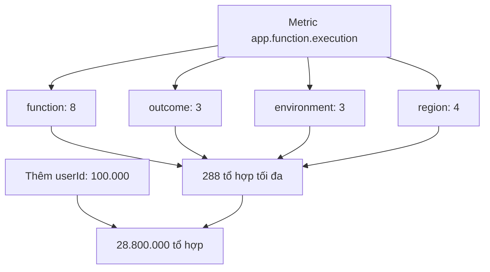

# Giới hạn nhãn số liệu và tránh ghi dữ liệu nhạy cảm

## Mục tiêu học tập

Sau bài này, bạn có thể:

1. Giải thích **cardinality** của metric và vì sao số lượng time series tăng theo tích các giá trị tag/label.
2. Chọn nhãn có tập giá trị hữu hạn cho các function `Supplier`, `Function`, `Consumer`, HTTP adapter và Spring Cloud Stream binder.
3. Nhận diện dữ liệu không nên trở thành metric label: user ID, order ID, email, token, payload, request ID và trace ID.
4. Dùng Micrometer `MeterFilter` để đặt giới hạn phòng vệ cho tag values/metrics, đồng thời hiểu filter không thay thế thiết kế nhãn đúng.
5. Phân biệt nơi lưu dữ liệu phù hợp: **metrics** cho tổng hợp, **logs** cho sự kiện có ngữ cảnh, **traces** cho hành trình xử lý.
6. Thiết kế log có cấu trúc, làm sạch dữ liệu đầu vào, giảm nguy cơ log injection và tránh ghi credential/PII.
7. Sử dụng correlation ID, trace ID, baggage và exemplars đúng mục đích mà không làm tăng cardinality của metric.
8. Thiết lập quyền truy cập, retention và kiểm thử để hạn chế dữ liệu nhạy cảm trong pipeline observability.

## 1. Vì sao phải giới hạn nhãn số liệu?

Spring Cloud Function cho phép viết logic nghiệp vụ tái sử dụng bằng các bean `Supplier`, `Function` và `Consumer`, tra cứu qua `FunctionCatalog`, ghép hàm và chuyển đổi thông điệp. Một function có thể được gọi qua HTTP, Spring Cloud Stream hoặc môi trường serverless.

Khi instrument function, ta thường thêm tags để phân biệt:

```java
Counter.builder("app.function.calls")
        .tag("function", "normalizeText")
        .tag("outcome", "success")
        .register(registry)
        .increment();
```

Hai tag `function` và `outcome` có số giá trị nhỏ, được kiểm soát. Nhưng nếu thêm `userId`, `orderId` hoặc `requestId`, mỗi request có thể tạo ra một bộ tag mới. Hệ thống metrics phải lưu và xử lý ngày càng nhiều **time series**.

**Cardinality** là số lượng tổ hợp giá trị nhãn khác nhau của một metric. Cardinality tăng nhanh có thể làm:

- Tăng bộ nhớ của ứng dụng, Prometheus/remote storage và dashboard.
- Tăng chi phí scrape, ingestion, index, query và retention.
- Làm dashboard chậm, truy vấn timeout hoặc hệ thống metrics từ chối series mới.
- Khiến các dimension quan trọng khó quan sát giữa hàng triệu series.
- Vô tình đưa dữ liệu cá nhân, định danh nội bộ hoặc bí mật vào hệ thống observability.

**Thiết kế nhãn là một phần của thiết kế vận hành và bảo vệ dữ liệu.** Không phải dữ liệu nào có ích khi debug cũng nên được đưa vào metric.

## 2. Cardinality được tạo ra như thế nào?

Giả sử metric `app.function.execution` có các tag:

| Tag | Số giá trị có thể có |
| --- | ---: |
| `function` | 8 |
| `outcome` | 3 |
| `environment` | 3 |
| `region` | 4 |

Trong trường hợp mọi tổ hợp đều xuất hiện, số time series tối đa xấp xỉ:

\[
8 \times 3 \times 3 \times 4 = 288
\]

Đây là quy mô có thể dự đoán và quản lý. Nếu thêm tag `userId` với 100.000 giá trị:

\[
8 \times 3 \times 3 \times 4 \times 100{,}000
= 28{,}800{,}000
\]

Một tag có vẻ chỉ là “một trường bổ sung” có thể làm số tổ hợp tăng từ hàng trăm lên hàng chục triệu.



Phép nhân trên là ước lượng cho trường hợp các giá trị kết hợp tự do; số series thực tế phụ thuộc những tổ hợp đã phát sinh, cách registry tạo meter và backend lưu trữ. Với histogram, mỗi logical meter còn có thể tạo thêm nhiều bucket/count/sum series, nên chi phí thực tế còn cao hơn một counter đơn giản.

### Cardinality không chỉ đến từ số tag

Một metric có thể có cardinality lớn do:

- Tag chứa dữ liệu thay đổi theo từng request.
- Đường dẫn URL có ID động như `/orders/10001`, `/orders/10002`.
- Exception message có chứa ID, SQL fragment hoặc URL.
- Tên function hoặc operation được client gửi tùy ý.
- Tag `tenant` chứa hàng chục nghìn tenant.
- Kết hợp nhiều dimension nhỏ nhưng tích của chúng vẫn rất lớn.
- Histogram có nhiều bucket và nhiều tổ hợp tags.

**Đếm số tag là chưa đủ.** Hãy ước tính số giá trị cho mỗi tag và tích của chúng trên từng metric quan trọng.

## 3. Chọn nhãn có tập giá trị hữu hạn

Một nhãn tốt thường có các đặc điểm:

1. Tập giá trị được định nghĩa trước hoặc giới hạn rõ.
2. Có ý nghĩa để lọc/nhóm dashboard và cảnh báo.
3. Không chứa nội dung do người dùng tùy ý gửi.
4. Không tiết lộ dữ liệu cá nhân, credential hoặc nội dung nghiệp vụ nhạy cảm.
5. Có thể giải thích trong tài liệu metric.

Ví dụ cho Spring Cloud Function:

| Tag | Giá trị phù hợp | Tránh dùng |
| --- | --- | --- |
| `function` | `normalizeText`, `reverseText`, `saveOrder` từ code/config được duyệt | Tên function lấy trực tiếp từ header không giới hạn |
| `outcome` | `success`, `error`, `rejected` | Exception message hoặc stack trace |
| `source` | `http`, `stream`, `internal`, `warmup` | URL hoặc tên client tùy ý |
| `operation` | `normalize`, `reverse`, `validate` trong allowlist | Giá trị routing do client gửi không kiểm soát |
| `status` | `2xx`, `4xx`, `5xx` hoặc nhóm status | Raw response body |
| `error_type` | `validation`, `timeout`, `dependency`, `internal` | `exception.getMessage()` |
| `region` | `ap-southeast-1`, `eu-west-1` nếu tập region nhỏ | Hostname hoặc IP riêng của từng request |
| `tenant_tier` | `free`, `standard`, `enterprise` | Tenant ID, email hoặc tên khách hàng |

### URL phải là route template

Đối với HTTP metrics, nên dùng route template như:

```text
/orders/{orderId}
/customers/{customerId}/profile
/functions/{functionName}
```

Không dùng raw URL chứa ID thật:

```text
/orders/ORD-2026-00001234
/customers/mai.nguyen@example.com/profile
```

Spring MVC/WebFlux observation thường có thể cung cấp URI pattern đã chuẩn hóa. Nếu tự tạo metric ở filter/controller, hãy lấy **route template** hoặc nhóm route hữu hạn; không lấy trực tiếp request URI rồi đưa vào tag.

### Tag `error_type` nên là enum do ứng dụng kiểm soát

Ví dụ:

```java
enum ErrorType {
    VALIDATION,
    TIMEOUT,
    DEPENDENCY,
    INTERNAL
}
```

Khi bắt exception, ánh xạ sang một nhóm:

```java
static ErrorType classify(RuntimeException exception) {
    if (exception instanceof IllegalArgumentException) {
        return ErrorType.VALIDATION;
    }
    if (exception instanceof java.util.concurrent.TimeoutException) {
        return ErrorType.TIMEOUT;
    }
    return ErrorType.INTERNAL;
}
```

Ví dụ này chỉ minh họa nguyên tắc; trong ứng dụng thật, cần ánh xạ exception theo hợp đồng nghiệp vụ và loại lỗi của dependency. **Không dùng tên message của exception làm tag** vì message có thể chứa dữ liệu đầu vào.

## 4. Dữ liệu nào thuộc metrics, logs và traces?

Không phải mọi dữ liệu có giá trị quan sát đều phải được lưu cùng một nơi.

| Loại dữ liệu | Metrics | Logs | Traces |
| --- | --- | --- | --- |
| Tên function trong allowlist | Phù hợp | Phù hợp | Phù hợp |
| Outcome hữu hạn | Phù hợp | Phù hợp | Phù hợp |
| Latency/count | Phù hợp qua Timer/Counter | Có thể ghi sự kiện chọn lọc | Có thể có duration/span |
| Request ID ngẫu nhiên | Không nên làm label | Có thể dùng để tra cứu nếu được kiểm soát | Có thể liên kết qua trace/span context |
| Order ID/user ID | Không nên làm label | Chỉ khi thật sự cần, được phân quyền và giảm thiểu | Chỉ khi có mục đích, chính sách dữ liệu và quyền phù hợp |
| Raw payload | Không | Tránh; ưu tiên field đã chọn lọc | Tránh đưa payload vào span attributes/events |
| Password/API key/access token | Tuyệt đối không | Tuyệt đối không | Tuyệt đối không |
| Trace ID | Không làm metric tag | Có thể xuất qua tracing correlation | Là định danh gốc của trace |
| Broker topic/partition | Chỉ khi tập hữu hạn, phù hợp | Có thể | Có thể là span attributes nếu hữu ích |

### Metrics trả lời câu hỏi tổng hợp

- Bao nhiêu lần `normalizeText` thất bại trong 5 phút?
- P95 latency của function theo environment là bao nhiêu?
- Số message bị reject theo binding có tăng không?

Đây là các câu hỏi có thể trả lời bằng một tập dimension hữu hạn.

### Logs trả lời câu hỏi sự kiện cụ thể

- Lần xử lý `invocationId=...` đã đi qua stage nào?
- Tại sao một event cụ thể bị từ chối?
- Lần retry nào đã ghi database thành công?

Log có thể chứa ID tương quan ngẫu nhiên để tra cứu, nhưng cần giới hạn quyền truy cập, thời gian lưu và dữ liệu đi kèm.

### Traces trả lời câu hỏi hành trình

Trace nối các bước HTTP → function → client → broker/consumer khi instrumentation và propagation được cấu hình. Trace/span ID là định danh có cardinality cao theo thiết kế; backend tracing được xây để quản lý chúng. **Không chuyển trace ID thành label của Prometheus metric**.

## 5. Ví dụ metric an toàn cho function

Ví dụ sau dùng tags có tập giá trị hữu hạn:

```java
package com.example.safemetrics;

import java.util.Locale;
import java.util.function.Function;

import io.micrometer.core.instrument.MeterRegistry;
import io.micrometer.core.instrument.Timer;
import org.springframework.context.annotation.Bean;
import org.springframework.context.annotation.Configuration;

@Configuration
class SafeFunctionMetricsConfiguration {

    @Bean
    Function<String, String> normalizeText(MeterRegistry registry) {
        Timer success = Timer.builder("app.function.execution")
                .description("Thoi gian xu ly mot function invocation")
                .tag("function", "normalizeText")
                .tag("outcome", "success")
                .register(registry);

        Timer error = Timer.builder("app.function.execution")
                .description("Thoi gian xu ly mot function invocation")
                .tag("function", "normalizeText")
                .tag("outcome", "error")
                .register(registry);

        return input -> {
            Timer.Sample sample = Timer.start(registry);
            try {
                if (input == null || input.isBlank()) {
                    throw new IllegalArgumentException("Input is blank");
                }
                String output = input.trim().toUpperCase(Locale.ROOT);
                sample.stop(success);
                return output;
            }
            catch (RuntimeException exception) {
                sample.stop(error);
                throw exception;
            }
        };
    }
}
```

Hai tag `function` và `outcome` có tập giá trị nhỏ, được định nghĩa trong code. Timer ghi count và thời lượng của **một lần gọi thân function**.

Không thêm các tag sau:

```java
// KHÔNG dùng:
.tag("userId", request.getUserId())
.tag("email", request.getEmail())
.tag("orderId", order.getId())
.tag("payload", input)
.tag("traceId", currentTraceId)
```

Những giá trị này thay đổi theo từng request, có thể chứa PII hoặc dữ liệu nghiệp vụ, và tạo cardinality cao. Nếu cần tìm một lần gọi cụ thể, hãy dùng log/tracing có kiểm soát và correlation context.

### Function name lấy từ routing header

Một ứng dụng có `functionRouter` có thể nhận tên function từ header. Không đưa trực tiếp header đó thành tag:

```java
// Không an toàn nếu operation đến từ nguồn không giới hạn:
registry.counter("app.function.routes",
        "operation", message.getHeaders()
                .get("spring.cloud.function.definition").toString())
        .increment();
```

Hãy ánh xạ qua allowlist:

```java
import java.util.Map;

private static final Map<String, String> ALLOWED_OPERATIONS = Map.of(
        "normalize", "normalize",
        "reverse", "reverse",
        "validate", "validate");

static String metricOperation(String requested) {
    return ALLOWED_OPERATIONS.getOrDefault(requested, "other");
}
```

Sau đó chỉ dùng kết quả `metricOperation(...)` làm tag. Giá trị lạ vẫn có thể được ghi ở log đã làm sạch (nếu cần và được phép), nhưng **không được tạo một time series mới** cho mỗi chuỗi tùy ý.

## 6. Đặt guardrail bằng Micrometer `MeterFilter`

Thiết kế metric tốt phải là tuyến phòng thủ đầu tiên. `MeterFilter` cung cấp **lớp bảo vệ bổ sung** ở registry, giúp giới hạn số meter/tag values.

### 6.1. Giới hạn số giá trị của một tag

```java
package com.example.safemetrics;

import io.micrometer.core.instrument.config.MeterFilter;
import org.springframework.context.annotation.Bean;
import org.springframework.context.annotation.Configuration;

@Configuration
class MetricsGuardrailsConfiguration {

    @Bean
    MeterFilter functionNameCardinalityLimit() {
        return MeterFilter.maximumAllowableTags(
                "app.function.execution",
                "function",
                20,
                MeterFilter.deny());
    }
}
```

Filter trên giới hạn tối đa 20 giá trị tag `function` cho các meter có tên bắt đầu bằng `app.function.execution`. Khi vượt giới hạn, filter `deny()` từ chối meter mới không đáp ứng quy tắc.

**Giới hạn này không làm sạch dữ liệu và không ẩn PII.** Nếu tag `function` chứa email hoặc token, filter vẫn có thể chấp nhận một giá trị nhạy cảm trước khi đạt giới hạn. Do đó, vẫn phải allowlist/chuẩn hóa trước khi đăng ký meter.

### 6.2. Giới hạn tổng số meter

Có thể thêm một giới hạn toàn registry:

```java
@Bean
MeterFilter totalMetricLimit() {
    return MeterFilter.maximumAllowableMetrics(
            5000,
            MeterFilter.deny());
}
```

Con số `5000` chỉ là ví dụ. Hãy chọn giới hạn theo dung lượng registry, số function, số dimension, histogram buckets và ngân sách hệ thống. Nếu từ chối meter mới, dashboard có thể thiếu dữ liệu; cần theo dõi và ghi nhận việc áp dụng filter.

### 6.3. Chuẩn hóa giá trị động thành nhóm hữu hạn

Một số phiên bản Micrometer có API `MeterFilter.replaceTagValues(...)` để ánh xạ giá trị tag sang một nhóm đã định nghĩa. Ví dụ minh họa:

```java
import io.micrometer.core.instrument.config.MeterFilter;

@Bean
MeterFilter routeTagNormalizer() {
    return MeterFilter.replaceTagValues(
            "route",
            value -> switch (value) {
                case "normalize", "reverse", "validate" -> value;
                default -> "other";
            });
}
```

API trên áp dụng cho tag key `route` trong registry; nếu cần giới hạn phạm vi theo meter, hãy dùng filter theo `Meter.Id` hoặc cấu hình filter cụ thể của phiên bản Micrometer đang dùng. **Đừng giả định** filter chuẩn hóa này thay thế validation tại nơi tạo tag: một metric khác cũng có tag tên `route` có thể bị ảnh hưởng.

### 6.4. Thứ tự và phạm vi filter

| Guardrail | Bảo vệ điều gì? | Không giải quyết điều gì? |
| --- | --- | --- |
| `maximumAllowableTags` | Số giá trị tag trên một meter prefix | PII có bị đưa vào giá trị được chấp nhận hay không |
| `maximumAllowableMetrics` | Tổng số meter được đăng ký | Cardinality bên remote storage hoặc log volume |
| `replaceTagValues` | Chuẩn hóa giá trị tag | Quyền riêng tư của log/span và mọi registry khác |
| `denyNameStartsWith` | Chặn nhóm metric không được phép | Không sửa metric đã export trước đó |

Nếu ứng dụng dùng nhiều `MeterRegistry`, hãy xác nhận filter được áp dụng ở **mọi registry cần bảo vệ**. Filter cục bộ không kiểm soát dữ liệu được một SDK/exporter khác gửi thẳng sang backend.

## 7. Đoạn code không nên làm: nhãn từ dữ liệu request

Ví dụ sau rất dễ xuất hiện khi muốn điều tra theo người dùng:

```java
@Bean
Function<OrderRequest, OrderResult> processOrder(MeterRegistry registry) {
    return request -> {
        return Timer.builder("app.order.processing")
                .tag("customer", request.email())
                .tag("orderId", request.orderId())
                .register(registry)
                .record(() -> doProcess(request));
    };
}
```

Các vấn đề:

- Email là dữ liệu cá nhân; order ID có thể là dữ liệu nghiệp vụ cần bảo vệ.
- Mỗi khách hàng/đơn hàng có thể tạo series mới.
- Dashboard tổng hợp theo customer không còn hiệu quả khi số khách hàng lớn.
- Metric backend có thể giữ dữ liệu lâu hơn log ứng dụng.
- Hash email/order ID **không tự giải quyết cardinality**; giá trị vẫn khác nhau và có thể bị liên kết lại.

Thiết kế lại:

```java
Timer.builder("app.order.processing")
        .tag("function", "processOrder")
        .tag("outcome", "success")
        .tag("customer_tier", allowedTier(request.customerTier()))
        .register(registry)
        .record(() -> doProcess(request));
```

Nếu cần truy tìm một order cụ thể, dùng **opaque correlation ID** trong logs/traces có phân quyền, hoặc hệ thống audit nghiệp vụ được thiết kế cho mục tiêu đó. Không biến metric thành kho tra cứu từng khách hàng.

## 8. Logs: không ghi payload, token và dữ liệu cá nhân

Metric labels có cardinality cao là một rủi ro; logs có thể tạo rủi ro khác: **ghi quá nhiều dữ liệu**.

Ví dụ không nên:

```java
log.info("Processing request: {}", request);
log.debug("Authorization header={}", authorizationHeader);
log.error("Failed payload={}, exception={}", message.getPayload(), ex);
```

Các dòng trên có thể ghi:

- Email, số điện thoại, địa chỉ hoặc nội dung khách hàng gửi.
- Access token, refresh token, API key hoặc session cookie.
- Thông tin thanh toán, thông tin xác thực database.
- SQL/query parameter, URL có credential hoặc nội dung exception chứa bí mật.

Thay vào đó, log sự kiện với **trường tối thiểu**:

```java
log.info(
        "event=function_completed function={} outcome={} correlationId={}",
        "processOrder",
        "success",
        safeCorrelationId);
```

Một log tốt trả lời câu hỏi vận hành mà không phải ghi toàn bộ payload. Nếu cần điều tra nội dung nghiệp vụ, hãy dùng audit record hoặc công cụ được phép truy cập theo quy trình riêng.

### Log exception thế nào?

`log.error("processing failed", ex)` có thể ghi stack trace và exception message. Một số exception message chứa URL, SQL, header hoặc dữ liệu input. Có thể:

- Ghi error code/exception class thuộc tập hữu hạn.
- Ghi correlation ID để tìm trace có phân quyền.
- Chỉ xuất stack trace ở mức và nơi phù hợp; scrub secret trước khi gửi nếu thư viện có thể chứa dữ liệu nhạy cảm.
- Tránh ghi `ex.getMessage()` vào metric tag hoặc structured field không kiểm soát.

Không nên bỏ mọi stack trace một cách máy móc; cần cân bằng khả năng điều tra và rủi ro dữ liệu, có phân quyền và retention phù hợp.

## 9. Chống log injection và kiểm soát correlation ID

Một client có thể gửi header:

```text
X-Correlation-Id: request-42
```

Nếu ứng dụng ghi trực tiếp giá trị có ký tự xuống dòng vào log dạng text, kẻ gửi có thể làm log xuất hiện thêm dòng giả hoặc làm sai cấu trúc bản ghi.

Validate giá trị trước khi dùng:

```java
import java.util.UUID;
import java.util.regex.Pattern;

final class CorrelationIds {

    private static final Pattern SAFE =
            Pattern.compile("[A-Za-z0-9._-]{1,64}");

    private CorrelationIds() {
    }

    static String acceptOrGenerate(String incoming) {
        if (incoming != null && SAFE.matcher(incoming).matches()) {
            return incoming;
        }
        return UUID.randomUUID().toString();
    }
}
```

Đoạn code:

- Giới hạn chiều dài tối đa 64 ký tự.
- Chỉ nhận chữ, số, dấu chấm, gạch dưới và gạch nối.
- Tạo ID mới khi giá trị không hợp lệ.

Tùy hợp đồng API, có thể trả `400 Bad Request` thay vì tạo ID mới. Dù chọn cách nào, **không log nguyên văn giá trị không hợp lệ**.

### Structured logging giúp gì và không giúp gì?

JSON encoder đúng chuẩn thường escape ký tự điều khiển, giảm nguy cơ log injection qua dấu xuống dòng. Tuy nhiên, JSON **không tự che**:

- `password` hoặc `accessToken`.
- Email, số tài khoản hoặc nội dung payload.
- Một trường `correlationId` có chứa dữ liệu cá nhân.

Vẫn phải validate, chọn trường và redaction trước khi gửi log.

## 10. Trace attributes và baggage cũng cần giới hạn

Distributed tracing dùng trace/span IDs để liên kết các bước. Các span có thể mang attributes như:

```text
service.name = order-service
function.name = processOrder
messaging.destination.name = order-events
outcome = error
```

Đây là metadata hữu ích nếu giá trị được kiểm soát. Nhưng **không đưa raw payload, credential, email, access token hoặc nội dung tùy ý vào span attributes/events**.

### Baggage khác span attribute

Baggage là metadata có thể được truyền qua nhiều service theo propagator. Ví dụ `tenantTier=enterprise` có thể hữu ích nếu nó thuộc tập giá trị nhỏ và được phép truyền. Ngược lại, đưa `email`, `userToken` hoặc raw customer data vào baggage sẽ khiến dữ liệu lan rộng qua các service và hệ thống telemetry.

| Trường | Metric tag | Log | Trace attribute/baggage |
| --- | --- | --- | --- |
| `function=processOrder` | Có | Có | Có thể |
| `outcome=success/error` | Có | Có | Có thể |
| `traceId` | Không | Có qua tracing correlation | Có sẵn trong trace |
| `requestId` ngẫu nhiên | Không | Có nếu cần và kiểm soát | Chỉ khi có mục đích rõ |
| `userId` | Không | Hạn chế, tránh nếu không cần | Tránh đưa vào baggage; attribute cần phê duyệt |
| `email` | Không | Không ghi mặc định | Không |
| Access token | Không | Không | Không |
| Raw payload | Không | Không ghi mặc định | Không |

### Dùng exemplars để nối metric với trace

Prometheus/Micrometer có thể hỗ trợ **exemplars**: một sample đại diện trong histogram/counter được liên kết với trace context (tùy registry/backend). Đây là hướng phù hợp để từ một spike latency trên metric chuyển sang trace mẫu mà **không thêm trace ID làm label của mọi time series**.

Exemplar support phụ thuộc registry, scrape protocol, backend và tracing context hiện hành. Hãy xác minh cấu hình/exporter thực tế; đừng tự thêm `traceId` vào tag để thay thế exemplar.

## 11. Giới hạn dữ liệu cho từng tầng Spring Cloud Function

### Function và composition

Tags nên dựa trên tên function trong code/config được kiểm soát:

```text
function=normalizeText
function=validateOrder
function=saveOrder
```

Nếu composition là `validateOrder|saveOrder`, có thể đo từng stage bằng metric riêng. Không tạo tag `definition` từ một chuỗi composition tùy ý do client gửi; dùng một tập definition đã allowlist.

### `functionRouter`

Router có thể chọn đích qua header hoặc routing expression. Trước khi dùng route làm tag:

1. Chuẩn hóa thành một trong các route cho phép.
2. Gộp route lạ vào `other` hoặc từ chối theo chính sách.
3. Không dùng toàn bộ header hoặc expression làm metric label.
4. Không ghi raw payload/header chứa thông tin xác thực.

Log có thể ghi `requestedOperation=unknown` hoặc mã lỗi hữu hạn; nếu cần raw value để điều tra, phải scrub/giới hạn chiều dài và chỉ lưu ở nơi được bảo vệ.

### HTTP adapter

- Dùng method và route template, không dùng raw URL.
- Dùng status class hoặc status code hữu hạn.
- Không ghi Authorization/Cookie headers.
- Không ghi body mặc định; chỉ ghi field được phê duyệt khi có mục đích.

### Spring Cloud Stream binder

- Destination/binding names nên đến từ cấu hình được quản lý, có số lượng hữu hạn.
- Partition/consumer group có thể dùng làm dimension nếu quy mô được giới hạn và có giá trị vận hành.
- Không đưa message key tùy ý, payload hoặc customer ID vào tag.
- Log retry/DLQ bằng event name, binding và outcome; không log toàn bộ event.

### Serverless

- Platform invocation ID có thể dùng trong log/trace theo hướng dẫn nền tảng, nhưng không dùng làm metric label.
- Không sao chép toàn bộ event JSON vào log để debug.
- Phân biệt request/event ID của nhà cung cấp với business event ID của ứng dụng.
- Xác minh log/trace export không vô tình chứa event payload hoặc environment variables.

## 12. Kiểm thử guardrail cardinality

Có thể kiểm tra `MeterFilter.maximumAllowableTags` bằng `SimpleMeterRegistry`:

```java
import static org.junit.jupiter.api.Assertions.assertEquals;

import io.micrometer.core.instrument.Counter;
import io.micrometer.core.instrument.config.MeterFilter;
import io.micrometer.core.instrument.simple.SimpleMeterRegistry;
import org.junit.jupiter.api.Test;

class MetricCardinalityGuardrailTest {

    @Test
    void limitsRouteTagValues() {
        try (SimpleMeterRegistry registry = new SimpleMeterRegistry()) {
            registry.config().meterFilter(
                    MeterFilter.maximumAllowableTags(
                            "app.function.calls",
                            "route",
                            2,
                            MeterFilter.deny()));

            Counter.builder("app.function.calls")
                    .tag("route", "normalize")
                    .register(registry)
                    .increment();

            Counter.builder("app.function.calls")
                    .tag("route", "reverse")
                    .register(registry)
                    .increment();

            Counter.builder("app.function.calls")
                    .tag("route", "user-input-123")
                    .register(registry)
                    .increment();

            assertEquals(2, registry.getMeters().size());
        }
    }
}
```

Test minh họa rằng registry chỉ giữ hai meter có giá trị route đầu tiên; meter thứ ba bị từ chối theo filter. Hành vi cụ thể của meter no-op và cách đếm có thể tùy phiên bản Micrometer, nên hãy chạy test với dependency thực tế của dự án.

**Đây chỉ là guardrail kỹ thuật.** Test không chứng minh ứng dụng không log PII, không truyền baggage nhạy cảm hoặc mọi registry/exporter đều được bảo vệ. Cần kiểm tra log/trace pipeline riêng.

## 13. Kiểm thử log không chứa dữ liệu nhạy cảm

Có thể viết test với test appender của Logback để xác nhận event log có trường cần thiết nhưng không chứa token/payload. Pseudocode:

```java
// Pseudocode: sử dụng ListAppender<ILoggingEvent> của Logback.
ListAppender<ILoggingEvent> appender = new ListAppender<>();
appender.start();
((ch.qos.logback.classic.Logger) LoggerFactory
        .getLogger(OrderProcessor.class))
        .addAppender(appender);

processor.process(requestWithSecret);

String rendered = appender.list.stream()
        .map(ILoggingEvent::getFormattedMessage)
        .collect(java.util.stream.Collectors.joining("\n"));

assertFalse(rendered.contains("secret-token-value"));
assertFalse(rendered.contains("customer@example.com"));
```

Đây là pseudocode vì cách khởi tạo appender và logger phụ thuộc logging backend. Trong dự án thật:

- Kiểm tra cả formatted message, MDC map và structured arguments.
- Nếu appender ghi exception proxy/stacktrace, kiểm tra nội dung exception.
- Tách fixture secret giả khỏi test output/CI logs.
- Kiểm tra serialization cuối cùng, không chỉ message template.

### Các trường hợp nên có test

| Input | Kỳ vọng |
| --- | --- |
| Correlation ID hợp lệ | Log chứa ID opaque đã được chấp nhận |
| ID có CR/LF | Không log raw value; thay bằng ID mới hoặc từ chối |
| Request có Authorization header | Token không xuất hiện trong log |
| Payload có email | Email không xuất hiện nếu không có mục đích/cho phép rõ |
| Exception message chứa SQL parameter | Log theo error code hoặc scrubbed fields |
| Route tùy ý từ client | Metric dùng allowlist/`other`, không tạo tag mới |
| Trace context | Trace ID xuất qua correlation logging/exemplar, không thành metric label |

## 14. Quyền truy cập, retention và pipeline dữ liệu

Giới hạn dữ liệu ở code là chưa đủ. Metrics, logs và traces thường được chuyển đến các hệ thống tập trung, nơi nhiều nhóm có thể truy cập.

### Nguyên tắc kiểm soát

1. **Purpose limitation:** chỉ thu thập trường phục vụ vận hành, bảo mật hoặc audit có mục đích rõ.
2. **Data minimization:** không thu thập payload/PII chỉ vì “có thể hữu ích khi debug”.
3. **Access control:** phân quyền theo vai trò; log có định danh khách hàng cần giới hạn hơn metric tổng hợp.
4. **Retention:** đặt thời gian lưu theo nhu cầu vận hành, audit và chính sách dữ liệu; không giữ vô hạn mặc định.
5. **Encryption:** bảo vệ dữ liệu khi truyền và khi lưu theo khả năng của hệ thống telemetry.
6. **Redaction at source:** che dữ liệu trước khi ghi log/export span; không chỉ trông chờ backend scrub sau khi đã ingest.
7. **Audit access:** ghi nhận việc truy cập dữ liệu observability nhạy cảm.
8. **Incident response:** có quy trình xử lý khi secret/PII bị ghi nhầm, bao gồm thu hồi credential và làm việc với backend để xóa/giới hạn bản sao khi cần.

### Actuator cũng là bề mặt truy cập

Các endpoint như `/actuator/metrics`, `/actuator/prometheus` và `/actuator/env` có thể tiết lộ thông tin khác nhau. Chỉ expose những endpoint cần thiết:

```yaml
management:
  endpoints:
    web:
      exposure:
        include: "health,metrics,prometheus"
```

Cấu hình trên chỉ minh họa exposure; cần thêm security policy, mạng quản trị và xác thực/phân quyền. Không mở `env`, `configprops` hoặc toàn bộ endpoint chỉ để debug metric cardinality.

### Không coi hash là ẩn danh tuyệt đối

Hash một email hoặc customer ID có thể vẫn cho phép đối chiếu/tấn công từ điển nếu không gian đầu vào nhỏ hoặc thuật toán không có secret. Hash cũng không làm giảm cardinality nếu mỗi đầu vào tạo một giá trị khác. **Đừng dùng hash để hợp thức hóa PII trong metric labels.**

## 15. Checklist review một metric mới

Trước khi thêm meter vào một function hoặc adapter, hãy trả lời:

```text
1. Metric này trả lời câu hỏi vận hành nào?
2. Tên meter và unit có rõ nghĩa không?
3. Mỗi tag có tập giá trị tối đa bao nhiêu?
4. Tích các tag values có thể tạo bao nhiêu series?
5. Có tag nào lấy từ user input, payload, URL hoặc exception message?
6. Có chứa PII, credential, secret hoặc ID nội bộ nhạy cảm không?
7. Có thể dùng route template, enum hoặc nhóm "other" thay thế không?
8. Có cần tag này trong metric hay log/trace là đủ?
9. Histogram/percentile có thực sự cần và đã ước tính bucket cost chưa?
10. Có MeterFilter guardrail và test cardinality không?
11. Metric có được đăng ký ở mọi MeterRegistry/exporter phù hợp không?
12. Dashboard/alert có dùng dimension hữu hạn và đúng denominator không?
```

## 16. Chẩn đoán vấn đề thường gặp

| Triệu chứng | Nguyên nhân có thể | Hướng xử lý |
| --- | --- | --- |
| Prometheus có hàng triệu series | Tag chứa ID động hoặc tổ hợp dimension lớn | Loại ID khỏi tags, chuẩn hóa enum, xem top series |
| Scrape/remote write chậm | Cardinality/histogram tăng nhanh | Giảm tags/buckets, giới hạn metric mới |
| Dashboard chậm khi lọc tenant | Tag tenant ID có quá nhiều giá trị | Dùng tier/region hữu hạn; tra cứu cá thể qua log có kiểm soát |
| Metric không xuất hiện sau khi thêm MeterFilter | Filter deny meter mới | Xem prefix, tag key, giới hạn và thứ tự filter |
| Metric route luôn là `other` | Allowlist không khớp giá trị thật hoặc filter áp dụng sai scope | Kiểm tra route mapping, test filter và registry |
| Log có token dù metric đã sạch | Logging ghi header/payload/exception | Redact tại source, kiểm tra appender/structured fields |
| JSON log vẫn lộ email | JSON chỉ escape, không tự redaction | Chọn trường cho phép và scrub dữ liệu |
| Trace có attribute chứa dữ liệu khách hàng | Span event/baggage được thêm tùy tiện | Xóa attribute, allowlist, cập nhật instrumentation |
| Cardinality filter không ngăn PII | Giá trị nhạy cảm được chấp nhận trước khi chạm limit | Validate/normalize tại nguồn; filter chỉ là guardrail |
| Metric có trace ID label | Dùng trace ID như dimension | Bỏ tag, dùng exemplars hoặc tracing backend |
| Log không tìm được invocation | Không có correlation context hoặc ID không được truyền | Sinh ID tại ingress, propagate qua Message và async boundary |
| Filter giới hạn tag nhưng remote storage vẫn quá tải | Các tag khác/histogram hoặc registry khác không được bảo vệ | Kiểm kê mọi dimension/exporter và tổng series |
| Tenant hash vẫn có series tăng theo tenant | Hash không làm giảm số giá trị | Dùng tenant tier/aggregate; không hash để chữa cardinality |

### Quy trình xử lý khi cardinality tăng đột biến

1. Xác định metric name/prefix tăng nhanh và khoảng thời gian bắt đầu.
2. Kiểm tra tag keys, top values và tổ hợp dimension gây tăng.
3. Tìm code tạo meter: function, router, HTTP filter, binder hoặc custom instrumentation.
4. Xác định tag nào là dữ liệu động; chuyển sang enum/route template/nhóm hữu hạn.
5. Kiểm tra liệu dữ liệu nhạy cảm đã được ingest hay chưa; nếu có, thực hiện quy trình incident dữ liệu.
6. Thêm test allowlist/cardinality và guardrail ở registry.
7. Theo dõi series count, scrape duration, ingestion và dashboard sau thay đổi.

Không xóa metric hàng loạt một cách mù quáng: cần biết dashboard/alert nào đang phụ thuộc tên và labels đó để tránh mất tín hiệu vận hành quan trọng.

## 17. Bài tập thực hành

1. Tạo metric `app.function.execution` với tags `function`, `outcome`, `environment`, `region`. Tính số tổ hợp tối đa nếu mỗi tag lần lượt có 8, 3, 3 và 4 giá trị.
2. Thêm `userId` có 10.000 giá trị vào phép tính. Giải thích tác động đến số time series và vì sao metric không nên dùng làm kho truy vấn người dùng.
3. Instrument function `normalizeText` với `Timer` chỉ dùng hai tags hữu hạn `function` và `outcome`. Kiểm tra số meter tạo ra sau nhiều invocation.
4. Dùng `functionRouter` nhận operation từ header. Viết allowlist cho `normalize`, `reverse`, `validate`; các giá trị khác phải thành `other` hoặc bị từ chối.
5. Thêm `MeterFilter.maximumAllowableTags` cho tag `function`, viết JUnit test xác minh meter vượt giới hạn không được đăng ký.
6. So sánh `maximumAllowableTags` và `maximumAllowableMetrics`. Giải thích vì sao cả hai không thay thế việc kiểm tra PII tại nơi tạo meter.
7. Viết một log event cho `function_completed` chỉ có function name, outcome và correlation ID opaque. Chứng minh token và payload không xuất hiện trong log.
8. Gửi correlation ID chứa ký tự CR/LF. Thiết kế cách validate, từ chối hoặc sinh ID mới mà không log raw input.
9. Đọc một request URL `/orders/12345`; đề xuất route template `/orders/{orderId}` cho HTTP metric và giải thích tại sao raw URL tạo cardinality cao.
10. Đề xuất các trường được phép trong span attributes cho function `saveOrder`; loại bỏ email, token và raw payload.
11. Giải thích vì sao hash `customerId` không giải quyết cardinality và không mặc nhiên biến dữ liệu thành anonymous.
12. Thiết kế dashboard theo `function`, `outcome`, `region` và `tenantTier`; nêu rõ vì sao không có `tenantId` hoặc `traceId`.
13. Bật Actuator `metrics` và `prometheus` trong môi trường thử nghiệm. Đề xuất chính sách exposure, authentication và network access.
14. Tạo checklist review log/metric/trace cho một function xử lý message chứa thông tin khách hàng.

## Ghi nhớ

- **Cardinality là số tổ hợp nhãn**; thêm một tag có nhiều giá trị có thể làm time series tăng theo cấp số nhân/tích tổ hợp.
- Metric tags nên là **tập giá trị hữu hạn và có ý nghĩa vận hành**: tên function cố định, outcome enum, route template, environment hoặc tier.
- Không đưa `userId`, `orderId`, email, payload, request ID hoặc trace ID vào metric labels. Hash ID không giải quyết cardinality và không bảo đảm ẩn danh.
- Dùng `MeterFilter.maximumAllowableTags`/`maximumAllowableMetrics` làm guardrail bổ sung; filter không thay thế allowlist, validation hoặc bảo vệ dữ liệu ở source.
- Metrics dùng cho tổng hợp; logs dùng cho sự kiện có ngữ cảnh; traces dùng cho hành trình phân tán. Không ghi token, password, credential hoặc raw payload vào bất kỳ kênh telemetry nào.
- Structured JSON giúp escape ký tự nhưng **không tự redaction**; validate correlation ID và kiểm soát log injection.
- Trace ID nên liên kết log/trace hoặc exemplar, không phải metric label. Baggage và span attributes cũng cần allowlist, data minimization và quyền truy cập.
- Bảo vệ Actuator, telemetry backend, retention và quyền đọc; nếu dữ liệu nhạy cảm đã bị ingest, xử lý như một sự cố dữ liệu.

### Tài liệu tham khảo chính thức

- [Micrometer — Meter Filters](https://docs.micrometer.io/micrometer/reference/concepts/meter-filters.html)
- [Micrometer — Naming Meters và Tags](https://docs.micrometer.io/micrometer/reference/concepts/naming.html)
- [Micrometer — Exemplars](https://docs.micrometer.io/micrometer/reference/prometheus/exemplars.html)
- [Prometheus — Metric and Label Naming](https://prometheus.io/docs/practices/naming/)
- [Prometheus — Instrumentation Practices](https://prometheus.io/docs/practices/instrumentation/)
- [Prometheus — Histograms and Summaries](https://prometheus.io/docs/practices/histograms/)
- [Spring Boot — Metrics and Actuator](https://docs.spring.io/spring-boot/reference/actuator/metrics.html)
- [Spring Boot — Logging](https://docs.spring.io/spring-boot/reference/features/logging.html)
- [Spring Cloud Function — Programming Model và FunctionCatalog](https://docs.spring.io/spring-cloud-function/reference/spring-cloud-function/programming-model.html)
