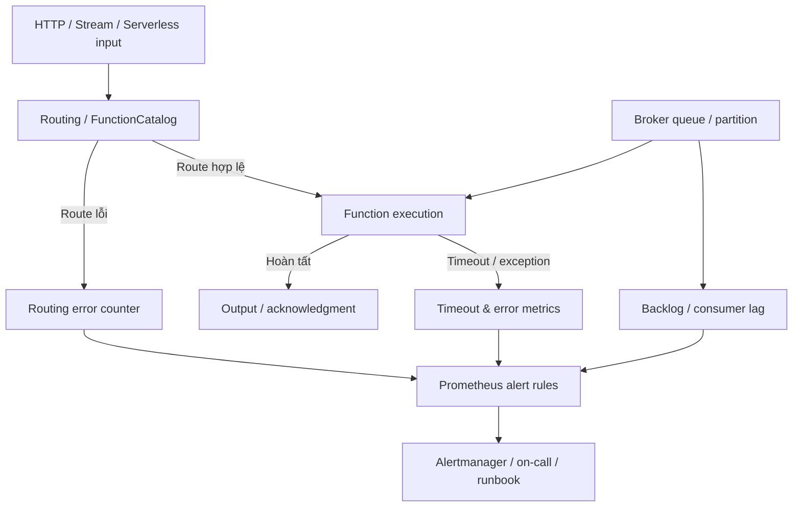

# Thiết lập cảnh báo lỗi định tuyến, dữ liệu tồn đọng và quá thời gian

## Mục tiêu học tập

Sau bài này, bạn có thể:

1. Xác định ba nhóm sự cố quan trọng trong dịch vụ Spring Cloud Function: **lỗi định tuyến**, **message tồn đọng** và **quá thời gian xử lý**.
2. Phân biệt lỗi chọn function trong `FunctionCatalog`/`functionRouter` với lỗi nghiệp vụ xảy ra sau khi function đã bắt đầu chạy.
3. Instrument routing attempts/errors bằng Micrometer Counter với nhãn có cardinality thấp.
4. Chọn đúng tín hiệu backlog theo broker: Kafka consumer lag, RabbitMQ queue depth hoặc số message đang chờ của nền tảng khác.
5. Thiết lập timeout ở đúng ranh giới xử lý, hiểu cancellation, retry và giới hạn của việc ngắt một hàm đồng bộ.
6. Viết Prometheus alert rules cho routing error rate, backlog cao/tăng, dead-letter và timeout/latency.
7. Chọn ngưỡng, cửa sổ quan sát, điều kiện `for` và mức độ cảnh báo theo SLO cùng lưu lượng thực tế.
8. Kiểm thử metric, cảnh báo và runbook; phân biệt **không có lỗi** với **không có dữ liệu quan sát**.

## 1. Vì sao cần cảnh báo ở ba nhóm này?

Spring Cloud Function cho phép phát triển logic nghiệp vụ bằng các bean `Supplier`, `Function` và `Consumer`, đăng ký/tra cứu qua `FunctionCatalog`, ghép hàm và chuyển đổi thông điệp. Cùng một function có thể được gọi từ HTTP, Spring Cloud Stream hoặc môi trường serverless.

Khi hệ thống có vấn đề, ba dấu hiệu sau thường cần được phát hiện sớm:

- **Routing error:** request hoặc message không được chuyển đến function mong muốn, ví dụ tên function không tồn tại, route không hợp lệ hoặc routing expression lỗi.
- **Backlog:** broker nhận message nhanh hơn tốc độ consumer xử lý; queue/partition tồn đọng ngày càng nhiều.
- **Timeout:** function hoặc downstream dependency không hoàn thành trong deadline; request bị hủy, message retry hoặc bị đưa vào dead-letter queue.

Ba nhóm có quan hệ nhưng không đồng nghĩa:

| Triệu chứng | Có thể là nguyên nhân | Không thể tự kết luận |
| --- | --- | --- |
| Routing error tăng | Sai route/header, function chưa đăng ký, cấu hình definition sai | Function nghiệp vụ chạy chậm |
| Backlog tăng | Consumer chậm, thiếu concurrency, broker rebalance, producer tăng tải | Chắc chắn function có bug |
| Timeout tăng | Downstream chậm, thread bị block, deadline quá thấp, CPU/GC | Chắc chắn broker tồn đọng |
| HTTP 5xx tăng | Routing, function exception, timeout, serialization hoặc adapter | Tất cả lỗi đều nằm trong function body |
| DLQ tăng | Message liên tục thất bại, hết retry hoặc bị reject | Message đã được xử lý thành công |

Mục tiêu của cảnh báo là **báo đúng tầng và đưa người vận hành tới bằng chứng tiếp theo**, không chỉ gửi một thông báo “service is unhealthy”.



## 2. Định nghĩa tín hiệu trước khi viết alert

Một alert hữu ích cần có metric, đơn vị, nhãn, mẫu số và điều kiện rõ ràng.

| Nhóm | Metric ứng dụng minh họa | Đơn vị |
| --- | --- | --- |
| Routing attempts | `app.function.routing.attempts` | Lần chọn route |
| Routing errors | `app.function.routing.errors` | Lần chọn route thất bại |
| Function execution | `app.function.execution` (Timer) | Thời lượng và số lần gọi |
| Function timeouts | `app.function.timeouts` | Lần vượt deadline |
| Messaging backlog | `app.messaging.backlog.messages` (Gauge) | Message đang chờ |
| Consumer lag | `app.messaging.consumer.lag.records` (Gauge) | Record chưa được consumer bắt kịp |
| Dead-letter messages | `app.messaging.deadletter.messages` | Message đi vào DLQ |

Đây là **tên metric do ví dụ quy ước**, không phải cam kết Spring Cloud Function hoặc mọi binder tự xuất đúng các meter này. Micrometer Prometheus registry thường chuẩn hóa tên thành snake_case và Counter có hậu tố `_total`; hãy kiểm tra `/actuator/prometheus` hoặc danh sách meter thực tế trước khi viết PromQL.

Nếu alert rules nhóm theo nhãn `application`, hãy thêm common tag cho registry và bảo đảm broker exporter dùng cùng nhãn:

```yaml
management:
  metrics:
    tags:
      application: order-function-service
```

Tên `application` và giá trị ở trên là quy ước của ví dụ. Nếu exporter không phát nhãn này, hãy điều chỉnh `sum by (...)` và vector matching trong PromQL theo label set thực tế; đừng giả định mọi binder tự thêm cùng nhãn.

### Ba câu hỏi phải trả lời cho mỗi metric

1. **Ai ghi metric?** Function, router, binder, broker exporter hay cloud platform?
2. **Đơn vị là gì?** Lần gọi, message attempt, record lag, message ready hay giây?
3. **Những chiều nào được phép?** Ví dụ `application`, `function`, `destination`, `consumer_group`, `reason` từ tập hữu hạn.

Không dùng payload, user ID, order ID, trace ID hoặc tên route tùy ý làm metric label. Các giá trị này có thể tạo cardinality cao và đưa dữ liệu nhạy cảm vào backend metrics.

## 3. Phát hiện và đếm lỗi định tuyến

### 3.1. Lỗi định tuyến xuất hiện ở đâu?

Spring Cloud Function có thể định tuyến bằng:

- `FunctionCatalog` để tra cứu một function hoặc composition.
- `functionRouter` để chọn function theo message/header hoặc routing expression.
- `spring.cloud.function.definition` để xác định function definition được dùng.
- `MessageRoutingCallback` khi ứng dụng cần logic chọn route riêng.

Các lỗi phổ biến:

| Lỗi | Ví dụ | Metric reason phù hợp |
| --- | --- | --- |
| Route không được cho phép | Client gửi `deleteAll` trong khi chỉ cho `normalize`, `reverse` | `unknown_route` |
| Function không đăng ký | Catalog không tìm thấy `normalizeText` | `function_not_found` |
| Definition lỗi | Composition có tên sai hoặc biểu thức không hợp lệ | `invalid_definition` |
| Routing callback lỗi | Callback không thể quyết định đích | `routing_callback_error` |
| Lookup thất bại | Framework/catalog phát sinh exception khi tra cứu | `lookup_failed` |

**Tách lỗi định tuyến khỏi lỗi thực thi.** Nếu lookup thành công, function bắt đầu chạy rồi ném exception, đó là function execution error. Nếu gộp cả hai vào một counter routing, dashboard sẽ chỉ sai tầng.

### 3.2. Instrument ở ranh giới chọn function

Ví dụ service nhận tên route, kiểm tra allowlist rồi tra cứu bằng `FunctionCatalog`:

```java
package com.example.alerting;

import java.util.Set;
import java.util.function.Function;

import io.micrometer.core.instrument.MeterRegistry;
import org.springframework.cloud.function.context.FunctionCatalog;
import org.springframework.stereotype.Component;

@Component
class InstrumentedFunctionRouter {

    private static final Set<String> ALLOWED =
            Set.of("normalizeText", "reverseText", "validateOrder");

    private final FunctionCatalog catalog;
    private final MeterRegistry registry;

    InstrumentedFunctionRouter(
            FunctionCatalog catalog, MeterRegistry registry) {
        this.catalog = catalog;
        this.registry = registry;
    }

    Object route(String requestedName, Object payload) {
        registry.counter("app.function.routing.attempts").increment();

        if (requestedName == null || !ALLOWED.contains(requestedName)) {
            routingError("unknown_route");
            throw new IllegalArgumentException("Unsupported function route");
        }

        final Function function;
        try {
            function = catalog.lookup(Function.class, requestedName);
        }
        catch (RuntimeException exception) {
            routingError("lookup_failed");
            throw exception;
        }

        if (function == null) {
            routingError("function_not_found");
            throw new IllegalStateException("Function is not registered");
        }

        // Lỗi phát sinh từ function.apply thuộc execution metrics,
        // không tính lại là routing error.
        return function.apply(payload);
    }

    private void routingError(String reason) {
        registry.counter(
                "app.function.routing.errors",
                "reason", reason)
                .increment();
    }
}
```

Ví dụ này minh họa một **ranh giới routing do ứng dụng kiểm soát**:

1. Mỗi yêu cầu chọn route tăng `app.function.routing.attempts`.
2. Tên route không nằm trong allowlist làm tăng `reason=unknown_route`.
3. Lỗi khi lookup được phân loại `lookup_failed`.
4. Kết quả lookup rỗng được phân loại `function_not_found`.
5. Khi đã gọi `function.apply`, lỗi thuộc execution layer.

Tên function và reason là các tập giá trị hữu hạn. Không gắn `requestedName` trực tiếp vào tag; nếu client gửi hàng nghìn tên khác nhau, cardinality sẽ tăng theo input.

**Lưu ý tích hợp:** nếu ứng dụng dùng `functionRouter` mặc định thay vì wrapper riêng, hãy instrument tại adapter, routing callback hoặc exception boundary phù hợp. Đừng tạo thêm một router chỉ để đếm nếu điều đó làm thay đổi semantics routing hiện có. Cần kiểm thử rằng counter tăng đúng một lần cho mỗi quyết định route và không bị đếm trùng bởi cả wrapper lẫn adapter.

### 3.3. Tính routing error rate

Định nghĩa:

\[
\text{Routing error rate}
= \frac{\text{routing errors}}{\text{routing attempts}}
\]

Ví dụ có 12 lỗi trong 1.000 lần chọn route:

\[
\frac{12}{1000}\times 100\% = 1.2\%
\]

Khi không có routing attempts, error rate là **không xác định**, không phải bằng 0%. Alert nên có điều kiện lưu lượng tối thiểu để tránh một lỗi đơn lẻ trong vài request tạo cảnh báo tỷ lệ quá lớn.

Wrapper routing minh họa ở trên chỉ xử lý `Function`. Nếu catalog route đến `Supplier` hoặc `Consumer`, adapter cần gọi đúng giao diện (`get()` hoặc `accept(...)`) và đo routing decision ở cùng một điểm; không ép mọi functional bean thành `Function`. Payload truyền vào `Function.apply` cũng phải có kiểu đúng hoặc đã được chuyển đổi theo hợp đồng adapter.

## 4. Quan sát backlog đúng theo broker

Backlog là lượng công việc đã được gửi nhưng chưa hoàn tất theo cách đo của broker hoặc consumer group.

### Kafka: consumer lag

Kafka thường đo lag theo **record offset**: chênh lệch giữa vị trí consumer group đã commit/đang xử lý và offset mới nhất của partition, theo semantics của exporter/binder.

Các dimension có ích:

- Topic/destination.
- Consumer group.
- Partition khi cần khoanh vùng.
- Application/service.

Lag nên được tổng hợp theo consumer group/destination cho alert tổng thể, nhưng vẫn giữ khả năng drill-down đến partition để phát hiện một partition bị nghẽn.

### RabbitMQ: queue depth

Với RabbitMQ, các tín hiệu thường cần xem:

- `messages_ready`: message đang chờ được consumer nhận.
- `messages_unacknowledged`: message đã giao nhưng chưa được acknowledge.
- Consumer count và publish/ack rate.
- Queue state, connection/channel errors.

`messages_ready` tăng có thể là consumer không theo kịp. `messages_unacknowledged` cao kéo dài có thể cho thấy consumer đang xử lý chậm, treo hoặc prefetch/concurrency không phù hợp.

### SQS và broker khác

Với SQS, có thể xem số message visible, not-visible/in-flight và age of oldest message. Với các broker khác, dùng metric tương ứng của nền tảng.

**Không có một metric backlog chung cho mọi binder.** Spring Cloud Stream cung cấp abstraction binding, nhưng metric và cách đo lag/depth phụ thuộc binder, broker, phiên bản và exporter.

| Nền tảng | Tín hiệu backlog cần chuẩn hóa |
| --- | --- |
| Kafka | Consumer lag theo record/partition/group |
| RabbitMQ | Ready và unacknowledged messages |
| Amazon SQS | Visible, not-visible và age of oldest message |
| Broker khác | Queue depth, pending count hoặc lag theo tài liệu broker |

### Không tự tính backlog bằng cách trừ hai counter nếu semantics khác nhau

Công thức `published - consumed` có thể sai khi:

- Producer và consumer đếm batch khác nhau.
- Retry làm một message được giao nhiều lần.
- Consumer acknowledge trước/sau side effect theo chính sách khác nhau.
- Có filter, discard, compaction hoặc DLQ.
- Counter bị reset khi process restart hoặc dữ liệu scrape bị thiếu.

Ưu tiên **broker-native backlog/lag metric**. Nếu buộc phải chuẩn hóa, định nghĩa rõ message nào được xem là pending và trạng thái nào được xem là complete.

### Metric backlog chuẩn hóa cho dashboard

Một tổ chức có thể chuẩn hóa thành:

```text
app.messaging.backlog.messages
  application=order-processor
  destination=orders
  consumer_group=order-workers

app.messaging.deadletter.messages
  application=order-processor
  destination=orders-dlq
```

Đây là quy ước nội bộ; exporter cần map broker metrics thực tế sang những meter này. Nếu dùng Gauge, giá trị phải được cập nhật từ nguồn đáng tin cậy và có timestamp/freshness được giám sát. Một Gauge giữ giá trị cũ khi poller ngừng hoạt động có thể tạo cảm giác backlog đang ổn định dù telemetry đã mất.

## 5. Thiết lập cảnh báo backlog

### 5.1. Backlog vượt ngưỡng

Ví dụ PromQL với metric chuẩn hóa:

```promql
sum by (application, destination, consumer_group) (
  app_messaging_backlog_messages
) > 10000
```

Đây là ngưỡng minh họa **10.000 message**. Ngưỡng thực tế phải dựa trên:

- Tốc độ producer.
- Throughput của consumer.
- SLA thời gian xử lý message.
- Kích thước/chi phí mỗi message.
- Khả năng scale và giới hạn broker.

Không dùng cùng ngưỡng 10.000 cho mọi queue. Queue ít traffic có thể cần cảnh báo ở 100; batch analytics có thể chấp nhận backlog lớn hơn nhiều.

### 5.2. Backlog tiếp tục tăng

Một backlog cao trong vài giây có thể là đợt burst bình thường. Tín hiệu đáng lo hơn là backlog **tăng liên tục**:

```promql
sum by (application, destination, consumer_group) (
  deriv(app_messaging_backlog_messages[10m])
) > 10
```

Ở đây slope lớn hơn 10 message/giây trong cửa sổ 10 phút là ví dụ. Vì `deriv` dùng chuỗi mẫu của Gauge, chỉ áp dụng khi metric thực sự biểu diễn **backlog hiện tại** chứ không phải counter tích lũy.

### 5.3. Message tồn đọng quá lâu

Số lượng backlog không phản ánh tuổi của message. Nếu broker/exporter cung cấp tuổi message lâu nhất, chuẩn hóa thêm metric:

```text
app.messaging.oldest_message_age_seconds
```

PromQL:

```promql
max by (application, destination, consumer_group) (
  app_messaging_oldest_message_age_seconds
) > 300
```

Ví dụ cảnh báo khi message cũ nhất chờ hơn 5 phút. Với workflow có deadline 30 giây, 5 phút đã quá muộn; với batch xử lý theo giờ, ngưỡng phải khác.

### 5.4. Dead-letter queue tăng

Nếu có counter cho message được chuyển vào DLQ:

```promql
sum by (application, destination) (
  increase(app_messaging_deadletter_messages_total[5m])
) > 0
```

Đây là cảnh báo cho biết có message mới vào DLQ trong 5 phút. Có thể dùng severity warning hoặc critical tùy loại event và khả năng replay. Cần giữ DLQ count khác với function exception count: một message có thể lỗi nhiều lần trước khi chỉ được ghi vào DLQ một lần.

## 6. Timeout: xác định deadline ở đâu?

Timeout không phải một metric duy nhất. Nó có thể phát sinh ở nhiều tầng:

| Tầng | Ví dụ | Tín hiệu |
| --- | --- | --- |
| HTTP client/gateway | Client ngừng chờ sau 2 giây | Client timeout, gateway 504 |
| HTTP server | Request processing vượt deadline | Server request duration/error |
| Function body | Logic nghiệp vụ không hoàn thành trong thời gian cho phép | Function timeout counter/timer |
| Downstream client | Database/HTTP dependency không trả lời | Client timeout, dependency span |
| Reactive pipeline | Publisher không phát signal trong duration quy định | Reactor `timeout` signal |
| Message processing | Consumer xử lý lâu hơn deadline/visibility timeout | Retry, redelivery, lag, DLQ |
| Serverless platform | Handler vượt execution timeout | Platform timeout/invocation failure |

**Đo thời gian không tự tạo timeout.** Micrometer Timer ghi thời lượng; nó không dừng một function chạy quá lâu. Muốn có timeout phải thiết lập deadline/cancellation ở client, reactive operator, async task hoặc runtime.

### Synchronous function không thể bị ngắt an toàn chỉ bằng Timer

Với:

```java
Function<Order, Receipt> processOrder = order -> doBlockingWork(order);
```

đặt Timer quanh `apply` chỉ ghi nhận thời gian sau khi hàm trả về hoặc ném lỗi. Nó không thể tự dừng `doBlockingWork` khi vượt 2 giây.

Nếu cần giới hạn thời gian:

- Đặt timeout ở downstream client (ví dụ HTTP client/database statement).
- Dùng API async có cancellation/deadline rõ ràng.
- Dùng reactive pipeline với `timeout(Duration)` khi công việc hỗ trợ cancellation.
- Dùng TimeLimiter/runtime deadline phù hợp và hiểu việc hủy task thực tế.

`CompletableFuture.orTimeout` có thể hoàn tất future bằng TimeoutException, nhưng không bảo đảm code đang chạy bên trong task đã dừng; cần quản lý cancellation và tài nguyên riêng.

## 7. Ví dụ reactive function có timeout và metric

Ví dụ dưới đây dùng `Function<Flux<Message<String>>, Flux<String>>`, áp deadline 2 giây cho từng message. Đây là cách minh họa khi công việc có thể chạy theo reactive subscription.

```java
package com.example.alerting;

import java.time.Duration;
import java.util.Locale;
import java.util.concurrent.TimeoutException;
import java.util.concurrent.atomic.AtomicReference;
import java.util.function.Function;

import io.micrometer.core.instrument.Counter;
import io.micrometer.core.instrument.MeterRegistry;
import io.micrometer.core.instrument.Timer;
import org.springframework.context.annotation.Bean;
import org.springframework.context.annotation.Configuration;
import org.springframework.messaging.Message;
import reactor.core.publisher.Flux;
import reactor.core.publisher.Mono;
import reactor.core.publisher.SignalType;

@Configuration
class FunctionTimeoutConfiguration {

    @Bean
    Function<Flux<Message<String>>, Flux<String>> normalizeWithTimeout(
            MeterRegistry registry) {

        Timer success = timer(registry, "success");
        Timer error = timer(registry, "error");
        Timer timeout = timer(registry, "timeout");
        Timer cancelled = timer(registry, "cancelled");

        Counter timeoutCounter = registry.counter(
                "app.function.timeouts", "function", "normalizeWithTimeout");

        return messages -> messages.concatMap(message ->
                Mono.defer(() -> {
                    Timer.Sample sample = Timer.start(registry);
                    AtomicReference<String> outcome =
                            new AtomicReference<>("success");

                    return Mono.fromCallable(() ->
                                    message.getPayload().trim()
                                            .toUpperCase(Locale.ROOT))
                            .timeout(Duration.ofSeconds(2))
                            .doOnError(exception -> {
                                if (exception instanceof TimeoutException) {
                                    outcome.set("timeout");
                                    timeoutCounter.increment();
                                }
                                else {
                                    outcome.set("error");
                                }
                            })
                            .doFinally(signal -> {
                                if (signal == SignalType.CANCEL) {
                                    outcome.set("cancelled");
                                }
                                sample.stop(timerFor(
                                        outcome.get(), success, error,
                                        timeout, cancelled));
                            });
                }));
    }

    private static Timer timer(MeterRegistry registry, String outcome) {
        return Timer.builder("app.function.execution")
                .tag("function", "normalizeWithTimeout")
                .tag("outcome", outcome)
                .register(registry);
    }

    private static Timer timerFor(
            String outcome, Timer success, Timer error,
            Timer timeout, Timer cancelled) {
        return switch (outcome) {
            case "timeout" -> timeout;
            case "error" -> error;
            case "cancelled" -> cancelled;
            default -> success;
        };
    }
}
```

Ví dụ ghi:

- Timer `outcome=success` khi xử lý hoàn tất.
- Timer `outcome=error` khi function lỗi vì nguyên nhân khác timeout.
- Timer `outcome=timeout` và Counter `app.function.timeouts` khi deadline bị vượt.
- Timer `outcome=cancelled` nếu subscription bị hủy.

**Lưu ý kỹ thuật:** `Mono.fromCallable` trong ví dụ chỉ phù hợp với phép xử lý nhanh, đồng bộ. Nếu công việc blocking, không chạy nó trên Reactor event-loop; dùng `subscribeOn(Schedulers.boundedElastic())` hoặc chuyển sang reactive client. Nếu downstream đã có API reactive, hãy gọi API đó trực tiếp và áp `timeout` lên Publisher.

`timeout(Duration)` hủy upstream subscription khi hết hạn, nhưng một thao tác blocking không hỗ trợ interruption/cancellation vẫn có thể tiếp tục chạy ở thread nền. Timeout ở tầng function không bảo đảm side effect đã dừng hoặc rollback.

Với `concatMap`, lỗi từ một item có thể kết thúc outer stream nếu không xử lý tại từng item. Chính sách retry, error recovery hoặc DLQ do adapter/binder và ứng dụng quyết định; đừng nuốt lỗi chỉ để alert không tăng.

## 8. Prometheus alert rules cho ba nhóm sự cố

Ví dụ sau dùng metric names sau khi Prometheus registry chuẩn hóa:

- `app_function_routing_attempts_total`
- `app_function_routing_errors_total`
- `app_function_timeouts_total`
- `app_messaging_backlog_messages`
- `app_messaging_oldest_message_age_seconds`
- `app_messaging_deadletter_messages_total`

Đây là **metric contract do ứng dụng/exporter định nghĩa**. Nếu output thực tế khác, điều chỉnh PromQL theo `/actuator/prometheus` và label names thật.

### 8.1. Routing error rate cao

```yaml
groups:
  - name: spring-cloud-function-routing
    rules:
      - alert: FunctionRoutingErrorRateHigh
        expr: |
          (
            sum by (application) (
              rate(app_function_routing_errors_total[5m])
            )
            /
            clamp_min(
              sum by (application) (
                rate(app_function_routing_attempts_total[5m])
              ),
              1e-9
            )
          ) > 0.01
          and on (application)
          sum by (application) (
            increase(app_function_routing_attempts_total[5m])
          ) >= 100
        for: 5m
        labels:
          severity: warning
        annotations:
          summary: "Function routing error rate is high"
          description: "More than 1% of routing attempts failed over 5m."
```

Alert chỉ kích hoạt khi:

- Routing error rate lớn hơn 1%.
- Có ít nhất 100 routing attempts trong 5 phút.
- Điều kiện duy trì 5 phút.

Ngưỡng 1%, 100 attempts và `for: 5m` là ví dụ. Chọn lại theo SLO và traffic thực tế. Nếu metric errors/attempts không có cùng label set, phép tổng hợp theo `application` phải được điều chỉnh cho khớp.

### 8.2. Backlog cao kéo dài

```yaml
groups:
  - name: spring-cloud-function-messaging
    rules:
      - alert: FunctionMessageBacklogHigh
        expr: |
          sum by (application, destination, consumer_group) (
            app_messaging_backlog_messages
          ) > 10000
        for: 10m
        labels:
          severity: warning
        annotations:
          summary: "Message backlog is high"
          description: "Backlog exceeded 10000 messages for 10m."
```

Đối với queue quan trọng, có thể cảnh báo theo **oldest message age**:

```yaml
groups:
  - name: spring-cloud-function-message-age
    rules:
      - alert: FunctionMessageTooOld
        expr: |
          max by (application, destination, consumer_group) (
            app_messaging_oldest_message_age_seconds
          ) > 300
        for: 5m
        labels:
          severity: critical
        annotations:
          summary: "Oldest message exceeded processing objective"
          description: "The oldest pending message is older than 5 minutes."
```

Tuổi message thường gắn trực tiếp hơn với SLA xử lý so với số lượng backlog. Nếu broker không cung cấp age metric, không giả lập nó bằng cách chia backlog cho throughput rồi coi là tuổi chính xác; đó chỉ là một ước lượng cần ghi rõ.

### 8.3. Backlog tăng liên tục

```yaml
groups:
  - name: spring-cloud-function-backlog-growth
    rules:
      - alert: FunctionMessageBacklogGrowing
        expr: |
          sum by (application, destination, consumer_group) (
            deriv(app_messaging_backlog_messages[10m])
          ) > 10
        for: 10m
        labels:
          severity: warning
        annotations:
          summary: "Message backlog keeps growing"
          description: "Backlog is increasing by more than 10 messages per second."
```

`deriv` áp dụng cho Gauge. Nếu exporter phát counter tổng số message pending thay vì gauge backlog hiện tại, dùng công thức khác. Không dùng `rate` trên một Gauge backlog để thay thế phép tính slope.

### 8.4. Timeout xuất hiện

```yaml
groups:
  - name: spring-cloud-function-timeouts
    rules:
      - alert: FunctionTimeoutsDetected
        expr: |
          sum by (application, function) (
            increase(app_function_timeouts_total[5m])
          ) > 0
        for: 2m
        labels:
          severity: warning
        annotations:
          summary: "Function timeouts detected"
          description: "One or more function invocations timed out in the last 5m."
```

Nếu function có lưu lượng lớn, một timeout đơn lẻ có thể không cần cảnh báo page. Có thể tính tỷ lệ timeout:

```promql
sum by (application, function) (
  rate(app_function_timeouts_total[5m])
)
/
clamp_min(
  sum by (application, function) (
    rate(app_function_execution_seconds_count[5m])
  ),
  1e-9
)
> 0.01
```

Ví dụ cảnh báo khi tỷ lệ timeout trên tổng invocation vượt 1%. Điều kiện này giả định Timer và timeout Counter dùng **cùng ranh giới invocation** và mỗi lần timeout chỉ được đếm đúng một lần.

### 8.5. P99 execution latency cao

Nếu đã bật histogram cho Timer `app.function.execution`, có thể cảnh báo P99:

```promql
histogram_quantile(
  0.99,
  sum by (le, application, function) (
    rate(app_function_execution_seconds_bucket[5m])
  )
) > 2
```

Đơn vị là giây trong ví dụ Prometheus Timer. Alert trên chỉ hợp lệ khi histogram buckets được export. Nếu chỉ có `_count` và `_sum`, chưa thể tính P99 bằng công thức này.

## 9. Cảnh báo thiếu dữ liệu quan sát

Một metric không xuất hiện **không đồng nghĩa giá trị bằng 0**. Ví dụ:

- Consumer chưa được tạo hoặc binding chưa active.
- Exporter ngừng scrape.
- Label set thay đổi sau deployment.
- Meter chưa được đăng ký vì chưa có invocation.
- Poller backlog bị lỗi nhưng Gauge vẫn giữ giá trị cũ.

Nếu một ứng dụng bắt buộc phải có backlog metric, hãy tạo alert riêng cho telemetry missing hoặc target down:

Điều kiện target down bên dưới phát hiện target đã được Prometheus biết đến nhưng scrape thất bại. Nếu target biến mất hoàn toàn khỏi service discovery, series `up` cũng có thể biến mất; khi đó dùng `absent(up{job="order-function-service"})` hoặc đối chiếu với inventory/expected target count.

```promql
up{job="order-function-service"} == 0
```

Hoặc kiểm tra metric bắt buộc không xuất hiện trong khi target vẫn up, theo label contract của hệ thống. Không dùng `or vector(0)` một cách tùy tiện để biến dữ liệu thiếu thành số 0; điều đó có thể che mất exporter/binder đang hỏng.

### Phân biệt ba trạng thái

| Trạng thái | Cách diễn giải |
| --- | --- |
| Metric có và bằng 0 | Đã quan sát, hiện không có sự kiện/backlog |
| Metric có giá trị dương | Đã quan sát, có lỗi hoặc công việc tồn đọng |
| Metric không có | Chưa có dữ liệu, exporter/target chưa hoạt động hoặc series chưa được tạo |

Alerting system cần có cách biểu diễn `No Data` riêng cho những metric quan trọng.

## 10. Kết hợp routing, backlog và timeout để tìm nguyên nhân

Ba nhóm cảnh báo nên được đọc cùng nhau:

| Routing errors | Backlog | Timeout | Hướng điều tra đầu tiên |
| --- | --- | --- | --- |
| Tăng | Thấp | Thấp | Route/header/function definition, deployment/config |
| Thấp | Tăng | Thấp | Producer rate, consumer count, partition, broker |
| Thấp | Tăng | Tăng | Function/downstream chậm, retry, concurrency, timeout policy |
| Tăng | Tăng | Tăng | Route sai làm retry/không ack hoặc nhiều sự cố đồng thời; xem trace và DLQ |
| Thấp | Thấp | Tăng | HTTP/downstream timeout hoặc workload ít nhưng chậm |
| Thấp | Không có dữ liệu | Thấp/không có | Binder/exporter/telemetry pipeline chưa hoạt động |

Ví dụ:

1. Consumer lag Kafka tăng liên tục.
2. Function timer P95 tăng từ 80 ms lên 2,5 giây.
3. Timeout counter tăng ở dependency HTTP.
4. Retry khiến cùng message được xử lý nhiều lần.
5. DLQ tăng khi retry hết hạn.

Trong trường hợp này, tăng consumer count có thể làm tải downstream tăng thêm. Cần điều tra **dependency timeout, retry policy và khả năng xử lý song song** trước khi tăng concurrency.

## 11. Thiết kế ngưỡng, thời gian chờ và severity

Một alert nên dựa trên ảnh hưởng thực tế, không chỉ một giá trị cố định.

| Mức | Ý nghĩa | Ví dụ |
| --- | --- | --- |
| **Info** | Có thay đổi cần theo dõi, chưa cần hành động ngay | Backlog tăng nhẹ trong burst ngắn |
| **Warning** | Có dấu hiệu vượt ngưỡng, cần điều tra | Routing error rate > 1% trong 5 phút |
| **Critical** | SLO/đường xử lý quan trọng bị ảnh hưởng | Message age vượt deadline nghiệp vụ, timeout kéo dài |
| **Page** | Cần người trực xử lý ngay | Thanh toán không thể xử lý hoặc queue critical không tiến triển |

### Chọn `for` để chống nhiễu

- Dùng cửa sổ ngắn để phát hiện sự cố nhanh, nhưng có thể nhạy với spike.
- Dùng `for` để yêu cầu điều kiện tồn tại liên tục trước khi alert firing.
- Không đặt `for` dài hơn SLA mà người dùng có thể chấp nhận.
- Với DLQ hoặc mất message quan trọng, có thể cảnh báo ngay khi có message mới.
- Với backlog, kết hợp số lượng, tuổi message và tốc độ tăng để tránh báo động do burst ngắn.

### Cảnh báo theo SLO

Nếu dịch vụ có SLO về thời gian xử lý message, ví dụ 99% event được xử lý trong 30 giây, alert nên phản ánh **tỷ lệ vi phạm deadline** hoặc burn rate của SLO. Backlog 5.000 message có thể bình thường với batch service, nhưng message cũ nhất 2 phút có thể là critical với payment workflow.

Không dùng một threshold chung cho mọi function. Hãy gắn owner, runbook và mục tiêu nghiệp vụ vào mỗi alert rule.

## 12. Alertmanager: gom nhóm và gửi cảnh báo có ích

Prometheus alert rules tạo trạng thái alert; Alertmanager chịu trách nhiệm grouping, routing, silencing và inhibition.

Ví dụ cấu hình grouping:

```yaml
route:
  group_by: ["alertname", "application", "destination"]
  group_wait: 30s
  group_interval: 5m
  repeat_interval: 4h
```

Điều này giúp gộp nhiều partition hoặc nhiều series cùng một destination vào nhóm cảnh báo, thay vì gửi hàng trăm notification riêng.

Một alert tốt nên có:

- **Summary:** triệu chứng ngắn, dễ hiểu.
- **Description:** ngưỡng, cửa sổ và dimension bị ảnh hưởng.
- **Runbook:** bước kiểm tra tiếp theo.
- **Owner/severity:** đội phụ trách và mức ưu tiên.
- **Dashboard link:** trang tổng hợp metric liên quan.

Không đưa raw payload, token, email hoặc customer ID vào annotation của alert; notification có thể được gửi tới nhiều kênh và lưu lâu.

## 13. Runbook cho từng loại cảnh báo

### Runbook: FunctionRoutingErrorRateHigh

1. Kiểm tra error rate và tổng routing attempts; xác nhận có đủ traffic.
2. Nhóm lỗi theo reason hữu hạn: `unknown_route`, `function_not_found`, `lookup_failed`.
3. So sánh deployment/config gần thời điểm alert bắt đầu.
4. Kiểm tra tên function trong catalog, definition, routing callback và header mapping.
5. Kiểm tra client/gateway có gửi route hợp lệ không.
6. Nếu function đã được lookup thành công, xem execution errors riêng.
7. Rollback/correct route config theo quy trình triển khai nếu phát hiện sai cấu hình.

### Runbook: FunctionMessageBacklogHigh

1. Xác định destination, consumer group và partition/queue bị ảnh hưởng.
2. Xem backlog hiện tại, oldest message age và tốc độ backlog tăng.
3. So sánh producer rate với consumer throughput.
4. Kiểm tra consumer count, rebalance, partition assignment, connection và broker health.
5. Xem function duration, downstream latency, timeout, retry và DLQ.
6. Chỉ tăng concurrency khi downstream/broker có capacity và semantics partition cho phép.
7. Nếu backlog do message lỗi lặp lại, cô lập/replay theo quy trình DLQ và idempotency.

### Runbook: FunctionTimeoutsDetected

1. Nhóm theo function và outcome; xác định timeout ở function, HTTP client, broker hay platform.
2. So sánh Timer P95/P99 với deadline được cấu hình.
3. Dùng trace/log correlation để tìm downstream span chậm.
4. Kiểm tra thread pool, blocking call, CPU, GC, connection pool và rate limit.
5. Xác nhận timeout có hủy upstream thật hay chỉ trả lỗi cho caller trong khi task vẫn chạy.
6. Xem retry có làm tăng tải và backlog hay không.
7. Điều chỉnh deadline/retry/concurrency chỉ khi đã hiểu nguyên nhân và tác động.

## 14. Kiểm thử metric và alert

### 14.1. Unit test routing counter

Đối với wrapper routing, có thể kiểm tra metric với `SimpleMeterRegistry`. Ví dụ dưới đây minh họa trường hợp route không hợp lệ:

```java
import static org.junit.jupiter.api.Assertions.assertThrows;
import static org.junit.jupiter.api.Assertions.assertEquals;

import io.micrometer.core.instrument.simple.SimpleMeterRegistry;
import org.junit.jupiter.api.Test;
import org.mockito.Mockito;
import org.springframework.cloud.function.context.FunctionCatalog;

class InstrumentedFunctionRouterTest {

    @Test
    void countsUnknownRoute() {
        try (SimpleMeterRegistry registry = new SimpleMeterRegistry()) {
            FunctionCatalog catalog = Mockito.mock(FunctionCatalog.class);
            InstrumentedFunctionRouter router =
                    new InstrumentedFunctionRouter(catalog, registry);

            assertThrows(IllegalArgumentException.class,
                    () -> router.route("unknown", "hello"));

            assertEquals(1.0,
                    registry.get("app.function.routing.attempts")
                            .counter().count());
            assertEquals(1.0,
                    registry.get("app.function.routing.errors")
                            .tag("reason", "unknown_route")
                            .counter().count());
        }
    }
}
```

Test dùng Mockito để tạo một catalog mock. Vì route `unknown` bị chặn bởi allowlist trước khi gọi `lookup`, test không cần stub thêm phương thức catalog.

### 14.2. Kiểm thử timeout reactive

```java
import java.time.Duration;
import java.util.concurrent.TimeoutException;

import org.junit.jupiter.api.Test;
import reactor.core.publisher.Mono;
import reactor.test.StepVerifier;

class FunctionTimeoutTest {

    @Test
    void emitsTimeoutWhenWorkExceedsDeadline() {
        Mono<String> work = Mono.delay(Duration.ofSeconds(2))
                .thenReturn("done")
                .timeout(Duration.ofMillis(50));

        StepVerifier.create(work)
                .expectError(TimeoutException.class)
                .verify();
    }
}
```

Test xác minh Reactor phát timeout khi nguồn không hoàn tất trong deadline. Nó không chứng minh mọi blocking task đã bị dừng; cần test cancellation/side effect riêng cho client và tài nguyên thực tế.

### 14.3. Kiểm thử Prometheus alert rules

Không chỉ test code Java. Alert rule cần được kiểm tra bằng Prometheus rule testing (ví dụ `promtool test rules`) với fixture:

- Routing attempts đủ lớn, error rate dưới ngưỡng → alert không firing.
- Error rate vượt ngưỡng và duy trì đủ `for` → alert firing.
- Backlog tăng nhưng chỉ trong vài giây → chưa firing nếu `for` chưa đủ.
- Timeout counter tăng liên tục → timeout alert firing.
- Metric bị thiếu → no-data/target alert, không bị coi là zero.

Test rules giúp phát hiện sai label matching, phép chia mẫu số, metric naming và điều kiện `for` trước khi đưa vào production.

## 15. Những lỗi cấu hình cảnh báo thường gặp

| Triệu chứng | Nguyên nhân | Khắc phục |
| --- | --- | --- |
| Routing error rate luôn bằng 0 | Chưa instrument router hoặc metric name sai | Kiểm tra meter và Prometheus exposition |
| Error rate tăng đột biến với một lỗi | Mẫu số rất nhỏ | Thêm minimum traffic condition hoặc dùng count alert |
| Routing error alert không firing | Counter errors và attempts có label khác nhau | Chuẩn hóa label contract, kiểm tra PromQL |
| Backlog alert không hoạt động | Đang dùng counter thay cho Gauge hoặc tên metric sai | Kiểm tra semantics và exporter |
| Backlog luôn bằng 0 sau khi exporter chết | Gauge giữ giá trị cũ hoặc no-data bị thay bằng zero | Cảnh báo target/exporter freshness |
| Kafka lag tăng nhưng queue depth không đổi | Đang đọc nhầm metric hoặc lag theo partition chưa tổng hợp | Kiểm tra consumer group/topic/partition |
| RabbitMQ unacked tăng | Consumer nhận message nhưng xử lý/ack chậm | Xem function duration, prefetch và downstream |
| Timeout alert không tăng dù request 504 | Timeout xảy ra ở gateway trước khi function ghi metric | Đo gateway/client timeout riêng |
| Timeout Counter tăng hai lần cho một lần gọi | Nhiều layer cùng ghi timeout | Chọn một ranh giới sở hữu metric và correlation |
| Timeout đã trả về nhưng task vẫn chạy | Cancellation không dừng blocking operation | Dùng deadline ở client/resource, quản lý task lifecycle |
| DLQ tăng nhưng function errors thấp | Binder retry/DLQ ở tầng ngoài instrumentation function | Theo dõi binder/broker DLQ metrics |
| Alert spam theo từng partition | Không grouping theo destination/group | Cấu hình Alertmanager group_by và runbook |
| Alert không firing do thiếu histogram | Chưa bật bucket export | Cấu hình histogram hoặc dùng count/sum phù hợp |
| Alert không có dữ liệu bị hiểu là khỏe | Dashboard/rule ép absent thành 0 | Tạo alert telemetry missing riêng |

## 16. Bài tập thực hành

1. Tạo ba function `normalizeText`, `reverseText` và `validateOrder`. Viết routing wrapper có allowlist và counter cho attempts/errors với reason hữu hạn.
2. Gửi route không hợp lệ, function chưa đăng ký và function đã lookup nhưng ném exception. Giải thích vì sao chỉ hai trường hợp đầu là routing errors.
3. Tạo PromQL tính routing error rate trong 5 phút và thêm điều kiện tối thiểu 100 attempts để tránh cảnh báo do mẫu số nhỏ.
4. Với Kafka, tìm metric consumer lag theo group/topic/partition của binder/exporter đang dùng. Chuẩn hóa thành Gauge backlog và ghi rõ đơn vị.
5. Với RabbitMQ, phân biệt messages_ready và messages_unacknowledged. Đề xuất hai cảnh báo riêng cho backlog chờ và consumer xử lý chưa ack.
6. Tạo backlog Gauge giả lập, viết alert khi tổng backlog vượt ngưỡng 10.000 trong 10 phút và alert khi backlog tăng hơn 10 message/giây.
7. Thiết kế alert oldest message age theo deadline nghiệp vụ 30 giây; giải thích vì sao backlog count không thay thế age.
8. Viết reactive function áp `timeout(Duration.ofSeconds(2))` cho từng message. Kiểm thử timeout bằng StepVerifier.
9. Mô phỏng một blocking operation không phản ứng với cancellation. Giải thích vì sao Reactor timeout không đảm bảo operation đã dừng.
10. Viết Prometheus rule cho timeout count và P99 execution latency. Xác định yêu cầu histogram trước khi dùng `histogram_quantile`.
11. Mô phỏng một message timeout rồi retry ba lần trước khi vào DLQ. Thiết kế metric phân biệt invocation attempts, timeout events và DLQ messages.
12. Viết promtool test rules cho routing error, backlog, timeout và no-data.
13. Thiết kế Alertmanager grouping để gộp alert của nhiều partition thuộc cùng destination/consumer group.
14. Viết runbook cho tình huống backlog và timeout cùng tăng nhưng routing errors không tăng. Xác định thứ tự kiểm tra downstream, concurrency, broker và retry.

## Ghi nhớ

- **Routing error** là lỗi chọn/tra cứu function; **execution error** xảy ra sau khi function đã được gọi. Đếm riêng để xác định đúng tầng.
- Backlog phải lấy từ **broker-native queue depth/consumer lag** hoặc metric chuẩn hóa có semantics rõ. Kafka lag, RabbitMQ ready/unacked và SQS visible/in-flight không phải cùng một chỉ số.
- Timer chỉ đo thời lượng; nó **không tự dừng** một function quá lâu. Timeout cần deadline/cancellation ở reactive operator, async client hoặc runtime.
- Prometheus alert cần metric contract, label set, cửa sổ quan sát, mẫu số và điều kiện `for` rõ ràng; ngưỡng ví dụ phải được điều chỉnh theo SLO.
- Cảnh báo backlog nên xem cả **số lượng, tốc độ tăng và tuổi message**. DLQ là tín hiệu riêng với function exception/attempt.
- **No data không phải zero**: cần cảnh báo exporter/target/binding không phát metric.
- Dùng low-cardinality labels như application, function, destination, consumer group và reason allowlist; không dùng payload, user ID hoặc route tùy ý.
- Mỗi alert cần severity, owner, dashboard và runbook để người trực biết bước tiếp theo.

### Tài liệu tham khảo chính thức

- [Spring Cloud Function — FunctionCatalog, Programming Model và Routing](https://docs.spring.io/spring-cloud-function/reference/spring-cloud-function/programming-model.html)
- [Spring Cloud Function — Functional Bean Definitions](https://docs.spring.io/spring-cloud-function/reference/functional.html)
- [Spring Cloud Stream — Reference và Binder Abstraction](https://docs.spring.io/spring-cloud-stream/reference/)
- [Spring Cloud Stream — Kafka Binder Metrics](https://docs.spring.io/spring-cloud-stream/reference/5.0/kafka/kafka-binder/metrics.html)
- [Spring Boot — Metrics và Actuator](https://docs.spring.io/spring-boot/reference/actuator/metrics.html)
- [Project Reactor — Timeout Operator](https://projectreactor.io/docs/core/release/reference/coreFeatures/error-handling.html)
- [Prometheus — Alerting Rules](https://prometheus.io/docs/prometheus/latest/configuration/alerting_rules/)
- [Prometheus — Alerting Practices](https://prometheus.io/docs/practices/alerting/)
- [Prometheus — promtool Rule Unit Testing](https://prometheus.io/docs/prometheus/latest/configuration/unit_testing_rules/)
- [Alertmanager — Configuration](https://prometheus.io/docs/alerting/latest/configuration/)
