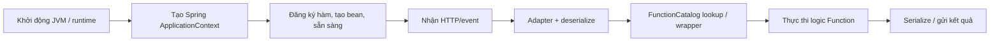
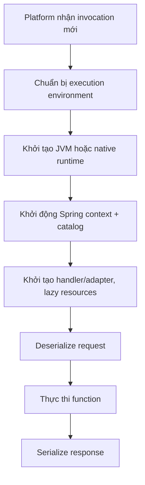

# Đo riêng thời gian khởi động và thời gian thực thi hàm

**Spring Cloud Function** giúp viết logic nghiệp vụ dưới dạng `Supplier<T>`, `Function<I, O>` và `Consumer<T>`, sau đó đưa vào `FunctionCatalog`, kết hợp (*composition*) và gọi lại cùng một hàm qua HTTP, sự kiện hoặc môi trường serverless. Kiến trúc này rất thuận lợi cho tái sử dụng, nhưng khi đánh giá **hiệu năng**, câu hỏi “Hàm chạy nhanh không?” thường chưa đủ chính xác.

Có ít nhất hai đại lượng cần **đo riêng**:

1. **Thời gian khởi động** (*startup time*): thời gian để tiến trình và ứng dụng Spring chuẩn bị tài nguyên, tạo context, đăng ký hàm và trở nên sẵn sàng phục vụ.
2. **Thời gian thực thi hàm** (*function execution time*): khoảng thời gian từ lúc một invocation bắt đầu xử lý đến lúc việc xử lý mà ta chọn đo hoàn thành.

Thực tế còn có thời gian tạo môi trường serverless, khởi tạo `FunctionCatalog` lần đầu, chọn/converter payload, network I/O, queueing và serialize kết quả. Nếu gộp tất cả vào một số đo, rất dễ tối ưu sai chỗ. Một ứng dụng có thể mất nhiều thời gian khởi động nhưng xử lý từng request cực nhanh; ứng dụng khác khởi động nhanh nhưng lại chậm dưới tải vì truy vấn database hay xử lý JSON tốn tài nguyên.

Bài học thuộc chương **Hiệu năng**. Bạn sẽ học cách thiết kế phép đo có ranh giới rõ ràng, dùng `ApplicationReadyEvent` để đo khởi động, `System.nanoTime()`/Micrometer `Timer` để đo lời gọi hàm, kiểm tra catalog và adapter, nhận biết *cold start* trên serverless và tránh các sai lầm phổ biến trong benchmarking.

## 1. Định nghĩa đúng ranh giới trước khi ghi số liệu

Một lời gọi Spring Cloud Function có thể trải qua các giai đoạn:



Các giai đoạn mô tả thứ tự khái niệm; thực tế có phần được thực hiện lazy, song song hoặc đã cache. Chẳng hạn, lookup catalog có thể được thực hiện trước lần gọi đầu tiên, hoặc một adapter đã giải tuần tự hóa JSON trước khi trao dữ liệu cho function. **Không được coi thời gian tổng là tổng đơn giản của mọi mốc này khi có xử lý song song, chờ hàng đợi hay đo bằng các đồng hồ khác nhau.**

| Đại lượng | Bắt đầu | Kết thúc | Nó phản ánh điều gì? |
| --- | --- | --- | --- |
| **Process-to-ready** | Tiến trình được hệ điều hành khởi chạy | Ứng dụng được xác nhận sẵn sàng | JVM + Boot + tài nguyên + readiness |
| **Main-to-ready** | Bắt đầu `main(...)` | `ApplicationReadyEvent` | Phần bootstrap quan sát được **từ trong JVM** |
| **Context startup** | Một mốc trong bootstrap Spring | Context refresh hoặc event tương ứng | Chi phí xây dựng Spring context; không nhất thiết bằng process-to-ready |
| **First catalog lookup** | Ngay trước `catalog.lookup(name)` lần đầu | Lookup hoàn thành | Phân giải/đóng gói/có thể cache hàm |
| **First invocation** | Ngay trước lời gọi hàm đầu | Kết quả đầu hoàn thành | Có thể bao gồm lazy initialization/JIT/cache |
| **Warm function execution** | Bắt đầu lời gọi trong trạng thái đã warm | Logic được đo hoàn thành | Chi phí xử lý Java, không nhất thiết bao gồm giao thức |
| **End-to-end latency** | Client gửi request hoặc broker giao event | Client nhận đủ response / event được xử lý theo mốc chọn | Network, queue, adapter, converter, function và output |

Với phép đo được định nghĩa bằng hai mốc thời gian:

\[
T_{\text{main-to-ready}} = t_{\text{ready}} - t_{\text{main}}
\]

\[
T_{\text{function}} = t_{\text{end-function}} - t_{\text{begin-function}}
\]

\[
T_{\text{end-to-end}} = t_{\text{response}} - t_{\text{request}}
\]

Các công thức hữu ích chỉ khi **mốc đầu/cuối được xác định nhất quán**. Chỉ số `main-to-ready` không bao gồm thời gian hệ điều hành tạo process và khởi động JVM trước khi vào `main(...)`.

## 2. Ví dụ nghiệp vụ: một Function tính tiền độc lập giao thức

Ví dụ dùng Java 17 trở lên, với DTO là record và nghiệp vụ tính tổng tiền bằng `long`:

```java
package demo.perf;

import java.util.function.Function;

import org.springframework.context.annotation.Bean;
import org.springframework.context.annotation.Configuration;

@Configuration
public class QuoteFunctions {

    public record QuoteRequest(String sku, int quantity) {}

    public record QuoteResult(
        String sku,
        int quantity,
        long totalVnd
    ) {}

    @Bean("quoteCore")
    public Function<QuoteRequest, QuoteResult> quoteCore() {
        return request -> {
            if (request == null ||
                request.sku() == null ||
                request.sku().isBlank() ||
                request.quantity() <= 0) {
                throw new IllegalArgumentException("Invalid quote request");
            }

            long total = Math.multiplyExact(
                request.quantity(), 50_000L
            );
            return new QuoteResult(
                request.sku(),
                request.quantity(),
                total
            );
        };
    }
}
```

Hợp đồng là `Function<QuoteRequest, QuoteResult>`. Bản thân hàm không cần biết request đến từ Web adapter hay broker. Điều này cho phép đo **logic Java** riêng, rồi đo thêm chi phí giao thức.

Một test trực tiếp:

```java
var functions = new QuoteFunctions();
var quote = functions.quoteCore();

QuoteFunctions.QuoteResult result = quote.apply(
    new QuoteFunctions.QuoteRequest("BOOK-1", 2)
);

System.out.println(result.totalVnd()); // 100000
```

Kết quả đó xác nhận phép tính; **không phải kết quả benchmark**. Đặc biệt, `quote.apply(...)` nhận DTO đã tạo sẵn nên không bao gồm JSON parser, `MessageConverter` hay chi phí HTTP.

## 3. Đo thời gian khởi động từ main đến ApplicationReadyEvent

Trong Spring Boot, `ApplicationStartedEvent` và `ApplicationReadyEvent` không có cùng ý nghĩa:

- `ApplicationStartedEvent` thường được phát sau khi context được refresh và trước khi chạy `ApplicationRunner`/`CommandLineRunner`.
- `ApplicationReadyEvent` được phát sau khi các runner đã thực hiện, khi Boot coi ứng dụng sẵn sàng phục vụ.

Nếu mục tiêu là **readiness**, mốc `ApplicationReadyEvent` thường phù hợp hơn chỉ đo thời gian `SpringApplication.run(...)` hoặc `ApplicationStartedEvent`. Nhưng readiness của Spring Boot vẫn chưa đồng nghĩa mọi database, broker hay dịch vụ bên ngoài đã có thể đáp ứng nghiệp vụ; cần health/readiness probe tương ứng.

Ví dụ đo từ đầu `main(...)` đến lúc Boot phát sự kiện:

```java
package demo.perf;

import java.util.concurrent.TimeUnit;

import org.springframework.boot.SpringApplication;
import org.springframework.boot.autoconfigure.SpringBootApplication;
import org.springframework.boot.context.event.ApplicationReadyEvent;
import org.springframework.boot.context.event.ApplicationStartedEvent;
import org.springframework.context.ApplicationListener;

@SpringBootApplication
public class PerformanceApplication {

    public static void main(String[] args) {
        final long mainStartedNs = System.nanoTime();
        SpringApplication application =
            new SpringApplication(PerformanceApplication.class);

        application.addListeners(
            (ApplicationListener<ApplicationStartedEvent>) event -> {
                long elapsedMs = TimeUnit.NANOSECONDS.toMillis(
                    System.nanoTime() - mainStartedNs
                );
                System.out.println(
                    "startup.main_to_started.ms=" + elapsedMs
                );
            }
        );

        application.addListeners(
            (ApplicationListener<ApplicationReadyEvent>) event -> {
                long elapsedMs = TimeUnit.NANOSECONDS.toMillis(
                    System.nanoTime() - mainStartedNs
                );
                System.out.println(
                    "startup.main_to_ready.ms=" + elapsedMs
                );
            }
        );

        application.run(args);
    }
}
```

Code sử dụng `System.nanoTime()` để đo **khoảng thời gian**, không dùng nó như mốc ngày giờ tuyệt đối. Trong cùng một JVM, hiệu hai lần gọi nanoTime phù hợp để đo elapsed duration.

### Phải ghi tên mốc thay vì gọi mọi thứ là startup

Ví dụ log:

```text
startup.main_to_started.ms=1180
startup.main_to_ready.ms=1310
```

Đây là **số liệu minh họa**, không phải benchmark của Spring Cloud Function. Khác biệt 130 ms có thể do runner hoặc hoạt động ở giai đoạn sau context refresh. Đừng khẳng định khoảng chênh luôn bằng chi phí của runner; việc xử lý event và các bước khác còn phụ thuộc ứng dụng.

Đo từ `main(...)` **không** bao gồm toàn bộ thời gian khởi tạo JVM trước khi gọi main. Ngoài ra, nếu hệ thống thực sự quan tâm khi nào HTTP readiness probe trả kết quả thành công, nên đo **process-to-ready từ bên ngoài tiến trình** thay vì chỉ nhìn log của JVM.

### Khả năng quan sát có sẵn của Spring Boot

Tùy phiên bản và dependency, Spring Boot có:

- `ApplicationReadyEvent.getTimeTaken()` để truy cập thời lượng do Boot báo cáo nếu khả dụng.
- Micrometer/Actuator startup metrics như `application.started.time` và `application.ready.time` khi hệ thống metrics được cấu hình phù hợp.
- `ApplicationStartup` (ví dụ `BufferingApplicationStartup`) và endpoint Actuator startup để tìm các bước tạo context tốn thời gian.

Những công cụ này có ý nghĩa khác nhau: **metric tổng thời gian** cho biết mức độ thay đổi, trong khi **startup steps** hỗ trợ tìm thành phần tốn chi phí. Đừng bật tracing chi tiết rồi mặc định không có overhead; đo baseline và so sánh khi instrumentation được bật.

## 4. Process-to-ready: đo từ bên ngoài thay vì chỉ trong JVM

Muốn đánh giá cold process startup, cần đo bằng một bộ điều khiển **nằm ngoài ứng dụng**, với các mốc như sau:

```text
t0: Bộ đo yêu cầu hệ điều hành khởi chạy java -jar ...
    |
    | JVM boot / class loading / Spring context / bean initialization
    v
t1: Endpoint readiness hoặc tín hiệu sẵn sàng đạt điều kiện
    |
    +-- T_process_to_ready = t1 - t0
```

Khuyến nghị quy trình:

1. Dùng **bản build đã đóng gói**, không lấy thời gian `gradle bootRun` hoặc Maven chạy toàn bộ chu kỳ build làm startup time.
2. Bảo đảm quá trình trước đó đã dừng hẳn; **mỗi lần đo cold startup phải tạo tiến trình mới**.
3. Ghi mốc trước khi start process bằng đồng hồ monotonic của bộ đo.
4. Poll một readiness endpoint hoặc tín hiệu đáng tin cậy, có timeout và ghi cả lỗi khởi động.
5. Ghi mốc khi probe sẵn sàng, kết thúc process một cách có kiểm soát.
6. Lặp lại nhiều lần (ví dụ 20–30 lượt tùy chi phí) và báo cáo phân phối, không chỉ một mẫu.

Nếu dùng Spring Boot Actuator với readiness probes đã được bật, có thể quan sát endpoint thích hợp, thường là:

```text
GET /actuator/health/readiness
```

Đường endpoint trên phụ thuộc cấu hình Actuator, cổng quản trị và base path; **không tự tồn tại** chỉ vì ứng dụng có Spring Cloud Function. Cũng nên phân biệt “health endpoint trả HTTP 200” với “đã thử được đường nghiệp vụ”, vì một ứng dụng có thể healthy nhưng downstream vẫn lỗi.

Một phép đo từ ngoài còn có overhead của **polling interval và network**. Nếu poll mỗi 500 ms, thời điểm phát hiện readiness có thể trễ đáng kể so với lúc ứng dụng thật sự sẵn sàng; ghi rõ polling interval trong báo cáo.

### Những yếu tố phải cố định khi so sánh cold startup

| Yếu tố | Vì sao cần ghi lại? |
| --- | --- |
| JDK, Spring Boot, Spring Cloud Function | Thay đổi runtime/framework ảnh hưởng class loading và context |
| Kiểu triển khai JVM JAR/native image/container | Mỗi cách có đường bootstrap và chi phí riêng |
| Số bean, converter, adapter, function definitions | Có thể thay đổi công việc lúc khởi động |
| CPU/memory limit, kiến trúc máy | Tác động mạnh tới thời gian init |
| Kết nối database, broker, DNS, TLS | Có thể làm startup chậm hoặc dễ biến động |
| Warm/cold filesystem cache và image layers | Ảnh hưởng thời gian đọc class/resource |
| Runner, migrations, cache preloading | Chi phí sau context refresh có thể lớn |
| Cách xác định readiness, timeout, polling | Quyết định chính xác mốc kết thúc |

Nếu so sánh hai bản ứng dụng, hãy giữ môi trường đo giống nhau, tách các lần benchmark khỏi build/test chạy song song và ghi lại biến thể cấu hình được sử dụng.

## 5. Cold start serverless khác startup của Spring Boot

Khi triển khai Spring Cloud Function trên serverless, **cold start latency** có thể bao gồm nhiều hơn việc tạo Spring context:



**Cold invocation** là lời gọi đầu trong một execution environment mới. **Warm invocation** sử dụng lại môi trường đã có và thường bỏ qua phần bootstrap lớn, nhưng vẫn có thể gặp cache miss, GC hoặc kết nối downstream chậm.

| Metric | Cách hiểu | Lưu ý |
| --- | --- | --- |
| Platform init duration | Khoảng khởi tạo theo telemetry của nền tảng | Không mặc định trùng `main-to-ready` |
| Cold invocation latency | Độ trễ request bị ảnh hưởng bởi tạo môi trường mới | Gồm các thành phần khác ngoài core function |
| Warm invocation latency | Độ trễ request trên môi trường đã warm | Có thể chịu queue/network/IO |
| Core function execution | Đo trong delegate Java hoặc publisher được subscribe | Chỉ là một phần của invocation |

Trên AWS Lambda, có thể tham khảo các mốc initialization/invocation trong platform logs/telemetry; với các nền tảng khác, mốc và tên metric có thể khác. Cơ chế snapshot/provisioned instances, container reuse hoặc native image cũng làm cách phân loại cold/warm thay đổi.

**Đừng so sánh số đo `ApplicationReadyEvent` của ứng dụng HTTP thường trú trực tiếp với tổng latency của một cold serverless invocation**, vì các mốc bắt đầu/kết thúc không tương đương.

## 6. Tách FunctionCatalog lookup, lần gọi đầu và lần gọi đã warm

Khi muốn đo thực thi hàm, ít nhất cần tách:

- Thời gian **lookup function**: `FunctionCatalog.lookup(...)`, có thể tạo wrapper hoặc composition.
- Thời gian **lần gọi đầu**: có thể bao gồm JIT compilation, khởi tạo lớp lazy và cache.
- Thời gian **gọi liên tiếp sau warm-up**: phản ánh một phần trạng thái ổn định.

Snippet dưới đây dùng lại `quoteCore` ở mục 2. Nó minh họa phân tách các mốc:

```java
package demo.perf;

import java.util.concurrent.TimeUnit;
import java.util.function.Function;

import org.springframework.cloud.function.context.FunctionCatalog;

public final class CatalogTimingProbe {

    private CatalogTimingProbe() {}

    public static void run(FunctionCatalog catalog) {
        long lookupStart = System.nanoTime();

        Function<QuoteFunctions.QuoteRequest,
                 QuoteFunctions.QuoteResult> function =
            catalog.lookup("quoteCore");

        long lookupElapsed = System.nanoTime() - lookupStart;
        if (function == null) {
            throw new IllegalStateException("quoteCore not registered");
        }

        var request = new QuoteFunctions.QuoteRequest("BOOK-1", 2);

        long firstStart = System.nanoTime();
        var firstResult = function.apply(request);
        long firstElapsed = System.nanoTime() - firstStart;

        System.out.printf(
            "catalog.lookup.ms=%.3f%n",
            lookupElapsed / 1_000_000.0
        );
        System.out.printf(
            "function.first_call.ms=%.3f%n",
            firstElapsed / 1_000_000.0
        );
        System.out.println(firstResult.totalVnd()); // 100000
    }
}
```

Đặt lời gọi `CatalogTimingProbe.run(catalog)` trong **test hoặc lệnh đo chủ động sau khi app đã ready**. Không đặt code này vào `ApplicationRunner` của lần đo startup nếu muốn giữ mốc startup độc lập: khi đó runner sẽ làm startup trông chậm hơn vì chính benchmark.

### Quan trọng: mốc chưa đồng nghĩa chi phí thuần của một thành phần

Thời gian `catalog.lookup(...)` có thể bị ảnh hưởng bởi context đã cache hay chưa. Lần `function.apply(...)` đầu có thể chứa overhead wrapper, chuyển đổi hoặc khởi tạo lazy. Không lấy chênh lệch hai số đó rồi khẳng định “chi phí framework” tuyệt đối; muốn phân rã, cần instrument từng tầng trên cùng đường thực thi.

## 7. Đo riêng thời gian logic hàm bằng Micrometer Timer

Với ứng dụng đã dùng Micrometer, có thể gắn timer **bên trong wrapper nghiệp vụ** để đo riêng phần gọi delegate. Ví dụ đăng ký thêm một bean được instrument:

```java
package demo.perf;

import java.util.function.Function;

import io.micrometer.core.instrument.MeterRegistry;
import io.micrometer.core.instrument.Timer;

import org.springframework.beans.factory.annotation.Qualifier;
import org.springframework.context.annotation.Bean;
import org.springframework.context.annotation.Configuration;

@Configuration
public class TimedQuoteFunctions {

    @Bean("quoteTimed")
    public Function<
        QuoteFunctions.QuoteRequest,
        QuoteFunctions.QuoteResult
    > quoteTimed(
        @Qualifier("quoteCore")
        Function<QuoteFunctions.QuoteRequest,
                 QuoteFunctions.QuoteResult> delegate,
        MeterRegistry registry
    ) {
        Timer timer = Timer.builder("app.function.core.duration")
            .description("Synchronous quote delegate duration")
            .tag("function", "quoteTimed")
            .publishPercentileHistogram()
            .register(registry);

        return request -> timer.record(
            () -> delegate.apply(request)
        );
    }
}
```

Đoạn này cần dependency Micrometer và một `MeterRegistry` trong Spring context (ví dụ từ cấu hình metrics/Actuator thích hợp). Chữ ký của bean `quoteTimed` vẫn là `Function<QuoteRequest, QuoteResult>` nên có thể được `FunctionCatalog` tra cứu như hàm khác.

Nếu muốn expose **đúng wrapper được đo** thay vì core bean:

```yaml
spring:
  cloud:
    function:
      definition: quoteTimed
```

Khi đó:

- Timer bắt đầu **ngay trước** `delegate.apply(request)` và dừng khi lời gọi đồng bộ kết thúc hoặc ném lỗi.
- Nó đo **core function duration**, không bao gồm giai đoạn trước wrapper như network, HTTP parsing và catalog lookup.
- Với một nghiệp vụ có gọi database, thời gian chờ database nằm trong timer vì xảy ra bên trong delegate.
- Timer tạo thêm overhead đo; cần cân nhắc khi hàm cực ngắn hoặc có throughput rất cao.

**Không gắn request ID, tên khách hàng, mã đơn hoặc payload vào metric tags.** Những tag có số lượng giá trị gần như vô hạn tạo *high cardinality* và có thể làm hệ thống metrics tốn nhiều tài nguyên.

### Nên báo cáo các thống kê nào?

| Chỉ số | Ý nghĩa |
| --- | --- |
| Count | Số lần gọi đã đo |
| Mean | Trung bình, hữu ích nhưng che tail latency |
| p50 | Trung vị; một nửa số lần đo không vượt mốc này |
| p95 / p99 | Các percentiles cao, hữu ích để quan sát request chậm |
| Error count/rate | Tỷ lệ lỗi; không được chỉ lấy latency của request thành công |
| Throughput (ops/s, RPS) | Số invocation xử lý trên một đơn vị thời gian |
| Allocation/GC/CPU | Tìm nguyên nhân gây chậm, không chỉ nhìn duration |

`publishPercentileHistogram()` giúp các backend hỗ trợ histogram/percentiles, nhưng cách query p95/p99 và độ chính xác phụ thuộc registry, export interval và hệ quan sát cụ thể. Không khẳng định cứ bật timer là mọi backend tự cung cấp cùng một phép đo p99.

## 8. Đo nóng bằng System.nanoTime: dùng đúng mục đích

Nếu chưa có Micrometer, có thể viết một phép thử ngắn dùng `System.nanoTime()`. Nhưng phép thử này chỉ là **probe khám phá**, không thay thế công cụ microbenchmark như JMH.

Ví dụ một phép đo tuần tự sau warm-up:

```java
package demo.perf;

import java.util.Arrays;
import java.util.function.Function;

import org.springframework.cloud.function.context.FunctionCatalog;

public final class WarmFunctionProbe {

    private static volatile long resultSink;

    private WarmFunctionProbe() {}

    public static void measure(FunctionCatalog catalog) {
        Function<QuoteFunctions.QuoteRequest,
                 QuoteFunctions.QuoteResult> function =
            catalog.lookup("quoteCore");

        if (function == null) {
            throw new IllegalStateException("Missing quoteCore");
        }

        var inputs = new QuoteFunctions.QuoteRequest[32];
        for (int i = 0; i < inputs.length; i++) {
            inputs[i] = new QuoteFunctions.QuoteRequest(
                "BOOK-" + i, (i % 10) + 1
            );
        }

        for (int i = 0; i < 20_000; i++) {
            function.apply(inputs[i % inputs.length]);
        }

        int samples = 50_000;
        long[] durations = new long[samples];
        long checksum = 0L;

        for (int i = 0; i < samples; i++) {
            var request = inputs[i % inputs.length];
            long start = System.nanoTime();
            var result = function.apply(request);
            durations[i] = System.nanoTime() - start;
            checksum += result.totalVnd();
        }

        resultSink = checksum;
        Arrays.sort(durations);

        System.out.printf(
            "warm.p50.ns=%d%n", percentile(durations, 0.50)
        );
        System.out.printf(
            "warm.p95.ns=%d%n", percentile(durations, 0.95)
        );
        System.out.printf(
            "warm.p99.ns=%d%n", percentile(durations, 0.99)
        );
    }

    private static long percentile(long[] sorted, double p) {
        int index = (int) Math.ceil(sorted.length * p) - 1;
        return sorted[Math.max(0, Math.min(index, sorted.length - 1))];
    }
}
```

**Giới hạn của probe trên:**

1. Mỗi lần gọi quá ngắn nên **chi phí hai lần gọi `nanoTime()` có thể chiếm tỷ lệ lớn** trong duration.
2. Warm-up 20.000 lần là giá trị minh họa, không bảo đảm JIT đã ổn định.
3. JVM có thể tối ưu hóa mạnh các vòng lặp và input; volatile sink chỉ giảm một số rủi ro loại bỏ phép tính, không tạo benchmark hoàn hảo.
4. Các mẫu chạy tuần tự trên một thread, không đại diện cho server đồng thời nhiều request.
5. Đây là phép đo **catalog-wrapped function với DTO đầu vào sẵn có**, không đo HTTP JSON.
6. Percentiles của tập mẫu đơn giản chưa cho biết độ tin cậy của kết quả; cần lặp các phép thử và so sánh phương sai.

Nếu muốn microbenchmark logic ở mức nanosecond/microsecond, nên sử dụng **JMH**, để framework benchmark xử lý warm-up, fork JVM, chống tối ưu hóa sai và thống kê phù hợp.

## 9. Dùng JMH để benchmark hàm Java thuần

Ví dụ JMH chạy **hàm nghiệp vụ thuần** `quoteCore`, không bao gồm Spring context hoặc adapter:

```java
package demo.perf;

import java.util.concurrent.TimeUnit;
import java.util.function.Function;

import org.openjdk.jmh.annotations.*;
import org.openjdk.jmh.infra.Blackhole;

@State(Scope.Thread)
@BenchmarkMode(Mode.AverageTime)
@OutputTimeUnit(TimeUnit.MICROSECONDS)
@Warmup(iterations = 5)
@Measurement(iterations = 5)
@Fork(2)
public class QuoteCoreBenchmark {

    private Function<
        QuoteFunctions.QuoteRequest,
        QuoteFunctions.QuoteResult
    > function;

    private QuoteFunctions.QuoteRequest request;

    @Setup(Level.Trial)
    public void setUp() {
        function = new QuoteFunctions().quoteCore();
        request = new QuoteFunctions.QuoteRequest("BOOK-1", 3);
    }

    @Benchmark
    public void callQuote(Blackhole blackhole) {
        blackhole.consume(function.apply(request));
    }
}
```

Code yêu cầu các dependency **JMH core và annotation processor** tương ứng. Không cần khởi tạo Spring cho benchmark này, vì mục tiêu là **chi phí của core Java function**. Hãy giữ input thực tế và kiểm tra cách JIT tối ưu hóa nếu operation quá nhỏ.

Nếu mục tiêu là benchmark **FunctionCatalog wrapper**, cần thiết kế benchmark khác khởi tạo context trước phần đo và đảm bảo việc dựng context nằm ở `@Setup`, không lọt vào thân `@Benchmark`. Nhưng kết quả đó vẫn **không đo startup time**; việc tạo Spring context bên ngoài vòng đo chính là để tách hai đại lượng.

**Đừng dùng JMH để khẳng định p99 end-to-end HTTP dưới tải thật.** JMH là công cụ microbenchmark code path, còn API load test cần request đồng thời, network, queueing và lỗi.

## 10. Đo đầu cuối qua HTTP: so sánh với core duration

Giả sử Spring Cloud Function Web adapter đã được cài đặt và expose `quoteTimed`. Client có thể gửi JSON:

```bash
curl -sS -o /dev/null \
  -w 'connect=%{time_connect}s ttfb=%{time_starttransfer}s total=%{time_total}s\n' \
  -X POST http://localhost:8080/quoteTimed \
  -H 'Content-Type: application/json' \
  -d '{"sku":"BOOK-1","quantity":3}'
```

Ba trường thời gian của `curl`:

| Trường | Ý nghĩa tổng quát |
| --- | --- |
| `time_connect` | Thời gian từ đầu transaction đến khi kết nối TCP được thiết lập |
| `time_starttransfer` | Thời gian đến byte đầu tiên của response (*TTFB*) |
| `time_total` | Tổng thời gian transfer theo curl |

`time_total` bao gồm nhiều phần ngoài logic hàm, như kết nối HTTP, chờ, deserialize JSON, catalog/adapter, serialize response và truyền dữ liệu. Vì vậy, nó thường không thể được dùng thay cho metric `app.function.core.duration`.

**Lưu ý:** một lần chạy curl không phải load test. Để đánh giá HTTP latency và throughput, dùng công cụ tạo tải phù hợp, cố định concurrency, thời lượng warm-up, số connection và kích thước payload; báo cáo p50/p95/p99 cùng tỷ lệ lỗi. Khi tải tăng, request có thể chờ hàng đợi, nên tail latency tăng dù thời gian thực thi core ít thay đổi.

### So sánh hai lớp metric

| Trường hợp quan sát | Core Timer | HTTP total | Cách suy luận |
| --- | --- | --- | --- |
| Cả hai đều tăng | Tăng | Tăng | Xem code, I/O bên trong function và tài nguyên JVM |
| Core ổn định, HTTP tăng | Gần như không đổi | Tăng | Xem network, connection, queueing, codec, thread pool |
| Core tăng nhưng HTTP ít đổi | Tăng | Gần như không đổi | Kiểm tra cỡ mẫu, caching, thành phần khác; không kết luận vội |
| Cold request chậm, warm nhanh | Có thể khác ít | Tăng mạnh ở lần cold | Xem bootstrap, lazy init, serverless environment |

Bảng chỉ gợi ý hướng điều tra, **không phải phép trừ chính xác** kiểu “HTTP total − core = framework overhead”. Các phép đo có thể khác đồng hồ, tập mẫu, thời điểm, concurrency và overhead của instrumentation.

## 11. Đo qua sự kiện: phải chọn điểm bắt đầu và kết thúc

Với hệ thống sự kiện, có thể có các mốc:

```text
Producer tạo event
    ↓
Broker nhận và lưu
    ↓
Consumer nhận message
    ↓
Adapter deserialize
    ↓
Function/Consumer xử lý
    ↓
Ack / ghi kết quả / phát event mới
```

Bạn cần phân biệt:

- **Delivery lag:** từ producer hoặc broker đến lúc consumer nhận event.
- **Conversion duration:** parse payload và map thành kiểu Java theo generic/content type.
- **Function processing duration:** xử lý nghiệp vụ sau khi payload đã sẵn sàng.
- **Acknowledgment/end-to-end duration:** tính đến khi ack, commit hoặc downstream nhận kết quả theo hợp đồng.

Một bean `Consumer<T>` không trả output Java, nhưng thời gian xử lý vẫn có thể bao gồm thao tác database hoặc phát sự kiện. Ngược lại, nếu `Consumer<T>` chỉ lên lịch tác vụ rồi trả về ngay, timer quanh `accept(...)` đo **thời gian lên lịch**, không đo đến khi tác vụ thật sự hoàn thành.

Với broker, correlation ID và timestamp nên được thiết kế từ trước để đo end-to-end. Không trừ hai giá trị `System.nanoTime()` lấy ở **hai JVM khác nhau**: nanoTime là đồng hồ đo khoảng thời gian trong cùng process, không có cùng epoch tuyệt đối. Muốn đo xuyên process, dùng timestamp có đồng hồ được đồng bộ hoặc trace context, đồng thời tính đến clock skew.

Ngoài latency, ghi nhận throughput, backlog, số message retry và DLQ. Nếu chỉ báo cáo thời gian những message thành công, bạn có thể bỏ sót tình trạng hệ thống đang nghẽn hoặc liên tục retry.

## 12. Với Mono/Flux, thời gian gọi apply không phải thời gian xử lý xong

Spring Cloud Function còn có thể dùng các chữ ký reactive, chẳng hạn:

```java
import java.util.function.Function;
import reactor.core.publisher.Mono;

Function<
    Mono<QuoteFunctions.QuoteRequest>,
    Mono<QuoteFunctions.QuoteResult>
> reactiveQuote = source -> source.map(request -> {
    long total = Math.multiplyExact(
        request.quantity(), 50_000L
    );
    return new QuoteFunctions.QuoteResult(
        request.sku(), request.quantity(), total
    );
});
```

Ở đây, `reactiveQuote.apply(source)` **thường chỉ xây dựng một publisher**. Nếu bạn đo từ trước đến sau lời gọi `apply(...)`, phép đo có thể kết thúc trước khi publisher được subscribe và dữ liệu được xử lý thật sự.

Trong **test** (không chạy trên event-loop production), có thể đo đến khi `Mono` hoàn thành:

```java
import java.time.Duration;

var request = new QuoteFunctions.QuoteRequest("BOOK-1", 3);

long start = System.nanoTime();
var result = reactiveQuote
    .apply(Mono.just(request))
    .block(Duration.ofSeconds(5));
long end = System.nanoTime();

System.out.println(result.totalVnd()); // 150000
System.out.println("reactive.completion.ns=" + (end - start));
```

Thời gian này bao gồm xây dựng publisher, subscription và completion của đường test; nó **không đồng nghĩa với thời gian CPU của lambda `map(...)`**. Trong ứng dụng reactive, nên instrument từ thời điểm subscribe đến signal terminal và ghi rõ các trường hợp complete, error, cancel. Với `Flux` không kết thúc, phải định nghĩa một ranh giới đo khác (ví dụ latency mỗi item, thời gian đến item đầu, hoặc cửa sổ đo hữu hạn).

**Không gọi `block(...)` trong đường xử lý reactive production**, nhất là trên event loop. Nó được dùng ở đây để minh họa cách đo hoàn thành trong test.

## 13. Startup và execution cần tối ưu bằng những chiến lược khác nhau

| Nếu metric chính chậm là… | Hướng điều tra phù hợp |
| --- | --- |
| Process-to-ready | JVM boot, filesystem/image, startup scripts, CPU/memory, readiness probe |
| Main-to-ready | Spring context creation, bean init, classpath scanning, runners, migration |
| First invocation | Lazy init, class loading, JIT, cache, kết nối/handshake lần đầu |
| Warm function core | Thuật toán, allocation, DB/network I/O bên trong function, lock contention |
| HTTP end-to-end | Network, queue, connection pooling, JSON codec, thread pool và core |
| Event end-to-end | Broker backlog, batching, partitioning, retry, downstream processing |
| Reactive completion | Scheduler, subscription, backpressure, IO và cancellation |

Ví dụ, tối ưu startup bằng cách lazy-load một bean có thể làm `main-to-ready` tốt hơn nhưng làm **lần invocation đầu chậm hơn**. Điều này có thể phù hợp với service chạy lâu và có warm-up, nhưng không nhất thiết tốt cho serverless có nhiều cold invocations. Vì vậy, một thay đổi phải được đánh giá bằng **cả startup và first-invoke/warm metrics**, không chỉ một bảng số.

### Chọn metric theo mục tiêu vận hành

- API sống lâu: thường cần **steady-state p95/p99 latency**, throughput và error rate; startup vẫn quan trọng cho rolling deployment/scale-out.
- Autoscaling/serverless: **cold-start latency và tỷ lệ cold invocations** có thể quan trọng ngang với warm execution.
- Batch/event consumer: throughput, backlog/drain time và end-to-end event latency thường quan trọng hơn độ trễ một lời gọi Java riêng lẻ.
- Hàm CPU cực nhỏ: benchmark code bằng JMH; HTTP/messaging có thể chiếm phần lớn chi phí của end-to-end call.

Không có một giá trị “startup tốt” hay “execution nhanh” áp dụng cho mọi ứng dụng: đặt **performance budget** theo SLA/SLO và ràng buộc phần cứng thực tế.

## 14. Thiết kế thí nghiệm A/B để so sánh hai phiên bản

Giả sử muốn biết việc tối ưu khởi động có giúp hệ thống nhanh hơn hay không. Hãy chia thí nghiệm:

| Bài đo | Baseline | Candidate | Cách thu thập |
| --- | --- | --- | --- |
| Process-to-ready p50/p95 | Đo N tiến trình mới | Đo cùng N tiến trình mới | External harness, cùng readiness |
| Main-to-ready p50/p95 | Event trong JVM | Cùng event | Không trộn metric với process-to-ready |
| First catalog lookup | Đo sau readiness | Cùng mốc | Context và tên function như nhau |
| First invocation | Một lời gọi đầu mỗi process | Tương tự | Cùng input, sau lookup |
| Warm core p50/p95/p99 | Warm-up + nhiều mẫu | Cùng cỡ mẫu | Timer/JMH, cùng JVM resources |
| HTTP p95/p99 và error rate | Load test cố định | Load test tương tự | Cùng client, concurrency và payload |
| Memory/GC/CPU | Theo dõi | Theo dõi | Để giải thích thay đổi latency |

Nên chạy các bản theo nhiều vòng xen kẽ thay vì đo toàn bộ baseline vào buổi sáng rồi candidate vào buổi chiều, bởi load hệ thống và môi trường có thể thay đổi. Tránh chạy hai load test nặng đồng thời trên cùng một host nếu muốn so sánh độc lập.

### Ví dụ kết quả giả định để tập cách diễn giải

| Metric | Trước | Sau | Diễn giải hợp lý |
| --- | ---: | ---: | --- |
| Main-to-ready p50 | 1.400 ms | 950 ms | Phần startup trong JVM giảm |
| First invocation p50 | 12 ms | 45 ms | Có thể lazy initialization bị dời sang lần gọi đầu |
| Warm core p50 | 0,30 ms | 0,30 ms | Chưa thấy thay đổi ở logic khi warm |
| HTTP warm p99 | 18 ms | 18 ms | Chưa thấy cải thiện tail latency HTTP |

Các số trên **được đặt ra để minh họa**, không phải phép đo Spring Cloud Function. Nhìn vào đó, không nên tuyên bố “hệ thống nhanh hơn 32%” một cách tổng quát: startup được cải thiện nhưng first invocation tệ hơn, còn warm latency gần như không đổi.

## 15. Sai lầm đo hiệu năng thường gặp

| Sai lầm | Vì sao sai? | Cách sửa |
| --- | --- | --- |
| Đo `SpringApplication.run(...)` rồi gọi là toàn bộ cold start | Không bao gồm JVM/process initialization trước main | Đo process-to-ready từ bên ngoài |
| Tính thời gian build vào startup | Build và bootstrap là hai công việc khác nhau | Đo từ packaged artifact |
| Đo một lần rồi kết luận | Cache/JIT/GC/OS gây biến động | Lặp nhiều lần, báo phân phối |
| Gọi Function trực tiếp rồi coi là HTTP latency | Thiếu codec/network/queue | Load test qua adapter |
| Gộp lookup đầu tiên với core time | Cache catalog làm cold/hot khác nhau | Đo lookup và invoke riêng |
| Không warm-up khi so sánh core | Kết quả chịu JIT/class loading | Có giai đoạn warm-up rõ |
| Đo hàm quá nhỏ bằng vòng lặp tự viết | Timer overhead và JIT tối ưu sai lệch | Dùng JMH cho microbenchmark |
| Chỉ báo average | Che request chậm và tail latency | Theo dõi p50/p95/p99, lỗi |
| Chỉ tính request thành công | Timeout/retry biến mất khỏi báo cáo | Tính error rate và latency thất bại |
| Đo `Mono.apply(...)` rồi coi đã hoàn thành | Reactive publisher có thể chưa subscribe | Đo đến terminal signal khi phù hợp |
| Trừ nanoTime của hai JVM | Không có chung mốc tham chiếu | Dùng timestamp/tracing xuyên tiến trình |
| Instrument với tag orderId | Cardinality rất lớn | Chỉ tag tên function/stage hữu hạn |
| Tối ưu startup mà không đo first call | Lazy init có thể dời chi phí | Báo startup + first + warm |
| So sánh khác CPU/memory/traffic | Không công bằng | Cố định và ghi rõ môi trường |

## 16. Một bộ kết quả đo tối thiểu nên có

Đối với một function được expose qua giao thức, nên giữ **hai nhóm kết quả tách biệt**:

**Nhóm khởi động**

```text
Version / build:
JDK / Spring Boot / Spring Cloud Function:
Deployment: JVM JAR / container / serverless / native
CPU / memory:
Cold process count:
Process-to-ready: p50 / p95 / max
Main-to-ready: p50 / p95 / max
First lookup: p50 / p95
First invocation: p50 / p95
Readiness definition and polling interval:
```

**Nhóm thực thi**

```text
Function name / composition:
Input size and contentType:
Invocation model: synchronous / reactive
Warm-up method:
Sample size / concurrency:
Core execution: count / mean / p50 / p95 / p99
Adapter end-to-end: p50 / p95 / p99
Throughput:
Error/timeout/retry rate:
CPU, heap allocation and GC observations:
```

Ghi riêng *first invocation* sẽ giúp phát hiện một tối ưu startup chỉ đơn thuần dời chi phí sang lần gọi đầu. Ghi cả *core* và *end-to-end* sẽ giúp phân biệt thay đổi thuật toán với thay đổi network/adapter.

## 17. Bài tập thực hành

**Bài 1 — Xác định mốc.** Bạn bắt đầu `System.nanoTime()` ở dòng đầu trong `main(...)` và dừng khi nhận `ApplicationReadyEvent`. Đây có phải toàn bộ process startup không?

*Đáp án:* Không. Đây là main-to-ready trong JVM; chưa tính phần khởi chạy tiến trình và JVM trước khi vào main. Muốn process-to-ready cần bộ đo ở bên ngoài.

**Bài 2 — First call.** Một function chạy rất nhanh sau 10.000 lần gọi, nhưng lần đầu chậm. Có nên đưa mẫu đầu vào cùng tập warm execution để tính p50 không?

*Đáp án:* Nên tách chỉ số first invocation và warm invocation. Trộn các trạng thái làm kết quả khó diễn giải và có thể che ảnh hưởng của lazy/JIT.

**Bài 3 — FunctionCatalog.** Tại sao cần đo `catalog.lookup("quoteCore")` tách khỏi `function.apply(request)`?

*Đáp án:* Lookup có thể phân giải/đóng gói/caching function, trong khi `apply` thực thi lời gọi. Hai giai đoạn có chi phí và khả năng cache khác nhau.

**Bài 4 — HTTP.** Micrometer timer quanh `delegate.apply(...)` báo 0,2 ms, nhưng curl báo 14 ms. Có thể khẳng định Spring Cloud Function thêm chính xác 13,8 ms overhead không?

*Đáp án:* Không. Hai phép đo có ranh giới, đồng hồ và tập mẫu khác nhau; HTTP còn có network, queue, parse/serialize, connection và thời gian adapter. Cần đo đồng nhất theo trace để phân rã chính xác hơn.

**Bài 5 — Reactive.** Vì sao đo thời gian `fn.apply(Mono.just(input))` chưa đủ để tính thời gian hoàn thành?

*Đáp án:* `apply(...)` có thể chỉ tạo publisher. Xử lý thật xảy ra sau subscription; cần đo đến terminal signal hoặc một mốc được định nghĩa phù hợp.

**Bài 6 — Serverless.** Điều gì khác giữa thời gian Boot `ApplicationReadyEvent` và một cold invocation trên nền tảng serverless?

*Đáp án:* Cold invocation còn có thể bao gồm việc cấp môi trường, khởi tạo runtime/handler, mapping event và xử lý request. Hai đại lượng không trùng ranh giới.

**Bài 7 — Thử nghiệm A/B.** Sau tối ưu, main-to-ready giảm 400 ms nhưng first invocation tăng 300 ms, warm core không đổi. Có thể kết luận mọi lời gọi nhanh hơn không?

*Đáp án:* Không. Có thể một phần khởi tạo đã bị hoãn sang lời gọi đầu tiên. Cần nhìn cold/warm mix và end-to-end SLA thực tế.

**Bài 8 — Đo event.** Một `Consumer<T>` ghi database rồi ack. Timer chỉ quanh xử lý Java có phản ánh độ trễ từ producer đến broker và consumer không?

*Đáp án:* Không. Timer trong consumer không bao gồm broker queue/delivery lag. Muốn end-to-end cần timestamp/tracing và định nghĩa mốc ack/commit rõ.

**Bài 9 — Microbenchmark.** Tại sao JMH phù hợp hơn một vòng lặp `nanoTime()` khi mỗi invocation chỉ mất vài trăm nanosecond?

*Đáp án:* JMH hỗ trợ fork, warm-up, kiểm soát JIT và cơ chế benchmark phù hợp; với code tự đo, overhead của đồng hồ và các tối ưu hóa runtime có thể chi phối kết quả.

## 18. Ghi nhớ

- **Đo startup và execution bằng hai nhóm metric riêng**, cùng định nghĩa rõ mốc bắt đầu/kết thúc.
- **Main-to-ready khác process-to-ready**; cả hai lại khác cold invocation latency trên serverless.
- **FunctionCatalog lookup, first invocation và warm execution là ba phép đo khác nhau**; không gộp rồi gọi tất cả là thời gian xử lý hàm.
- **Micrometer Timer quanh delegate** hữu ích để đo core function, trong khi curl/load test và broker metrics phản ánh đầu cuối qua adapter.
- **Không đo publisher reactive chỉ bằng thời gian `apply(...)`**; cần xét subscription, completion/error/cancel.
- **Đừng lấy average hoặc một mẫu duy nhất để kết luận hiệu năng.** Báo p50/p95/p99, throughput, lỗi và tài nguyên.
- **Tối ưu startup có thể làm first call chậm hơn** nếu dùng lazy initialization; phải đánh giá cả hai.
- **So sánh công bằng yêu cầu cùng phiên bản JDK/môi trường/tải và cách đo**, có warm-up và số mẫu đủ.

**Tài liệu tham khảo:**

- [Spring Cloud Function Reference](https://docs.spring.io/spring-cloud-function/reference/)
- [Spring Boot — Application Events and Listeners](https://docs.spring.io/spring-boot/reference/features/spring-application.html)
- [Spring Boot — Actuator Metrics](https://docs.spring.io/spring-boot/reference/actuator/metrics.html)
- [Micrometer — Timer](https://docs.micrometer.io/micrometer/reference/concepts/timers.html)
- [JMH — Java Microbenchmark Harness](https://github.com/openjdk/jmh)
- [Project Reactor — Reference Guide](https://projectreactor.io/docs/core/release/reference/)

Các ví dụ là công cụ học và thiết kế phép đo. Khi áp dụng, cần kiểm tra **phiên bản Spring Cloud Function, Spring Boot, adapter và môi trường triển khai**, rồi đo trên hệ thống thực tế trước khi đưa ra kết luận hiệu năng.
