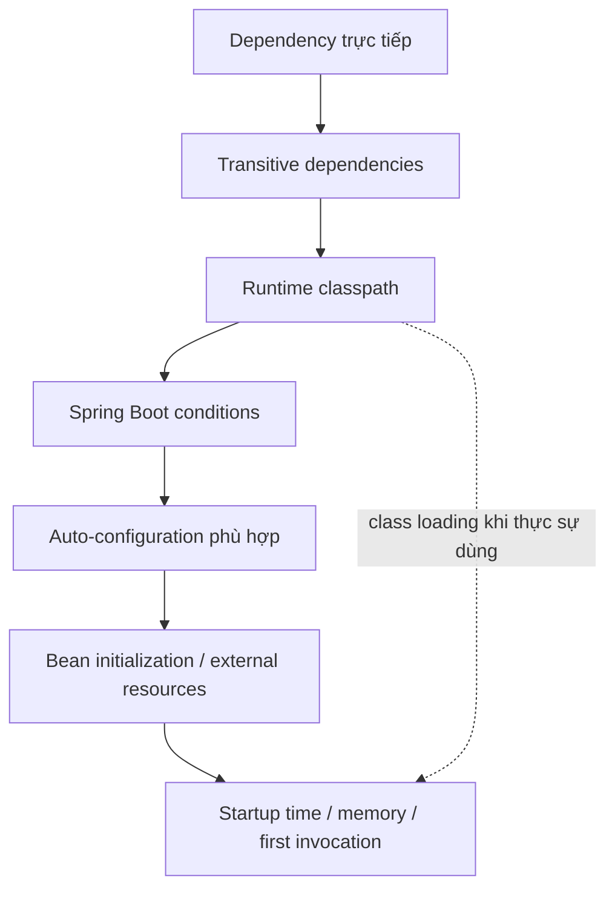
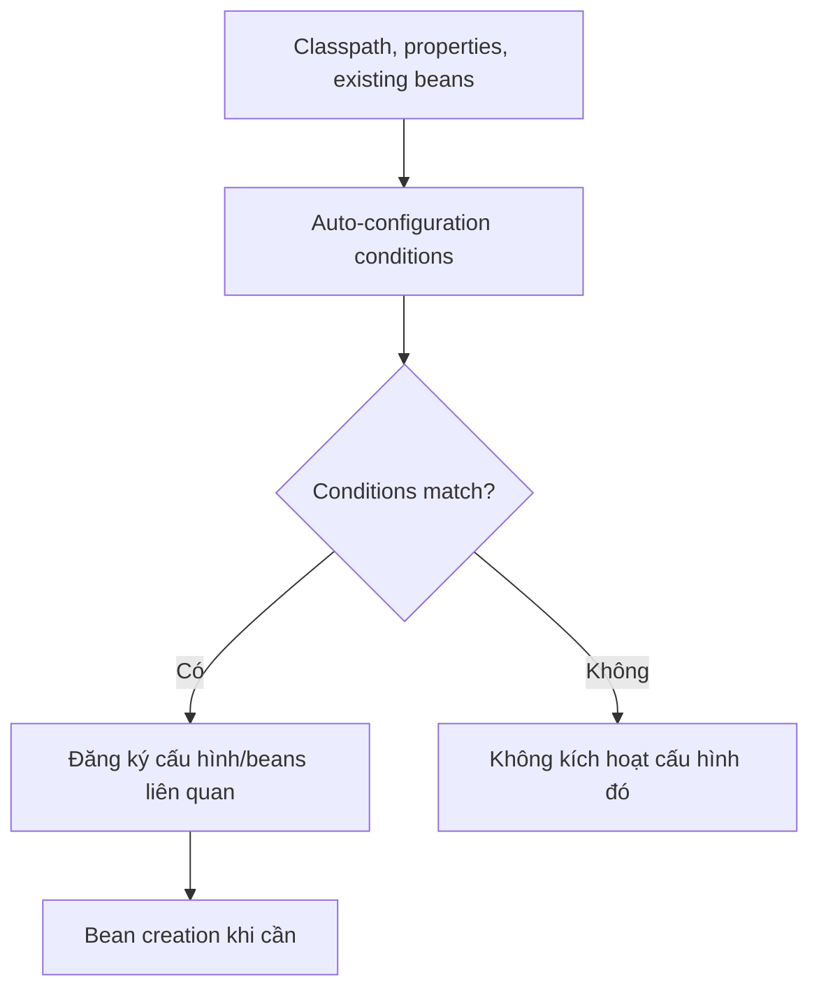

# Giảm phụ thuộc và tự cấu hình không cần thiết

**Spring Cloud Function** giúp tổ chức logic nghiệp vụ thành các bean `Supplier<T>`, `Function<I, O>` và `Consumer<T>`, đăng ký qua `FunctionCatalog`, hỗ trợ composition và đưa cùng một hàm đến HTTP, sự kiện hoặc môi trường serverless. Tính độc lập giao thức là ưu điểm lớn, nhưng nó cũng đặt ra câu hỏi về **chi phí khởi động và tài nguyên**: một hàm chỉ tính giá sản phẩm có thật sự cần cả web server, thư viện kết nối database, message broker, actuator, template engine và nhiều bộ chuyển đổi không sử dụng?

Trong chương **Hiệu năng**, bài này hướng dẫn **giảm phụ thuộc và tự cấu hình không cần thiết** mà không làm mất chức năng. Hai đòn bẩy chính là:

1. **Giảm dependency/runtime classpath**: chỉ đưa các thư viện và adapter thật sự cần để chạy function.
2. **Giảm những công việc Spring phải thực hiện lúc bootstrap**: xem xét auto-configuration, component scanning, bean initialization và các kết nối bên ngoài.

Không nên đánh đồng “ít dependency” với “chắc chắn khởi động nhanh hơn”. Spring Boot có các điều kiện tự cấu hình: một số dependency hiện diện nhưng không tạo bean nếu điều kiện không thỏa. Ngược lại, một cấu hình sai có thể kích hoạt khởi tạo tài nguyên nặng hoặc trì hoãn lỗi đến lần invocation đầu. **Đo trước, thay đổi có kiểm soát, rồi đo lại** là nguyên tắc xuyên suốt.

Sau bài học, bạn có thể:

- Xác định những dependency nào thật sự thuộc đường chạy HTTP, messaging hoặc serverless.
- Đọc Gradle/Maven dependency graph và truy ra dependency kéo theo (*transitive dependency*).
- Dùng conditions report của Spring Boot để biết auto-configuration nào được kích hoạt và tại sao.
- Phân biệt **loại dependency**, **loại auto-configuration**, **không khởi tạo bean** và **lazy initialization**.
- So sánh cách khai báo `@SpringBootApplication` thông thường với **functional bean definitions** của Spring Cloud Function.
- Đánh giá trade-off giữa thời gian sẵn sàng, lần gọi đầu, thời gian gọi đã warm, bộ nhớ và chức năng còn hoạt động.

## 1. Vì sao dependency ảnh hưởng hiệu năng?

Một dependency có thể mang theo các class và tài nguyên, kéo thêm thư viện khác, tham gia cơ chế phát hiện auto-configuration, đăng ký metadata hoặc làm xuất hiện các bean/integration mà ứng dụng không cần.



**Không phải mọi mũi tên đều nhất thiết xảy ra:** có jar trên classpath không có nghĩa Spring phải nạp mọi class hoặc tạo mọi bean của jar đó. Spring Boot thường điều kiện hóa auto-configuration bằng classpath, property, bean hiện có và loại ứng dụng web/non-web. Một dependency dư chỉ là **ứng viên** cần kiểm tra, không phải bằng chứng nó đang chiếm phần lớn startup time.

| Nguồn chi phí | Ví dụ | Dấu hiệu đo được |
| --- | --- | --- |
| Artifact/classpath lớn | Nhiều starter, SDK nặng, nhiều adapter | JAR/container lớn, nhiều thư viện runtime |
| Bean creation | Client HTTP, pool kết nối, converter, scheduler | Context refresh lâu, nhiều bean |
| Kết nối bên ngoài | Database, Kafka, schema registry, cloud metadata | Startup biến động do DNS/TLS/network |
| Scanning và reflective metadata | Component scanning quá rộng, cấu hình nhiều | Startup steps cho bean/configuration |
| Lazy work ở lần gọi đầu | Class load, cache, client handshake | Startup giảm nhưng first invocation tăng |
| Nội dung function | JSON parse, thuật toán, I/O, composition | Warm latency, CPU, allocation |

**Điểm mấu chốt:** giảm dependency và auto-configuration chủ yếu nhằm giảm **chi phí bootstrap, footprint và độ phức tạp**. Nó không tự làm một phép tính `Function.apply(...)` nhanh hơn nếu chi phí thực tế nằm trong thuật toán hay I/O của hàm.

## 2. Bắt đầu từ nhu cầu triển khai, không từ một tập starter mặc định

Một ứng dụng Spring Cloud Function cần định nghĩa rõ **nó được gọi bằng cách nào**. Không nên cài tất cả adapter “để tiện sau này” khi chỉ triển khai một đường.

| Cách chạy | Phần cần nghĩ đến | Các thành phần có thể không cần |
| --- | --- | --- |
| Gọi trong Java qua `FunctionCatalog` | Spring Cloud Function context và Spring context | Embedded web server, broker binder |
| HTTP endpoint | Web adapter và web runtime tương thích | Broker binder, serverless adapter |
| Consumer/producer sự kiện | Binder/integration phù hợp (ví dụ Kafka/Rabbit), converter | Embedded HTTP server nếu không dùng health/web |
| AWS Lambda hoặc platform serverless khác | Adapter đúng nền tảng và packaging phù hợp | HTTP server nhúng và binder không được sử dụng |
| Một ứng dụng nhiều giao thức thật sự | Nhiều adapter khi có yêu cầu | Phải chấp nhận chi phí và đo từng đường |

Đây là bảng **xác định phạm vi**, không phải danh sách dependency đầy đủ cho mọi phiên bản. Spring Cloud Function có các artifact như `spring-cloud-function-context`, `spring-cloud-function-web` và adapter serverless theo nền tảng. Spring Cloud Stream/binder lại là một lớp tích hợp riêng dành cho sự kiện.

### Tách lõi nghiệp vụ khỏi adapter

Một kiến trúc nên hướng tới:

```text
                       ┌─────────────────────┐
                       │ Logic Java thuần    │
                       │ Supplier / Function │
                       │ Consumer            │
                       └──────────┬──────────┘
                                  │
                          FunctionCatalog
                                  │
                 ┌────────────────┼────────────────┐
                 │                │                │
             HTTP adapter    Event binder   Serverless adapter
              (nếu cần)      (nếu cần)       (nếu cần)
```

Cùng một bean `Function<Request, Response>` có thể được sử dụng ở nhiều đường, nhưng **mỗi artifact triển khai không nhất thiết phải mang tất cả adapter**. Có thể xây các biến thể đóng gói khác nhau dùng chung module nghiệp vụ, nếu kiến trúc build hỗ trợ.

## 3. Ví dụ nghiệp vụ làm mốc tối ưu

Ví dụ Java 17+ đơn giản: một hàm tính tổng tiền và một hàm định dạng kết quả.

```java
package demo.perf;

import java.util.function.Function;

import org.springframework.context.annotation.Bean;
import org.springframework.context.annotation.Configuration;

@Configuration
public class PriceFunctions {

    public record PriceRequest(String sku, int quantity) {}

    public record PriceResult(String sku, long totalVnd) {}

    @Bean
    public Function<PriceRequest, PriceResult> calculatePrice() {
        return request -> {
            if (request == null ||
                request.sku() == null ||
                request.sku().isBlank() ||
                request.quantity() <= 0) {
                throw new IllegalArgumentException(
                    "Invalid price request"
                );
            }

            long total = Math.multiplyExact(
                request.quantity(), 50_000L
            );
            return new PriceResult(request.sku(), total);
        };
    }

    @Bean
    public Function<PriceResult, String> formatPrice() {
        return result -> result.sku() + ": " +
            result.totalVnd() + " VND";
    }
}
```

Chuỗi này có kiểu khớp:

```yaml
spring:
  cloud:
    function:
      definition: calculatePrice|formatPrice
```

```text
PriceRequest
   ↓ calculatePrice
PriceResult
   ↓ formatPrice
String
```

Bean Java không mở socket, kết nối database hoặc yêu cầu messaging broker. Nó chỉ xử lý hai DTO/giá trị. Nếu triển khai qua HTTP, **adapter** phải nhận JSON và trả biểu diễn output; nếu triển khai qua event, **binder** phải kết nối broker và ánh xạ message.

Mọi so sánh hiệu năng sau đây phải giữ nguyên logic và input, để chỉ thay đổi dependency/cấu hình chứ không thay đổi phép tính.

## 4. Lập “dependency budget” theo đường triển khai

Trước khi tối ưu, viết rõ một **danh sách tối thiểu được phép tồn tại** trong runtime:

| Nhóm | Câu hỏi quyết định | Ví dụ hướng xử lý |
| --- | --- | --- |
| Spring Cloud Function | Có cần `FunctionCatalog` không? | Giữ context/catalog cần thiết |
| Web | Có endpoint HTTP thật không? | Chỉ mang Web adapter/runtime nếu cần |
| Messaging | Có dùng broker nào? | Chỉ thêm đúng binder đang sử dụng |
| Data/JPA | Hàm có truy vấn database không? | Không dùng thì tránh cả starter và driver |
| Security | Có HTTP authentication/authorization hoặc policy khác? | Giữ tính năng bảo mật được yêu cầu |
| Actuator | Cần health/metrics/conditions ở runtime hay chỉ ở môi trường đo? | Cân nhắc variant cấu hình và quyền truy cập |
| Observability | Cần traces/metrics/log exporters nào? | Chỉ dùng exporter và registry thực sự vận hành |
| Cloud SDK | Có gọi API cloud nào? | Tránh import cả SDK tập hợp khi chỉ cần một service |
| JSON | Dùng JSON mapper nào? | Tránh nhiều mapper chỉ vì dependency gián tiếp, nhưng không loại tùy tiện |

**Không được loại các chức năng bắt buộc chỉ vì muốn giảm vài mili giây.** Readiness/health trong môi trường orchestration, security, tracing để đáp ứng SLO và cơ chế retry có thể quan trọng hơn lợi ích startup nhỏ.

### Hai khái niệm dễ nhầm

- **Direct dependency:** khai báo trực tiếp trong `build.gradle`/`pom.xml`.
- **Transitive dependency:** dependency được một thư viện khác kéo vào. Xóa một dòng direct chưa chắc đã loại artifact khỏi runtime vì nó vẫn có thể đi qua dependency khác.

Để loại dependency dư thực sự, phải kiểm tra **runtime dependency graph sau thay đổi**, không chỉ nhìn file build.

## 5. Phân tích dependency graph bằng Gradle hoặc Maven

Các lệnh sau là **hướng dẫn cho dự án học viên**, không phải lệnh đã chạy trong quá trình soạn bài.

Với Gradle:

```bash
./gradlew dependencies --configuration runtimeClasspath
./gradlew dependencyInsight \
  --dependency spring-boot-starter-web \
  --configuration runtimeClasspath
./gradlew dependencyInsight \
  --dependency spring-cloud-stream \
  --configuration runtimeClasspath
```

Với Maven:

```bash
mvn dependency:tree -Dscope=runtime
```

Trên Windows, dùng `gradlew.bat` thay `./gradlew` hoặc cú pháp phù hợp với shell. Một dependency cần cho compile/test chưa chắc là dependency có mặt ở runtime; nên ưu tiên cấu hình **runtimeClasspath** hoặc runtime scope tương ứng.

### Kết quả cần trả lời

1. Tại sao có thư viện web khi artifact chỉ là event consumer?
2. Ai kéo vào nhiều JSON library cùng lúc?
3. Có database driver/JPA migration tool trong một hàm không truy vấn dữ liệu không?
4. Có test/dev-only library lọt vào runtime artifact không?
5. Các adapter serverless, HTTP và binder có bị gộp vào một runtime mà không có nhu cầu không?
6. Các phiên bản trong graph có khớp dependency management của Spring Boot/Spring Cloud không?

### Phân biệt loại dependency với loại bean

| Thay đổi | Classpath thay đổi? | Auto-config có thể thay đổi? | Bean có thể thay đổi? |
| --- | --- | --- | --- |
| Xóa dependency không còn được dùng | Có | Có | Có |
| Exclude một transitive dependency | Có | Có | Có |
| Chỉ dùng `spring.autoconfigure.exclude` | Không | Có | Có |
| Chỉ dùng `spring.main.lazy-initialization` | Không | Không nhất thiết | Thời điểm tạo bean thay đổi |
| Chỉ chọn `spring.cloud.function.definition` | Không | Không mặc định | Thường chọn hàm expose/compose; không xóa bean khác |
| Đổi `web-application-type` | Không | Có thể | Loại application context và web features thay đổi |

**Loại dependency ở build** thường là biện pháp triệt để hơn việc giữ jar rồi tắt auto-configuration bằng property. Nhưng cần đảm bảo không có thành phần khác vẫn phụ thuộc các class đã loại.

## 6. Tạo biến thể build theo loại adapter

Một dự án có thể dùng một core module chứa DTO/function Java và nhiều module triển khai mỏng. Ví dụ sơ đồ module:

```text
order-functions-core
  └─ DTO, business logic, unit tests

order-http-app
  └─ FunctionCatalog + Web adapter + HTTP dependencies

order-event-app
  └─ FunctionCatalog + binder đang dùng

order-lambda-app
  └─ FunctionCatalog + đúng serverless adapter
```

Đây là một **gợi ý thiết kế**, không phải yêu cầu bắt buộc phải tách thành nhiều module. Nếu một ứng dụng thực sự phục vụ cả HTTP và event, việc chia tách có thể làm tăng vận hành; hãy cân nhắc mục tiêu.

### Dependency Gradle minh họa

Khi project đã sử dụng dependency management/BOM tương thích với Spring Cloud Function:

```kotlin
// build.gradle.kts - ví dụ minh họa phần dependencies
dependencies {
    implementation("org.springframework.cloud:spring-cloud-function-context")

    // Chỉ thêm vào artifact thực sự cần HTTP:
    // implementation("org.springframework.cloud:spring-cloud-function-web")

    // Chỉ thêm đúng binder/adapter sự kiện hoặc serverless
    // mà phiên bản Spring Cloud Function đang dùng hỗ trợ.
}
```

Ví dụ **không khai báo version trực tiếp** vì version phải được quản lý bằng BOM/release train tương thích với Spring Boot của project. Tự thêm một artifact đơn lẻ không chứng minh ứng dụng đã có đầy đủ Spring Boot bootstrap, Web runtime hoặc packaging cần thiết.

Khi cần loại một transitive dependency không phù hợp:

```kotlin
// Ví dụ khi một SDK tích hợp cũ kéo web starter ngoài ý muốn.
dependencies {
    implementation("com.example:legacy-integration-sdk") {
        exclude(
            group = "org.springframework.boot",
            module = "spring-boot-starter-web"
        )
    }
}
```

`com.example:legacy-integration-sdk` là **tên giả định để minh họa cú pháp**, không phải dependency cần cài. Chỉ thực hiện exclude nếu graph chứng minh artifact đó bị kéo vào, và test xác nhận SDK vẫn hoạt động; việc loại starter có thể làm thiếu những thành phần SDK thực sự cần.

### Kiểm tra artifact sau build

Sau khi build bản triển khai thực, xem:

- Kích thước JAR/layer/container image.
- Danh sách dependency trong `BOOT-INF/lib` (với executable JAR dạng phù hợp).
- Runtime classpath thực tế, không chỉ dependencies khai báo trực tiếp.
- Sự khác nhau giữa các biến thể HTTP, event và serverless.

JAR nhỏ hơn thường giúp phân phối/đọc image thuận lợi hơn, nhưng **không bảo đảm** startup nhanh hơn theo đúng tỷ lệ số byte đã giảm.

## 7. Spring Boot tự cấu hình theo điều kiện

Spring Boot **auto-configuration** cố gắng cấu hình các thành phần dựa trên jar có trong classpath, properties, bean có sẵn và môi trường. Chẳng hạn, có thư viện JDBC không tự động đồng nghĩa một DataSource sẽ được tạo thành công trong mọi cấu hình; điều kiện cụ thể quyết định hành vi.



**Vì sao không nên tắt bừa?**

Một cấu hình không được kích hoạt có thể chỉ xuất hiện trong metadata nhưng **không hề tạo bean**. Exclude nó có thể không làm startup cải thiện đáng kể. Ngược lại, tắt nhầm datasource, JSON converter, transaction management, web handler hoặc security auto-configuration có thể khiến hàm không chạy đúng hoặc endpoint không được bảo vệ.

Quy trình đúng là tìm **bằng chứng cấu hình nào thực sự matched/khởi tạo resource** trước khi vô hiệu hóa.

## 8. Đọc Conditions Evaluation Report

Spring Boot có **conditions report** để giải thích vì sao auto-configuration được áp dụng hoặc không. Với artifact Boot chạy theo cách thông thường:

```bash
java -jar app.jar --debug
```

Chế độ debug sẽ in báo cáo điều kiện và nhiều log khác ra console. Cần phân biệt:

- **Positive matches:** điều kiện của một cấu hình thỏa.
- **Negative matches:** cấu hình không được chọn do điều kiện thiếu.
- **Unconditional classes:** không cần các điều kiện kiểu đó.

**Positive match không đồng nghĩa cấu hình đó chính là bottleneck.** Cần đối chiếu với startup steps, số bean, network operations và số đo startup.

### Actuator conditions endpoint

Nếu ứng dụng có Actuator, endpoint `conditions` cung cấp thông tin về các điều kiện auto-configuration. Endpoint phải được **cho phép truy cập và expose** đúng cách; nó không luôn công khai mặc định:

```yaml
management:
  endpoints:
    web:
      exposure:
        include: health,info,conditions
```

Trong môi trường được cấp quyền, endpoint thường ở:

```text
/actuator/conditions
```

Đừng mở rộng endpoint diagnostics này ra Internet công cộng: nó có thể tiết lộ cấu trúc classpath/cấu hình nội bộ. Trên serverless hoặc ứng dụng không có web server, việc thêm cả Actuator Web chỉ để xem report có thể **tăng footprint** và làm sai phép đo đang muốn tối ưu. Khi đó dùng `--debug` hoặc instrumentation phát triển phù hợp.

### Tìm nguyên nhân thay vì chỉ nhìn danh sách bean

Một luồng điều tra nên là:

1. Chụp điều kiện của bản baseline, ghi những cấu hình được áp dụng.
2. Xác định resource nào có chi phí: database pool, broker client, scheduler, embedded server.
3. Đối chiếu graph dependency xem thư viện nào kích hoạt cấu hình đó.
4. Chỉ đề xuất loại dependency hoặc loại auto-configuration sau khi chứng minh tính năng không được dùng.
5. Chụp lại report và đo thời gian sau thay đổi để xác nhận nguyên nhân.

## 9. Tắt một auto-configuration cụ thể khi có bằng chứng

Spring Boot hỗ trợ hai cách chính:

- Exclude trong annotation `@SpringBootApplication` / `@EnableAutoConfiguration`.
- Property `spring.autoconfigure.exclude`.

Ví dụ **chỉ dành cho ứng dụng Spring Boot 3.x** khi DataSource/JDBC thực sự không cần thiết:

```yaml
spring:
  autoconfigure:
    exclude:
      - org.springframework.boot.autoconfigure.jdbc.DataSourceAutoConfiguration
```

Hoặc cùng ý tưởng ở Java Boot 3:

```java
import org.springframework.boot.autoconfigure.SpringBootApplication;
import org.springframework.boot.autoconfigure.jdbc.DataSourceAutoConfiguration;

@SpringBootApplication(
    exclude = DataSourceAutoConfiguration.class
)
public class Application {
}
```

**Không sao chép ví dụ này nguyên trạng giữa các major versions.** Spring Boot 4 di chuyển nhiều package/module auto-configuration, ví dụ tên DataSource auto-configuration được tài liệu Boot 4 đặt dưới `org.springframework.boot.jdbc.autoconfigure.DataSourceAutoConfiguration`. Chỉ exclude đúng tên class **thuộc phiên bản và classpath đang dùng**.

Với các dependency mới, lỗi “không cấu hình được DataSource” có thể là dấu hiệu ứng dụng không cần JDBC thật, nhưng cũng có thể là bug cấu hình kết nối. Không vô hiệu hóa DataSource khi nghiệp vụ hoặc migrations vẫn cần database.

### Loại auto-configuration không tương đương loại dependency

Nếu JAR database driver còn trong runtime, dùng `spring.autoconfigure.exclude` **không làm JAR nhỏ đi**. Nếu dependency thực sự không còn dùng, nên cân nhắc loại ở cấp build thay vì giữ mã và chỉ tắt bean.

Ngược lại, khi dependency còn cần cho một thư viện khác nhưng auto-config sai phạm vi, property exclude có thể hợp lý hơn việc xóa artifact.

## 10. Chọn web-application-type phù hợp

Spring Boot có thể khởi động ở các loại ứng dụng:

- **SERVLET** nếu ứng dụng sử dụng servlet web stack.
- **REACTIVE** với ứng dụng reactive web phù hợp.
- **NONE** khi không cần application context dạng web.

Đối với một event consumer hoặc handler chạy mà **không cần embedded HTTP server**, có thể cân nhắc:

```yaml
spring:
  main:
    web-application-type: none
```

Property này ảnh hưởng cách Spring Boot chọn application context và khởi tạo web runtime, nhưng **không xóa các thư viện web khỏi runtime classpath**. Muốn footprint nhỏ hơn thì vẫn phải xử lý dependency.

**Không đặt `none` cho ứng dụng đang cần Web adapter expose HTTP endpoint hoặc Actuator HTTP readiness** rồi kỳ vọng server vẫn hoạt động. Đối với serverless, hãy kiểm tra adapter cụ thể; một nền tảng có thể dùng handler không cần server nhúng, còn nền tảng khác có đường HTTP runtime riêng.

### Các cấu hình dễ nhầm

| Thiết lập | Nó làm gì? | Nó không làm gì? |
| --- | --- | --- |
| `spring.main.web-application-type=none` | Chọn non-web context | Không remove web jars |
| `server.port=0` | Để server chọn cổng ngẫu nhiên khi có server | Không tắt web stack |
| `spring.cloud.function.definition=calculatePrice` | Chọn function/chuỗi cho đường expose hoặc gọi | Không mặc định vô hiệu hóa tất cả bean khác |
| `spring.main.lazy-initialization=true` | Trì hoãn việc tạo bean đến lúc cần | Không loại dependencies và có thể làm first call chậm |

**Cần chọn đúng đòn bẩy cho đúng mục tiêu**: đừng dùng function definition như một cơ chế thu nhỏ classpath hoặc dùng random port như một cách loại web server.

## 11. Giảm component scanning và bean initialization không cần thiết

`@SpringBootApplication` thường kết hợp auto-configuration và component scanning theo package phù hợp. Nếu main class đặt tại package quá cao trong một codebase lớn, scanner có thể tìm thấy những configuration/component không liên quan tới function deployment.

Ví dụ bố cục dễ kiểm soát hơn:

```text
demo.price
  ├─ PriceApplication
  ├─ PriceFunctions
  └─ adapter-specific-config

demo.other-service
  └─ OtherServiceConfiguration
```

Đặt entrypoint trong package được quản lý rõ ràng giúp scanner không tự động quét toàn bộ các service khác. Chỉ mở rộng `scanBasePackages` hoặc `@Import` cho những phần thật sự cần.

**Lưu ý:** giảm scan quá mức có thể làm mất bean validation, `MessageConverter` custom hoặc dependency injection cần thiết. Chỉ có ít bean hơn không có nghĩa tính năng vẫn đúng; cần integration tests.

### Xem xét những bean có side effect lúc khởi động

Một số đoạn mã thường khiến startup chậm không phải vì bản thân Spring Cloud Function:

- Constructor hoặc `@PostConstruct` gọi API bên ngoài.
- `ApplicationRunner`/`CommandLineRunner` preload cache lớn.
- Connection pool thử kết nối khi chưa có downstream.
- Migrations chạy mỗi lần khởi động.
- Scheduler khởi chạy công việc nặng ngay khi context ready.

Hãy phân biệt **cấu hình thừa** và **công việc thật sự cần hoàn thành trước readiness**. Nếu giảm startup bằng cách trì hoãn migration quan trọng, ứng dụng có thể nhận request khi schema chưa sẵn sàng — lợi ích đo được nhưng vi phạm hợp đồng vận hành.

## 12. Functional bean definitions: một lựa chọn cho function nhỏ

Tài liệu Spring Cloud Function mô tả cách đăng ký bean kiểu **functional** cho ứng dụng phạm vi nhỏ muốn rút ngắn startup. Mẫu này tránh việc dùng toàn bộ annotation scanning và Boot auto-configuration thông thường.

### So sánh hai phong cách

**Phong cách truyền thống:**

```java
@SpringBootApplication
public class TraditionalPriceApp {

    @Bean
    public Function<String, String> uppercase() {
        return value -> value.toUpperCase(
            java.util.Locale.ROOT
        );
    }

    public static void main(String[] args) {
        SpringApplication.run(TraditionalPriceApp.class, args);
    }
}
```

Snippet minh họa trong class có imports `SpringBootApplication`, `Bean`, `SpringApplication` và `Function`. Nó dùng Boot auto-configuration theo thông lệ.

**Phong cách functional của Spring Cloud Function:**

```java
package demo.perf;

import java.util.Locale;
import java.util.function.Function;

import org.springframework.boot.SpringBootConfiguration;
import org.springframework.cloud.function.context.FunctionRegistration;
import org.springframework.cloud.function.context.FunctionalSpringApplication;
import org.springframework.cloud.function.context.catalog.FunctionTypeUtils;
import org.springframework.context.ApplicationContextInitializer;
import org.springframework.context.support.GenericApplicationContext;

@SpringBootConfiguration
public class MinimalFunctionApplication implements
        ApplicationContextInitializer<GenericApplicationContext> {

    public static void main(String[] args) {
        FunctionalSpringApplication.run(
            MinimalFunctionApplication.class, args
        );
    }

    @Override
    public void initialize(GenericApplicationContext context) {
        Function<String, String> uppercase =
            input -> input.toUpperCase(Locale.ROOT);

        context.registerBean(
            "uppercase",
            FunctionRegistration.class,
            () -> new FunctionRegistration<>(uppercase)
                .type(FunctionTypeUtils.functionType(
                    String.class, String.class
                ))
        );
    }
}
```

Những điểm quan trọng:

1. `@SpringBootConfiguration` **không tự bật toàn bộ Boot auto-configuration** như `@SpringBootApplication`.
2. `FunctionalSpringApplication` là API do Spring Cloud Function cung cấp cho mô hình này.
3. `ApplicationContextInitializer<GenericApplicationContext>` đăng ký function trực tiếp, không cần tìm bean qua component scanning rộng.
4. `FunctionRegistration.type(...)` cung cấp metadata kiểu input/output của lambda. Nếu chỉ đăng ký raw `Function.class`, framework có thể không suy ra được `String → String`.
5. Cách này phù hợp với function nhỏ, nhưng **không mặc nhiên cấu hình mọi tích hợp Boot/adapter bên ngoài**.

Theo tài liệu SCF, nếu cần datasource hay tự cấu hình Boot phong phú, có thể dùng khai báo kiểu `@Bean` hoặc **hybrid mode**. Tối ưu không phải lúc nào cũng đồng nghĩa functional mode thuần.

### Hybrid: khi vẫn cần auto-configuration

Tài liệu Spring Cloud Function mô tả khả năng kết hợp functional bean registration với Boot auto-configuration; khi đi theo hướng đó, cần sử dụng `@EnableAutoConfiguration` thích hợp và cấu hình:

```properties
spring.functional.enabled=false
```

Điều này **tắt “full functional mode”** để Boot có thể điều khiển auto-configuration. Vì vậy, không nên kỳ vọng hybrid giữ nguyên mọi lợi ích startup của functional mode thuần. Hãy chọn dựa trên nhu cầu tích hợp và kiểm thử theo phiên bản SCF đang dùng.

## 13. Chọn function definition không xóa bean khác

Spring Cloud Function hỗ trợ property:

```yaml
spring:
  cloud:
    function:
      definition: calculatePrice|formatPrice
```

Property này chọn tên function hoặc composition để expose/invoke trong ngữ cảnh thích hợp. Nó **không phải lệnh tối ưu hóa tự động loại toàn bộ các beans không thuộc chuỗi**.

Nếu ứng dụng vẫn quét một package chứa nhiều component, tự cấu hình datasource hoặc tạo broker client, những thành phần đó có thể vẫn được khởi tạo ngay cả khi `spring.cloud.function.definition` chỉ có `calculatePrice`.

Khi giảm startup, hãy kiểm tra **số bean thực được tạo**, dependencies và conditions report; không dựa vào việc chỉ một function xuất hiện qua endpoint.

## 14. Lazy initialization: dễ cải thiện startup nhưng chuyển chi phí sang lần gọi đầu

Spring Boot hỗ trợ:

```yaml
spring:
  main:
    lazy-initialization: true
```

Khi lazy initialization bật, nhiều bean được tạo **khi thực sự cần** thay vì lúc ứng dụng khởi động. Điều này có thể giảm thời gian đến readiness trong một số trường hợp.

Nhưng có trade-off:

- **First invocation** chậm hơn vì phải tạo bean, nạp class hoặc thiết lập kết nối.
- Lỗi cấu hình có thể chỉ xuất hiện ở request đầu thay vì startup.
- Bộ nhớ sau khi ứng dụng chạy đủ tải có thể gần bằng hoặc lớn hơn lúc eager init; không nên dùng lazy như một cách cam kết giảm RAM bền vững.
- Với serverless, nhiều cold invocation có thể chịu chi phí đó.

### Ví dụ đánh đổi

| Metric giả định | Baseline | Sau lazy init | Kết luận |
| --- | ---: | ---: | --- |
| Main-to-ready p50 | 1.300 ms | 850 ms | Startup được rút ngắn |
| First invocation p50 | 20 ms | 180 ms | Công việc chuyển sang lần gọi đầu |
| Warm p95 | 12 ms | 12 ms | Không thấy cải thiện warm path |
| Peak heap khi đã xử lý tải | 220 MiB | 220 MiB | Không chứng minh đã tiết kiệm heap |

Số liệu **giả định để học cách diễn giải**, không phải benchmark của Spring Cloud Function. Một thay đổi chỉ thực sự hữu ích nếu cải thiện **mục tiêu vận hành**: chẳng hạn giảm cold-start latency tổng thể, không chỉ rút ngắn log “Started application”.

## 15. Đo baseline trước khi thay đổi

Tối thiểu cần đo:

| Nhóm | Metric nên giữ | Vì sao? |
| --- | --- | --- |
| Artifact | JAR/image size, runtime dependency count | Biết footprint thực |
| Startup | Process-to-ready, main-to-ready, beans initialized | Biết bootstrap tốn bao lâu |
| First use | First catalog lookup, first function invocation | Phát hiện chi phí bị dời sang runtime |
| Warm | p50/p95/p99 của function và adapter | Bảo đảm không làm hỏng steady state |
| Resource | RSS/heap, allocation, GC, CPU | Biết chi phí bộ nhớ/tài nguyên |
| Reliability | Error rate, readiness, health, retry | Tránh đánh đổi hiệu năng lấy lỗi |

### Ví dụ đo main-to-ready

```java
import java.util.concurrent.TimeUnit;

import org.springframework.boot.SpringApplication;
import org.springframework.boot.context.event.ApplicationReadyEvent;
import org.springframework.context.ApplicationListener;

public static void main(String[] args) {
    long start = System.nanoTime();
    SpringApplication app = new SpringApplication(PriceApplication.class);

    app.addListeners(
        (ApplicationListener<ApplicationReadyEvent>) event -> {
            long elapsed = System.nanoTime() - start;
            System.out.println(
                "main_to_ready_ms=" +
                TimeUnit.NANOSECONDS.toMillis(elapsed)
            );
        }
    );

    app.run(args);
}
```

Đoạn này là **phần method `main` mẫu** nằm trong một class Boot có `PriceApplication` tương ứng, không phải một source file biên dịch độc lập. Nếu dùng `FunctionalSpringApplication` ở mục 12 thì cần điều chỉnh cách khởi động/tạo listener phù hợp. Mốc này chỉ đo từ dòng đầu main đến `ApplicationReadyEvent`, **không bao gồm phần tạo process/JVM trước main**.

Nên đo thêm process-to-ready **từ bộ điều khiển bên ngoài**, với readiness probe và polling interval cố định, để đánh giá tổng startup của artifact.

### ApplicationStartup và Actuator startup

Spring Boot cung cấp `ApplicationStartup` và endpoint startup khi được cấu hình thích hợp. Ví dụ thiết lập ứng dụng để ghi startup steps:

```java
import org.springframework.boot.SpringApplication;
import org.springframework.boot.context.metrics.buffering.BufferingApplicationStartup;

SpringApplication app = new SpringApplication(PriceApplication.class);
app.setApplicationStartup(new BufferingApplicationStartup(2048));
app.run(args);
```

Đoạn này cũng là **snippet trong method khởi động**, cần phiên bản Spring Boot hỗ trợ. Endpoint `/actuator/startup` chỉ hoạt động nếu Actuator, startup buffering và chính sách exposure phù hợp; đừng thêm dependency instrumentation vào bản optimized production chỉ vì muốn thu một báo cáo tạm thời mà không đo overhead.

## 16. Thí nghiệm A/B: thay một yếu tố mỗi lần

Một kế hoạch có thể theo thứ tự:

1. **Baseline:** đo runtime graph, jar size, startup, first call, warm latency và bean/conditions report.
2. **Loại starter không cần:** giữ nguyên logic và adapter cần thiết; đo lại.
3. **Tắt auto-configuration có chứng cứ:** chỉ một class/group mỗi lượt; đo lại.
4. **Giảm scanning/side effects:** sửa phạm vi scan hoặc bean init có lý do; đo lại.
5. **Thử functional mode hoặc lazy initialization:** làm trên một biến thể riêng và đo first call.
6. **Chạy regression tests:** HTTP/event/serverless, JSON conversion, security, readiness, metrics.
7. **Chỉ giữ thay đổi có lợi:** xem giá trị p50/p95, phương sai, lỗi và footprint, không chỉ một lần chạy.

### Bảng kết quả giả định

| Thử nghiệm | Runtime JAR | Main-to-ready p50 | First invocation p50 | Warm p95 |
| --- | ---: | ---: | ---: | ---: |
| Baseline nhiều adapter | 74 MiB | 1.420 ms | 18 ms | 12 ms |
| Loại binder không dùng | 60 MiB | 1.180 ms | 17 ms | 12 ms |
| Loại web stack ở event-only | 49 MiB | 900 ms | 16 ms | 12 ms |
| Bật lazy init toàn cục | 49 MiB | 700 ms | 160 ms | 12 ms |

**Toàn bộ số liệu trên chỉ là ví dụ minh họa**, không phải kết quả đo Spring Cloud Function. Chúng cho thấy lý do cần báo cáo **startup và first invocation riêng**. Một ứng dụng dùng để xử lý event theo lô có thể đánh giá khác với API serverless bị cold-start thường xuyên.

## 17. Kiểm thử chức năng sau khi cắt dependency

Cắt dependency quá mạnh có thể khiến ứng dụng khởi động thành công nhưng chức năng biên bị thiếu. Hãy kiểm tra:

| Chức năng | Điều cần xác minh sau thay đổi |
| --- | --- |
| Catalog | `FunctionCatalog.lookup("calculatePrice")` tìm được hàm |
| Composition | `calculatePrice|formatPrice` chạy đúng kiểu và thứ tự |
| JSON converter | HTTP/event JSON thành đúng DTO, không thành raw Map/Object |
| HTTP | Endpoint thực có thể gọi, đúng response/content type |
| Event | Binder kết nối được và consumer xử lý, ack/retry đúng |
| Serverless | Handler khởi tạo và ánh xạ event envelope đúng |
| Security | Authentication/authorization/filter bắt buộc vẫn hoạt động |
| Health/readiness | Probe đúng trong môi trường deploy |
| Observability | Metrics/tracing cần thiết vẫn được tạo và gửi |
| Startup/first use | Không gây exception bị trì hoãn tới request đầu |

### Test logic và catalog

```java
import static org.junit.jupiter.api.Assertions.assertEquals;

import java.util.function.Function;

import org.junit.jupiter.api.Test;
import org.springframework.beans.factory.annotation.Autowired;
import org.springframework.cloud.function.context.FunctionCatalog;

// Đặt trong lớp Spring Test có cấu hình đúng application context.
@Autowired
FunctionCatalog catalog;

@Test
void catalogAndCompositionStillWork() {
    Function<PriceFunctions.PriceRequest, String> pipeline =
        catalog.lookup("calculatePrice|formatPrice");

    String result = pipeline.apply(
        new PriceFunctions.PriceRequest("BOOK-1", 2)
    );

    assertEquals("BOOK-1: 100000 VND", result);
}
```

Mẫu này xác nhận catalog/composition với DTO Java tạo sẵn. **Nó không chứng minh JSON converter hoặc HTTP adapter vẫn tồn tại**. Nếu artifact cần HTTP, phải có integration test gửi JSON qua endpoint; nếu cần event, phải có test binder và payload/header thực tế.

### Một ví dụ HTTP khi Web adapter được giữ lại

```bash
curl -X POST http://localhost:8080/calculatePrice \
  -H 'Content-Type: application/json' \
  -d '{"sku":"BOOK-1","quantity":2}'
```

Lệnh này chỉ phù hợp nếu ứng dụng đang expose function ở HTTP. Với artifact event-only đã chuyển sang `web-application-type=none`, **không kỳ vọng endpoint còn hoạt động**: đó có thể là hành vi đúng theo thiết kế mới, miễn là yêu cầu triển khai không cần HTTP.

## 18. Đừng đánh đổi tính đúng đắn hoặc khả năng quan sát chỉ để giảm startup

Một số tối ưu nhìn trên biểu đồ rất đẹp nhưng có rủi ro:

**Vô hiệu hóa security auto-configuration** có thể làm endpoint không được bảo vệ. Nếu Spring Security đang là một phần yêu cầu, không được cắt chỉ để giảm số bean. Chọn cách cấu hình phù hợp hoặc tối ưu ở nơi khác.

**Loại Actuator hoàn toàn** có thể làm mất readiness/liveness probe hoặc metrics cần cho autoscaling. Nếu các chức năng này là hợp đồng vận hành, nên giữ và chỉ giảm endpoint/exporter không cần thiết, đồng thời hạn chế truy cập endpoints diagnostics.

**Tắt database/broker config** trong khi function phụ thuộc vào dữ liệu bên ngoài có thể làm lỗi chỉ xuất hiện khi invocation đầu chạy.

**Bật lazy init trên production** có thể giảm mốc ready nhưng làm lỗi cấu hình đến muộn, ảnh hưởng SLO của request đầu.

**Chuyển sang functional mode thuần** có thể loại auto-configuration mà một adapter hoặc client cần. Khi ứng dụng cần integration phức tạp, hybrid/traditional style có thể phù hợp hơn.

**Loại JSON mapper/converter** có thể làm `Function<PriceRequest, PriceResult>` nhận input sai kiểu hoặc thất bại khi HTTP/event deserialize JSON. Đừng cho rằng các bean function Java không dùng Jackson trực tiếp nghĩa là adapter cũng không cần JSON.

## 19. Bảng chẩn đoán khi tối ưu không có kết quả

| Triệu chứng | Nguyên nhân khả dĩ | Cách kiểm tra |
| --- | --- | --- |
| JAR nhỏ hơn nhưng startup không đổi | Auto-config đã không match hoặc bottleneck ngoài classpath | Conditions report, startup steps, external I/O |
| Startup giảm, first call chậm mạnh | Lazy init hoặc cache warm-up dời thời điểm | Đo first invocation riêng |
| Chỉ một function được expose nhưng vẫn nhiều bean | `definition` không xóa bean khác | Kiểm tra beans và component scan |
| Non-web vẫn có thư viện servlet | Chỉ đổi property, chưa loại dependency | Xem runtimeClasspath/BOOT-INF/lib |
| HTTP endpoint biến mất | Tắt web context hoặc loại Web adapter | Kiểm tra đường triển khai yêu cầu |
| Event không xử lý sau khi cắt dependencies | Binder/serializer/header converter thiếu | Test event end-to-end |
| Bean injection lỗi sau khi dùng functional mode | Cần auto-configuration/scan không được kích hoạt | Kiểm tra functional/hybrid config |
| FunctionCatalog không tìm ra lambda | Thiếu `FunctionRegistration` hoặc type metadata | Kiểm tra tên registration, generic và lookup |
| JSON input thành Map thay vì DTO | Converter/generic thiếu hoặc dependency JSON bị loại | Kiểm tra mapper và target type |
| Startup biến động lớn giữa các lần | Network, migrations, CPU contention, cache | Lặp phép đo trong cùng môi trường |
| Actuator conditions không truy cập được | Endpoint chưa expose/không có web/không đủ quyền | Xem config và policy bảo mật |
| Metrics backend bị thiếu số liệu | Đã loại registry/exporter không nên loại | Contract test observability |

### Thứ tự kiểm tra để tránh chỉnh cấu hình mù quáng

1. Xác định **tính năng thật sự cần** trong artifact đang deploy.
2. Phân tích **runtime dependency graph** và tìm nơi dependency được kéo vào.
3. Xem **conditions report** để biết auto-config nào match, và các startup steps để tìm công việc tốn thời gian.
4. Loại dependency/cấu hình cụ thể, **mỗi lần chỉ đổi một yếu tố chính**.
5. Đo **process-to-ready, main-to-ready, first invocation, warm latency và footprint**.
6. Chạy regression tests cho function, adapter, security và health.
7. Giữ thay đổi chỉ khi **lợi ích được xác nhận và chức năng không suy giảm**.

## 20. Bài tập thực hành

**Bài 1 — Cắt sai lớp.** Một artifact chỉ dùng event binder, không cung cấp HTTP endpoint, nhưng đang khai `spring-boot-starter-web` và `spring-cloud-function-web`. Bạn nên kiểm tra gì đầu tiên?

*Đáp án:* Kiểm tra runtime dependency graph và yêu cầu health/readiness/metrics có cần HTTP không. Nếu thật sự event-only, cân nhắc loại Web adapter/starter, kiểm tra binder vẫn chạy rồi đo startup, footprint và event processing.

**Bài 2 — Vì sao điều kiện quan trọng?** Có một JAR trên classpath nhưng conditions report cho thấy auto-configuration tương ứng không được kích hoạt. Exclude class đó có chắc làm startup nhanh hơn không?

*Đáp án:* Không. Cấu hình đã không match nên có thể không tạo bean; muốn kết luận phải đo và tìm bottleneck thực tế.

**Bài 3 — Chọn công cụ.** Muốn biết thư viện nào kéo vào `spring-boot-starter-web` trên Gradle, dùng gì?

*Đáp án:* `./gradlew dependencyInsight --dependency spring-boot-starter-web --configuration runtimeClasspath`, kết hợp `dependencies --configuration runtimeClasspath`.

**Bài 4 — Tắt web khác loại dependency.** Vì sao `spring.main.web-application-type=none` không đồng nghĩa đã loại web jars khỏi artifact?

*Đáp án:* Property chỉ chọn non-web application context/đường bootstrap; dependency graph và JAR vẫn có thể chứa web libraries.

**Bài 5 — Chọn function definition.** Đặt `spring.cloud.function.definition=calculatePrice` có làm Spring không tạo các bean JPA/broker không liên quan không?

*Đáp án:* Không mặc định. Definition chọn function/chuỗi cần expose/invoke, không phải cơ chế tắt auto-configuration và component scanning.

**Bài 6 — Functional style.** Vì sao cần `FunctionRegistration.type(...)` khi đăng ký lambda trong `GenericApplicationContext`?

*Đáp án:* Lambda/raw factory có thể không giữ đủ generic input/output ở runtime; type metadata giúp catalog/converter biết đúng kiểu đích.

**Bài 7 — Lazy initialization.** Main-to-ready giảm từ 1.400 xuống 900 ms nhưng first invocation tăng từ 15 lên 220 ms. Đã có thể gọi đây là thành công chưa?

*Đáp án:* Chưa. Phải xem SLO, tỷ lệ cold requests, thời gian end-to-end và liệu lỗi cấu hình bị dời sang lần gọi đầu hay không.

**Bài 8 — Auto-config theo phiên bản.** Vì sao không nên sao chép nguyên một class name để exclude từ Boot 3 sang Boot 4?

*Đáp án:* Package/module auto-configuration có thể đổi giữa major versions. Cần kiểm tra conditions report và tên chính xác của bản đang chạy.

**Bài 9 — Kiểm thử sau tối ưu.** Unit test gọi thẳng `new PriceFunctions().calculatePrice().apply(...)` pass. Có đủ kết luận Web adapter còn chuyển JSON thành DTO đúng không?

*Đáp án:* Không. Test Java bỏ qua JSON converter và HTTP runtime; cần integration test gửi request JSON qua endpoint thật.

**Bài 10 — Mục tiêu tối ưu.** Sau khi loại một SDK cloud lớn, JAR giảm 20 MiB nhưng p95 startup và warm latency không thay đổi, trong khi việc deploy image nhanh hơn. Kết quả có giá trị không?

*Đáp án:* Có thể có: giảm footprint có thể giúp phân phối/deploy dù không cải thiện startup hoặc warm latency. Báo cáo đúng metric đã cải thiện, không tuyên bố function execution nhanh hơn khi chưa có bằng chứng.

## 21. Ghi nhớ

- **Loại dependency thừa ở runtime là bước ưu tiên đầu tiên** khi giảm footprint và những thành phần có thể kích hoạt auto-configuration.
- **Spring Boot auto-configuration là có điều kiện**: hiện diện một JAR không đồng nghĩa mọi bean của nó được tạo; dùng conditions report và startup steps để xác minh.
- **`spring.autoconfigure.exclude` tắt cấu hình, không giảm classpath**. Chỉ exclude đúng auto-configuration của phiên bản đang chạy và khi tính năng không cần.
- **`spring.main.web-application-type=none` chọn non-web context**, không xóa thư viện web; đừng áp dụng cho ứng dụng thực sự cần HTTP.
- **`spring.cloud.function.definition` chọn hàm/chuỗi**, không tự dọn mọi bean không sử dụng.
- **Functional bean definitions** của Spring Cloud Function phù hợp một số ứng dụng nhỏ; chúng cần metadata `FunctionRegistration` và có giới hạn khi tích hợp Boot auto-configuration.
- **Lazy init có thể dời chi phí sang first invocation**, nên luôn đo cả startup, first call và warm execution.
- **Đừng cắt security, health, converter hoặc broker support đang cần** chỉ vì muốn giảm số bean; kiểm thử nghiệp vụ và adapter thật.
- **Mỗi thay đổi phải được so sánh có kiểm soát**, báo footprint, process-to-ready/main-to-ready, p50/p95, lỗi và tài nguyên.

**Tài liệu tham khảo chính thức:**

- [Spring Cloud Function — Functional Bean Definitions](https://docs.spring.io/spring-cloud-function/reference/5.0/functional.html)
- [Spring Cloud Function Reference](https://docs.spring.io/spring-cloud-function/reference/)
- [Spring Boot — Auto-configuration](https://docs.spring.io/spring-boot/reference/using/auto-configuration.html)
- [Spring Boot — SpringApplication và Lazy Initialization](https://docs.spring.io/spring-boot/reference/features/spring-application.html)
- [Spring Boot Actuator — Endpoints, Conditions và Startup](https://docs.spring.io/spring-boot/reference/actuator/endpoints.html)
- [Gradle — Viewing Dependencies](https://docs.gradle.org/current/userguide/viewing_debugging_dependencies.html)
- [Apache Maven Dependency Plugin — dependency:tree](https://maven.apache.org/plugins/maven-dependency-plugin/tree-mojo.html)

Bài này trình bày nguyên tắc và các ví dụ học tập; khi triển khai thực tế, hãy dùng **Spring Cloud Function, Spring Boot và Spring Cloud release train tương thích**, xác nhận tên class/property theo đúng major version và chỉ giữ các tối ưu đã được phép đo chứng minh.
