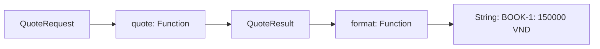

# Lựa chọn đăng ký bean truyền thống hoặc functional

Trong **Spring Cloud Function**, logic nghiệp vụ được biểu diễn bằng `Supplier<T>`, `Function<I, O>` và `Consumer<T>`. Framework đưa các hàm vào `FunctionCatalog` để có thể tra cứu theo tên, composition và sử dụng cùng một logic qua HTTP, sự kiện hoặc môi trường serverless. Nhưng **cách đăng ký những hàm đó vào Spring context** ảnh hưởng đến việc Spring phải làm gì lúc khởi động, cách suy luận kiểu generic, và mức độ tích hợp với hệ sinh thái Spring Boot.

Có hai cách chính:

- **Truyền thống (traditional):** dùng `@SpringBootApplication`, `@Configuration` và `@Bean` để Spring tự khám phá bean, kết hợp Boot auto-configuration và dependency injection.
- **Functional bean definitions:** dùng `FunctionalSpringApplication`, `ApplicationContextInitializer<GenericApplicationContext>` và `context.registerBean(...)` để đăng ký rõ ràng các hàm, thường kèm `FunctionRegistration` chứa metadata kiểu.

Hai cách không phải hai ngôn ngữ lập trình khác nhau; **phần logic Java `Function.apply(...)` có thể hoàn toàn giống nhau**. Khác biệt nằm ở **bootstrap, metadata và khả năng tích hợp**. Lựa chọn nào có lợi hơn về hiệu năng phải được đo trên chính ứng dụng và adapter triển khai.

Bài thuộc chương **Hiệu năng**. Sau bài này, bạn có thể:

1. So sánh traditional, functional và hybrid theo startup, auto-configuration, khả năng mở rộng và độ phức tạp.
2. Tạo hai entrypoint tương đương cho cùng một `Function<Request, Response>`.
3. Giải thích vì sao functional registration cần giữ metadata input/output thay vì chỉ đăng ký lambda bằng raw `Function.class`.
4. Tìm đúng hàm qua `FunctionCatalog`, ghép composition và kiểm thử dữ liệu đầu vào từ adapter.
5. Chọn cách đăng ký dựa vào workload HTTP, broker, serverless, database và yêu cầu vận hành thực.
6. Đo **main-to-ready/process-to-ready**, **first invocation** và **warm execution** riêng trước khi kết luận “functional nhanh hơn”.

## 1. Cùng một hàm, hai cách đưa vào Spring context

Giả sử một dịch vụ tính tiền có chức năng:

```text
QuoteRequest(sku="BOOK-1", quantity=3)
                   ↓
             quote : Function
                   ↓
QuoteResult(sku="BOOK-1", totalVnd=150000)
```

Điểm xuất phát nên là **hợp đồng Java rõ ràng**:

```java
Function<QuoteRequest, QuoteResult>
```

Nếu người học chỉ nhìn code thực thi nghiệp vụ, traditional và functional có thể cho cùng kết quả. Tuy nhiên:

| Câu hỏi | Traditional `@Bean` | Functional bean definitions |
| --- | --- | --- |
| Ai tạo bean? | Spring xử lý configuration/method `@Bean` | Code gọi `GenericApplicationContext.registerBean(...)` |
| Entry point tiêu biểu | `@SpringBootApplication` + `SpringApplication.run(...)` | `@SpringBootConfiguration` + `FunctionalSpringApplication.run(...)` |
| Spring Boot auto-config mặc định? | Có khi dùng `@SpringBootApplication` | Full functional mode tránh bật toàn bộ Boot auto-config theo cách thông thường |
| Metadata generic lấy từ đâu? | Chữ ký method `@Bean` có thể được framework phản chiếu | Thường cần `FunctionRegistration.type(...)` hoặc class triển khai generic cụ thể |
| Có dùng `FunctionCatalog` không? | Có | Có |
| Có thể compose `quote|format` không? | Có, khi các function đã đăng ký và kiểu khớp | Có, với metadata đúng và function đăng ký đầy đủ |
| Tích hợp datasource, web, security, metrics? | Thuận tiện nhờ auto-config/scan | Có thể cần đăng ký/cấu hình tường minh hoặc hybrid |
| Chi phí bootstrap | Có thể cao hơn khi ứng dụng lớn/nhiều cấu hình | Có cơ hội nhỏ hơn với function rất gọn |
| Rủi ro chính | Context có nhiều cấu hình/bean thừa | Thiếu bean/auto-config/type metadata cần thiết |

**Không kết luận truyền thống luôn chậm** hay functional luôn tốt. Đối với một dịch vụ chạy lâu có database, nhiều integrations và health/metrics, chi phí functional setup có thể không đáng; đối với một hàm serverless nhỏ, giảm bootstrap có thể có lợi đáng kể. Quyết định cần dựa trên phép đo và yêu cầu chức năng.

### Vai trò của FunctionCatalog không đổi

Cho dù đăng ký bằng cách nào, mục tiêu là đưa hàm vào catalog:

```mermaid
flowchart TD
    A["Traditional: @Bean Function<I,O>"]
    B["Functional: FunctionRegistration + type"]
    C[Spring ApplicationContext]
    D[FunctionCatalog]
    E[lookup quote hoặc quote|format]
    F[HTTP / Messaging / Serverless adapter]
    A --> C
    B --> C
    C --> D --> E --> F
```

Sơ đồ nói về **mô hình khái niệm**. Adapter, wrapper và thời điểm lookup có thể khác theo phiên bản. Mục tiêu không phải tạo thêm lớp trừu tượng nghiệp vụ, mà làm rõ con đường Spring Cloud Function tìm đến function.

## 2. Tách code nghiệp vụ khỏi cách đăng ký

Ta dùng Java 17 trở lên để có `record`. Ba lớp sau **độc lập với Spring**, dùng chung cho cả hai entrypoint:

```java
// File: demo/perf/QuoteRequest.java
package demo.perf;

public record QuoteRequest(String sku, int quantity) {}
```

```java
// File: demo/perf/QuoteResult.java
package demo.perf;

public record QuoteResult(
    String sku,
    int quantity,
    long totalVnd
) {}
```

```java
// File: demo/perf/QuoteLogic.java
package demo.perf;

import java.util.Locale;

public final class QuoteLogic {

    private QuoteLogic() {}

    public static QuoteResult calculate(QuoteRequest request) {
        if (request == null ||
            request.sku() == null ||
            !request.sku().matches("[A-Z0-9-]{1,24}") ||
            request.quantity() <= 0) {
            throw new IllegalArgumentException(
                "Invalid sku or quantity"
            );
        }

        long total = Math.multiplyExact(
            request.quantity(), 50_000L
        );
        return new QuoteResult(
            request.sku(),
            request.quantity(),
            total
        );
    }

    public static String format(QuoteResult result) {
        return result.sku() + ": " +
            String.format(Locale.ROOT, "%d VND", result.totalVnd());
    }
}
```

Ví dụ:

```text
Input:  {"sku":"BOOK-1","quantity":3}
Output: {"sku":"BOOK-1","quantity":3,"totalVnd":150000}

Sau format:
BOOK-1: 150000 VND
```

Logic không import Spring, Jackson, Gson, HTTP hay binder. Vì vậy:

- Cùng một `QuoteLogic.calculate(...)` có thể được gọi trực tiếp trong unit test.
- Hai cách đăng ký đều có thể dùng method reference `QuoteLogic::calculate`.
- Nếu kết quả hiệu năng khác, ta có cơ hội phân tích **phần bootstrap/wrapper/adapter**, thay vì thay đổi thuật toán nghiệp vụ cùng lúc.

**Lưu ý về tính đồng thời:** các function bean thường được dùng lại giữa nhiều invocation. Logic không giữ trạng thái mutable per-request trong field singleton thì dễ an toàn hơn. Functional registration không tự biến một lambda có mutable state thành thread-safe.

## 3. Phương án truyền thống: @SpringBootApplication + @Bean

Một ứng dụng Spring Cloud Function đơn giản có thể dùng:

```java
package demo.perf;

import java.util.function.Function;

import org.springframework.boot.SpringApplication;
import org.springframework.boot.autoconfigure.SpringBootApplication;
import org.springframework.context.annotation.Bean;

@SpringBootApplication
public class TraditionalQuoteApplication {

    public static void main(String[] args) {
        SpringApplication.run(
            TraditionalQuoteApplication.class, args
        );
    }

    @Bean("quote")
    public Function<QuoteRequest, QuoteResult> quote() {
        return QuoteLogic::calculate;
    }

    @Bean("format")
    public Function<QuoteResult, String> format() {
        return QuoteLogic::format;
    }
}
```

Điểm đáng chú ý:

1. `@SpringBootApplication` bao gồm khai báo cấu hình, cơ chế auto-configuration và component scanning thông thường của Spring Boot.
2. Các method `@Bean` công bố đầy đủ `Function<QuoteRequest,QuoteResult>` và `Function<QuoteResult,String>`; framework có thể suy ra generic từ chữ ký method.
3. Khi Spring Cloud Function được cài và cấu hình phù hợp, `FunctionCatalog` tìm được hai bean theo tên `quote` và `format`.
4. Cơ chế tiêm phụ thuộc của Spring sẵn có: method `@Bean` có thể nhận repository/service/client bean đã được auto-configure hoặc khai báo rõ.
5. App không tự có HTTP endpoint chỉ vì có `@Bean Function`; cần Web adapter và web runtime tương thích.

### Vì sao truyền thống thuận tiện?

Ví dụ logic cần gọi một service có connection pool:

```java
@Bean("quote")
public Function<QuoteRequest, QuoteResult> quote(
        PricingService pricingService) {
    return pricingService::calculate;
}
```

Đây là snippet minh họa nếu ứng dụng **đã có bean `PricingService`**. Với Spring Boot truyền thống, các starter và auto-configuration cho datasource, transaction, security, metrics có thể giảm đáng kể code cấu hình thủ công. Tuy nhiên, chúng vẫn cần dependency và property phù hợp, không phải cứ dùng `@SpringBootApplication` là mọi tích hợp tự hoạt động.

### Rủi ro hiệu năng thực tế

Một ứng dụng lớn có thể scan nhiều component hoặc khởi tạo:

- Pool kết nối database dù function không cần.
- Client broker/cloud SDK không sử dụng trong artifact hiện tại.
- Scheduler/cache warm-up qua `@PostConstruct` hoặc `ApplicationRunner`.
- Nhiều converter/HTTP handler/actuator integration.

Phần startup chậm có thể đến từ những thành phần này, **không phải từ cú pháp `@Bean`**. Trước khi thay toàn bộ app sang functional mode, hãy xem dependency graph, conditions report và startup steps để loại phần thừa đúng chỗ.

## 4. Phương án functional: đăng ký trực tiếp bằng GenericApplicationContext

Tài liệu Spring Cloud Function mô tả **Functional Bean Definitions** dành cho ứng dụng nhỏ cần startup nhanh. Ví dụ tương đương dùng:

```java
package demo.perf;

import java.util.function.Function;

import org.springframework.boot.SpringBootConfiguration;
import org.springframework.cloud.function.context.FunctionRegistration;
import org.springframework.cloud.function.context.FunctionalSpringApplication;
import org.springframework.cloud.function.context.catalog.FunctionTypeUtils;
import org.springframework.context.ApplicationContextInitializer;
import org.springframework.context.support.GenericApplicationContext;

@SpringBootConfiguration
public class FunctionalQuoteApplication
        implements ApplicationContextInitializer<GenericApplicationContext> {

    public static void main(String[] args) {
        FunctionalSpringApplication.run(
            FunctionalQuoteApplication.class, args
        );
    }

    @Override
    public void initialize(GenericApplicationContext context) {
        Function<QuoteRequest, QuoteResult> quote =
            QuoteLogic::calculate;

        context.registerBean(
            "quote",
            FunctionRegistration.class,
            () -> new FunctionRegistration<>(quote)
                .type(FunctionTypeUtils.functionType(
                    QuoteRequest.class,
                    QuoteResult.class
                ))
        );

        Function<QuoteResult, String> format =
            QuoteLogic::format;

        context.registerBean(
            "format",
            FunctionRegistration.class,
            () -> new FunctionRegistration<>(format)
                .type(FunctionTypeUtils.functionType(
                    QuoteResult.class,
                    String.class
                ))
        );
    }
}
```

**Hai entrypoint ở mục 3 và mục 4 là hai biến thể thay thế**, không được đưa cả hai vào cùng một artifact rồi chạy với hai cơ chế bootstrap tranh chấp. Trong một project học tập, có thể tách source set/module hoặc build hai JAR riêng cùng phụ thuộc vào `QuoteLogic`.

Điểm khác với bản truyền thống:

| Traditional | Functional |
| --- | --- |
| `@SpringBootApplication` | `@SpringBootConfiguration` |
| `SpringApplication.run(...)` | `FunctionalSpringApplication.run(...)` |
| `@Bean Function<I,O>` | `context.registerBean(..., FunctionRegistration.class, ...)` |
| Framework đọc metadata generic từ chữ ký method `@Bean` | Code cung cấp `FunctionTypeUtils.functionType(I.class,O.class)` |
| Boot auto-config/scanning thường được bật | Full functional mode tránh đường auto-config/scanning thông thường |

### Vì sao cần FunctionRegistration?

Khi lambda đã được tạo, code runtime có thể chỉ nhìn thấy một instance của một lớp lambda tổng quát. Nếu đăng ký nó với `Function.class`, các tham số kiểu cụ thể không nhất thiết còn dễ suy ra qua reflection.

`FunctionRegistration` lưu **target function + metadata input/output** để catalog biết:

```text
quote:
    Function<QuoteRequest, QuoteResult>

format:
    Function<QuoteResult, String>
```

Metadata này quan trọng khi adapter nhận JSON và cần giải tuần tự hóa thành `QuoteRequest`, khi hai function được compose, hoặc khi cần serialize kết quả. **Thêm `contentType=application/json` không tự bù được metadata generic đã mất**.

### Không đăng ký lambda như raw Function rồi trông chờ may mắn

Ví dụ rủi ro:

```java
// Tránh nếu cần catalog hiểu rõ generic của lambda:
Function<QuoteRequest, QuoteResult> fn = QuoteLogic::calculate;
context.registerBean("quote", Function.class, () -> fn);
```

Code trên là **phản ví dụ đặt trong một initializer**, không phải phương án khuyến nghị. Nó có thể làm framework chỉ thấy một `Function` thô, dẫn tới conversion sai hoặc thiếu target type. Phương án ở mục 4 chủ động dùng `FunctionRegistration.type(...)`.

**Không cần thêm type metadata để làm cho toán tử `apply(...)` của Java tự chạy nhanh hơn.** Type metadata phục vụ catalog/converter và tính đúng đắn, không phải một tối ưu CPU trong phép tính.

## 5. Một biến thể functional khác: class implement Function trực tiếp

Nếu ứng dụng chỉ có một hàm và không cần nhiều registration, Spring Cloud Function còn mô tả một kiểu functional app **implement interface `Function<I,O>` ngay trên class**:

```java
package demo.perf;

import java.util.function.Function;

import org.springframework.boot.SpringBootConfiguration;
import org.springframework.cloud.function.context.FunctionalSpringApplication;

@SpringBootConfiguration
public class SingleQuoteApplication
        implements Function<QuoteRequest, QuoteResult> {

    public static void main(String[] args) {
        FunctionalSpringApplication.run(
            SingleQuoteApplication.class, args
        );
    }

    @Override
    public QuoteResult apply(QuoteRequest request) {
        return QuoteLogic.calculate(request);
    }
}
```

Class công bố generic qua khai báo `implements Function<QuoteRequest,QuoteResult>`, giúp framework biết kiểu ở runtime. Đây là **biến thể thay thế** cho hai entrypoint trước, phù hợp khi ứng dụng có một function chính. Nó ít tiện lợi khi cần nhiều hàm và composition được đặt tên riêng.

Khi dùng class cụ thể thay cho lambda, có thể đăng ký bằng `FunctionRegistration<>(new MyFunction()).type(MyFunction.class)` trong ngữ cảnh hỗ trợ. Cách này hữu ích với các type phức tạp, nhưng cần đối chiếu API đăng ký của đúng nhánh Spring Cloud Function.

## 6. Giữ tính nhất quán về tên và composition

Với hai bean `quote` và `format` của cả hai app, có thể khai báo:

```yaml
spring:
  cloud:
    function:
      definition: quote|format
```

Luồng logic:



Tên `quote` và `format` trong `FunctionCatalog` nên được giữ giống nhau giữa hai biến thể. Nếu đổi tên registration lúc migration, cấu hình `spring.cloud.function.definition`, binding của Spring Cloud Stream, HTTP route và test có thể bị ảnh hưởng.

### Lookup qua FunctionCatalog

```java
import java.util.function.Function;
import org.springframework.cloud.function.context.FunctionCatalog;

// Trong method/test đã inject FunctionCatalog catalog:
Function<QuoteRequest, String> chain =
    catalog.lookup("quote|format");

String output = chain.apply(new QuoteRequest("BOOK-1", 3));
System.out.println(output); // BOOK-1: 150000 VND
```

Khi nhìn vào đoạn này:

- Cả traditional và functional đều có thể cung cấp hàm tới catalog.
- Điểm nối của composition đã khớp kiểu: `QuoteResult → QuoteResult`.
- Input DTO đã có sẵn trong Java, nên test này **không chứng minh JSON conversion qua HTTP**.
- Kết quả là chuỗi logic; adapter đầu ra quyết định format và headers của response/event.

Nếu chỉ có một function trong catalog, Spring Cloud Function có cơ chế lookup mặc định; nhưng khi ứng dụng có nhiều bean, nên chọn tên rõ ràng để tránh phụ thuộc hành vi khám phá function.

## 7. Trường hợp Supplier và Consumer

Spring Cloud Function hỗ trợ ba interface tiêu chuẩn:

| Loại | Chữ ký | Vai trò | Có input? | Có output Java? |
| --- | --- | --- | --- | --- |
| Supplier | `Supplier<T>` | Cung cấp giá trị | Không | Có |
| Function | `Function<I,O>` | Biến đổi giá trị | Có | Có |
| Consumer | `Consumer<T>` | Xử lý giá trị | Có | Không |

Với cách truyền thống:

```java
@Bean
public java.util.function.Supplier<String> readiness() {
    return () -> "READY";
}

@Bean
public java.util.function.Consumer<QuoteResult> auditQuote() {
    return result -> System.out.println(
        "Processed quote " + result.sku()
    );
}
```

Đây là hai bean mẫu trong một class `@Configuration`; logging bằng `System.out` chỉ để minh họa. Khi chạy production, dùng logger cấu hình phù hợp và không log dữ liệu nhạy cảm.

Với functional registration, cũng cần đăng ký tương ứng bằng metadata của `Supplier<T>`/`Consumer<T>`. Nếu chưa chắc type inference, ưu tiên **class cụ thể implement interface cùng generic** và đăng ký dưới dạng `FunctionRegistration` theo API của phiên bản thay vì chỉ gắn raw `Supplier.class`/`Consumer.class`.

**Ý nghĩa hiệu năng:** loại function không quyết định cách tạo bean. Một `Supplier` cần kết nối database có thể khiến functional mode vẫn phải khởi tạo tài nguyên nặng. Một `Consumer` nhận sự kiện không tự tạo message broker connection khi không có binder/adapter phù hợp.

## 8. Sự phụ thuộc vào auto-configuration là ranh giới lựa chọn lớn

Theo tài liệu Spring Cloud Function, **full functional mode** thích hợp với ứng dụng có phạm vi nhỏ và ít phụ thuộc Spring Boot auto-configuration. Khi app cần integrations phức tạp, có thể:

1. Giữ kiểu `@Bean`/traditional.
2. Sử dụng kiểu **hybrid** kết hợp functional registration với auto-configuration cần thiết.

Một cấu hình hybrid được tài liệu đề cập:

```java
@SpringBootConfiguration
@EnableAutoConfiguration
public class HybridApplication
        implements ApplicationContextInitializer<GenericApplicationContext> {
    // Đăng ký function bằng context.registerBean(...)
    // và để Boot cung cấp auto-config cho các tích hợp cần thiết.
}
```

Snippet trên là **khung minh họa**, cần imports tương ứng và phương thức `main/initialize` khi triển khai. Khi chọn hybrid, tài liệu chỉ ra việc tắt chế độ “full functional” để Boot quản lý auto-configuration:

```properties
spring.functional.enabled=false
```

**Không coi hybrid là mặc nhiên nhanh hơn traditional hay functional thuần.** Một khi bật lại auto-configuration, số bean và công việc bootstrap có thể tăng đáng kể. Mục đích của hybrid là **cân bằng tiện ích tích hợp và quyền kiểm soát registration**, không phải cam kết giảm startup trong mọi ứng dụng.

### Điều gì có thể bị thiếu nếu dùng functional thuần?

| Tính năng | Traditional | Functional thuần | Điều cần kiểm tra |
| --- | --- | --- | --- |
| Component scanning | Thường sẵn có | Không đi theo toàn bộ cơ chế scan thông thường | Những bean do `@Component` tạo có tồn tại không? |
| `@Bean` config | Được framework khám phá | Bean cần đăng ký/cấu hình theo functional | Bean nào chưa được tạo? |
| JDBC/DataSource | Có thể auto-config theo starter/props | Có thể phải cấp bean hoặc chuyển hybrid | Có connection pool? |
| Transaction management | Có thể được cấu hình từ Boot/Spring | Không nên mặc định tồn tại | Có transaction interceptor không? |
| Security filter chain | Có thể đến từ Spring Security/Boot | Cần tích hợp đúng với adapter | Endpoint có được bảo vệ không? |
| Observability/Actuator | Có thể auto-config | Cần kiểm tra các dependency/beans/endpoint | Health, metrics, tracing có còn không? |
| HTTP/stream/serverless adapter | Phụ thuộc artifact/config | Phụ thuộc artifact/config và mode | Adapter có khởi động đúng không? |

Một ứng dụng “khởi động nhanh hơn” vì **vô tình không tạo security, datasource hoặc broker client bắt buộc** không phải là tối ưu thành công. Chỉ so sánh hiệu năng khi **hai biến thể đáp ứng cùng các yêu cầu chức năng thực tế**.

## 9. Functional mode không đồng nghĩa bỏ mọi dependency

Chuyển từ `@SpringBootApplication` sang `@SpringBootConfiguration` không tự loại các JAR khỏi runtime classpath. Nếu build vẫn mang:

- `spring-boot-starter-web`;
- database driver;
- message binder;
- cloud SDK;
- Jackson/Gson và các module;
- actuator/tracing exporters;

thì artifact vẫn có các thư viện đó, dù một số auto-config bị bỏ qua.

Vì vậy, tối ưu có hai đường riêng:

```text
                 Mục tiêu: startup/footprint
                            |
             ┌──────────────┴──────────────┐
             │                             │
    Giảm runtime dependencies     Giảm bootstrap/bean work
             │                             │
       Chỉnh build graph           Traditional / functional
             │                     / hybrid / targeted config
             └──────────────┬──────────────┘
                            |
                  Đo lại và kiểm chức năng
```

Một entrypoint functional có thể giảm scanning/configuration work mà **không làm JAR nhỏ đi đáng kể**. Muốn giảm JAR/container image, phải xử lý dependency graph, chia adapter theo deployment và kiểm tra artifact sau build.

### Chỉ thêm adapter thật sự dùng

| Deployment | Adapter cần xem xét | Tránh |
| --- | --- | --- |
| Local Java gọi catalog | Spring Cloud Function context | Embedded web/binder khi không có yêu cầu |
| HTTP | Web adapter + web runtime tương thích | Broker binder không dùng |
| Event | Binder/messaging integration phù hợp | Web server không cần thiết |
| Serverless | Adapter đúng nền tảng | Mang tất cả adapter khác “để dự phòng” |

Đây là định hướng kiến trúc, không phải danh sách dependency tuyệt đối. Những service cần health HTTP hoặc cùng lúc HTTP/event có thể cần cả hai đường. **Đừng đánh đổi các yêu cầu vận hành lấy footprint nhỏ hơn.**

## 10. Đo đúng hiệu năng: không chỉ xem một lần “Started application”

Một đề xuất migration chỉ có ý nghĩa khi đo các mốc sau:

| Metric | Đo ở đâu? | Tại sao quan trọng? |
| --- | --- | --- |
| Process-to-ready | Từ controller bên ngoài process đến readiness | Bao gồm JVM bootstrap và Spring startup |
| Main-to-ready | Từ đầu `main(...)` đến `ApplicationReadyEvent` | So sánh phần bootstrap quan sát trong JVM |
| First catalog lookup | Quanh `catalog.lookup("quote")` đầu tiên | Phát hiện wrapper/registration lazy |
| First invocation | Quanh lời gọi đầu sau startup | Phát hiện JIT, cache, lazy initialization |
| Warm function duration | Timer/JMH trong trạng thái warm | Tách logic chạy đã ổn định |
| HTTP/event end-to-end | Client/broker/tracing | Bao gồm adapter, serialization, queueing |
| Memory/RSS, CPU, GC | Metrics runtime | Biết footprint và trade-off |

**Giảm main-to-ready không chắc giảm cold invocation latency**: một số chi phí có thể bị dời sang catalog lookup hoặc request đầu tiên. Ngược lại, traditional có thể khởi động chậm nhưng function warm rất nhanh.

### Ví dụ instrumentation startup trong traditional app

```java
import java.util.concurrent.TimeUnit;

import org.springframework.boot.SpringApplication;
import org.springframework.boot.context.event.ApplicationReadyEvent;
import org.springframework.context.ApplicationListener;

public static void main(String[] args) {
    long startNs = System.nanoTime();

    SpringApplication app =
        new SpringApplication(TraditionalQuoteApplication.class);
    app.addListeners(
        (ApplicationListener<ApplicationReadyEvent>) event ->
            System.out.println(
                "main_to_ready_ms=" +
                TimeUnit.NANOSECONDS.toMillis(
                    System.nanoTime() - startNs
                )
            )
    );
    app.run(args);
}
```

Đoạn trên là **phương thức main thay thế** cho method main ở mục 3, không phải method Java top-level; đặt vào class `TraditionalQuoteApplication` khi dùng. Chọn cơ chế đo startup tương ứng cho `FunctionalSpringApplication`, đảm bảo mốc tương đương và không tự tạo thêm initialization trong bản này mà bản kia không có.

### Đo lookup riêng

```java
import java.util.function.Function;
import org.springframework.cloud.function.context.FunctionCatalog;

// Trong test/method có FunctionCatalog catalog:
long lookupStarted = System.nanoTime();
Function<QuoteRequest, QuoteResult> fn =
    catalog.lookup("quote");
long lookupNs = System.nanoTime() - lookupStarted;

long firstStarted = System.nanoTime();
QuoteResult result = fn.apply(
    new QuoteRequest("BOOK-1", 3)
);
long firstNs = System.nanoTime() - firstStarted;

System.out.println("lookup_ns=" + lookupNs);
System.out.println("first_call_ns=" + firstNs);
System.out.println(result.totalVnd()); // 150000
```

Đây là phép đo **thăm dò**: một mẫu không đủ để rút kết luận. Đo lại nhiều tiến trình cho startup, nhiều mẫu có warm-up cho execution, dùng Micrometer/JMH hoặc công cụ benchmark thích hợp. Không cộng thời gian hai mốc một cách máy móc rồi gắn nhãn “framework overhead”.

## 11. Thiết kế thử nghiệm công bằng traditional vs functional

Khi so sánh, cố định:

1. **Logic:** cùng `QuoteLogic`, cùng input và quy tắc validation.
2. **JDK, Spring Boot, Spring Cloud Function và dependency management.**
3. **Adapter và hợp đồng giao thức:** chỉ so sánh startup khi hai bản phục vụ **cùng nhu cầu**; nếu bản functional không có HTTP endpoint, không được so với latency HTTP của bản traditional.
4. **CPU/memory limits, OS, container image/base JDK**, garbage collector.
5. **Startup readiness definition**, timeout và polling interval.
6. **Số tiến trình lạnh và số mẫu warm**, thứ tự các lượt chạy.
7. **Cấu hình validation, security, observability và external clients** giống nhau khi chúng là yêu cầu.

### Một ma trận thử nghiệm có kiểm soát

| Biến thể | Registration | Auto-config | Adapter | Mục tiêu |
| --- | --- | --- | --- | --- |
| A | Traditional `@Bean` | Boot thông thường | HTTP | Baseline |
| B | Functional thuần | Giảm auto-config theo mode | Không có HTTP | Xem chi phí tối thiểu **khác tính năng**, không so endpoint |
| C | Functional/hybrid | Boot auto-config cần thiết | HTTP | So cùng chức năng với A |
| D | Traditional, dependency cắt gọn | Boot thông thường nhưng classpath sạch | HTTP | Tách tác động của dependency khỏi registration |

**Chỉ so sánh A và C cho phép kết luận về cùng HTTP contract.** B giúp ước lượng bootstrap tối thiểu nhưng không phải bằng chứng rằng functional đem lại lợi ích tương tự trong ứng dụng HTTP có đầy đủ security, JSON conversion và health.

### Bảng số liệu giả định

| Metric | Traditional | Functional thuần, function nhỏ | Hybrid cùng adapter |
| --- | ---: | ---: | ---: |
| Main-to-ready p50 | 1.200 ms | 520 ms | 1.050 ms |
| First call p50 | 12 ms | 18 ms | 15 ms |
| Warm core p95 | 0,4 ms | 0,4 ms | 0,4 ms |
| HTTP endpoint | Có | Không trong phép đo này | Có |

**Tất cả số liệu trên đều do bài học đặt ra để minh họa**, không phải benchmark Spring Cloud Function. Không thể lấy 520 ms của functional thuần để nói HTTP app sẽ giảm 680 ms nếu app đó thực sự phải bật lại một loạt auto-configuration.

### Khi nào lợi ích startup có ý nghĩa vận hành?

- **Serverless/cold scaling:** vài trăm ms bootstrap có thể ảnh hưởng latency đầu tiên khi môi trường mới được tạo.
- **Service sống lâu:** startup có thể chỉ ảnh hưởng rollout/scale-out, trong khi throughput, p95/p99 warm latency và reliability quan trọng hơn.
- **Consumer có backlog:** xử lý và drain backlog, tốc độ tạo client/binder, retry và kết nối broker có thể chiếm phần lớn thời gian.

Không có mốc “functional nhanh hơn N%” áp dụng cho mọi dự án. Hãy đặt **performance budget** theo SLO thực tế.

## 12. Test FunctionCatalog trong hai biến thể

Một unit test Java không cần Spring:

```java
import static org.junit.jupiter.api.Assertions.assertEquals;
import org.junit.jupiter.api.Test;

class QuoteLogicTest {

    @Test
    void calculatesTotal() {
        QuoteResult result = QuoteLogic.calculate(
            new QuoteRequest("BOOK-1", 3)
        );
        assertEquals(150_000L, result.totalVnd());
    }
}
```

Test này xác nhận **nghiệp vụ**, không chứng minh bean/catalog/adapter được đăng ký đúng. Nên có test riêng qua `FunctionCatalog`:

```java
import static org.junit.jupiter.api.Assertions.assertEquals;
import static org.junit.jupiter.api.Assertions.assertNotNull;

import java.util.function.Function;

import org.junit.jupiter.api.Test;
import org.springframework.beans.factory.annotation.Autowired;
import org.springframework.cloud.function.context.FunctionCatalog;

// Các thành phần sau nằm trong class Spring Test
// được khởi tạo bằng traditional hoặc functional entrypoint.
@Autowired
FunctionCatalog catalog;

@Test
void catalogAndCompositionWork() {
    Function<QuoteRequest, String> pipeline =
        catalog.lookup("quote|format");

    assertNotNull(pipeline);
    assertEquals(
        "BOOK-1: 150000 VND",
        pipeline.apply(new QuoteRequest("BOOK-1", 3))
    );
}
```

Để chạy test:

- Với traditional, dùng `@SpringBootTest` và chỉ định application class đúng.
- Với functional mode, Spring Cloud Function có test support `@FunctionalSpringBootTest` trong các phiên bản hỗ trợ. Kiểm tra đúng package/dependency và các chú thích của phiên bản đang dùng.
- Đặt cấu hình context phù hợp để không tải cả hai entrypoint cùng lúc.

Đặc biệt: nếu test trực tiếp `new TraditionalQuoteApplication().quote().apply(...)`, nó **không kiểm tra catalog registration**. Nếu test chỉ gọi `catalog.lookup("quote")` với DTO đã tạo sẵn, nó **không kiểm tra JSON conversion qua HTTP**.

### Kiểm thử HTTP nếu artifact có Web adapter

Với một Web adapter tương thích đang expose function `quote`:

```bash
curl -X POST http://localhost:8080/quote \
  -H 'Content-Type: application/json' \
  -H 'Accept: application/json' \
  -d '{"sku":"BOOK-1","quantity":3}'
```

Output body dữ liệu mong đợi là một biểu diễn của `QuoteResult("BOOK-1",3,150000)`, chẳng hạn JSON tương ứng, nếu adapter có JSON converter và response config phù hợp. **Không thể chạy curl chỉ với bean Java**, và không được giả định functional thuần cung cấp ngay mọi Web auto-configuration mà traditional có.

### Kiểm thử event/serverless

Với event binder, cần kiểm tra payload/header `contentType`, conversion thành `QuoteRequest`, ack/retry và việc function được binder gọi thực sự. Với serverless, cần kiểm tra handler/adapter ánh xạ event envelope, cold invocation và output serialization.

Hai biến thể không được coi là tương đương về runtime chỉ vì unit test tính tiền pass.

## 13. Metadata generic, JSON và message conversion khi migration

Một nguyên nhân phổ biến khiến functional migration “chạy được bằng Java nhưng hỏng HTTP/event” là **thất lạc thông tin kiểu**.

Với traditional:

```java
@Bean("quote")
public Function<QuoteRequest, QuoteResult> quote() {
    return QuoteLogic::calculate;
}
```

Framework có thể đọc `QuoteRequest` và `QuoteResult` từ generic của method trả về. Nhưng trong functional mode, nếu chỉ đăng ký:

```java
// Không khuyến nghị khi cần conversion dựa trên generic:
context.registerBean(
    "quote", Function.class,
    () -> (Function<QuoteRequest, QuoteResult>) QuoteLogic::calculate
);
```

metadata được công bố chỉ là raw `Function.class`. Giải pháp của bài là:

```java
context.registerBean(
    "quote",
    FunctionRegistration.class,
    () -> new FunctionRegistration<
        Function<QuoteRequest, QuoteResult>
    >(QuoteLogic::calculate)
        .type(FunctionTypeUtils.functionType(
            QuoteRequest.class, QuoteResult.class
        ))
);
```

Các snippet là lựa chọn **thay thế** bên trong initializer, không đặt cả hai registration cùng tên `quote` vào cùng context.

### Vì sao không chỉ thêm header JSON?

Giả sử adapter có:

```text
payload: {"sku":"BOOK-1","quantity":3}
contentType: application/json
target type: ?
```

Header `contentType` chỉ nói payload là JSON. Để tạo một Java `QuoteRequest` thay vì `Map<String,Object>`, converter cần **kiểu đích**; `FunctionRegistration.type(...)` có thể cung cấp thông tin đó. Đây là một chức năng đúng đắn, không phải tùy chọn phụ chỉ dành cho performance benchmark.

### Collection và reactive còn nhạy cảm hơn

| Signature | Metadata quan trọng |
| --- | --- |
| `Function<QuoteRequest, QuoteResult>` | Input/output DTO |
| `Function<List<QuoteRequest>, List<QuoteResult>>` | Kiểu phần tử trong `List<T>` |
| `Consumer<Message<QuoteRequest>>` | Wrapper `Message<T>` và payload type |
| `Function<Flux<QuoteRequest>, Flux<QuoteResult>>` | Publisher và kiểu phần tử |

Không khai `List.class` rồi cho rằng mapper tự biết `QuoteRequest`. Không coi `Flux<T>` là `List<T>` chỉ vì cùng chứa phần tử T. Nếu cần metadata generic tham số hóa, dùng type registration API tương thích và test converter.

## 14. Lựa chọn theo loại dự án

### Trường hợp A — Hàm nhỏ, ít phụ thuộc, cold start quan trọng

Một hàm serverless chỉ chuẩn hóa/định dạng dữ liệu, không cần JPA hoặc nhiều client có thể hưởng lợi từ **functional thuần**. Tuy nhiên vẫn cần adapter serverless và serialization đúng. Đo **platform cold-start**, **first invocation** và **warm runtime** để biết lợi ích thật.

### Trường hợp B — Dịch vụ HTTP có security, database, health

**Traditional** thường có lợi về tính đơn giản vận hành nhờ Boot auto-configuration, DI và hệ sinh thái Spring. Có thể giảm dependency, tắt auto-config không dùng và thu hẹp component scan trước khi quyết định chuyển sang hybrid. Nếu chọn hybrid, so sánh trên bản có cùng HTTP/security/health contract.

### Trường hợp C — Consumer sự kiện xử lý số lượng lớn

Chi phí kết nối broker, group coordination, serializer, retry và xử lý message có thể lớn hơn chi phí tạo hai function bean. **Lựa chọn registration** thường không phải yếu tố chính của throughput. Ưu tiên đo end-to-end backlog/throughput, error rate, GC và startup broker client.

### Trường hợp D — Nhiều function, nhiều composition và converter

Traditional với `@Bean` rõ ràng thường dễ bảo trì và test; functional vẫn có thể quản lý nhiều `FunctionRegistration`, nhưng phải chủ động đặt tên, type metadata và dependency. Nếu app có nhiều service bean phức tạp, chi phí mã hóa thủ công và rủi ro thiếu auto-config có thể lớn hơn lợi ích startup nhỏ.

### Bảng quyết định nhanh

| Tiêu chí | Có xu hướng chọn | Lý do |
| --- | --- | --- |
| Một–vài function thuần, không cần Boot integrations phong phú | Functional | Ít bootstrap/scanning, type có thể khai tường minh |
| Nhiều Boot starters thực sự cần | Traditional hoặc hybrid | Giữ auto-config và DI dễ dàng |
| Serverless cực nhạy với cold start | Thử functional và đo | Có cơ hội giảm khởi động |
| HTTP API sống lâu có nhiều middleware/security | Traditional trước | Tối ưu lifecycle và vận hành toàn diện |
| Nhiều DTO/generic lồng nhau | Cả hai, nhưng phải giữ metadata | Functional cần registration type rõ |
| Nhóm chưa có test catalog/adapter | Traditional trước, thêm test | Migration rủi ro nếu không có regression suite |
| Dịch vụ đang ổn định và startup đủ SLO | Không cần đổi chỉ vì xu hướng | Lợi ích chưa chắc lớn hơn chi phí thay đổi |

## 15. Quy trình migration an toàn

Nếu đang có một Spring Cloud Function truyền thống và muốn thử functional:

1. **Đóng băng hợp đồng:** function names, chữ ký generic, dữ liệu vào/ra, composition, headers.
2. **Tách logic khỏi Spring** nếu chưa làm: dùng class/method nghiệp vụ có thể gọi trực tiếp.
3. **Ghi baseline:** startup, catalog lookup, first invocation, warm latency, footprint, lỗi.
4. **Tạo entrypoint functional trong biến thể riêng**: `@SpringBootConfiguration`, `FunctionalSpringApplication`, `ApplicationContextInitializer`.
5. **Đăng ký đúng tên và type:** `FunctionRegistration.type(...)` cho các lambda cần generic.
6. **Kiểm tra từng dependency/integration:** converter JSON, security, validation, database, messaging, serverless adapter, health/metrics.
7. **Chọn full functional hoặc hybrid:** nếu cần Boot auto-config, thử `@EnableAutoConfiguration` cùng `spring.functional.enabled=false` theo tài liệu nhánh đang dùng.
8. **Chạy regression tests:** Java logic, `FunctionCatalog`, composition, HTTP/event/serverless.
9. **So sánh công bằng:** kiểm startup/cold và first/warm invocation trên cùng môi trường, tính cả error rate.
10. **Quyết định giữ hay rollback:** dựa vào SLO và chi phí bảo trì, không dựa vào một log “Started”.

**Không làm hai việc cùng lúc nếu mục tiêu là xác định nguyên nhân hiệu năng:** vừa đổi registration, vừa nâng Spring Boot, vừa thay parser JSON sẽ làm rất khó biết cái nào tạo khác biệt. Nên tách thành các thí nghiệm có thể rollback.

## 16. Các lỗi thường gặp và cách chẩn đoán

| Triệu chứng | Nguyên nhân có thể | Cách xử lý |
| --- | --- | --- |
| Functional app không có bean quan trọng | Full functional mode không scan/auto-config như traditional | Đăng ký bean cần hoặc chuyển hybrid |
| `FunctionCatalog.lookup("quote")` trả null | Sai tên registration/initializer không chạy | Kiểm tra entrypoint, bean names và context |
| HTTP JSON thành `Map` thay vì `QuoteRequest` | Raw `Function.class`/mất metadata generic | Dùng `FunctionRegistration.type(...)` |
| Composition `quote|format` lỗi | Một function chưa đăng ký hoặc type mismatch | Kiểm tra catalog và output/input |
| App functional chạy nhưng HTTP endpoint không tồn tại | Web adapter/bootstrap chưa phù hợp | Kiểm tra dependency, mode và adapter |
| Functional startup nhanh nhưng first call rất chậm | Lazy resources hoặc JIT/cache dời sang lần gọi đầu | Đo separate first vs warm; warm-up có chủ đích nếu phù hợp |
| Hybrid startup gần bằng traditional | Đã bật lại nhiều auto-config | Kiểm tra conditions report và bean creation |
| Validation annotation không hoạt động | Validator/interceptor không được tạo | Đăng ký/cấu hình validation đúng tầng |
| Function cần repository nhưng inject lỗi | Datasource/repository bean không tồn tại | Kiểm tra auto-config hoặc dùng traditional/hybrid |
| Không có metrics/health | Actuator/registry/beans không được tạo | Bảo đảm observability contract |
| Event không được nhận | Binder/handler/metadata thiếu | Integration test broker, không chỉ unit test |
| Đổi đăng ký không cải thiện warm latency | Logic/I/O mới là bottleneck | Profiling và tối ưu core/adapter |

### Sáu câu hỏi để định vị vấn đề

1. Đang chạy **traditional, functional thuần hay hybrid**? Entrypoint nào thật sự được sử dụng?
2. Tên hàm trong `FunctionCatalog` có đúng và đủ không?
3. Framework biết **input/output generic** của từng hàm từ đâu?
4. Bean nào được tạo và auto-configuration nào đang hoạt động?
5. Adapter HTTP/event/serverless có thực sự xử lý payload và headers đúng?
6. Số đo đang nói về **startup, first call hay warm call**?

Đừng sửa một lỗi JSON bằng cách thêm toàn bộ Boot starter không cần thiết nếu nguyên nhân chỉ là type metadata. Ngược lại, đừng tự tạo một repository bean thủ công khi việc dùng auto-configuration ở traditional/hybrid rõ ràng hơn và phù hợp với yêu cầu.

## 17. Bài tập thực hành

**Bài 1 — Chọn cách đăng ký.** Một serverless function chỉ đổi `String` thành chữ hoa, không dùng database/web server. Cách nào đáng thử để giảm cold startup?

*Đáp án:* Thử functional bean definition với `FunctionalSpringApplication`, đăng ký rõ input/output hoặc class implement `Function<String,String>`; vẫn phải giữ đúng serverless adapter và đo cold/warm thực.

**Bài 2 — Metadata kiểu.** Vì sao traditional `@Bean Function<QuoteRequest,QuoteResult>` thường không cần `FunctionRegistration.type(...)` nhưng lambda functional đăng ký bằng raw `Function.class` có thể cần?

*Đáp án:* Chữ ký method `@Bean` công bố generic để framework suy luận; đăng ký raw lambda có thể làm mất metadata cần cho converter và catalog. `FunctionRegistration.type(...)` khai rõ cặp kiểu đích.

**Bài 3 — Functional mode và datasource.** Ứng dụng chuyển sang functional thuần rồi không còn DataSource/repository bean. Có phải bug của `QuoteLogic` không?

*Đáp án:* Chưa chắc. Functional thuần không bật toàn bộ auto-config như traditional. Nếu ứng dụng cần datasource, đăng ký tích hợp phù hợp hoặc dùng traditional/hybrid với `@EnableAutoConfiguration` và `spring.functional.enabled=false` theo phiên bản.

**Bài 4 — Composition.** Hai bean `quote: Function<QuoteRequest,QuoteResult>` và `format: Function<QuoteResult,String>` đã được đăng ký. Chuỗi cấu hình là gì?

*Đáp án:* `spring.cloud.function.definition=quote|format`. Test `FunctionCatalog.lookup("quote|format")` với một `QuoteRequest` hợp lệ.

**Bài 5 — Startup so sánh không công bằng.** Traditional có Web adapter/security/health, functional thuần chỉ có core function. Bản functional khởi động nhanh hơn 600 ms. Có thể kết luận “đổi registration tiết kiệm 600 ms” không?

*Đáp án:* Không. Hai bản không tương đương về tính năng. Phải so sánh với bản functional/hybrid đáp ứng cùng adapter và security/health contract, hoặc ghi rõ functional là cấu hình tối giản khác.

**Bài 6 — Kiểm thử JSON.** Test `QuoteLogic.calculate(new QuoteRequest(...))` pass. Vì sao vẫn cần HTTP integration test sau migration?

*Đáp án:* Unit test đã tạo DTO sẵn, không kiểm generic, JSON converter, header `Content-Type` hoặc Web adapter. Migration có thể ảnh hưởng những phần này.

**Bài 7 — First invocation.** Main-to-ready giảm 400 ms nhưng first invocation tăng 300 ms. Cần làm gì trước khi chấp nhận thay đổi?

*Đáp án:* Đo cold end-to-end và warm path theo workload/SLO, xác định phần lazy chuyển chi phí, tính error rate; không chỉ nhìn main-to-ready.

**Bài 8 — Bean names.** Trong traditional method `@Bean("quote")` được chuyển thành `context.registerBean("calculate",...)`. Test `catalog.lookup("quote")` bắt đầu fail. Lỗi nằm ở đâu?

*Đáp án:* Tên registration không còn giữ hợp đồng `quote`. Giữ nguyên tên hoặc cập nhật có chủ đích các binding/definitions/tests liên quan.

**Bài 9 — Supplier và Consumer.** Có phải chỉ `Function<I,O>` mới có thể đăng ký bằng functional style?

*Đáp án:* Không. Spring Cloud Function hỗ trợ `Supplier<T>` và `Consumer<T>`; vẫn phải giữ generic/type metadata và kiểm tra thời điểm trigger/ack do adapter quyết định.

**Bài 10 — Khi nào không đổi?** Một API Spring Boot có nhiều tích hợp, warm p95/p99 đạt SLO, startup không ảnh hưởng rollout. Có nên chuyển sang functional chỉ vì tài liệu nói có thể startup nhanh hơn?

*Đáp án:* Không bắt buộc. Cân nhắc chi phí migration, khả năng bảo trì và test coverage; ưu tiên tối ưu nơi có bottleneck đo được.

## 18. Ghi nhớ

- **Traditional và functional cùng phục vụ `FunctionCatalog`**, chỉ khác cách Spring tạo bean và xác định metadata kiểu.
- **Traditional `@Bean` có lợi về Boot auto-configuration, component scanning và DI**, thích hợp với ứng dụng tích hợp nhiều thành phần.
- **Functional dùng `FunctionalSpringApplication`, `@SpringBootConfiguration` và `GenericApplicationContext.registerBean(...)`**, phù hợp với function nhỏ cần kiểm soát bootstrap.
- **Giữ metadata generic bằng `FunctionRegistration.type(...)` khi cần.** Chỉ đăng ký raw lambda có thể làm hỏng JSON conversion và composition.
- **Hybrid phục hồi Boot auto-configuration theo tài liệu**, dùng `@EnableAutoConfiguration` và `spring.functional.enabled=false` trong nhánh hỗ trợ; điều đó có thể làm giảm lợi ích startup.
- **Đừng nhầm loại auto-config với loại dependency**: functional mode không tự làm JAR nhỏ hoặc biến function CPU-bound thành nhanh hơn.
- **So sánh công bằng yêu cầu tính năng/adapter tương đương** và đo tách process-to-ready, main-to-ready, catalog lookup, first invocation, warm execution.
- **Chọn theo SLO, độ phức tạp và tính đúng đắn**; ưu tiên test cả Java logic, catalog/composition và HTTP/event/serverless adapter.

**Tài liệu tham khảo chính thức:**

- [Spring Cloud Function — Functional Bean Definitions (5.0)](https://docs.spring.io/spring-cloud-function/reference/5.0/functional.html)
- [Spring Cloud Function — Programming Model (5.0)](https://docs.spring.io/spring-cloud-function/reference/5.0/spring-cloud-function/programming-model.html)
- [Spring Cloud Function — Reference](https://docs.spring.io/spring-cloud-function/reference/)
- [Spring Boot — Auto-configuration](https://docs.spring.io/spring-boot/reference/using/auto-configuration.html)
- [Spring Boot — Application Events and Listeners](https://docs.spring.io/spring-boot/reference/features/spring-application.html)

Các ví dụ minh họa lựa chọn kiến trúc và đăng ký bean. Khi triển khai thật, hãy đối chiếu **phiên bản Spring Cloud Function, Spring Boot, JDK và adapter**, thực hiện đo trên cùng môi trường và bảo đảm chức năng trước khi coi một cách đăng ký là tối ưu.
