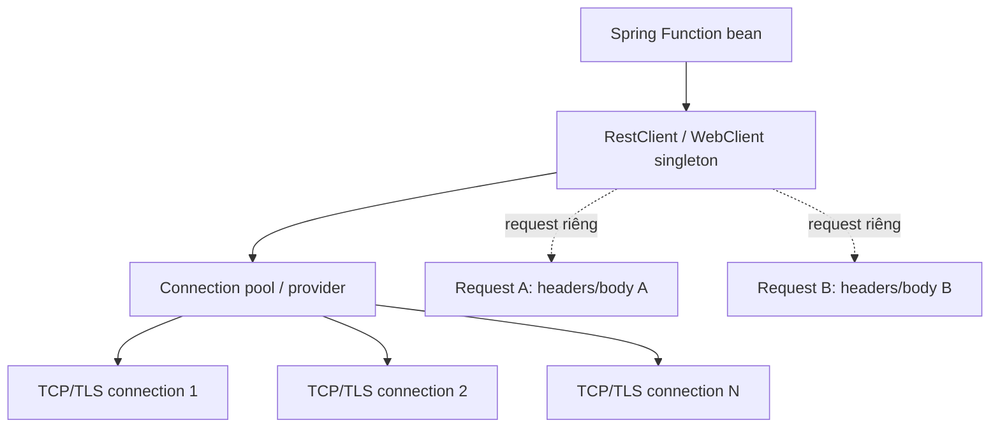
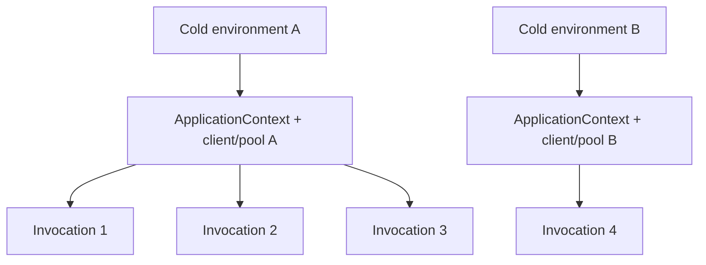
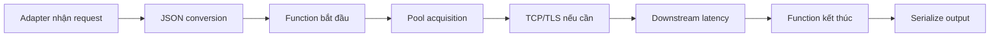

# Tái sử dụng kết nối và đối tượng client an toàn

Trong **Spring Cloud Function**, logic nghiệp vụ được viết dưới dạng `Supplier<T>`, `Function<I, O>` hoặc `Consumer<T>`, tra cứu bằng `FunctionCatalog`, có thể ghép chuỗi (*composition*) và triển khai qua HTTP, sự kiện hoặc môi trường serverless. Nhưng nếu **mỗi lần một hàm được gọi** lại tạo HTTP transport client, mở pool kết nối hoặc khởi tạo cloud SDK từ đầu, chi phí I/O có thể lớn hơn nhiều so với phần tính toán thực sự.

Trong chương **Hiệu năng**, bài này tập trung vào hai mục tiêu phải đạt **đồng thời**:

1. **Tái sử dụng đúng tài nguyên đắt tiền** — HTTP client, connection pool, datasource hoặc SDK client được tài liệu xác nhận hỗ trợ chia sẻ.
2. **Không chia sẻ sai trạng thái của từng invocation** — body, token người dùng, correlation ID, JDBC `Connection`, buffer mutable hoặc request đang được xử lý.

Tái sử dụng một object không mặc nhiên đồng nghĩa tái sử dụng **cùng một TCP connection**; một pool có thể mở nhiều kết nối, đóng kết nối nhàn rỗi hoặc tạo mới khi server reset. Mục tiêu chính là kiểm soát vòng đời, giảm connection churn, tránh tài nguyên bị rò rỉ và giữ latency ổn định dưới tải.

Sau bài học, bạn có thể:

- Phân biệt client object, pool, socket, request, transaction và các phạm vi sống của chúng.
- Viết `Function<QuoteRequest, QuoteResult>` với `RestClient` dùng chung ở đường đồng bộ.
- Viết `Function<Flux<QuoteRequest>, Flux<QuoteResult>>` với `WebClient`/Reactor Netty non-blocking, có bounded concurrency.
- Quản lý connection pool JDBC bằng `DataSource` thay vì chia sẻ JDBC `Connection`.
- Tính ngân sách kết nối cho nhiều replicas và điều chỉnh timeout, pending queue, retry, bulkhead.
- Hiểu giới hạn reuse giữa cold/warm environments trên serverless.
- Kiểm thử concurrency, connection lifecycle và quan sát metrics để xác minh lợi ích.

> **Phạm vi ví dụ:** Java 17+, Spring Framework tương thích (`RestClient` có từ 6.1), Apache HttpClient 5 hoặc Reactor Netty phù hợp với Spring Boot/Spring Cloud Function đang sử dụng. Các URL và số cấu hình là minh họa, không phải dịch vụ hay benchmark đã chạy. Trước khi dùng code cần kiểm tra dependency versions và tài liệu API tương ứng.

## 1. Tái sử dụng ở lớp nào?

Một invocation gọi pricing service có thể đi qua nhiều lớp:



Một `Function` singleton được phép tham chiếu một client ổn định; mỗi invocation lại tạo request mới. Pool chịu trách nhiệm mượn, tái dùng hoặc đóng socket theo giới hạn. Không giữ socket cố định trong function và không dùng field mutable để ghi dữ liệu của request hiện tại.

| Thành phần | Nên dùng chung? | Lưu ý |
| --- | --- | --- |
| `RestClient` đã cấu hình và `build()` | Có | Client wrapper thường an toàn để dùng lại khi cấu hình không bị thay đổi |
| `WebClient` đã `build()` | Có | Dùng request-specific builders và non-blocking operators |
| Apache `CloseableHttpClient` / connection manager | Có | Đóng khi application context kết thúc |
| Reactor Netty `ConnectionProvider` | Có | Quản lý max/idle/lifetime và dispose khi shutdown |
| `DataSource`/HikariCP pool | Có | Lấy connection cho mỗi operation/transaction |
| JDBC `Connection`, `ResultSet`, `PreparedStatement` | **Không** chia sẻ giữa invocation | Trả về pool/đóng theo phạm vi sử dụng |
| Token, body, correlation ID từng request | **Không** lưu ở singleton | Truyền qua tham số/headers của request riêng |
| `WebClient.Builder` mutable | Không sửa đồng thời từ nhiều invocation | Tạo client một lần hoặc dùng bản sao builder |
| SDK client của cloud provider | Tùy API | Chỉ chia sẻ nếu nhà cung cấp xác nhận thread-safe và có lifecycle thích hợp |
| Reactive `Mono`/`Flux` mang nội dung request | Theo ngữ nghĩa publisher | Không cache/replay response per-user ngoài chủ đích |

**Singleton là scope tạo bean, không phải chứng nhận thread safety.** Spring có thể dùng cùng function bean từ nhiều HTTP threads, nhiều event consumer threads hoặc nhiều reactive subscriptions.

## 2. Khi nào tạo client mới gây tốn tài nguyên?

Ví dụ một cách viết khó kiểm soát:

```java
// PHẢN VÍ DỤ: tạo RestClient wrapper trong từng invocation.
@Bean
public Function<QuoteRequest, QuoteResult> quoteBad() {
    return request -> RestClient.create(
            "https://pricing.example.internal"
        )
        .post()
        .uri("/v1/quotes")
        .body(request)
        .retrieve()
        .body(QuoteResult.class);
}
```

Đoạn này giả định đã import Spring `RestClient` và các DTO. Việc tạo wrapper mỗi lần khiến cấu hình, observability và quản lý transport kém rõ ràng. **Tuy nhiên, không được khẳng định chỉ vì gọi `RestClient.create(...)` hoặc `WebClient.builder().build()` thì mỗi lần luôn mở TCP connection mới**: có client/connector dùng shared resources. Vấn đề nghiêm trọng hơn là tự tạo **HTTP transport và connection pool mới cho mỗi lần gọi**, không tái dùng, không đóng hoặc không kiểm soát giới hạn.

```text
Thiết kế sai:
invocation A → transport A → pool A → DNS/TCP/TLS
invocation B → transport B → pool B → DNS/TCP/TLS
invocation C → transport C → pool C → DNS/TCP/TLS

Thiết kế tốt:
ApplicationContext → shared transport + bounded pool
     ├─ invocation A → request A
     ├─ invocation B → request B
     └─ invocation C → request C
```

Tái dùng transport/pool có thể giảm:

- Chi phí DNS resolution, TCP connect và TLS handshake lặp lại.
- Connection churn và áp lực lên file descriptors/ephemeral ports/NAT.
- Việc tạo threads/event-loop resources nhiều lần.
- Các pool bị bỏ quên mà không có shutdown.
- Latency biến động do kết nối lạnh hoặc nghẽn ở lớp transport.

Lợi ích tùy downstream, keep-alive, HTTP version, TLS và cấu hình connector. Nếu bottleneck thực là JSON serialization hoặc một truy vấn chậm, pooling riêng có thể không cải thiện bao nhiêu.

## 3. DTO và hợp đồng Spring Cloud Function

Ví dụ xuyên suốt: một function gửi yêu cầu tới pricing API nội bộ. Dữ liệu nghiệp vụ là hai record Java:

```java
// QuoteRequest.java
package demo.perf;

public record QuoteRequest(String sku, int quantity) {}
```

```java
// QuoteResult.java
package demo.perf;

public record QuoteResult(
    String sku,
    int quantity,
    long totalVnd
) {}
```

HTTP body tương ứng có thể là:

```json
{"sku":"BOOK-1","quantity":2}
```

Phản hồi pricing service giả định:

```json
{"sku":"BOOK-1","quantity":2,"totalVnd":100000}
```

Pricing API `https://pricing.example.internal/v1/quotes` là **địa chỉ minh họa**, không phải API công khai. Trong môi trường thực, đưa host vào cấu hình tin cậy, không để input người dùng tùy ý đặt toàn bộ URL vì có thể dẫn đến SSRF.

Hai lựa chọn hợp đồng:

| Loại xử lý | Chữ ký | Bản chất |
| --- | --- | --- |
| Đồng bộ | `Function<QuoteRequest, QuoteResult>` | Caller chờ cho đến khi gọi pricing service trả kết quả |
| Reactive | `Function<Flux<QuoteRequest>, Flux<QuoteResult>>` | Luồng publisher, xử lý non-blocking khi được subscribe |

Hai lựa chọn không hoán đổi tự động; đặc biệt **không gọi `block()` trên WebClient trong một reactive function chạy trên event loop**.

## 4. RestClient đồng bộ: bean được tạo một lần

Khi dùng Spring Framework 6.1+ cùng **Apache HttpClient 5**, có thể cấu hình connection manager/pool trong một Spring bean.

```java
package demo.perf;

import org.apache.hc.client5.http.config.ConnectionConfig;
import org.apache.hc.client5.http.config.RequestConfig;
import org.apache.hc.client5.http.impl.classic.CloseableHttpClient;
import org.apache.hc.client5.http.impl.classic.HttpClients;
import org.apache.hc.client5.http.impl.io.PoolingHttpClientConnectionManagerBuilder;
import org.apache.hc.core5.util.Timeout;

import org.springframework.beans.factory.annotation.Value;
import org.springframework.context.annotation.Bean;
import org.springframework.context.annotation.Configuration;
import org.springframework.http.client.HttpComponentsClientHttpRequestFactory;
import org.springframework.web.client.RestClient;

@Configuration
public class BlockingHttpConfiguration {

    @Bean(destroyMethod = "close")
    public CloseableHttpClient pricingApacheClient() {
        ConnectionConfig connectionConfig =
            ConnectionConfig.custom()
                .setConnectTimeout(Timeout.ofSeconds(2))
                .build();

        var manager =
            PoolingHttpClientConnectionManagerBuilder.create()
                .setMaxConnTotal(32)
                .setMaxConnPerRoute(16)
                .setDefaultConnectionConfig(connectionConfig)
                .build();

        RequestConfig requestConfig =
            RequestConfig.custom()
                .setConnectionRequestTimeout(Timeout.ofSeconds(2))
                .setResponseTimeout(Timeout.ofSeconds(3))
                .build();

        return HttpClients.custom()
            .setConnectionManager(manager)
            .setDefaultRequestConfig(requestConfig)
            .evictExpiredConnections()
            .build();
    }

    @Bean
    public RestClient pricingRestClient(
        CloseableHttpClient pricingApacheClient,
        @Value("${pricing.base-url}") String baseUrl
    ) {
        var requestFactory =
            new HttpComponentsClientHttpRequestFactory(
                pricingApacheClient
            );

        return RestClient.builder()
            .baseUrl(baseUrl)
            .requestFactory(requestFactory)
            .build();
    }
}
```

Spring Boot có thể cung cấp `RestClient.Builder` và lựa chọn HTTP request factory dựa trên dependency/configuration. Ví dụ trên **cấu hình pool tường minh** để bài học có thể kiểm soát max connections, timeout và shutdown. Nếu đã có transport client do Boot hoặc hạ tầng khác quản lý, nên cân nhắc reuse thay vì tạo thêm nhiều pool.

### Những thông số đang giới hạn điều gì?

| Thiết lập | Ý nghĩa | Không nên suy ra |
| --- | --- | --- |
| `setMaxConnTotal(32)` | Trần connection toàn pool | Không phải giới hạn request/s |
| `setMaxConnPerRoute(16)` | Trần connection cho mỗi route | Không tự tăng theo số replicas |
| `setConnectTimeout(2s)` | Giới hạn thiết lập kết nối | Không thay tổng deadline |
| `setConnectionRequestTimeout(2s)` | Giới hạn chờ mượn connection | Không làm downstream trả lời nhanh hơn |
| `setResponseTimeout(3s)` | Giới hạn thời gian phản hồi theo transport | Không tự chặn mọi retry ở mức operation |
| `destroyMethod="close"` | Đóng Apache client khi context dừng | Không đóng sau mỗi request |

Các con số chỉ là **ví dụ để giải thích cơ chế**. Thực tế phải dựa vào peak concurrency, upstream timeout budget, per-route traffic và giới hạn của dịch vụ pricing.

### Bean Function chỉ giữ tham chiếu client

```java
package demo.perf;

import java.util.Objects;
import java.util.function.Function;

import org.springframework.beans.factory.annotation.Qualifier;
import org.springframework.context.annotation.Bean;
import org.springframework.context.annotation.Configuration;
import org.springframework.web.client.RestClient;

@Configuration
public class BlockingQuoteFunctions {

    @Bean("quoteBlocking")
    public Function<QuoteRequest, QuoteResult> quoteBlocking(
        @Qualifier("pricingRestClient") RestClient client
    ) {
        return request -> {
            if (request == null ||
                request.sku() == null ||
                !request.sku().matches("[A-Z0-9-]{1,24}") ||
                request.quantity() <= 0) {
                throw new IllegalArgumentException("Invalid quote request");
            }

            QuoteResult response = client.post()
                .uri("/v1/quotes")
                .body(request)
                .retrieve()
                .body(QuoteResult.class);

            return Objects.requireNonNull(
                response, "Empty pricing response"
            );
        };
    }
}
```

Ở đây `@Bean Function<QuoteRequest,QuoteResult>` giữ generic rõ ràng cho `FunctionCatalog` và converter JSON. Khi ứng dụng expose `quoteBlocking` qua HTTP, event hoặc serverless adapter tương thích, logic Java vẫn dùng **cùng client bean trong phạm vi application context đó**.

Từng invocation có request builder và body riêng. Hàm không giữ `currentRequest`, bearer token hoặc connection trong mutable field. Nếu downstream POST có side effect, **không tự retry mù quáng** chỉ vì gặp timeout.

## 5. WebClient + Reactor Netty: reuse kết nối non-blocking

Với đường reactive, có thể dùng `WebClient` và cấu hình `ConnectionProvider` của Reactor Netty. Một pool rõ giới hạn giúp tránh request dồn vô hạn đến downstream.

### 5.1. Cấu hình pool trong Spring context

```java
package demo.perf;

import java.time.Duration;

import io.netty.channel.ChannelOption;
import reactor.netty.http.client.HttpClient;
import reactor.netty.resources.ConnectionProvider;

import org.springframework.beans.factory.annotation.Value;
import org.springframework.context.annotation.Bean;
import org.springframework.context.annotation.Configuration;
import org.springframework.http.client.reactive.ReactorClientHttpConnector;
import org.springframework.web.reactive.function.client.WebClient;

@Configuration
public class ReactiveHttpConfiguration {

    @Bean(destroyMethod = "dispose")
    public ConnectionProvider pricingConnectionProvider() {
        return ConnectionProvider.builder("pricing-pool")
            .maxConnections(32)
            .pendingAcquireMaxCount(64)
            .pendingAcquireTimeout(Duration.ofSeconds(2))
            .maxIdleTime(Duration.ofSeconds(30))
            .maxLifeTime(Duration.ofMinutes(5))
            .build();
    }

    @Bean("pricingWebClient")
    public WebClient pricingWebClient(
        ConnectionProvider pricingConnectionProvider,
        @Value("${pricing.base-url}") String baseUrl
    ) {
        HttpClient httpClient =
            HttpClient.create(pricingConnectionProvider)
                .option(
                    ChannelOption.CONNECT_TIMEOUT_MILLIS,
                    2_000
                )
                .responseTimeout(Duration.ofSeconds(3));

        return WebClient.builder()
            .baseUrl(baseUrl)
            .clientConnector(
                new ReactorClientHttpConnector(httpClient)
            )
            .build();
    }
}
```

Các thư viện cần thiết gồm Spring WebFlux, Reactor Netty HTTP và dependency liên quan đúng phiên bản. Reactor Netty có cơ chế tài nguyên dùng chung theo mặc định; ví dụ này tạo **pool riêng cho pricing** để thể hiện giới hạn và lifecycle. Nếu ứng dụng đã sử dụng `ReactorResourceFactory` hoặc resource management của Boot, phải xem lại chủ sở hữu tài nguyên trước khi tạo thêm provider.

| Thiết lập | Mục đích |
| --- | --- |
| `maxConnections(32)` | Trần kết nối trong provider |
| `pendingAcquireMaxCount(64)` | Trần số lời gọi đang chờ lấy connection |
| `pendingAcquireTimeout(2s)` | Không chờ pool vô hạn |
| `maxIdleTime(30s)` | Loại kết nối idle theo chính sách |
| `maxLifeTime(5m)` | Giới hạn tuổi kết nối của pool |
| `CONNECT_TIMEOUT_MILLIS` | Timeout kết nối TCP |
| `responseTimeout(3s)` | Timeout xử lý response theo Reactor Netty |
| `dispose()` lúc shutdown | Giải phóng resource pool thuộc context |

Không đóng `ConnectionProvider` ngay sau khi `WebClient.post(...)` trả về: một `Mono` có thể chưa được subscribe hoặc response chưa hoàn thành.

### 5.2. Hàm reactive có bounded concurrency

```java
package demo.perf;

import java.util.function.Function;

import org.springframework.beans.factory.annotation.Qualifier;
import org.springframework.context.annotation.Bean;
import org.springframework.context.annotation.Configuration;
import org.springframework.web.reactive.function.client.WebClient;

import reactor.core.publisher.Flux;
import reactor.core.publisher.Mono;

@Configuration
public class ReactiveQuoteFunctions {

    @Bean("quoteReactive")
    public Function<
        Flux<QuoteRequest>,
        Flux<QuoteResult>
    > quoteReactive(
        @Qualifier("pricingWebClient") WebClient client
    ) {
        return requests -> requests.flatMap(request -> {
            if (request == null ||
                request.sku() == null ||
                request.sku().isBlank() ||
                request.quantity() <= 0) {
                return Mono.error(
                    new IllegalArgumentException(
                        "Invalid quote request"
                    )
                );
            }

            return client.post()
                .uri("/v1/quotes")
                .bodyValue(request)
                .retrieve()
                .bodyToMono(QuoteResult.class)
                .switchIfEmpty(Mono.error(
                    new IllegalStateException("Empty pricing response")
                ));
        }, 8);
    }
}
```

`flatMap(..., 8)` giới hạn **số inner subscriptions đồng thời trong pipeline này**, không phải giới hạn toàn hệ thống: nhiều pipeline, nhiều function invocations và nhiều replicas có thể cùng dùng pool. Cân nhắc thêm bulkhead hoặc rate limiting để bảo vệ downstream.

**`flatMap` có thể trả kết quả không cùng thứ tự input.** Khi nghiệp vụ yêu cầu giữ thứ tự, cân nhắc `concatMap` (tuần tự) hoặc toán tử bảo toàn thứ tự phù hợp và đo throughput/latency thực tế.

Không gọi `.block()` trên event loop production. Nếu phải dùng thư viện blocking, cần tách scheduler/execution model và giới hạn tài nguyên tương ứng, không tự động coi reactive là tăng hiệu năng.

## 6. Thread safety: những lỗi singleton nguy hiểm

Một function bean là singleton nhưng có thể được gọi đồng thời. Nếu lưu request hiện tại trong field chung:

```java
// PHẢN VÍ DỤ: có data race và nguy cơ lẫn dữ liệu giữa users.
@Configuration
public class UnsafeQuoteFunctions {

    private QuoteRequest currentRequest;

    @Bean
    public Function<QuoteRequest, String> unsafe() {
        return request -> {
            currentRequest = request;
            return currentRequest.sku();
        };
    }
}
```

Request A và B có thể sửa field xen kẽ khiến A đọc `sku` của B. Cách đúng là giữ dữ liệu per invocation ở biến cục bộ:

```java
@Bean
public Function<QuoteRequest, String> safe() {
    return request -> {
        String sku = request.sku();
        return sku;
    };
}
```

Các snippet này đặt trong các lớp có import `@Bean`, `@Configuration` và `Function` tương ứng.

### Bảng phân biệt chia sẻ an toàn và không an toàn

| Đối tượng | Cách làm đúng |
| --- | --- |
| Client HTTP đã build | Inject như bean ổn định, không sửa cấu hình mỗi request |
| `WebClient.Builder` mutable | Không để nhiều threads sửa cùng builder; build trước hoặc lấy bản sao phù hợp |
| Bearer token người dùng | Gắn vào request riêng, không lưu ở default headers global |
| Cache toàn cục | Dùng cache concurrency-safe, TTL và max size; không giữ dữ liệu vô hạn |
| `SimpleDateFormat` mutable | Thay bằng `DateTimeFormatter` immutable khi phù hợp |
| Byte buffer mutable | Tạo/borrow theo request với ownership rõ |
| JDBC Connection/ResultSet | Không cất trong singleton field |
| Per-request correlation ID | Truyền qua input/message headers/reactive context |
| `ThreadLocal` ở async/reactive code | Không coi là context propagation tự động; cleanup đúng |

Client thread-safe **không làm mọi đoạn code sử dụng client trở thành thread-safe**. Cần review các biến trạng thái trong `Supplier`, `Function` và `Consumer`.

## 7. Authorization và headers của từng lời gọi

Khi access token thuộc từng user hoặc tenant, đặt nó trên **request builder riêng**, không ghi vào client singleton:

```java
import reactor.core.publisher.Mono;
import org.springframework.web.reactive.function.client.WebClient;

public Mono<QuoteResult> quoteForUser(
    WebClient client,
    QuoteRequest request,
    String accessToken
) {
    return client.post()
        .uri("/v1/quotes")
        .headers(headers -> headers.setBearerAuth(accessToken))
        .bodyValue(request)
        .retrieve()
        .bodyToMono(QuoteResult.class);
}
```

Đây là method minh họa bên trong class/service, không phải một method top-level trong Java. Token phải đến từ cơ chế xác thực hợp lệ và không xuất hiện trong logs hoặc metric tags.

Với service credentials, dùng credential provider có khả năng **rotation/refresh**. Không lưu token khởi tạo một lần rồi tin rằng nó hợp lệ mãi. Nếu tenant có proxy, certificate hoặc policy khác nhau, cần thiết kế partitioning client/pool có giới hạn thay vì vô tình chia sẻ context của tenant đầu tiên.

## 8. Database: chia sẻ DataSource, mượn Connection theo transaction

Trong ứng dụng dùng JDBC, **`DataSource`/HikariCP pool** thường là bean chia sẻ. Nhưng `Connection` được mượn từ pool chỉ có vòng đời ngắn và mang transaction/session state.

Ví dụ cấu hình HikariCP (thời gian tính bằng mili giây):

```yaml
spring:
  datasource:
    hikari:
      maximum-pool-size: 10
      minimum-idle: 2
      connection-timeout: 2000
      idle-timeout: 600000
      max-lifetime: 1800000
```

Đây là **giá trị minh họa**, không phải khuyến nghị chung. URL, tài khoản và mật khẩu database phải đến từ cấu hình/secret management, không ghi cứng vào bài học hoặc source code.

### Mượn và trả logical connection

```java
package demo.perf;

import java.sql.Connection;
import java.sql.PreparedStatement;
import java.sql.ResultSet;
import java.sql.SQLException;
import javax.sql.DataSource;

public final class PriceRepository {

    private final DataSource dataSource;

    public PriceRepository(DataSource dataSource) {
        this.dataSource = dataSource;
    }

    public long unitPrice(String sku) throws SQLException {
        String sql =
            "SELECT unit_price_vnd FROM product_price WHERE sku = ?";

        try (Connection connection = dataSource.getConnection();
             PreparedStatement statement =
                connection.prepareStatement(sql)) {
            statement.setString(1, sku);

            try (ResultSet rs = statement.executeQuery()) {
                if (!rs.next()) {
                    throw new IllegalArgumentException("Unknown SKU");
                }
                return rs.getLong(1);
            }
        }
    }
}
```

Khi `Connection` được mượn từ Hikari, `connection.close()` thường **trả logical connection về pool**, chứ không nhất thiết đóng kết nối vật lý. `try-with-resources` giúp release ngay cả khi query lỗi.

Nếu dùng Spring transaction management hoặc `JdbcTemplate`, để Spring quản lý connection trong đúng transaction scope. Không tự mượn/đóng connection ngoài transaction manager rồi kỳ vọng nó tự tham gia transaction đang hoạt động. Với JPA, không chia sẻ session/`EntityManager` thực giữa threads; sử dụng managed proxy/service transaction đúng cách.

### Tính pool budget với autoscaling

Nếu dịch vụ có `N` replicas, mỗi replica có thể mở tối đa `P` kết nối:

\[
C_{\mathrm{max,service}} \approx N \times P
\]

Ví dụ 12 instances và pool size 10 tạo mức trần cấu hình khoảng **120 connections** từ service đó, chưa tính rolling deployment, admin tasks và hệ thống khác. Con số không có nghĩa luôn có 120 socket đang mở.

Tăng max pool không nhất thiết cải thiện throughput: database có thể chậm hơn khi có quá nhiều truy vấn tranh CPU, lock hoặc I/O.

## 9. Serverless: chia sẻ trong warm environment, không chia sẻ giữa environments

Trên serverless, Spring context và các bean có thể còn tồn tại cho nhiều invocations **trong cùng execution environment**:



Môi trường A và B **không dùng chung bộ nhớ/pool**. Một cold start mới tạo context/client riêng; một warm invocation có thể dùng lại client cũ nhưng cũng có thể gặp connection idle đã bị server/load balancer đóng.

**Quy tắc thiết kế:**

- Khởi tạo client ở application scope, không khởi tạo transport trong từng invocation.
- Không coi môi trường sẽ luôn warm hoặc được gọi đúng một lần tại một thời điểm.
- Đặt connect/response/idle/max-life timeout và xử lý stale connections.
- Không lưu trạng thái per-user trong static/singleton mutable fields.
- Có thể giải phóng resource khi shutdown được gọi, nhưng không phụ thuộc mọi serverless platform luôn chạy shutdown callback.
- Đo **cold invocation**, **first connection** và **warm invocation** riêng.

Tái sử dụng client không tự loại chi phí của platform init, JVM startup, Spring bootstrap hoặc deserialization JSON ở serverless adapter.

## 10. Pool size, pending queue và concurrency phải cân đối

Ba giới hạn khác nhau:

- **Max connections**: số kết nối đồng thời mà pool cho phép.
- **Pending acquire**: số yêu cầu đang chờ mượn connection.
- **Application concurrency**: số invocations/inner subscriptions cùng hoạt động.

```text
40 lời gọi cùng lúc
        |
        v
Pool giới hạn 16 connections
        ├─ 16 đang dùng connection → downstream
        └─ 24 chờ acquire → có thể timeout
```

Một cách ước lượng nhu cầu trung bình là Little's Law:

\[
L = \lambda W
\]

Ví dụ throughput trung bình **80 req/s**, thời gian ở hệ thống trung bình **0,15 s** thì có khoảng:

\[
L = 80 \times 0.15 = 12
\]

request đồng thời trung bình trong đoạn đo. Đây **không phải công thức chọn maxConnections=12**: traffic burst, p95/p99, số instances, số route, HTTP/2 multiplexing và downstream capacity còn ảnh hưởng.

### Pool nhỏ và pool lớn đều có rủi ro

| Cấu hình | Rủi ro |
| --- | --- |
| Pool quá nhỏ | Pending queue dài, timeouts, latency cao |
| Pool quá lớn | Quá tải downstream, thêm sockets/file descriptors, contention |
| Pending queue không giới hạn | Tăng RAM và latency khi downstream chậm |
| Timeout quá dài | Request chiếm tài nguyên quá lâu |
| Timeout quá ngắn | Lỗi giả/không chịu được tail latency hợp lệ |
| Retry quá nhiều | Khuếch đại lưu lượng khi downstream đang lỗi |
| Một pool chung cho mọi downstream | Downstream chậm có thể ảnh hưởng downstream khác |

Chỉ tăng pool size khi metrics xác nhận thiếu capacity **và** downstream đủ khả năng nhận thêm concurrency; có thể cần bulkhead, rate limiting hoặc tối ưu downstream thay vì tăng số kết nối.

## 11. Timeout và deadline không phải một thứ

Một remote call có nhiều giai đoạn:

```text
Chờ connection từ pool
  ↓
DNS/TCP connect
  ↓
TLS handshake
  ↓
Gửi request
  ↓
Đợi response
  ↓
Đọc và deserialize body
```

| Timeout/deadline | Bảo vệ giai đoạn |
| --- | --- |
| Pending acquire timeout | Chờ pool quá lâu |
| Connect timeout | Thiết lập TCP kết nối |
| TLS handshake timeout | Kết nối TLS không hoàn tất |
| Response/read timeout | Downstream phản hồi chậm theo chính sách client |
| Overall operation deadline | Tổng thời gian của nhiều bước, kể cả retry |
| Function/platform timeout | Giới hạn của HTTP adapter, broker hoặc serverless |

Không suy luận `responseTimeout(3s)` nghĩa là operation có **ba lần retry** luôn kết thúc trong 3 giây. Cần deadline chung và tính thêm thời gian queue, backoff, conversion và mọi downstream hops.

### Retry cần idempotency

| Lỗi | Cách cân nhắc |
| --- | --- |
| GET idempotent gặp lỗi mạng tạm thời | Có thể retry giới hạn, backoff và jitter |
| POST tạo hóa đơn/thanh toán | Không retry mù quáng; cần idempotency key hoặc contract xác nhận |
| HTTP 400 do request sai | Thường không retry cùng payload |
| HTTP 429/503 | Xem chính sách throttling/Retry-After, giới hạn retries |
| Pool acquire timeout liên tục | Xem concurrency, saturation và downstream |
| Stale connection sau idle | Kết nối lại hoặc retry khi operation an toàn |
| Token hết hạn | Refresh credential đúng cơ chế |

`Connection pool` không thay cho circuit breaker, bulkhead hoặc idempotency. Với message broker, hãy tính **cả retry ở binder** và retry trong HTTP client, tránh nhân số lần gọi ngoài dự kiến.

## 12. Supplier, Function, Consumer cùng hưởng lợi từ client dùng chung

| Interface | Ví dụ | Lưu ý |
| --- | --- | --- |
| `Supplier<T>` | Đọc trạng thái hoặc dữ liệu từ một API | Client reuse qua nhiều lần `get()`; trigger do adapter |
| `Function<I,O>` | Gọi pricing API theo request | Mỗi input/output độc lập, client dùng chung |
| `Consumer<T>` | Gửi audit/event đến downstream | Ack/retry/idempotency khi event được phát lại |

Ví dụ `Supplier<String>` dùng RestClient được tiêm:

```java
import java.util.Objects;
import java.util.function.Supplier;

import org.springframework.beans.factory.annotation.Qualifier;
import org.springframework.context.annotation.Bean;
import org.springframework.web.client.RestClient;

@Bean
public Supplier<String> pricingHealth(
    @Qualifier("pricingRestClient") RestClient client
) {
    return () -> Objects.requireNonNull(
        client.get()
            .uri("/v1/status")
            .retrieve()
            .body(String.class)
    );
}
```

Đây là bean ví dụ trong một class `@Configuration`; endpoint `/v1/status` giả định. Không tự suy ra supplier sẽ chạy đúng một lần hoặc theo một lịch cố định: adapter/binder quyết định trigger.

Với `Consumer<Message<T>>`, chỉ giữ headers của event trong đúng invocation. Không ghi `correlationId` hay token từng event vào mutable client defaults. Nếu consumer phát sinh tác vụ async, cần xác định khi nào công việc hoàn thành trước khi ack.

### Composition không buộc tạo nhiều client

```text
validateQuote : Function<QuoteRequest, QuoteRequest>
    |
quoteBlocking : Function<QuoteRequest, QuoteResult>  <-- shared RestClient
    |
renderQuote   : Function<QuoteResult, String>
```

```yaml
spring:
  cloud:
    function:
      definition: validateQuote|quoteBlocking|renderQuote
```

Hai bean `validateQuote` và `renderQuote` ở ví dụ trên là **hợp đồng minh họa**, không được định nghĩa trong snippet code mục 4. FunctionCatalog có thể ghép các bean khi chúng đã được tạo và tên/generic đúng. Client vẫn là dependency của `quoteBlocking`, không được tự tạo lại ở từng điểm nối.

## 13. Quản lý vòng đời: đóng đúng resource vào đúng lúc

| Resource | Tạo ở đâu? | Đóng khi nào? |
| --- | --- | --- |
| `RestClient` wrapper | Bean/configuration | Thường không sở hữu socket riêng để đóng trực tiếp |
| Apache `CloseableHttpClient` | Bean transport client | Spring context shutdown, `close()` |
| Reactor Netty `ConnectionProvider` riêng | Bean | Spring context shutdown, `dispose()` |
| Hikari `DataSource` | Spring Boot/bean | App shutdown/bean destroy |
| JDBC `Connection` | Operation/transaction | Khi operation kết thúc, trả về pool |
| Per-request request/response stream | Từng invocation | Khi complete/error/cancel, release đúng API |

**Đóng quá sớm:** gọi `connectionProvider.dispose()` trong `Function.apply(...)` có thể làm hỏng các invocation đang hoạt động hoặc một publisher chưa subscribe.

**Không đóng bao giờ:** tạo nhiều HTTP clients/pools ngoài Spring context mà không shutdown có thể để lại threads, sockets và file descriptors khi reload hoặc integration tests liên tục dựng context.

Trong serverless, không phải lúc nào nền tảng cũng gọi shutdown hooks. Vì vậy client còn cần timeout và xử lý kết nối cũ/reset, không dựa vào một connection tồn tại vĩnh viễn.

## 14. Đo đúng để biết reuse có hiệu quả không

Không chỉ đo thời gian `Function.apply(...)`. Một invocation với HTTP downstream có các phần:



| Metric | Câu hỏi trả lời |
| --- | --- |
| Process-to-ready / main-to-ready | Khởi tạo client/pool làm startup lâu hơn không? |
| First invocation | Request đầu có DNS/TCP/TLS hoặc lazy setup? |
| Warm p50/p95/p99 | Pool có giảm latency ở trạng thái ổn định? |
| New connections per second | Có giảm connection churn thật không? |
| Active/idle/pending connections | Pool đang sử dụng hiệu quả hay bão hòa? |
| Pool acquisition timeouts | Có request chờ pool quá lâu? |
| HTTP status 429/503, error rate | Downstream có đang bị quá tải? |
| Throughput, CPU, RSS/heap, GC, file descriptors | Hiệu quả và chi phí tài nguyên thực |
| Retry count | Có đang khuếch đại traffic do retry? |

Reactor Netty có hỗ trợ pool metrics/quan sát khi tích hợp Micrometer tương thích; tên metric và cách enable phụ thuộc phiên bản. Không dùng request ID, user ID, SKU hoặc URL tùy ý làm metric tags vì **high cardinality**.

### Đo synchronous function đã tiêm client bằng Micrometer

```java
import java.util.function.Function;

import io.micrometer.core.instrument.MeterRegistry;
import io.micrometer.core.instrument.Timer;

import org.springframework.beans.factory.annotation.Qualifier;
import org.springframework.context.annotation.Bean;

@Bean("quoteTimed")
public Function<QuoteRequest, QuoteResult> quoteTimed(
    @Qualifier("quoteBlocking")
    Function<QuoteRequest, QuoteResult> delegate,
    MeterRegistry registry
) {
    Timer timer = Timer.builder("app.quote.duration")
        .description("Synchronous quote function duration")
        .tag("function", "quoteTimed")
        .publishPercentileHistogram()
        .register(registry);

    return request -> timer.record(
        () -> delegate.apply(request)
    );
}
```

Đoạn này thuộc class `@Configuration` có dependency Micrometer và bean `MeterRegistry`. Timer đo **toàn bộ thời gian synchronous delegate**, gồm cả chờ connection và remote HTTP, không phải chỉ CPU time của lambda. Để tách pool wait/TCP/remote latency cần instrumentation thêm ở transport/tracing.

Với `Mono/Flux`, `apply(...)` có thể chỉ tạo publisher; phải quan sát **subscription đến completion/error/cancel** hoặc latency từng item khi stream không kết thúc. Không `block()` trong reactive production code để đo timer.

## 15. Ví dụ A/B và cách diễn giải

Giả sử so sánh hai bản có cùng logic, adapter, concurrency và downstream:

| Metric (số liệu **giả định**) | Transport/pool tạo không kiểm soát | Shared bounded pool |
| --- | ---: | ---: |
| New connections/s | 90 | 7 |
| Warm HTTP p50 | 26 ms | 11 ms |
| Warm HTTP p99 | 320 ms | 93 ms |
| CPU system | 62% | 37% |
| Pool pending acquire timeout | Chưa có metric chung | 0,2% |
| Main-to-ready p50 | 840 ms | 910 ms |

Đây **không phải kết quả benchmark Spring Cloud Function**. Ví dụ thể hiện một trade-off: khởi tạo pool sớm có thể tăng startup, nhưng giảm connection churn và warm latency. Tuy nhiên 0,2% pending timeouts là tín hiệu cần điều tra, không được bỏ qua vì p50 đẹp hơn.

### Checklist thí nghiệm công bằng

1. Giữ JDK, Spring Boot/Cloud Function, container resources và adapter giống nhau.
2. Dùng cùng input/request size, concurrency và tải của downstream.
3. Đo **startup**, **first connection**, **cold request**, **warm request** riêng.
4. Ghi giới hạn connections, per-route, pending queue, response timeout và retry policy.
5. Thu p50/p95/p99, error rate, throughput và pool metrics.
6. Lặp nhiều lần, kiểm tra phương sai và các lỗi, không kết luận từ một lần `curl`.
7. Không chạy load test vượt khả năng downstream production hoặc vi phạm quy định hệ thống.

Tối ưu reuse không nên làm mất tính đúng đắn, không đưa rủi ro bảo mật vào shared client và không làm lỗi tăng khi traffic bùng nổ.

## 16. Kiểm thử an toàn: object reuse khác socket reuse

### Test một gateway được giữ qua nhiều invocation

Để test logic không phụ thuộc mạng, tách gateway:

```java
// PricingGateway.java
package demo.perf;

public interface PricingGateway {
    QuoteResult quote(QuoteRequest request);
}
```

```java
// GatewayQuoteFunctions.java
package demo.perf;

import java.util.function.Function;
import org.springframework.context.annotation.Bean;
import org.springframework.context.annotation.Configuration;

@Configuration
public class GatewayQuoteFunctions {

    @Bean("quoteViaGateway")
    public Function<QuoteRequest, QuoteResult> quoteViaGateway(
        PricingGateway gateway
    ) {
        return gateway::quote;
    }
}
```

```java
// GatewayQuoteFunctionsTest.java
package demo.perf;

import static org.junit.jupiter.api.Assertions.assertEquals;

import java.util.concurrent.atomic.AtomicInteger;
import java.util.function.Function;

import org.junit.jupiter.api.Test;

class GatewayQuoteFunctionsTest {

    @Test
    void reusesGatewayObject() {
        AtomicInteger calls = new AtomicInteger();

        PricingGateway fake = request -> {
            calls.incrementAndGet();
            return new QuoteResult(
                request.sku(),
                request.quantity(),
                request.quantity() * 50_000L
            );
        };

        Function<QuoteRequest, QuoteResult> function =
            new GatewayQuoteFunctions().quoteViaGateway(fake);

        function.apply(new QuoteRequest("BOOK-1", 2));
        function.apply(new QuoteRequest("PEN-1", 3));

        assertEquals(2, calls.get());
    }
}
```

Test này cho thấy hai lần gọi dùng **cùng gateway object**, không chứng minh TCP socket được dùng lại. Muốn kiểm tra connection reuse cần integration test và metrics/transport tracing thực tế.

### Integration test pool thật

Với test HTTP server có thể quan sát số connections (ví dụ MockWebServer, WireMock hoặc Netty test server phù hợp):

1. Dựng Spring context có client/pool một lần.
2. Gửi nhiều requests tuần tự, rồi đồng thời.
3. Kiểm tra response thuộc đúng request — không lẫn token/body/correlation ID.
4. Quan sát pool active/idle/pending và số connection được tạo.
5. Cho test server đóng idle socket; xác minh hành vi reconnect/retry an toàn.
6. Tạo timeout/503 có kiểm soát; xác nhận giới hạn retries và overall deadline.
7. Đóng context; xác minh resource pool/client được giải phóng.

Kiểm tra thread safety bằng test đồng thời có ích nhưng **một lần test pass không chứng minh không có data race**. Cần review code, dùng DTO immutable và công cụ concurrency testing khi phù hợp.

## 17. Các lưu ý riêng của Spring Cloud Function

### FunctionCatalog wrapper không tự tạo mới client

Spring Cloud Function có thể bọc function khi tra cứu qua catalog để hỗ trợ composition/type conversion. Wrapper **không phải lý do** để tạo transport mới mỗi lần. Client nên là dependency của functional bean trong Spring context:

```text
Spring context
  ├─ pricingRestClient (singleton)
  ├─ quoteBlocking Function (tham chiếu client)
  └─ FunctionCatalog
       └─ lookup("quoteBlocking")
            ├─ HTTP invocation
            ├─ event invocation
            └─ serverless invocation
```

Đường HTTP, event và serverless trong sơ đồ là các **môi trường triển khai thay thế** hoặc các adapter đã được cấu hình thật; không tự tồn tại đồng thời nếu build chỉ có một adapter.

Với functional registration thay vì `@Bean`, đăng ký client và `FunctionRegistration` trong context đúng cách, giữ metadata input/output của lambda. `FunctionRegistration.type(...)` giúp catalog/converter biết DTO, **không điều khiển pooling**.

### Inbound server và outbound client là hai pool khác nhau

Web adapter nhận request **inbound**; `RestClient/WebClient` từ function gọi pricing API **outbound**. Tuning server threads không tự thay đổi outbound connection pool. Một event consumer cũng có broker connection riêng và HTTP client riêng; đừng gộp chúng thành một metric.

### MessageConverter không quản lý socket

`JsonMessageConverter`, `StringMessageConverter` và `ByteArrayMessageConverter` giải quyết **định dạng payload**, không phải TCP reuse. Nếu CPU bị chi phối bởi JSON parsing, pool có thể không phải bottleneck. Nếu request chậm do pool acquisition, đổi JSON mapper cũng có thể không cải thiện.

## 18. Troubleshooting

| Triệu chứng | Nguyên nhân có thể | Hướng xử lý |
| --- | --- | --- |
| First call chậm, warm nhanh | DNS/TCP/TLS/lazy client setup | Đo first connection/startup riêng |
| Connection count cao, requests/connection thấp | Nhiều transport/pools tạo riêng, server idle timeout | Reuse shared pool, kiểm tra keep-alive |
| Pool pending tăng mạnh | Concurrency vượt pool/downstream capacity | Bulkhead, queue bound, điều tra remote latency |
| p99 tăng khi tăng max connections | Downstream overload, contention | Giảm concurrency, xem budget toàn hệ thống |
| Request A nhận token hoặc body B | Mutable singleton request state | Per-request headers/body, DTO immutable |
| JDBC pool cạn | Connection leak/transaction dài | try-with-resources, transaction boundaries |
| Stale connection sau idle dài | Server/proxy đóng socket | Idle/max life, reconnect và retry an toàn |
| Client bị đóng khi đang xử lý | Dispose/close trong từng function call | Quản lý resource theo Spring context |
| Serverless warm tốt nhưng cold chậm | Context/pool không có ở environment mới | Đo cold/warm và startup riêng |
| HTTP 503 tăng sau khi bật retry | Retry storm/too many parallel attempts | Retry budget, backoff, circuit breaker |
| Reactive throughput thấp | `block()` trong event loop, concurrency sai | Non-blocking pipeline và bounded flatMap |
| Reuse client mà không thấy cải thiện | Default connector đã pool hoặc bottleneck khác | Traces, pool metrics và profiling |
| Memory tăng không giới hạn | Pending queue/cache/buffer không bounded | Giới hạn queue/cache/size và đo allocation |
| Lỗi chỉ xảy ra khi container dừng | Resource lifecycle và in-flight requests | Graceful shutdown, close/dispose đúng thời điểm |

### Sáu câu hỏi khi chẩn đoán

1. **Đang đo tầng nào?** Logic Java, HTTP outbound, broker, adapter hay toàn bộ invocation?
2. **Client/pool được tạo ở đâu?** Trong mỗi request hay Spring context?
3. **Có state mutable được chia sẻ không?** Token, headers, request, connection, cache?
4. **Giới hạn thực tế là gì?** Max pool, per-route, pending, timeout, retry, concurrency?
5. **Downstream và số replicas ra sao?** Pool budget toàn hệ thống có hợp lý không?
6. **Đã đo cold/first/warm và lỗi chưa?** Một giá trị average không đủ.

## 19. Bài tập thực hành

**Bài 1 — Client và socket.** Đưa `WebClient` thành singleton bean có bảo đảm mọi invocation dùng cùng một TCP socket không?

*Đáp án:* Không. Client có thể dùng connection pool, nhiều sockets và reconnect khi idle/stale. Reuse object và reuse connection là hai khái niệm khác.

**Bài 2 — Phạm vi dữ liệu.** Trong `Function<QuoteRequest,QuoteResult>`, nên để client và `currentRequest` ở đâu?

*Đáp án:* Client đã build được inject như singleton dependency; request hiện tại nằm trong tham số và biến cục bộ, không trong mutable singleton field.

**Bài 3 — JDBC.** Vì sao không lưu `Connection` vào field của function để dùng lại?

*Đáp án:* Connection mang transaction/session state, có thể không thread-safe và có thể stale. Nên chia sẻ `DataSource`, borrow/release connection theo operation hoặc transaction.

**Bài 4 — Pool budget.** Một ứng dụng có 15 replicas, mỗi replica đặt `maximum-pool-size=12`. Trần kết nối từ ứng dụng này là bao nhiêu?

*Đáp án:* Khoảng `15 × 12 = 180` connection theo cấu hình, chưa tính rolling deployment và ứng dụng khác. Không có nghĩa luôn mở 180 sockets.

**Bài 5 — Reactive.** Tại sao tránh `webClient.post(...).retrieve().bodyToMono(...).block()` trong `flatMap(...)`?

*Đáp án:* Blocking có thể chặn event-loop thread; cần giữ pipeline non-blocking và giới hạn concurrency.

**Bài 6 — Credential.** Token của user A có nên lưu vào default header của client singleton để user B dùng tiếp?

*Đáp án:* Không. Đặt token trên request riêng và dùng auth/credential rotation có kiểm soát.

**Bài 7 — Serverless.** Một warm invocation reuse pool được. Invocation tiếp có chắc sử dụng pool đó không?

*Đáp án:* Không. Nền tảng có thể tạo execution environment khác; pooling chỉ trong cùng environment/context, còn socket cũ có thể stale.

**Bài 8 — Pool saturation.** Pool có 16 connections, 40 requests đồng thời, 24 đang chờ. Có nên tăng pool lên 100 ngay?

*Đáp án:* Chưa. Cần kiểm tra downstream capacity, pool wait, p95/p99, error rate, replica count và bulkhead/backpressure.

**Bài 9 — POST retry.** POST tạo hóa đơn timeout nhưng server đã ghi. Retry tự động ba lần có an toàn không?

*Đáp án:* Không nếu thiếu idempotency contract. Có thể tạo trùng giao dịch; cần idempotency key hoặc cơ chế xác nhận trạng thái.

**Bài 10 — Đo kết quả.** Warm p50 giảm nhưng p99 tăng và có pending-acquire timeout. Có thể gọi là cải thiện hoàn toàn không?

*Đáp án:* Không. Phải tính tail latency, throughput, error rate và bão hòa pool.

**Bài 11 — Dispose.** Có nên gọi `ConnectionProvider.dispose()` ngay sau khi tạo một `Mono` response?

*Đáp án:* Không. Mono có thể chưa subscribe hoặc response chưa xong; provider được đóng theo lifecycle context.

**Bài 12 — Xác minh socket reuse.** Test fake gateway hai lần gọi pass đã chứng minh connection reuse chưa?

*Đáp án:* Chưa. Test chỉ xác nhận dependency object reuse. Cần quan sát transport connections qua integration test/metrics/tracing.

## 20. Ghi nhớ

- **Chia sẻ client/pool, không chia sẻ mutable per-invocation state.** Singleton scope không mặc nhiên thread-safe.
- **RestClient và WebClient đã build có thể được dùng lại**, nhưng connection reuse phụ thuộc transport/connector, remote server và cấu hình.
- **Hãy giới hạn max connections, per-route, pending queue, acquisition timeout, idle lifetime và concurrency** theo tải thực tế.
- **Đối với JDBC, chia sẻ `DataSource` nhưng không chia sẻ `Connection`**; giải phóng đúng transaction scope.
- **Với reactive, không block event loop**; xác định concurrency và cách giữ thứ tự kết quả.
- **Timeout, retry, circuit breaker và bulkhead giải quyết các vấn đề khác nhau**; retry phải tuân thủ idempotency và deadline.
- **Serverless chỉ tái dùng client trong warm environment**, không có pool chung giữa các cold environments.
- **Đo first/warm, pool active/idle/pending, connection churn, p50/p95/p99, throughput và error rate** trước khi kết luận tối ưu thành công.

**Tài liệu tham khảo:**

- [Spring Cloud Function Reference](https://docs.spring.io/spring-cloud-function/reference/)
- [Spring Framework — REST Clients](https://docs.spring.io/spring-framework/reference/integration/rest-clients.html)
- [Spring Framework — WebClient](https://docs.spring.io/spring-framework/reference/web/webflux-webclient.html)
- [Reactor Netty — HTTP Client và Connection Pool](https://projectreactor.io/docs/netty/release/reference/http-client.html)
- [Apache HttpClient 5 — Connection Management](https://hc.apache.org/httpcomponents-client-5.5.x/current/tutorial/html/connmgmt.html)
- [HikariCP — Configuration](https://github.com/brettwooldridge/HikariCP)
- [Micrometer — Timers](https://docs.micrometer.io/micrometer/reference/concepts/timers.html)

Những ví dụ là hướng dẫn thiết kế và kiểm thử; khi triển khai, hãy đối chiếu đúng phiên bản Spring Boot/Spring Cloud Function, Reactor Netty/Apache HttpClient, adapter, giới hạn downstream và chính sách bảo mật của hệ thống.
