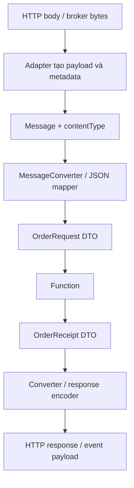
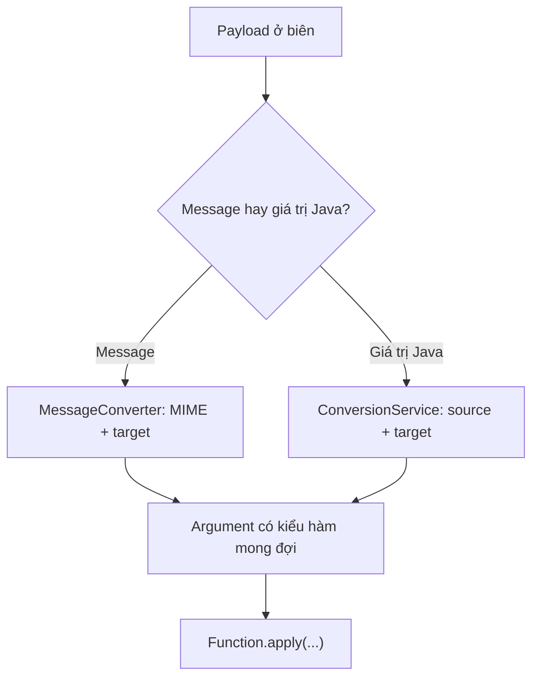

# Chi phí chuyển đổi JSON và sao chép Message

Spring Cloud Function cho phép viết nghiệp vụ dưới dạng `Supplier<T>`, `Function<I, O>` và `Consumer<T>`, tra cứu qua `FunctionCatalog`, ghép chuỗi (*composition*) và triển khai cùng một logic qua HTTP, sự kiện hoặc môi trường serverless. Để đi qua các biên giao thức, framework hoặc adapter có thể phải **giải tuần tự hóa JSON thành kiểu Java**, tạo `Message<?>` mang headers và **tuần tự hóa kết quả**. Những bước này có chi phí CPU, cấp phát bộ nhớ và thu gom rác khác với thời gian xử lý nghiệp vụ.

Trong chương **Hiệu năng**, bài học này tập trung vào hai nguồn overhead thường bị nhầm lẫn:

1. **Chuyển đổi JSON:** encode/decode byte ↔ object, chuyển đổi charset, tra cứu metadata kiểu, cấp phát DTO/collection và validation.
2. **Sao chép Message:** tạo wrapper mới, sao chép map header, dùng chung hay nhân bản payload, và truyền metadata khi chuyển qua các hàm trong chuỗi.

Mục tiêu không phải loại mọi lần tạo object. **Sao chép dữ liệu khi cần bảo vệ quyền sở hữu và tính bất biến là đúng đắn**, còn loại bỏ các vòng JSON round-trip hoặc copy payload không cần thiết có thể cải thiện hiệu năng. Phải tách được **cái nào thực sự bị copy** trước khi tối ưu.

Sau bài này, bạn có thể:

- Giải thích chi phí `byte[] → DTO → byte[]` và phân biệt với `String`/`Map`/`Message<?>`.
- Hiểu quan hệ giữa generic của function, header `contentType`, `MessageConverter` và `ConversionService`.
- Chứng minh `MessageBuilder.fromMessage(...)` sử dụng lại payload thay vì deep copy.
- Phân biệt **sao chép header map**, **sao chép tham chiếu header value** và **clone byte array**.
- Giảm chuyển đổi trung gian khi composition của các function đã có kiểu Java tương thích.
- Thiết kế DTO bất biến, header propagation có chọn lọc và bảo vệ payload mutable ở ranh giới bất đồng bộ.
- Dùng JMH và phép đo integration để so sánh JSON serialization, Message wrapping và end-to-end latency.

> **Phạm vi phiên bản:** Các ví dụ Java dùng Java 17+; đoạn `ObjectMapper` dùng Jackson 2 (package `com.fasterxml.jackson.*`), phù hợp với project có Jackson 2. Jackson 3 dùng package `tools.jackson.*` và API tương ứng. `JsonMapper` của Spring Cloud Function không đồng nhất với class `JsonMapper` của Jackson 3. Cấu hình, adapter và phiên bản Spring Cloud Function thực tế quyết định converter nào chạy.

## 1. Vẽ đúng đường đi của một payload

Một request JSON gửi vào function có thể đi qua các đoạn:



Đây là **sơ đồ khái niệm**, không phải call stack bắt buộc của mọi adapter. Một Web adapter có thể giải mã body bằng codec riêng rồi mới chuyển cho catalog; một broker có thể đưa payload đã là `String` hoặc đối tượng Java. Bởi vậy không thể khẳng định mọi lời gọi luôn tạo đúng một `Message<byte[]>` rồi dùng đúng một JSON converter.

### Chi phí nào có thể xuất hiện?

| Giai đoạn | Công việc | Chi phí thường gặp |
| --- | --- | --- |
| Nhận body | Network I/O, buffering, có thể giải nén | Memory/copy bytes, thời gian chờ |
| Charset | UTF-8 bytes ↔ Java `String` nếu đi qua text | Cấp phát char/string, CPU |
| JSON decode | Tokenize, match property, tạo DTO/list/map | CPU, allocation, GC |
| Message wrapper | Tạo `Message<?>`, headers | Object và header-map allocations |
| Function | Validation, tính toán, DB/HTTP I/O | CPU hoặc chờ I/O nghiệp vụ |
| JSON encode | Duyệt object graph, encode UTF-8 | CPU, buffer allocation |
| Adapter output | Copy buffer, truyền network/broker | I/O, queueing, có thể copy |

Một `Function.apply(...)` trực tiếp trên DTO có sẵn **không đo** các bước JSON/adapter ở đầu và cuối. Ngược lại, thời gian HTTP end-to-end chứa nhiều chi phí ngoài core function, nên không thể lấy chênh lệch đơn giản rồi gọi là “chi phí Jackson”.

## 2. Message là một envelope, không phải bản sao nội dung

Spring Messaging định nghĩa `Message<T>` với hai thành phần chính:

- **Payload:** đối tượng Java `T`.
- **Headers:** `MessageHeaders` mang metadata như `contentType`, correlation ID, routing/tracing information.

```text
Message<OrderRequest>
├── payload ───────────────> OrderRequest (object)
└── headers
    ├── contentType: application/json
    ├── correlationId: order-42
    ├── id: ...
    └── timestamp: ...
```

Một `Message` mới có thể **trỏ tới cùng payload** như message cũ. Tương tự, sao chép headers thường sao chép cặp key/value ở mức map, **không tự tạo bản sao sâu của mỗi value**.

### Bất biến của wrapper không phải bất biến của payload

`MessageHeaders` cung cấp map **không cho phép chỉnh sửa thông thường**; giao diện `Message` không có setter để thay payload. Tuy vậy, nếu payload là `byte[]` hoặc header value là `Map` mutable, code giữ tham chiếu vẫn có thể sửa nội dung nằm bên trong.

So sánh:

| Thành phần | Có thể đổi thông qua Message wrapper? | Dữ liệu bên trong có thể mutable? |
| --- | --- | --- |
| `MessageHeaders` map | Không qua `put(...)` thông thường | Header values vẫn có thể mutable |
| Payload `String` | Không thay reference bằng setter | `String` bất biến |
| Payload record với fields bất biến | Không thay reference bằng setter | Phụ thuộc các field lồng nhau |
| Payload `byte[]` | Không thay reference bằng setter | **Có**, phần tử byte thay được |
| Payload `List<T>` | Không thay reference bằng setter | Phụ thuộc implementation và elements |

Quyết định copy nên dựa trên **quyền sở hữu và nguy cơ concurrent mutation**, không dựa riêng vào việc message được khai báo là `Message<byte[]>` hay `Message<OrderRequest>`.

## 3. Ví dụ DTO và Function xuyên suốt

Ví dụ ứng dụng xử lý đơn hàng:

```java
// File: demo/perf/OrderLine.java
package demo.perf;

public record OrderLine(
    String sku,
    int quantity,
    long unitPriceVnd
) {}
```

```java
// File: demo/perf/OrderRequest.java
package demo.perf;

import java.util.List;
import java.util.Objects;

public record OrderRequest(
    String orderId,
    List<OrderLine> lines
) {
    public OrderRequest {
        Objects.requireNonNull(orderId, "orderId");
        lines = List.copyOf(
            Objects.requireNonNull(lines, "lines")
        );
    }
}
```

```java
// File: demo/perf/OrderReceipt.java
package demo.perf;

public record OrderReceipt(
    String orderId,
    int lineCount,
    long totalVnd
) {}
```

Constructor `List.copyOf(...)` tạo một **snapshot cấu trúc của list** để caller không thêm/xóa phần tử sau khi truyền vào record. Nó **không deep-copy mọi phần tử**; ở ví dụ này mỗi `OrderLine` là record chứa primitive và `String` nên có thể chia sẻ tương đối an toàn. Với phần tử mutable, cần biện pháp sâu hơn hoặc đổi thiết kế dữ liệu.

Hàm nghiệp vụ:

```java
// File: demo/perf/OrderFunctions.java
package demo.perf;

import java.util.function.Function;

import org.springframework.context.annotation.Bean;
import org.springframework.context.annotation.Configuration;

@Configuration
public class OrderFunctions {

    @Bean("calculateOrder")
    public Function<OrderRequest, OrderReceipt> calculateOrder() {
        return request -> {
            if (request == null ||
                !request.orderId().matches("[A-Z0-9-]{1,32}") ||
                request.lines().isEmpty() ||
                request.lines().size() > 100) {
                throw new IllegalArgumentException("Invalid order");
            }

            long total = 0L;
            for (OrderLine line : request.lines()) {
                if (line == null ||
                    line.sku() == null ||
                    !line.sku().matches("[A-Z0-9-]{1,24}") ||
                    line.quantity() < 1 ||
                    line.quantity() > 10_000 ||
                    line.unitPriceVnd() < 0) {
                    throw new IllegalArgumentException(
                        "Invalid order line"
                    );
                }

                total = Math.addExact(total, Math.multiplyExact(
                    (long) line.quantity(), line.unitPriceVnd()
                ));
            }

            return new OrderReceipt(
                request.orderId(),
                request.lines().size(),
                total
            );
        };
    }

    @Bean("renderReceipt")
    public Function<OrderReceipt, String> renderReceipt() {
        return result -> result.orderId() + ": " +
            result.totalVnd() + " VND";
    }
}
```

Ví dụ input JSON:

```json
{
  "orderId": "ORD-101",
  "lines": [
    {"sku": "BOOK-1", "quantity": 2, "unitPriceVnd": 50000},
    {"sku": "PEN-1", "quantity": 1, "unitPriceVnd": 30000}
  ]
}
```

Kết quả logic là `OrderReceipt("ORD-101", 2, 130000)`. Khai báo generic `Function<OrderRequest,OrderReceipt>` cho Spring Cloud Function biết **đích chuyển đổi** nếu adapter nhận JSON; MIME `application/json` chỉ nói định dạng, không tự chọn DTO.

## 4. Chi phí JSON decode và encode gồm những gì?

Phân biệt rõ các thao tác:

```text
JSON byte[] --(decode/parser)--> OrderRequest object
OrderRequest object --(JSON writer)--> byte[]

JSON byte[] --(UTF-8 decode)--> String
String --(JSON parser)--> OrderRequest
```

Đường thứ hai có bước tạo `String` trung gian có thể cấp phát thêm bộ nhớ. Với Jackson 2, `ObjectMapper.readValue(byte[], ...)` có thể đọc trực tiếp byte array mà không cần bạn tự tạo `String` bằng `new String(bytes, UTF_8)`. Điều này **không có nghĩa hoàn toàn zero-copy**: parser vẫn có buffer, tokenization và cấp phát object Java.

### Chuyển đổi “thành công” vẫn có overhead

| Dữ liệu | Đặc điểm chi phí |
| --- | --- |
| Một DTO nhỏ gồm vài trường | Parser overhead và object allocations có thể đáng kể so với phép tính đơn giản |
| JSON object có nhiều trường | Tăng số token/property lookups |
| JSON array nhiều phần tử | Tăng số lượng DTO/list objects, CPU và GC |
| Chuỗi Unicode dài | Tăng chi phí decode/encode UTF-8 và allocation |
| Cấu trúc lồng sâu | Tăng traversal, stack/depth constraints |
| `Map<String,Object>` rồi convert sang DTO | Có thể tạo object trung gian không cần thiết |
| `byte[] → String → DTO` | Có thể thêm lần decode/cấp phát chuỗi |

**Không dùng “JSON tốn X ms” như hằng số.** Chi phí phụ thuộc kích thước payload, schema, mapper, JDK/JIT, cấu hình, concurrency và warm-up. Đo trên dữ liệu đại diện thay vì chỉ dùng một JSON nhỏ bất biến.

## 5. Giữ một JSON mapper được cấu hình ổn định

Với **Jackson 2**, `ObjectMapper` là thành phần tương đối đắt hơn so với gọi một phép serialize nhỏ. Mẫu nên xét là **cấu hình một lần**, sau đó dùng chung cho các lời gọi nếu bảo đảm không thay đổi cấu hình giữa lúc đọc/ghi.

```java
package demo.perf;

import com.fasterxml.jackson.databind.ObjectMapper;
import com.fasterxml.jackson.databind.ObjectReader;
import com.fasterxml.jackson.databind.ObjectWriter;

import org.springframework.context.annotation.Bean;
import org.springframework.context.annotation.Configuration;

@Configuration
public class JsonCodecConfiguration {

    @Bean
    public ObjectReader orderReader(ObjectMapper objectMapper) {
        return objectMapper.readerFor(OrderRequest.class);
    }

    @Bean
    public ObjectWriter receiptWriter(ObjectMapper objectMapper) {
        return objectMapper.writerFor(OrderReceipt.class);
    }
}
```

Ví dụ trên giả định ứng dụng **đã có một `ObjectMapper` Jackson 2 bean**. Nếu dùng Spring Boot/Spring Cloud Function ở phiên bản dựa vào Jackson 3/Gson hoặc một abstraction `JsonMapper` riêng, cần sử dụng API đúng phiên bản thay vì ép dùng đoạn code trên.

`ObjectReader` và `ObjectWriter` được cấu hình bất biến giúp code diễn đạt rõ target type và dùng lại thiết lập. Cần tránh gọi các method thay đổi cấu hình của một `ObjectMapper` đang được nhiều threads sử dụng; cấu hình trước khi publish bean, sau đó coi mapper là read-only.

### Ví dụ trực tiếp để hiểu điểm copy

```java
import com.fasterxml.jackson.databind.ObjectMapper;
import java.nio.charset.StandardCharsets;

ObjectMapper mapper = new ObjectMapper();

byte[] raw = """
    {"orderId":"ORD-101","lines":[
      {"sku":"BOOK-1","quantity":2,"unitPriceVnd":50000}
    ]}
    """.getBytes(StandardCharsets.UTF_8);

OrderRequest request =
    mapper.readValue(raw, OrderRequest.class);

OrderReceipt receipt = new OrderReceipt(
    request.orderId(), request.lines().size(), 100_000L
);

byte[] encoded = mapper.writeValueAsBytes(receipt);
System.out.println(encoded.length);
```

Ở đây:

- `raw` là byte array đầu vào.
- `readValue(...)` tạo Java object graph mới.
- `receipt` là object Java khác.
- `writeValueAsBytes(...)` tạo byte array JSON cho output.

Không kết luận rằng vì `writeValueAsBytes(...)` trả `byte[]` nên socket/network sẽ gửi chính mảng đó mà không copy. Adapter và transport có thể buffer/copy thêm.

### Reuse mapper không đồng nghĩa bỏ validate/giới hạn

Một request JSON quá lớn hoặc array cực nhiều phần tử vẫn có thể làm cạn tài nguyên dù mapper được reuse. Cần đặt giới hạn ở gateway/adapter, parser nesting/string limits và số phần tử collection, đồng thời cập nhật bản vá framework. Tối ưu “ít allocation” không được đánh đổi an toàn giải tuần tự hóa.

## 6. Chuyển đổi trong Spring Cloud Function: khi nào thực sự xảy ra?

Spring Cloud Function có hai cơ chế Spring Framework liên quan:

- **`MessageConverter`**: chuyển payload của `Message<?>` khi cần đưa về kiểu mà function khai báo; dựa vào `contentType` và kiểu đích.
- **`ConversionService`**: chuyển giá trị Java không bọc `Message<?>` giữa những kiểu có converter phù hợp.

Sơ đồ:



Framework **không cần deserialize lại** nếu đối tượng đến đã đúng kiểu mà hàm mong đợi và đường gọi không buộc thêm conversion. Đừng suy luận từ việc có `contentType=application/json` rằng một `Message<OrderRequest>` đã có DTO payload vẫn sẽ bị đưa qua JSON serializer rồi parser thêm lần nữa.

Ví dụ:

| Đầu vào runtime | Kiểu đích | Có khả năng phát sinh JSON mapping? |
| --- | --- | --- |
| `Message<byte[]>`, JSON | `OrderRequest` | Có, nếu adapter/catalog chọn JSON converter |
| `Message<OrderRequest>` | `OrderRequest` | Thường không cần deserialize lại payload |
| `OrderRequest` thuần | `OrderRequest` | Không cần JSON conversion |
| `String` chứa JSON | `OrderRequest` | Phụ thuộc converter/đường gọi; không tự áp dụng với mọi plain String |
| `Map<String,Object>` | `OrderRequest` | Có thể cần mapping chuyển kiểu, tùy cơ chế |
| `Message<byte[]>`, MIME sai | `OrderRequest` | Có thể không tìm được converter hoặc xử lý sai |

JSON được đọc **bao nhiêu lần** là một câu hỏi đo đạc và tracing, không thể trả lời chính xác chỉ bằng tên class function.

## 7. Composition: đừng encode/decode JSON giữa hai hàm Java đã khớp kiểu

Với hai function ở mục 3:

```yaml
spring:
  cloud:
    function:
      definition: calculateOrder|renderReceipt
```

Điểm nối là:

```text
OrderRequest
    ↓ calculateOrder
OrderReceipt  ← đối tượng Java đã đúng kiểu
    ↓ renderReceipt
String
```

Không cần trung gian:

```text
OrderReceipt
  ↓ serialize thành JSON byte[]
  ↓ decode JSON byte[] trở lại OrderReceipt
  ↓ renderReceipt
```

Đoạn trung gian đó là một **JSON round-trip không cần thiết** nếu hai bean chạy trong cùng process và chữ ký Java phù hợp. Catalog có khả năng bọc hàm, nhưng không nên chủ động chèn bước JSON chỉ để “chuẩn hóa” mọi function.

### Vì sao đôi khi vẫn có JSON conversion giữa hai bước?

- Hàm trước trả `Message<byte[]>` mang JSON, hàm sau cần `OrderReceipt`.
- Một hàm hoặc adapter xử lý raw payload thay vì đối tượng Java.
- Kiểu đầu ra/đầu vào không tương thích và converter được áp dụng ở điểm nối.
- Một bước là ranh giới **network/broker** thật, không phải chỉ composition trong JVM.

Nếu muốn truyền qua broker, việc serialize là một phần của hợp đồng truyền tải, không nên “tối ưu bỏ” bằng cách chia sẻ Java object giữa hai process độc lập.

## 8. MessageBuilder.fromMessage(...) sao chép điều gì?

Javadoc Spring Framework mô tả `MessageBuilder.fromMessage(message)` tạo builder có **headers được copy** và **dùng payload của message gốc**.

```java
import org.springframework.messaging.Message;
import org.springframework.messaging.support.MessageBuilder;

byte[] payload = {1, 2, 3, 4};

Message<byte[]> original = MessageBuilder
    .withPayload(payload)
    .setHeader("correlationId", "ORD-101")
    .build();

Message<byte[]> next = MessageBuilder
    .fromMessage(original)
    .setHeader("processingStage", "validated")
    .build();

System.out.println(
    original.getPayload() == next.getPayload()
); // true: dùng cùng tham chiếu byte[]

System.out.println(
    original == next
); // false: message object mới
```

**Hai điều đúng cùng lúc:** có Message wrapper mới, nhưng mảng payload là **cùng đối tượng**. Việc copy header entries có thể tạo map/builder allocations; nó **không clone từng byte payload**.

Phân biệt với:

```java
Message<byte[]> independentBytes = MessageBuilder
    .withPayload(original.getPayload().clone())
    .setHeader("correlationId", "ORD-101")
    .build();

System.out.println(
    original.getPayload() == independentBytes.getPayload()
); // false
```

Ở đây `byte[].clone()` tạo **mảng mới cùng nội dung**, có chi phí O(n) theo kích thước payload và tăng allocation. Dùng nó khi cần **quyền sở hữu riêng** của bytes hoặc khi nguồn có thể sửa dữ liệu sau khi publish message.

## 9. Header copy là shallow copy, không phải deep copy

Ví dụ header value là một `Map` mutable:

```java
import java.util.HashMap;
import java.util.Map;

import org.springframework.messaging.Message;
import org.springframework.messaging.support.MessageBuilder;

Map<String, String> attributes = new HashMap<>();
attributes.put("region", "north");

Message<String> original = MessageBuilder
    .withPayload("hello")
    .setHeader("attributes", attributes)
    .build();

Message<String> derived = MessageBuilder
    .fromMessage(original)
    .setHeader("stage", "processed")
    .build();

attributes.put("region", "south");

@SuppressWarnings("unchecked")
Map<String, String> seen = (Map<String, String>)
    derived.getHeaders().get("attributes");

System.out.println(seen.get("region")); // south
```

Việc gọi `MessageHeaders.put(...)` trực tiếp không được hỗ trợ theo thông lệ, nhưng **đối tượng giá trị** `attributes` vẫn là mutable map mà cả original/derived cùng trỏ tới.

Để bảo vệ message khỏi thay đổi từ nguồn:

```java
Map<String, String> safeAttributes =
    Map.copyOf(attributes);

Message<String> safe = MessageBuilder
    .withPayload("hello")
    .setHeader("attributes", safeAttributes)
    .build();
```

`Map.copyOf(...)` tạo map không sửa được ở mức cấu trúc, nhưng vẫn là **shallow copy** nếu value của map là object mutable. Với header values lớn/nested, cân nhắc thay bằng value types bất biến, loại header không cần thiết hoặc tạo bản sao theo hợp đồng thực tế.

### Các metadata không nên copy vô điều kiện

| Header | Rủi ro khi copy bừa sang message mới |
| --- | --- |
| `contentType` | Payload đã đổi từ text sang JSON nhưng header vẫn là text |
| `replyChannel`/routing information | Message có thể đi sai kênh hoặc lặp phản hồi |
| `errorChannel` | Lỗi bị gửi đến nơi không còn phù hợp |
| Auth/session headers | Rò rỉ thông tin giữa boundary/tenant |
| Correlation ID | Có thể cần giữ, nhưng phải kiểm soát trust/độ dài |
| Custom header chứa Map/List mutable | Dữ liệu thay đổi ngoài ý muốn khi fan-out |
| `id`, `timestamp` | Spring xem là metadata đặc biệt, có quy tắc read-only riêng |

Với Spring Integration, `id` và `timestamp` được xem là headers chỉ đọc khi tạo message mới; không dùng copy của chúng để thay thế định danh/lifecycle chuẩn. **Header propagation phải theo contract của adapter**, không phải luôn “copy all”.

## 10. Khi thay payload, tạo Message mới và chỉ giữ header thực sự cần

Một function nhận `Message<OrderRequest>` có thể muốn trả `Message<OrderReceipt>` để giữ correlation ID.

```java
package demo.perf;

import java.util.function.Function;

import org.springframework.beans.factory.annotation.Qualifier;
import org.springframework.context.annotation.Bean;
import org.springframework.context.annotation.Configuration;
import org.springframework.messaging.Message;
import org.springframework.messaging.MessageHeaders;
import org.springframework.messaging.support.MessageBuilder;
import org.springframework.util.MimeTypeUtils;

@Configuration
public class MessageOrderFunctions {

    @Bean("calculateWithHeaders")
    public Function<
        Message<OrderRequest>,
        Message<OrderReceipt>
    > calculateWithHeaders(
        @Qualifier("calculateOrder")
        Function<OrderRequest, OrderReceipt> calculateOrder
    ) {
        return incoming -> {
            OrderReceipt result =
                calculateOrder.apply(incoming.getPayload());

            MessageBuilder<OrderReceipt> builder =
                MessageBuilder.withPayload(result)
                    .setHeader(
                        MessageHeaders.CONTENT_TYPE,
                        MimeTypeUtils.APPLICATION_JSON
                    );

            Object correlationId = incoming
                .getHeaders().get("correlationId");
            if (correlationId != null) {
                builder.setHeader("correlationId", correlationId);
            }

            return builder.build();
        };
    }
}
```

`@Qualifier("calculateOrder")` nêu rõ bean được tiêm khi context có nhiều function. Không tạo thêm một bean trùng tên `calculateWithHeaders` trong cùng context.

**Lưu ý:**

- `MessageBuilder.withPayload(result)` tạo message mới với **payload object `OrderReceipt`**, **không tạo JSON bytes tại đây**.
- `contentType=application/json` mô tả định dạng mong muốn/được adapter xử lý ở biên; việc serialize thật phụ thuộc adapter/converter.
- Chỉ giữ `correlationId` từ input khi hợp đồng cho phép; các headers khác được chủ động xem xét.
- Khi message cuối cùng đi qua broker hoặc HTTP adapter, có thể xuất hiện một lần JSON encode cần thiết để gửi ra ngoài.

## 11. Có lúc nên dùng lại Message, có lúc phải tạo mới

| Nhu cầu | Cách tiếp cận | Chi phí/rủi ro |
| --- | --- | --- |
| Hàm chỉ đọc payload/header rồi trả nguyên message | Có thể return cùng message nếu contract cho phép | Không tạo wrapper mới; không đổi metadata |
| Thêm header `stage` cho cùng payload | `MessageBuilder.fromMessage(original).setHeader(...).build()` | Wrapper/header map mới, payload dùng chung |
| Đổi payload từ `OrderRequest` sang `OrderReceipt` | `MessageBuilder.withPayload(result)` + headers cần thiết | Wrapper mới; không cần JSON round-trip |
| Bảo vệ `byte[]` trước mutation của nguồn | `raw.clone()` khi nhận quyền sở hữu | Cấp phát/copy theo kích thước byte |
| Truyền qua mạng/broker | Serialize/encode theo giao thức | Không thể dùng Java reference của process khác |
| Gửi cùng mutable byte[] tới nhiều consumer | Copy riêng, hoặc thiết kế ownership/immutability | Tránh data race và corruption |

Không được cố “zero-copy” mọi trường hợp. Nếu producer tái sử dụng một buffer sau khi gửi message async, consumer có thể đọc bytes đã bị ghi đè. **Đúng đắn và cô lập dữ liệu đứng trước tối ưu allocation**.

## 12. Những đoạn code có thể tạo JSON round-trip thừa

Phản ví dụ:

```java
// PHẢN VÍ DỤ: không cần đưa DTO qua JSON trong cùng JVM.
byte[] intermediate =
    mapper.writeValueAsBytes(orderReceipt);

OrderReceipt copied =
    mapper.readValue(intermediate, OrderReceipt.class);

String display = copied.orderId();
```

Đoạn code này tạo bytes, parse JSON và một DTO mới chỉ để lấy lại các trường đã có sẵn. Nếu cần **deep copy** một object graph, serialize/deserialize có thể là một kỹ thuật, nhưng chi phí lớn và phụ thuộc schema/mapper; nên ưu tiên DTO bất biến hoặc copy constructor khi phù hợp.

Thay bằng:

```java
String display = orderReceipt.orderId();
```

Khi nhìn code, hỏi:

1. Hai hàm có chạy trong **cùng process** không?
2. Output type của bước trước đã là input type của bước sau chưa?
3. Có ranh giới giao thức/ủy quyền/serialization thật sự không?
4. Đối tượng có mutable state khiến việc chia sẻ nguy hiểm không?
5. JSON round-trip đang phục vụ một hợp đồng hay chỉ là thói quen triển khai?

Chỉ bỏ conversion khi bảo đảm không làm sai contract, validation, audit logging hoặc security boundary.

## 13. Allocation, throughput và GC: ba chiều đánh giá

Trong hệ thống xử lý nhiều request, overhead JSON và copy Message có thể tạo lượng allocation đáng kể.

Giả sử một operation tự ý sao chép `byte[]` kích thước 32 KiB. Với **2.000 operations/giây**, riêng lượng payload bytes mới được copy đã xấp xỉ:

\[
32 \times 1024 \times 2000
= 65{,}536{,}000\ \text{bytes/s}
\]

Tức khoảng **62,5 MiB/s** chỉ tính **nội dung bytes mới**, chưa tính header objects, message wrapper, alignment, buffer của parser hay các allocations khác.

Đây là phép tính minh họa, không phải số liệu đo được. Lượng dữ liệu tăng khi payload lớn, throughput cao hoặc copy qua nhiều bước.

### Hệ quả tiềm năng

- **CPU:** JSON parsing, encoding, hashing/copying headers và memory copy.
- **Allocation rate:** nhiều DTO, map/list, byte arrays và message wrappers.
- **GC:** tần suất dọn các object sống ngắn tăng; p99 có thể biến động.
- **Memory pressure:** batch/queue giữ nhiều bản sao cùng payload trong heap.
- **Cache locality:** object graph/bytes mới có thể làm tăng memory bandwidth.

Không khẳng định mọi allocation đều gây GC pause rõ rệt. JVM và collector được tối ưu cho object sống ngắn; **đo bằng profiler/JFR/JMH trước khi quyết định đổi thiết kế**.

### So sánh mức độ copy

| Thao tác | Độ lớn công việc tương đối | Ghi chú |
| --- | --- | --- |
| Gán thêm tham chiếu DTO | Xấp xỉ O(1) | Không copy dữ liệu |
| Tạo `Message` mới, vài headers | Phụ thuộc số headers | Không nhất thiết copy payload |
| Copy map headers | Xấp xỉ O(h), h = số entries | Values thường vẫn là tham chiếu |
| `byte[].clone()` | O(n), n = số bytes | Tạo mảng bytes mới |
| JSON serialize/deserialize | Phụ thuộc độ dài và cấu trúc | Duyệt object/token, thường tạo buffers/objects |
| Gửi network/broker | Phụ thuộc transport | Có thể có copies hoặc buffering thêm |

Hàm `MessageBuilder.fromMessage(...)` không phải **deep clone** của toàn bộ payload; do đó không nên dùng tên “sao chép Message” để suy luận có O(n) byte copy ở mọi trường hợp.

## 14. JMH: benchmark conversion và Message copy đúng cách

Để đo microbenchmark, dùng **JMH** thay vì một vòng lặp ngắn `System.nanoTime()` cho mỗi operation. JMH có warm-up, fork JVM, Blackhole và cơ chế hạn chế tác động của compiler optimizations.

Ví dụ benchmark **Jackson 2 + Spring Messaging** dưới đây cố định một payload nhỏ để so sánh một số operation **khác nhau về bản chất**:

```java
package demo.perf;

import java.util.concurrent.TimeUnit;

import com.fasterxml.jackson.databind.ObjectMapper;
import org.openjdk.jmh.annotations.*;
import org.openjdk.jmh.infra.Blackhole;

import org.springframework.messaging.Message;
import org.springframework.messaging.support.MessageBuilder;

@State(Scope.Thread)
@BenchmarkMode(Mode.AverageTime)
@OutputTimeUnit(TimeUnit.MICROSECONDS)
@Warmup(iterations = 5)
@Measurement(iterations = 5)
@Fork(2)
public class JsonAndMessageBenchmark {

    private ObjectMapper mapper;
    private OrderRequest request;
    private byte[] json;
    private Message<byte[]> original;

    @Setup(Level.Trial)
    public void setUp() throws Exception {
        mapper = new ObjectMapper();
        request = new OrderRequest("ORD-101",
            java.util.List.of(
                new OrderLine("BOOK-1", 2, 50_000L)
            ));
        json = mapper.writeValueAsBytes(request);
        original = MessageBuilder
            .withPayload(json)
            .setHeader("correlationId", "ORD-101")
            .build();
    }

    @Benchmark
    public void jsonDecode(Blackhole sink) throws Exception {
        sink.consume(
            mapper.readValue(json, OrderRequest.class)
        );
    }

    @Benchmark
    public void jsonEncode(Blackhole sink) throws Exception {
        sink.consume(mapper.writeValueAsBytes(request));
    }

    @Benchmark
    public void messageWithSharedPayload(Blackhole sink) {
        sink.consume(
            MessageBuilder.fromMessage(original)
                .setHeader("stage", "next")
                .build()
        );
    }

    @Benchmark
    public void messageWithClonedBytes(Blackhole sink) {
        sink.consume(
            MessageBuilder
                .withPayload(original.getPayload().clone())
                .setHeader("correlationId", "ORD-101")
                .build()
        );
    }
}
```

Benchmark cần dependency `jmh-core` và JMH annotation processor tương thích, Spring Messaging và Jackson 2. Code trong bài chưa được chạy — mỗi project cần build với JDK/dependency versions thực tế.

### Vì sao không so một giá trị rồi kết luận?

Bốn benchmark trên có lượng công việc khác nhau:

- `jsonDecode`: parse bytes và tạo object graph.
- `jsonEncode`: duyệt DTO và tạo bytes mới.
- `messageWithSharedPayload`: tạo wrapper/headers nhưng dùng lại payload.
- `messageWithClonedBytes`: copy bytes và tạo message.

Nếu `messageWithSharedPayload` nhanh hơn `jsonDecode`, điều đó không đủ để kết luận “Spring Cloud Function chỉ tốn một message copy”: đó chỉ là **microbenchmark của một đoạn code không chạy qua FunctionCatalog hoặc adapter thật**.

### Thêm kích thước payload và allocation

Khi mở rộng benchmark, thay đổi có chủ đích:

| Biến | Giá trị gợi ý |
| --- | --- |
| JSON payload size | 1 KiB, 32 KiB, 256 KiB |
| Headers | 2, 20, 100 entries |
| DTO graph | Một object, danh sách 10/100 items |
| Charset | ASCII, Unicode UTF-8 có dấu |
| Mapper | Jackson 2/3 hoặc Gson theo phiên bản đang dùng |
| Threads | Single-thread rồi nhiều threads |
| Target | DTO cụ thể vs raw `Map` |

Để xem allocation, JMH có profiler `-prof gc` cung cấp các chỉ số như `gc.alloc.rate.norm` (**bytes/op**) khi runtime hỗ trợ. Với Java Flight Recorder (JFR), có thể quan sát allocations và hotspots trong ứng dụng tích hợp. Không trộn kết quả single-thread JMH với p99 HTTP dưới tải đồng thời như thể chúng cùng một metric.

## 15. Kiểm thử sao chép wrapper, payload và header value

Unit test JUnit 5 có thể kiểm tra contract một cách trực tiếp:

```java
package demo.perf;

import static org.junit.jupiter.api.Assertions.*;

import java.util.HashMap;
import java.util.Map;

import org.junit.jupiter.api.Test;
import org.springframework.messaging.Message;
import org.springframework.messaging.support.MessageBuilder;

class MessageCopyTest {

    @Test
    void newMessageSharesSamePayloadReference() {
        byte[] bytes = {1, 2, 3};
        Message<byte[]> original = MessageBuilder
            .withPayload(bytes)
            .setHeader("trace", "A")
            .build();

        Message<byte[]> next = MessageBuilder
            .fromMessage(original)
            .setHeader("trace", "B")
            .build();

        assertNotSame(original, next);
        assertSame(original.getPayload(), next.getPayload());
        assertEquals("A", original.getHeaders().get("trace"));
        assertEquals("B", next.getHeaders().get("trace"));
    }

    @Test
    void cloneCreatesIndependentBytes() {
        byte[] source = {1, 2, 3};
        Message<byte[]> original =
            MessageBuilder.withPayload(source).build();

        Message<byte[]> copied = MessageBuilder
            .withPayload(original.getPayload().clone())
            .build();

        assertNotSame(
            original.getPayload(), copied.getPayload()
        );
        source[0] = 9;
        assertEquals(1, copied.getPayload()[0]);
        assertEquals(9, original.getPayload()[0]);
    }

    @Test
    void headerValueIsNotDeepCopied() {
        Map<String, String> value = new HashMap<>();
        value.put("region", "north");

        Message<String> original = MessageBuilder
            .withPayload("hello")
            .setHeader("meta", value)
            .build();

        Message<String> copied = MessageBuilder
            .fromMessage(original)
            .setHeader("trace", "next")
            .build();

        value.put("region", "south");

        assertSame(
            original.getHeaders().get("meta"),
            copied.getHeaders().get("meta")
        );
    }
}
```

Những test này xác minh hành vi đối tượng trong Spring Messaging, **không đo chi phí mạng, broker hay conversion của Spring Cloud Function**. Mỗi test dùng `MessageBuilder`; với publisher async hoặc broker adapter thực, vẫn phải kiểm tra ownership và thời điểm dữ liệu được đọc.

## 16. Kiểm thử FunctionCatalog và JSON tại biên

Một test gọi thẳng `calculateOrder().apply(request)` với DTO có sẵn chỉ xác minh logic Java.

```java
import java.util.List;
import java.util.function.Function;

import org.springframework.cloud.function.context.FunctionCatalog;

// Trong test/method đã inject FunctionCatalog catalog:
Function<OrderRequest, OrderReceipt> fn =
    catalog.lookup("calculateOrder");

OrderReceipt receipt = fn.apply(
    new OrderRequest("ORD-101", List.of(
        new OrderLine("BOOK-1", 2, 50_000L)
    ))
);

System.out.println(receipt.totalVnd()); // 100000
```

Lời gọi này không có JSON bytes hoặc Message headers, nên không thể suy ra thời gian `JsonMessageConverter` từ nó.

### Đo end-to-end khi có HTTP adapter

Với ứng dụng Spring Cloud Function Web đã expose `calculateOrder`:

```bash
curl -X POST http://localhost:8080/calculateOrder \
  -H 'Content-Type: application/json' \
  -H 'Accept: application/json' \
  -d '{"orderId":"ORD-101","lines":[{"sku":"BOOK-1","quantity":2,"unitPriceVnd":50000}]}'
```

Lời gọi này thử luồng **HTTP body → adapter/conversion → function → response** trên phiên bản thực. Nếu chỉ so code JMH mà không chạy integration, bạn sẽ không thấy overhead của adapter, headers, IO buffers và network.

### Ma trận phép đo nên có

| Bài đo | Đầu vào | Thời gian có thể chứa |
| --- | --- | --- |
| Core function | `OrderRequest` Java | Validation/tính toán |
| JSON decode microbenchmark | `byte[]` JSON | Parser/object allocation |
| Message shallow copy microbenchmark | `Message<byte[]>` | Wrapper và headers |
| Message deep byte copy benchmark | `Message<byte[]>` | Byte copy + wrapper |
| Catalog invocation với DTO | DTO Java | Wrapper/catalog + function tùy đường gọi |
| HTTP integration | Body JSON thực | Codec/Message/conversion + function + network |
| Event binder test | Broker payload + headers | Broker, binder, converter, function, ack |
| Serverless cold/warm | Platform event | Initialization + adapter + conversion + function |

**Không trừ thời gian đo của hai test khác điều kiện rồi gọi là chính xác chi phí framework.** Muốn phân rã, cần instrument cùng trace/đường request và loại trừ chênh lệch đồng hồ, sampling, concurrency, GC và payload.

## 17. Các tối ưu đáng cân nhắc theo thứ tự

1. **Giữ chữ ký generic cụ thể**: `Function<OrderRequest, OrderReceipt>` và `Message<OrderRequest>` khi cần; tránh raw `Object` khiến mapping trở nên khó đoán.
2. **Để DTO đi xuyên qua composition khi kiểu khớp**; không tự encode/decode JSON ở giữa các Java functions.
3. **Reuse mapper/reader/writer đã cấu hình ổn định** thay vì tạo codec mới không cần thiết mỗi invocation.
4. **Tránh `byte[] → String → DTO` khi decoder hỗ trợ bytes trực tiếp**, nếu điều đó phù hợp API/charset.
5. **Không clone byte[] theo phản xạ** ở mọi điểm. Clone tại trust/ownership boundary thật sự và ghi rõ lý do.
6. **Chọn lọc headers khi tạo Message mới**, tránh chở theo routing/security metadata không còn phù hợp.
7. **Giảm payload không cần thiết**, nhưng giữ đủ dữ liệu theo schema; không xóa trường khiến downstream mất hợp đồng.
8. **Áp dụng giới hạn kích thước/depth/collection**, tránh quá tải parser và JSON arrays không bounded.
9. **Đo allocation/GC và end-to-end trước–sau**, tránh tối ưu dựa trên cảm giác.
10. **Tính concurrency và backpressure** khi chuyển sang reactive/batch, không giả định throughput tăng chỉ vì ít Message objects hơn.

### Những tối ưu nên thận trọng

| Ý tưởng | Rủi ro |
| --- | --- |
| Dùng chung một `byte[]` mutable cho nhiều message async | Producer ghi đè khi consumer chưa đọc |
| Tự giữ global mutable map header để giảm allocation | Race condition, rò dữ liệu giữa invocation |
| Bỏ JSON conversion ở ranh giới broker | Process khác không hiểu Java object reference |
| Chuyển mọi function sang `String` | Mất kiểu, parse lặp, thiếu validation |
| Đổi hết DTO sang `Map<String,Object>` | Mất type safety, casting, map allocation |
| Cache toàn bộ JSON theo request content | Memory leak/high-cardinality, dữ liệu nhạy cảm |
| Batch càng lớn càng tốt | Memory pressure, tail latency, quá giới hạn message |
| Tắt validation để giảm CPU | Sai nghiệp vụ và rủi ro bảo mật |

## 18. Headers, fan-out và điều kiện phải sao chép thật

Trong fan-out, một `Message<byte[]>` có thể được gửi đến nhiều consumers:

```text
                  Message<byte[]>
                         |
               +---------+---------+
               |                   |
          Consumer A           Consumer B
               |                   |
         đọc cùng bytes?       đọc cùng bytes?
```

Nếu cả hai **chỉ đọc** và nguồn không sửa bytes, chia sẻ tham chiếu có thể an toàn trong cùng process. Nhưng khi consumer A sửa `payload[0]`, B có thể quan sát thay đổi. Với event broker, serializer còn có thể lấy dữ liệu sau khi publisher trả quyền điều khiển, nên source sửa mảng trước khi encode xong sẽ gây corruption.

Các chiến lược:

- **Immutable DTO** hoặc `String`: chia sẻ an toàn hơn khi toàn bộ object graph là immutable.
- **Defensive copy tại boundary**: clone bytes khi một thành phần không thể tin tưởng hành vi của producer hoặc consumer.
- **Ownership transfer**: quy định sau khi publish, producer không được sửa buffer và consumer cũng chỉ đọc.
- **Reference-counted buffers** trong một số transport: tuân thủ retain/release nghiêm ngặt nếu dùng, không coi như `byte[]` thông thường.
- **Giảm header propagation**: chỉ giữ correlation/tracing headers có nghĩa; không copy nguyên mọi metadata nội bộ sang kênh công khai.

Với `List<OrderLine>`, `List.copyOf` chỉ bảo vệ cấu trúc list; nếu phần tử là object mutable, nhiều consumers vẫn có thể đụng đến cùng phần tử. Chọn cấu trúc dữ liệu theo hợp đồng ownership, không chỉ theo kiểu generic.

## 19. Reactive và batch: giảm overhead không phải lúc nào cũng đơn giản

Với reactive function:

```java
import java.util.function.Function;
import reactor.core.publisher.Flux;

Function<Flux<OrderRequest>, Flux<OrderReceipt>> calculateStream =
    requests -> requests.map(
        new OrderFunctions().calculateOrder()
    );
```

Đây là Java pipeline không tự serialize JSON cho từng phần tử chỉ vì dữ liệu là `Flux`. Nhưng nếu adapter nhận/gửi mỗi event dưới dạng JSON, **vẫn có conversion ở biên mỗi event**, trừ khi chính adapter hỗ trợ batching/encoding khác.

Không đo thời gian `apply(...)` tạo publisher rồi gọi là thời gian xử lý xong: công việc có thể chỉ diễn ra khi được subscribe. Đo độ trễ từng item, thời gian tới terminal signal hoặc một cửa sổ đo phù hợp.

### Batching có trade-off

| Lợi ích có thể | Chi phí/rủi ro |
| --- | --- |
| Giảm overhead gửi một message cho mỗi item | Tăng độ trễ chờ batch đủ |
| Giảm số lần tạo envelope/header | Có thể tăng kích thước một message |
| Tăng throughput cho broker/transport | Batch lớn gây áp lực RAM và retry cả batch |
| JSON array encode một lần | Vẫn tạo nhiều DTO, cần giới hạn phần tử |

Batch chỉ nên áp dụng khi contract cho phép, size có giới hạn, retry/partial failure được xử lý và SLO tail latency không bị phá vỡ.

## 20. Checklist troubleshooting

| Triệu chứng | Nguyên nhân có thể | Cách kiểm tra |
| --- | --- | --- |
| CPU tăng khi JSON lớn | Parser/encoder và object graph phức tạp | JFR, JMH JSON benchmark theo size |
| GC tăng dù core function rất nhanh | DTO/byte arrays/message wrappers sống ngắn | Allocation profiler, `gc.alloc.rate.norm` |
| Message mới nhưng mutation ảnh hưởng message cũ | Payload byte[]/header value được chia sẻ | Unit test `assertSame`, kiểm tra ownership |
| JSON parse hai lần trong một request | Adapter/logic tự round-trip hoặc conversion nhiều tầng | Trace converter, instrument boundary |
| `List<Map>` thay cho `List<DTO>` | Generic target bị mất | Bean signatures, `FunctionRegistration.type(...)` |
| Lỗi `MessageConversionException` | `contentType` hoặc target không phù hợp | Kiểm tra metadata và runtime payload type |
| Header `contentType` sai sau transform | Copy all headers mặc dù payload đổi | Set content type mới/whitelist |
| Response mất correlation ID | Không truyền header cần thiết | Explicit header propagation |
| Dữ liệu giữa tenants bị lẫn | Shared mutable payload/header map | Immutable DTO, copy boundary, isolation |
| HTTP p99 chậm nhưng JMH JSON tốt | Network, queue, broker, serverless initialization | End-to-end traces/adapter metrics |
| Clone byte[] khiến memory tăng | Copy payload lớn ở mọi bước | Xác định trust boundary và số byte/op |
| Không thấy lợi ích khi giảm Message copy | Bottleneck ở I/O hoặc GC đã tối ưu tốt | Đo trước/sau cùng tải |
| Array lớn làm cạn heap | Thiếu limits ở transport/parser/collection | Giới hạn size/stream parse và cập nhật framework |

### Sáu câu hỏi khi phân tích

1. **Runtime payload type hiện tại là gì?** `byte[]`, `String`, `Map`, DTO hay `Message<?>`?
2. **Có ranh giới giao thức thật hay chỉ đang nối Java functions?**
3. **Từ bước trước đến bước sau, target type và `contentType` có khớp không?**
4. **Payload/header values có mutable hoặc được fan-out sang nhiều threads không?**
5. **Lượng allocation nằm ở JSON parser, clone byte array hay map headers?**
6. **Kết quả benchmark có phản ánh cùng schema, tải, JDK và adapter như production không?**

## 21. Bài tập thực hành

**Bài 1 — Định nghĩa JSON overhead.** Hàm `Function<OrderRequest,OrderReceipt>` nhận DTO trực tiếp và trả DTO trực tiếp. Có thể suy ra chi phí JSON deserialize từ thời gian `apply(...)` không?

*Đáp án:* Không. JSON conversion, nếu có, xảy ra ở adapter/catalog trước hoặc sau lời gọi; test với DTO tạo sẵn không đi qua bước đó.

**Bài 2 — Shallow hay deep?** `MessageBuilder.fromMessage(original).setHeader("stage","x").build()` có tự clone `byte[]` payload không?

*Đáp án:* Không. Javadoc mô tả payload object được dùng lại; headers được copy vào builder/message mới. Với bytes mutable cần bảo vệ riêng khi có nguy cơ sửa đồng thời.

**Bài 3 — Header value.** Một header value là `HashMap` mutable. Sau `fromMessage(...)`, sửa HashMap gốc có thể ảnh hưởng message mới không?

*Đáp án:* Có. Sao chép map headers không đồng nghĩa clone sâu các header values.

**Bài 4 — Header propagation.** Sau khi biến body `text/plain` thành DTO JSON, có nên copy nguyên header `contentType=text/plain` sang message mới không?

*Đáp án:* Không. Phải công bố metadata phù hợp payload mới và chọn lọc các header còn ý nghĩa.

**Bài 5 — Clone bytes.** Một `byte[]` 32 KiB được clone 2.000 lần/giây. Lượng bytes mới từ clone xấp xỉ bao nhiêu?

*Đáp án:* Khoảng 65.536.000 bytes/giây, tức 62,5 MiB/giây, chưa tính allocations khác.

**Bài 6 — Mapper reuse.** Có nên tạo `new ObjectMapper()` trong mỗi invocation hoặc thay đổi cấu hình mapper singleton khi nhiều threads đang sử dụng?

*Đáp án:* Thường không. Cấu hình mapper một lần rồi tái dùng; dùng `ObjectReader`/`ObjectWriter` khi cần cấu hình cụ thể mà không sửa shared mapper đang hoạt động.

**Bài 7 — Composition.** `calculateOrder` trả `OrderReceipt` còn `renderReceipt` nhận `OrderReceipt`. Có cần serialize JSON giữa hai bước không?

*Đáp án:* Không, nếu đây là composition trong cùng process và hợp đồng typed Java đã khớp. JSON vẫn có thể cần ở biên transport.

**Bài 8 — JMH vs HTTP.** JMH báo Message wrapping rất nhanh; HTTP p99 vẫn cao. Có phải kết quả mâu thuẫn?

*Đáp án:* Không. HTTP chứa network/queue/codec/serialization/function; JMH chỉ đo operation cục bộ với payload/tải đã đặt.

**Bài 9 — Reactive.** Tại sao thời gian `fn.apply(flux)` không đủ để đo parse/processing xong mọi phần tử?

*Đáp án:* Publisher có thể lazy; xử lý diễn ra sau subscription. Đo per-item hoặc terminal signal với ranh giới rõ.

**Bài 10 — Fan-out.** Hai consumers cùng nhận một `Message<byte[]>`; consumer A thay phần tử byte. Consumer B có thể thấy thay đổi không?

*Đáp án:* Có nếu payload array là cùng object và không có cơ chế bảo vệ. Dùng immutability, ownership transfer hoặc defensive copy thích hợp.

**Bài 11 — Generic.** Raw `Function<Object,Object>` với `contentType=application/json` có đảm bảo converter tạo đúng `OrderRequest` không?

*Đáp án:* Không. Header MIME chỉ nói định dạng; converter còn cần target type từ generic/registration hoặc cơ chế định kiểu an toàn khác.

**Bài 12 — Batch.** Gộp 1.000 events thành một JSON array có tự động tốt hơn 1.000 Message riêng không?

*Đáp án:* Chưa chắc. Có thể giảm envelope overhead nhưng tăng memory, tail latency, retry scope và rủi ro array quá lớn. Cần đo, giới hạn size và kiểm tra hợp đồng broker.

## 22. Ghi nhớ

- **JSON encode/decode, Message wrapper copy và byte-array deep copy là ba loại công việc khác nhau.** Đừng dùng một số liệu thay cho tất cả.
- **Spring Cloud Function dùng generic và `contentType` để chọn conversion khi cần**, không tự JSON-round-trip mọi object đã đúng kiểu.
- **`MessageBuilder.fromMessage(...)` copy headers ở mức entries và dùng lại tham chiếu payload**, không deep-copy payload hoặc các header values.
- **Với DTO bất biến và composition typed trong cùng JVM, có thể truyền object trực tiếp**, tránh chuyển đổi trung gian thừa.
- **Nếu payload hoặc header value mutable và đi qua boundary bất đồng bộ/fan-out**, cân nhắc defensive copy hay ownership transfer; đúng đắn quan trọng hơn zero-copy.
- **Reuse JSON mapper/reader/writer sau khi cấu hình**, giữ type metadata rõ và giới hạn JSON payload/collection.
- **Đo JMH, allocation/GC và integration latency riêng**, báo p50/p95/p99, bytes/op, throughput và error rate.
- **Tối ưu dựa trên profiling và contract thật**, không tự loại validation, security boundary hoặc serialization cần thiết cho broker/HTTP.

**Tài liệu tham khảo chính thức:**

- [Spring Cloud Function — Programming Model / Message Converters](https://docs.spring.io/spring-cloud-function/reference/spring-cloud-function/programming-model.html)
- [Spring Framework — MessageBuilder Javadoc](https://docs.spring.io/spring-framework/docs/current/javadoc-api/org/springframework/messaging/support/MessageBuilder.html)
- [Spring Framework — MessageHeaders Javadoc](https://docs.spring.io/spring-framework/docs/current/javadoc-api/org/springframework/messaging/MessageHeaders.html)
- [Spring Integration — Message and Header Propagation](https://docs.spring.io/spring-integration/reference/message.html)
- [Jackson 2 — ObjectMapper Javadoc](https://javadoc.io/doc/com.fasterxml.jackson.core/jackson-databind/2.17.3/com/fasterxml/jackson/databind/ObjectMapper.html)
- [JMH — Java Microbenchmark Harness](https://github.com/openjdk/jmh)
- [Micrometer — Timer](https://docs.micrometer.io/micrometer/reference/concepts/timers.html)

Các ví dụ trình bày cách phân tích hiệu năng và hợp đồng ownership. Khi áp dụng, phải đối chiếu phiên bản Spring Cloud Function/Spring Framework/Jackson, đo trên cùng JDK và adapter, rồi thực hiện kiểm thử chính xác dữ liệu trước khi giữ một tối ưu.
