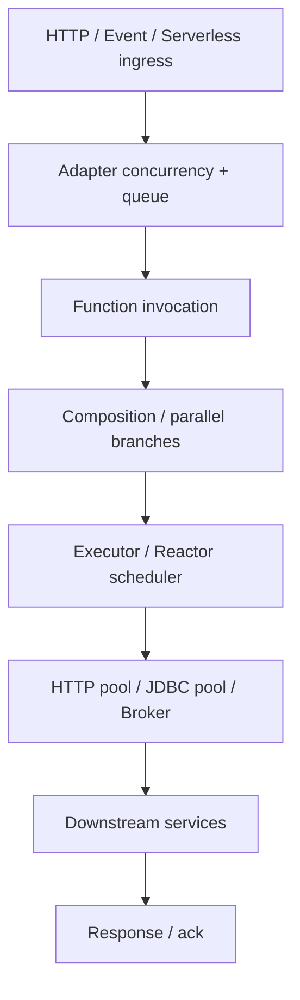
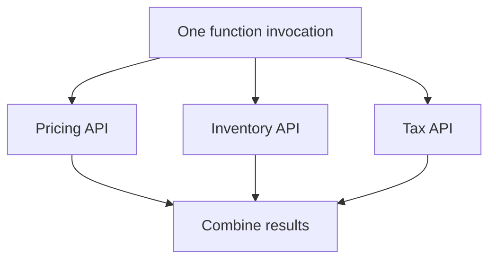

# Điều chỉnh song song, bộ nhớ và số kết nối

Spring Cloud Function cho phép viết nghiệp vụ bằng `Supplier<T>`, `Function<I, O>` và `Consumer<T>`, tra cứu qua `FunctionCatalog`, ghép các hàm thành composition và triển khai cùng logic qua HTTP, sự kiện hoặc serverless. Khi lưu lượng tăng, câu hỏi quan trọng không chỉ là một function chạy mất bao lâu, mà là **bao nhiêu invocation có thể chạy cùng lúc, mỗi invocation giữ bao nhiêu bộ nhớ và tổng số kết nối mà cả hệ thống tạo ra là bao nhiêu**.

Ba giới hạn này liên hệ chặt chẽ:

- **Concurrency** quyết định số công việc đang hoạt động đồng thời.
- **Memory budget** quyết định hệ thống có thể giữ bao nhiêu request, response, buffer và task đang chờ.
- **Connection budget** quyết định số socket/connection đến database, HTTP service và broker mà downstream có thể chịu được.

Tăng concurrency mà không tính bộ nhớ có thể gây GC pressure hoặc `OutOfMemoryError`. Tăng số thread mà không tính connection pool có thể chỉ tạo thêm hàng đợi. Tăng connection pool trên mọi replica có thể làm database hoặc API downstream quá tải. Vì vậy, bài học này xây dựng cách **đặt ngân sách xuyên suốt từ adapter đến function và resource bên ngoài**.

Sau bài học, bạn có thể:

1. Phân biệt concurrency ở ingress, adapter, function pipeline, executor và connection pool.
2. Giới hạn invocation và tác vụ con bằng thread pool, virtual threads, Reactor operators và binder settings phù hợp.
3. Ước lượng heap cho request đang xử lý, queue, batch, payload và response.
4. Tính tổng connection budget khi có nhiều replicas, autoscaling và rolling deployment.
5. Dùng Little's Law để ước lượng in-flight work và nhận biết giới hạn của công thức.
6. Áp dụng bounded queue, backpressure, load shedding và timeout thay vì giữ vô hạn công việc chờ.
7. Đo throughput, p95/p99, heap, GC, queue depth, thread usage, connection pool và downstream errors.

> **Phạm vi ví dụ:** Java 17+ và Spring Cloud Function trên phiên bản Spring Boot/Spring Framework tương thích. Virtual threads yêu cầu JDK 21+; Reactor và binder APIs phụ thuộc phiên bản. Các con số là giả định để hướng dẫn cách tính, không phải cấu hình mặc định hoặc benchmark đã chạy.

## 1. Ba ngân sách phải được tính cùng nhau

Một request đi qua nhiều tầng:



Ở từng tầng có một loại giới hạn:

| Tầng | Ngân sách | Nếu không giới hạn |
| --- | --- | --- |
| Ingress | Số request/event được nhận đồng thời | Request dồn vào server hoặc broker |
| Adapter | Worker threads, prefetch, poller, request queue | Queue tăng, latency tăng |
| Function | Số invocation chạy đồng thời | Singleton state bị tranh chấp, heap tăng |
| Composition | Số nhánh/tác vụ con chạy song song | Một request nhân nhiều downstream calls |
| Executor/scheduler | Threads và queue tasks | Thread starvation hoặc task backlog |
| Connection pool | HTTP/JDBC connections | Pool wait, timeout hoặc quá tải downstream |
| Memory | Heap/direct buffers và per-request retained data | GC thrashing, OOM |

**Không có một con số concurrency duy nhất cho toàn ứng dụng.** Ví dụ HTTP server có thể nhận 200 request, nhưng chỉ cho 20 request vào function; mỗi function có thể gọi 3 API song song; HTTP pool lại chỉ có 30 connections. Mỗi con số kiểm soát một phần khác nhau của tải.

### Phân biệt các loại concurrency

- **Request concurrency:** số request đầu vào đang được xử lý hoặc chờ xử lý.
- **Function concurrency:** số lần thực thi logic function cùng lúc.
- **Inner concurrency:** số tác vụ con của một invocation, ví dụ ba API gọi bằng `flatMap`.
- **Thread concurrency:** số công việc đang chiếm platform/virtual threads hoặc scheduler workers.
- **Connection concurrency:** số kết nối đang được dùng đến một destination.

Một invocation reactive có thể không giữ một thread trong suốt thời gian chờ I/O, nhưng vẫn giữ **request state, publisher state, buffers và connection lease**. Non-blocking không có nghĩa là không tốn bộ nhớ.

## 2. Function bean không tự giới hạn số lần gọi đồng thời

Spring thường quản lý function bean ở singleton scope. Một bean:

```java
@Bean
public Function<QuoteRequest, QuoteResult> quote() {
    return request -> calculate(request);
}
```

có thể được gọi từ nhiều threads hoặc subscriptions tùy adapter và runtime. Việc đăng ký function trong `FunctionCatalog` **không tự đặt concurrency bằng một** và cũng không tự tạo một thread cho mỗi invocation.

Concurrency thực tế đến từ đường gọi:

| Đường triển khai | Nơi cần kiểm tra |
| --- | --- |
| HTTP servlet | Server request threads, connection limit, accept queue và ingress proxy |
| HTTP reactive | Event loops, reactive subscriptions, downstream concurrency |
| Spring Cloud Stream | Binder consumer concurrency, partition/consumer model, prefetch và poller |
| Serverless | Số execution environments, concurrency limit của platform, parallelism trong một environment |
| Gọi trực tiếp qua Java | Executor/caller và cách function được schedule |

**Không suy ra số function invocations từ số bean.** Một bean singleton có thể phục vụ nhiều invocation đồng thời; logic phải stateless hoặc quản lý trạng thái chia sẻ bằng cơ chế concurrency-safe.

## 3. Đặt concurrency budget từ tải cần phục vụ

Trước khi chỉnh cấu hình, xác định:

- Throughput mục tiêu (request/second hoặc event/second).
- Latency budget, đặc biệt p95/p99.
- Thời gian xử lý trung bình và phân phối thời gian chờ downstream.
- Số replicas ở steady state và lúc autoscaling/rolling deployment.
- Capacity của database, HTTP APIs và broker.
- Heap/container memory limit và phần dành cho JVM/runtime.

### Little's Law: ước lượng số request đang in-flight

Trong trạng thái ổn định:

\[
L = \lambda \times W
\]

Trong đó:

- `L`: số công việc đang ở trong hệ thống trung bình.
- `λ`: throughput trung bình (request/giây).
- `W`: thời gian trung bình trong hệ thống (giây).

Ví dụ, function xử lý **120 request/giây** và mỗi request ở trong đoạn đo trung bình **0,25 giây**:

\[
L = 120 \times 0.25 = 30
\]

Hệ thống có khoảng **30 request in-flight trung bình** ở đoạn đo đó.

Đây là giá trị trung bình, **không phải cấu hình concurrency tối đa**. Traffic burst, p95/p99, retry, số replicas và downstream capacity vẫn phải được xem xét. Dùng p95 thay cho W trung bình có thể giúp xây kịch bản bảo thủ, nhưng không còn là áp dụng trực tiếp Little's Law với cùng ý nghĩa thống kê.

### Phân bổ giữa nhiều replicas

Nếu có 6 replicas và mục tiêu 120 request/giây toàn hệ thống, throughput trung bình trên mỗi replica là:

\[
\lambda_{\mathrm{instance}} = \frac{120}{6} = 20
\]

Nếu thời gian trung bình trong function là 250 ms:

\[
L_{\mathrm{instance}} = 20 \times 0.25 = 5
\]

Khoảng 5 request in-flight trung bình mỗi replica trong điều kiện phân phối tải đều. Không nên đặt concurrency tối đa bằng đúng 5; cần headroom cho burst và sai lệch phân phối, nhưng headroom phải nằm trong memory/connection budgets.

## 4. Bắt đầu từ giới hạn downstream

Giả sử function gọi:

- Một pricing API có capacity an toàn 80 requests đồng thời.
- Một database có ngân sách 60 connections dành cho ứng dụng này.
- Một broker consumer group có 12 partitions đang được xử lý.

Concurrency tổng thể không thể được quyết định chỉ từ số CPU hoặc số HTTP worker threads. Nếu mỗi function invocation gọi pricing API một lần và database một lần, số invocations đang thực hiện hai bước có thể bị giới hạn bởi downstream nhỏ hơn; hai bước có thể diễn ra tuần tự hoặc song song.

Nếu mỗi invocation gọi **ba pricing APIs song song**, 30 invocations có thể tạo ra tối đa 90 inner calls trong một đợt. Vì vậy cần tính **fan-out factor**:

\[
C_{\mathrm{downstream}} \approx
C_{\mathrm{invocations}} \times F
\]

Trong đó `F` là số calls đồng thời tối đa tới destination trên mỗi invocation. Đây là ước lượng trần; thời gian overlap và điều khiển concurrency có thể làm số thực thấp hơn.

### Đừng cấu hình độc lập từng tầng

| Cấu hình | Ví dụ | Câu hỏi phải trả lời |
| --- | --- | --- |
| HTTP ingress | 200 requests | Có thể giữ 200 request bodies trong heap không? |
| Function concurrency | 40 invocations | Mỗi invocation có fan-out bao nhiêu? |
| Reactive flatMap | 8 inner calls | 40 invocations có thể tạo 320 inner calls không? |
| HTTP pool | 32 connections | Những calls còn lại chờ ở đâu, trong bao lâu? |
| Database pool | 10 connections | Có bao nhiêu invocation chờ DB? |
| Queue | 500 pending items | 500 items giữ bao nhiêu bytes? |

Giới hạn ở một tầng không tự bảo vệ tầng khác. Ví dụ `flatMap(..., 8)` chỉ giới hạn inner subscriptions trong một pipeline; nếu 40 pipeline chạy đồng thời thì tổng lý thuyết vẫn có thể lên đến 320.

## 5. Thread pool và executor: giới hạn cả threads lẫn queue

Với code imperative, executor có thể điều khiển số task chạy và số task chờ. Một cấu hình có queue không giới hạn có thể khiến hệ thống nhận tải nhanh hơn khả năng xử lý, giữ request objects trong heap và tăng latency.

Ví dụ tạo executor có giới hạn:

```java
package demo.performance;

import java.util.concurrent.ThreadPoolExecutor;

import org.springframework.context.annotation.Bean;
import org.springframework.context.annotation.Configuration;
import org.springframework.scheduling.concurrent.ThreadPoolTaskExecutor;

@Configuration
public class ExecutionConfiguration {

    @Bean("quoteExecutor")
    public ThreadPoolTaskExecutor quoteExecutor() {
        ThreadPoolTaskExecutor executor =
            new ThreadPoolTaskExecutor();
        executor.setCorePoolSize(8);
        executor.setMaxPoolSize(16);
        executor.setQueueCapacity(64);
        executor.setThreadNamePrefix("quote-");
        executor.setRejectedExecutionHandler(
            new ThreadPoolExecutor.AbortPolicy()
        );
        executor.setWaitForTasksToCompleteOnShutdown(true);
        executor.setAwaitTerminationSeconds(10);
        return executor;
    }
}
```

Các giá trị 8/16/64/10 chỉ minh họa. `ThreadPoolTaskExecutor` cần được dùng thật ở boundary thích hợp, ví dụ khi submit task hoặc trong integration có executor; **chỉ khai báo bean này không tự chuyển mọi Spring Cloud Function invocation sang executor đó**.

### Core, max và queue có ý nghĩa khác nhau

- `corePoolSize`: số worker nền tảng được giữ theo policy executor.
- `maxPoolSize`: giới hạn số platform threads có thể được tạo khi queue đã đầy, tùy executor policy.
- `queueCapacity`: số task được giữ chờ.
- `RejectedExecutionHandler`: hành vi khi không còn worker/queue capacity.

Với `ThreadPoolExecutor` và queue hữu hạn, task thường được queue sau khi core workers bận; chỉ khi queue đầy mới mở rộng vượt core đến max. Nếu queue capacity lớn, max pool có thể ít khi được dùng.

### Chọn chính sách khi quá tải

| Chính sách | Hành vi | Trade-off |
| --- | --- | --- |
| Abort/reject | Từ chối task mới | Caller/adapter cần ánh xạ thành lỗi có kiểm soát |
| Caller-runs | Caller tự chạy task | Có thể tạo backpressure, nhưng có thể block request/event thread |
| Discard | Bỏ task | Chỉ phù hợp với tác vụ có thể mất và contract cho phép |
| Discard-oldest | Bỏ task cũ nhất trong queue | Có thể mất công việc quan trọng hoặc sai thứ tự |

Không dùng discard cho order/payment/audit event nếu chưa có cơ chế lưu bền và xác nhận rõ. Load shedding phải là **quyết định nghiệp vụ có chủ đích**, không phải cách che lỗi.

## 6. Virtual threads không xóa connection budget

JDK 21+ hỗ trợ virtual threads. Trong Spring Boot phiên bản tương thích, có thể bật:

```yaml
spring:
  threads:
    virtual:
      enabled: true
```

Virtual threads giảm chi phí giữ platform thread trong nhiều tác vụ blocking, nhưng:

- Không tăng số connections database mà database chịu được.
- Không tăng rate limit của HTTP downstream.
- Không làm một SDK blocking có throughput vô hạn.
- Không loại bỏ heap state của mỗi request.
- Không thay thế giới hạn queue, deadline và load shedding.

Nếu có 1.000 virtual threads cùng chờ một JDBC pool 20 connections, tối đa khoảng 20 connections có thể thực hiện database work đồng thời; phần còn lại có thể chờ. Nếu request body và context của 1.000 invocation vẫn được giữ, heap vẫn chịu chi phí đó.

**Virtual threads là cách thực thi, không phải ngân sách tài nguyên downstream.**

## 7. Reactive concurrency: flatMap, prefetch và backpressure

Với Reactor, `flatMap` có tham số concurrency để giới hạn số inner publishers đang hoạt động:

```java
Flux<QuoteResult> results = requests.flatMap(
    request -> pricingClient.quote(request),
    8
);
```

Con số 8 giới hạn inner publishers của **một subscription**. Nếu có 25 subscriptions đồng thời, số inner calls lý thuyết có thể đạt:

\[
25 \times 8 = 200
\]

Nếu pricing service chỉ chịu được 80 calls đồng thời, phải giảm concurrency ở mỗi pipeline hoặc giới hạn tổng số pipeline đang chạy.

### Concurrency và prefetch không giống nhau

Một overload Reactor có thể nhận cả `concurrency` và `prefetch`:

```java
Flux<QuoteResult> results = requests.flatMap(
    request -> pricingClient.quote(request),
    8,   // max inner subscriptions
    1    // prefetch per inner publisher
);
```

- **Concurrency** điều khiển số inner publishers được subscribe đồng thời.
- **Prefetch** điều khiển số elements được yêu cầu/buffer trước trong các inner publishers theo operator semantics.

Prefetch lớn có thể tăng throughput trong một số pipeline nhưng cũng tăng buffering và memory. Không tăng prefetch theo cảm giác; đo queue, allocation và latency.

### Chọn operator theo semantics

| Operator | Concurrency/order | Khi dùng |
| --- | --- | --- |
| `map` | Đồng bộ theo signal, không tạo async concurrency | Biến đổi nhanh |
| `concatMap` | Một inner publisher mỗi lần, giữ thứ tự | Cần tuần tự hoặc bảo toàn thứ tự |
| `flatMap(mapper, n)` | Tối đa n inner publishers, kết quả có thể đảo thứ tự | I/O độc lập |
| `flatMapSequential(mapper, n)` | Xử lý đồng thời nhưng phát kết quả theo thứ tự nguồn | Cần concurrency và ordering |
| `buffer(n)` | Gom tối đa n elements thành batch | Downstream hỗ trợ batch |

Reactive Streams backpressure giúp publisher/subscriber phối hợp demand, nhưng **không tự đảm bảo mọi queue bên ngoài đều bounded**. Adapter, broker, executor và network client có policy riêng.

## 8. Broker concurrency và prefetch phải theo partition/capacity

Với Spring Cloud Stream, consumer concurrency phụ thuộc binder và loại broker. Ví dụ một số binder hỗ trợ property:

```yaml
spring:
  cloud:
    stream:
      bindings:
        processOrder-in-0:
          consumer:
            concurrency: 4
```

Tên binding `processOrder-in-0` phải khớp function/binding thực tế. Property và hiệu lực cụ thể cần đối chiếu phiên bản Spring Cloud Stream và binder đang dùng.

### Kafka và partitions

Trong Kafka, mức concurrency hữu ích của một consumer group bị ràng buộc bởi số partitions có thể phân phối cho consumers. Nếu có 4 partitions mà cấu hình 12 consumer threads, một số consumers có thể idle vì không có partition được gán. Tăng concurrency không tự tăng số partitions hoặc throughput của một partition.

### RabbitMQ và prefetch

Với Rabbit binder, prefetch ảnh hưởng số unacknowledged messages có thể được giao cho consumer. Prefetch lớn có thể tăng throughput nhưng cũng giữ nhiều messages trong memory và ảnh hưởng fairness/rebalancing. Tên property và default phụ thuộc binder version/configuration; kiểm tra tài liệu tương ứng.

### Xác định tổng in-flight events

Nếu có 4 consumer instances, mỗi consumer xử lý 8 messages đồng thời và mỗi message có fan-out 3 API calls:

\[
4 \times 8 \times 3 = 96
\]

Có thể có tối đa khoảng 96 API calls in-flight trong trường hợp overlap tối đa. Đây là lý do broker concurrency phải được tính cùng downstream HTTP pool và API capacity.

## 9. Memory budget bắt đầu từ mỗi invocation

Một invocation không chỉ giữ payload gốc. Nó có thể giữ:

- HTTP body bytes hoặc broker payload.
- DTO sau deserialize.
- Các object trung gian trong validation/composition.
- Response DTO/serialized bytes.
- Message headers, tracing context và request-scoped data.
- Closures/publishers, buffers và retry state.
- Các object do function tạo trong quá trình xử lý.

Vì vậy, cần đo **retained memory trung bình trên một in-flight invocation**, không chỉ nhìn kích thước JSON trên wire.

### Công thức ước lượng đơn giản

\[
M_{\mathrm{inflight}} \approx
C \times S_{\mathrm{retained}}
\]

Trong đó `C` là số invocations đang giữ state đồng thời, `S_retained` là lượng heap/direct memory giữ lại trung bình trên mỗi invocation theo ranh giới đo.

Ví dụ một request JSON 64 KiB sau khi decode tạo DTO graph, buffers và response với tổng retained footprint đo được khoảng 300 KiB; nếu có 400 invocations:

\[
400 \times 300\ \mathrm{KiB}
= 120{,}000\ \mathrm{KiB}
\approx 117.2\ \mathrm{MiB}
\]

Đây là ước lượng theo giả định 300 KiB/invocation, **không phải hệ số chuyển đổi chung từ JSON sang heap**. Object headers, collection capacity, strings, alignment và lifetime làm footprint thay đổi.

### Đừng dùng heap tối đa làm ngân sách request

Heap còn phải chứa Spring ApplicationContext, singleton beans, caches, connection/client state, queues, background jobs và GC headroom. Ngoài heap còn có direct buffers, metaspace, thread stacks, native memory và memory do container runtime tính. `-Xmx` không phải toàn bộ container memory.

## 10. Tính memory budget và giới hạn in-flight work

Một cách lập ngân sách:

```text
Container memory limit
  ├─ JVM heap budget (-Xmx)
  │    ├─ baseline live set (Spring/context/caches)
  │    ├─ per-request retained objects
  │    ├─ pending queues / batch buffers
  │    └─ GC headroom
  ├─ metaspace + code cache
  ├─ direct/native buffers
  ├─ thread stacks
  └─ native libraries / runtime overhead
```

Ví dụ một ứng dụng có:

| Hạng mục | Ngân sách minh họa |
| --- | ---: |
| Container memory limit | 1.536 MiB |
| JVM heap max | 1.024 MiB |
| Baseline live heap sau warm-up | 420 MiB |
| Reserve cho GC/headroom | 180 MiB |
| Heap còn lại cho biến thiên | 424 MiB |

Nếu mỗi in-flight request giữ trung bình 256 KiB:

\[
C_{\mathrm{memory}} =
\frac{424 \times 1024\ \mathrm{KiB}}{256\ \mathrm{KiB}}
= 1696
\]

Giới hạn lý thuyết theo phép chia này khoảng 1.696 invocations. **Không nên cấu hình concurrency bằng con số đó**: ví dụ chưa tính peak payload, variance, temporary allocations, native/direct buffers và downstream constraints. Thực tế cần headroom và đo peak retained memory.

### Ước lượng bằng phép đo

1. Warm ứng dụng và giữ baseline.
2. Gửi request có kiểm soát, giữ chúng in-flight (ví dụ downstream test server cố ý delay).
3. Quan sát heap histogram/JFR/GC logs hoặc heap dump trong môi trường test.
4. So sánh live set trước và trong tải.
5. Lặp với payload nhỏ/lớn, số line khác nhau và response khác nhau.
6. Tách retained objects khỏi temporary allocations nếu công cụ cho phép.

Một phép chia heap delta cho số request chỉ là **ước lượng sơ bộ** nếu request không có lifetime và object graph đồng nhất.

## 11. Queue capacity cũng là memory capacity

Queue giữ task hoặc message chưa được xử lý. Nếu mỗi task giữ request body 128 KiB và queue chứa 1.000 task:

\[
M_{\mathrm{queue}} \approx
1000 \times 128\ \mathrm{KiB}
= 125\ \mathrm{MiB}
\]

Đây chỉ tính payload ước lượng, chưa gồm object graph, queue nodes, headers và metadata.

### Queue dài không làm hệ thống xử lý nhanh hơn

Nếu arrival rate lâu dài cao hơn service rate:

\[
\lambda_{\mathrm{in}} > \mu_{\mathrm{out}}
\]

backlog sẽ tăng nếu không có load shedding, autoscaling hoặc giảm tốc nguồn. Queue lớn có thể hấp thụ burst ngắn, nhưng không sửa được tình trạng quá tải kéo dài. Queue wait tăng, request hết deadline trước khi được xử lý, memory bị giữ lâu và GC tăng.

### Bounded queue và load shedding

Một queue có capacity rõ giúp hệ thống có điểm từ chối hoặc điều tiết. Tùy loại nghiệp vụ:

- HTTP có thể trả 429/503 với retry guidance phù hợp.
- Event consumer có thể giảm prefetch/pause consumption hoặc để broker giữ backlog bền vững.
- Batch có thể hoãn lô tiếp theo.
- Tác vụ có thể mất (ví dụ metric sampling) mới được cân nhắc drop theo policy.

Không âm thầm drop đơn hàng, thanh toán hoặc audit events. Với message bền vững, ưu tiên để broker giữ backlog và consumer kiểm soát tốc độ theo semantics của binder.

## 12. Batch size là trade-off giữa throughput và memory

Batch có thể giảm số lần gọi database/broker/HTTP nếu downstream hỗ trợ bulk API. Nhưng batch lớn tăng lượng dữ liệu giữ trong heap và có thể tăng tail latency.

| Batch size | Lợi ích có thể | Chi phí/rủi ro |
| --- | --- | --- |
| Nhỏ | Latency thấp, ít memory | Nhiều calls/round trips |
| Vừa | Amortize network/serialization overhead | Cần tune theo payload và downstream |
| Rất lớn | Có thể tăng throughput bulk | Heap spike, timeout, retry cả lô, partial failure phức tạp |

Với Reactor:

```java
Flux<List<QuoteRequest>> batches = requests.buffer(100);
```

Mỗi batch tối đa 100 elements khi stream phát đủ phần tử. Nếu downstream cần giới hạn thời gian gom batch, dùng API buffer theo size/time của Reactor phù hợp với phiên bản.

Khi dùng batch, giới hạn cả số phần tử và tổng byte size nếu payload biến động; xác định partial failure/retry semantics; tránh giữ nhiều batches đồng thời vượt memory budget; đo time-to-first-result và p99, không chỉ throughput.

## 13. Connection budget phải tính toàn cụm

Mỗi replica có thể có HTTP pool và JDBC pool riêng. Tổng số connections là tổng của tất cả instances đang sống, kể cả surge trong rolling deployment/autoscaling.

\[
C_{\mathrm{total}} \approx
N_{\mathrm{instances}} \times P_{\mathrm{per-instance}}
\]

Ví dụ:

- 12 replicas steady state.
- Mỗi replica có HTTP pool max 20 connections tới pricing.

\[
12 \times 20 = 240
\]

Ứng dụng có thể tạo tối đa khoảng 240 connections đến pricing API trong điều kiện pool đầy.

Nếu rolling deployment cho phép 4 replicas surge, peak instance count là 16:

\[
16 \times 20 = 320
\]

Do đó downstream phải được kiểm tra theo **peak deployment topology**, không chỉ steady state.

### Tính riêng từng destination

| Destination | Pool mỗi instance | 12 replicas | 4 replicas surge | Peak 16 |
| --- | ---: | ---: | ---: | ---: |
| Pricing HTTP | 20 | 240 | 80 | 320 |
| Inventory HTTP | 8 | 96 | 32 | 128 |
| JDBC database | 6 | 72 | 24 | 96 |

Các con số là ví dụ. HTTP pool, database pool và broker connections là ngân sách riêng; không cộng tất cả rồi cho rằng mọi connection có cùng chi phí hoặc cùng destination.

### Đừng quên các nguồn connection khác

- Health checks và management clients.
- Background jobs/schedulers.
- Migrations và admin sessions.
- Retry/hedged requests nếu được bật.
- Các phiên bản cũ trong rolling deployment.
- Serverless execution environments cùng lúc.
- Những service khác dùng chung downstream.

Database có `max_connections` là giới hạn toàn server; ứng dụng phải dành headroom cho quản trị, failover và clients khác. Không cấu hình mỗi replica bằng một phần lớn của giới hạn database rồi quên nhân theo số replicas.

## 14. Pool size, concurrency và fan-out phải tương thích

Giả sử:

- Function concurrency: 30 invocations.
- Mỗi invocation gọi 2 HTTP APIs song song.
- Mỗi destination có pool 20 connections.

Nếu hai calls đi tới hai hosts khác nhau, mỗi pool có thể nhận 30 calls đồng thời nhưng chỉ có 20 connections, vì vậy phần còn lại chờ pool. Nếu cả hai calls cùng route, nhu cầu có thể lên đến 60 calls cho một pool.

Một quy tắc kiểm tra thô:

\[
C_{\mathrm{outbound}} \le
C_{\mathrm{function}} \times F
\]

Trong đó `F` là số outbound calls đồng thời mỗi invocation. Pool size giới hạn số calls được phục vụ qua connections đồng thời; pending queue giữ phần còn lại.

**Pool size không nhất thiết phải bằng concurrency**: HTTP/2 có multiplexing, call duration khác nhau, destinations khác nhau và request có thể diễn ra tuần tự. Dùng công thức để tìm trần cần kiểm tra, sau đó đo pool wait và downstream.

## 15. Cấu hình HTTP và database pool có chủ đích

Ví dụ cấu hình minh họa:

```yaml
pricing:
  http:
    max-connections: 20
    acquire-timeout: 2s
    response-timeout: 3s

spring:
  datasource:
    hikari:
      maximum-pool-size: 6
      minimum-idle: 2
      connection-timeout: 2000
```

Các property `pricing.http.*` là **custom properties của ứng dụng**, không phải property chuẩn tự động được Spring Cloud Function hiểu. Cần bind chúng vào cấu hình HTTP client và connection provider. Hikari `connection-timeout` tính bằng milliseconds; các giá trị phải được đối chiếu với version và downstream SLA.

### Các nguyên tắc

- Một pool riêng cho mỗi destination khi cần isolation và capacity khác nhau.
- Không tạo pool mới mỗi invocation.
- Đặt acquisition timeout để pool exhaustion không giữ request vô hạn.
- Hạn chế pending queue và concurrency trước khi tăng max connections.
- Tính tổng connections qua peak replica count.
- Với database, giữ pool dưới budget được database cấp cho service.
- Theo dõi active/idle/pending và connection acquisition latency.

Nếu ứng dụng dùng auto-configuration client của Spring Boot, xem lại resource lifecycle để không vô tình tạo hai pools cho cùng destination.

## 16. Backpressure, rate limiting và load shedding

Ba cơ chế có mục đích khác nhau:

| Cơ chế | Tác dụng |
| --- | --- |
| Backpressure | Điều tiết demand giữa publisher/subscriber có hỗ trợ Reactive Streams |
| Rate limiting | Giới hạn tốc độ requests/events theo thời gian |
| Load shedding | Từ chối hoặc bỏ tải theo policy khi hệ thống quá tải |

Backpressure không thay rate limit ở biên HTTP hoặc quota của downstream. Rate limit không tự giới hạn heap của queue nếu queue vẫn nhận vô hạn. Load shedding cần phân biệt nghiệp vụ có thể từ chối và công việc phải lưu bền.

### Ví dụ bounded buffer

```java
Flux<QuoteRequest> bounded = requests
    .onBackpressureBuffer(
        500,
        dropped -> recordOverflow(dropped)
    );
```

Đây là ví dụ Reactor minh họa buffer có capacity hữu hạn; overload behavior của overload/API cụ thể cần đối chiếu Reactor version. Khi buffer đầy, cần chọn rõ chính sách overflow (error/drop/latest) và ghi nhận metric. Không dùng drop cho nghiệp vụ không thể mất.

### Rate limit theo downstream

Nếu pricing API cho phép 100 calls/second, một app có 10 replicas không nên mỗi replica tự đặt 100 calls/second rồi tạo tổng 1.000 calls/second. Có thể phân bổ quota theo instance, dùng distributed rate limiter nếu cần quota toàn cụm, để gateway/downstream enforce quota, và điều chỉnh concurrency/retry để không vượt budget.

## 17. Fan-out và composition có thể nhân tải

Composition tuyến tính:

```text
validate → enrich → calculate → render
```

thường truyền output của bước trước vào bước sau. Nhưng một function có thể fan-out tới nhiều destinations:



Nếu mỗi invocation gọi ba APIs đồng thời và có 40 invocations, tổng in-flight downstream calls có thể đạt 120. Nếu mỗi call có retry, tổng attempt count còn tăng thêm.

### Tính fan-out có điều kiện

- Chỉ gọi destination khi dữ liệu nghiệp vụ cần.
- Cache dữ liệu reference có TTL và giới hạn kích thước nếu phù hợp.
- Giới hạn concurrency theo từng destination, không chỉ một con số toàn function.
- Dùng deadline tổng và timeout riêng cho từng call.
- Tránh retry đồng thời ở nhiều tầng.
- Kết hợp kết quả theo semantics rõ ràng khi một nhánh lỗi.

## 18. Autoscaling không thay cho resource budgeting

Autoscaling tăng số replicas khi tải tăng. Nhưng nếu mỗi replica có pool 20 connections, scale từ 5 lên 30 replicas sẽ tăng trần HTTP connections từ 100 lên 600.

Khi autoscaling:

1. Tính peak replicas, không chỉ desired replicas.
2. Tính connection pools và background workers trên mỗi replica.
3. Xem downstream có scale theo kịp không.
4. Giới hạn max replicas theo database/API capacity.
5. Xem startup surge và rolling update overlap.
6. Đặt scale-down grace period để xử lý in-flight work và đóng resource.

Nếu autoscaler chỉ dựa CPU, workload I/O-bound có thể có CPU thấp nhưng queue/pending connections cao. Có thể cần thêm metrics queue depth, request latency hoặc consumer lag tùy platform.

### Serverless cũng có instance multiplier

Serverless có thể tạo nhiều execution environments song song. Mỗi environment có Spring context, HTTP clients và pool riêng. Giới hạn concurrency của platform cần được tính vào:

\[
C_{\mathrm{connections}} \approx
N_{\mathrm{active\ environments}} \times P
\]

Không giả định một static client hoặc singleton bean được chia sẻ giữa các environments độc lập.

## 19. Đo và giám sát các ngân sách

Một dashboard hiệu năng nên có ít nhất:

| Nhóm | Metric |
| --- | --- |
| Traffic | Requests/events per second, active requests |
| Latency | p50, p95, p99, queue wait, downstream duration |
| Function | Invocation count, active executions, failures |
| Threads | Active platform threads, virtual thread count nếu cần, executor queue |
| Reactive | Event-loop utilization, pending subscriptions, operator/buffer signals |
| Memory | Heap used/committed, live set, allocation rate, GC pause |
| Queues | Queue depth, oldest item age, rejected tasks, consumer lag |
| HTTP pool | Active, idle, pending, acquire timeout, new connections |
| JDBC pool | Active, idle, pending, acquisition timeouts |
| Downstream | 429/5xx, response latency, timeout, retry attempts |

Không đưa user ID, order ID hoặc URL tùy ý vào metric tags vì high cardinality làm tăng memory/CPU ở monitoring backend.

### Phân biệt queue wait và service time

\[
T_{\mathrm{total}} =
T_{\mathrm{queue}} + T_{\mathrm{service}}
\]

Nếu service time ổn định nhưng p99 tăng, queue wait có thể là nguyên nhân. Chỉ tối ưu code function sẽ không giải quyết được nếu request đang chờ executor hoặc connection pool trước khi function tiếp tục.

### Quan sát memory và GC

- Dùng JFR/GC logs hoặc profiler trong môi trường test/production có kiểm soát.
- Quan sát allocation rate và live set, không chỉ heap used tại một thời điểm.
- Theo dõi container RSS và direct memory bên cạnh heap.
- Xác định queue nào đang giữ request objects lâu.
- Dùng heap dump khi cần tìm retained paths, xử lý dữ liệu nhạy cảm theo quy định.

## 20. Kịch bản thực hành: thiết kế budget cho Order Function

Giả sử một service xử lý order:

- 8 replicas steady state, có thể surge thêm 2.
- Throughput mục tiêu 160 orders/second.
- Thời gian trung bình trong function 200 ms.
- Mỗi order gọi pricing một lần và inventory một lần.
- HTTP pool pricing tối đa 12/replica; inventory tối đa 8/replica.
- JDBC pool tối đa 6/replica.
- Heap max mỗi instance 1 GiB.
- Baseline live heap 400 MiB; reserve 200 MiB.
- Retained memory ước lượng 200 KiB/order in-flight.

### Bước 1: Ước lượng in-flight trung bình toàn cụm

\[
L = 160 \times 0.2 = 32
\]

Khoảng 32 orders in-flight trung bình nếu tải ổn định và thời gian đo là 200 ms.

### Bước 2: Chia theo steady replicas

\[
L_{\mathrm{instance}} = \frac{32}{8} = 4
\]

Khoảng 4 orders in-flight trung bình mỗi replica trong điều kiện phân phối đều.

### Bước 3: Tính connection ceilings

Peak instances = 8 + 2 = 10.

| Destination | Pool/instance | Peak connection ceiling |
| --- | ---: | ---: |
| Pricing | 12 | 120 |
| Inventory | 8 | 80 |
| JDBC | 6 | 60 |

Các ceilings này phải được downstream cấp capacity; nếu không, pool values cần giảm hoặc max replicas cần giới hạn.

### Bước 4: Ước lượng heap biến thiên

Với 200 KiB/order và 4 orders in-flight trung bình mỗi replica:

\[
4 \times 200\ \mathrm{KiB} = 800\ \mathrm{KiB}
\]

Đây là lượng retained request state trung bình theo giả định, rất nhỏ so với heap 1 GiB. Nhưng nếu burst khiến 300 orders in-flight mỗi replica:

\[
300 \times 200\ \mathrm{KiB}
= 60{,}000\ \mathrm{KiB}
\approx 58.6\ \mathrm{MiB}
\]

Vẫn phải cộng queues, temporary allocations, caches, thread stacks và native/direct memory; không kết luận chỉ từ phép tính này rằng mọi burst đều an toàn.

### Bước 5: Chọn điểm bắt đầu và đo

- Bắt đầu với function concurrency vừa phải, không vượt capacity của downstream.
- Giữ pool theo budget database/pricing/inventory.
- Queue bounded và có reject/slowdown policy.
- Load test steady state, burst và downstream degradation.
- Điều chỉnh từng biến, theo dõi p99, queue wait, heap/GC và pool pending.

Các số trong kịch bản là giả định học tập. Khi áp dụng, thay bằng measurements và capacity limits thật.

## 21. Các lỗi điều chỉnh thường gặp

| Triệu chứng | Nguyên nhân có thể | Hướng xử lý |
| --- | --- | --- |
| CPU thấp nhưng latency cao | Chờ connection, queue hoặc downstream | Đo queue wait/pool acquisition |
| Heap tăng liên tục dưới tải | Queue không bounded hoặc retained request state | Giới hạn in-flight, queue, batch |
| GC pause tăng khi tăng concurrency | Nhiều DTO/buffers/request objects cùng sống | Giảm concurrency, payload/batch, profile allocation |
| Database connection exhausted | Pool per replica nhân với max replicas | Tính peak instance budget |
| HTTP pool pending cao | Function fan-out lớn hơn pool/downstream | Giảm fan-out/concurrency hoặc điều chỉnh pool có căn cứ |
| Thêm threads nhưng throughput không tăng | Downstream hoặc CPU đã bão hòa | Profile bottleneck và đặt bulkhead |
| Reactive app OOM | Buffer/prefetch/flatMap/queue quá lớn | Bounded operators và đo retained memory |
| Broker lag tăng dù consumer concurrency cao | Partitions, downstream hoặc processing time là giới hạn | Kiểm tra partition assignment và service time |
| Autoscaling làm database lỗi | Mỗi replica tạo pool riêng | Giới hạn max replicas và pool size |
| p50 tốt nhưng p99 xấu | Queueing, burst, GC hoặc retry | Theo dõi tail và queue age |
| Rejected tasks tăng | Executor queue/thread capacity đã đầy | Load shed, giảm upstream hoặc tăng capacity có kiểm chứng |
| Retry làm downstream quá tải hơn | Retry storm và nhiều tầng retry | Retry budget, backoff, jitter, circuit breaker |
| Virtual threads tăng nhưng DB không nhanh | Connection pool vẫn giới hạn | Điều chỉnh DB concurrency theo capacity |

### Sáu câu hỏi trước khi tăng một giới hạn

1. Tầng nào đang bão hòa: ingress, function, executor, pool hay downstream?
2. Tăng giới hạn có làm tăng memory retained hoặc queue depth không?
3. Tổng resource budget qua peak replicas là bao nhiêu?
4. Downstream có thực sự chịu được concurrency mới không?
5. p95/p99 và error rate có cải thiện hay chỉ throughput?
6. Khi quá tải, hệ thống từ chối/điều tiết hay giữ vô hạn công việc chờ?

## 22. Bài tập thực hành

**Bài 1 — Little's Law.** Một function hoàn thành trung bình 100 requests/giây; mỗi request ở trong hệ thống 300 ms. In-flight trung bình ước lượng bao nhiêu?

*Đáp án:* `L = 100 × 0,3 = 30` requests. Đây là trung bình theo trạng thái ổn định, không phải max concurrency.

**Bài 2 — Fan-out.** Có 20 function invocations đồng thời; mỗi invocation gọi 3 APIs song song. Tổng inner calls tối đa lý thuyết là bao nhiêu?

*Đáp án:* `20 × 3 = 60` calls, trước khi tính pool/adapter limits và thời gian overlap.

**Bài 3 — Reactive subscriptions.** Một pipeline có `flatMap(..., 8)` và 25 subscriptions đang chạy. Tổng inner concurrency lý thuyết có thể đạt bao nhiêu?

*Đáp án:* `25 × 8 = 200` inner publishers. Tham số 8 không phải giới hạn toàn process.

**Bài 4 — Connection budget.** 10 replicas, mỗi replica có JDBC pool max 12. Trần connection cấu hình từ ứng dụng là bao nhiêu?

*Đáp án:* `10 × 12 = 120` connections, chưa tính rolling surge, migrations và clients khác.

**Bài 5 — Memory queue.** Queue có 800 tasks, mỗi task giữ trung bình 96 KiB payload. Payload-only memory xấp xỉ bao nhiêu?

*Đáp án:* `800 × 96 KiB = 76.800 KiB = 75 MiB`, chưa tính object graph/headers/queue nodes.

**Bài 6 — Virtual threads.** 500 virtual threads cùng gọi database nhưng Hikari pool chỉ có 20 connections. Bao nhiêu query tối đa có thể dùng connection đồng thời từ pool đó?

*Đáp án:* Tối đa khoảng 20 connection-backed operations cùng lúc; các tasks còn lại chờ pool hoặc timeout. Virtual threads không tăng database capacity.

**Bài 7 — Queue overload.** Arrival rate là 150 events/s nhưng consumer xử lý được 100 events/s trong thời gian dài. Backlog thay đổi thế nào nếu không có giới hạn hoặc load shedding?

*Đáp án:* Backlog tăng khoảng 50 events/s trong mô hình đơn giản, và memory/latency có thể tăng cho đến khi có giới hạn hoặc nguồn giảm tải.

**Bài 8 — Prefetch.** Có nên đặt broker prefetch rất lớn để giảm round trips không?

*Đáp án:* Không mặc định. Prefetch lớn giữ nhiều messages unacknowledged trong memory và có thể ảnh hưởng fairness/latency. Đo throughput, heap, queue và ack behavior.

**Bài 9 — Pool per instance.** Một dịch vụ có 12 replicas steady state và 3 surge; HTTP pool max 15. Peak connection ceiling là bao nhiêu?

*Đáp án:* `(12 + 3) × 15 = 225` connections tới destination đó.

**Bài 10 — Batch.** Tăng batch từ 100 lên 10.000 records có chắc tăng hiệu năng không?

*Đáp án:* Không. Có thể giảm round trips nhưng tăng heap, latency chờ đủ batch, retry scope và partial failure. Cần giới hạn byte size và đo.

**Bài 11 — Load shedding.** Executor queue đã đầy trong khi xử lý payment. Có nên dùng DiscardOldestPolicy?

*Đáp án:* Không nếu payment là công việc không thể mất. Cần reject có kiểm soát, lưu bền hoặc điều tiết nguồn theo contract nghiệp vụ.

**Bài 12 — Chẩn đoán.** CPU thấp, heap cao, p99 tăng và HTTP pool pending cao. Nên tăng CPU trước không?

*Đáp án:* Chưa. Dấu hiệu gợi ý queue/pool/downstream wait và retained request state. Đo acquisition time, pending count, queue age, downstream latency và memory retained trước.

## 23. Ghi nhớ

- **Concurrency, memory và connections là ba ngân sách liên kết**, phải tính từ ingress qua function, composition, executor và downstream.
- **Function bean singleton không tự giới hạn concurrency**; adapter/runtime quyết định số invocation và code phải thread-safe.
- **Little's Law `L = λW` ước lượng in-flight trung bình**, không phải giá trị max concurrency hoặc pool size.
- **Thread pool và queue đều cần giới hạn**; queue dài chỉ giữ công việc lâu hơn, không làm service rate tăng.
- **Reactive flatMap concurrency chỉ giới hạn một subscription/pipeline**, cần nhân với số invocations/replicas và fan-out.
- **Virtual threads không tăng capacity của JDBC/HTTP downstream** và không loại bỏ memory per-request.
- **Memory budget phải tính request/response object graphs, queues, batches, buffers và GC headroom**, không chỉ JSON bytes trên wire.
- **Connection budget là pool-per-instance nhân với peak replicas**, bao gồm autoscaling và rolling deployment surge.
- **Backpressure, rate limiting và load shedding có vai trò khác nhau**; không drop nghiệp vụ quan trọng.
- **Đo p95/p99, queue wait, heap/GC, active/pending connections và error rate** trước khi tăng bất kỳ giới hạn nào.

**Tài liệu tham khảo:**

- [Spring Cloud Function — Reference](https://docs.spring.io/spring-cloud-function/reference/)
- [Spring Cloud Stream — Consumer Properties](https://docs.spring.io/spring-cloud-stream/reference/spring-cloud-stream/binding-properties.html)
- [Project Reactor — Reference Guide](https://projectreactor.io/docs/core/release/reference/)
- [Reactive Streams — Specification](https://www.reactive-streams.org/)
- [Spring Framework — Task Execution and Scheduling](https://docs.spring.io/spring-framework/reference/integration/scheduling.html)
- [Spring Boot — Virtual Threads](https://docs.spring.io/spring-boot/reference/features/spring-application.html)
- [HikariCP — Pool Sizing](https://github.com/brettwooldridge/HikariCP/wiki/About-Pool-Sizing)
- [Micrometer — JVM Metrics](https://docs.micrometer.io/micrometer/reference/reference/jvm.html)

Các con số trong ví dụ là giả định để hướng dẫn cách tính, không phải cấu hình chuẩn. Khi triển khai, thay bằng tải đo được, giới hạn của downstream, peak replicas và memory footprint thực tế; xác nhận API theo phiên bản Spring Cloud Function, binder, Spring Boot và Reactor đang dùng.
